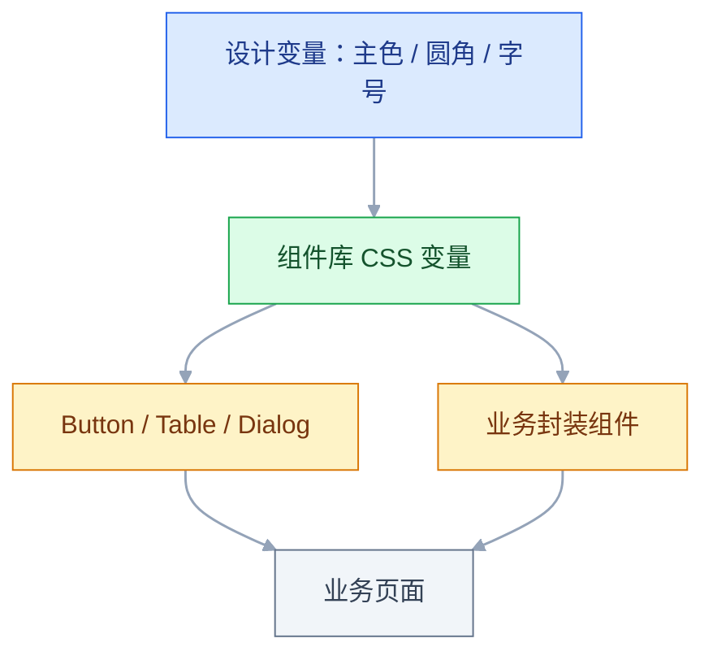
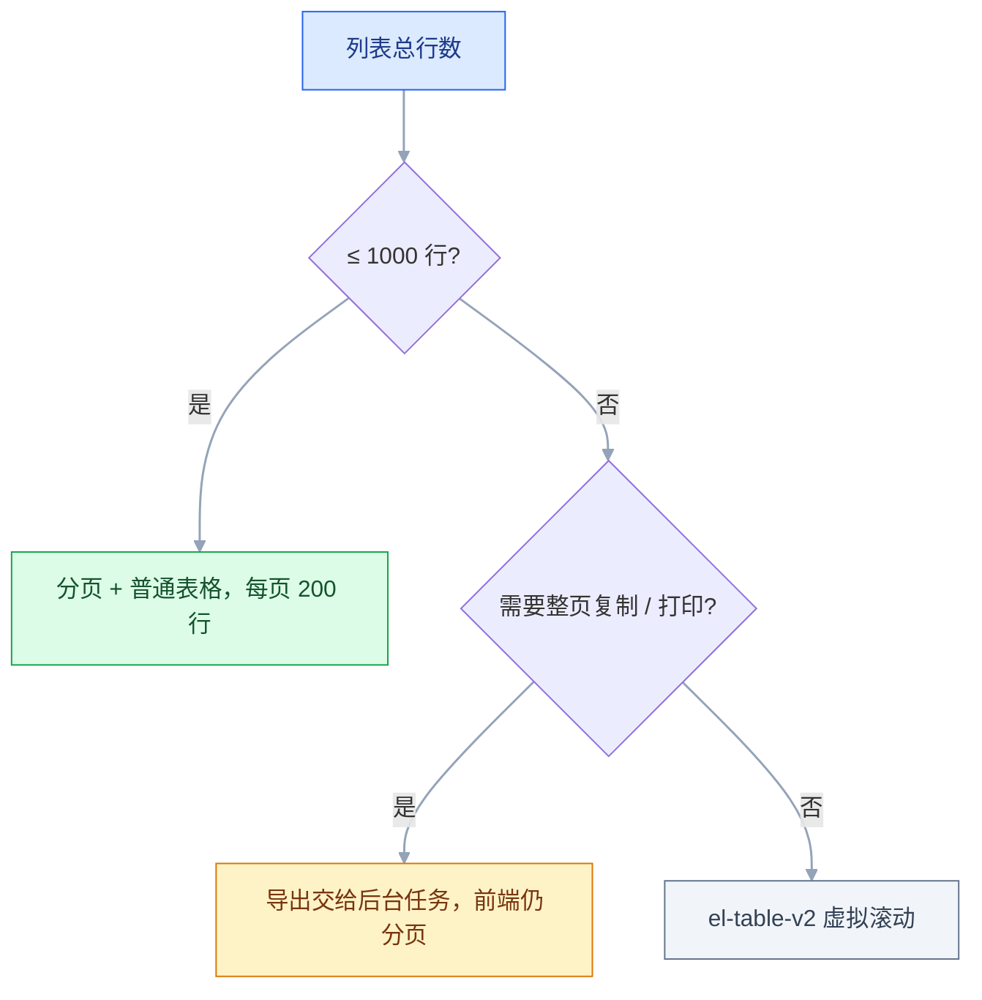

# UI 组件库

## 一、工程案例：给中后台定组件库选型与二次封装规范

**场景**：一个 30 人的研发团队维护三套中后台，前端 6 人。现状是 Element Plus、Ant Design、手写组件混用，同一个「删除确认」有四种写法，主色改一次要动 40 个文件；表格页每页 200 行、10 列，翻页时明显卡顿。要求三个月内统一到一套组件库，并给出业务组件的封装规范。

**约束**：

| 约束 | 具体内容 |
|---|---|
| 技术栈 | Vue 3 + TypeScript，存量有两套 Vue 2 |
| 人力 | 6 人，只能用业务迭代的间隙做 |
| 兼容 | 存量页面不能停，迁移按路由逐个替换 |
| 体积 | 首屏 JS 预算 300 KB（gzip 前） |
| 设计 | 设计稿有自己的主色、圆角、间距，不接受默认皮肤 |

**产出**：一份选型对比表、一套按需引入配置、一套主题变量文件、`BaseTable` 与 `FormDialog` 两个业务封装，以及一张验收表。落到仓库里就是这几个文件：

```text
vite.config.ts                          # 按需引入插件
src/styles/theme.css                    # 主题变量
src/components/base/BaseTable.vue       # 表格封装
src/components/base/FormDialog.vue      # 表单弹窗封装
docs/ui-acceptance.md                   # 1.7 的验收表
```

命令：`npm run dev` 起本地验证，`npm run build` 出产物记体积。

### 1.1 先定选型标准，再看库

不要按「哪个好看」投票，按可验证的指标打分：

| 维度 | 权重 | 怎么验 |
|---|---|---|
| 与框架匹配 | 高 | 官方是否支持 Vue 3 / React 18+，是否有长期维护（以官方当前稳定版为准） |
| 组件覆盖 | 高 | 列出业务必需的 15 个组件，逐个查文档 |
| 主题能力 | 高 | 能否只改变量换主色、圆角、字号 |
| 按需引入 | 高 | 构建后看首屏包体 |
| 表格性能 | 中 | 200 行 × 10 列翻页是否掉帧 |
| 可访问性 | 中 | 弹窗焦点锁定、ESC 关闭、键盘操作 |
| 升级成本 | 中 | 近两年是否有破坏性大版本 |

业务必需的 15 个组件先列死，选型才可验收：`Button`、`Input`、`Select`、`Form`、`Table`、`Pagination`、`Dialog`、`Drawer`、`Tabs`、`DatePicker`、`Upload`、`Tree`、`Cascader`、`Message`、`Menu`。15 个里缺一个，就记一次扣分，而不是用「基本够用」糊过去。

**结论**（示例，按团队实际打分）：Vue 侧选 Element Plus，React 侧选 Ant Design；新项目不再引入第三套。shadcn/ui 这类「复制源码到项目里」的方案适合设计高度定制的产品，但要求团队自己维护组件代码。

存量两套 Vue 2 不做整体重写：过渡期继续用 Element UI，按路由把页面逐个迁到 Vue 3 + Element Plus，替换完一套下线一套，别让「统一组件库」变成一次性重写。

### 1.2 按需引入

Vue 3 + Vite 用插件自动按需注册：

```bash
npm i element-plus
npm i -D unplugin-vue-components unplugin-auto-import
```

```typescript
// vite.config.ts（省略 defineConfig、vue 插件的 import）
import AutoImport from 'unplugin-auto-import/vite';
import Components from 'unplugin-vue-components/vite';
import { ElementPlusResolver } from 'unplugin-vue-components/resolvers';

export default defineConfig({
  plugins: [
    vue(),
    AutoImport({ resolvers: [ElementPlusResolver()] }),
    Components({ resolvers: [ElementPlusResolver()] }),
  ],
});
```

样式跟随组件按需加载，不再全量 `import 'element-plus/dist/index.css'`。插件按标签名解析组件，`v-loading` 这类指令由 resolver 的 `directives` 选项处理，默认开启；不确定时在产物里搜一次有没有 `ElLoadingDirective` 的注册代码。

**例外**：`ElMessage`、`ElMessageBox`、`ElLoading` 的**服务式调用**（`ElMessage.success(...)`）不在模板里，函数本身能由 AutoImport 的 resolver 补上 import，但对应样式不会自动带上，需要手动引或在 `main.ts` 统一注册一次。

```typescript
// main.ts：函数式组件的样式单独引
import 'element-plus/theme-chalk/el-message.css';
import 'element-plus/theme-chalk/el-message-box.css';
import 'element-plus/theme-chalk/el-loading.css';
```

**验收**：构建后对比 `dist/assets` 里 CSS 体积；全量引入通常是几百 KB，按需后应显著下降。具体数字以项目构建结果为准。

```bash
npm run build
du -ch dist/assets/*.css | tail -1   # 改按需配置前后各跑一次
```

### 1.3 主题变量：只改一层，不碰组件内部

Element Plus 的主题是一组 CSS 变量，覆盖在 `:root` 即可：

```css
/* src/styles/theme.css */
:root {
  --el-color-primary: #2563eb;
  --el-color-primary-light-3: #60a5fa;
  --el-color-primary-light-5: #93c5fd;
  --el-color-primary-light-7: #bfdbfe;
  --el-color-primary-light-8: #dbeafe;
  --el-color-primary-light-9: #eff6ff;
  --el-color-primary-dark-2: #1d4ed8;

  --el-border-radius-base: 6px;
  --el-font-size-base: 14px;
  --el-text-color-primary: #0f172a;
  --el-text-color-regular: #334155;
}
```

派生色是主色和白色按比例混合出来的，只改主色不改派生色，hover、选中、禁用、浅底会各露一块默认蓝。用 SCSS 时可以让 `mix()` 生成，避免手写漏项。



**禁止**的做法：在业务页面里用 `:deep()` 改组件内部结构。组件升级后类名一变，样式全崩，而且没人知道影响面。

```css
/* 不要这样：依赖组件内部类名 */
.user-table :deep(.el-table__cell) { padding: 4px 0; }
```

```vue
<!-- 需要密度控制时，用组件自己的属性或统一封装 -->
<el-table :row-style="{ height: '36px' }" size="small" />
```

### 1.4 业务封装一：BaseTable

每个列表页都重复写「加载中、空状态、分页、序号、操作列宽度」，封一层：

```vue
<!-- src/components/base/BaseTable.vue -->
<script setup lang="ts" generic="T extends Record<string, any>">
withDefaults(defineProps<{
  data: T[];
  loading?: boolean;
  total?: number;
  page?: number;
  pageSize?: number;
  rowKey?: string;
}>(), { loading: false, total: 0, page: 1, pageSize: 20, rowKey: 'id' });

const emit = defineEmits<{
  'update:page': [value: number];
  'update:pageSize': [value: number];
  'change': [];
}>();
</script>

<template>
  <div class="base-table">
    <el-table v-loading="loading" :data="data" :row-key="rowKey" stripe>
      <slot />
      <template #empty>
        <el-empty description="暂无数据" :image-size="72" />
      </template>
    </el-table>
    <div class="pager">
      <el-pagination
        :current-page="page"
        :page-size="pageSize"
        :total="total"
        layout="total, sizes, prev, pager, next"
        @update:current-page="emit('update:page', $event); emit('change')"
        @update:page-size="emit('update:pageSize', $event); emit('change')"
      />
    </div>
  </div>
</template>
```

`generic` 属性需要 Vue 3.3+，低版本去掉泛型、把 `data` 写成 `any[]` 即可，以项目锁定的 Vue 版本为准。

**封装原则**：只收敛重复的**结构与行为**，不收敛业务列。列定义仍由页面用插槽写，否则 BaseTable 会变成一个参数超过 30 个的怪物。空状态必须走表格的 `#empty` 插槽，别再在表格下面追加一个 `el-empty`，否则表格内置的空文案和自定义空态会同时出现。

### 1.5 业务封装二：FormDialog

新增和编辑共用一个弹窗，重复点在「打开前重置、提交时校验、提交中禁用」：

```vue
<!-- src/components/base/FormDialog.vue -->
<script setup lang="ts">
import { ref, watch } from 'vue';
import type { FormInstance, FormRules } from 'element-plus';

const props = defineProps<{
  modelValue: boolean;
  title: string;
  model: Record<string, any>;
  rules?: FormRules;
  width?: string;
  /** 传入后由弹窗托管 loading 与关闭时机；不传则退回 emit('submit') */
  submit?: () => Promise<void>;
}>();
const emit = defineEmits<{
  'update:modelValue': [value: boolean];
  'submit': [];
}>();

const formRef = ref<FormInstance>();
const submitting = ref(false);

watch(() => props.modelValue, (open) => {
  if (open) formRef.value?.clearValidate();
});

async function onConfirm() {
  const ok = await formRef.value?.validate().catch(() => false);
  if (!ok) return;
  if (!props.submit) {
    emit('submit');
    return;
  }
  submitting.value = true;
  try {
    await props.submit();
    emit('update:modelValue', false);
  } catch {
    /* 失败保持打开，提示交给请求层或全局拦截器 */
  } finally {
    submitting.value = false;
  }
}
</script>

<template>
  <el-dialog
    :model-value="modelValue"
    :title="title"
    :width="width ?? '560px'"
    :close-on-click-modal="false"
    @update:model-value="emit('update:modelValue', $event)"
  >
    <el-form ref="formRef" :model="model" :rules="rules" label-width="90px">
      <slot />
    </el-form>
    <template #footer>
      <el-button :disabled="submitting" @click="emit('update:modelValue', false)">取消</el-button>
      <el-button type="primary" :loading="submitting" @click="onConfirm">确定</el-button>
    </template>
  </el-dialog>
</template>
```

父组件只需传一个返回 Promise 的 `submit`，弹窗自己等结果、成功后关闭、失败留在原地：

```vue
<!-- src/views/user/UserList.vue 片段 -->
<script setup lang="ts">
import { reactive } from 'vue';
import FormDialog from '@/components/base/FormDialog.vue';
import { saveUser } from '@/api/user';

const dialog = reactive({ open: false, id: '' });
const form = reactive({ name: '', email: '' });
const rules = { name: [{ required: true, message: '请输入姓名', trigger: 'blur' }] };

function openCreate() {
  dialog.id = '';
  Object.assign(form, { name: '', email: '' }); // 打开前显式重置
  dialog.open = true;
}

async function save() {
  await saveUser({ ...form, id: dialog.id }); // 抛错则弹窗不关
  // 成功后刷新列表：调用页面自己的 loadList()
}
</script>

<template>
  <el-button type="primary" @click="openCreate">新增用户</el-button>

  <FormDialog
    v-model="dialog.open"
    :title="dialog.id ? '编辑用户' : '新增用户'"
    :model="form"
    :rules="rules"
    :submit="save"
  >
    <el-form-item label="姓名" prop="name">
      <el-input v-model="form.name" />
    </el-form-item>
  </FormDialog>
</template>
```

**注意**：不传 `submit` 时，`submit` 事件是同步 emit，`loading` 一闪而过，关闭时机也落在父组件手里——这就是「请求没完弹窗先关」的来源。封装层重置只负责清校验，业务初始值必须由父组件在打开前赋好。

### 1.6 表格性能：200 行 × 10 列

| 现象 | 原因 | 处理 |
|---|---|---|
| 翻页卡 1 秒 | 每行都用了 `el-tooltip` / `el-select` | 改成纯文本 + 点击编辑 |
| 首屏白很久 | 列里用了 `formatter` 做复杂计算 | 数据加载时预处理一次 |
| 滚动掉帧 | 单元格里有 `el-progress` 动画 | 关闭动画或换成静态色块 |
| 内存涨 | 未使用虚拟滚动，行数上千 | 分页，或换 `el-table-v2` 虚拟滚动 |

先按行数决定渲染方式，再谈调优：



**边界**：虚拟滚动会牺牲「整页复制」「打印」这类能力，后台列表优先分页，超过 1000 行再考虑虚拟滚动。`el-table-v2` 的 API 与普通表格不同（列定义走配置对象、必须给宽高），部分版本仍标注实验性，采用前以官方当前稳定版为准。

### 1.7 验收

| 检查项 | 怎么验 | 通过标准 |
|---|---|---|
| 组件覆盖 | 对照业务必需的 15 个组件 | 15 个全部有官方实现或封装 |
| 按需引入 | `npm run build` 后看产物里 CSS/JS 清单 | 只出现实际用到的组件样式，CSS 总体积不到全量引入时的一半 |
| 主题 | 改 `--el-color-primary` 后刷新列表、弹窗、分页 | 主色相关位置同步变化，DevTools 里没有残留的默认蓝变量 |
| 业务封装 | 新增一个列表页 | 不重复写分页、空状态、加载态，页面只写列定义 |
| 表格性能 | 200 行 × 10 列连续翻 10 页，Performance 面板录制 | 单次翻页无超过 50ms 的长任务，操作反馈在 100ms 内 |
| 升级 | 在分支上升一个小版本，跑核心 10 个页面 | 除 CHANGELOG 已列变更外，无样式错位与行为差异 |
| 可访问性 | 只用键盘走完新增流程 | Tab 能进入弹窗、ESC 能关、焦点不跑到遮罩后面 |
| 产物体积 | 对比改造前后的 `dist/assets` 总字节 | 首屏 JS 不超过 300 KB（gzip 前）的预算 |

## 二、高频问答：会卡住你的地方，也是面试最常问的

### 2.1 打包体积比预期大很多

**现场**

构建后看产物里是否出现整包 CSS，再搜 `element-plus/dist` 是否还留在代码里。

**要点**

- 全量引入了组件和样式，或者按需插件没生效。
- 这是引入方式问题，不是选型问题，先确认按需配置真的生效，再谈换库。
- 对比 `dist/assets` 里 CSS 体积，按需后应显著下降。

**追问**

- 怎么快速判断按需生效了？→ 产物里只出现实际用到的组件样式。
- 哪些写法会让按需失效？→ 动态组件名、用字符串拼导入路径。

### 2.2 改了主色，部分地方还是默认蓝

**现场**

DevTools 里看该元素的 `background-color` 最终来自哪个变量。

**要点**

- 组件用的是 `--el-color-primary-light-3` 这类派生色，只改主色没改派生色。
- 主色、浅色 3/5/7/9、深色 2 要成套覆盖，只改一个变量不够。
- 样式加载顺序排在组件库之前，也会被默认值盖掉。

**追问**

- 派生色是怎么来的？→ 主色和白色按比例混合。
- 加 `!important` 行不行？→ 只是压过变量，换主题时又得重来。

### 2.3 弹窗里的表单校验不触发

**现场**

在 `validate()` 的 catch 里打印 `invalidFields`，看哪些字段被识别。

**要点**

- `el-form` 的 `model` 和 `el-form-item` 的 `prop` 没对上。
- 规则挂在错误的路径上，等于没挂。
- `prop` 必须和 `model` 的路径一致，嵌套对象用 `a.b` 形式。

**追问**

- 字段是动态加的为什么也不行？→ 没有重新挂载，规则没生效。
- 怎么确认规则真的挂上了？→ 打印 `invalidFields`，看目标字段在不在。

### 2.4 表格列一多就横向错位

**现场**

缩放窗口或改数据后调用 `doLayout()`，看是否恢复。

**要点**

- 固定列 + `show-overflow-tooltip` + 动态列宽同时使用时，表头和表体宽度计算不同步。
- 这是布局时序问题，不是渲染缺陷。
- 数据变化或容器显隐后，用 `nextTick` 调一次 `tableRef.doLayout()`。

**追问**

- 为什么缩放一下窗口就好了？→ 触发了重新计算。
- 侧边栏收起后错位也一样吗？→ 容器宽度变了但表格没收到通知，同样用 `doLayout()`。

### 2.5 删除确认框写法五花八门

**现场**

全局搜 `ElMessageBox.confirm`，数一下有几种写法。

**要点**

- 没有统一封装，参数、文案、异常处理各写一遍。
- 「能跑」不等于「可维护」。
- 收敛成一个 `confirmDelete()`，统一按钮文案、危险色和取消异常的处理。

**追问**

- 为什么取消也要处理？→ 它返回 rejected Promise，不接就是未捕获异常。
- 封装放在哪一层？→ 组合层，业务页面只传标题和 id。

### 2.6 组件库升级后页面样式全乱

**现场**

对比升级前后的 DOM 结构与类名，再搜项目里 `:deep(` 的数量。

**要点**

- 业务里用了大量 `:deep()` 改内部结构，或依赖了未公开的类名。
- 这是耦合内部实现的代价，不该算在组件库头上。
- 升级前先清理深度选择器，只用公开的 CSS 变量和插槽。

**追问**

- 为什么类名一变就崩？→ 深度选择器直接绑在组件内部结构上。
- 怎么从源头预防？→ 样式只通过变量和公开属性改。

### 2.7 设计稿和组件库长得不一样，逐页改

**现场**

把设计稿的 token 和 `--el-*` 变量列成两张表对比。

**要点**

- 设计稿的间距、圆角、字号没有映射成变量，组件库默认值和设计规范是两套。
- 在页面层解决系统层的问题，只会越改越散。
- 先对齐变量，页面只负责布局。

**追问**

- 为什么不能逐页调？→ 主色改一次要动几十个文件。
- token 和变量怎么对应？→ 一张映射表，组件没暴露的再补组件变量。

### 2.8 按需引入后 `ElMessage` 没样式

**现场**

看 `ElMessage` 弹出的 DOM 是否存在但无样式。

**要点**

- 函数式组件不在模板编译范围，插件不会自动收集它的样式。
- 按需插件管得到 import，管不到样式注入。
- 手动引 `el-message.css`，或在入口统一注册一次。

**追问**

- 还有哪些属于这种情况？→ `ElMessageBox`、`ElLoading` 这类服务式调用。
- 怎么验收？→ 构建后看产物里有没有对应的 CSS。

### 2.9 表单弹窗关闭再打开，还是上次的数据

**现场**

打开时打印 `model`，看是否残留上次的值。

**要点**

- 复用了同一个对象，关闭时没有重置；或用 `v-show` 隐藏，组件从未销毁。
- 这是状态生命周期问题，不是响应式失效。
- 打开前显式赋初始值，或 `:key` 强制重建；重置放 `@closed`。

**追问**

- `@close` 和 `@closed` 有什么区别？→ 前者动画还没结束，后者才走完。
- 开 `destroy-on-close` 能解决吗？→ 能，每次打开都是新实例。

### 2.10 表格操作列按钮太多，挤成两行

**现场**

在 1280 宽度下看操作列是否换行。

**要点**

- 操作超过 3 个时没有做收纳，列宽又固定。
- 缩小字号是用视觉手段掩盖信息架构问题。
- 超过 3 个操作收进「更多」下拉，危险操作单独放。

**追问**

- 为什么危险操作要单独放？→ 避免和常用操作挤在一起被误点。
- 靠横向滚动能解决吗？→ 用户看不见，操作等于不存在。

### 2.11 弹窗里的下拉、日期面板被裁掉或位置错乱

**现场**

看浮层 DOM 的父节点是 `body` 还是弹窗内部；父级存在 `overflow` / `transform` 就是它。

**要点**

- 浮层挂在了带 `overflow: hidden` 或 `transform` 的祖先里，被裁剪，或被困在新层叠上下文中。
- `z-index` 只解决同级堆叠，解决不了裁剪。
- 确认组件默认把浮层传送到 `body` 的开关没被关掉（`teleported`、`append-to-body`）；自研浮层用 `Teleport to="body"`。

**追问**

- 为什么往上加数字没用？→ 父级裁剪掉了，层级再高也看不见。
- 样式怎么带到 `body` 上？→ 用 `popper-class` 指定，别靠 `:deep()`。

## 三、核心知识：从零开始要建立的东西

### 3.1 组件库的职责边界

组件库提供三类东西：视觉样式、交互行为（键盘、焦点、动画）、可访问性属性。它不提供业务规则，也不提供设计规范本身。**边界**：组件库能保证「按钮能点」，不能保证「这个按钮该不该出现」。

### 3.2 主流库的定位差异

| 库 | 框架 | 风格 | 适合 |
|---|---|---|---|
| Element Plus | Vue 3 | 中后台、克制 | 管理系统、快速交付 |
| Ant Design | React | 企业级、规范完整 | 复杂中后台、React 团队 |
| Naive UI | Vue 3 | 轻、TypeScript 友好 | 中小型项目、主题灵活 |
| Arco Design | Vue / React | 字节系、设计资源全 | 有设计团队的产品 |
| MUI | React | Material Design | 面向 C 端、需要 Material 语言 |
| shadcn/ui | React | 源码复制、Tailwind | 高度定制、愿意维护组件源码 |

**取舍**：库越「全」，定制越重时越难改；库越「轻」，业务组件越要自己补。没有普适最优，只有和团队、设计、存量匹配。各库对框架版本的支持范围随版本变化，接入前以官方当前稳定版的文档为准。

### 3.3 全量引入与按需引入

| 方式 | 体积 | 配置 | 适用 |
|---|---|---|---|
| 全量 | 大 | 一行 `app.use` | 原型、内部工具 |
| 按需（插件） | 小 | 构建插件 | 生产项目 |
| 手动按需 | 最小 | 逐个 import + 样式 | 只用少量组件 |

按需的本质是「让构建工具只打包被引用到的模块」。它依赖静态分析，所以动态组件名、`import()` 拼字符串都会让它失效。

> **面试**：常问「按需引入是怎么生效的？」答：构建时静态分析引用到的组件，只打包对应模块；动态组件名会让它失效。

### 3.4 CSS 变量与主题切换

组件库的主题通常分两层：**基础变量**（颜色、圆角、字号）和**组件变量**（某个组件的局部覆盖）。改主题优先改基础变量，其次用组件暴露的属性，最后才是深度选择器。

```css
/* 暗色主题：只覆盖变量，不动组件 */
html.dark {
  --el-bg-color: #0f172a;
  --el-text-color-primary: #e2e8f0;
  --el-border-color: #334155;
}
```

变量切换是运行时的，不需要重新构建；这也是它比 Sass 变量更适合主题切换的原因。

> **面试**：常问「主题切换为什么用 CSS 变量而不是 Sass 变量？」答：CSS 变量运行时可改，Sass 变量在构建时就被替换掉了。

### 3.5 组件封装的分层

| 层 | 内容 | 例子 |
|---|---|---|
| 基础层 | 组件库原样 | `el-button` |
| 组合层 | 把多个基础组件拼成固定结构 | 搜索栏、分页表格 |
| 业务层 | 带业务语义和接口调用 | 用户选择器、订单状态标签 |

封装只往上加一层，不要让业务层直接改基础层。**边界**：组合层超过 10 个 props 时，说明抽象错了，应该拆成插槽。

### 3.6 插槽与作用域

组件库的表格、下拉、弹窗都依赖插槽扩展。默认插槽负责内容，具名插槽负责结构（`header`、`footer`、`empty`），作用域插槽把行数据、当前项传回调用方。

```vue
<el-table :data="rows">
  <el-table-column label="状态">
    <template #default="{ row }">
      <el-tag :type="row.enabled ? 'success' : 'info'">
        {{ row.enabled ? '启用' : '停用' }}
      </el-tag>
    </template>
  </el-table-column>
</el-table>
```

### 3.7 表单组件的受控模式

组件库的输入组件大多支持 `v-model`，本质是 `modelValue` + `update:modelValue`。自定义封装时必须同时支持这两个方向，否则父组件的值改不进来。

**常见坑**：封装时只 `emit` 不接收，或者对 `props.modelValue` 直接赋值（Vue 会警告）。正确做法是本地 ref 同步，或直接用 `computed` 的 getter/setter。

### 3.8 表格的数据驱动模型

表格由三样东西决定：数据源、列定义、行 key。列定义决定渲染结构，行 key 决定复用与选中状态。**行 key 必须稳定**，用索引会导致排序、删除后选中错位。

```vue
<el-table :data="rows" row-key="id" @selection-change="onSelect" />
```

### 3.9 弹窗的生命周期

弹窗的打开、关闭、销毁是三个不同状态。`v-model` 控制显隐，`destroy-on-close` 控制关闭后是否销毁内容，`@closed` 在关闭动画结束后触发。**需要重置表单时用 `@closed`**：此时收起动画已经走完，不会在收起过程中看到表单闪一下；不要在 `@close` 里做，那一刻动画还没结束。开了 `destroy-on-close` 则每次打开都是新实例，重置交给初始值即可。

> **面试**：常问「弹窗里重置表单该放在哪个钩子？」答：`@closed`，关闭动画结束后再重置，不会看到表单闪一下。

### 3.10 消息与通知的调用方式

| 类型 | 调用 | 等待结果 | 适用 |
|---|---|---|---|
| Message | 函数调用 | 不需要 | 操作结果提示 |
| MessageBox | 函数调用，返回 Promise | 需要 await | 二次确认 |
| Notification | 函数调用 | 不需要 | 系统通知、带标题 |
| Loading | 服务或指令 | 关闭句柄 | 长任务遮罩 |

函数式组件不依赖父组件，但也不受组件树控制，且直接操作 `document`，只能在客户端调用。

### 3.11 图标体系

图标通常单独成包（如 `@element-plus/icons-vue`），在模板里按需 import 使用，别整包全局注册。**边界**：图标是字体还是 SVG 会影响渲染与打包，图标数量大时优先 SVG 按需引入。

### 3.12 国际化与文案

组件库自带文案（分页「共 100 条」、日期面板、上传提示）需要通过 locale 覆盖：Vue 侧用 `ElConfigProvider` 包住根组件传 `locale`，React 侧用 `ConfigProvider`。业务文案和组件文案要分开管理，不要在一个文件里混着改。

### 3.13 属性与事件透传

二次封装时，没有在 `props` / `emits` 里声明的属性和事件会落到组件根元素上。想精确控制透传目标，就关掉默认继承，手动绑定：

```vue
<script setup lang="ts">
defineOptions({ inheritAttrs: false });
</script>

<template>
  <el-input v-bind="$attrs" />
</template>
```

`$attrs` 里含 `class`、`style` 和监听器，一次 `v-bind` 带过去。`defineOptions` 需要 Vue 3.3+，低版本改用 `export default { inheritAttrs: false }` 与 `<script setup>` 并存。**边界**：`v-model` 会被拆成 `modelValue` 和 `update:modelValue`，声明过就被本层消费，不会留在 `$attrs` 里，必须显式往下传。

### 3.14 升级与锁定版本

| 策略 | 做法 | 风险 |
|---|---|---|
| 锁死 | 固定版本，不升级 | 漏洞与兼容问题累积 |
| 跟随补丁 | `~` 或只升 patch，先读 CHANGELOG | 仍需回归，但变更面小 |
| 跟随大版本 | 读 migration guide 后升级 | 破坏性变更，工作量大 |

生产项目用 `^` 锁大版本并提交 lockfile，补丁版本定期升；跨大版本单独开分支回归。**边界**：组件库的破坏性变更通常集中在样式变量名、事件参数、插槽名，升级前先搜这三类用法；具体变更以官方当前稳定版的 migration guide 为准。

## 四、冷门知识汇总

| 知识点 | 为什么冷门 | 用到时的关键词 |
|---|---|---|
| `doLayout()` | 只在表格宽度异常时才需要手动调用 | 表格错位、侧边栏收起 |
| `destroy-on-close` | 弹窗默认不销毁内容，状态会残留 | 弹窗重置、表单残留 |
| `teleported` / `append-to-body` | 浮层默认挂到 `body`，裁剪与作用域都受它影响 | 下拉被裁、样式不生效（见 2.11） |
| 组件的 `size` 继承 | `el-config-provider` 可全局改尺寸 | 全局紧凑模式 |
| 虚拟滚动表格 | 只有大数据量才用，API 与普通表格不同 | 万行数据、卡顿 |
| 表格的 `span-method` | 合并单元格时才用 | 合并行、合并列 |
| 函数式组件的样式 | 按需插件不收集，要手动引 | ElMessage 无样式 |
| `el-form` 的 `scroll-to-error` | 长表单自动滚到第一个错误 | 表单很长、错误看不到 |
| 主题的派生色 | 只改主色不改 light-3/5/7/9 会花 | 主色改了还有蓝色 |
| 组件库的 `namespace` | 微前端下避免样式冲突 | 多应用共存 |
| `Teleport` 与弹窗 | 弹窗默认挂到 body，作用域样式失效 | scoped 样式不生效 |
| 图标的按需注册 | 图标包全量注册会增加体积 | 首屏体积、图标很多 |
| SSR 下的 `window` / `document` | 组件库在模块顶层访问浏览器 API 才会暴露 | window is not defined、预渲染报错 |
