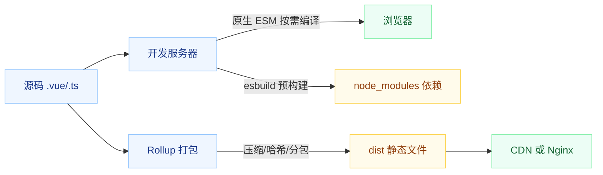

# Vite构建与部署

> 这篇从构建器在交付链上的职责讲起，经过 ESM 模块解析、`vite.config` 结构、静态资源处理、生产构建与分包、产物分析，最后落到 Nginx、容器部署和线上排障。
>
> 学完能独立把一个 Vue 3 项目配置成可分析、可分包、可部署、出问题能排查的产物。

## 一、构建器的职责与 Vite 的边界

构建器只做两件事：开发期把源码按模块喂给浏览器，交付期把源码压成浏览器一次能加载完的静态文件。其余工作——类型检查、规范检查、测试——不属于构建器。

源码里的 `.vue`、`.ts`、`import x from 'lodash-es'` 浏览器都不认。开发期必须有人把单文件组件（Single-File Component，SFC）编译成 JavaScript、把 TypeScript 剥掉类型、把裸模块名（bare import）解析成真实路径；交付期还要合并请求、压缩代码、按内容哈希命名，让 CDN 能长期缓存。

Vite 把这两段拆开实现：



两段用的是不同引擎：开发期靠浏览器原生 ESM 加 esbuild 预构建，生产期靠 Rollup 做完整打包。这解释了一个常见困惑：`vite dev` 秒开，`vite build` 却要几十秒——开发期根本没打包全量代码。

| 任务 | 工具 | 是否构建器负责 |
|---|---|---|
| SFC/TS 转译 | Vite 内置 esbuild | 是 |
| 依赖预构建 | Vite（esbuild） | 是 |
| 打包、压缩、哈希 | Rollup | 是 |
| 类型检查 | `vue-tsc` | 否，需单独脚本 |
| 规范检查 | ESLint | 否 |
| 单元测试 | Vitest | 否 |

```json
{
  "scripts": {
    "dev": "vite",
    "build": "vue-tsc -b && vite build",
    "typecheck": "vue-tsc --noEmit",
    "preview": "vite preview"
  }
}
```

`build` 里把 `vue-tsc` 放在前面，是因为 esbuild 只删类型、不查类型：类型写错也能构建成功，必须让 `vue-tsc` 先失败，CI 才拦得住。

### 1.1 什么情况下继续用 Webpack

存量项目不需要为了“新”而迁移。三种情况留在 Webpack 或改用 Rspack：

- 构建链里有自研 loader，且短期无法改写；
- 依赖 Webpack 特有的能力，例如复杂 `require.context` 组合、老版本 Module Federation 运行时；
- 需要兼容 IE 或非常老的浏览器内核，Vite 产物是 ESM，不支持 `nomodule` 降级。

新项目、以 Vue 3 / React 19 为主的项目，默认选 Vite。迁移的中间态通常是 Rspack：配置接口与 Webpack 兼容，构建速度接近 Vite，改动量比换 Vite 小。

> 边界：Vite 的生产产物是原生 ESM。目标浏览器必须支持 `<script type="module">` 和动态 `import()`；Vite 7 默认目标已经是 Chrome 107 / Safari 16 这一档。需要支持更老的浏览器，只能换构建器或加一层转译，不能靠改 `target` 解决。

## 二、环境准备与最小构建

Node 22 LTS + pnpm 10 + Vite 7 是 2026 年 Vue 3 项目的默认组合。Node 低于 20.19 或 22.12，Vite 7 无法启动。

### 2.1 安装 Node 与 pnpm

Ubuntu / Debian：

```bash
# NodeSource 源比发行版自带的 Node 版本新，Vite 7 需要 20.19+
curl -fsSL https://deb.nodesource.com/setup_22.x | sudo -E bash -
sudo apt install -y nodejs
node -v   # v22.23.4
```

Rocky / CentOS：

```bash
curl -fsSL https://rpm.nodesource.com/setup_22.x | sudo bash -
sudo dnf install -y nodejs
```

macOS：

```bash
brew install node@22
```

Windows：用 `winget install OpenJS.NodeJS.LTS`，或从 nodejs.org 下载 MSI。装完在 PowerShell 里验证 `node -v`。

pnpm 用 Corepack 启用，避免全局安装带来的版本漂移：

```bash
corepack enable pnpm
corepack prepare pnpm@10.19.0 --activate
pnpm -v   # 10.19.0
```

`package.json` 里固定 `packageManager` 字段后，Corepack 会按项目切版本，团队里不会出现各人版本不一致的问题。

```json
{
  "packageManager": "pnpm@10.19.0",
  "engines": { "node": ">=22.12.0" }
}
```

### 2.2 创建项目并跑通最小闭环

```bash
pnpm create vite@latest admin --template vue-ts
cd admin
pnpm install
pnpm dev
```

预期输出（端口被占用时会自动 +1）：

```text
  VITE v7.3.8  ready in 412 ms

  ➜  Local:   http://localhost:5173/
  ➜  Network: use --host to expose
  ➜  press h + enter to show help
```

三个命令各自验证一件事：

```bash
pnpm dev       # 开发服务器能起，改文件能热更新
pnpm build     # 产物能生成，类型检查能过
pnpm preview   # 产物能被静态服务器正确托管
```

`vite preview` 默认监听 `4173`，它只用于验证产物，不用于生产：

```text
  ➜  Local:   http://localhost:4173/
```

### 2.3 版本基线

| 组件 | 版本 | 说明 |
|---|---|---|
| Node | 22.x LTS | Vite 7 要求 ≥ 20.19 或 ≥ 22.12 |
| pnpm | 10.x | Corepack 管理 |
| Vite | 7.3.x | 生产构建用 Rollup 4 |
| Vue | 3.5.x | 主线技术栈 |
| TypeScript | 5.9.x | 由 esbuild 转译，`vue-tsc` 检查 |

> 边界：不要用 `npm install -g vite`。全局 Vite 会绕过项目的 `packageManager` 和插件版本，出现“命令行能构建、CI 不能”的分裂。始终用 `pnpm exec vite` 或 `package.json` 脚本。

## 三、ESM 与模块解析

Vite 7 的 Node API 只提供 ESM，配置文件必须能被 `import` 加载。项目 `package.json` 不写 `"type": "module"` 时，配置文件要用 `vite.config.mts`，否则会报 `ERR_REQUIRE_ESM`。

```json
{
  "type": "module"
}
```

### 3.1 裸模块名怎么变成真实路径

浏览器只认相对路径和绝对 URL，`import { createApp } from 'vue'` 必须由构建器解析。解析规则写在依赖的 `exports` 字段里：

```json
{
  "name": "some-lib",
  "exports": {
    ".": {
      "types": "./dist/index.d.ts",
      "import": "./dist/index.mjs",
      "require": "./dist/index.cjs"
    },
    "./utils": "./dist/utils.mjs"
  }
}
```

Vite 优先取 `import` 条件，所以同一个库在 Vite 里走 ESM 产物，在老的 CommonJS 工具链里走 CJS 产物。库作者只写 `main` 不写 `exports` 时，Vite 只能按 `main` 猜，深层导入 `some-lib/dist/x` 也可能被拦截。

开发期 Vite 还会做依赖预构建（dependency pre-bundling）：把 `lodash-es` 这种几百个小文件的包合并成一个 ESM 文件，避免浏览器发几百个请求。

```bash
# 依赖变更后强制重建预构建缓存
pnpm exec vite --force
```

预构建缓存在 `node_modules/.vite/deps`，删除该目录等同于 `--force`。出现“改了依赖没生效”“页面报 `does not provide an export named`”时，先删缓存再重启。

### 3.2 生产产物也是 ESM

`vite build` 输出的是 ESM。入口 HTML 里是：

```html
<script type="module" crossorigin src="/assets/index-BEfZq1Yw.js"></script>
<link rel="modulepreload" crossorigin href="/assets/vendor-CAwYcE0h.js">
```

`crossorigin` 是必须的：静态资源和页面不同源（CDN）时，模块脚本按 CORS 规则加载，缺这个属性会直接失败。`modulepreload` 让浏览器提前并行抓取静态依赖，减少瀑布。

`build.target` 决定语法降级程度。Vite 7 默认 `baseline-widely-available`（Chrome 107 / Edge 107 / Firefox 104 / Safari 16）：

```ts
// vite.config.ts
export default defineConfig({
  build: {
    // 明确写出来，别让默认值随 Vite 升级而漂移
    target: 'es2022',
  },
})
```

写 `es2022` 而不是 `es2015`：语法降级越多，产物越大、运行越慢；目标浏览器已经支持 `es2022` 时没有理由再降。

### 3.3 import.meta 的三种用法

`import.meta` 是 ESM 的元信息对象，Vite 在它上面挂了环境和资源能力。

```ts
// 1. 环境变量，只有 VITE_ 前缀会被注入
const base = import.meta.env.VITE_API_BASE
const isProd = import.meta.env.PROD

// 2. 批量导入：构建期展开成静态 import，不能拼变量
const pages = import.meta.glob('./views/*.vue')
for (const [file, component] of Object.entries(pages)) {
  const path = file.replace('./views', '').replace('.vue', '')
  router.addRoute({ path, component })
}

// 3. 资源 URL：由构建器重写为带哈希的产物路径
const logo = new URL('./assets/logo.svg', import.meta.url).href
```

`import.meta.glob` 必须是字面量参数。写成 `` import.meta.glob(`./views/${name}.vue`) `` 会直接报错，因为构建期无法枚举。需要动态路径时改用 `import(/* @vite-ignore */ path)`，但那会失去预加载和哈希。

> 边界：`import.meta.env` 在构建期被替换成字面量。`import.meta.env.VITE_API_BASE` 不能写在运行时才求值的字符串模板里做“换环境”，换环境必须重新构建，或改用运行时配置（见第八节）。

## 四、vite.config 的结构与常用选项

配置文件用函数形式，才能按 `mode` 分支，且只在需要时加载插件。对象形式在配置复杂后会出现“开发和生产的插件同时生效”。

```ts
import { fileURLToPath, URL } from 'node:url'
import { defineConfig, loadEnv } from 'vite'
import vue from '@vitejs/plugin-vue'

export default defineConfig(({ mode }) => {
  // 第三个参数传 '' 才会加载全部变量，默认只加载 VITE_ 前缀
  const env = loadEnv(mode, process.cwd(), '')

  return {
    plugins: [vue()],
    resolve: {
      alias: {
        // 用 URL 而不是 __dirname：ESM 配置里没有 __dirname
        '@': fileURLToPath(new URL('./src', import.meta.url)),
      },
    },
    define: {
      // 构建期替换，避免运行时拼接；值必须是 JSON 字符串化的字面量
      __BUILD_TIME__: JSON.stringify(new Date().toISOString()),
    },
    server: {
      port: 5173,
      proxy: {
        '/api': {
          target: env.API_ORIGIN || 'http://127.0.0.1:8080',
          changeOrigin: true,
          // 只在开发期去掉前缀，生产由 Nginx 负责同样的事
          rewrite: (path) => path.replace(/^\/api/, ''),
        },
      },
    },
    build: {
      sourcemap: 'hidden',
      chunkSizeWarningLimit: 600,
    },
  }
})
```

| 选项 | 用途 | 最容易错在哪 |
|---|---|---|
| `base` | 部署子路径 | 只改 `base` 不改路由 `base`，刷新 404 |
| `resolve.alias` | 路径别名 | 只配 Vite，没配 `tsconfig.paths`，编辑器报错 |
| `server.proxy` | 开发期跨域 | 生产环境忘了配 Nginx 同路径 |
| `define` | 编译期常量 | 直接传对象，未 `JSON.stringify` |
| `envDir` | 环境文件目录 | monorepo 里默认读不到根目录 `.env` |

### 4.1 环境文件的加载顺序

Vite 按 `mode` 叠加加载，后面的覆盖前面的：

```text
.env                # 所有模式共用
.env.local          # 本地覆盖，加入 .gitignore
.env.production     # 仅 production
.env.production.local
```

```bash
# 构建 staging 包，读取 .env.staging
pnpm exec vite build --mode staging
```

```ini
# .env.production
VITE_API_BASE=https://api.example.com
VITE_APP_TITLE=订单后台
```

只有 `VITE_` 前缀的变量会进客户端产物。不加前缀的变量留在 Node 侧，`loadEnv` 能读到，前端代码读不到——这正是防止密钥被打进 JS 的机制。

```ts
// 错误：密钥会被明文写进 dist/assets/*.js
const key = import.meta.env.SECRET_KEY
```

> 边界：任何写进前端产物的变量都等于公开。`VITE_` 只用于接口地址、埋点开关、构建标识这类非敏感值。密钥、签名盐值必须留在服务端，前端通过自己的后端换取短期凭证。

## 五、静态资源与导入方式

资源放在 `src/assets` 还是 `public`，取决于是否需要构建器处理。这一步选错，后面会出现“图片没哈希、改名后 404、子路径部署图片全挂”。

| 目录 | 处理方式 | 适用 |
|---|---|---|
| `src/assets` | 哈希、压缩、可内联 | 组件引用的图片、字体 |
| `public` | 原样拷贝到根 | `favicon.ico`、`robots.txt` |
| `new URL(..., import.meta.url)` | 参与构建，得到 URL | 动态拼接的资源路径 |
| `?url` 后缀 | 强制返回 URL | 需要 URL 字符串的库 |
| `?raw` 后缀 | 返回文件内容字符串 | 模板、SQL、示例代码 |

```ts
// 小于 4KB 的资源被内联成 base64，减少请求
import smallIcon from './assets/icon-16.png'

// 大图返回 URL，不内联
import hero from './assets/hero.webp?url'

// 原样读取文件文本，构建期就确定内容
import schema from './schema.json?raw'

// Web Worker 单独打包，避免阻塞主线程
import Worker from './worker/heavy.worker?worker'
const worker = new Worker()
```

```ts
// vite.config.ts
export default defineConfig({
  build: {
    // 默认 4096；调大有收益也有代价，见下方边界
    assetsInlineLimit: 4096,
  },
})
```

内联的代价是体积翻倍：base64 比原文件大约 33%，且无法被单独缓存。图标这类小文件内联能省请求，超过 4KB 的图内联只会拖慢首屏。

```html
<!-- public 下的文件用绝对路径引用，base 由 Vite 在构建时补上 -->
<link rel="icon" href="/favicon.ico" />
```

`public` 里的文件**不会**被重写路径。部署到 `/admin/` 子路径时，`/favicon.ico` 会指向域名根，正确写法是在模板里用 `%BASE_URL%`：

```html
<link rel="icon" href="%BASE_URL%favicon.ico" />
```

SVG 有两种用法，别混：

```vue
<!-- 当图片：走 ，浏览器缓存友好，无法用 CSS 改颜色 -->


<!-- 当组件：需要跟随主题变色时，用 vite-svg-loader 或 ?component -->
<Logo class="logo" />
```

> 边界：动态拼接的资源路径构建器看不见。`new URL(`./assets/${name}.png`, import.meta.url)` 在 Vite 里会失败或漏打包，必须用 `import.meta.glob('./assets/*.png', { eager: true, query: '?url', import: 'default' })` 建映射表。

## 六、生产构建与分包

分包的目标只有一个：首屏只加载首屏需要的代码。判断标准是打开首页时 Network 面板里 JS 的总传输量，而不是 `dist` 目录的文件个数。

```ts
// vite.config.ts
export default defineConfig({
  build: {
    target: 'es2022',
    // hidden：生成 .map 供 Sentry 上传，但产物里不留引用
    sourcemap: 'hidden',
    cssCodeSplit: true,
    reportCompressedSize: true,
    // 超过阈值才告警；默认 500，管理后台常在 600 左右
    chunkSizeWarningLimit: 600,
  },
})
```

`sourcemap: true` 会把 `//# sourceMappingURL=` 写进产物，等于把源码目录结构公开。对外部署用 `hidden`，再把 `.map` 单独上传到监控平台后删除。

### 6.1 路由级分包

Vue Router 的懒加载就是动态 `import()`，Rollup 会为每个动态入口切一个 chunk：

```ts
const routes = [
  { path: '/', component: () => import('@/views/OrderList.vue') },
  { path: '/detail/:id', component: () => import('@/views/OrderDetail.vue') },
]
```

实测一个 Vue 3.5 + Element Plus 后台，两个懒加载路由，`vite build` 输出：

```text
dist/index.html                          0.32 kB │ gzip:  0.25 kB
dist/assets/OrderDetail-BpDzfuC8.css     3.42 kB │ gzip:  0.61 kB
dist/assets/base-BhyKBIh7.css            7.79 kB │ gzip:  1.96 kB
dist/assets/OrderList-CDRnq5VH.css      37.39 kB │ gzip:  5.32 kB
dist/assets/OrderDetail-D_tJlOB3.js      5.24 kB │ gzip:  2.20 kB
dist/assets/base-B2UL198h.js            20.06 kB │ gzip:  8.33 kB
dist/assets/index-C-phjTaS.js          106.31 kB │ gzip: 41.78 kB
dist/assets/OrderList-DEOBKkWq.js      169.05 kB │ gzip: 58.81 kB
✓ built in 2.25s
```

`index` 是入口加框架运行时，`base` 是多个路由共用的工具代码，`OrderList` 里那 169 kB 主要是表格组件。入口加共享代码合计 126.37 kB（gzip 50.11 kB）；表格那部分在进入列表路由时才追加，改造前的对照数据见第十节。

### 6.2 manualChunks 的三种策略与反例

`manualChunks` 只影响“哪些模块进同一个文件”，不减少总代码量。用错会把懒加载的收益吃掉。

第一种，按依赖名拆：

```ts
build: {
  rollupOptions: {
    output: {
      manualChunks(id) {
        // node_modules 里的三方库统一进 vendor，长期缓存
        if (id.includes('node_modules')) return 'vendor'
      },
    },
  },
}
```

第二种，把变化频率不同的库分开：`vue` 这类一年不动一次的进 `framework`，业务库进 `vendor`，发版时只有业务包哈希变化。

第三种，把某个大库单独拎出来，让它能被路由复用：

```ts
manualChunks: {
  charts: ['echarts'],
}
```

反例来自同一个项目：把 Element Plus 整体塞进一个手动 chunk。

```ts
manualChunks(id) {
  if (id.includes('node_modules/element-plus')) return 'element-plus'
  if (id.includes('node_modules')) return 'vendor'
}
```

```text
dist/assets/element-plus-DXy6CnkM.js   769.33 kB │ gzip: 242.93 kB
dist/assets/vendor-CAwYcE0h.js         263.59 kB │ gzip:  95.88 kB
dist/assets/index-BEfZq1Yw.js            2.55 kB │ gzip:   1.29 kB
```

路由 chunk 从 169 kB 缩到 0.39 kB，看起来“分包成功”，实际首屏变成 1,035 kB：因为 `element-plus` 和 `vendor` 都被入口静态引用，`index.html` 里三条 `<script>` 加三条 `modulepreload`，全都要在首屏下载。手动 chunk 把懒加载边界抹平了。

判断方法：看 `dist/index.html` 里有哪些 `<script>`。只应该出现入口，其余靠动态导入。

> 边界：`manualChunks` 函数形式里不要用 `id.includes('vue')` 这种宽匹配，会把 `@vueuse/core`、`vue-demi` 一起拽进来，还可能切出循环依赖，运行时得到 `Cannot access before initialization`。

### 6.3 预加载与体积告警

`modulepreload` 让浏览器在解析 HTML 时就并行抓取静态依赖，默认开启，不必手写。真正需要关的是它的 polyfill：

```ts
build: {
  modulePreload: {
    // 现代浏览器已原生支持，去掉 polyfill 省 1KB 左右
    polyfill: false,
  },
}
```

体积告警不是错误，构建照样成功。把它当门禁需要自己写检查（见第七节），或把 `chunkSizeWarningLimit` 调到团队能接受的上限，让超限变成显式决策而不是噪音。

## 七、产物分析与性能预算

分析产物只信三个来源：构建输出的体积表、可视化依赖图、浏览器实际加载记录。三者结论不一致时，以浏览器为准。

```bash
pnpm add -D rollup-plugin-visualizer
```

```ts
// vite.config.ts
import { visualizer } from 'rollup-plugin-visualizer'

export default defineConfig({
  plugins: [
    vue(),
    visualizer({
      filename: 'dist/stats.html',
      gzipSize: true,
      // 打开构建就自动弹出报告，CI 里要关掉
      open: false,
    }),
  ],
})
```

构建后打开 `dist/stats.html`，能按 gzip 体积排序看到每个包的真实占比。常见结论：`element-plus`、`echarts`、`moment` 三者常年占据前三；`lodash` 全量导入能顶掉一个业务模块。

`dist/stats.html` 本身有几百 KB，不要随产物发布：

```ts
// 只在 ANALYZE=1 时启用
plugins: [vue(), process.env.ANALYZE && visualizer({ filename: 'dist/stats.html' })]
```

### 7.1 预算与门禁

预算用“首屏 JS 的 gzip 总量”作为唯一硬指标，其余指标只做观察。

| 指标 | 建议阈值 | 依据 |
|---|---|---|
| 首屏 JS（gzip） | ≤ 200 kB | 4G 首屏 3s 的常见上限 |
| 单个异步 chunk（gzip） | ≤ 150 kB | 单路由可接受等待 |
| 首屏 CSS（gzip） | ≤ 50 kB | 阻塞渲染 |
| 构建耗时 | ≤ 3 min | CI 反馈周期 |

```js
// scripts/check-budget.mjs
import { readdirSync, readFileSync } from 'node:fs'
import { gzipSync } from 'node:zlib'

const LIMIT = 200 * 1024 // 200 kB，和预算表保持一致
const dir = 'dist/assets'
const initial = readdirSync(dir)
  // 入口与共享 chunk 才算首屏；路由 chunk 由 index.html 之外的动态导入加载
  .filter((f) => f.endsWith('.js') && /^(index|vendor|base)-/.test(f))
  .map((f) => gzipSync(readFileSync(`${dir}/${f}`)).length)
  .reduce((a, b) => a + b, 0)

console.log(`first-screen js gzip: ${(initial / 1024).toFixed(2)} kB`)
if (initial > LIMIT) {
  console.error(`over budget: limit ${LIMIT / 1024} kB`)
  process.exit(1) // 非零退出码让 CI 失败
}
```

```text
$ node scripts/check-budget.mjs
first-screen js gzip: 50.11 kB
```

这个脚本按文件名前缀判断首屏，是简化做法。更严格的方式是解析 `dist/index.html` 里的 `<script src>`，只统计 HTML 直接引用的文件。

> 边界：预算卡的是传输体积，不是磁盘体积。CI 里必须用 gzip 后的数字，否则压缩率不同的两个包会被判成一样大。服务器开 Brotli 时真实传输更小，但门禁仍按 gzip 算，保证跨环境可比。

## 八、部署：静态托管、Nginx 与容器

前端产物是纯静态文件，部署问题几乎都出在两处：路径（`base`）和回退（history 路由）。静态托管平台点两下就能上线，但企业内网、子路径、灰度发布仍要自己配 Nginx。

### 8.1 base 与路由必须同时改

部署到 `https://example.com/admin/` 时，两个 `base` 都要设：

```ts
// vite.config.ts
export default defineConfig({ base: '/admin/' })
```

```ts
// src/router/index.ts
const router = createRouter({
  // 与 Vite base 保持一致，否则刷新后路由匹配不到
  history: createWebHistory(import.meta.env.BASE_URL),
  routes,
})
```

`import.meta.env.BASE_URL` 由 Vite 注入，值就是 `base` 配置。写死 `'/'` 是最常见的子路径 404 来源。

### 8.2 Nginx 配置

以下配置按独立域名、根路径部署；若按 8.1 的 `/admin/` 子路径部署，`location` 前缀和回退路径都要同步加 `/admin`。

```nginx
server {
    listen 80;
    server_name admin.example.com;
    root /var/www/admin/current;   # 指向版本目录，回滚只换软链

    # 带哈希的产物可以永久缓存
    location /assets/ {
        add_header Cache-Control "public, max-age=31536000, immutable";
        try_files $uri =404;
    }

    # index.html 绝不能缓存，否则发版后用户仍加载旧入口
    location = /index.html {
        add_header Cache-Control "no-cache, must-revalidate";
    }

    # history 路由：找不到文件时回退到 index.html
    location / {
        try_files $uri $uri/ /index.html;
    }

    gzip on;
    gzip_types text/css text/javascript application/javascript application/json image/svg+xml;
    gzip_min_length 1024;
}
```

三个 `Cache-Control` 各管一件事：`assets/*` 永久缓存靠内容哈希保证正确；`index.html` 不缓存保证发版立即生效；其余文件走默认。

产物走独立 CDN 域名时，才需要在 `assets` 的 `location` 里加 CORS 头，否则 `crossorigin` 的模块脚本会被浏览器拒绝：

```nginx
location /assets/ {
    add_header Access-Control-Allow-Origin "https://admin.example.com" always;
    add_header Cache-Control "public, max-age=31536000, immutable";
}
```

同源部署不要加这个头：它会让资源对任意来源可读，而收益为零。

### 8.3 容器化部署

```dockerfile
# 构建阶段用完整 Node 镜像，产物阶段只要 Nginx
FROM node:22-alpine AS build
WORKDIR /app
# 先复制锁文件，依赖不变时复用缓存层
COPY package.json pnpm-lock.yaml ./
RUN corepack enable && pnpm install --frozen-lockfile
COPY . .
RUN pnpm build

FROM nginx:1.27-alpine
COPY --from=build /app/dist /usr/share/nginx/html
COPY deploy/nginx.conf /etc/nginx/conf.d/default.conf
EXPOSE 80
```

```bash
docker build -t admin-web:20261113 .
docker run -d --name admin-web -p 8080:80 admin-web:20261113
curl -I http://127.0.0.1:8080/
```

预期：

```text
HTTP/1.1 200 OK
Cache-Control: no-cache, must-revalidate
Content-Type: text/html
```

镜像里没有 Node，也没有源码，攻击面只剩 Nginx。

### 8.4 运行时配置与回滚

构建期注入的环境变量无法在部署后修改。同一份产物要跑测试、预发、生产三套后端时，用运行时配置：

```html
<!-- public/runtime-config.js，部署时由运维覆盖，不进构建 -->
<script src="%BASE_URL%runtime-config.js"></script>
```

```js
// 读取时做兜底，缺配置也不至于整页崩
const config = window.__APP_CONFIG__ ?? { apiBase: '/api' }
```

回滚用版本目录加软链，比重新构建快：

```bash
ls -1 /var/www/admin/releases
# 20261110-1  20261112-1  20261113-1
ln -sfn /var/www/admin/releases/20261112-1 /var/www/admin/current
nginx -s reload
```

> 边界：软链切换后，用户浏览器里缓存的 `index.html` 可能还是旧的，会去请求已被清理的旧哈希文件。旧版本目录至少保留两个发布周期，或改为对象存储 + 版本前缀，不要立刻删。

## 九、排障手册

排障先分清是开发期还是生产期：开发期看终端和浏览器控制台，生产期先看 Network 里的状态码。

| 现象 | 最可能原因 | 第一条命令 |
|---|---|---|
| 白屏，控制台 404 `/assets/...` | `base` 与部署路径不一致 | `curl -I https://域名/assets/x.js` |
| 首页正常，刷新子路由 404 | 服务端没做 history 回退 | `curl -I https://域名/orders/1` |
| `import.meta.env.X` 是 `undefined` | 变量没加 `VITE_` 前缀 | `grep -r "VITE_" .env*` |
| 构建 OOM 被杀 | 单进程堆不足 | `NODE_OPTIONS=--max-old-space-size=4096 pnpm build` |
| 改了依赖但页面行为没变 | 预构建缓存未失效 | `rm -rf node_modules/.vite` |
| 报 `Cannot access before initialization` | chunk 循环依赖 | 看构建日志的 circular dependency 警告 |

### 9.1 白屏与路径问题

先在服务器上确认文件真的存在，再确认 HTML 引用的路径：

```bash
curl -s https://admin.example.com/ | grep -o 'src="[^"]*"'
# src="/admin/assets/index-BEfZq1Yw.js"
curl -I https://admin.example.com/admin/assets/index-BEfZq1Yw.js
```

第二条返回 200 而页面仍白屏，问题在路由或运行时异常，不在部署。返回 404 则是 `base` 或文件没上传。

### 9.2 刷新 404

`try_files $uri $uri/ /index.html;` 缺失时，`/orders/1` 会被当成文件路径。验证：

```bash
curl -I https://admin.example.com/orders/1
# HTTP/1.1 200 OK 且 Content-Type: text/html 才算对
```

返回 404 说明回退没生效；返回 200 但内容是后端 JSON，说明 `/orders` 被反向代理规则抢先匹配了，需要给前端路由单独 `location`。

### 9.3 环境变量不生效

```bash
grep -rn "import.meta.env" src | head
grep -rn "VITE_" .env.production
```

两种典型错误：变量名少了 `VITE_`；`.env.production` 放错目录（monorepo 里 Vite 默认读项目根，不是仓库根）。后者用 `envDir` 修正。

### 9.4 构建内存与耗时

大型项目在 CI 的 2C4G 机器上容易 OOM。先加堆，再考虑拆分：

```bash
NODE_OPTIONS=--max-old-space-size=4096 pnpm build
```

```bash
# 找出最慢的构建阶段
pnpm exec vite build --debug 2>&1 | grep -E "transform|render|build" | tail -20
```

耗时集中在 `transform` 时，检查是否引入了未预构建的大依赖；集中在 `render` 时，检查 chunk 数量和 `manualChunks` 是否切得过碎。

> 边界：`--max-old-space-size` 只是把 OOM 推迟。持续增长说明有插件在内存里累积 AST，或源码里有超大 JSON 被静态导入。先用分析器确认，别把上限当解法。

## 十、最佳实践案例

### 10.1 案例背景

某 B2B 订单管理后台，Vue 3.5 + Element Plus，入口文件里 `app.use(ElementPlus)` 全量注册，所有组件样式一次性引入。上线后首屏 JS 1,035.60 kB（gzip 341.51 kB），4G 网络下首屏可交互 4.8 秒。

约束：不能改组件库（业务组件依赖 Element Plus 的 API），不能拆微前端，两周内上线；构建时间不能超过 3 分钟。

目标：入口与列表页的 JS gzip 都降到 120 kB 以内，首屏可交互降到 2 秒以内，并建立体积门禁防止回退。

### 10.2 案例实操

第一步，先量基线，不看感觉。

```bash
pnpm build 2>&1 | tee baseline.log
```

```text
dist/index.html                          0.40 kB │ gzip:   0.28 kB
dist/assets/index-BIV-JprT.css         363.00 kB │ gzip:  48.45 kB
dist/assets/OrderDetail-CxA4xuey.js      0.35 kB │ gzip:   0.27 kB
dist/assets/OrderList-DaAmN5aT.js        0.36 kB │ gzip:   0.29 kB
dist/assets/index-T_W9Vbih.js        1,035.60 kB │ gzip: 341.51 kB
```

路由 chunk 只有 0.35 kB，说明 Element Plus 全被入口吃掉了，懒加载形同虚设。

第二步，改成按需引入。装两个构建期插件：

```bash
pnpm add -D unplugin-vue-components unplugin-auto-import
```

```ts
// vite.config.ts
import Components from 'unplugin-vue-components/vite'
import { ElementPlusResolver } from 'unplugin-vue-components/resolvers'

export default defineConfig({
  plugins: [
    vue(),
    Components({
      // 只注册模板里真正用到的组件，样式随之按需引入
      resolvers: [ElementPlusResolver()],
      dts: 'src/components.d.ts', // 生成类型声明，模板里才有提示
    }),
  ],
})
```

```ts
// src/main.ts 删掉全量注册与全量样式
import { createApp } from 'vue'
import App from './App.vue'
import router from './router'

// 不再有 app.use(ElementPlus) 和 element-plus/dist/index.css
createApp(App).use(router).mount('#app')
```

第三步，确认没有遗漏的命令式组件。`ElMessage`、`ElMessageBox` 这类通过函数调用的组件不会出现在模板里，需要显式引入样式：

```ts
// 按需插件扫不到函数调用，必须手动引
import 'element-plus/es/components/message/style/css'
```

第四步，重新构建，得到新分布：

```text
dist/index.html                         0.32 kB │ gzip:  0.25 kB
dist/assets/OrderDetail-BpDzfuC8.css    3.42 kB │ gzip:  0.61 kB
dist/assets/base-BhyKBIh7.css           7.79 kB │ gzip:  1.96 kB
dist/assets/OrderList-CDRnq5VH.css     37.39 kB │ gzip:  5.32 kB
dist/assets/OrderDetail-D_tJlOB3.js     5.24 kB │ gzip:  2.20 kB
dist/assets/base-B2UL198h.js           20.06 kB │ gzip:  8.33 kB
dist/assets/index-C-phjTaS.js         106.31 kB │ gzip: 41.78 kB
dist/assets/OrderList-DEOBKkWq.js     169.05 kB │ gzip: 58.81 kB
```

首屏 JS = `index` + `base` = 126.37 kB，gzip 50.11 kB；进入列表页再追加 169.05 kB（gzip 58.81 kB），同一路径合计 295.42 kB（gzip 109.09 kB）。表格页的 169 kB 留在了路由 chunk 里，符合预期。

第五步，关掉公开 sourcemap，改 Nginx 缓存策略：

```ts
build: { sourcemap: 'hidden' }
```

```nginx
location /assets/ {
    add_header Cache-Control "public, max-age=31536000, immutable";
}
location = /index.html {
    add_header Cache-Control "no-cache, must-revalidate";
}
```

第六步，加门禁，防止有人再把大库塞进入口：

```json
{
  "scripts": {
    "build": "vue-tsc -b && vite build && node scripts/check-budget.mjs"
  }
}
```

门禁脚本用第七节的 `check-budget.mjs`，阈值 200 kB。

### 10.3 案例结果

| 指标 | 改造前 | 改造后 | 变化 |
|---|---|---|---|
| 入口 + 共享 JS（gzip） | 341.80 kB | 50.11 kB | −85.3% |
| 列表页 JS 合计（gzip） | 341.80 kB | 109.09 kB | −68.1% |
| 列表页 JS（原始） | 1,035.96 kB | 295.42 kB | −71.5% |
| 列表页 CSS（gzip） | 48.45 kB | 7.28 kB | −85.0% |

数字为本地实测，Node 22.23.4 + Vite 7.3.8 + Element Plus 2.14.8，两个懒加载路由。改造前的列表页 = 入口 1,035.60 kB + 路由 0.36 kB；改造后 = 入口 106.31 + 共享 20.06 + 表格 169.05。真实业务项目组件更多，绝对值会更大，比例接近。

构建耗时从 2.45 s 变为 2.25 s，基本持平。首屏可交互从 4.8 s 降到约 1.9 s（示例，4G 网络、中端安卓机，Chrome DevTools 节流）。

失败模式一：只配 `manualChunks` 不按需引入。列表页仍是 1,036 kB，因为 `element-plus` 被入口静态引用，手动 chunk 只改变了文件边界，没改变加载时机。

失败模式二：按需引入后忘了命令式组件的样式，`ElMessage` 弹窗无样式、弹窗错位，构建和类型检查都不会报错，只有点开弹窗才能发现。

失败模式三：`components.d.ts` 提交后没加入 ESLint 忽略，生成文件里的长行导致 lint 失败刷屏。

复盘：体积问题先定位“谁在入口”，再决定用按需还是分包。`manualChunks` 是缓存优化手段，不是体积优化手段；真正的体积优化只有两条——不引入、晚引入。
