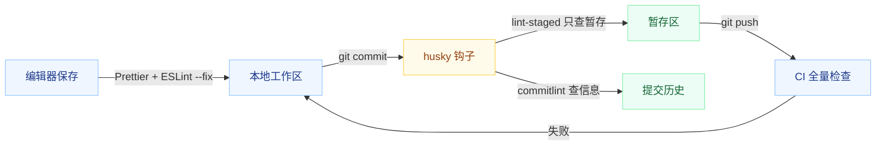

# 代码规范与提交约束

> 这篇从规范要拦在哪一层讲起，经过 ESLint 9 的 flat config、Vue 与 TypeScript 的规则组合、Prettier 与 Stylelint 的分工、husky 与 lint-staged 的钩子，最后落到提交信息、CI 门禁和排障。
>
> 学完能独立给一个 Vue 3 单仓接上保存即格式化、提交即检查、合并即拦截的完整约束链。

## 一、规范的三层拦截

规范要拦的不是“写错语法”，而是三类不同的问题：代码质量、格式、提交历史。三类问题的拦截点和工具都不同，混在一层做必然慢且难维护。

| 层级 | 拦截什么 | 工具 | 反馈时间 |
|---|---|---|---|
| 编辑器 | 格式、明显错误 | Prettier、ESLint 插件 | 保存瞬间 |
| 提交前 | 暂存文件的规范 | husky + lint-staged | 1–10 秒 |
| CI | 全量规范、类型、测试 | ESLint、`vue-tsc`、Vitest | 分钟级 |

三层是递进关系，不是重复：编辑器负责即时反馈，钩子负责不让脏代码进历史，CI 负责兜底（有人用 `--no-verify`、有人 IDE 没配）。只有一层时必然漏：只靠 CI，问题在合并时才暴露；只靠钩子，绕过钩子的提交没人发现。

工具边界：

- **ESLint** 查“可能出错”的代码，能自动修一部分；
- **Prettier** 只管排版，不判断代码好坏；
- **Stylelint** 查样式，规则和 ESLint 不重叠；
- **commitlint** 查提交信息格式，不碰代码。



> 边界：规范工具不能替代代码评审。ESLint 能发现未使用的变量，发现不了错误的业务判断；commitlint 能保证信息格式，保证不了信息真实。规范解决“机械可判定”的部分，剩下的仍然要人看。

## 二、安装与最小验证

版本基线：ESLint 9.39、Prettier 3.10、Stylelint 18、husky 9.1、lint-staged 17.6、commitlint 21.2。全部用 pnpm 10 安装，Node 22 LTS。

### 2.1 装依赖

```bash
pnpm add -D eslint@9 @eslint/js eslint-plugin-vue typescript-eslint \
  @vue/eslint-config-typescript eslint-config-prettier globals @vitest/eslint-plugin

pnpm add -D prettier stylelint stylelint-config-standard \
  stylelint-config-recommended-vue

pnpm add -D husky lint-staged @commitlint/cli @commitlint/config-conventional
```

三端差异只在 Node 与 pnpm 的安装，装包命令一致：

```bash
# Ubuntu / Debian
curl -fsSL https://deb.nodesource.com/setup_22.x | sudo -E bash - && sudo apt install -y nodejs

# Rocky / CentOS
sudo dnf install -y nodejs

# macOS
brew install node@22

# Windows
winget install OpenJS.NodeJS.LTS
```

装完统一用 Corepack 启 pnpm：`corepack enable pnpm`。

### 2.2 最小验证

先确认三个工具都装上了；再用一个故意写坏的文件验证规则真的生效（需要第三节的 `eslint.config.js` 就位，否则 ESLint 会直接报找不到配置）：

```bash
pnpm exec eslint --version    # v9.39.5
pnpm exec prettier --version  # 3.10.1
pnpm exec stylelint --version # 18.0.0
```

```vue
<!-- src/bad.vue：故意写坏，验证工具链 -->
<template>
  <div id="app">
    <span v-if="visible">{{ msg }}</span>
  </div>
</template>

<script setup>
var msg = "hello"
let unused = 1
function go() {
  return msg
}
console.log(go())
</script>

<style>
.app { color: red; }
</style>
```

```bash
pnpm exec eslint src/bad.vue
```

```text
/repo/src/bad.vue
  1:1  error    Component name "bad" should always be multi-word   vue/multi-word-component-names
  7:1  error    The 'lang' attribute of '<script>' is missing      vue/block-lang
  8:1  error    Unexpected var, use let or const instead           no-var
  9:5  error    'unused' is never reassigned. Use 'const' instead  prefer-const
  9:5  error    'unused' is assigned a value but never used        @typescript-eslint/no-unused-vars
 13:1  warning  Unexpected console statement                       no-console

✖ 6 problems (5 errors, 1 warning)
  2 errors and 0 warnings potentially fixable with the `--fix` option.
```

六条问题分别来自 Vue 规则、TypeScript 规则和基础规则，说明三层配置都加载了。`vue/block-lang` 报错是因为 TypeScript 规则集要求 `<script lang="ts">`，这在 JS 与 TS 混用的 `.vue` 项目里是常见困惑，第四节展开。

| 组件 | 版本 |
|---|---|
| ESLint | 9.39.x |
| Prettier | 3.10.x |
| Stylelint | 18.x |
| husky | 9.1.x |
| lint-staged | 17.6.x |
| commitlint | 21.2.x |

## 三、ESLint 9 的 flat config

ESLint 9 默认只读 `eslint.config.js`，`.eslintrc.*` 全部失效。flat config 是一个配置对象数组，后面的对象覆盖前面的同名规则。

```js
// eslint.config.js
import js from '@eslint/js'
import pluginVue from 'eslint-plugin-vue'
import { defineConfigWithVueTs, vueTsConfigs } from '@vue/eslint-config-typescript'
import globals from 'globals'

export default defineConfigWithVueTs(
  // 忽略项必须是独立对象，且只含 ignores；写进别的对象里不生效
  { ignores: ['dist/**', 'coverage/**', 'src/components.d.ts'] },
  js.configs.recommended,
  pluginVue.configs['flat/recommended'],
  // 这层要在 vue 规则之后，才能覆盖 TS 相关规则
  vueTsConfigs.recommended,
  {
    languageOptions: {
      // 不声明浏览器全局，window、document 会被 no-undef 误报
      globals: globals.browser,
    },
    rules: {
      'no-console': ['warn', { allow: ['warn', 'error'] }],
      'vue/multi-word-component-names': ['error', { ignores: ['index'] }],
    },
  },
)
```

四个结构要点：

1. **`ignores` 单独成对象**，放在数组第一项。flat config 不再有 `.eslintignore`，忽略规则写在这里；
2. **`files` 用来圈定适用范围**，没有 `files` 的对象对所有文件生效；
3. **`plugins` 是对象**，值直接是插件模块，不是字符串数组；
4. **`languageOptions.globals`** 取代了 `env`，`env: { browser: true }` 在 flat config 里不存在。

### 3.1 配置分层

一个真实项目至少需要四层：源码、测试、构建脚本、配置文件本身。

```js
// eslint.config.js 追加
import vitest from '@vitest/eslint-plugin'

export default defineConfigWithVueTs(
  { ignores: ['dist/**', 'coverage/**'] },
  js.configs.recommended,
  pluginVue.configs['flat/recommended'],
  vueTsConfigs.recommended,
  {
    languageOptions: { globals: globals.browser },
  },
  {
    // 测试文件用 vitest 全局，并允许 describe/it 这类未导入的调用
    files: ['**/*.test.ts', '**/*.spec.ts'],
    plugins: { vitest },
    languageOptions: { globals: vitest.environments.env.globals },
    rules: { ...vitest.configs.recommended.rules },
  },
  {
    // Node 侧脚本：vite.config.ts 里没有 window，但需要 process
    files: ['*.config.ts', 'scripts/**/*.mjs'],
    languageOptions: { globals: globals.node },
  },
)
```

不分层的后果是二选一：要么在测试文件里到处 `/* eslint-disable no-undef */`，要么全局放开 `no-undef`，后者让浏览器代码里的拼写错误也漏过去。

### 3.2 规则分级与取舍

ESLint 的规则级别只有三档：`off`、`warn`、`error`。团队落地时按“能否自动修、是否阻断合并”分：

```js
rules: {
  // 能自动修且几乎无争议，直接 error
  'prefer-const': 'error',
  'no-var': 'error',
  // 有争议但确实是隐患，warn，靠 CI 的 --max-warnings=0 收口
  'no-console': 'warn',
  // 与业务约定冲突的规则关掉，而不是到处 disable
  'vue/multi-word-component-names': 'off',
}
```

`warn` 不是“不重要”，配合 CI 的 `--max-warnings=0`，warn 也会让流水线失败，只是本地编辑时不打断。

不要保留“历史遗留”级别的关闭。关一条规则要么写进配置并注明原因，要么删掉。仓库里散落的 `// eslint-disable-next-line` 半年后会变成没人敢动的黑盒，用 `--report-unused-disable-directives` 定期清理：

```bash
pnpm exec eslint . --report-unused-disable-directives
```

> 边界：`eslint --fix` 只修“安全”的问题，例如引号、分号、`var` 转 `let`。它不会把 `any` 改成具体类型，也不会自动删除未使用的 import；`--fix` 后仍需人工看 diff。

## 四、Vue 与 TypeScript 的规则组合

Vue 项目最容易踩的坑是规则集顺序和 `lang` 属性。`@vue/eslint-config-typescript` 提供 `defineConfigWithVueTs` 来保证顺序正确，手写数组时把 TS 配置放前面会丢规则。

### 4.1 常见规则与判断

| 规则 | 默认级别 | 建议 |
|---|---|---|
| `vue/multi-word-component-names` | error | 页面级组件可忽略 `index` |
| `vue/block-lang` | error | 用了 TS 规则集就必须写 `lang="ts"` |
| `vue/attributes-order` | warn | 保持模板可读，可自动修 |
| `vue/no-mutating-props` | error | 永不关闭 |
| `@typescript-eslint/no-explicit-any` | warn | 新项目 error，存量 warn |

`vue/block-lang` 的实际报错：

```text
7:1  error  The 'lang' attribute of '<script>' is missing  vue/block-lang
```

两种解法，选一种：

方案一：项目确实只用 JavaScript，去掉 `vueTsConfigs.recommended`，只保留 `pluginVue.configs['flat/recommended']`。这时 `vue/block-lang` 不再要求 `lang`，但 `@typescript-eslint/*` 规则也一并消失。

方案二（推荐）：项目是 TypeScript，补上 `lang` 并写类型：

```vue
<!-- 补 lang 后，vue/block-lang 通过，TS 规则开始对这个组件生效 -->
<script setup lang="ts">
const msg: string = 'hello'
</script>
```

项目里混用 JS 和 TS 的 SFC 时，别为个别文件关规则，统一改成 TS。

### 4.2 类型感知规则的成本

`vueTsConfigs.recommendedTypeChecked` 开启类型感知检查，能发现“`await` 了非 Promise”“比较两个不兼容类型”这类问题，代价是 ESLint 需要加载 TypeScript 程序信息，全量 lint 从秒级变成分钟级。

```js
// 只有大项目才值得开，且必须配 parserOptions.projectService
vueTsConfigs.recommendedTypeChecked,
{
  languageOptions: {
    parserOptions: {
      // 让 typescript-eslint 自己找最近的 tsconfig
      projectService: true,
      tsconfigRootDir: import.meta.dirname,
    },
  },
}
```

```bash
# 开启类型感知后必须带 --cache，否则每次全量重算类型
pnpm exec eslint . --cache --cache-location node_modules/.cache/eslint/
```

判断标准：仓库超过 300 个文件时，先上非类型感知规则 + `vue-tsc` 做类型检查，两者分工更清晰；只有确实需要“跨文件类型推断”的规则时才开类型感知。

> 边界：`vue-tsc --noEmit` 和 ESLint 的 TS 规则不重复。前者查类型错误，后者查代码模式；两个都要跑，不能互相替代。

## 五、Prettier 与 ESLint 的分工

Prettier 只做一件事：把代码打印成统一格式。它不理解语义，所以不会因为“这个函数太长”而报错；ESLint 里的格式类规则则与它冲突。

分工规则：

- 缩进、引号、分号、换行、尾逗号——Prettier；
- 命名、复杂度、未使用变量、Vue 模板约束——ESLint；
- 两者重叠的部分，用 `eslint-config-prettier` 关掉 ESLint 的。

```jsonc
// .prettierrc.json
{
  "semi": false,
  "singleQuote": true,
  "printWidth": 100,
  "trailingComma": "all"
}
```

```js
// eslint.config.js 最后一项
import eslintConfigPrettier from 'eslint-config-prettier'

export default defineConfigWithVueTs(
  // ...
  eslintConfigPrettier,
)
```

`eslint-config-prettier` 必须放最后，它的作用是把所有与 Prettier 冲突的规则设为 `off`。放前面会被后面的配置覆盖，冲突照旧。

### 5.1 忽略文件与检查

```text
# .prettierignore
dist
coverage
pnpm-lock.yaml
src/components.d.ts
```

lockfile 和自动生成的类型文件不能格式化：前者会被包管理器重写，后者每次构建都变。

```bash
pnpm exec prettier --check "src/**/*.{ts,vue,css,json}"
```

```text
Checking formatting...
[warn] src/bad.vue
[warn] Code style issues found in the above file. Run Prettier with --write to fix.
```

`--check` 只报不改，用于 CI；`--write` 用于本地和 lint-staged。CI 里绝不能用 `--write`，否则格式问题永远拦不住。

### 5.2 编辑器的角色

本地体验取决于编辑器，而不是命令行：

```jsonc
// .vscode/settings.json
{
  "editor.formatOnSave": true,
  "editor.defaultFormatter": "esbenp.prettier-vscode",
  "editor.codeActionsOnSave": {
    "source.fixAll.eslint": "explicit"
  },
  "eslint.useFlatConfig": true
}
```

`eslint.useFlatConfig` 在 ESLint 9 之后默认开启，但团队里有人用旧版插件时必须显式写。把这个文件提交进仓库，新人开箱即用，省掉一轮“为什么保存不格式化”的问答。

> 边界：`formatOnSave` 与 `codeActionsOnSave` 会同时改文件，偶尔出现保存两次才稳定。把 Prettier 设为唯一格式化器、ESLint 只做 `fixAll`，不要在 ESLint 里保留格式规则，冲突自然消失。

## 六、Stylelint 与样式边界

Stylelint 管 CSS、SCSS、Less 和 SFC 的 `<style>` 块。只装 `stylelint-config-standard` 时，`.vue` 文件会被当成纯 CSS 解析，模板里的 <span v-pre>`{{ }}`</span> 触发语法错误。

```bash
pnpm exec stylelint "src/**/*.vue"
```

```text
src/bad.vue
  3:29  ✖  Unknown word msg  CssSyntaxError

✖ 1 problem (1 error, 0 warnings)
```

这是 2026 年仍最常见的 Stylelint 配置错误。修复是加上 Vue 语法支持：

```bash
pnpm add -D stylelint-config-recommended-vue postcss-html
```

```jsonc
// .stylelintrc.json
{
  "extends": ["stylelint-config-standard", "stylelint-config-recommended-vue"],
  "rules": {
    "selector-class-pattern": "^[a-z][a-z0-9-]*$"
  }
}
```

`stylelint-config-recommended-vue` 内部会引入 `postcss-html` 作为自定义语法，`.vue` 只解析 `<style>` 块。

```text
src/bad2.vue
  3:1  ✖  Expected ".\41 pp" to match pattern "^[a-z][a-z0-9-]*$"  selector-class-pattern

✖ 1 problem (1 error, 0 warnings)
```

### 6.1 命名规范与 BEM

`selector-class-pattern` 是最容易和团队约定打架的规则。默认的 kebab-case 不接受 BEM 的 `block__elem--mod`：

```json
{
  "rules": {
    "selector-class-pattern": "^[a-z][a-z0-9]*(-[a-z0-9]+)*(__[a-z0-9]+(-[a-z0-9]+)*)?(--[a-z0-9]+(-[a-z0-9]+)*)?$"
  }
}
```

正则一旦写到这个长度，可读性就成了问题。三种务实选择：

- Tailwind 项目：几乎不写自定义类名，保持默认规则；
- CSS Modules：类名即局部作用域，放宽为 `^[a-zA-Z][a-zA-Z0-9_-]*$`；
- 传统 BEM：用上面的完整正则，并在团队文档里给出正反例。

### 6.2 样式属性顺序

`stylelint-config-standard` 不管属性顺序。需要顺序时加 `stylelint-order`：

```json
{
  "plugins": ["stylelint-order"],
  "rules": {
    "order/properties-order": ["position", "display", "flex", "width", "height", "margin", "padding", "color", "background"]
  }
}
```

属性顺序的收益是 review 时能快速定位，代价是每个人都要背一份列表。团队规模小于五人时不建议开，格式化工具和编辑器已经能保证基本一致性。

> 边界：Stylelint 不检查“样式是否生效”。选择器写错、优先级被覆盖、Tailwind 类名拼错，它都发现不了。样式问题的第一手段仍是浏览器 DevTools，不是 lint。

## 七、Git hooks：husky 与 lint-staged

钩子的目标是“让不合规的代码进不了提交历史”，不是“在提交时跑全量检查”。全量检查放 CI，钩子只查暂存文件。

### 7.1 初始化

```bash
pnpm exec husky init
```

husky 9 会做四件事：创建 `.husky/` 目录、写入 `pre-commit` 示例、在 `package.json` 加 `prepare` 脚本、把 `core.hooksPath` 指向 `.husky/_`。

```json
{
  "scripts": {
    "prepare": "husky"
  }
}
```

`prepare` 在 `pnpm install` 之后自动执行，团队其他人拉代码装完依赖就有了钩子。CI 里也会执行，虽然 CI 不需要钩子，但保证脚本本身没坏。

```bash
# .husky/pre-commit
pnpm exec lint-staged
```

husky 9 的钩子文件不再需要 shebang 和 husky 的引导代码，写一行命令即可。旧教程里的：

```bash
#!/usr/bin/env sh
. "$(dirname -- "$0")/_/husky.sh"
```

在 9.x 里已经不需要，加上反而可能报 `_/husky.sh: No such file`。

```bash
# .husky/commit-msg
pnpm exec commitlint --edit "$1"
```

`$1` 是 Git 传给钩子的提交信息文件路径，不加就会去读 stdin，检查永远通过。

### 7.2 lint-staged 配置

```jsonc
// .lintstagedrc.json
{
  "*.vue": ["eslint --fix", "stylelint --fix", "prettier --write"],
  "*.{ts,js}": ["eslint --fix", "prettier --write"],
  "*.{css,scss}": ["stylelint --fix", "prettier --write"],
  "*.{json,md,yml,yaml}": ["prettier --write"]
}
```

三个要点：

1. 数组内的命令串行执行，`eslint --fix` 之后再 `prettier --write`，顺序不能反——先修语义再统一格式，否则第二次检查会把前一次的成果改回去；
2. 一个 `.vue` 文件只能落进一组。多组同时匹配同一个文件时 lint-staged 并行执行，ESLint 与 Stylelint 会互相覆盖，所以三件事合并进 `*.vue` 这一组串行跑；
3. lint-staged 会自动把修改后的文件重新 `git add`，配置里不要再写 `git add`。

它只处理暂存文件：一次提交改三个文件就只查三个，耗时和提交规模成正比。

```bash
git add src/views/OrderList.vue
git commit -m "feat(order): 增加导出按钮"
```

```text
[main 3f2c1a9] feat(order): 增加导出按钮
 1 file changed, 12 insertions(+)
```

钩子成功时基本静默，只有 git 自己的提交摘要；失败时输出第一个报错命令并中断提交，修完重新 `git add` 再提交。

### 7.3 为什么不在钩子里跑类型检查

`vue-tsc` 需要整个项目的类型信息，单文件跑不准，全量跑要几十秒到几分钟。放进 pre-commit 的直接后果是团队开始习惯 `--no-verify`。

正确分工：

| 检查 | 本地钩子 | CI |
|---|---|---|
| ESLint（暂存文件） | 是 | 全量 |
| Prettier | 是 | 全量 |
| Stylelint | 是 | 全量 |
| commitlint | 是 | 是 |
| `vue-tsc` | 否 | 是 |
| Vitest | 相关文件可选 | 全量 |

`--no-verify` 永远拦不住，所以 CI 必须重跑同样的检查。钩子的价值是“早发现”，不是“唯一防线”。

> 边界：GUI 客户端（Fork、SourceTree）和 IDE 内置 Git 有时不执行钩子，因为它们的 `PATH` 里没有 Node。从终端提交排查，或在客户端设置里指定 shell 环境。

## 八、提交信息与版本发布

提交信息是唯一能长期保留的“为什么改”的记录。格式统一后，changelog、版本号、发布说明都能自动生成。

### 8.1 Conventional Commits

```text
<type>(<scope>): <subject>

<body>

<footer>
```

| type | 含义 | 触发版本 |
|---|---|---|
| `feat` | 新功能 | minor |
| `fix` | 修缺陷 | patch |
| `perf` | 性能优化 | patch |
| `refactor` | 重构 | 无 |
| `docs` / `test` / `ci` / `build` | 非产品代码 | 无 |
| `BREAKING CHANGE` | 破坏性变更 | major |

```text
feat(order): 支持按状态批量导出订单

导出走异步任务，超过 1 万条时前端轮询任务状态，
避免大文件下载导致页面假死。

Closes #4821
```

`scope` 用业务模块名（order、user、payment），不要用技术名（vue、api），后者在 changelog 里没有信息量。

### 8.2 commitlint 配置

```js
// commitlint.config.js
export default {
  extends: ['@commitlint/config-conventional'],
  rules: {
    // 标题上限 72，保证 GitHub 列表不折行
    'header-max-length': [2, 'always', 72],
    // scope 限定在业务模块，防止随手写
    'scope-enum': [2, 'always', ['order', 'user', 'payment', 'build', 'deps']],
    // 中文标题没有大小写概念，关掉
    'subject-case': [0],
  },
}
```

验证一条不合规的提交信息：

```bash
printf '加了一个按钮\n' | pnpm exec commitlint
```

```text
⧗   --- input ---
加了一个按钮
✖   subject may not be empty [subject-empty]
✖   type may not be empty [type-empty]

✖   found 2 problems, 0 warnings
ⓘ   Get help: https://github.com/conventional-changelog/commitlint/#what-is-commitlint
```

合规的返回 0，不输出内容：

```bash
printf 'feat(order): 增加订单导出\n' | pnpm exec commitlint && echo OK
# OK
```

### 8.3 版本与 changelog

单包项目用 `release-please`；多包单仓用 changesets：

```bash
pnpm add -D @changesets/cli
pnpm changeset          # 交互式选择变更包和版本级别
pnpm changeset version  # 写入版本号并生成 CHANGELOG
```

`changeset` 生成的文件要提交，它记录了“这次改动影响了哪些包、升什么版本”，发布时统一消费。手工改版本号在单仓里几乎必然漏包。

> 边界：commitlint 校验的是格式，不能校验内容真实性。`fix: 修复问题` 这种信息能过 lint，但对半年后的排查毫无价值。格式交给工具，内容质量靠 review 约定。

## 九、CI 门禁与性能

CI 是唯一绕不过的一层。设计目标：跑得够快、失败原因够明确、与本地命令完全一致。

```yaml
# .github/workflows/lint.yml
name: lint
on: [push, pull_request]

jobs:
  lint:
    runs-on: ubuntu-latest
    steps:
      - uses: actions/checkout@v4
      - uses: pnpm/action-setup@v4
        with: { version: 10.19.0 }
      - uses: actions/setup-node@v4
        with:
          node-version: 22
          cache: pnpm
      - run: pnpm install --frozen-lockfile
      # 全量 lint，warn 也算失败，避免 warn 越积越多
      - run: pnpm exec eslint . --max-warnings=0 --cache
      - run: pnpm exec prettier --check "src/**/*.{ts,vue,css,json}"
      - run: pnpm exec stylelint "src/**/*.{css,scss,vue}"
      - run: pnpm exec vue-tsc --noEmit
```

三个细节决定这套配置是否可持续：

1. `--frozen-lockfile`：依赖不一致立即失败，保证 lint 结果可复现；
2. `--max-warnings=0`：把 warn 纳入门禁，否则半年后 warn 上千条，没人再看；
3. `--cache`：ESLint 缓存只重查改动文件，大项目从分钟级降到十几秒。

ESLint 缓存的坑在 CI：缓存目录默认在 `.eslintcache`，每次全新 runner 都是空的。要么在 CI 里配 `actions/cache`，要么接受首次全量。

```yaml
      - uses: actions/cache@v4
        with:
          path: .eslintcache
          # 键里带 lockfile 哈希，依赖变了缓存自动失效
          key: eslint-${{ hashFiles('pnpm-lock.yaml') }}-${{ github.sha }}
          restore-keys: eslint-${{ hashFiles('pnpm-lock.yaml') }}-
```

### 9.1 拆分作业

lint、类型检查、测试互不依赖，拆成并行作业能把总时长压到最慢那个：

```yaml
jobs:
  lint:
    # ESLint + Prettier + Stylelint
  typecheck:
    # vue-tsc --noEmit
  test:
    # vitest run --coverage
```

合并成一个作业的顺序执行看似省了 setup 时间，实际是三者耗时相加。pnpm 的 store 缓存让三个作业的安装总成本接近一个。

> 边界：CI 里不要跑 `eslint --fix` 或 `prettier --write`。自动修复会让“检查通过”变成假象，格式问题应该在本地钩子解决；CI 只判断。

## 十、排障手册

| 现象 | 最可能原因 | 第一条命令 |
|---|---|---|
| `No files matching` | glob 没匹配到或忽略错 | `pnpm exec eslint . --debug` |
| 规则不生效 | flat config 未加载 | `pnpm exec eslint --print-config src/a.vue` |
| 插件找不到 | flat config 里 `plugins` 写成了字符串 | 检查配置对象结构 |
| 保存不格式化 | 编辑器没设默认格式化器 | 看 `.vscode/settings.json` |
| 钩子不执行 | `core.hooksPath` 未设 | `git config core.hooksPath` |
| 提交被拦但看不到原因 | 钩子里命令输出被吞 | 手动执行钩子内容 |
| CSS 报 `CssSyntaxError` | 没装 Vue 语法支持 | 加 `stylelint-config-recommended-vue` |
| ESLint 与 Prettier 反复改 | 配置顺序错 | 把 `eslint-config-prettier` 放最后 |

### 10.1 规则为什么没生效

ESLint 9 只认 `eslint.config.js`。仓库里同时存在 `.eslintrc.js` 时，它会被静默忽略——没有任何警告。

```bash
# 打印某个文件最终生效的配置，确认规则和插件都在
pnpm exec eslint --print-config src/main.ts | head -40
```

输出里搜不到目标规则，说明配置对象没覆盖到该文件（`files` 写错）或被后面的对象覆盖。

### 10.2 钩子不执行

```bash
git config core.hooksPath
# 期望：.husky/_
```

为空说明 husky 没初始化成功。重跑 `pnpm exec husky init`，并确认 `package.json` 里有 `prepare` 脚本。用 `git commit` 时留一份手动验证：

```bash
sh .husky/pre-commit
```

能跑通但提交时不触发，问题在 Git 的 hooksPath 或被客户端绕过。

### 10.3 样式解析错误

```text
src/OrderCard.vue
  3:29  ✖  Unknown word msg  CssSyntaxError
```

`.vue` 文件被当成 CSS 解析。检查两件事：`extends` 里有没有 `stylelint-config-recommended-vue`；`postcss-html` 是否装成功。二者缺一都会退回纯 CSS 解析。

## 十一、最佳实践案例

### 11.1 案例背景

某订单后台有 460 个 `.vue` 文件、180 个 `.ts` 文件，前端 11 人。现状：仓库里同时存在 `.eslintrc.cjs` 和半成品 `eslint.config.js`，ESLint 实际跑的是旧配置；Prettier 只在两个人的编辑器里生效；提交信息中英混杂，changelog 靠手写；CI 只跑构建。

结果：review 里大量格式评论、发版前集中修 lint、`git log` 无法用于定位问题。

目标：两周内统一到 ESLint 9 flat config，建立“保存格式化 → 提交检查 → CI 全量”的链，并把提交信息接入自动 changelog。

### 11.2 案例实操

第一步，删掉旧配置，只保留一份 flat config：

```bash
rm .eslintrc.cjs .eslintignore
```

第二步，写分层配置，先只开 recommended，避免一次报出上千条：

```js
// eslint.config.js
import js from '@eslint/js'
import pluginVue from 'eslint-plugin-vue'
import { defineConfigWithVueTs, vueTsConfigs } from '@vue/eslint-config-typescript'
import eslintConfigPrettier from 'eslint-config-prettier'
import globals from 'globals'

export default defineConfigWithVueTs(
  { ignores: ['dist/**', 'coverage/**', 'src/components.d.ts'] },
  js.configs.recommended,
  pluginVue.configs['flat/recommended'],
  vueTsConfigs.recommended,
  {
    languageOptions: { globals: globals.browser },
    rules: {
      'no-console': ['warn', { allow: ['warn', 'error'] }],
      'vue/multi-word-component-names': ['error', { ignores: ['index'] }],
      '@typescript-eslint/no-explicit-any': 'warn',
    },
  },
  eslintConfigPrettier,
)
```

第三步，跑第一次全量，把问题分类而不是逐条修：

```bash
pnpm exec eslint . -f json -o lint-report.json || true
node -e "
const r = require('./lint-report.json');
const count = {};
for (const f of r) for (const m of f.messages) count[m.ruleId] = (count[m.ruleId] || 0) + 1;
console.log(Object.entries(count).sort((a,b) => b[1]-a[1]).slice(0, 10));
"
```

```text
[
  [ 'vue/attributes-order', 386 ],
  [ 'vue/max-attributes-per-line', 274 ],
  [ 'vue/html-self-closing', 143 ],
  [ 'no-console', 61 ],
  [ '@typescript-eslint/no-unused-vars', 38 ]
]
```

前三条都是格式类，跑一次 `--fix` 能消掉绝大部分：

```bash
pnpm exec eslint . --fix
pnpm exec prettier --write "src/**/*.{ts,vue,css,json}"
```

第四步，处理不能自动修的 38 个未使用变量——多数是重构残留的 import，人工删除，确认构建通过。

第五步，接钩子：

```bash
pnpm exec husky init
```

```bash
# .husky/pre-commit
pnpm exec lint-staged
```

```bash
# .husky/commit-msg
pnpm exec commitlint --edit "$1"
```

```jsonc
// .lintstagedrc.json
{
  "*.vue": ["eslint --fix", "stylelint --fix", "prettier --write"],
  "*.{ts,js}": ["eslint --fix", "prettier --write"],
  "*.{css,scss}": ["stylelint --fix", "prettier --write"],
  "*.{json,md}": ["prettier --write"]
}
```

第六步，统一提交信息，并把 commitlint 规则收窄：

```js
// commitlint.config.js
export default {
  extends: ['@commitlint/config-conventional'],
  rules: {
    'scope-enum': [2, 'always', ['order', 'user', 'payment', 'build', 'deps']],
    'header-max-length': [2, 'always', 72],
    'subject-case': [0],
  },
}
```

第七步，CI 门禁，按第九节的三作业结构落地，并在第一周用 `continue-on-error` 观察，第二周去掉。

### 11.3 案例结果

| 指标 | 改造前 | 改造后 | 口径 |
|---|---|---|---|
| 全量 lint 问题数 | 1,142 | 0 | `eslint . --max-warnings=0` |
| 格式类 review 评论 | 每周约 40 条 | 0 | 示例，团队统计 |
| 提交信息合规率 | 约 35% | 100% | commitlint 拦截 |
| 全量 lint 耗时 | 74 s | 19 s | 本地 M2，`--cache` 冷/热 |
| CI 反馈时长 | 6 min 30 s | 3 min 10 s | 三作业并行，示例 |

失败模式一：一次性开启 `recommendedTypeChecked`。首日 CI 超时、编辑器卡顿，团队集体要求关掉。正确顺序是先 recommended，稳定两周后再评估类型感知。

失败模式二：`eslint --fix` 直接提交，没检查 diff。自动修复把某个 `v-if` 的条件括号改了位置，逻辑没变但 review 无人看懂。批量修复必须单独一个 commit，且只看修复 diff。

失败模式三：husky 装上了，但 CI 里没跑同样的检查。三周后出现 4 个 `--no-verify` 提交，其中两个带 `console.log` 上线。CI 兜底是必须项，不是可选项。

复盘：规范链的落地顺序是“先统一配置 → 再批量修复 → 然后接钩子 → 最后上门禁”。反过来做会在第一天就收到大量失败通知，团队的第一印象决定这套工具能不能活下来。
