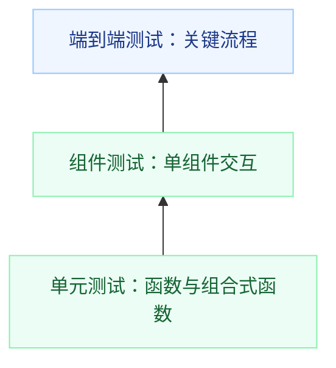

# Vitest单元与组件测试

> 这篇从单元测试与组件测试的边界讲起，经过断言结构、隔离与 mock、组件挂载、MSW 网络层、覆盖率、快照，最后落到 CI 并行与排障手册。
>
> 学完能独立给一个 Vue 3 项目补上跑得快、测得准、CI 能拦住回归的单元与组件测试。

## 一、单元测试与组件测试的边界

单元测试验证一个函数的行为，组件测试验证一个组件的输入输出，两者都不碰真实网络和真实浏览器。判断一段代码值不值得测，标准是“逻辑会不会悄悄坏”——纯展示模板不值得，金额换算、状态流转、重试逻辑值得。



三层的数量关系是底多顶少。单元测试毫秒级、组件测试百毫秒级、端到端分钟级；把登录流程写成单元测试太费劲，把金额格式化写成端到端太慢。这篇覆盖底下两层，端到端见 Playwright 篇。

不适合单元测试的内容：

| 内容 | 原因 | 替代 |
|---|---|---|
| 纯模板渲染 | 没有分支逻辑 | 冒烟测试 |
| 第三方库内部 | 测的是别人的代码 | 集成测试 |
| 样式与布局 | jsdom 不计算布局 | Playwright |
| 时间敏感的动画 | 等待只会让测试脆弱 | 单测纯逻辑 |

> 边界：单元测试的运行环境是 jsdom 或 happy-dom，不是真浏览器。jsdom 没有布局引擎，`offsetWidth` 恒为 0，`canvas` 需要额外垫片。测视觉回归必须上真浏览器，不要在 jsdom 里测 CSS。

## 二、安装与最小验证

Vitest 3 + Vue Test Utils 2 + jsdom，配 Vite 7 的项目可以直接复用 `vite.config.ts` 的插件与别名。

### 2.1 安装

```bash
pnpm add -D vitest@3 @vitest/coverage-v8@3 @vue/test-utils jsdom
```

三端差异只在 Node 与 pnpm 的安装，装包命令一致：

```bash
# Ubuntu / Debian
curl -fsSL https://deb.nodesource.com/setup_22.x | sudo -E bash - && sudo apt install -y nodejs

# Rocky / CentOS
sudo dnf install -y nodejs

# macOS
brew install node@22

# Windows
winget install OpenJS.NodeJS.LTS
```

### 2.2 配置与第一个测试

```ts
// vitest.config.ts
import { defineConfig } from 'vitest/config'
import vue from '@vitejs/plugin-vue'

export default defineConfig({
  plugins: [vue()],
  test: {
    environment: 'jsdom',
    // 不开 globals，显式 import 让依赖来源清楚
    globals: false,
    include: ['src/**/*.{test,spec}.ts'],
  },
})
```

```json
{
  "scripts": {
    "test": "vitest",
    "test:run": "vitest run",
    "coverage": "vitest run --coverage"
  }
}
```

```ts
// src/money.ts
export function formatMoney(cents: number, currency = 'CNY'): string {
  if (!Number.isInteger(cents)) throw new TypeError('cents must be an integer')
  return new Intl.NumberFormat('zh-CN', {
    style: 'currency',
    currency,
    minimumFractionDigits: 2,
  }).format(cents / 100)
}
```

```ts
// src/money.test.ts
import { describe, it, expect } from 'vitest'
import { formatMoney } from './money'

describe('formatMoney', () => {
  it('把分转成两位小数的人民币', () => {
    expect(formatMoney(49900)).toBe('¥499.00')
  })

  it('拒绝非整数输入', () => {
    expect(() => formatMoney(1.5)).toThrow(TypeError)
  })

  it('支持千分位', () => {
    expect(formatMoney(1234567)).toBe('¥12,345.67')
  })
})
```

```bash
pnpm test:run
```

```text
 RUN  v3.2.7 /repo

 ✓ src/money.test.ts (3 tests) 12ms

 Test Files  1 passed (1)
      Tests  3 passed (3)
   Start at  05:27:10
 Duration  448ms (transform 13ms, setup 0ms, collect 10ms, tests 12ms, environment 252ms, prepare 34ms)
```

| 组件 | 版本 |
|---|---|
| Vitest | 3.2.x |
| @vue/test-utils | 2.5.x |
| jsdom | 31.x |
| Node | 22.x LTS |

`environment: 'jsdom'` 是全局默认；纯逻辑测试其实不需要 DOM，`environment: 'node'` 更快，第九节用 `projects` 按目录拆分。

> 边界：`globals: true` 让 `describe`、`expect` 不用 import，看着省事，代价是所有测试文件隐式依赖配置，且 TypeScript 类型要靠 `types` 声明补齐。显式 import 三行，换来“看文件头就知道测试跑在哪个运行时”。

## 三、测试结构与断言

一个测试文件的结构是 `describe` 分组 + `it` 断言场景。命名标准：it 的名字念出来是一句完整的话——“把分转成两位小数的人民币”，而不是“测试 formatMoney”。

### 3.1 常用匹配器

| 匹配器 | 判断 | 示例 |
|---|---|---|
| `toBe` | 严格相等 | `expect(x).toBe(1)` |
| `toEqual` | 深比较 | 对象、数组 |
| `toBeCloseTo` | 浮点近似 | `expect(0.1 + 0.2).toBeCloseTo(0.3)` |
| `toThrow` | 抛错 | 构造器或消息 |
| `toHaveBeenCalled` | 被调用 | 配合 mock |
| `toMatchObject` | 部分匹配 | 大对象只断言关键字段 |
| `toMatchSnapshot` | 快照 | 见第八节 |

```ts
it('明细求和忽略已取消行', () => {
  const rows = [
    { amount: 100, status: 'paid' },
    { amount: 50, status: 'cancelled' },
    { amount: 30, status: 'paid' },
  ]
  expect(sum(rows)).toBe(130)
})
```

浮点比较不用 `toBe`：`0.1 + 0.2 === 0.3` 为 false，写 `toBe` 的浮点断言是潜伏的随机失败源。

### 3.2 参数化

同一逻辑多组输入，用 `it.each` 而不是复制五个 it：

```ts
it.each([
  ['pending', '待付款'],
  ['paid', '待发货'],
  ['done', '已完成'],
])('状态 %s 显示为 %s', (code, label) => {
  expect(statusLabel(code)).toBe(label)
})
```

`%s` 按顺序替换数组里的值，失败输出能看到具体是哪组数据：

```text
✕ 状态 pending 显示为 待付款
```

### 3.3 读懂失败输出

```ts
it('演示失败输出', () => {
  expect(1 + 1).toBe(3)
})
```

```text
- 3
+ 2

 ❯ src/fail.demo.test.ts:3:17
      1| import { it, expect } from 'vitest'
      2| it('演示失败输出', () => {
      3|   expect(1 + 1).toBe(3)
       |                 ^
      4| })

⎯⎯⎯⎯⎯⎯⎯⎯⎯⎯⎯⎯⎯⎯⎯⎯⎯⎯⎯⎯[1/1]⎯⎯

 Test Files  1 failed (1)
      Tests  1 failed (1)
```

读法：红色 `-` 是期望值，绿色 `+` 是实际值；反引号箭头指向断言行，上下文直接贴出源码。修失败测试的第一步永远是看这个 diff，不是看测试名猜。

异步测试返回 Promise 即可，不需要 done 回调：

```ts
it('并发请求合并结果', async () => {
  // 两个请求都要完成，await 自动处理；任何一个 reject 都会失败
  const [orders, users] = await Promise.all([fetchOrders(), fetchUsers()])
  expect(orders).toHaveLength(2)
})
```

> 边界：`it` 的回调不要带 `done` 参数。Vitest 支持 done 风格是为了兼容旧代码，混用两种风格会出现“忘了调 done 导致超时”的假失败。

## 四、测试隔离与 mock

测试之间必须互不影响：每个测试自己准备数据、自己清理状态。mock 的用途只有一个——把测试不关心的依赖换成可控的替身。

### 4.1 函数替身

```ts
import { describe, it, expect, vi, beforeEach } from 'vitest'

const saveFn = vi.fn()

beforeEach(() => {
  vi.clearAllMocks() // 清掉上一个测试的调用记录
})

it('成功路径调用了保存并提示', async () => {
  saveFn.mockResolvedValue({ id: 1 }) // 指定返回值，控制依赖行为
  ...
  expect(saveFn).toHaveBeenCalledTimes(1)
  expect(saveFn).toHaveBeenCalledWith({ amount: 1 })
})
```

`vi.fn()` 创建空替身，`mockResolvedValue` 决定它的返回。断言的是“被怎么调用”，而不是“内部怎么实现”——断言实现细节的测试在重构时必然失败。

```ts
import { vi } from 'vitest'
import { router } from './router'

// 已存在的方法只监听不替换
const spy = vi.spyOn(router, 'push').mockResolvedValue()
```

`spyOn` 保留原实现，除非链上 `mockImplementation`。测“跳转被触发”用 spy，测“跳转后的行为”不要 mock 跳转本身。

### 4.2 模块替身与提升

```ts
import { vi } from 'vitest'
import { useSave } from './useSave'
import { notify } from './notify'

// vi.mock 被提升到文件顶部，先于 import 执行
vi.mock('./notify', () => ({ notify: vi.fn() }))
```

`vi.mock` 是被编译器提升的：写在文件任何地方都等价于第一行。这带来一个坑——factory 里引用外部变量会报错：

```ts
const fakeNotify = vi.fn() // 这行还没执行，vi.mock 已经先跑了
vi.mock('./notify', () => ({ notify: fakeNotify })) // TypeError
```

正确写法是 `vi.hoisted`，它和 `vi.mock` 一起提升：

```ts
const { fakeNotify } = vi.hoisted(() => ({ fakeNotify: vi.fn() }))
vi.mock('./notify', () => ({ notify: fakeNotify }))
```

一个完整的组合式函数测试，覆盖成功、失败和过程状态三面：

```ts
import { describe, it, expect, vi, beforeEach } from 'vitest'
import { useSave } from './useSave'

// vi.mock 的 factory 与 vi.hoisted 一起提升，先于所有 import 执行
const { fakeNotify } = vi.hoisted(() => ({ fakeNotify: vi.fn() }))
vi.mock('./notify', () => ({ notify: fakeNotify }))

describe('useSave', () => {
  beforeEach(() => vi.clearAllMocks())

  it('成功后提示并返回 true', async () => {
    const saveFn = vi.fn().mockResolvedValue({ id: 1 })
    const { save, saving } = useSave(saveFn)
    const promise = save({ amount: 1 })
    expect(saving.value).toBe(true) // 过程状态在 await 前断言
    await expect(promise).resolves.toBe(true)
    expect(saving.value).toBe(false)
    expect(fakeNotify).toHaveBeenCalledWith('保存成功')
  })

  it('失败后提示错误信息', async () => {
    const saveFn = vi.fn().mockRejectedValue(new Error('网络错误'))
    const { save } = useSave(saveFn)
    await expect(save({})).resolves.toBe(false)
    expect(fakeNotify).toHaveBeenCalledWith('保存失败：网络错误')
  })
})
```

### 4.3 时间替身

```ts
import { it, expect, vi } from 'vitest'

// 被测算数：每 interval 调一次 cb，最多 max 次后自停
function startPolling(cb: () => void, { interval, max }: { interval: number; max: number }) {
  let count = 0
  const timer = setInterval(() => {
    cb()
    if (++count >= max) clearInterval(timer)
  }, interval)
  return () => clearInterval(timer)
}

it('轮询在 3 秒后停止', () => {
  vi.useFakeTimers()
  const spy = vi.fn()
  startPolling(spy, { interval: 1000, max: 3 })

  vi.advanceTimersByTime(3000) // 一步走完，不用真实等待
  expect(spy).toHaveBeenCalledTimes(3)

  vi.useRealTimers() // 还原，避免污染下一个测试
})
```

测试文件之间虽有环境隔离，但同一文件内忘了还原 fake timers 会污染下一个测试；重置语句始终显式保留。

时间替身的原则：mock `Date` 和定时器，不要 mock `setTimeout` 函数本身。前者改的是“时钟”，行为语义保留；后者改的是执行机制，容易把轮询逻辑测成另一个东西。

> 边界：mock 数量是测试质量的负指标。一个测试文件里 mock 超过三个依赖，通常说明被测代码耦合太多，先重构再写测试，而不是继续堆 mock。

## 五、组件测试

组件测试的对象是“一个组件”，输入是 props 和用户事件，输出是渲染结果与 emit 的事件。不测组件的内部状态名，只测用户可观察的行为。

### 5.1 第一个组件测试

```vue
<!-- src/OrderStatus.vue -->
<template>
  <div>
    <span data-test="status">{{ label }}</span>
    <button data-test="advance" :disabled="status === 'done'" @click="advance">
      推进
    </button>
  </div>
</template>

<script setup lang="ts">
import { computed } from 'vue'

const props = defineProps({
  status: { type: String, default: 'pending' },
})
const emit = defineEmits<{ change: [next: string] }>()

const LABELS: Record<string, string> = { pending: '待付款', paid: '待发货', done: '已完成' }
const ORDER = ['pending', 'paid', 'done']
const label = computed(() => LABELS[props.status])

function advance() {
  const next = ORDER[ORDER.indexOf(props.status) + 1]
  if (!next) return
  emit('change', next)
}
</script>
```

```ts
// src/OrderStatus.test.ts
import { describe, it, expect } from 'vitest'
import { mount } from '@vue/test-utils'
import OrderStatus from './OrderStatus.vue'

describe('OrderStatus', () => {
  it('把状态码渲染成中文', () => {
    const wrapper = mount(OrderStatus, { props: { status: 'paid' } })
    expect(wrapper.get('[data-test="status"]').text()).toBe('待发货')
  })

  it('点击推进时发出下一个状态', async () => {
    const wrapper = mount(OrderStatus, { props: { status: 'pending' } })
    await wrapper.get('[data-test="advance"]').trigger('click')
    expect(wrapper.emitted('change')).toEqual([['paid']])
  })

  it('已完成时按钮禁用', () => {
    const wrapper = mount(OrderStatus, { props: { status: 'done' } })
    expect(wrapper.get('[data-test="advance"]').attributes('disabled')).toBeDefined()
  })
})
```

三个测试分别覆盖：渲染、事件、边界条件。`data-test` 属性让选择器稳定，不随 CSS 类名和 DOM 结构调整而失效——这是组件测试能长期活下来的关键。

`mount` 与 `shallowMount` 的取舍：默认 `mount`，真实渲染子组件；只有子组件是重依赖（图表、地图）时才用 `shallowMount` 或 `stubs`。浅挂载测的是“给子组件传了什么”，对子组件内部行为没有任何保障，滥用后测试通过但页面是坏的。

### 5.2 事件与异步

```ts
const wrapper = mount(Counter)
await wrapper.get('button').trigger('click')
```

`trigger` 之后必须 `await`：Vue 的响应式更新是异步批处理的，不等待就断言 DOM，读到的是旧状态。涉及 `setTimeout`、Promise 链时用 `flushPromises`：

```ts
import { flushPromises } from '@vue/test-utils'

it('加载完成后渲染列表', async () => {
  server.use(handler) // MSW 返回数据
  const wrapper = mount(OrderList)
  await flushPromises() // 把挂载后所有微任务一次冲完
  expect(wrapper.findAll('tr')).toHaveLength(2)
})
```

### 5.3 插槽、依赖注入与 Teleport

```ts
// 插槽内容参与渲染断言
const wrapper = mount(PageHeader, {
  slots: { default: '<strong>订单中心</strong>' },
})
expect(wrapper.html()).toContain('订单中心')

// provide 的值直接注入，不必真挂载父组件
const wrapper = mount(OrderForm, {
  global: {
    provide: { formConfig: { size: 'small' } },
  },
})
```

`Teleport` 的内容不在组件自身根节点下，断言要挂到 body：

```ts
const wrapper = mount(Dialog, {
  attachTo: document.body, // Teleport 目标存在，才能查到弹层
})
expect(document.body.querySelector('.el-dialog')).toBeTruthy()
wrapper.unmount() // attachTo 后必须手动卸载，否则 DOM 泄漏到下个测试
```

> 边界：组件测试发现不了跨组件的 bug。`OrderStatus` 单测全绿、列表页把 `status` 拼错照样白屏——跨组件集成交给页面级组件测试或端到端测试，不要指望单元层兜住所有回归。

## 六、网络层测试与 MSW

请求代码的测试不应该真的发网络，也不应该把 `fetch` mock 成任意的假函数——那样测的是 mock 的行为，不是请求层与真实 HTTP 语义的配合。MSW（Mock Service Worker）在网络层拦截，测试代码里仍然写 `fetch`。

### 6.1 基本结构

```bash
pnpm add -D msw@2
```

```ts
// src/api.ts
export async function fetchOrders(): Promise<Order[]> {
  const res = await fetch('/api/orders')
  if (!res.ok) throw new Error(`HTTP ${res.status}`)
  return res.json()
}
```

```ts
// src/api.test.ts
import { describe, it, expect, beforeAll, afterAll, afterEach } from 'vitest'
import { setupServer } from 'msw/node'
import { http, HttpResponse } from 'msw'
import { fetchOrders } from './api'

const server = setupServer(
  // 路由级声明：方法 + 路径 + 返回，测试代码不关心拦截细节
  http.get('/api/orders', () =>
    HttpResponse.json([{ no: 'SO-1', amount: 499 }]),
  ),
)

beforeAll(() => server.listen())
afterEach(() => server.resetHandlers()) // 每个测试后清掉临时覆盖的 handler
afterAll(() => server.close())

describe('fetchOrders', () => {
  it('返回订单列表', async () => {
    expect(await fetchOrders()).toEqual([{ no: 'SO-1', amount: 499 }])
  })

  it('500 时抛出带状态码的错误', async () => {
    server.use( // 只在本测试内覆盖默认 handler
      http.get('/api/orders', () =>
        new HttpResponse(null, { status: 500 }),
      ),
    )
    await expect(fetchOrders()).rejects.toThrow('HTTP 500')
  })
})
```

四个生命周期缺一不可：`listen` 开拦截、`resetHandlers` 保证测试隔离、`close` 还原全局 fetch。忘写 `resetHandlers` 的症状是“单独跑全过、一起跑随机挂”。

```text
✓ src/api.test.ts (2 tests) 31ms

Test Files  1 passed (1)
Tests  2 passed (2)
```

### 6.2 断言请求本身

需要验证“请求参数对不对”时，handler 里捕获：

```ts
let captured: URL | undefined

server.use(
  http.post('/api/orders', ({ request }) => {
    captured = new URL(request.url)
    return HttpResponse.json({ id: 'SO-2' })
  }),
)

it('导出请求带筛选参数', async () => {
  await exportOrders({ status: 'paid' })
  expect(captured?.searchParams.get('status')).toBe('paid')
})
```

网络延迟、竞态、重试这类时间行为也能精确控制：

```ts
// delay 从 msw 导出，不要用真实 setTimeout，避免测试受真实时间影响
import { http, HttpResponse, delay } from 'msw'

server.use(
  http.get('/api/orders', async () => {
    await delay(5000)
    return HttpResponse.json([])
  }),
)
```

> 边界：MSW 的 handler 路径是相对路径时依赖运行环境的 base URL，jsdom 里默认 `http://localhost:3000` 所以能匹配；换成 node 环境会报 `Failed to parse URL`（实测），因为 node 的 fetch 没有页面地址。用 node 环境测请求层时 handler 与调用都要写绝对 URL。

## 七、覆盖率

覆盖率回答“哪些行没被执行过”，不回答“测得对不对”。它是发现遗漏的工具，不是质量本身。

### 7.1 配置与阈值

```ts
// vitest.config.ts
export default defineConfig({
  test: {
    coverage: {
      provider: 'v8',
      // 阈值不达标直接失败，退出码非零，CI 拦住
      thresholds: { lines: 80, functions: 80, branches: 70, statements: 80 },
      // 生成器配置文件、类型声明不计入分母
      exclude: ['src/components.d.ts', 'src/main.ts', 'src/**/*.d.ts'],
    },
  },
})
```

真实输出（money.ts 与 OrderStatus.vue 两个文件、6 个测试）：

```text
 % Coverage report from v8
-----------------|---------|----------|---------|---------|-------------------
File             | % Stmts | % Branch | % Funcs | % Lines | Uncovered Line #s
-----------------|---------|----------|---------|---------|-------------------
All files        |     100 |    83.33 |     100 |     100 |
 OrderStatus.vue |     100 |    66.66 |     100 |     100 | 24
 money.ts        |     100 |      100 |     100 |     100 |
-----------------|---------|----------|---------|---------|-------------------
```

读法：`Uncovered Line #s: 24` 直接给出没跑到的分支——`advance` 里 `if (!next) return` 的防御分支。常规的“done 状态点击不发事件”行为测试会被 Vue Test Utils 的 disabled 检查挡在组件外，覆盖不到这个分支；要覆盖只能绕过 DOM 直接调用内部函数，是否值得取决于该分支的风险。

报告只列两个业务文件，是因为当时 `src` 下只有它们。新增文件如果没有被任何测试导入，默认不会进入报告，指标会虚高；显式 `include` 后，未测文件才以 0% 计入分母，指标才反映真实覆盖。这也是必须用 `include` 圈定统计范围的原因：

```ts
coverage: {
  include: ['src/**/*.{ts,vue}'],
  exclude: ['src/main.ts', 'src/**/*.d.ts'],
}
```

`include` 决定“哪些文件算分母”，`exclude` 从其中剔除入口与生成文件。不写 `include` 时默认扫描整个 `src`，未测的配置文件、未使用的模块都会拉低指标。

| 阈值 | 建议值 | 理由 |
|---|---|---|
| lines / functions | 80 | 业务代码的现实上限 |
| branches | 70 | 防御式代码拉低分母 |
| 全局 100% | 不建议 | 逼出凑行数的假测试 |

### 7.2 覆盖率的反噬

追 100% 覆盖率会出现两种病：

- 测试只为执行代码而写，没有任何断言或断言恒真；
- 为了可测而拆分出没有业务含义的函数。

团队里先约定“哪些必须测”：金额、权限、状态机、对外 API 的参数解析。这些模块 100%，其余模块 60% 也接受，比全仓库强制 80% 健康得多。

> 边界：v8 provider 统计的是“执行路径”，与 istanbul 的插桩口径有差异；混用两种 provider 的数字不可比。团队统一用 v8 即可，跨项目比较覆盖率时先确认口径一致。

## 八、快照测试的边界

快照适合“结构稳定、人工比对成本高”的输出：序列化结果、生成的配置、错误信息模板。不适合“本来就频繁变化”的 UI。

```ts
it('错误信息保持稳定', () => {
  expect(buildOrderError({ code: 4012, field: 'amount' }))
    .toMatchInlineSnapshot(`"订单金额无效 (4012: amount)"`)
})
```

`toMatchInlineSnapshot` 把期望值直接写进测试文件，review 时快照变化和代码变化在同一处可见；`toMatchSnapshot` 生成 `__snapshots__/` 目录，改动藏在另一个文件里，review 容易漏。

快照的失效循环要警惕：快照一挂，跑一次 `vitest run -u` 全部绿。`-u` 更新的是“实际输出”，如果输出本来就错了，错误就被快照固化了。约定：

```text
1. 快照失败先看 diff，不看直接 -u 的提交一律打回
2. 组件整体快照不超过 30 行，超过说明该测行为而不是测结构
3. 快照里不许出现时间戳、随机 id、绝对路径
```

不稳定来源要显式固定：

```ts
it('时间字段固定后快照稳定', () => {
  vi.setSystemTime(new Date('2026-11-13T10:00:00Z'))
  expect(renderTimeline(events)).toMatchInlineSnapshot()
})
```

> 边界：Vue 组件快照只记录 HTML 字符串，样式、交互、异步渲染都不在内。组件的正确打开方式是第五节的行为断言；快照只用于“这个组件的静态结构变化需要人确认”的场景。

## 九、CI 与执行效率

测试在 CI 里的目标是“快、稳、失败原因清楚”。Vitest 默认已经并行，真正拉开差距的是环境拆分和增量选择。

### 9.1 按环境拆分

jsdom 环境启动要 500ms 上下（实测 environment 548ms），纯逻辑测试被它拖着跑。用 `projects` 把两类测试分开：

```ts
// vitest.config.ts
import { defineConfig } from 'vitest/config'
import vue from '@vitejs/plugin-vue'

export default defineConfig({
  test: {
    projects: [
      {
        plugins: [vue()],
        test: {
          name: 'unit',
          environment: 'node',
          include: ['src/**/*.node.test.ts'],
        },
      },
      {
        plugins: [vue()],
        test: {
          name: 'dom',
          environment: 'jsdom',
          include: ['src/**/*.test.ts', '!src/**/*.node.test.ts'],
        },
      },
    ],
  },
})
```

运行时每个项目单独报告，node 环境的纯逻辑测试不再为 DOM 付费：

```text
 ✓ unit
 ✓ dom

 Test Files  8 passed (8)
```

### 9.2 watch、增量与产物

```bash
vitest            # watch 模式，本地开发主力
vitest run        # CI 单次运行，必须用 run，watch 在 CI 会挂住
vitest --changed  # 只跑自上次提交后改动相关的测试
```

`--changed` 基于模块依赖图反查：改了 `money.ts`，引用它的测试全跑，无关的不跑。本地提交前用它，CI 里仍然全量。

CI 需要报告时用 junit reporter，失败细节能点进 CI 页面看：

```ts
test: {
  reporters: ['default', 'junit'],
  outputFile: { junit: 'reports/vitest.junit.xml' },
}
```

### 9.3 稳定性

三类典型 flaky 与对策：

| 症状 | 原因 | 对策 |
|---|---|---|
| 本地过 CI 挂 | 测试间共享状态 | `afterEach` 清理、`resetHandlers` |
| 偶发超时 | 真实定时器或网络 | fake timers、MSW `delay` |
| 顺序相关 | mock 未隔离 | `clearAllMocks`、`vi.restoreAllMocks()` |

单个测试设置自己的超时，不给慢测试拖累全局：

```ts
it('大列表渲染', () => { ... }, 10_000) // 第三参数覆盖默认 5s
```

> 边界：sharding（按文件分片到多台 runner）只在上千个测试文件后才值得引入；拆得太碎时每台机器都要付一次安装与环境启动成本，总时长反而上升。

## 十、排障手册

| 现象 | 最可能原因 | 第一条命令 |
|---|---|---|
| `document is not defined` | 环境是 node | 查 `environment` 配置 |
| 改了 props 断言不变 | 少了 `await` | 检查 `trigger` 后的 await |
| `Cannot find module './x.css'` | 组件测了却没配插件 | `vitest.config` 加 `css: true` 或 mock |
| MSW 报 `Failed to parse URL` | node 环境用相对 URL | handler 与调用都写绝对 URL |
| 快照天天红 | 里有时间或随机值 | `vi.setSystemTime` 固定 |
| 覆盖率忽高忽低 | include 范围漂移 | 固定 `coverage.include` |
| 测试单独过、全量挂 | 共享状态泄漏 | 搜全局变量与 `beforeAll` |

### 10.1 document is not defined

```text
ReferenceError: document is not defined
```

组件测试文件落进了 node 环境的项目。检查两处：`vitest.config.ts` 的 `environment`；文件名是否符合 dom 项目的 include 规则。临时单文件环境也可以用注释头：

```ts
// @vitest-environment jsdom
import { test } from 'vitest'
```

### 10.2 断言通过了但页面是坏的

组件测试全绿却出现回归，多数是断言写在了错误层级：断言了内部变量而不是 DOM，或者用 `shallowMount` 把真正的子组件 stub 掉了。定位方法是把 stub 渲染出来的注释节点打出来：

```ts
console.log(wrapper.html())
```

输出里出现 `<!-- <OrderTable-stub> -->` 就说明问题在浅挂载，真实子组件根本没渲染。

### 10.3 全量跑随机挂

按顺序跑能复现时，用二分定位泄漏源：

```bash
vitest run src/a.test.ts src/b.test.ts
```

逐个加文件，加到哪个文件开始挂，问题就在它没有清理的状态里——全局 store、MSW handler、`vi.useFakeTimers` 没还原，三个方向依次查。

## 十一、最佳实践案例

### 11.1 案例背景

订单后台的核心交互是“订单状态推进”：待付款 → 待发货 → 已完成，涉及金额展示和状态流转，此前完全没有测试，三周内两次回归：一次是金额展示把分当成元（多显示两个 0），一次是状态推进跳过了“已完成”的禁用逻辑，运营在已完成的订单上继续推进，产生了一条脏数据。

约束：不能重写业务代码，两周内交付；CI 全量测试必须控制在 3 分钟内；测试要能拦住这两类回归。

### 11.2 案例实操

第一步，给金额工具补测试，覆盖整数、千分位、非法输入三个面（代码见第二节）。跑通后确认：

```text
 ✓ src/money.test.ts (3 tests) 13ms
```

第二步，给 `OrderStatus.vue` 补三个行为测试：渲染映射、点击推进发事件、终态禁用（代码见第五节）。

```text
 ✓ src/OrderStatus.test.ts (3 tests) 20ms
```

第三步，再补一条终态行为测试——终态点击不得发事件：

```ts
it('终态点击不发出事件', async () => {
  const wrapper = mount(OrderStatus, { props: { status: 'done' } })
  await wrapper.get('[data-test="advance"]').trigger('click')
  expect(wrapper.emitted('change')).toBeUndefined()
})
```

这条测试第一次运行就通过：Vue Test Utils 的 `trigger` 会跳过 `disabled` 元素，事件根本没有进入组件。它验证的是用户可见行为，与第五节的“禁用属性存在”互补；组件内部第 24 行的防御分支仍未被覆盖，覆盖率报告照实显示。防御分支需要绕过 DOM 直接调用才能覆盖，这里不为了数字去测内部函数，把它记为已知缺口。

第四步，接入 MSW 覆盖请求层，正常返回与 500 抛错各一个测试（第六节）。

第五步，配覆盖率阈值并按环境拆分项目：

```ts
test: {
  coverage: {
    provider: 'v8',
    thresholds: { lines: 80, functions: 80, branches: 70, statements: 80 },
    exclude: ['src/components.d.ts', 'src/main.ts'],
  },
  projects: [
    { test: { name: 'unit', environment: 'node', include: ['src/**/*.node.test.ts'] } },
    { plugins: [vue()], test: { name: 'dom', environment: 'jsdom', include: ['src/**/*.test.ts', '!src/**/*.node.test.ts'] } },
  ],
}
```

第六步，CI 单次运行加 junit 报告：

```yaml
- run: pnpm exec vitest run --coverage
- uses: actions/upload-artifact@v4
  if: always()
  with: { name: vitest-report, path: reports/ }
```

### 11.3 案例结果

| 指标 | 数值 | 口径 |
|---|---|---|
| 测试数 | 9（金额 3 + 组件 4 + 请求 2） | 本地实测 |
| 运行时长 | 593 ms | `vitest run`，含环境启动 |
| 行覆盖 | 100% | 两个核心业务文件 |
| 分支覆盖 | 83.33% | 防御分支 24 行未执行 |
| CI 测试作业 | 41 s | 示例，含安装 |

两周后的回归拦截记录（示例）：金额工具改动引入的“分转元”错误在 CI 被拦下，一次失败的测试直接给出 diff：

```text
expect(formatMoney(49900)).toBe('¥499.00')

- "¥499.00"
+ "¥4.99"
```

失败模式一：为覆盖率把 `main.ts` 也纳入统计，指标被入口文件拉低，团队开始讨论“要不要给 mount 调用写测试”。入口与生成文件进排除名单，覆盖率只算业务模块。

失败模式二：快照测试给整个 `OrderList.vue` 存了一份 400 行快照，第三周改了一次文案后大家开始习惯性 `-u`，快照彻底失去报警价值。删除大快照，换成关键行的行为断言。

失败模式三：MSW handler 忘了 `resetHandlers`，某个测试临时覆盖的“500 响应”泄漏到下一个测试，全量运行时随机挂掉。定位用了半天，教训是四行生命周期从第一天就要写全。

复盘：单元测试的价值不在“测了多少”，在“回归发生时它先响”。金额与状态机这类纯逻辑模块投入产出比最高——三个测试拦住了历史上真实发生过的事故；组件测试只测用户可见行为，mock 维持在三处以内，测试才能随重构存活。
