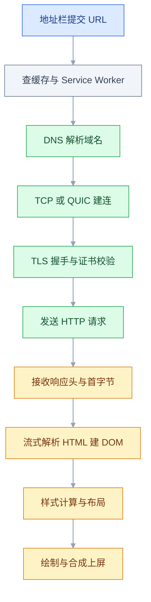
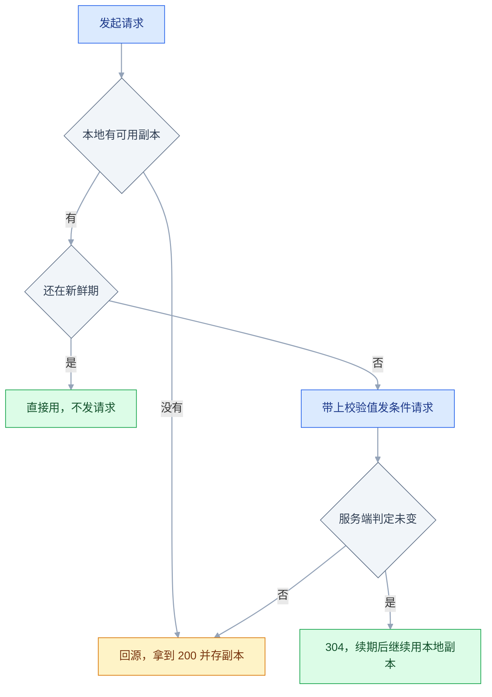
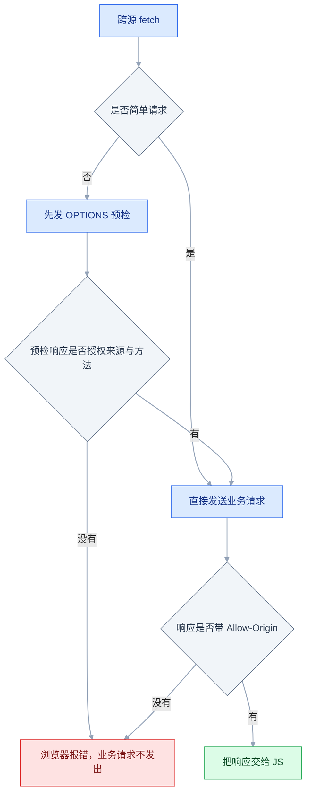

# 浏览器与网络

## 一、工程案例：给一个前后端分离站点做上线前的网络层验收

**场景**：一个 Vue SPA 部署在 Nginx 上（`admin.example.com`），接口在另一台机器（`api.example.com`）。上线前有三个反馈：① 首屏要 3.2 秒才出内容；② 少数用户打开是白屏；③ 改版之后，一部分用户一直看到旧页面，强刷才好。

**为什么必须做**：这三个症状看起来都是「前端有问题」，实际分别落在**传输时序、跨域策略、缓存策略**三层。只改代码不去量，改哪一层都是猜。下面这条链路的目标是：每一处修改都能指到一条证据，改完能用命令复验。

**动手前确认**：能打开 DevTools；本机有 `curl`；能改 Nginx 配置和后端 CORS 配置；知道服务是怎么发布的（谁在管入口 HTML）。

### 1.1 先量，一行代码都不改

把一次导航拆成四段，看时间花在哪：

```bash
curl -sS -o /dev/null \
  -w 'dns=%{time_namelookup}s tcp=%{time_connect}s tls=%{time_appconnect}s ttfb=%{time_starttransfer}s total=%{time_total}s size=%{size_download}B\n' \
  https://admin.example.com/
```

基线输出：

```text
dns=0.004s tcp=0.021s tls=0.048s ttfb=0.910s total=0.984s size=1234B
```

`total` 0.98 秒里，TTFB 独占 910ms，响应体只有 1234B。**静态 HTML 的 TTFB 不该接近 1 秒**，这不是带宽问题，要往回源、重定向、边缘节点上查。注意 curl 只量到「响应体收完」；用户说的 3.2 秒还包含 HTML 到达之后的解析与 JS 执行（见 2.6、3.3），两笔账要分开记。判读规则：

| 观测 | 含义 | 往哪查 |
|---|---|---|
| `dns` 超过 100ms | 递归解析慢或没缓存 | 本地 DNS、`dns-prefetch` |
| `tcp` + `tls` 超过 300ms | 跨地域握手成本 | CDN、`preconnect`、HTTP/3 |
| `ttfb` 大而 `size` 很小 | 服务器或链路在等，不是传得慢 | 回源、重定向链、后端渲染 |
| `ttfb` 小而 `total` 大 | 内容体积问题 | 压缩、图片、拆包 |

接着打开 DevTools → Network，勾上 **Disable cache**，刷新，按 Size 排序。看单个请求的 Timing 分段：`Queueing/Stalled → DNS → Initial connection → SSL → Waiting (TTFB) → Content Download`。**静态资源看 Content Download，接口看 TTFB**，两类问题的处理方向完全相反。

然后查缓存现状——这是「一直看到旧页面」的现场：

```bash
for u in https://admin.example.com/ \
         https://admin.example.com/assets/index-3f9a1c.js \
         https://api.example.com/api/config; do
  echo "== $u"
  curl -sI "$u" | grep -iE '^(cache-control|etag|last-modified|age|vary):'
done
```

```text
== https://admin.example.com/
etag: "66f1c2a0-4b2"
last-modified: Mon, 19 Oct 2026 02:00:00 GMT
== https://admin.example.com/assets/index-3f9a1c.js
cache-control: public, max-age=31536000, immutable
== https://api.example.com/api/config
cache-control: no-store
```

入口 `/` 一个 `Cache-Control` 都没有，只有校验值。没写 `Cache-Control`、也没写 `Expires` 但有 `Last-Modified` 时，浏览器会走**启发式缓存**：按 `(当前时间 - Last-Modified) × 10%` 估一个新鲜期。一个三天没更新的 `index.html` 能被缓存七个多小时——用户当然拿不到新版本。强刷能好，正是因为强刷跳过了这一层。查缓存现场时记得把 Network 的 **Disable cache** 取消，否则永远看不到命中。

最后查跨域现状：

```bash
curl -i -X OPTIONS https://api.example.com/api/users \
  -H "Origin: https://admin.example.com" \
  -H "Access-Control-Request-Method: GET" \
  -H "Access-Control-Request-Headers: authorization"
```

```text
HTTP/1.1 200 OK
Content-Type: application/json
Content-Length: 0
```

响应里没有任何 `Access-Control-*` 头。预检不通过，浏览器**不会再发那个真正的 GET**：Network 里通常是一条标红的 `OPTIONS`（状态码可能是 200，但没有放行头），业务请求要么不出现、要么显示 `(failed)`。要分清两件事——**预检确实打到了服务器**（后端日志里能看到 OPTIONS），业务请求却从未离开浏览器；而 2.2 里「请求发出去了、响应被拦在 JS 之外」是另一种现场。那批「白屏」用户就卡在这里：接口拿不到数据，页面没有兜底。

### 1.2 按层修复

**① 缓存：入口与产物分开**

```nginx
# 入口 HTML：允许缓存，但每次都要回源确认
location = /index.html {
    add_header Cache-Control "no-cache" always;
}

# 带内容 hash 的产物：可以放心缓存一年
location /assets/ {
    add_header Cache-Control "public, max-age=31536000, immutable" always;
}
```

`no-cache` 不是「不缓存」，是「缓存了也必须先问服务器」；没变就回 304，只花一个往返，不重传内容。`immutable` 告诉浏览器这段时间内连条件请求都不用发——前提是文件名真的带 hash。

> `add_header` 写在 `location` 里会**覆盖**从 `server` 继承下来的全部 `add_header`。安全头、缓存头要么每个 location 各写一份，要么抽成 `include` 片段统一引入。

**② 同源化：生产环境不要再跨域**

```nginx
upstream api_backend {
    server 10.0.1.20:8080;
    keepalive 32;
}

server {
    listen 443 ssl;
    http2 on;                     # nginx 1.25.1+ 写法；更早版本写 listen 443 ssl http2;
    server_name admin.example.com;
    ssl_certificate     /etc/nginx/certs/admin.example.com.pem;
    ssl_certificate_key /etc/nginx/certs/admin.example.com.key;

    location / {
        root /usr/share/nginx/html;
        try_files $uri $uri/ /index.html;
    }

    location /api/ {
        proxy_pass http://api_backend/;
        proxy_http_version 1.1;
        proxy_set_header Connection "";
        proxy_set_header Host $host;
        proxy_set_header X-Real-IP $remote_addr;
        proxy_set_header X-Forwarded-For $proxy_add_x_forwarded_for;
        proxy_set_header X-Forwarded-Proto $scheme;
    }
}
```

`upstream` 里的 `keepalive` 只有在 `location` 里开了 `proxy_http_version 1.1` 并把 `Connection` 置空时才生效，否则每个请求都新建一条到后端的连接。

`proxy_pass` 末尾那个斜杠决定路径怎么拼，写错就是一片 404：

| 写法 | 浏览器请求 `/api/users` 到后端变成 |
|---|---|
| `proxy_pass http://api_backend/;` | `/users`（前缀被替换） |
| `proxy_pass http://api_backend;` | `/api/users`（原样透传） |

同源之后，浏览器视角只有 `admin.example.com` 一个源：没有预检、没有 `Origin` 校验、Cookie 也不用 `SameSite=None`。这是最省事也最稳的方案。

**③ 开发环境必须有等价链路**

线上同源、本地却跨域，问题会一直拖到发版才暴露。Vite 的代理让本地也走同源：

```typescript
// vite.config.ts
import { defineConfig } from 'vite';

export default defineConfig({
  server: {
    proxy: {
      '/api': { target: 'http://localhost:8080', changeOrigin: true },
    },
  },
});
```

前端代码里的请求一律写相对路径 `fetch('/api/users')`，**不要写 `http://localhost:8080`**——写死绝对地址，代理就绕过去了。

如果业务上确实必须保留跨域（比如开放平台），后端要在预检里回明确的域名、方法、头，并允许凭证；**带凭证时 `allowedOrigins` 必须是枚举出的明确域名，写 `*` 浏览器会直接拒绝**。

### 1.3 验收：12 项全过才算交付

| # | 检查项 | 命令或检查 | 通过标准 |
|---|---|---|---|
| 1 | 入口不被强缓存 | `curl -sI https://admin.example.com/ \| grep -i cache-control` | 含 `no-cache` |
| 2 | 产物长缓存 | `curl -sI .../assets/index-3f9a1c.js \| grep -i cache-control` | `max-age=31536000` 且含 `immutable` |
| 3 | 协商缓存可用 | 带 `If-None-Match`（取自上一次响应的 `ETag`）重发同一 URL | 返回 `304`，无响应体 |
| 4 | 版本切换正确 | 改一行代码重新构建，刷新页面 | 新 hash 文件被拉取，页面是新版 |
| 5 | 同源无预检 | Network 过滤 `Fetch/XHR` | 只有业务请求，没有 `OPTIONS` |
| 6 | 跨域（若保留） | 用 1.1 的 `curl -X OPTIONS` | `204`/`200` + 明确的 `Access-Control-Allow-Origin` + `Vary: Origin` |
| 7 | TTFB | `curl -w '%{time_starttransfer}'` | 静态入口 < 0.8s，接口 < 0.5s |
| 8 | 协议版本 | Network 右键表头 → 勾 `Protocol` | 显示 `h2` 或 `h3` |
| 9 | Cookie 属性 | `curl -sI` 看 `set-cookie` | 含 `HttpOnly`、`Secure`、`SameSite` |
| 10 | 白屏回归 | Console + Network 全量刷新 | 无红色报错，接口 200 且页面有数据 |
| 11 | 长连接存活 | 停后端 60 秒再启动 | SSE 由浏览器自动重连；WebSocket 走到自写的退避重连，都无需手动刷新 |
| 12 | 深链接可直达 | `curl -sI https://admin.example.com/users/42` | `200` 且 `Content-Type: text/html`，同时 `/api/users` 仍为 JSON |

第 3 项的做法是先 `curl -sI` 取回 `ETag`，再带上 `If-None-Match` 发一次，看是否回 `304`。第 6 项如果已经同源部署，应当**没有 OPTIONS 请求**，这一条是给保留跨域的场景用的。

### 1.4 把验收固化成脚本

```bash
#!/usr/bin/env bash
# net-check.sh —— 上线前跑一遍，任一失败即退出非 0
set -euo pipefail
BASE="${1:?用法: ./net-check.sh https://admin.example.com}"

# 这里只固化「最容易悄悄失效」的两项，其余按 1.3 的表逐条追加

cc=$(curl -sI "$BASE/" | awk -F': ' 'tolower($1)=="cache-control"{print $2}' | tr -d '\r')
case "$cc" in *no-cache*) echo "OK   入口 no-cache" ;; *) echo "FAIL 入口: ${cc:-空}"; exit 1 ;; esac

ttfb=$(curl -s -o /dev/null -w '%{time_starttransfer}' "$BASE/")
awk -v t="$ttfb" 'BEGIN{exit !(t<0.8)}' || { echo "FAIL TTFB ${ttfb}s"; exit 1; }
echo "OK   TTFB ${ttfb}s"
```

这套检查该挂在发布流水线的最后一步。**网络层的问题不该靠人肉记忆复验**，尤其缓存头这种「改一个 location 就悄悄失效」的配置。

---

## 二、高频问答：会卡住你的地方，也是面试最常问的

### 2.1 改完代码，刷新还是旧页面

**现场**

先看 `index.html` 是不是从缓存来的：Network 的 Size 列出现 `(disk cache)` / `(memory cache)` 就是它（旧版本显示 `(from disk cache)`）。

```bash
curl -sI https://admin.example.com/ | grep -iE 'cache-control|age|etag'
```

**要点**

- 入口 HTML 才是版本入口：HTML 新，引用的 hash 文件才会新，盯着 JS 找问题一定找错方向。
- 核实顺序固定为「HTML 是不是从缓存来的 → HTML 里引用的文件名有没有变 → 最后才看 JS 内容」。
- 如果 HTML 是 `no-cache` 却仍然是旧的，查 Service Worker（Application → Service Workers → 勾 `Update on reload` 复测）和 CDN 边缘缓存（看响应头 `age`、`x-cache`）。

**追问**

- 为什么强刷就好了？→ 强刷跳过本地缓存直连服务器，恰好证明问题在缓存层。
- 入口能不能也长缓存？→ 不能，HTML 是版本入口，必须每次回源确认。
- CDN 上怎么确认是边缘缓存？→ 看 `age` 和 `x-cache`，命中时 `age` 会持续增长。

### 2.2 控制台报 CORS，但接口在 Postman 里是通的

**现场**

先确认请求到底发没发出去：Network 里看状态是 `(failed)` 或 `canceled`；再用 `curl -H "Origin: ..."` 复现。

```bash
curl -i https://api.example.com/api/users -H "Origin: https://admin.example.com"
```

**要点**

- 请求到了服务器、服务器也回了 200，但响应缺 `Access-Control-Allow-Origin`，浏览器拒绝把响应交给 JS。
- Postman 不是浏览器，没有同源策略，所以它通不代表浏览器通。
- CORS 是浏览器对**响应**的检查，不是对请求的封锁；把「浏览器拦截」当成「请求没发出」是最常见的误判。

**追问**

- 怎么区分「没发出」和「响应被拦」？→ 看 Request Headers 有没有 `Origin`，再看 Response Headers 有没有 `Access-Control-Allow-Origin`。
- 预检失败是什么样？→ 一条标红的 `OPTIONS`，业务请求要么不出现、要么显示 `(failed)`。
- 为什么 curl 能拿到完整响应？→ curl 不执行同源策略，拿到的是服务端原样返回。

### 2.3 带上 Cookie 的跨域请求一定失败

**现场**

先看报错原文：Chrome 是 `... must not be the wildcard '*' when the request's credentials mode is 'include'`，Firefox 是 `Credentials flag is 'true', but ...`。

```javascript
fetch('https://api.example.com/me', { credentials: 'include' });
```

**要点**

- 带凭证的跨域请求要同时满足三条：前端 `credentials: 'include'`、后端 `Access-Control-Allow-Credentials: true`、`Allow-Origin` 是明确域名而不是 `*`。
- 还有第四个条件在 Cookie 属性上：跨站 Cookie 必须 `SameSite=None; Secure`，否则请求根本不带 Cookie。
- 只查 Cookie 本身不够，先分清是「没带上」还是「带上了但响应头不合规」。

**追问**

- 为什么带凭证时 `*` 不行？→ 浏览器一律不认通配，必须回明确域名。
- Cookie 没带上怎么查？→ Application → Cookies 确认值存在，再看 Request Headers 里有没有 `Cookie`。
- 带上了还报错呢？→ 那就是响应头的问题，回到前三条逐一核对。

### 2.4 主域名登录了，子域名还是要重新登录

**现场**

Application → Cookies 看 `Domain` 列；或 `curl -sI` 看 `Set-Cookie` 里有没有 `Domain=.example.com`。

```text
Set-Cookie: sid=abc; Domain=.example.com; Path=/; Secure; HttpOnly; SameSite=Lax
```

**要点**

- Cookie 的可见范围由 `Domain` 和 `Path` 决定，跟页面代码无关；用 iframe 同步登录态是在用前端方案解决作用域问题。
- `admin.example.com` 种下的 Cookie 默认只属于它自己，要子域共享必须显式写父域。
- `__Host-` 前缀的 Cookie 强制不允许写 `Domain`，两者互斥，别混用。

**追问**

- `Domain=example.com` 和 `Domain=.example.com` 有区别吗？→ 现代浏览器视作等价，带点的写法更明确。
- `Path` 是安全边界吗？→ 不是，只是前缀匹配，不能用来隔离权限。
- 怎么验证生效？→ 在子域页面执行 `document.cookie`，看得到父域 Cookie 才算。

### 2.5 页面白屏，但 Network 里所有请求都是 200

**现场**

先看 Console 第一条红色报错，再看 Network 里该 JS 的 `Content-Type`。

```text
Failed to load module script: Expected a JavaScript module script
but the server responded with a MIME type of "text/html".
```

**要点**

- 200 只说明「服务器给了东西」，不说明「给的是对的东西」；只看状态码会漏掉 MIME 和运行时错误。
- 两个高频原因：JS 运行时抛错导致挂载中断；资源 200 但 `Content-Type: text/html`，模块脚本被拒绝执行。
- 核实顺序：Console 有没有 `Uncaught` → 有没有 `MIME type` 报错 → 有没有 CSP 的 `Refused to execute` → 最后看 `#app` 是不是空的、路由是不是回退到了 HTML。

**追问**

- 为什么 Nginx 会把 HTML 返回给 JS 请求？→ 文件不存在，`try_files` 回退到了 `index.html`。
- CSP 拦截长什么样？→ `Refused to execute`，并带上具体指令名。
- 状态码 200 但内容不对，最快的确认方式？→ `curl -sI` 看 `Content-Type`。

### 2.6 首屏 HTML 很快就到了，内容却很久才出来

**现场**

Performance 面板看 FCP 之前主线程在干什么；Network 看 Waterfall 是不是串行。

**要点**

- 传输快的标志是 HTML 的 `Content Download` 很短，此后到 FCP 之间的空白全是解析与执行成本。
- 三类阻塞：同步 `<script>` 卡住解析、CSS 没到齐无法构建渲染树、首屏内容要等 JS 执行完再请求接口（CSR 的串行链）。
- 把「渲染等待」当成「传输慢」就会去加带宽，而真正该做的是拆阻塞。

**追问**

- 怎么确认是 JS 在挡？→ Main 轨道 FCP 之前有大段黄色 Scripting。
- CSS 为什么会间接挡 JS？→ 同源样式表之后的脚本要等 CSSOM 建好才执行。
- 加 `defer` 能解决吗？→ 只解除解析阻塞，执行仍在 `DOMContentLoaded` 前。

### 2.7 明明返回 304，页面内容却是旧的

**现场**

对比两台机器返回的 `ETag` 是否相同；再把 `ETag` 和文件内容的 hash 对一下。

**要点**

- 304 只表示校验值匹配，不是内容指纹的证明。
- nginx 默认 `ETag` 是 `mtime-size`，Apache 默认是 `inode-mtime-size`，换机器、换发布方式就可能「内容变了但校验值没变」。
- 连续 `curl -sI` 两次看 `ETag` 是否稳定；不稳定就先统一成内容 hash 再谈缓存。

**追问**

- 多机部署为什么容易出问题？→ 每台机器生成 `ETag` 的规则和时间不同。
- 部署脚本改了 mtime 会怎样？→ 内容变了校验值没变，浏览器仍收到 304。
- 弱 `ETag` 是什么？→ `W/` 前缀，表示语义等价，不保证字节相同。

### 2.8 接口「很慢」，但 TTFB 只有几十毫秒

**现场**

Timing 分段里看哪一段最长；再看响应头有没有 `Content-Encoding`。

**要点**

- 慢在 `Content Download`：响应体太大、没压缩，或前端在等一个流式响应读完。
- 也可能是 Queueing——同域连接被占满，请求在排队，还没轮到发。
- 只看总耗时会把它误判成网络问题；TTFB 小、下载长是典型的体积问题。

**追问**

- 怎么看出没压缩？→ `Size`（传输体积）与 `Content`（解压后体积）差距大。
- Stalled 是什么？→ 请求在浏览器队列里等可用连接。
- HTTP/2 下还有 Queueing 吗？→ 单连接多路复用，主要受流控和优先级影响。

### 2.9 WebSocket 每隔一分钟左右断一次

**现场**

看断开间隔是否固定；查代理的 `proxy_read_timeout`；抓包看最后一条数据到断开的时间差。

```nginx
location /ws/ {
    proxy_pass http://ws_backend;
    proxy_http_version 1.1;
    proxy_set_header Upgrade $http_upgrade;
    proxy_set_header Connection "upgrade";
    proxy_read_timeout 300s;
    proxy_send_timeout 300s;
}
```

**要点**

- 中间的 Nginx / 负载均衡 / 云 NAT 有空闲超时（常见 60s），长时间没有数据就掐连接。
- 客户端没心跳、服务端也没主动 ping，连接在链路设备眼里就是空闲的。
- 心跳间隔要小于超时时间（比如 25s 一次 ping）；再配客户端指数退避重连，避免服务端重启时被重连风暴打垮。

**追问**

- 为什么只查应用层会漏？→ 这一类是链路设备先动手，应用日志里往往没有异常。
- 怎么确认是空闲超时？→ 把心跳调到小于超时后断开消失。
- SSE 需要心跳吗？→ 浏览器会自动重连，但代理超时同样会断，长连接都要保活。

### 2.10 服务端 `Set-Cookie` 了，浏览器里却没有

**现场**

Network → 该响应 → Response Headers 看 `set-cookie`；Console 有时会给出被忽略的原因。

**要点**

- 浏览器对非法属性组合是**静默丢弃**，不报错；只看「有没有这个头」不够。
- 逐项核对 `Domain`（必须以当前域或父域结尾）、`Path`、`Secure`（`None` 时必须）、`SameSite`，再确认响应是在 HTTPS 下返回的。
- 都对了还不出现，看是不是被 `Clear-Site-Data` 或隐私模式清掉了。

**追问**

- 为什么控制台没有报错？→ 规范要求静默丢弃，不产生异常。
- `SameSite=None` 不加 `Secure` 会怎样？→ 整个 Cookie 被丢弃。
- 怎么排除前端删掉了？→ Application 里看 Cookie 列表和 `Clear-Site-Data` 响应头。

### 2.11 无痕模式 / 隐私浏览器里 localStorage 直接抛异常

**现场**

在隐私窗口里执行 `localStorage.setItem('a','1')`，看是否抛错。

**要点**

- 浏览器拒绝存储时**不返回 `null`，而是抛异常**，假设存储一定可用是错的。
- 第三方 iframe 被存储策略拦会抛 `SecurityError`，配额耗尽抛 `QuotaExceededError`；旧版 Safari 无痕也属这一类（新版多改为临时存储，以官方当前文档为准）。
- 存储是外部资源，和网络一样会失败：包一层 try/catch，失败时退到内存对象。

**追问**

- 怎么判断是在 iframe 里被拦？→ 看是否第三方上下文、是否命中 Chrome 的存储分区。
- 配额耗尽怎么办？→ 清理旧键，或改用容量更大的 IndexedDB。
- 为什么不能只判 `null`？→ 失败路径是抛异常，`null` 判断永远不触发。

### 2.12 刷新子路由或直接打开深链接，返回 404

**现场**

`curl -sI https://admin.example.com/users/42` 看状态码与 `Content-Type`。

```bash
curl -sI https://admin.example.com/users/42 | head -3
```

```text
HTTP/1.1 404 Not Found
Content-Type: text/html
```

**要点**

- 线上只有一个 `index.html`，`/users/42` 在服务器上没有对应文件；开发服务器的 history 回退不写进构建产物，上线就没了。
- Nginx 没配 `try_files`，请求就直接落到 404；修法是 `location /` 里那行 `try_files $uri $uri/ /index.html;`。
- 核实要双向：深链接回 `200` 且 `Content-Type: text/html`，同时 `/api/users` 仍是 `application/json`。

**追问**

- 接口也返回 HTML 说明什么？→ 回退规则把接口吞了，接口那个 `location` 不能带 `try_files`。
- hash 路由为什么不需要回退？→ 路径不进服务器，`#` 后面不参与请求。
- `$uri/` 那一项是干什么的？→ 尝试目录，配合 `index` 指令处理 `/users/` 这类路径。
---

## 三、核心知识：从零开始要建立的东西

### 3.1 多进程架构与渲染主线程

浏览器不是一个进程。以 Chromium 为例：**浏览器进程**管地址栏、标签页、权限；**渲染进程**按站点隔离，每个标签页（或每个站点）一个，里面跑着页面；**GPU 进程**负责合成上屏；**网络进程**统一收发请求。一个页面崩了不拖垮整个浏览器，一个站点的脚本也读不到另一个站点的内存——这是**站点隔离**的安全价值。

渲染进程里真正干活的是**主线程**：解析 HTML、计算样式、布局、执行 JS、生成绘制指令，全在这一条线上排队。所以一段 800ms 的 `for` 循环会让点击、输入、动画一起停摆——这不是「JS 慢」，是**主线程被独占**。

旁边还有几条辅助线：**合成线程**（把图层交给 GPU，不等主线程）、**光栅线程**（图层转位图）、**Worker 线程池**（跑 Web Worker）。它们能分担计算，但**都不能碰 DOM**。

| 线程 | 能做什么 | 不能做什么 |
|---|---|---|
| 主线程 | 解析、样式、布局、执行 JS、改 DOM | 长时间独占而不影响交互 |
| 合成线程 | 图层位移、缩放、透明度合成 | 改布局、执行页面 JS |
| Worker | 纯计算、数据处理、`fetch` | 访问 `document`、`window` |

> **面试**：常问「一个 800ms 的循环为什么会卡住点击？」答：解析、样式、布局、JS 全在主线程排队，主线程被独占，交互一起停摆。

### 3.2 一次导航的四个阶段



四个阶段各自有独立的优化手段：DNS 用 `dns-prefetch`，连接用 `preconnect`，请求用 CDN 与缓存，渲染用关键 CSS 与 `defer`。**把它们混在一起说「页面慢」，就永远只能猜。**

TLS 1.3 把握手压到 1-RTT，会话复用时可以 0-RTT；HTTP/3 直接把传输换成基于 UDP 的 QUIC，建连与加密合并，弱网切换网络时连接还能迁移。HTTPS 不是可选项：`Service Worker`、`getUserMedia`、`Geolocation`、剪贴板等能力只在安全上下文（HTTPS 或 localhost）里可用。

### 3.3 HTML 解析与阻塞规则

浏览器**边下载边解析**，不是等整个文档到齐。解析器遇到外部资源时的行为，决定了首屏速度：

| 资源 | 是否阻塞解析 | 是否阻塞渲染 | 说明 |
|---|---|---|---|
| `<link rel="stylesheet">` | 否 | **是** | 没有 CSSOM 就无法计算样式 |
| `<script src>` | **是** | 是 | 停止解析，下载并执行完再继续 |
| `<script defer>` | 否 | 是（执行时） | 解析完、按顺序、在 `DOMContentLoaded` 前执行 |
| `<script async>` | 否 | 是（执行时） | 下载完立刻执行，顺序不确定 |
| `<script type="module">` | 否 | 是（执行时） | 默认等同 `defer` |
| `` | 否 | 否 | 只占位，不挡解析 |

两个容易忽略的细节：

1. **CSS 会间接阻塞脚本**。一个 `<script>` 如果排在同源的样式表之后，浏览器必须等 CSSOM 建好才执行它（脚本可能读样式）。所以「CSS 很慢」常常表现为「JS 迟迟不跑」。
2. **预加载扫描器（preload scanner）** 会在主解析器被脚本卡住时，继续往后扫 HTML、提前下载图片和脚本。这解释了为什么 `defer` 的脚本往往下载得很快——**下载不是它慢的原因，执行才是**。

### 3.4 渲染流水线：样式、布局、绘制、合成

DOM 树 + CSSOM 树合成**渲染树**（只含可见节点），然后：

```text
Style（算每个节点的最终样式）
  → Layout（算每个盒子的 x/y/宽/高）
  → Paint（生成绘制指令，按图层分）
  → Composite（GPU 把图层拼成一张图上屏）
```

成本量级差别很大：布局要处理元素之间的相互影响，最贵；绘制只重画受影响区域，中等；合成只是图层搬运，最便宜。所以动画优化的核心思路只有一句：**让变化只走最后一步**。

`display: none` 的元素不进渲染树；`visibility: hidden` 的元素**在**渲染树里，占位置但不画。这两者的区别会直接影响布局计算。

### 3.5 重排与重绘的触发边界

**重排（layout）**：几何信息变了，需要重新算位置和大小。**重绘（paint）**：只有颜色、背景、阴影这类视觉属性变了，几何没变。

| 改动 | 触发 |
|---|---|
| `width` / `height` / `margin` / `padding` / `font-size` | 重排 + 重绘 |
| 增删 DOM 节点、改变 `display` | 重排 + 重绘 |
| `color` / `background-color` / `visibility` / `box-shadow` | 只重绘 |
| `transform` / `opacity`（已提升为合成层） | 只合成 |
| 读取 `offsetWidth` / `getBoundingClientRect()` | **强制同步布局** |

**「读写交替」是最常见的性能陷阱**：读布局属性会要求浏览器立刻把待处理的样式变更算完，否则读不到正确值。循环里「写一次、读一次」，就把一次布局拆成了 N 次：

```javascript
// ✘ 每轮都强制同步布局
for (let i = 0; i < rows.length; i++) {
  rows[i].style.width = table.offsetWidth + 'px';
}

// ✔ 先读完，再统一写
const w = table.offsetWidth;
for (let i = 0; i < rows.length; i++) rows[i].style.width = w + 'px';
```

批量修改还有两个手段：用 class 一次性切换（避免逐条改 style），或用 `DocumentFragment` 一次性插入一批节点（只触发一次布局）。

### 3.6 合成层与动画时序

元素被提升为**合成层**后，`transform` 和 `opacity` 的变化由合成线程直接处理，**不经过主线程的布局与绘制**。主线程再忙，这类动画也不会掉帧。

```css
.card {
  transform: translateZ(0);   /* 触发层提升 */
  will-change: transform;     /* 更明确的声明 */
}
```

代价是显存：每一层都要一块独立的位图。给整页几百个列表项都加 `will-change`，显存会爆，反而更卡。**只给正在动的元素加，动画结束就撤掉。**

时间源也要对。`setInterval(fn, 16)` 和屏幕刷新没有关系，会抖动、会丢帧，后台标签页还在跑；`requestAnimationFrame` 在下一帧渲染前回调，页面不可见时自动暂停：

```javascript
function step() {
  x += 4;
  el.style.transform = `translateX(${x}px)`;
  if (x < 400) requestAnimationFrame(step);
}
requestAnimationFrame(step);
```

### 3.7 HTTP 报文与方法语义

一个请求由**请求行、请求头、空行、请求体**组成；响应同理。方法不只是「动词」，它带有两个契约：

| 方法 | 语义 | 安全（不改状态） | 幂等（可重试） | 常见用途 |
|---|---|---|---|---|
| `GET` | 取资源 | 是 | 是 | 查询、页面 |
| `HEAD` | 只要头 | 是 | 是 | 探活、看是否更新 |
| `POST` | 提交/创建 | 否 | **否** | 表单、下单 |
| `PUT` | 整体替换 | 否 | 是 | 覆盖式更新 |
| `PATCH` | 局部更新 | 否 | 否 | 改单个字段 |
| `DELETE` | 删除 | 否 | 是 | 删除资源 |
| `OPTIONS` | 询问支持的能力 | 是 | 是 | CORS 预检 |

**幂等决定了能不能自动重试**。网络抖动时重发 `PUT` 结果一样，重发 `POST` 可能建出两条订单——这就是支付接口必须带幂等键的原因，方法语义本身救不了业务。

`GET` 的查询参数在 URL 里，会进日志、进 Referer、进浏览器历史，**不要放手机号、身份证、token**。

### 3.8 状态码的分类与判别

| 段 | 含义 | 高频码 |
|---|---|---|
| 1xx | 信息性 | `101` 协议切换（WebSocket） |
| 2xx | 成功 | `200`、`201` 已创建、`204` 无内容、`206` 部分内容 |
| 3xx | 重定向/缓存 | `301` 永久、`302` 临时、`304` 未修改、`307` 临时与 `308` 永久且都保持方法与请求体 |
| 4xx | 客户端 | `400`、`401`、`403`、`404`、`405`、`413`、`429` |
| 5xx | 服务端 | `500`、`502`、`503`、`504` |

几组必须分清的对：

- **401 vs 403**：401 是「没认证/凭证失效」，403 是「认证过了但没权限」。前端对 401 应跳登录，对 403 应提示无权限——都跳登录会让用户反复登录还是进不去。
- **301 vs 302**：301 会被浏览器长期缓存，路径一旦发出去就难收回；临时跳转一律 302/307。
- **307 vs 302**：307 明确要求保持原方法和请求体，POST 重定向不会被降级成 GET。
- **502 vs 504**：502 是网关从上游收到无效响应（后端崩了/端口不通），504 是网关等上游超时（后端太慢）。一个是「连不上」，一个是「等不到」。

### 3.9 请求头与响应头的职责

| 头 | 方向 | 作用 | 常见坑 |
|---|---|---|---|
| `Host` | 请求 | 目标站点，HTTP/1.1 必带 | 反代没透传会导致后端生成错误链接 |
| `Origin` | 请求 | 发起请求的源，CORS 与 CSRF 校验用 | 部分请求不带（同源 GET 导航） |
| `Referer` | 请求 | 来源页面 | 可被策略裁掉，不能当唯一依据 |
| `Content-Type` | 双向 | 报文体的格式 | 写错会让后端解析失败或触发预检 |
| `Accept-Encoding` | 请求 | 支持的压缩算法 | 压缩必须配 `Vary` |
| `Cache-Control` | 双向 | 缓存策略 | `no-cache` ≠ 不缓存 |
| `ETag` / `Last-Modified` | 响应 | 校验值 | 多机不一致会导致误判 304 |
| `Vary` | 响应 | 同一 URL 按哪些请求头分版本 | 漏了会把 A 用户的响应给 B |
| `Set-Cookie` | 响应 | 种 Cookie | 属性非法会被静默丢弃 |
| `Content-Disposition` | 响应 | 内联展示还是下载 | 文件名要 RFC 5987 编码 |

`Vary: Accept-Encoding` 是压缩场景的必需品：没有它，CDN 可能把 gzip 版本发给不支持压缩的客户端。`Vary: Origin` 是 CORS 场景的必需品：没有它，边缘节点会把 A 域的 `Allow-Origin` 缓存给 B 域。

### 3.10 HTTP 缓存的两级模型



**强缓存**看 `Cache-Control`（`Expires` 是旧写法，优先级更低）；**协商缓存**看 `ETag`/`If-None-Match` 或 `Last-Modified`/`If-Modified-Since`。

图里「带校验值发条件请求」有前提：副本得带 `ETag` 或 `Last-Modified`。两者都没有时，浏览器只能当成普通请求整份重取——这也是静态文件不要随手关掉 `etag` 的原因。

| 指令 | 含义 | 典型用途 |
|---|---|---|
| `max-age=31536000` | 一年内直接用 | 带 hash 的静态产物 |
| `no-cache` | 可以存，但每次必须校验 | 入口 HTML |
| `no-store` | 完全不存 | 含用户隐私的接口 |
| `private` | 只允许浏览器缓存，CDN 不许 | 个性化页面 |
| `public` | 允许 CDN 缓存 | 公共静态资源 |
| `s-maxage` | 只对共享缓存生效，覆盖 `max-age` | CDN 与浏览器策略不同 |
| `immutable` | 新鲜期内连校验都免了 | 文件名带内容 hash |
| `stale-while-revalidate` | 先给旧内容，后台更新 | 容忍短暂过期的列表 |

三个边界：

1. **`no-cache` 不是「不缓存」**，`no-store` 才是。把 `no-cache` 理解成不缓存，会误以为「用户每次都全量下载」。
2. **强缓存期间服务器管不到浏览器**。资源删了、改了，只要没到期，用户看到的还是旧的——这就是为什么入口必须 `no-cache`。
3. **缓存默认只认 GET/HEAD**，`POST` 要显式声明新鲜度才可能被存。带 `Authorization` 的响应默认不进共享缓存。

> **面试**：常问「`no-cache` 和 `no-store` 有什么区别？」答：`no-cache` 可以存但每次必须校验，`no-store` 完全不存；入口 HTML 用前者。

### 3.11 Cookie 的属性与作用域

```text
Set-Cookie: sid=abc123; Domain=.example.com; Path=/; Max-Age=86400; HttpOnly; Secure; SameSite=Lax
```

| 属性 | 决定什么 | 注意 |
|---|---|---|
| `Domain` | 哪些域能带上 | 不写=仅当前主机；写父域则子域共享 |
| `Path` | 哪些路径能带上 | 只是前缀匹配，不是安全边界 |
| `Max-Age` / `Expires` | 存活时间 | 都不写=会话 Cookie，关浏览器即失 |
| `HttpOnly` | JS 能否读取 | 只能服务端设置，`document.cookie` 看不到 |
| `Secure` | 是否仅 HTTPS 发送 | `SameSite=None` 时必须 |
| `SameSite` | 跨站请求是否携带 | `Lax` 是现代默认 |

`SameSite` 三档的实际行为：

| 值 | 跨站顶层导航 GET | 跨站 POST / iframe / fetch |
|---|---|---|
| `Strict` | 不带 | 不带 |
| `Lax` | 带 | 不带 |
| `None` | 带 | 带（必须配 `Secure`） |

`Lax` 之所以能挡掉大部分 CSRF，是因为攻击者最想要的是「跨站自动 POST」，而 `Lax` 恰好不带。但它**不拦顶层 GET 导航**，所以「用 GET 做删除」依然危险。

Cookie 总量小（单条约 4KB，单域上限约 180 条，以官方当前文档为准），且**每个同域请求都会带上**。把用户信息、权限列表塞进 Cookie，会让每个请求都多几百字节。

### 3.12 同源策略与 CORS 预检

**同源 = 协议 + 主机 + 端口完全相同**。`https://a.com` 与 `http://a.com`、`https://a.com:8443`、`https://api.a.com` 全都不同源。

同源策略限制的是**读取**：跨源的 `fetch` 默认发得出去，但响应不给 JS。这让「借用户身份发请求」仍然可能（CSRF），但「读用户数据」被挡住。

CORS 用响应头授权。**简单请求**直接发，浏览器看响应头决定是否放行；**非简单请求**先发 `OPTIONS` 预检。简单请求要同时满足：

- 方法是 `GET`、`HEAD`、`POST` 之一；
- 只用了 CORS 安全列表内的请求头（`Accept`、`Accept-Language`、`Content-Language`、`Content-Type` 等）；
- `Content-Type` 是 `application/x-www-form-urlencoded`、`multipart/form-data`、`text/plain` 之一。

所以**只要带 `Authorization` 或发 JSON，就一定会预检**。



预检响应至少要回 `Access-Control-Allow-Origin`（明确域名或 `*`）；方法不是简单方法时要回 `Access-Control-Allow-Methods`；带了非安全列表的请求头时要回 `Access-Control-Allow-Headers`（自定义头逐个列出）。`Access-Control-Max-Age` 能把结果缓存一段时间，减少往返——**浏览器各自有封顶**（Chrome 约 2 小时，Firefox 约 24 小时，以官方当前文档为准）。

还有一对容易混的头：`Access-Control-Allow-Headers` 管**请求**能带什么；前端要读自定义**响应**头（比如分页的 `X-Total-Count`）则要靠 `Access-Control-Expose-Headers` 放出来。只配前者时业务数据全对，读那个头却拿到 `null`。

带凭证时还有两条硬约束：`Allow-Origin` 不能是 `*`，且必须回 `Access-Control-Allow-Credentials: true`。

> **面试**：常问「为什么带了 `Authorization` 就一定会预检？」答：它不在 CORS 安全列表请求头里，属于非简单请求，浏览器先发 OPTIONS 问服务器。

### 3.13 连接复用与 HTTP 版本演进

| | HTTP/1.1 | HTTP/2 | HTTP/3 |
|---|---|---|---|
| 传输层 | TCP | TCP | QUIC（UDP） |
| 并发方式 | 每域约 6 个连接 | 单连接多路复用 | 单连接多路复用 |
| 队头阻塞 | HTTP 层 + TCP 层 | 仅 TCP 层 | 基本消除 |
| 头部压缩 | 无 | HPACK | QPACK |
| 服务器推送 | 无 | 曾有，浏览器已移除 | 无 |
| 加密 | 可选 | 事实必需 | 强制 |

这直接改写了优化清单：

```text
HTTP/1.1 时代：合并文件、雪碧图、域名分片、内联小资源
HTTP/2 时代：按路由拆分更好（缓存粒度细）、不需要雪碧图、不要域名分片
```

**域名分片在 HTTP/2 下是负优化**：多开一个域名就多一次 DNS、TCP、TLS，而单连接本来就能并行。合并文件也一样——一个大 bundle 里改一行，整个文件的缓存都失效。

查看当前协议：Network 面板右键表头 → 勾 `Protocol`，看 `h2` / `h3` / `http/1.1`。

### 3.14 浏览器存储的四个位置

| | Cookie | localStorage | sessionStorage | IndexedDB |
|---|---|---|---|---|
| 容量 | 约 4KB | 约 5MB | 约 5MB | 数百 MB 起，按配额 |
| 生命周期 | 可设置 | 永久，除非手动清除 | 标签页关闭即清 | 永久 |
| 随请求发送 | **是** | 否 | 否 | 否 |
| 跨标签页 | 是 | 同源共享 | 否 | 同源共享 |
| API | 字符串拼接 | 同步 | 同步 | **异步事务** |
| 适合 | 会话标识 | 主题、少量配置 | 表单草稿 | 大量结构化数据、离线缓存 |

选择只有一条判断链：**需要自动随请求发给服务器 → Cookie；只是本地配置 → localStorage；只在本标签页有效 → sessionStorage；数据量大或要索引 → IndexedDB。**

```javascript
document.cookie = 'theme=dark; Path=/; Max-Age=86400; SameSite=Lax';
localStorage.setItem('prefs', JSON.stringify({ theme: 'dark' }));
```

存储是「按源隔离」的，不是「按用户隔离」的：同一浏览器里切换账号，上一个账号留下的数据还在。**登出时必须主动清理**，否则下一个用户能读到。`localStorage` 是同步 API，在主线程读写大对象会造成可感知的卡顿。

### 3.15 实时通信的三种形态

| | 短轮询 | SSE | WebSocket |
|---|---|---|---|
| 方向 | 客户端拉 | 服务端推 | 双向 |
| 协议 | HTTP | HTTP（`text/event-stream`） | 独立协议，`101` 升级 |
| 自动重连 | 自己写 | **浏览器内置** | 自己写 |
| 断点续传 | 自己记录 | `Last-Event-ID` | 自己设计 |
| 数据形态 | 任意 | 仅文本 | 文本 + 二进制 |
| 适合 | 低频状态查询 | 通知、AI 流式输出 | 聊天、协同、行情 |

WebSocket 的握手是 HTTP：客户端发 `Upgrade: websocket` 和 `Sec-WebSocket-Key`，服务端回 `101` 和算好的 `Sec-WebSocket-Accept`。**握完就不再是 HTTP**，所以它没有同源策略那套响应头检查：任意站点都能向你的 `wss://` 发起连接，鉴权要在握手阶段用 Cookie 或首个消息完成，并且**服务端必须自己校验 `Origin`**，否则就是跨站 WebSocket 劫持。

SSE 只是「一个不结束的 HTTP 响应」，因此天然穿过大部分代理，但也因此受连接数限制：HTTP/1.1 下同域约 6 个，HTTP/2 下按流算。`EventSource` 只支持 GET，需要 POST 参数时得用 `fetch` + `ReadableStream` 自己解析。

> **面试**：常问「WebSocket 有没有同源策略保护？」答：没有，握手完就不是 HTTP 了，鉴权要在握手阶段做，服务端必须自己校验 `Origin`。

### 3.16 DevTools 的证据面板

| 面板 | 回答什么问题 | 关键操作 |
|---|---|---|
| Network | 请求发没发、慢在哪一段、有没有走缓存 | 勾 Disable cache、看 Timing、加 Protocol 列 |
| Console | 有没有报错、报错原文是什么 | 看第一条红错，不要只看最后一条 |
| Performance | 主线程在忙什么、有没有长任务 | 录一段交互，看 Main 轨道的黄块 |
| Application | 存了什么、Service Worker 是谁 | 看 Cookie 属性、清站点数据 |
| Sources | 哪一行代码干的 | 条件断点、XHR 断点、事件断点 |
| Lighthouse | 整体处于什么水平 | 移动端跑三次取中间值 |

排障顺序应该固定成：**Console 看错 → Network 看请求 → Application 看存储 → Performance 看主线程**。跳着看最容易把「缓存问题」当成「代码问题」。

---

## 四、冷门知识汇总

| 知识点 | 为什么冷门 | 用到时的关键词 |
|---|---|---|
| `103 Early Hints` | 需要服务端与 CDN 同时支持，配好的人少 | `Link: </app.css>; rel=preload` |
| `Clear-Site-Data` | 只在「登出要彻底清干净」时才需要 | `Clear-Site-Data: "cache", "cookies", "storage"` |
| 混合内容升级 | HTTPS 站点里偶尔残留一个 HTTP 资源 | `upgrade-insecure-requests`、`blockable mixed content` |
| `fetchpriority` | 默认优先级已够用，只有首屏大图值得手动调 | `fetchpriority="high"` |
| 弱 ETag | 只有跨机器部署时才会暴露问题 | `W/"abc"`、语义等价 |
| `Range` 与断点续传 | 视频、大文件下载场景之外很少碰 | `Range: bytes=0-1023`、`206` |
| back/forward cache | 现象是「后退秒开」，很少有人主动配 | `bfcache`、`pagehide`、`pageshow` |
| 存储分区 | 第三方 iframe 里的存储行为变了才有感知 | `Storage Partitioning`、`Partitioned` |
| `__Host-` Cookie 前缀 | 安全加固时才会用到 | `__Host-`、`__Secure-` |
| Cookie 的 `Partitioned` | 广告与嵌入式场景专属 | `CHIPS`、`Partitioned; Secure` |
| `SameSite=Lax` 的两分钟例外 | 新建 Cookie 的 POST 导航短暂放行 | `Lax-allowing-unsafe` |
| 预加载扫描器 | 解释了「为什么 defer 也下载得很快」 | `preload scanner`、`speculative parsing` |
| `chrome://net-export/` | 需要抓底层网络日志时才用 | `net-export`、`NetLog` |
| Alt-Svc 与 HTTP/3 发现 | 由响应头自动完成，平时无感 | `Alt-Svc: h3=":443"` |
| `Keep-Alive` 与连接池 | 只在调优高并发时才有意义 | `keepalive_requests`、`keepalive_timeout` |
