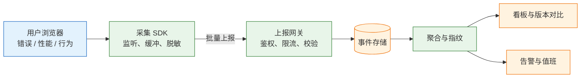
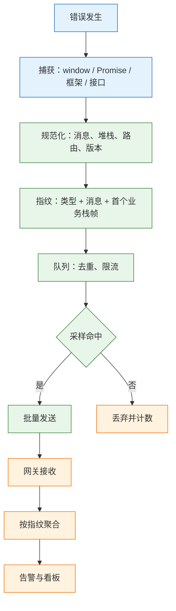

# 前端监控

---

## 一、前端监控是什么

### 1.1 核心概念

> 监控不是接一个 SDK。它要回答三个问题：坏了没有、坏在哪里、影响了多少人。答不上第三个，告警就只是噪音。

前端监控是在真实用户的浏览器里持续采集运行状态，并把零散事件整理成可查询、可比较、可告警的数据。它和日志的区别在视角：日志记录“系统做了什么”，监控回答“用户遇到了什么”。

上线之后，开发者能直接观察的只有自己的浏览器和客服转述的截图。常见的信息断层有三类：

- “用户说打不开”——不知道是哪个页面、什么浏览器、是否只有他一个人。
- “昨天还好好的”——不知道昨天发的是哪个版本，错误率有没有变化。
- “改完了”——不知道是真的没再出现，还是没人再报。

监控把口头反馈变成结构化数据：哪条错误、哪个版本、多少用户、什么设备、堆栈落在哪一行。它不证明功能正确，那是测试的职责；它负责发现测试覆盖不到的真实环境问题。

| 能力 | 回答的问题 | 不负责 |
|---|---|---|
| 错误采集 | 有没有报错、报在哪一行 | 证明业务逻辑正确 |
| 性能采集 | 用户体感有没有变差 | 定位到具体慢查询 |
| 行为采集 | 用户走到哪一步、卡在哪个接口 | 解释用户为什么放弃 |
| 版本对比 | 是不是这次发版引入的 | 自动修复问题 |
| 告警 | 是否需要立刻处理 | 替代值班流程 |

### 1.2 与相邻技术的关系

前端监控容易和后端监控、日志平台、APM、埋点混为一谈。它们的采集位置和回答的问题不同，不能互相替代。

| 相邻技术 | 采集位置 | 关注点 | 与前端监控的边界 |
|---|---|---|---|
| 后端监控 | 服务端进程 | 接口耗时、错误率、资源 | 看不到浏览器渲染与设备差异 |
| 日志平台 | 应用输出 | 结构化事件、审计 | 缺少用户侧上下文与版本维度 |
| APM | 全链路追踪 | 调用链、依赖耗时 | 前端只作为链路起点上报 |
| 埋点分析 | 业务代码 | 转化、点击、漏斗 | 关注行为，不关注异常 |
| 合成监控 | 固定机房探针 | 可用性、定时拨测 | 无法覆盖真实设备与网络 |

四类监控各管一段：合成监控发现“站点挂了”，后端监控发现“接口慢了”，前端监控发现“某类用户的某条路径坏了”，埋点回答“用户为什么不用”。缺任何一层，故障归因都会断。

> **注意**：前端监控看到 500，只能证明接口返回了 500，拿不到服务端堆栈。要定位根因，必须把前端的 `trace_id` 或请求 ID 带到后端日志里。

### 1.3 架构组成

一套完整链路包含采集、传输、接收、存储、聚合、展示与告警七段。任何一段缺失，数据都不可用。



| 组件 | 职责 | 关键约束 |
|---|---|---|
| SDK | 监听事件、补上下文、脱敏、缓冲 | 体积小、不阻塞渲染、异常自身不能抛错 |
| 传输 | 批量、压缩、卸载时送达 | 不因网络失败拖慢页面 |
| 网关 | 鉴权、限流、字段白名单 | 公网可达，能扛住突发 |
| 存储 | 原始事件、按时间分区 | 写入快、可按时效删除 |
| 聚合 | 指纹分组、分位数计算 | 结果可复现，口径固定 |
| 展示 | 趋势、版本对比、下钻 | 默认按影响面排序 |
| 告警 | 触发、分级、认领 | 有负责人、有静默规则 |

---

## 二、信号分类与采集点

### 2.1 三类信号

前端能采集的信号很多，真正需要先接的是三类。它们的优先级不同，顺序反了会先得到一堆无法行动的数据。

| 信号 | 回答什么问题 | 采样 | 成本 |
|---|---|---|---|
| 错误 | 有没有坏、坏在哪一行 | 全量，按指纹限流 | 低 |
| 性能 | 用户体感有没有变差 | 5%–20% | 中 |
| 行为与请求 | 用户走到哪一步、卡在哪个接口 | 按需 | 高，注意隐私 |

先接错误，再接性能，最后才考虑行为与录屏。错误的数据量最小、行动性最强；性能需要分布才有意义；行为数据的隐私成本最高，接入前要先想清楚用途。



### 2.2 错误采集入口

浏览器的错误分散在四个层面：全局运行时、Promise、框架渲染、网络请求。每个入口的捕获方式不同，漏一个就会留下盲区。

```bash
# 用浏览器版 SDK；Vue/React 项目也可换成对应框架包
pnpm add @sentry/browser web-vitals
```

```js
// 1. 运行时错误与资源加载错误
window.addEventListener('error', (event) => {
  // 资源错误没有 event.error，target 是具体元素
  if (event.target && event.target !== window) {
    report({ type: 'resource', url: event.target.src || event.target.href });
    return;
  }
  report({ type: 'js', message: event.message, stack: event.error?.stack });
}, true); // 必须用捕获，资源错误不冒泡

// 2. 未处理的 Promise 拒绝
window.addEventListener('unhandledrejection', (event) => {
  report({ type: 'promise', reason: String(event.reason), stack: event.reason?.stack });
});

// 3. 框架层：Vue
app.config.errorHandler = (err, instance, info) => {
  report({ type: 'vue', message: String(err), stack: err?.stack, info });
};

// 4. 接口层：在 axios/fetch 封装里统一上报非 2xx
```

React 用 Error Boundary 捕获渲染错误；React 19 的 `createRoot` 还提供 `onUncaughtError`、`onCaughtError`、`onRecoverableError`，可以把“未捕获”“已降级”“可恢复”分开上报。

| 入口 | 捕获范围 | 易漏点 |
|---|---|---|
| `window.addEventListener('error', fn, true)` | 脚本错误、资源加载失败 | 不用捕获阶段就收不到资源错误 |
| `unhandledrejection` | 未处理的 Promise 拒绝 | 已 `catch` 的错误不会触发 |
| 框架 `errorHandler` | 组件渲染与生命周期 | 异步回调里的错误仍走全局 |
| Error Boundary | 子树渲染错误 | 事件处理函数、异步代码不覆盖 |
| 请求封装 | 非 2xx、超时、断网 | 业务错误码常被当成成功 |

### 2.3 性能采集入口

性能指标用 `web-vitals` 采集，它按浏览器实际能力选择底层 API，并对指标口径做了统一。

```ts
import { onCLS, onINP, onLCP, onTTFB } from 'web-vitals';

function report(metric) {
  const body = JSON.stringify({
    name: metric.name,
    value: metric.value,
    rating: metric.rating,
    id: metric.id,
    path: location.pathname,
    release: import.meta.env.VITE_RELEASE,
  });
  // 页面关闭时也能发出去
  navigator.sendBeacon('/api/rum', new Blob([body], { type: 'application/json' }));
}

onLCP(report);
onINP(report);
onCLS(report);
onTTFB(report);
```

四个指标从不同维度描述同一次访问：TTFB 是首字节等待，LCP 是主要内容出现，INP 是交互响应，CLS 是布局稳定。它们并非依次串行发生，采集时也不应假设固定顺序。

| 指标 | 含义 | 经验良好阈值 | 常见变差原因 |
|---|---|---|---|
| TTFB | 请求发出到首字节到达 | ≤ 800 ms | 服务端排队、DNS、TLS、CDN 回源 |
| LCP | 最大内容元素完成渲染 | ≤ 2.5 s | 大图、字体阻塞、首屏依赖接口 |
| INP | 交互到下一次绘制的延迟 | ≤ 200 ms | 长任务、大量同步渲染 |
| CLS | 布局偏移累计得分 | ≤ 0.1 | 图片无尺寸、广告位后插入、字体切换 |

### 2.4 行为与请求采集

请求层的数据最有诊断价值：它能把“页面白屏”定位到“某个接口 500”或“某个接口超时”。但请求体、响应体、Header 都可能是敏感数据，采集前要先定字段白名单。

| 字段 | 是否采集 | 说明 |
|---|---|---|
| 方法、路径、状态码 | 是 | 路径要去掉查询参数中的敏感值 |
| 耗时、是否超时 | 是 | 用于区分慢与失败 |
| 请求 ID | 是 | 与后端日志串联 |
| 请求体、响应体 | 默认否 | 含密码、身份证、业务数据 |
| 完整 URL | 脱敏后 | 手机号、令牌常出现在 query |
| 用户 ID | 按需 | 用内部 ID，不用邮箱手机号 |

---

## 三、上报链路与传输机制

### 3.1 上报时机

上报时机的选择直接影响数据完整性和页面性能。错误应该尽快发，性能指标要等页面稳定，批量数据要在页面隐藏前冲刷。

| 时机 | 适用 | 风险 |
|---|---|---|
| 立即发送 | 严重错误、崩溃 | 请求过多，抢占带宽 |
| 定时批量 | 普通错误、性能 | 页面提前关闭会丢 |
| `visibilitychange` 冲刷 | 离开页面 | 移动端切后台也会触发 |
| `pagehide` 冲刷 | 卸载、往返缓存 | 部分浏览器不保证完成 |
| `beforeunload` | 旧方案 | 现代浏览器不可靠，且影响往返缓存 |

`unload` 事件在现代浏览器里越来越不可靠，移动端经常不触发。用 `visibilitychange` 判断 `document.visibilityState === 'hidden'`，再配合 `pagehide` 做兜底，是更稳的组合。

> **注意**：不要在 `beforeunload` 里做同步 XHR。它会阻塞卸载，用户感知为“关不掉页面”，而且多数浏览器已经限制这种用法。

### 3.2 sendBeacon 与 keepalive

普通 `fetch` 在页面卸载时会被取消，导致最后一批数据丢失。两种传输方式可以解决这个问题。

```js
// 方式一：sendBeacon，浏览器接管发送，不阻塞卸载
const ok = navigator.sendBeacon(
  '/api/rum',
  new Blob([JSON.stringify(events)], { type: 'application/json' }),
);

// 方式二：keepalive，仍然走 fetch 的语义，可带自定义头
if (!ok) {
  fetch('/api/rum', {
    method: 'POST',
    body: JSON.stringify(events),
    headers: { 'content-type': 'application/json' },
    keepalive: true,
  });
}
```

| 方式 | 优点 | 限制 |
|---|---|---|
| `sendBeacon` | 不阻塞卸载，浏览器保证尝试发送 | 不能自定义请求头，请求体有大小上限 |
| `fetch(keepalive)` | 可带 Header、可读响应 | 规范给的配额是 64 KiB，超出会失败 |
| `img` 像素 | 兼容性最好 | 只能 GET，URL 长度有限，易被拦截 |
| 同步 XHR | 送达率高 | 阻塞页面，已不推荐 |

`sendBeacon` 返回布尔值，`false` 表示请求没能进入队列，此时再回退到 `keepalive` 才有意义。请求体超过限制时浏览器会直接拒绝，所以批量上限要按几十 KB 设计，而不是攒到几 MB 再发。

### 3.3 批量、采样与限流

三个手段解决三个不同问题：批量降低请求数，采样降低事件量，限流防止单个错误刷爆。

```js
const METRIC_SAMPLE_RATE = 0.1;   // 只有性能指标按比例采样
const MAX_PER_MINUTE = 30;        // 单页面上报上限
let windowStart = Date.now();
let sentInWindow = 0;

function shouldSend(kind) {
  // 错误全量进入队列，靠指纹去重与频率上限收敛
  if (kind === 'metric' && Math.random() >= METRIC_SAMPLE_RATE) return false;

  const now = Date.now();
  if (now - windowStart > 60_000) {
    windowStart = now;
    sentInWindow = 0;
  }
  if (sentInWindow >= MAX_PER_MINUTE) return false;

  sentInWindow += 1;
  return true;
}
```

| 手段 | 作用 | 注意 |
|---|---|---|
| 批量 | 合并请求，降低网关压力 | 单批控制在几十 KB |
| 会话采样 | 按用户会话整体抽样 | 同一会话内保持一致性 |
| 事件采样 | 按事件独立抽样 | 适合性能指标，不适合致命错误 |
| 指纹去重 | 同一错误只报一次 | 会低估发生次数，需另记计数 |
| 客户端限流 | 防止循环错误刷屏 | 被限流的量要单独统计 |

### 3.4 上报网关

网关是公网入口，必须假设收到的任何内容都不可信。它的职责是鉴权、限流、字段白名单和快速响应，不做重计算。

| 职责 | 做法 | 失败处理 |
|---|---|---|
| 鉴权 | 项目公钥 + 来源校验 | 拒绝并记录，不透露细节 |
| 限流 | 按项目、IP、会话三维度 | 返回 429，客户端退避 |
| 体积限制 | 请求体上限 128 KB | 返回 413 |
| 字段校验 | 只接受白名单字段与类型 | 丢弃非法字段，不整批拒绝 |
| 响应 | 204，无正文 | 减少带宽，避免客户端解析 |
| 缓冲 | 写入消息队列或本地文件 | 后端故障时不丢数据 |

> **安全警告**：上报接口不要复用业务鉴权，也不要接受任意 JSON 直接落库。攻击者可以伪造事件污染看板，也可以借上报接口探测内网或写入恶意内容。用独立的项目公钥，配合字段白名单与容量上限。

---

## 四、错误聚合与堆栈还原

### 4.1 指纹与分组

同一条错误会在不同用户、不同时间重复出现。指纹把“看起来相同”的事件归为一组，是告警和趋势的前提。

| 指纹字段 | 作用 | 处理方式 |
|---|---|---|
| 错误类型 | 区分 JS、Promise、资源、接口 | 直接取枚举值 |
| 错误消息 | 主要区分依据 | 去掉数字、ID、URL 中的动态段 |
| 首个业务栈帧 | 定位代码位置 | 跳过框架与 polyfill 帧 |
| 事务或路由 | 区分发生位置 | 用路由模板，不用具体 ID |
| 版本 | 区分代码基线 | 发版号，不用时间戳 |

指纹太细会导致同一问题分裂成几千组，太粗会把不同 bug 合并。稳妥的做法是“类型 + 归一化消息 + 首个业务栈帧”，版本只用于对比，不参与分组。

```js
// 归一化：把数字、UUID、长十六进制串替换掉，避免每组只出现一次
function normalizeMessage(message) {
  return String(message)
    .replace(/[0-9a-f]{8}-[0-9a-f]{4}-[0-9a-f]{4}-[0-9a-f]{4}-[0-9a-f]{12}/gi, '<uuid>')
    .replace(/\b\d+\b/g, '<n>')
    .slice(0, 300);
}
```

### 4.2 跨域脚本的错误脱敏

浏览器对跨源脚本的错误做了脱敏：没有文件名、行号、堆栈，只有一句 `Script error.`。这不是监控坏了，是安全策略。

解决要两边同时做：

```html
<script src="https://cdn.example.com/app.js" crossorigin="anonymous"></script>
```

```text
Access-Control-Allow-Origin: https://admin.example.com
```

| 条件 | 结果 |
|---|---|
| 有 `crossorigin`，CDN 返回 CORS 头 | 拿到完整消息与堆栈 |
| 有 `crossorigin`，CDN 无 CORS 头 | 脚本直接加载失败 |
| 无 `crossorigin`，CDN 有 CORS 头 | 仍是 `Script error.` |
| 第三方脚本不受控 | 只能过滤，无法还原 |

脚本标签加 `crossorigin`，CDN 返回允许的 CORS 头，浏览器才会把完整错误交出来。只加一边，要么仍是 `Script error.`，要么脚本根本加载不了。如果确实有拿不到的第三方脚本，可以过滤这一句，但要记下来：过滤掉的是“未知”，不是“没有”。

### 4.3 sourcemap 上传与访问控制

生产代码是压缩过的，堆栈里全是 `a.b.c`。要让堆栈落回 `.vue`、`.ts` 的行号，需要 sourcemap。

```ts
// vite.config.ts
export default defineConfig({
  build: { sourcemap: 'hidden' }, // 生成 .map，但不在 JS 末尾写 sourceMappingURL
});
```

```ts
// vite.config.ts；只在 CI 有 SENTRY_AUTH_TOKEN 时启用
import { defineConfig } from 'vite';
import { sentryVitePlugin } from '@sentry/vite-plugin';

export default defineConfig({
  build: { sourcemap: 'hidden' },
  plugins: [
    sentryVitePlugin({
      org: 'acme',
      project: 'admin-web',
      authToken: process.env.SENTRY_AUTH_TOKEN,
    }),
  ],
});
```

`hidden` 和 `true` 的区别：`true` 会在产物里留下引用，任何人打开 DevTools 都能还原源码；`hidden` 不写公开引用，只把 map 交给监控平台。不要把 `.map` 部署到 CDN。

| 配置 | 产物含引用 | 可还原源码 | 适用 |
|---|---|---|---|
| `false` | 否 | 否 | 生产默认 |
| `true` | 是 | 是 | 内部测试环境 |
| `hidden` | 否 | 需 map 文件 | 生产 + 平台上传 |

另一个必须对齐的字段是 `release`。堆栈要和版本对应，`release` 不一致时，平台找不到对应的 sourcemap，堆栈仍然是压缩的。

> **安全警告**：sourcemap 等于源码。上传到监控平台后要限制访问权限，构建产物里不要保留 `.map`，CI 的 `authToken` 只放在密钥管理中，不能写进仓库或前端环境变量。

---

## 五、性能指标与归因

### 5.1 核心指标定义

四个常用指标各有明确的测量对象。理解定义才能判断数据是否可信。

| 指标 | 测量对象 | 触发时机 | 常见误读 |
|---|---|---|---|
| TTFB | 网络请求到首字节 | 导航响应开始 | 把它当成服务端总耗时 |
| LCP | 视口内最大内容元素 | 元素完成渲染 | 首屏图片懒加载会让 LCP 失真 |
| INP | 交互到下一帧绘制 | 每次交互取较差值 | 与 FID 混淆，FID 只测首次输入延迟 |
| CLS | 非预期布局偏移 | 整个生命周期累计 | 用户主动交互引起的偏移不计入 |

指标要带上页面、版本、设备、网络类型才有分析价值。同一个 LCP 在桌面宽带和低端机上差几倍，混在一起看平均值没有意义。

### 5.2 归因字段

只看“LCP 是 4.2 秒”无法行动。归因版本会给出“哪个元素、什么原因”。

```ts
import { onLCP } from 'web-vitals/attribution';

onLCP((metric) => {
  report({
    ...metric,
    // 哪个元素、什么原因（图片、字体、TTFB 等）
    element: metric.attribution?.element?.tagName ?? null,
    url: metric.attribution?.url,
  });
});
```

| 归因字段 | 回答的问题 | 用途 |
|---|---|---|
| `element` | 哪个元素拖慢了 LCP | 定位首屏大图或标题 |
| `url` | 资源来自哪里 | 判断是自建还是第三方 |
| `timeToFirstByte` | 服务端占了多少 | 区分网络与渲染 |
| `resourceLoadDelay` | 资源发现得晚不晚 | 定位加载时机问题 |
| `resourceLoadDuration` | 资源下载耗时 | 定位大文件 |
| `elementRenderDelay` | 资源到手后渲染慢了多久 | 定位主线程阻塞 |

### 5.3 分位数与版本对比

性能数据看 p75，不看平均。平均值会被快用户稀释，少数极慢用户的问题在均值里几乎看不见。

| 统计量 | 含义 | 适用 |
|---|---|---|
| 平均值 | 总体水平 | 容量规划，不适合体验评估 |
| p50 | 一半用户好于该值 | 看常态 |
| p75 | 75% 用户好于该值 | 体验基线，告警常用 |
| p95 | 尾部用户体验 | 定位长尾与极端设备 |
| 版本对比 | 同口径跨版本 | 判断回归是否由发版引入 |

分位数必须同口径比较：同一页面、同一设备类型、同一时间段、足够的样本量。拿本周全部页面的 p75 和上周某个页面的 p75 对比，得出的结论没有意义。

---

## 六、降噪与告警

### 6.1 噪音分类

第一天接入，事件量通常大得离谱。常见噪音有六类，处理方式各不相同。

| 来源 | 典型内容 | 处理 |
|---|---|---|
| 浏览器插件 | `chrome-extension://`、`moz-extension://` 注入的脚本 | 按 URL 协议过滤 |
| 良性浏览器警告 | `ResizeObserver loop limit exceeded` | 加入忽略列表 |
| 用户取消与断网 | `AbortError`、`Failed to fetch`、`NetworkError` | 区分主动取消与真实失败，降低级别 |
| 发版后的旧 chunk | `Loading chunk 17 failed` | 处理一次自动刷新，再过滤 |
| 第三方脚本 | 客服、统计、广告 SDK 的报错 | 单独分组，不混入业务错误 |
| 重复错误 | 同一个循环里每帧报一次 | 指纹合并 + 限流 |


### 6.2 过滤实现

过滤要写在“上报前”，不是“看板里”。看板过滤只是隐藏，事件仍然占用存储和配额。

```ts
import * as Sentry from '@sentry/browser';

Sentry.init({
  dsn: import.meta.env.VITE_SENTRY_DSN,
  environment: import.meta.env.MODE,
  release: import.meta.env.VITE_RELEASE,
  tracesSampleRate: 0.1,
  integrations: [Sentry.browserTracingIntegration()],
  sendDefaultPii: false,
  ignoreErrors: [
    /ResizeObserver loop (limit exceeded|completed with undelivered notifications)/,
    /AbortError/,
  ],
  denyUrls: [
    /^chrome-extension:\/\//i,
    /^moz-extension:\/\//i,
    /^safari-web-extension:\/\//i,
  ],
  beforeSend(event) {
    // 在这里做 URL 参数脱敏；返回 null 表示丢弃
    if (event.request?.url) {
      event.request.url = stripSensitiveQuery(event.request.url);
    }
    return event;
  },
});
```

三个原则：

- **不要用“全忽略”代替“修”**。`Script error.` 应该先补 `crossorigin`，补不了才过滤。
- **不要忽略“用户可感知”的错误**。接口 500 导致的空白页，比插件报错重要得多。
- **过滤规则要能被审查**。写在代码里、进版本库，不要只在监控平台点几下。

### 6.3 告警规则设计

错误的绝对数量会随流量波动，按“每小时超过 100 条”告警，白天误报、夜里漏报。更有意义的触发条件是按影响面。

| 规则 | 触发条件 | 目的 |
|---|---|---|
| 新错误 | 某指纹首次出现且 5 分钟内影响用户数超阈值 | 发现发版引入的问题 |
| 版本回归 | 新 `release` 错误率显著高于上一版本 | 判断是否回滚 |
| 关键路径失败 | 登录、下单、支付接口错误率突增 | 保护核心转化 |
| 性能回归 | LCP p75 连续一小时超过预算 | 发现体验退化 |
| 影响面 | 同一错误影响 ≥ N 个独立用户 | 过滤单用户重复 |

告警要带三样东西：**哪个版本、哪个页面、多少用户**。没有这三样，值班的人第一反应是“先静音”。每条告警还要有负责人和处置手册，否则三天后必然被忽略。

---

## 七、完整示例：最小可用监控链路

### 7.1 目标与目录结构

目标是用一个自建服务接收错误与性能事件，能按版本和页面看 p75，不依赖外部平台。目录按前后端分开：

```text
monitor-demo/
├── web/
│   ├── monitor.js          # 采集 SDK
│   └── main.js             # 业务入口，安装 SDK
└── server/
    ├── index.js            # 上报网关
    └── data/events.ndjson  # 事件落盘
```

| 环节 | 实现 | 验证方式 |
|---|---|---|
| 采集 | 全局错误、Promise、资源、性能 | 控制台手动触发 |
| 传输 | `sendBeacon` + `keepalive` 回退 | Network 面板看请求 |
| 接收 | Express + 字段白名单 + 令牌桶 | `curl` 返回 204 |
| 存储 | NDJSON 追加写 | `wc -l` 看行数 |
| 聚合 | SQL 分位数查询 | 按版本对比 |

### 7.2 客户端 SDK

```js
// web/monitor.js
const ENDPOINT = '/api/rum';
const RELEASE = import.meta.env.VITE_RELEASE;

const queue = [];
const seen = new Set();

// 指纹只用于页面内去重，跨用户聚合由服务端完成
function fingerprint(item) {
  return [item.type, item.message, item.stack?.split('\n')[1] ?? '']
    .join('|')
    .replace(/\d+/g, '#')
    .slice(0, 200);
}

export function report(payload) {
  const item = {
    ...payload,
    release: RELEASE,
    route: location.pathname,
    ts: Date.now(),
  };

  const key = fingerprint(item);
  // 指标会随页面生命周期多次更新，不能按首次值去重
  if (item.type !== 'metric') {
    if (seen.has(key)) return;
    seen.add(key);
  }

  queue.push(item);
  if (queue.length >= 20) flush();
}

export function flush() {
  if (!queue.length) return;
  const body = JSON.stringify(queue.splice(0, queue.length));

  // 卸载时优先用 beacon；失败再退回 keepalive
  const ok = navigator.sendBeacon(
    ENDPOINT,
    new Blob([body], { type: 'application/json' }),
  );
  if (!ok) {
    fetch(ENDPOINT, {
      method: 'POST',
      body,
      headers: { 'content-type': 'application/json' },
      keepalive: true,
    }).catch(() => {});        // 上报失败不能影响业务
  }
}

export function install() {
  window.addEventListener('error', (event) => {
    // 资源错误没有 error 对象，target 指向具体元素
    if (event.target && event.target !== window) {
      report({
        type: 'resource',
        message: event.target.src || event.target.href || 'unknown',
      });
      return;
    }
    report({ type: 'js', message: event.message, stack: event.error?.stack });
  }, true);

  window.addEventListener('unhandledrejection', (event) => {
    report({
      type: 'promise',
      message: String(event.reason),
      stack: event.reason?.stack,
    });
  });

  // 隐藏时冲刷，unload 在现代浏览器不可靠
  document.addEventListener('visibilitychange', () => {
    if (document.visibilityState === 'hidden') flush();
  });
}
```

性能部分按采样率接入，避免每个页面都上报全量：

```js
// web/main.js
import { install, report } from './monitor.js';
import { onCLS, onINP, onLCP, onTTFB } from 'web-vitals';

install();

const sampled = Math.random() < 0.1;
if (sampled) {
  const send = (m) => report({
    type: 'metric',
    name: m.name,
    value: m.value,
    rating: m.rating,
  });
  onLCP(send);
  onINP(send);
  onCLS(send);
  onTTFB(send);
}
```

### 7.3 服务端接收与聚合

```js
// server/index.js
import express from 'express';
import { appendFile } from 'node:fs/promises';

const app = express();
app.use(express.json({ limit: '128kb' }));

// 简易令牌桶，生产环境应放在网关层
const buckets = new Map();
function allow(ip, rate = 60, burst = 120) {
  const now = Date.now();
  const b = buckets.get(ip) ?? { tokens: burst, ts: now };
  b.tokens = Math.min(burst, b.tokens + ((now - b.ts) / 1000) * rate);
  b.ts = now;
  if (b.tokens < 1) return false;
  b.tokens -= 1;
  buckets.set(ip, b);
  return true;
}

// 只保留白名单字段，长度截断，避免任意内容落库
function normalize(input) {
  return {
    type: String(input?.type ?? '').slice(0, 16),
    message: String(input?.message ?? '').slice(0, 512),
    stack: String(input?.stack ?? '').slice(0, 4096),
    route: String(input?.route ?? '').slice(0, 256),
    release: String(input?.release ?? '').slice(0, 64),
    // 性能指标专用字段，缺少时置空而不是丢弃整条事件
    name: String(input?.name ?? '').slice(0, 32),
    value: Number(input?.value) || 0,
    rating: String(input?.rating ?? '').slice(0, 16),
    ts: Number(input?.ts) || Date.now(),
  };
}

app.post('/api/rum', async (req, res) => {
  if (!allow(req.ip)) return res.status(429).end();

  const list = Array.isArray(req.body) ? req.body.slice(0, 50) : [];
  const lines = list.map((e) => JSON.stringify(normalize(e))).join('\n');
  if (lines) {
    await appendFile('./data/events.ndjson', lines + '\n');
  }
  // 204 无正文，减少带宽
  res.status(204).end();
});

app.listen(3000, () => console.log('rum server on :3000'));
```

```bash
# 启动前先建好落盘目录
mkdir -p server/data
node server/index.js

# 模拟一批上报，预期返回 204
curl -i -X POST http://localhost:3000/api/rum \
  -H 'content-type: application/json' \
  -d '[{"type":"js","message":"boom","route":"/","release":"v1.0.0"}]'
```

部署在反向代理之后时，要设置 `app.set('trust proxy', 1)`，否则 `req.ip` 拿到的是代理地址，限流会把所有用户算成同一个来源。落盘只是示例，生产环境应改为消息队列加批量写入。

聚合按版本和页面算 p75，样本不足时不出结论。示例假设 NDJSON 已由采集器导入 `rum_events` 表：

```sql
-- 以 ClickHouse 为例，按版本与页面看 LCP 的 p75
SELECT
  release,
  route,
  count() AS samples,
  quantile(0.75)(value) AS p75_lcp
FROM rum_events
WHERE name = 'LCP'
  AND ts >= now() - INTERVAL 7 DAY
GROUP BY release, route
HAVING samples >= 100
ORDER BY p75_lcp DESC
LIMIT 20;
```

### 7.4 验证与压测

| 验证项 | 操作 | 预期 |
|---|---|---|
| 全局错误 | 控制台执行 `setTimeout(() => { throw new Error('test') })` | 产生一条 `js` 事件 |
| Promise | 执行 `Promise.reject(new Error('p'))` | 产生一条 `promise` 事件 |
| 资源错误 | 引用不存在的图片 | 产生一条 `resource` 事件 |
| 性能上报 | 刷新页面并等待加载完成 | 产生 `metric` 事件 |
| 卸载送达 | 触发后立即关闭标签页 | 服务端 `events.ndjson` 仍有记录 |
| 限流 | 1 秒内连续发送 200 次 | 出现 429，业务不受影响 |
| 字段注入 | 提交超长 `stack` 与额外字段 | 被截断，额外字段不落库 |

压测时用固定 `release` 和路由，观察网关的 P99 与落盘延迟。上报接口的响应时间要控制在几十毫秒，慢一点就会和业务请求抢连接。

---

## 八、隐私边界与数据治理

### 8.1 采集红线

监控最容易越界的地方，是把“上下文”收得太全。以下内容默认不采集：

| 数据 | 风险 | 替代方案 |
|---|---|---|
| URL 中的手机号、身份证、令牌 | 直接泄露个人信息与凭据 | query 白名单或整体脱敏 |
| 表单输入值、请求体、响应体 | 密码、支付信息、业务数据 | 只采字段名与状态码 |
| 用户 ID、邮箱、IP | 可识别到个人 | 内部随机 ID，IP 截断 |
| 录屏回放中的文本 | 页面全部内容被记录 | 文本遮罩、输入遮罩 |
| 完整堆栈中的变量值 | 可能含令牌与业务数据 | 关闭局部变量采集 |

### 8.2 脱敏实现

```ts
// 只保留白名单参数，其余替换为占位符
const KEEP = new Set(['page', 'tab', 'id']);

function stripSensitiveQuery(raw: string) {
  try {
    const url = new URL(raw, location.origin);
    for (const key of [...url.searchParams.keys()]) {
      if (!KEEP.has(key)) url.searchParams.set(key, '***');
    }
    return url.toString();
  } catch {
    return '[invalid-url]';
  }
}
```

最低要求还包括：`sendDefaultPii: false`，不开默认的个人信息采集；错误信息里不含请求体；录屏回放开启文本遮罩（`maskAllText`）和输入遮罩；采样与保留期写进隐私政策；提供删除通道。

> **安全警告**：上报接口本身就是数据出口。即使是“内部”监控，也要按最小必要采集，传输用 HTTPS，存储加密，访问留审计。一旦 DSN 或项目公钥泄露，攻击者可以伪造事件，也可以反推采集了哪些字段。

### 8.3 保留与删除

| 数据 | 建议保留期 | 理由 |
|---|---|---|
| 原始错误事件 | 30–90 天 | 足够定位发版回归 |
| 聚合指标 | 13 个月 | 支持同比与季度对比 |
| 录屏回放 | 7–30 天 | 隐私风险最高 |
| 请求级明细 | 7–14 天 | 数据量大，敏感字段多 |

保留期不是越长越好。数据越久，泄露面越大，查询成本也越高。删除要能按用户、按项目、按时间三个维度执行，而不是只有“清空整库”。

---

## 九、选型与容量

### 9.1 SaaS 与自建

| 维度 | SaaS（如 Sentry 托管版） | 自建 |
|---|---|---|
| 接入成本 | 低，SDK + DSN 即可 | 中，要部署、存储、升级 |
| 数据合规 | 数据出境与驻留要确认 | 数据在自己机房，可控 |
| 成本 | 按事件量计费，量大后贵 | 服务器与人力成本，量大更划算 |
| 功能 | sourcemap、告警、回放齐全 | 取决于开源版本与二次开发 |
| 维护 | 平台负责 | 自己负责存储、扩容、升级 |
| 适合 | 小团队、快速上线 | 有合规要求、事件量大、已有运维 |

选 SaaS 时确认三件事：数据存哪个区域、采样后如何计费、sourcemap 上传是否额外收费。选自建时确认一件事：谁来维护它，否则半年后磁盘满了没人知道。

### 9.2 容量估算

容量按“页面浏览量 × 每页事件数 × 单事件体积”估算，再乘保留天数。

| 变量 | 取值示例 | 说明 |
|---|---|---|
| 日 PV | 200 万 | 按真实访问量，不是用户数 |
| 每页事件数 | 3 | 错误 + 性能 + 请求 |
| 单事件体积 | 1.5 KB | 含堆栈与上下文 |
| 采样率 | 10% | 性能指标 |
| 保留天数 | 60 | 原始事件 |

按此估算，日增原始数据约 `2000000 × 3 × 1.5KB × 10% ≈ 0.9 GB`，60 天约 54 GB，压缩后通常降到三分之一左右。这个量级用单机 ClickHouse 或对象存储加查询引擎即可，不需要一开始就上集群。

> **注意**：估算要包含峰值。发版当天、营销活动、故障期间的事件量可能是均值的数倍，网关和存储要按峰值留余量，否则故障时监控先挂。

### 9.3 监控能力的边界

监控能缩短定位时间，但不能替代测试、代码审查和业务判断。把边界写清楚，才不会对数据提出它答不了的问题。

| 问题 | 监控能给什么 | 仍需什么 |
|---|---|---|
| 功能是否符合预期 | 线上是否报错 | 单元测试、验收测试 |
| 用户为什么放弃 | 走到哪一步、哪个接口失败 | 用户访谈、可用性测试 |
| 服务端为什么慢 | 接口耗时与状态码 | 服务端追踪、慢查询日志 |
| 问题影响多大 | 受影响用户数与版本分布 | 业务口径、订单与金额核对 |
| 修复是否有效 | 错误率与指标是否回落 | 回归测试、灰度验证 |

采样还会带来偏差：低端设备更容易被采样遗漏，低频错误可能整周没有样本。看到“没有数据”时，先确认是问题不存在，还是采集没覆盖。

---

## 十、常见故障与排查

### 10.1 故障表

| 现象 | 最可能原因 | 处理 |
|---|---|---|
| 错误全是 `Script error.` | 跨域脚本没加 `crossorigin` 或服务端没给 CORS | 两边同时补，补不了再过滤 |
| 堆栈是压缩代码 | sourcemap 没上传、`release` 不匹配、map 未送达平台 | 用 `hidden` 生成并在 CI 上传，对齐 release |
| 同一个错误几万条 | 没做指纹合并和限流 | 平台侧分组，客户端按指纹限流 |
| 插件错误刷屏 | 没过滤扩展协议 | `denyUrls` 过滤 `chrome-extension://` 等 |
| 发版后 chunk 错误暴涨 | 用户拿着旧 HTML 请求新资源 | 保留旧版本一段时间，或自动刷新一次 |
| 上报拖慢页面 | 同步请求、体积大、未采样 | `sendBeacon`、批量、采样 |
| 性能数据缺失 | 页面卸载时请求被取消、采样太低 | `keepalive`/beacon，提高采样 |
| 告警太多没人看 | 按总量告警、没有分级 | 按新错误、影响用户数、关键路径告警 |
| 隐私投诉 | 采集了输入值或完整 URL | 脱敏、关闭 PII、回放遮罩 |
| DSN 出现在前端代码里 | 误以为它是密钥 | DSN 是公开标识；真正要保护的是上传 token |
| 服务端收到 0 条 | 上报路径被 CSP `connect-src` 拦截 | 把上报域名加入 `connect-src` |
| 同一页面事件重复上报 | SDK 被重复初始化、路由钩子重复注册 | 加单例标记，卸载时移除监听 |

### 10.2 排查顺序

1. 先确认 SDK 是否初始化、上报请求是否发出，在 Network 面板看请求与响应码。
2. 看 `release`、`environment` 是否与平台一致，版本不一致时先对齐再谈堆栈。
3. 看错误是否被过滤规则误杀，临时关掉 `ignoreErrors` 验证一条真实错误。
4. 看 sourcemap 是否上传、访问是否受限、产物引用是否残留。
5. 检查 CSP、CORS、网关限流是否拦截上报，尤其注意 `connect-src`。
6. 最后才怀疑平台聚合逻辑，先用原始事件确认数据本身是否正确。

> **注意**：排查顺序要从“数据有没有到达”开始，而不是从“看板为什么不对”开始。多数“监控坏了”其实是 SDK 没初始化、请求被拦、或版本字段为空。
