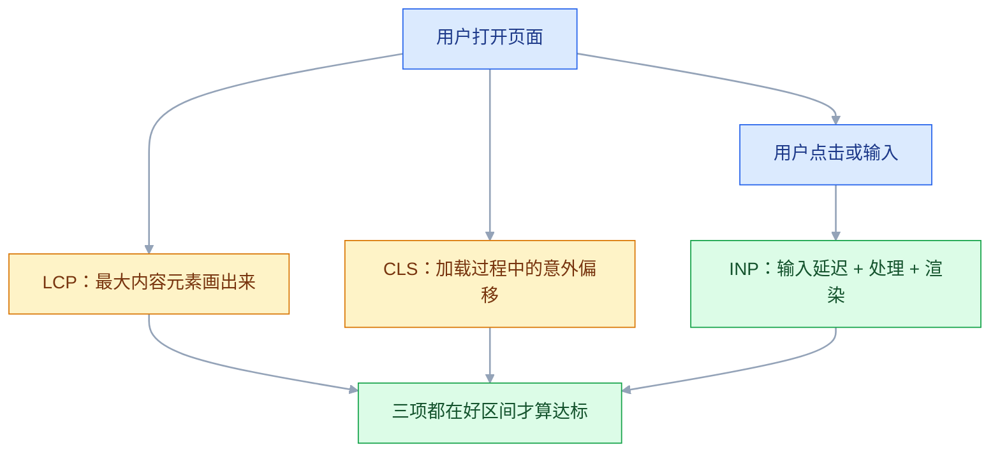
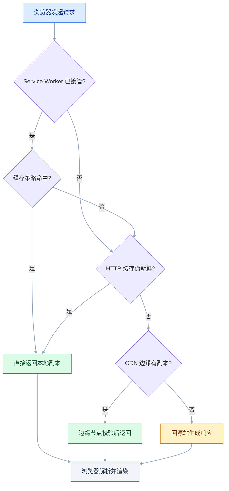

# 前端性能

## 一、工程案例：把后台管理系统的首屏从 4.1 秒压到 2 秒内

**场景**：Vue 3 + Vite 的后台系统（`admin-web`），报表页用 ECharts，组件库 Element Plus 完整引入，图片直接从设计稿导出，构建产物只有一个 bundle。运营的反馈是「打开要等四五秒，中间一片白」。

**为什么必须做**：这类系统一般只在办公网内使用，用户不会因为慢 2 秒就流失，但**慢会让每一次操作都变慢**——打开单据、切换 Tab、翻页，全是主线程在还债。而且性能一旦没人管就会持续退化，三个月后再想优化，成本翻倍。

**动手前确认**：能跑生产构建（`npm run build && npm run preview`）；Chrome 的 Lighthouse 与 Performance 面板可用；知道首屏是哪一屏（首屏的定义决定了优化目标）。

### 1.1 先建基线，不许动手改

```bash
npm run build
npm run preview   # 生产构建，端口通常 4173
```

> 一定要测 `preview` 而不是 `dev`。开发模式的代码没压缩、没 Tree Shaking、带 HMR 运行时代码，测出来的数据没有参考价值。

用 Lighthouse（DevTools → Lighthouse → Performance → **Mobile** → Analyze）跑三次取中间值：

```text
Performance  41
FCP  3.0s   LCP  4.1s   TBT  1850ms   CLS  0.18   SI  3.6s
```

再打开 Performance 面板录一次「回车 → 首屏可见」，看 Main 轨道：

- 前 1.2 秒是一段连续的黄色（Scripting），中间没有空隙 → 首屏被 JS 执行挡住；
- 黄色块之后才出现第一次绿色绘制 → 渲染起点被推后。

Network 按 Size 排序，一眼看到体积大头：

```text
echarts.full.min.js        3.1 MB
element-plus.full.js       1.7 MB
moment-with-locales.js     580 KB
logo@2x.png                860 KB
index.js                   410 KB（含所有页面）
```

这三个数据合起来就是证据链：**传输 6.7MB → 主线程连续忙 1.2s → 首屏 4.1s**。不要凭感觉挑一条改，先把因果对上。

### 1.2 LCP 元素是谁

Performance 面板里点 `LCP` 标记，或者直接在 Console 里问浏览器：

```javascript
new PerformanceObserver((list) => {
  for (const e of list.getEntries()) {
    console.log('LCP', e.startTime.toFixed(0) + 'ms', e.element, e.url);
  }
}).observe({ type: 'largest-contentful-paint', buffered: true });
```

本例输出是首页那张 860KB 的 banner 图。这决定了后面所有动作的优先级：**先让这张图变小、变早，再谈别的**。

### 1.3 分五步改，每步单独复测

**① 路由懒加载 + 手动分包**

```typescript
// router/index.ts
const routes = [
  { path: '/', component: () => import('@/views/Dashboard.vue') },
  { path: '/report', component: () => import('@/views/Report.vue') },
  { path: '/orders', component: () => import('@/views/OrderList.vue') },
];
```

```typescript
// vite.config.ts
export default defineConfig({
  build: {
    rollupOptions: {
      output: {
        manualChunks: {
          'vue-vendor': ['vue', 'vue-router', 'pinia'],
          'element-plus': ['element-plus'],
        },
      },
    },
  },
});
```

`echarts` 不放进 `manualChunks`，让它跟着报表页的 chunk 走——只有进报表页的人才付这份钱。

**② ECharts 按需 + 延后加载**

```typescript
// 全量引入会把整个图表库打进首包
// import * as echarts from 'echarts';

// 按需：只注册用到的图表和组件
import * as echarts from 'echarts/core';
import { BarChart, LineChart } from 'echarts/charts';
import { GridComponent, TooltipComponent, LegendComponent } from 'echarts/components';
import { CanvasRenderer } from 'echarts/renderers';

echarts.use([BarChart, LineChart, GridComponent, TooltipComponent, LegendComponent, CanvasRenderer]);
```

**③ 组件库改按需自动导入**

```bash
npm install -D unplugin-vue-components unplugin-auto-import
```

```typescript
// vite.config.ts
import AutoImport from 'unplugin-auto-import/vite';
import Components from 'unplugin-vue-components/vite';
import { ElementPlusResolver } from 'unplugin-vue-components/resolvers';

plugins: [
  AutoImport({ resolvers: [ElementPlusResolver()], imports: ['vue', 'vue-router'] }),
  Components({ resolvers: [ElementPlusResolver()] }),
],
```

改完之后把 `main.ts` 里的 `app.use(ElementPlus)` 和全量 CSS 引入删掉，否则体积下不来。

**④ 图片：格式、尺寸、优先级三件事**

```html
<!-- components/HeroBanner.vue：首屏主图 -->
<picture>
  <source srcset="/img/hero.avif" type="image/avif" />
  <source srcset="/img/hero.webp" type="image/webp" />
  
</picture>
```

```html
<!-- components/CardList.vue：首屏之外才懒加载 -->

```

三个属性各有分工：`width`/`height` 让浏览器**加载前就预留出正确比例的空间**（这是 CLS 的直接来源）；`loading="lazy"` 让视口外的图先不下载；`decoding="async"` 让解码不挡渲染。**首屏图绝对不要 `lazy`**，那等于主动推迟 LCP。

**⑤ 压缩与缓存：服务端的事**

```nginx
# deploy/nginx.conf
gzip on;
gzip_types text/css application/javascript application/json image/svg+xml;
gzip_min_length 1024;
gzip_comp_level 6;
gzip_vary on;

location = /index.html {
    add_header Cache-Control "no-cache" always;
}

location /assets/ {
    add_header Cache-Control "public, max-age=31536000, immutable" always;
}
```

`gzip_vary on` 会加 `Vary: Accept-Encoding`。少了它，CDN 可能把压缩后的版本发给不支持的客户端。

### 1.4 验收：10 项全过才算交付

| # | 检查项 | 命令或检查 | 通过标准 |
|---|---|---|---|
| 1 | LCP | Lighthouse Mobile，三次取中间值 | ≤ 2.5s |
| 2 | INP | 录一次点击 + 输入，看 Summary | ≤ 200ms（实验室可用 TBT ≤ 200ms 代理） |
| 3 | CLS | Lighthouse 报告 | ≤ 0.1 |
| 4 | 首屏传输体积 | Network Summary 的 Transferred | ≤ 1MB |
| 5 | 首包体积 | `npm run build` 输出里主 chunk | ≤ 250KB（gzip 后） |
| 6 | 无同步阻塞脚本 | 构建产物 HTML 里 `<script>` 均有 `type=module` 或 `defer` | 无裸 `<script src>` |
| 7 | 图片尺寸真实 | Elements 里看 `` 的渲染尺寸与属性比 | 比例一致，无 CLS 抖动 |
| 8 | 压缩生效 | `curl -sI .../index.js \| grep -i content-encoding` | `gzip` 或 `br` |
| 9 | 缓存生效 | 二次访问 Network 的 Size 列 | 产物显示 `(disk cache)`，HTML 是 304 |
| 10 | 长任务 | Performance 录制中 FCP 前无 > 50ms 的连续黄块 | 无长任务或已拆分 |

第 5 项的读法：`npm run build` 会打印每个 chunk 的原始体积与 gzip 体积，**看 gzip 那一列**，因为那才是传输量。

```text
dist/assets/index-8f2c1a.js        182.35 kB │ gzip:  58.10 kB
dist/assets/Dashboard-2a91bc.js     46.02 kB │ gzip:  15.40 kB
dist/assets/Report-7d3e0f.js       720.95 kB │ gzip: 225.90 kB
```

报表页的 chunk 有 720KB，但它只在进入报表页时才下载——**懒加载的 chunk 大不是问题，首包大才是问题**。

### 1.5 复测对比

| 指标 | 改前 | 改后 | 说明 |
|---|---|---|---|
| Performance | 41 | 91 | — |
| FCP | 3.0s | 0.9s | 路由拆包，首屏不再解析其他页面的代码 |
| LCP | 4.1s | 1.9s | 首图变小、变早 |
| TBT | 1850ms | 190ms | 首屏不再执行其他页面的代码 |
| CLS | 0.18 | 0.03 | 图片写了宽高 |
| 首屏传输 | 6.7MB | 760KB | 按需 + gzip + 图片压缩 |

### 1.6 防止退化

```json
[{
  "path": "/*",
  "timings": [
    { "metric": "largest-contentful-paint", "budget": 2500 },
    { "metric": "cumulative-layout-shift", "budget": 0.1 },
    { "metric": "total-blocking-time", "budget": 200 }
  ],
  "resourceSizes": [
    { "resourceType": "script", "budget": 400 },
    { "resourceType": "total", "budget": 1000 }
  ]
}]
```

```yaml
- run: npm ci && npm run build
# action 版本以官方当前稳定版为准
- uses: treosh/lighthouse-ci-action@v12
  with:
    staticDistDir: ./dist
    budgetPath: ./lighthouse-budget.json
    numberOfRuns: 3
    uploadArtifacts: true
```

预算的意义在于**把「变慢」变成一次失败的构建**。没有这道门，优化成果会在半年内被新功能一点点吃掉。

---

## 二、高频问答：会卡住你的地方，也是面试最常问的

### 2.1 本地很快，用户说很慢

**现场**

看线上 RUM 的 P75（按设备、网络类型分组），不要看平均值。

**要点**

- 本地是开发机 + 内网 + 热缓存，生产是低端手机 + 4G + 冷缓存，两个环境差三到五倍很常见。
- 用自己的机器代表所有用户，是这类判断最根本的错误。
- Lighthouse 切 Mobile + Slow 4G 再测一次；线上用 `web-vitals` 上报后按 `effectiveType` 分组。
- 实验室数据找问题，真实用户数据下结论。

**追问**

- 为什么看 P75 不看平均值？→ 平均值会被少数极快或极慢的样本稀释。
- 怎么按设备分组？→ 用 UA、`effectiveType`、`deviceMemory` 这些维度切。
- RUM 能定位原因吗？→ 不能，它只能下结论，定位还要靠 Lab。

### 2.2 Lighthouse 分数忽高忽低

**现场**

同一环境连跑三次，看分数的分布区间。

**要点**

- 单次跑分的波动本来就大：CPU 调度、网络抖动、第三方脚本都会影响。
- 分数是加权算出来的，某一项抖一下总分就跳，一次结果不能当结论。
- 跑三次取中间值；更稳的是看具体指标（LCP、TBT、CLS）的绝对值。
- 总分只适合对外汇报，排障要看指标。

**追问**

- 为什么 CI 里要跑三次？→ 单次波动大，取中位数才有可比性。
- TBT 和 INP 什么关系？→ 实验室里常用 TBT 代理 INP。
- 移动端分数为什么更低？→ 模拟 4G 加 CPU 降速，更接近真实设备。

### 2.3 加了 `loading="lazy"`，LCP 反而更差

**现场**

看 LCP 元素的 `url` 与对应的 `` 标签，是否有 `loading="lazy"`。

**要点**

- 首屏那张图也加了 `lazy`，浏览器要等布局完成、判断它在视口内，才开始下载，白等几百毫秒。
- 懒加载只属于「首屏之外」，不分位置套用优化手段就会把 LCP 推后。
- 首屏图不但不能 lazy，反而应该加 `fetchpriority="high"`。

**追问**

- 为什么 lazy 会延迟下载？→ 它要先完成布局、判断可见性，才发起请求。
- `loading="eager"` 是默认吗？→ 是，img 不写就是 eager。
- 先修 lazy 还是先加 preload？→ 先修 lazy，优先级提示是下一步。

### 2.4 用了 `preload`，关键资源还是慢

**现场**

Network 里看该资源是否出现两个请求；Console 是否有 `preloaded but not used` 警告。

**要点**

- `preload` 只把资源提到队首，五六个 preload 之间仍然抢同一段带宽，真正关键的仍被推后。
- `as` 写错会导致下载了两次；字体还要加 `crossorigin`，否则同样下两次。
- 只 preload 一到两个「首屏必须且发现得晚」的资源。
- 出现 `not used within a few seconds` 警告，就说明 preload 了用不上的东西。

**追问**

- `preload` 和 `preconnect` 的区别？→ 一个下载资源，一个只提前建连接。
- `preload` 了但没用会怎样？→ 控制台警告，还白占带宽。
- `modulepreload` 什么时候用？→ 预加载并解析关键 ES 模块。

### 2.5 图片已经压缩了，还是很大

**现场**

Elements 里看渲染尺寸，Network 里看原始尺寸与传输体积。

**要点**

- 压缩的是「导出尺寸」而不是「显示尺寸」；一张 3000px 宽的图显示在 400px 的卡片里，压缩率再高也白费。
- 只优化编码、不优化分辨率，是这类问题的共同点。
- 算一下「渲染宽度 × DPR」，图片自然宽度明显超过它就是浪费。
- 用 `srcset` + `sizes` 让浏览器按视口和 DPR 选图。

**追问**

- DPR 2 的屏要出两倍图吗？→ 按显示宽度 × DPR 出，不是按设计稿原尺寸。
- WebP 一定最小吗？→ 看内容和质量参数，AVIF 通常更小但编码慢。
- `sizes` 写错会怎样？→ 选错候选图，可能下大了，也可能糊。

### 2.6 页面会「跳一下」

**现场**

Performance 或 Layout Shift 区域高亮，看是哪块在移动。

**要点**

- 图片/iframe/广告位在加载前高度是 0，加载后撑开，把下面的内容推下去；`min-height` 猜错值就还是跳。
- 图片直接写 `width`/`height`，浏览器按比例预留空间。
- 动态内容用 `aspect-ratio` 或骨架屏占位，骨架高度要与真实内容一致。
- 偏移发生在内容到达之后，所以占位必须写在 HTML 里，不能靠 JS 事后补。

**追问**

- 为什么写了 `width`/`height` 就能防 CLS？→ 浏览器提前算出宽高比，下载前就留好位置。
- `transform` 动画算 CLS 吗？→ 不算，它不改变布局位置。
- 用户交互后的偏移算吗？→ 不算，属于预期变化。

### 2.7 点击之后要等半秒才有反应

**现场**

Performance 里看点击时刻前后有没有 > 50ms 的连续黄块；Network 里看请求的 Start Time 是不是明显晚于点击时刻。

**要点**

- 主线程被长任务占着，点击事件排在队列里没被处理，表现出来像「接口慢」，实际请求还没发出去。
- 只看网络会误判；请求的 Start Time 晚于点击，就是主线程排队。
- 在点击处理函数第一行打 `performance.now()`，与用户点击的时间戳对比，差几百毫秒就能确认。
- 解法是拆长任务、搬去 Worker，或减少一次渲染的数据量。

**追问**

- 50ms 这个阈值哪来的？→ 主线程连续执行超过 50ms 就算长任务。
- 怎么拆长任务？→ 分片执行并在片间让出，或用 `scheduler.yield()`。
- Worker 能解决所有长任务吗？→ 不能碰 DOM，数据往返还有克隆成本。

### 2.8 列表一多就卡

**现场**

Elements 里数一下子节点数；Performance 里看 Layout 的耗时占比。

**要点**

- DOM 节点数本身成了瓶颈：一万个节点，布局、绘制、内存都按这个量级付钱，和组件写得好不好关系不大。
- 在组件层优化一个结构问题，方向就错了。
- 把列表截断到 100 条再测，如果流畅了，就是数量问题。
- 解法是虚拟列表（只渲染视口内的几十条）或分页。

**追问**

- 虚拟列表的代价？→ `Ctrl+F` 找不到未渲染内容，读屏不完整，变高行难处理。
- 为什么 `v-show` 没用？→ 节点还在，布局成本没减。
- 多少节点算多？→ 没有硬阈值，看 Layout 耗时和交互体感。

### 2.9 换了 `font-display: swap`，文字还是闪

**现场**

看 CLS 归因里是否有字体相关的偏移；Network 里看字体的加载时间。

**要点**

- `swap` 的本质就是「先用系统字体显示，加载完替换」，替换那一刻必然重排。
- 它优化的是「不白等」，代价就是闪烁和 CLS；期待它同时解决两个问题一定落空。
- 想彻底不闪就用 `optional`，或做字体子集化把体积降下来。
- 想保留品牌字体又不要偏移，就让 fallback 字体的字宽尽量接近，并给关键文本预留空间。

**追问**

- `block` 和 `swap` 的区别？→ `block` 先空白等字体，`swap` 先显示系统字体。
- 中文字体为什么要子集化？→ 动辄几 MB，直接加载是灾难。
- 预加载字体为什么要 `crossorigin`？→ 否则凭据模式不一致，会下载两次。

### 2.10 上了 SSR，LCP 只快了一点

**现场**

看 HTML 的 `Content Download` 与 FCP 的关系；看 Performance 里 hydration 占了多久。

**要点**

- HTML 里确实有内容，但首屏被阻塞的 CSS/JS 挡住无法绘制；或者 hydration 太重，主线程立刻被占满，INP 反而变差。
- 「有内容」不等于「能显示」，这是 SSR 优化最常见的误判。
- `curl` 拿到的 HTML 里搜一下首屏文案，有就说明 SSR 生效。
- 再看 FCP 是否接近 TTFB：差得远是渲染阻塞，FCP 早但点不动是 hydration。

**追问**

- FCP 早但点不动是什么问题？→ hydration 太重，主线程被占。
- SSR 能改善 INP 吗？→ 不一定，注水成本高时反而更差。
- 流式 SSR 解决什么？→ 让首字节更早到达，FCP 不必等整页生成。

### 2.11 拆了包，请求数变多反而更慢

**现场**

Network 瀑布图看首屏 chunk 之间是不是串行；数一下首屏实际请求数。

**要点**

- 拆得太碎（几十个 chunk），或拆错了维度：把首屏要用的东西拆到别的 chunk 里，形成串行请求链。
- 拆包不是目的，首屏该控制在 5 个以内的关键请求。
- 其余按路由拆；用 `manualChunks` 把稳定的第三方库单独拎出来利用缓存，业务代码按路由走。

**追问**

- 为什么拆完会串行？→ chunk 之间有依赖，要等前一个下载解析完才知道下一个。
- HTTP/2 下请求数还重要吗？→ 多路复用降低了成本，但依赖链仍然串行。
- 怎么验证拆得对不对？→ 看瀑布图里首屏请求是否并列，而不是一条接一条。

### 2.12 自己的代码没动，页面却越来越慢

**现场**

Network 按 Domain 分组，看第三方域名占了多少请求与传输量；Performance 的 Bottom-Up 按 Script URL 排序，看黄块来自哪个域名。

**要点**

- 统计、客服、地图 SDK 这类第三方脚本在变多；它们不在构建产物里，`npm run build` 的体积表看不见，却照样占带宽、抢主线程。
- 只盯自己的产物，就会把第三方欠的债算到框架头上。
- 首屏只保留一个必需的第三方，其余在 `load` 之后动态插入 `<script>`。
- 必须早加载的加 `defer`，不要让它阻塞解析。

**追问**

- 第三方脚本怎么降级？→ 延迟加载，并给它超时兜底。
- 为什么 `defer` 比 `async` 合适？→ 保序且不阻塞解析。
- CSP 能限制第三方吗？→ 能，`script-src` 白名单就是干这个的。
---

## 三、核心知识：从零开始要建立的东西

### 3.1 三个核心指标与阈值

| 指标 | 回答什么问题 | 好 | 需改进 | 差 |
|---|---|---|---|---|
| **LCP** | 主要内容多久画出来 | ≤ 2.5s | 2.5–4.0s | > 4.0s |
| **INP** | 交互到画面反馈多久 | ≤ 200ms | 200–500ms | > 500ms |
| **CLS** | 内容有没有乱跳 | ≤ 0.1 | 0.1–0.25 | > 0.25 |

这三个是 Core Web Vitals 的当前组合。**FID 已在 2024 年 3 月被 INP 取代**：FID 只测「第一次交互的输入延迟」，INP 测整个生命周期里所有交互的响应质量，取第 98 百分位（大约每 50 次交互忽略最慢的 1 次）。

> **面试**：常问「LCP、INP、CLS 分别衡量什么？阈值是多少？」答：画出来 ≤2.5s、交互反馈 ≤200ms、布局偏移 ≤0.1；FID 已被 INP 取代。



### 3.2 LCP 的构成与四把钥匙

LCP 的时间轴可以切成四段，优化必须对应到具体某一段：

| 段 | 含义 | 手段 |
|---|---|---|
| TTFB | 服务器返回第一个字节 | CDN、后端优化、减少重定向、缓存 |
| 资源加载延迟 | 从 TTFB 到开始下载 LCP 资源 | 别用 JS 动态插入首屏图、`preload`、`fetchpriority` |
| 资源加载时长 | 下载这个资源 | 压缩、换格式、按显示尺寸出图 |
| 元素渲染延迟 | 下载完到画出来 | 减少阻塞 CSS/JS、字体 `swap` |

LCP 元素只可能是：``、`<image>`（SVG 内）、`<video>` 封面、带背景图的块、**大段文本块**。`<canvas>` 和用 CSS 隐藏的元素不算。

最常见的错判是「以为 LCP 是标题，其实是图片」。**先问浏览器是哪个元素，再决定改什么**（1.2 的那段 `PerformanceObserver` 就干这个）。

> **面试**：常问「LCP 慢了从哪几段查？」答：TTFB、资源加载延迟、下载时长、元素渲染延迟，四段对应不同手段，先定位再改。

### 3.3 INP 的三段耗时

INP 不是「接口响应时间」，它是从用户输入到画面更新的完整链路：

```text
输入延迟（主线程忙，事件还没被派发）
  + 事件处理（你的监听函数执行完）
  + 渲染延迟（样式、布局、绘制、合成）
= INP
```

三段对应三类问题：

| 段 | 典型原因 | 手段 |
|---|---|---|
| 输入延迟 | 长任务占着主线程 | 拆任务、`scheduler.yield()`、Worker |
| 事件处理 | 一次点击触发大量计算或同步请求 | 防抖、异步化、减少重渲染 |
| 渲染延迟 | 一次改动触发全页重排 | 局部更新、`transform` 动画、减少 DOM 数量 |

**INP 取的是第 98 百分位**（大约每 50 次交互忽略最慢的 1 次，但仍贴着最慢的那一端）。所以优化要盯着最卡的场景——通常是「表格里点开详情」「大表单提交」。

### 3.4 CLS 的计算

```text
单次偏移分数 = 影响区域比例 × 移动距离比例
会话窗口分数 = 窗口内所有偏移分数之和
CLS = 所有会话窗口里分数最高的那个
```

举例：一个占视口 50% 高的元素向下移动了自身高度的 25%，得分 `0.5 × 0.25 = 0.125`，已经超过「好」的阈值。

三个边界：

- **用户交互引起的偏移不算**（点击、滚动之后的变化属于预期）。
- **`transform` 动画不算**：它不改变布局位置。
- **偏移会被合并成会话窗口**：相邻两次偏移间隔小于 1 秒就并进同一窗口，窗口最长 5 秒；CLS 取所有窗口里最大的那个，不是全部累加。

CLS 的来源几乎总是三类：图片/iframe 没有尺寸、动态插入的内容没有占位、字体替换导致字宽变化。

### 3.5 实验室数据与真实用户数据

| | Lab（Lighthouse / Performance） | RUM（web-vitals 上报） |
|---|---|---|
| 环境 | 固定设备、固定网络 | 真实设备、真实网络 |
| 优点 | 可复现、能看到细节、能对比 | 反映真实体验、能按维度切分 |
| 缺点 | 不代表真实用户、单次有波动 | 需要样本量、发现问题但难定位 |

**两者不是替代关系**：Lab 用来「找原因」，RUM 用来「下结论」。改完一个优化项，用 Lab 验证机制是否生效；上线之后，用 RUM 的 P75 确认用户是否真的变快。

看 **P75** 而不是平均值，因为 Google 的评估口径就是「75% 的访问体验良好」。平均值会被少数极快或极慢的样本稀释掉。

```typescript
import { onLCP, onINP, onCLS, onFCP, onTTFB } from 'web-vitals';

const report = (m: { name: string; value: number; rating: string; id: string }) => {
  const body = JSON.stringify({
    name: m.name, value: Math.round(m.value), rating: m.rating, id: m.id,
    page: location.pathname, conn: (navigator as any).connection?.effectiveType,
  });
  navigator.sendBeacon?.('/api/metrics', body);
};

onLCP(report); onINP(report); onCLS(report); onFCP(report); onTTFB(report);
```

用 `sendBeacon` 的原因：LCP 和 CLS 要等到页面隐藏或卸载才最终确定，普通 `fetch` 在这时会被中断。

> **面试**：常问「实验室数据和 RUM 怎么配合？」答：Lab 找原因，RUM 下结论；验收看 RUM 的 P75，不看平均值。

### 3.6 打包体积的三个杠杆

| 杠杆 | 做什么 | 收益 |
|---|---|---|
| Tree Shaking | 删掉没被引用的导出 | 取决于库的写法，ESM 才有效 |
| 代码分割 | 把不急着用的代码拆出去 | 首包体积直接下降 |
| 按需引入 | 只引入用到的部分 | 大库收益最大（图表、编辑器、组件库） |

Tree Shaking 生效的前提常被忽略：

```text
① 用 ESM（import/export），CommonJS 的 require 分析不了
② 构建工具开启压缩（生产模式）
③ package.json 里 "sideEffects" 声明正确，否则不敢删
④ 用 lodash-es 而不是 lodash（后者是 CJS）
```

`sideEffects: false` 是一个承诺：这个包的模块被 import 但没有被使用，可以安全删掉。如果包里真的有「import 就产生副作用」的代码（比如自动注册 polyfill），这个承诺就是错的，删了会出 bug。

### 3.7 图片的四个决策

**格式**：JPEG 适合照片，PNG 适合需要透明和锐利边缘的图，WebP 是通用首选（比 JPEG 小 25–35%），AVIF 更小但编码慢。用 `<picture>` 做渐进回退，浏览器自己选。

**尺寸**：按**显示尺寸 × DPR** 出图，不要按设计稿原尺寸出图。`srcset` 给候选，`sizes` 告诉浏览器各视口下的显示宽度：

```html

```

**占位**：`width`/`height` 不只是给布局用的，浏览器会据此**在图片下载前算好宽高比**，这是 CLS 最有效的解法。

**优先级**：首屏图 `fetchpriority="high"` 且不 lazy；其余 `loading="lazy"`。

### 3.8 字体的两个阶段问题

自定义字体有两个独立的问题，别混在一起：

| 问题 | 表现 | 手段 |
|---|---|---|
| 等待期（FOIT/FOUT） | 文字不显示，或先显示系统字体再换 | `font-display` |
| 替换时的偏移 | 换字体后字宽变了，行高跳动 | 子集化 + 让 fallback 字宽接近 |

`font-display` 四档：

| 值 | 等待期 | 替换 | CLS 风险 |
|---|---|---|---|
| `block` | 先空白，最多约 3s | 会替换 | 高 |
| `swap` | 先用系统字体 | 会替换 | 中 |
| `fallback` | 极短空白 | 短暂交换窗口 | 低 |
| `optional` | 几乎不等 | 没快速加载就本次不用 | 最低 |

中文字体动辄几 MB，直接加载是灾难。**子集化是必需项**：用 `fontmin`、`glyphhanger` 只打包页面实际用到的字符，或让服务端按内容动态切片。一个 5MB 的中文字体，子集化后常常只有几十 KB。

预加载字体时 `crossorigin` 必须写，否则会因为「凭据模式不一致」下载两次。

### 3.9 资源提示的五种语义

| 指令 | 做什么 | 优先级 | 用在哪 |
|---|---|---|---|
| `preload` | 当前页面马上要用，现在下载 | 高 | 首屏关键资源 |
| `prefetch` | 下一个页面可能要用，空闲时下载 | 低 | 用户大概率会去的页面 |
| `preconnect` | 提前完成 DNS + TCP + TLS | — | 关键的第三方域名 |
| `dns-prefetch` | 只提前解析域名 | — | 次要第三方域名 |
| `modulepreload` | 预加载并解析 ES 模块 | 高 | 关键 JS 模块 |

```html
<link rel="preconnect" href="https://api.example.com" crossorigin />
<link rel="dns-prefetch" href="https://cdn.example.com" />
<link rel="preload" href="/fonts/main.woff2" as="font" type="font/woff2" crossorigin />
```

`preconnect` 只对「确定会用且跨域」的域名有价值，**每个连接都占资源**，一般不超过 3 个。同源的资源不需要 `preconnect`，浏览器本来就会复用连接。

### 3.10 压缩与传输

| 层 | 谁做 | 效果 |
|---|---|---|
| Minify | 构建工具（Vite/Rollup） | 去空格注释、缩短变量名，约减 30–50% |
| gzip | 服务器 / CDN | 文本再减 60–70% |
| brotli | 服务器 / CDN | 比 gzip 再小 15–25% |
| CDN | 边缘节点 | 减少 RTT，不只是压缩 |

**Minify 和传输压缩是两件事**，经常被混为一谈。构建产物已经 minify 了，但如果服务器没开 gzip，用户下到的还是 minify 后的大文件。

`gzip_min_length 1024` 的原因：小文件压缩后可能反而更大（要加压缩头）。`gzip_vary on` 是缓存正确性的前提。

### 3.11 长任务与让出主线程

主线程连续执行超过 **50ms** 的任务就是长任务。它期间，点击、输入、滚动全部排队。

```javascript
// 分片执行：每片之间让出主线程
async function processAll(items) {
  const CHUNK = 200;
  for (let i = 0; i < items.length; i += CHUNK) {
    for (const it of items.slice(i, i + CHUNK)) heavy(it);
    await new Promise((r) => setTimeout(r, 0));
  }
}
```

`setTimeout(0)` 的问题是「让出后不保证马上回来」，中间可能被别的任务插队很久。现代 API 提供了更精确的让出方式：

```javascript
await scheduler.yield?.();   // 让出后本任务优先恢复（不支持时回退）
```

| 手段 | 适用 | 代价 |
|---|---|---|
| 分片 + 让出 | 可切分的大循环 | 总耗时略增 |
| Web Worker | 纯计算、无 DOM | 数据要结构化克隆 |
| `requestIdleCallback` | 不急的收尾工作 | 空闲时机不可控 |
| 虚拟列表 | 数据量大且要展示 | 需要固定或可测的行高 |

> **面试**：常问「一个 200ms 的长任务怎么优化？」答：先拆片让出主线程，纯计算搬 Worker，展示层减少 DOM 数量。

### 3.12 Web Worker 的边界

Worker 是真正的并行线程，但它**没有 DOM、没有 `window`、没有 `document`**。这决定了它能干什么：

| 能 | 不能 |
|---|---|
| 数学计算、数据处理 | 直接改页面 |
| JSON 解析、加密解密 | 访问 `localStorage` |
| 图像处理（配合 `OffscreenCanvas`） | 读取页面上的元素 |
| `fetch` 请求 | 用大部分依赖 DOM 的库 |

```typescript
// heavy.worker.ts
self.onmessage = (e: MessageEvent<number[]>) => {
  let sum = 0;
  for (const n of e.data) sum += Math.sqrt(n) * Math.sin(n);
  self.postMessage(sum);
};
```

```typescript
const worker = new Worker(new URL('./heavy.worker.ts', import.meta.url), { type: 'module' });
worker.postMessage(bigArray);
worker.onmessage = (e) => render(e.data);
```

**什么时候不值得用**：计算只要几毫秒，通信成本比计算还高；数据要频繁往返（每次都要克隆）；需要读写 DOM。判断线大致是「超过 50ms 的纯计算 + 低频通信」。

### 3.13 虚拟列表的原理

一万条数据渲染一万个 DOM，问题不在「渲染慢」，而在**节点数量本身就是成本**：布局要遍历、内存要占、每次改动都要重算。

虚拟列表的做法是：容器高度按总条数撑开（让滚动条正确），**只渲染视口内的几十条**，滚动时按 `scrollTop` 换算出起始索引，复用 DOM。

```vue
<!-- 依赖 vue-virtual-scroller -->
<RecycleScroller class="list" :items="rows" :item-size="48" key-field="id" v-slot="{ item }">
  <div class="row">{{ item.name }}</div>
</RecycleScroller>
```

```css
.list { height: 600px; overflow-y: auto; }
.row { height: 48px; }
```

| 前提 | 说明 |
|---|---|
| 行高固定或可测 | 变高列表需要更复杂的测量与缓存 |
| 能按索引取数据 | 不做分页时数据要全在内存 |
| 滚动容器有确定高度 | 否则算不出视口范围 |

代价：`Ctrl+F` 找不到未渲染的内容、无障碍读屏不完整、行内有复杂交互时要小心复用。

### 3.14 重渲染的抑制手段

| 框架 | 手段 | 作用 |
|---|---|---|
| Vue | `computed` | 依赖不变就不重算 |
| Vue | `v-memo` | 依赖不变就跳过子树更新 |
| Vue | 拆分组件 | 缩小更新范围 |
| React | `memo` | props 不变就跳过渲染 |
| React | `useMemo` / `useCallback` | 缓存值与函数引用 |

React 的 `useCallback` 不是可有可无的：父组件每次渲染都会创建新函数，`memo` 的子组件因为 props 引用变了而失效。

但优先级要摆正：**减少渲染的数据量 > 优化单个组件的渲染**。虚拟列表带来的收益，通常比把每个组件都包一层 `memo` 大得多。

### 3.15 缓存分层

一次请求会依次撞上这些关卡，任何一层命中就提前返回：



前端项目里最省心的组合：

| 资源 | 策略 | 原因 |
|---|---|---|
| 入口 HTML | `no-cache` | 版本入口，必须每次确认 |
| 带 hash 的 JS/CSS | `max-age=31536000, immutable` | 内容变了文件名就变 |
| 接口数据 | `no-store`（默认） | 不能给下一个用户看 |
| 用户头像等 | `max-age=86400` | 可容忍一天内的旧图 |

Service Worker 是独立的一层，能力更强（能改请求、能离线），风险也更大：**策略写错会让用户永远停在旧版本**。`stale-while-revalidate` 这类策略适合「能容忍短暂旧数据」的场景，不适合权限、金额。

### 3.16 监控与退化防护

性能不是一次性项目，它会随着每次发版退化。有效的防线有三层：

| 层 | 手段 | 发现时机 |
|---|---|---|
| 构建时 | 体积预算、chunk 体积对比 | PR 阶段 |
| 发布前 | Lighthouse CI、性能预算 | 合并前 |
| 上线后 | RUM 的 P75 趋势、按版本对比 | 数小时内 |

最容易漏的是「按版本对比」。同样 2.3 秒的 LCP，如果上个版本是 1.8 秒，那这次发版就是退化——**只看绝对值会漏掉缓慢的滑坡**。

```yaml
- run: npm ci && npm run build
# action 版本以官方当前稳定版为准
- uses: treosh/lighthouse-ci-action@v12
  with:
    staticDistDir: ./dist
    budgetPath: ./lighthouse-budget.json
```

---

## 四、冷门知识汇总

| 知识点 | 为什么冷门 | 用到时的关键词 |
|---|---|---|
| `Server-Timing` | 需要后端配合输出，前端很少主动要求 | `Server-Timing: db;dur=53, app;dur=87` |
| `103 Early Hints` | 需要服务端与 CDN 同时支持 | `Link: </app.css>; rel=preload` |
| Long Animation Frames | 比 Long Task 更细，能定位到具体脚本 | `LoAF`、`PerformanceObserver` 的 `long-animation-frame` |
| INP 归因 | 需要 `event-timing` 才能定位到具体元素 | `interactionId`、`eventTarget` |
| Speculation Rules | 声明式预渲染，替代旧的 prerender | `<script type="speculationrules">` |
| `content-visibility` | 屏外内容跳过渲染，兼容性与可访问性要测 | `content-visibility: auto`、`contain-intrinsic-size` |
| CSS `contain` | 隔离渲染影响范围，收益依赖布局结构 | `contain: layout paint` |
| `scheduler.postTask` | 优先级调度，支持度还不完整 | `priority: 'user-blocking'` |
| `requestIdleCallback` | 触发时机不确定，不适合有时限的任务 | `timeout` 参数 |
| 图片 `decoding` | 对 LCP 影响微妙，容易做反 | 首屏 LCP 图不要加 `decoding="async"`，屏外图再加 |
| 流式 SSR | 需要框架支持，手写成本高 | `renderToPipeableStream`、Suspense |
| Islands 架构 | 只在内容型站点有明显收益 | Astro、部分注水 |
| `bundlephobia` | 引入依赖前才查一次 | 包体积与替代品对比 |
| Bundle 可视化 | 只在排查「谁把包撑大了」时用 | `rollup-plugin-visualizer` |
| Coverage 面板 | 能看未使用代码比例，但结论粗糙 | DevTools → Coverage |
| `stale-while-revalidate` | 语义反直觉，容易给不该缓存的接口用 | `Cache-Control: max-age=60, stale-while-revalidate=600` |
| back/forward cache | 现象是「后退秒开」，配置错了才有感知 | `pagehide`、`pageshow`、`bfcache` |
| 图片 `preload` 与 `srcset` 不一致 | 预加载的候选图和 `` 选中的不是同一张，Network 里才会看到下了两次 | `imagesrcset`、`imagesizes` |
