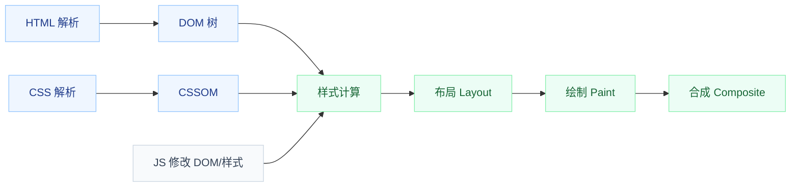
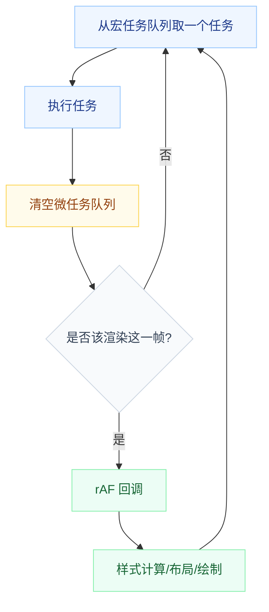

# 浏览器渲染与事件循环

> 这篇从浏览器的多进程架构讲起，经过渲染管线、回流与重绘、事件循环的宏/微任务、rAF 与调度、存储与线程模型，最后落到长任务定位与渲染卡顿的完整排查。
>
> 学完能解释“一段脚本为什么卡住页面”，并用 Performance 面板和 PerformanceObserver 把卡顿定位到布局抖动、长任务或调度时机，再给出可验证的修复。

## 一、多进程架构与线程模型

浏览器把“每个站点一个渲染进程”作为隔离单位：一个标签页崩溃不会拖垮整个浏览器，一个站点的脚本也摸不到另一个站点的内存。这套隔离是安全边界，也是理解性能问题的前提——性能永远先问“发生在哪个进程的哪个线程”。

| 进程 | 职责 | 出问题时的现象 |
|---|---|---|
| 浏览器进程 | 地址栏、网络、磁盘 I/O、权限 | 整个浏览器卡死 |
| 渲染进程 | HTML/CSS/JS 解析、布局、绘制、脚本执行 | 单个标签页卡死或白屏 |
| GPU 进程 | 光栅化、合成、上传纹理 | 动画掉帧但页面可交互 |
| 扩展进程 | 每个扩展一个 | 扩展崩溃不影响页面 |
| 网络服务 | HTTP/HTTPS、DNS、缓存 | 请求失败或变慢 |

**站点隔离（Site Isolation）**把跨站 iframe 放进独立渲染进程。因此一个嵌入的第三方广告页再卡，也只卡它自己那一块；同时跨站 iframe 与主页面之间的通信只能走 `postMessage` 这类进程间通道。

### 1.1 渲染进程里的关键线程

| 线程 | 职责 | 被谁阻塞 |
|---|---|---|
| 主线程 | 解析、样式计算、布局、绘制、执行 JS、跑事件回调 | 长任务、强制同步布局 |
| 合成线程 | 把图层合并成帧、响应滚动 | 主线程被阻塞时滚动仍可顺滑 |
| 光栅线程 | 把绘制指令变成位图 | 通常是 GPU 进程配合 |

主线程是单线程的：解析、布局、执行脚本、跑事件回调都在排队。**“页面卡”几乎总是“主线程忙”**。判断一个卡顿，第一步就是确认工作落在主线程还是别的线程。

> 边界：滚动不一定要等主线程。页面没有 `scroll` 事件监听、没有复杂的 fixed 元素时，合成线程可以独立完成滚动；主线程被 300ms 长任务卡住，用户依然能滚动。这是“看起来还能动，点了没反应”的常见解释。

## 二、从 HTML 到像素：渲染管线

渲染管线是**解析 → 样式计算 → 布局 → 绘制 → 合成**五步。每一步的产物固定，任何一步的重做都要付出对应代价。



| 阶段 | 产物 | 典型耗时来源 | 触发重来的修改 |
|---|---|---|---|
| 解析 | DOM / CSSOM | 大文档、阻塞脚本 | 修改会重新解析片段 |
| 样式计算 | 每个节点的最终样式 | 选择器复杂、节点多 | 改 class、改选择器命中的样式 |
| 布局（Layout/Reflow） | 几何盒模型 | 节点多、深嵌套 | 改宽高、边距、字号、插入删除节点 |
| 绘制（Paint） | 绘制指令与图层 | 阴影、圆角、渐变 | 改颜色、背景、阴影 |
| 合成（Composite） | 最终一帧 | 图层数量与面积 | 改 transform、opacity |

### 2.1 一帧里发生的顺序

浏览器以目标帧率刷新（通常 60Hz，高刷屏更高）。一帧的预算约 16.7ms（60Hz 时），这 16.7ms 要装下：事件回调 → 一个宏任务 → 微任务清空 → rAF 回调 → 样式计算 → 布局 → 绘制。任何一步超时，这一帧就掉。

实测一帧内各 API 的执行顺序（Chromium 14x，无争用页面）：

```js
const log = [];
setTimeout(() => log.push('timeout'), 0);      // 宏任务
Promise.resolve().then(() => log.push('microtask')); // 微任务
requestAnimationFrame(() => log.push('raf'));  // 渲染前
await new Promise((r) => setTimeout(r, 30));
console.log(log); // ["microtask", "timeout", "raf"]
```

微任务先于一切宏任务；同为“下一轮”的 `setTimeout` 回调先于 rAF，因为 rAF 挂在渲染步骤里，而宏任务之间可能根本不渲染。这个顺序是后面所有调度结论的地基。

> 边界：DevTools 里的“Recalculate Style”“Layout”是每次渲染帧都可能出现的小开销，本身不是问题；只有当单次超过几毫秒、或在一帧里反复出现，才需要处理。

### 2.2 解析阻塞：CSS 与脚本

HTML 解析器遇到 `<script>` 会停下，直到脚本下载并执行完；遇到尚未加载完的样式表，会推迟渲染，因为脚本可能读取样式。**CSS 阻塞渲染，脚本阻塞解析**，这是首屏白屏最常见的两条链路。

```html
<!-- 反例：同步脚本放在 head，解析被卡住，后面的 HTML 都出不来 -->
<script src="/analytics.js"></script>

<!-- 正例：不依赖 DOM 的统计脚本异步加载，解析继续 -->
<script src="/analytics.js" async></script>

<!-- 正例：需要 DOM 的业务脚本延后到解析完成，且按顺序执行 -->
<script type="module" src="/src/main.ts"></script>
```

| 写法 | 下载 | 执行时机 | 顺序 |
|---|---|---|---|
| `<script>` | 阻塞解析 | 下载完立即执行 | 保证 |
| `async` | 并行 | 下载完立即执行 | 不保证 |
| `defer` | 并行 | 解析完成后、DOMContentLoaded 前 | 保证 |
| `type="module"` | 并行 | 默认 defer 语义 | 保证 |

> 边界：`defer` 与 `async` 只对带 `src` 的外链脚本有效，内联脚本写了也无效。首屏关键 CSS 内联、非关键 CSS 用 `media` 或 `preload` 异步化，是打破“CSS 阻塞渲染”的标准做法，具体指标口径放在性能优化篇。

### 2.3 渲染帧预算与掉帧

一帧 16.7ms 不是“留给 JS 16.7ms”。浏览器要在这段时间里完成输入处理、rAF 回调、样式、布局、绘制与合成提交，实际留给脚本的通常只有 8–10ms。超过预算的帧在 Performance 面板里显示为红色长条，用户感知为滚动发涩、点击延迟。

连续掉帧比单次长任务更伤：单次 100ms 长任务之后浏览器还能补帧，连续 5 帧各 30ms 会让动画看起来“一顿一顿”。判断标准看**帧条是否连续变红**，而不是只看最长任务。

## 三、回流与重绘

**回流（Reflow，规范术语 Layout）重算几何，重绘（Repaint）重画像素，合成交给 GPU。**三者的代价递减：回流最贵、重绘居中、只走合成最便宜。优化 UI 更新的核心就是让修改尽量落在代价低的阶段。

### 3.1 什么触发什么

| 修改 | 样式计算 | 回流 | 重绘 | 合成 |
|---|---|---|---|---|
| `el.style.width = ...` | 是 | 是 | 是 | 可能 |
| `el.style.color = ...` | 是 | 否 | 是 | 否 |
| `el.style.transform = ...` | 否 | 否 | 否 | 是 |
| `el.style.opacity = ...` | 否 | 否 | 否 | 是 |
| 插入/删除节点 | 是 | 是 | 是 | 可能 |
| `getBoundingClientRect()` | — | 被迫执行 | — | — |

最后一行是重点：**读取几何信息会强制浏览器同步执行挂起的布局**，否则它无法给出正确答案。

### 3.2 布局抖动：读写交替

布局抖动（layout thrashing，规范称 forced synchronous layout）指“读一次几何、写一次样式”交替进行，每次写都把布局标记为失效，下一次读被迫立即重算。1000 行列表上单趟交替读写，与先读后写对比（Chromium 14x，Apple M 系列本机实测）：

```js
const rows = Array.from(document.querySelectorAll('.row')); // 1000 行

// 反例：读写交替，每次读都强制一次同步布局
// 实测：146.20 ms
for (const r of rows) {
  r.style.width = r.offsetWidth + 1 + 'px';
}

// 正例：先集中读、再集中写，整趟只有一次布局
// 实测：0.60 ms
const widths = rows.map((r) => r.offsetWidth);
rows.forEach((r, i) => { r.style.width = widths[i] + 1 + 'px'; });
```

同一页面、同一数据，**146ms 对 0.6ms，相差 240 倍**。反例把 1000 次布局算进了同步执行时间；正例只有一次。把同样的循环叠 100 遍（模拟批量编辑），反例 15047ms、正例 9ms。

修法固定为三条：

- 分批：先收集全部要读的值，再统一写入；
- 写后不读：一批写完立刻 `return`，别在这帧里再读几何；
- 隔离：高频更新的区域用 `contain: layout` 或独立合成层圈住，不让失效扩散到全页。

### 3.3 DOM 构建与批量插入

逐个 `appendChild` 到已挂载节点，每次插入都可能触发布局失效；先攒进 `DocumentFragment` 再一次性挂载，布局只失效一次：

```js
const host = document.getElementById('list');

// 反例：边建边挂，5000 次失效机会
for (let i = 0; i < 5000; i++) host.appendChild(makeRow(i));

// 正例：离屏构建，一次性挂载，5000 行实测同样约 3ms
const frag = document.createDocumentFragment();
for (let i = 0; i < 5000; i++) frag.appendChild(makeRow(i));
host.appendChild(frag);
```

本机实测两种写法都约 3ms（5000 行，Chrome 的插入优化已经很强），差异在小节点量上不大；但反例如果在循环里再读几何或读 `innerText`，就会立刻退化成布局抖动。**批量插入解决的是“失效次数”，不是构建本身。**

### 3.4 只走合成：transform 与 opacity

动画优先改 `transform` 和 `opacity`。它们由合成线程处理，不触发布局和重绘，主线程被卡住时动画还能继续：

```css
/* 反例：动 left，每一帧都回流 */
.bad { transition: left 0.3s; left: 0; }
.bad.on { left: 200px; }

/* 正例：动 transform，走合成，实测 1000 行批量设置仅 0.1ms 量级 */
.good { transition: transform 0.3s; will-change: transform; }
.good.on { transform: translateX(200px); }
```

`will-change: transform` 把元素提升为独立合成层，代价是常驻内存（一层位图）。只在确实高频动画的元素上用，动画结束移除；全页乱加会推高内存和合成成本。

> 边界：`will-change` 不是性能开关，是“提前打招呼”。静态页面加了反而更慢；低版本设备上大图层合成可能比回流还贵。先用 Performance 面板确认瓶颈在合成，再决定加不加。

### 3.5 限制失效范围

| 手段 | 作用 | 代价 |
|---|---|---|
| `contain: layout` | 内部布局与外部隔离 | 不改变元素自身尺寸，固定占位仍需显式尺寸 |
| `content-visibility: auto` | 视口外的行跳过渲染 | 需要配 `contain-intrinsic-size` 占位，否则滚动条跳变 |
| `position: fixed/absolute` | 脱离文档流，失效不传染 | 布局约束变化 |
| 虚拟滚动 | 只挂可见行 | 逻辑复杂，搜索/无障碍要自己处理 |

`content-visibility: auto` 适合“几千行表格首屏只要 20 行”的场景；但要给出 `contain-intrinsic-size`，否则滚动条高度会随渲染跳变，形成新的布局不稳定。

### 3.6 合成层不是越多越好

每个合成层在 GPU 里对应一块纹理，面积按页面像素算。元素被提升为独立层后，修改它只重合成这一层，但代价是常驻显存和更高的合成开销。层爆炸（layer explosion）的典型症状：动画流畅、内存飙高，低端机反而更卡。

| 触发提升的写法 | 是否值得 | 说明 |
|---|---|---|
| `transform: translateZ(0)` 全域滥用 | 否 | 每个元素一层，显存翻倍 |
| 动画元素 `will-change` | 是 | 动画结束移除 |
| `position: fixed` 头部 | 视情况 | 大幅固定元素可能自动分层 |
| 大图 `filter` / `backdrop-filter` | 谨慎 | 强制离屏合成，成本高 |

判断方法：DevTools 的 Layers 面板看层数量与每层内存；层数从几十涨到几百、单层几十 MB，就要收回不必要的提升。

## 四、事件循环

事件循环（event loop）决定“什么时候执行哪段代码”。浏览器里它是一个不断取任务的循环：**取一个宏任务 → 执行 → 清空全部微任务 →（需要时）渲染 → 取下一个宏任务**。



### 4.1 宏任务与微任务

| | 宏任务（macrotask） | 微任务（microtask） |
|---|---|---|
| 来源 | setTimeout、setInterval、I/O、事件回调、消息 | Promise.then、queueMicrotask、MutationObserver |
| 执行时机 | 每轮循环一个 | 当前宏任务结束后全部清空 |
| 能否让出主线程 | 能，中间可以渲染 | 不能，清空前不渲染 |
| 排队方式 | 多个来源的队列 | 单一 FIFO 队列 |

**微任务不让出主线程。**一条无限追加的 Promise 链可以饿死渲染（Chromium 14x 实测）：

```js
// 持续 300ms 的微任务链：每轮只做一点点活，但永远不清空
const start = performance.now();
await new Promise((resolve) => {
  const chain = () => {
    if (performance.now() - start > 300) return resolve();
    Promise.resolve().then(chain);
  };
  chain();
});
// 结果：300ms 内 rAF 只触发了 1 次（本应为 18 次左右）
```

实测输出：`{ frames: 1, elapsed: 353 }`。每一轮都“很快让出给下一个微任务”，但控制权从未回到事件循环，渲染步骤一次都没有执行。这就是“代码看起来没死循环，页面却整个冻住”的原因。

### 4.2 setTimeout 的嵌套钳制

规范允许浏览器把嵌套超过 5 层的 `setTimeout(fn, 0)` 钳到至少 4ms。实测（Chromium 14x）：

```js
// 6 层嵌套：0 ms
// 55 层嵌套：273 ms（≈ 50 次 × 4ms + 调度开销）
```

因此 `setTimeout(fn, 0)` 不能当“尽快执行”用，更不能当节流基准。要尽快回到下一轮循环，用 `queueMicrotask`（不让渲染）或 `scheduler.yield()` / `MessageChannel`（让渲染）。

### 4.3 常见误判

- **“async/await 比 Promise 快”**——没有区别，`await` 就是 `then`。真正的差别在于 `await` 之后的代码是微任务，会推迟到当前宏任务结束后。
- **“Promise 会让出线程”**——不会。只有宏任务边界（或 `scheduler.yield`）才让出。
- **“事件回调是微任务”**——不是。DOM 事件回调是宏任务；Promise 在事件回调里创建，仍然在回调结束后立即清空。
- **Node.js 一样**——概念相同，但 Node 有自己的阶段（timers、poll、check），`process.nextTick` 在微任务之前。前端笔记只记这一点差异。

> 边界：需要“每轮循环执行一次、且在渲染前”的语义，用 rAF；需要“尽快执行、不影响渲染”的语义，用微任务；需要“让主线程喘口气，先把这一帧画出来”，用宏任务或 `scheduler.yield()`。

### 4.4 一个回调里的微任务陷阱

下面这段代码看起来只是“保存后刷新列表”，实际会在同一个宏任务里把渲染推迟到接口返回之后：

```js
button.addEventListener('click', async () => {
  setLoading(true);                    // 写状态：此时还不渲染
  const res = await fetch('/api/orders');
  const data = await res.json();
  setLoading(false);
  render(data);                        // 整个流程在一个任务内连续占用主线程
});
```

`await` 之后的代码是微任务。若 `await` 的是已经就绪的 Promise（缓存命中、并发复用），后续代码仍在当前任务内执行，微任务清空前不渲染，`setLoading(true)` 的“转圈”可能一次都没画出来；网络请求通常会在任务边界后返回，但不能依赖这个时机。用户看到的是点击后页面静止几百毫秒然后内容直接变了。

要让中间状态可见，必须让出到宏任务边界：

```js
button.addEventListener('click', async () => {
  setLoading(true);
  // 让出一帧：浏览器完成样式/布局/绘制，转圈真正出现在屏幕上
  await new Promise((r) => requestAnimationFrame(() => requestAnimationFrame(r)));
  const data = await fetchOrders();
  setLoading(false);
  render(data);
});
```

连续两个 rAF 是常见写法：第一个 rAF 在下一帧渲染前执行，第二个保证第一帧已经绘制。替代方案是 `await scheduler.yield()`，语义更明确。

## 五、帧调度：rAF、idle 与 Observer

### 5.1 requestAnimationFrame

rAF 回调在每次渲染前执行，且浏览器保证按帧率调用。所有“动画前更新状态”的代码都应放进 rAF：同一帧内多次赋值只会渲染一次，天然合并。

```js
// 反例：scroll 事件每次都直接改样式，高频滚动时一秒触发几十上百次
window.addEventListener('scroll', () => {
  header.style.transform = `translateY(${window.scrollY * 0.5}px)`;
}, { passive: true });

// 正例：用 rAF 合并到渲染帧
let pending = false;
window.addEventListener('scroll', () => {
  if (pending) return;
  pending = true;
  requestAnimationFrame(() => {
    header.style.transform = `translateY(${window.scrollY * 0.5}px)`;
    pending = false;
  });
}, { passive: true });
```

`passive: true` 告诉浏览器回调不会 `preventDefault`，滚动可以立即开始而不用等回调结束，是滚动监听的标配。

### 5.2 空闲调度与让出

- `requestIdleCallback`：浏览器空闲时执行，带 `deadline.timeRemaining()`；不适合有截止时间的工作；
- `scheduler.yield()`（Scheduler API）：显式让出主线程并把后续工作作为延续任务排队，是拆长任务的首选（Chromium 已支持，2026 年按特性检测降级）；
- `scheduler.postTask()`：带优先级的任务队列。

```js
async function processRows(rows) {
  for (let i = 0; i < rows.length; i++) {
    update(rows[i]);
    // 每 16 行主动让出一次，浏览器有机会渲染一帧
    if (i % 16 === 0) {
      if ('scheduler' in window && 'yield' in scheduler) {
        await scheduler.yield();
      } else {
        await new Promise((r) => setTimeout(r, 0)); // 降级：让出到宏任务
      }
    }
  }
}
```

> 边界：`scheduler.yield()` 的兼容性按运行环境查；Safari 与 Firefox 的支持进度以 MDN/Can I use 为准，未支持时用 `MessageChannel` 或 `setTimeout` 降级，降级路径必须实测。

### 5.3 异步 Observer 的回调时机

| API | 回调时机 | 替代的坏模式 |
|---|---|---|
| IntersectionObserver | 主线程空闲，按帧批量 | scroll 里算 `getBoundingClientRect` |
| ResizeObserver | 布局后、绘制前批量 | resize 里读尺寸 + 手动 rAF |
| MutationObserver | 微任务阶段 | 轮询 DOM 变化 |

这三个 Observer 共同的特点：**浏览器替合并、回调在安全时机执行**。用它们替代在事件回调里读几何，能同时消灭大部分布局抖动。

## 六、存储与线程

存储 API 的选择先看两件事：**是否阻塞主线程、是否同步于请求**。

| 存储 | 容量 | 访问模型 | 适用 |
|---|---|---|---|
| Cookie | 单个约 4KB | 每次请求自动带上 | 仅会话凭据 |
| localStorage | 约 5MB | 同步阻塞，主线程串行 | 小配置、主题 |
| sessionStorage | 约 5MB | 同步，标签页独立 | 标签页级状态 |
| IndexedDB | 数百 MB 起 | 异步，事务 | 结构化离线数据 |
| Cache API | 磁盘配额 | 异步，配 Service Worker | 资源缓存 |

```js
// localStorage 是同步锁：主线程必须等它完成
const big = JSON.parse(localStorage.getItem('big-config')); // 2MB 的 JSON ≈ 十几 ms 主线程冻结

// IndexedDB 全异步，不阻塞渲染
const req = indexedDB.open('app', 2);
req.onsuccess = () => { /* 事务读写都在回调里 */ };
```

> 边界：Cookie 每次请求都随请求头发送。放 4KB 的数据进 Cookie，等于每个请求多发 4KB；除会话令牌外什么都别放。localStorage 的读取在多标签页之间串行，一边长任务持锁另一边会等。

### 6.1 Web Worker 与 OffscreenCanvas

重计算移出主线程用 Worker；Worker 不能碰 DOM，通信走 `postMessage`（结构化克隆）或 `SharedArrayBuffer` + `Atomics`：

```js
// main.js
const worker = new Worker('parse.worker.js', { type: 'module' });
worker.postMessage(bigJsonText);            // 传输文本，主线程只付克隆成本
worker.onmessage = (e) => render(e.data);   // 结果回来仍是宏任务

// parse.worker.js
self.onmessage = (e) => {
  const data = JSON.parse(e.data);          // 几百 ms 的解析发生在别的线程
  self.postMessage(summarize(data));
};
```

图表类重绘可用 `OffscreenCanvas` 把绘制指令也挪进 Worker。判断标准：**这段计算是否必须访问 DOM？**不必访问，就移出去。

### 6.2 跨线程通信的成本

`postMessage` 默认做结构化克隆（structured clone），大数据要复制一份；`ArrayBuffer` 与 `MessagePort` 可以转移（transfer），所有权直接移交，零复制。

```js
const view = new Uint8Array(new ArrayBuffer(8 * 1024 * 1024)); // 8MB

worker.postMessage(view);              // 克隆：实测往返 3.7ms
worker.postMessage(view, [view.buffer]); // 转移：实测往返 0.1ms，主线程侧 buffer 变为 detached
```

实测（Chromium 14x，8MB `Uint8Array`，含 Worker 唤醒）：克隆往返 3.70ms，转移 0.10ms。数据越大差距越明显。

> 边界：转移之后原线程的 `buffer` 变成 `detached`，再访问会抛错；转移是单向的，需要回传时把 buffer 再转移回来。共享内存 `SharedArrayBuffer` 只在跨源隔离（COOP/COEP 响应头）下可用，不能随手开。

## 七、用工具看见问题

渲染问题不靠猜，靠证据。三条路径按成本从低到高：PerformanceObserver 埋点 → DevTools Performance 面板 → trace 导出分析。

### 7.1 Long Tasks：最小代价的监控

长任务（Long Task）指阻塞主线程超过 50ms 的任务，是掉帧和输入延迟的直接来源：

```js
// 页面入口一次性埋点，生产环境可接入 INP 归因
new PerformanceObserver((list) => {
  for (const e of list.getEntries()) {
    console.log('longtask', Math.round(e.duration), 'ms', e.name);
  }
}).observe({ type: 'longtask', buffered: true });
```

实测（Chromium 14x）：主线程忙等 180ms，Observer 上报 `longtask 180 ms`。要强调的是，任务必须“从页面自己的任务里发起”，通过 DevTools 控制台注入的同步阻塞可能不会入队上报，本地复现时要用页面内定时器触发。

### 7.2 Performance 面板读什么

录制一段操作，按四条线索读：

| 线索 | 位置 | 说明 |
|---|---|---|
| 掉帧 | 帧条红色 | 该帧超 16.7ms 预算 |
| 长任务 | 主线程长条，右上角红角标 | 悬停看调用栈 |
| 强制同步布局 | Layout 条带紫色，标 "Forced reflow" | 顺着调用栈找到读写交替的代码行 |
| 请求瀑布 | Network 轨道 | 确认是不是接口慢导致渲染晚 |

DevTools 会把强制同步布局明确标为 **Layout Forced Reflow**，这一条是布局抖动的直接证据，不需要肉眼比对。

### 7.3 一次完整排查的固定动作

现象是“列表筛选后页面卡顿 150ms 以上”。固定流程：

1. 打开 Performance 面板，勾选 CPU 4× slowdown（模拟低端机），录制一次筛选；
2. 找到最长主任务，看红角标调用栈：定位到 `applyFilter`；
3. 读代码：函数里交替读 `offsetHeight` 与写 `style`；
4. 在该函数前后加 `performance.mark`，确认耗时（本机实测 146ms）；
5. 改成“先集中读后集中写”，再录一次（实测降到 0.6ms）；
6. 保留 before/after 的 Long Tasks 数据作为回归证据。

```js
performance.mark('filter-start');
applyFilter(rows);
performance.mark('filter-end');
performance.measure('filter', 'filter-start', 'filter-end');
console.log(performance.getEntriesByName('filter'));
```

### 7.4 trace 里读三段就够

导出的 trace 不必通读。Chrome DevTools 导出的是一份 JSON（顶层 `traceEvents` 数组）；Playwright 的 `trace.zip` 是另一套格式，用 `show-trace` 打开，不要用 `unzip` 读。定位渲染问题时只看三处：

```bash
# Chrome DevTools：Performance 面板导出 trace.json，顶层是 traceEvents 数组
# Playwright：npx playwright show-trace trace.zip，不要当 Chrome trace 解析
```

| 字段 | 含义 | 判断 |
|---|---|---|
| `dur` | 事件耗时（微秒） | 超过 50000 即长任务 |
| `name: Layout` + `args.beginData.dirtyObjects` | 一次布局重排了多少节点 | 数字大说明失效范围失控 |
| `name: UpdateLayoutTree` | 样式重算 | 与 Layout 交替出现多为布局抖动 |

一次坏例的 trace 片段（简化）：`Layout` 连续出现 1000 次、每次 `dur` 数十微秒，总计约 146ms，`UpdateLayoutTree` 夹在中间——这就是读写交替的指纹。修复后同样操作只剩 1 次 `Layout`。

### 7.5 现场手册

| 现象 | 最可能原因 | 第一条命令/动作 |
|---|---|---|
| 点击无响应但页面能滚 | 主线程长任务 | Performance 录制，找 >50ms 任务 |
| 列表筛选卡顿 | 读写交替、全页布局 | 搜 `offsetHeight`/`getBoundingClientRect` 附近是否有写样式 |
| 动画发涩 | 动了 `left/top/width` | 改 `transform`，看帧条是否转绿 |
| 滚动条越滚越短 | `contain-intrinsic-size` 缺失 | 补占位高度 |
| 转圈不显示 | 微任务里连续占用 | 首次渲染前 `await` 两帧 rAF |
| 首屏白屏久 | CSS/同步脚本阻塞 | Network 看阻塞资源，改 `defer`/`module` |
| 页面冻结数秒 | 微任务饥饿或超长循环 | Performance 看是否一直停在 Microtask |

## 八、最佳实践案例

### 8.1 案例背景

某订单管理后台的“待发货”列表页，Vue 3.5 + Element Plus，表格 1000 行直出。用户反馈筛选和批量改价时页面明显卡顿，操作期间点击无响应，部分低端机直接白屏数秒。

复现数据（Chromium 14x，本机，未加 CPU 降速）：筛选一次触发约 146ms 的同步阻塞；线上 24h 的长任务分布为示例数据，Long Tasks 面板上每 10s 约 6 次超过 50ms。目标是把交互期主线程单次阻塞压到 50ms 以下，不引入虚拟滚动库这类大改动。

### 8.2 案例实操

**第一步：埋 Long Tasks 监控确认范围。**

```js
// main.ts 入口：先量化，再动手
new PerformanceObserver((list) => {
  for (const e of list.getEntries()) {
    // attribution 里带容器与脚本来源，生产可直接上报
    reportLongTask(Math.round(e.duration));
  }
}).observe({ type: 'longtask', buffered: true });
```

24h 数据显示 78% 的长任务调用栈落在 `applyFilter` 与 `recalcPrices` 两个函数。

**第二步：用基准页复现布局抖动。** 独立 HTML 最小复现，脱离业务依赖：

```html
<div id="list"></div>
<script>
  // 先建 1000 行，否则下面的 querySelectorAll 拿到空数组，测不出布局开销
  const list = document.getElementById('list')
  for (let i = 0; i < 1000; i++) {
    const row = document.createElement('div')
    row.className = 'row'
    row.textContent = `订单 ${i + 1}`
    list.appendChild(row)
  }

  const rows = Array.from(document.querySelectorAll('.row'))

  function applyFilterBad() {
    // 读一次写一次：每次读都强制同步布局 —— 实测 146.20ms
    for (const r of rows) r.style.width = r.offsetWidth + 1 + 'px';
  }

  function applyFilterGood() {
    // 先集中读、再集中写，整趟只布局一次 —— 实测 0.60ms
    const widths = rows.map((r) => r.offsetWidth);
    rows.forEach((r, i) => { r.style.width = widths[i] + 1 + 'px'; });
  }
</script>
```

两种写法的差距（同机实测）：单趟 146.20ms 对 0.60ms；叠 100 趟 15047ms 对 9ms。业务代码里的 `applyFilter` 与坏例同构：循环里读 `offsetWidth` 再写 `style.width`。

**第三步：改业务代码。** 批量读写 + 用 class 替代逐行内联样式：

```js
// 修复后的 applyFilter：一次读、一次写，样式切换交给 class
function applyFilter(rows, keyword) {
  // 只读数据属性，不读几何，避免读一次触发一次布局
  rows.forEach((r) => {
    r.classList.toggle('is-hidden', !r.dataset.name.includes(keyword));
  });
}
```

**第四步：给长列表限制失效范围。** 不上虚拟滚动，先用 `content-visibility` 让视口外的行跳过渲染：

```css
/* 行内容可跳过渲染，但保留占位高度，避免滚动条跳变 */
.order-row {
  content-visibility: auto;
  contain-intrinsic-size: auto 44px;
}
/* 筛选中的隐藏行不参与命中与无障碍遍历 */
.is-hidden { display: none; }
```

**第五步：拆掉剩余长任务。** 批量改价循环用 `scheduler.yield` 分片：

```js
async function recalcPrices(rows) {
  for (let i = 0; i < rows.length; i++) {
    updatePrice(rows[i]);
    // 每 16 行让出一次，主线程有机会渲染一帧、响应输入
    if (i % 16 === 0) {
      if ('scheduler' in window && 'yield' in scheduler) await scheduler.yield();
      else await new Promise((r) => setTimeout(r, 0));
    }
  }
}
```

**第六步：录制 before/after。** Performance 面板 CPU 4× 降速各录一次，导出 trace 留档。

### 8.3 案例结果

本机基准数据为实测；24h Long Tasks 为该环境的示例统计：

| 指标 | 改前 | 改后 | 口径 |
|---|---|---|---|
| 筛选同步阻塞 | 146 ms | 0.6 ms | 独立基准页，同机实测 |
| 100 趟布局读写（基准页） | 15047 ms | 9 ms | 同机实测 |
| 24h 长任务（>50ms） | 6 次/10s | 0.5 次/10s | Long Tasks 上报 |
| 低端机交互白屏 | 2–3 s | 无 | CPU 4× 录制对比 |

失败模式复盘：

- 第一次修复只做了“读写分离”，筛选恢复流畅，但批量改价仍卡——剩余瓶颈是纯计算量，读写分离管不了 CPU 时间，必须分片让出；
- `content-visibility: auto` 初版没写 `contain-intrinsic-size`，滚动条高度跳变引发客诉“列表越滚越短”，补占位后恢复；
- rAF 合并方案在第一批修复里被否掉：筛选是离散操作不是连续动画，合并渲染帧解决不了单趟 146ms 的同步阻塞。

结论：渲染类卡顿先分清**布局抖动（读写交替）、纯计算（长任务）、失效范围（全页重排）**三类，各自的修法互不通用。读写分离治抖动、分片让出治计算、contain/虚拟滚动治范围。三类都有可复现的基准页和前后数据，修复才不会被回退。
