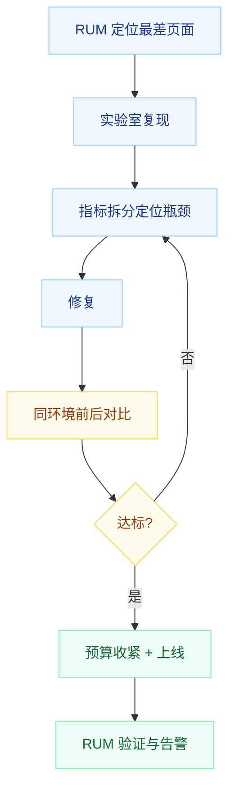

# 性能优化与CoreWebVitals

> 这篇从三个指标的定义与口径讲起，经过测量工具与环境、LCP/INP/CLS 三条优化路径、性能预算与构建集成、RUM 持续监控，最后落到一次带前后数据的完整优化案例。
>
> 学完能用 Lighthouse 和 web-vitals 库量出 LCP/INP/CLS 的真值，按指标定位到资源、长任务或布局问题，给出修复并用预算和 RUM 防回退。

## 一、指标体系与测量口径

Core Web Vitals 是 Google 定义的用户体验核心指标：**LCP 衡量加载、INP 衡量交互响应、CLS 衡量视觉稳定**。三个指标都以真实用户感受为准绳，并以第 75 百分位（p75）判定，不看平均值。

| 指标 | 全称 | 测量对象 | 良好 | 需改进 |
|---|---|---|---|---|
| LCP | Largest Contentful Paint | 最大内容元素渲染完成 | ≤ 2.5s | ≤ 4s |
| INP | Interaction to Next Paint | 所有交互中最差的响应 | ≤ 200ms | ≤ 500ms |
| CLS | Cumulative Layout Shift | 累计布局偏移 | ≤ 0.1 | ≤ 0.25 |

2024 年 3 月起 INP 取代首次输入延迟（FID）成为 Core Web Vitals 成员；FID 只测第一次输入，测不出“页面加载完之后越用越卡”。基线为 2026-11：Chrome 14x 采集口径、Lighthouse 12、web-vitals 库 v5。

### 1.1 实验室数据与真实用户数据

| | 实验室（Lab） | 真实用户（Field/RUM） |
|---|---|---|
| 来源 | Lighthouse、DevTools、CI 环境 | 用户浏览器上报 |
| 优点 | 可复现、可进 CI | 真实设备与网络 |
| 局限 | 合成负载、固定节流 | 采样与噪音 |
| 用途 | 改前改后对比、预算门槛 | 线上告警与验收 |

两条铁律：

- **上线判断只用 RUM**。实验室环境再像也不是用户；
- **优化对比只用实验室**。同一环境、同一节流、同一数据集，前后数据才有可比性。

Chrome 用户体验报告（CrUX）公开了真实 Chrome 用户在各站的 p75 数据；Search Console 的 Core Web Vitals 报告按页面组给出达标状态。自己的 RUM 与 CrUX 口径可能不同（采样、页面分组），对比时先对齐口径。

### 1.2 p75 的含义

指标按“最差的 25% 用户”判定。p75 的 LCP 是 3.2s，意味着 25% 的用户比这更慢。一个访问量很大的站点，慢的那部分用户往往就是移动端或弱网用户；只看平均会把他们平均掉。

> 边界：低流量站点 p75 波动极大，一天几十个样本时不要按天告警，按周聚合。RUM 数据保留至少 28 天再比较趋势。

## 二、测量工具与环境

### 2.1 Lighthouse：实验室基准

```bash
# 全局或 npx 运行；headless 默认 Chrome
npx lighthouse http://127.0.0.1:5173 \
  --preset=desktop \
  --output=json --output-path=./lh.json --chrome-flags="--headless"

# 移动端默认 4x CPU 节流 + 慢速 4G
npx lighthouse http://127.0.0.1:5173 --preset=perf --output=json --output-path=./lh-mobile.json
```

读结果先读指标，再读机会清单（Opportunities）与诊断（Diagnostics）：

```bash
node -e "
const r = require('./lh.json');
const a = r.audits;
console.log('LCP', Math.round(a['largest-contentful-paint'].numericValue), 'ms');
console.log('TBT', Math.round(a['total-blocking-time'].numericValue), 'ms');
console.log('CLS', a['cumulative-layout-shift'].numericValue.toFixed(4));
"
```

Lighthouse 不直接给 INP（没有真实交互），用总阻塞时间（TBT）近似：TBT 是主线程长任务超出 50ms 部分的总和，与 INP 相关但不相等。

### 2.2 web-vitals 库：RUM 埋点

```bash
npm i web-vitals
```

```ts
// main.ts：归因信息要从 attribution 子模块引入，主模块不带 attribution
import { onLCP, onINP, onCLS } from 'web-vitals/attribution';

function send(metric) {
  // sendBeacon 不阻塞且页面卸载时仍能发出
  navigator.sendBeacon('/api/vitals', JSON.stringify({
    name: metric.name,
    value: Math.round(metric.value),
    id: metric.id,
    // 归因信息：哪个元素、哪个资源
    attribution: metric.attribution,
  }));
}

onLCP(send);
onINP(send);
onCLS(send);
```

`metric.attribution` 带关键定位信息（需从 `web-vitals/attribution` 引入）：LCP 归因给出目标元素与其子部分耗时，INP 归因给出事件目标与长任务调用栈，CLS 归因给出偏移来源元素。只上报数值不收集归因的 RUM 无法排障。

### 2.3 DevTools：环境控制

| 手段 | 位置 | 用途 |
|---|---|---|
| CPU 4×/6× 节流 | Performance 面板 | 模拟低端机 |
| 网络 Fast 3G/Slow 4G | Network 面板 | 模拟弱网 |
| 缓存禁用 | Network 面板 | 模拟首访 |
| Web Vitals 覆盖层 | Rendering 面板 | 页内实时看数值 |

自动化里用 CDP 设同样的环境，人工环境与自动化环境不一致是“本地没问题、线上有问题”的头号来源：

```js
// Playwright 驱动的测量片段：CPU 4x + 150ms 延迟带宽
const cdp = await context.newCDPSession(page);
await cdp.send('Emulation.setCPUThrottlingRate', { rate: 4 });
await cdp.send('Network.emulateNetworkConditions', {
  offline: false, latency: 150,
  downloadThroughput: (1.6 * 1024 * 1024) / 8,
  uploadThroughput: (750 * 1024) / 8,
});
```

> 边界：无头浏览器渲染路径与有头不同，LCP 绝对值会偏低。做前后对比可以，对外报告数值必须用有头模式或 RUM。

## 三、LCP 优化

LCP 的总耗时拆成四段，优化永远先找出最长的那段：

| 子部分 | 含义 | 主要责任方 |
|---|---|---|
| TTFB | 首字节到达 | 后端、CDN、缓存 |
| 资源加载延迟 | LCP 资源开始下载 | 管道（CSS 阻塞、发现晚） |
| 资源加载耗时 | 下载完成 | 图片大小、格式、CDN |
| 渲染 | 元素画上屏幕 | 主线程长任务 |


### 3.1 首屏主图：preload 与 fetchpriority

首屏图片的通病是“发现晚”：HTML 解析到 `` 才开始下载，如果上面还有阻塞的 CSS，下载更晚。用 `preload` 提前发现，用 `fetchpriority` 抬高优先级：

```html
<head>
  <!-- 首屏主图提前发现、提高优先级；非首屏图片不要这样做 -->
  <link rel="preload" as="image" href="/hero.avif" fetchpriority="high">
</head>
<body>
  <!-- 宽高必须写：既是 CLS 占位，也避免加载后重排 -->
  
</body>
```

本地基准页实测（CPU 4×、150ms 延迟节流，Chromium 14x）：同一张延迟 300ms 的首屏图，不做任何处理 LCP 820ms；加 `preload + fetchpriority` 与非阻塞样式后 **356ms，提前 464ms**。管道优化在资源本身没变的前提下直接吃掉近一半时间。

### 3.2 图片格式与尺寸

| 格式 | 相对体积 | 支持度 | 用途 |
|---|---|---|---|
| AVIF | 最小 | 全主流浏览器 | 首选 |
| WebP | 小 | 全主流 | 兜底 |
| JPEG | 基准 | 全部 | `<picture>` 兜底 |
| PNG | 大 | 全部 | 需要透明时 |

```html
<picture>
  <!-- 浏览器按顺序选第一个支持的；img 是兜底 -->
  <source type="image/avif" srcset="/hero-800.avif 800w, /hero-1600.avif 1600w" sizes="100vw">
  <source type="image/webp" srcset="/hero-800.webp 800w" sizes="100vw">
  
</picture>
```

非首屏图片全部 `loading="lazy"`，首屏图反而**不要** lazy——它会降低 LCP 资源优先级。首图 lazy 是常见反直觉错误。

### 3.3 关键 CSS 与阻塞资源

CSS 阻塞首次渲染；JS 阻塞解析。优化动作固定三条：

- 首屏关键 CSS 内联进 `<head>`，其余拆出去异步加载；
- 业务脚本用 `type="module"`（默认 defer），第三方脚本按需 `async`；
- 字体用 `font-display: swap`，并 `preload` 字体文件，避免文字空窗后突然出现。

### 3.4 服务端渲染与流式

首屏内容靠客户端请求后再渲染，LCP 必然包含一整轮 JS 下载 + 执行 + 请求 + 渲染。管理后台的登录页、官网落地页这类首屏，SSR/SSG 直接把首字节后的 HTML 带内容返回，LCP 链路砍掉最长的两段。Next 16 默认流式 SSR；Nuxt 4.5 起可用 `experimental.ssrStreaming` 开启流式（默认关闭）。

> 边界：SSR 不是无条件更快。服务端模板本身有耗时（TTFB 变长），水合长任务也可能推迟 LCP。改完必须重测四段拆分，别默认“上了 SSR 就快”。

## 四、INP 优化

INP 取页面生命周期内**所有**交互（点击、按键、指针）中最差的一次（近似最高百分位），200ms 内完成“从输入到下一帧绘制”才算良好。它由三段组成：

| 段 | 含义 | 优化的对象 |
|---|---|---|
| 输入延迟 | 事件回调之前排队的时间 | 别的长任务占着主线程 |
| 处理时间 | 回调本身执行时间 | 回调里的重活 |
| 展示延迟 | 下一帧绘制时间 | 回调后的渲染量 |

### 4.1 先量化：一次实测

基准页实测（CPU 4× 节流，Chromium 14x）：点击触发“解析 1MB JSON × 40 次并渲染 3000 行”，事件计时 API 上报：

```text
同步执行（反例）：click duration = 520 ms
先反馈再分片（正例）：click duration = 48 ms
```

```js
// 采集事件时长：Event Timing API，web-vitals 库内部同样用它
new PerformanceObserver((list) => {
  for (const e of list.getEntries()) {
    if (e.name === 'click') {
      console.log('click', Math.round(e.duration), 'ms');
    }
  }
}).observe({ type: 'event', durationThreshold: 16 });
```

### 4.2 反例与正例的差别

```js
// 反例：事件回调里同步做完所有事，520ms 全部算进 INP
btn.addEventListener('click', () => {
  parseAll(40);        // 约 400ms（4x CPU 下）
  renderRows(3000);    // 约 100ms
});

// 正例：先渲染反馈，重活切片，回调本身 48ms 内结束
btn.addEventListener('click', async () => {
  status.textContent = '计算中…';
  // 连续两帧：第一帧提交状态，第二帧确认已经绘制，再开始重活
  await new Promise((r) => requestAnimationFrame(() => requestAnimationFrame(r)));
  for (let k = 0; k < 40; k += 4) {
    parseAll(4);
    await new Promise((r) => setTimeout(r, 0)); // 每片让出主线程
  }
  renderRows(3000);
});
```

正例的总耗时并没有变少，变的是**排队方式**：主线程每 50ms 内有空档，用户的点击、输入随时能插进来。INP 衡量的是响应性，不是吞吐量。

### 4.3 INP 的四类修复

| 问题 | 修复 | 边界 |
|---|---|---|
| 回调太重 | 拆分 + `scheduler.yield()` 让出 | 别用 setTimeout(0) 拆太碎，4ms 钳制反而更慢 |
| 输入延迟高 | 找占用主线程的长任务 | 三方脚本用 worker 或按需加载 |
| 纯计算 | 移到 Web Worker | 需要 DOM 的计算移不出去 |
| 渲染量大 | 减少回调后的 DOM 更新 | 虚拟滚动、分页、content-visibility |

水合（hydration）期的长任务是 SPA 常态：首屏可交互之前，点击全部排队。Next 16 通过 Suspense 做选择性水合，把非首屏组件的水合推迟到空闲期，直接改善加载后 1–2 秒内的 INP；Nuxt 4 也有组件懒加载策略，具体以当前版本文档为准。

> 边界：`passive: true` 只改善滚动启动，不影响 INP；`requestIdleCallback` 的回调可能一直不跑，不能用在有截止时间的交互里。

## 五、CLS 优化

CLS 取页面生命周期内最严重的一次布局偏移会话窗口的分数：窗口从第一次偏移开始，间隔超过 1 秒或总长超过 5 秒就结束；窗口内每个偏移按“影响面积比例 × 移动距离比例”计分后求和。用户输入后 500ms 内的偏移不计入，`transform` 动画不产生布局偏移。常见来源按修复难度排序：

| 来源 | 修复 |
|---|---|
| 图片/广告无尺寸 | `width/height` 或 `aspect-ratio` 占位 |
| 动态注入 DOM | 预留容器高度 |
| 字体加载替换 | `font-display: swap` + 字体度量匹配 |
| 动画动了 top/left | 改 `transform` |

### 5.1 图片必须带尺寸

```html
<!-- 反例：图片加载完成后把下方内容推下去 -->


<!-- 正例：属性占位，或用 aspect-ratio -->


```

### 5.2 动态内容预留空间

延迟注入的横幅是最典型的偏移源。本地实测：700ms 后在正文上方注入一个约 96px 高的横幅，CLS 从 0 变为 **0.2719**（“较差”档）；给容器预留固定高度后回到 **0**。

```html
<!-- 反例：横幅插进来，下方全部下移 -->
<div id="slot"></div>

<!-- 正例：slot 本身有高度，横幅在预留空间里渲染 -->
<div id="slot" style="min-height: 96px"></div>
```

```js
// 采集 CLS：按会话窗口累加，取生命周期内最大的窗口分数
let cls = 0, session = 0, sessionStart = 0, last = 0;
new PerformanceObserver((list) => {
  for (const e of list.getEntries()) {
    if (e.hadRecentInput) continue; // 用户输入后 500ms 内的偏移不算
    const t = e.startTime;
    if (session && t - last < 1000 && t - sessionStart < 5000) {
      session += e.value;
    } else {
      session = e.value;           // 间隔超过 1s 或窗口超过 5s，开新窗口
      sessionStart = t;
    }
    last = t;
    cls = Math.max(cls, session);
  }
  console.log('cls', cls.toFixed(4));
}).observe({ type: 'layout-shift', buffered: true });
```

### 5.3 字体与动画

- 字体：`font-display: swap` 会让文本先以回退字体显示，字体到达后替换；两套字体行高差异会造成一次偏移。配 `size-adjust` 与 `ascent-override` 让回退字体占位与最终字体一致；
- 动画：位移动画一律 `transform`，`transform` 不参与布局，不计入 CLS 也不触发回流；
- 骨架屏：骨架与真实内容尺寸不一致，等于制造两次偏移。骨架的宽高必须和内容一致。

> 边界：浏览器前进后退缓存（bfcache）恢复的页面不计新偏移，但离开前的 CLS 会被带回来。DevTools 里 CLS 有时会小于 RUM：扩展、输入法、翻译插件也会制造偏移，实验室环境测不到。

## 六、性能预算与构建集成

性能预算（performance budget）是把“多快”变成可执行约束的方式：给资源体积和指标定上限，构建或 CI 时超限即失败。

### 6.1 资源预算：size-limit

```bash
npm i -D size-limit @size-limit/file
```

```json
// package.json
{
  "size-limit": [
    { "path": "dist/assets/*.js", "limit": "180 kB" },
    { "path": "dist/assets/*.css", "limit": "30 kB" }
  ],
  "scripts": {
    "size": "size-limit"
  }
}
```

```bash
npm run size
```

```text
Size limit exceeded:
  dist/assets/*.js: 204.86 kB > limit 180 kB gzip
```

### 6.2 指标预算：Lighthouse CI

```bash
npm i -D @lhci/cli
```

```js
// lighthouserc.cjs
module.exports = {
  ci: {
    collect: {
      startServerCommand: 'npm run preview', // 用生产构建预览，dev 模式数据没有意义
      url: ['http://127.0.0.1:4173/', 'http://127.0.0.1:4173/orders'],
      numberOfRuns: 3,                        // 多次取中位数，抗抖动
    },
    assert: {
      assertions: {
        'largest-contentful-paint': ['error', { maxNumericValue: 2500 }],
        'cumulative-layout-shift': ['error', { maxNumericValue: 0.1 }],
        'total-blocking-time': ['error', { maxNumericValue: 300 }],
      },
    },
  },
};
```

```bash
npx lhci autorun
```

预算的三条原则：

- **只对生产构建断言**。dev 模式的数字没有参考价值；
- **每个断言跑 3 次取中位数**。单次实验室数据波动可达 ±15%；
- **预算随基线走**。基线 2.1s 的页面预算 2.5s 合理，基线 1.2s 的页面同样 2.5s 就是纵容回退。收紧预算用 ratchet：只允许变好，不允许变差。

## 七、RUM 与持续监控

实验室数据防不住真实回退：第三方脚本更新、缓存命中率下降、某个地区 CDN 抖动，只有 RUM 看得见。

### 7.1 采样与上报

```ts
// vitals.ts：web-vitals v5 的 attribution 子模块 + sendBeacon
import { onLCP, onINP, onCLS, type Metric } from 'web-vitals/attribution';

const SAMPLE_RATE = 0.1; // 采样 10%，高流量站点的默认起点

function send(metric: Metric) {
  const body = JSON.stringify({
    name: metric.name,
    value: Math.round(metric.value),
    rating: metric.rating,            // good / needs-improvement / poor
    id: metric.id,
    page: location.pathname,
    // attribution 带 LCP 元素、INP 事件目标等定位信息
    debug: metric.attribution,
  });
  if (navigator.sendBeacon) {
    navigator.sendBeacon('/api/vitals', body);
  } else {
    fetch('/api/vitals', { body, keepalive: true, method: 'POST' });
  }
}

if (Math.random() < SAMPLE_RATE) {
  onLCP(send);
  onINP(send);
  onCLS(send);
}
```

### 7.2 聚合与告警

| 维度 | 例子 | 说明 |
|---|---|---|
| 页面 | `/orders` | 按页面分组对比，别全站一个数 |
| 设备 | 移动 / 桌面 | 差异常在 3 倍以上 |
| 版本 | 应用版本号 | 发布前后对比 |
| 地区 / 运营商 | 国家、ASN | CDN 问题最先暴露在这 |

聚合一律用 p75，按日分桶、按周看趋势。告警阈值用“p75 连续 3 天超过基线 10%”而不是“超 2.5s 就报”，否则移动端常态化的波动会打爆值班。

> 边界：sendBeacon 的 POST 大小有限制（通常 64KB），归因信息要裁剪；页面卸载时 web-vitals 已处理好最终上报，不要自己在 `unload` 里再发一次，`unload` 会破坏 bfcache。

## 八、优化工作流与现场手册



| 现象 | 看什么 | 第一条动作 |
|---|---|---|
| LCP 慢 | 四段拆分（TTFB/加载延迟/耗时/渲染） | 从最长一段下手 |
| INP 高 | Event Timing 的输入延迟 vs 处理时间 | 输入延迟高找长任务；处理高拆回调 |
| CLS 高 | layout-shift 的 sources | 找第一个大偏移的来源元素 |
| 本地好线上差 | RUM 设备/地区分布 | 对比低端机与弱网环境 |
| 发布后回退 | 版本维度的 p75 | diff 本次发布资源与脚本 |
| 指标忽好忽坏 | 采样量与分桶 | 样本不足按周聚合 |

## 九、最佳实践案例

### 9.1 案例背景

某企业官网落地页由 Vite 7 构建，托管在 CDN 后面。营销方反馈“打开慢、点按钮没反应、内容会跳”。Search Console 的 Core Web Vitals 报告显示 LCP 与 CLS 双红，移动端更差。

约束：没有生产环境修改权限的排查窗口，只能先在本地构建一份**可复现基准页**（同一首屏图、同一横幅逻辑、同一计算量），用统一的节流环境（CPU 4×、150ms 延迟）做前后对比，结论再回灌到真实站点的发布计划。目标是三个指标全部进入“良好”。

### 9.2 案例实操

**第一步：搭基准环境。** Node 静态服务器三件套：延迟 CSS、延迟首屏图、700ms 后注入横幅，对应真实站的三个嫌疑点。

```js
// bench-server.js（片段）：可控延迟的最小服务器
const server = http.createServer((req, res) => {
  const delay = Number(new URL(req.url, 'http://x').searchParams.get('delay') || 0);
  setTimeout(() => {
    if (req.url.startsWith('/hero.svg')) {
      res.writeHead(200, { 'content-type': 'image/svg+xml' });
      res.end(HERO);
    } else if (req.url.startsWith('/style.css')) {
      res.writeHead(200, { 'content-type': 'text/css' });
      res.end(CSS);
    } else {
      res.writeHead(200, { 'content-type': 'text/html; charset=utf-8' });
      res.end(page(BAD_OR_GOOD)); // 同一页面的两个变体
    }
  }, delay);
});
server.listen(8140);
```

两个变体的差别只有三处：

```html
<!-- 反例页面 -->
<link rel="stylesheet" href="/style.css?delay=600">   <!-- 600ms 阻塞样式 -->
        <!-- 发现晚、无尺寸 -->
<div id="slot"></div>                                  <!-- 横幅无预留 -->

<!-- 正例页面 -->
<link rel="preload" as="image" href="/hero.svg?delay=300" fetchpriority="high">
<link rel="stylesheet" href="/style.css?delay=100">

<div id="slot" style="min-height: 96px"></div>
```

**第二步：固定测量脚本。** Playwright 驱动 Chromium 14x，CDP 设 CPU 4× 与 150ms 延迟，页面内用 PerformanceObserver 取 LCP 与 CLS：

```js
// cwv.js（片段）：LCP 取最后一次条目；本例只有一次横幅偏移，直接求和等价于会话窗口
const cdp = await context.newCDPSession(page);
await cdp.send('Emulation.setCPUThrottlingRate', { rate: 4 });
await cdp.send('Network.emulateNetworkConditions', {
  offline: false, latency: 150,
  downloadThroughput: (1.6 * 1024 * 1024) / 8,
  uploadThroughput: (750 * 1024) / 8,
});

async function measure(path) {
  await page.goto(`http://127.0.0.1:8140${path}`, { waitUntil: 'load' });
  await page.waitForTimeout(2500); // 等 LCP 元素稳定与横幅注入完成
  return page.evaluate(async () => {
    const lcp = await new Promise((r) => {
      new PerformanceObserver((l) => r(l.getEntries().at(-1)))
        .observe({ type: 'largest-contentful-paint', buffered: true });
      setTimeout(() => r(null), 500);
    });
    const shifts = await new Promise((r) => {
      const out = [];
      new PerformanceObserver((l) => out.push(...l.getEntries()))
        .observe({ type: 'layout-shift', buffered: true });
      setTimeout(() => r(out), 200);
    });
    return {
      lcp: lcp ? Math.round(lcp.renderTime || lcp.startTime) : null,
      cls: +shifts.reduce((s, e) => s + e.value, 0).toFixed(4), // 单次偏移，等价于会话窗口分数
    };
  });
}
```

**第三步：INP 用第二个基准测。** 同样 CPU 4×，点击“计算”按钮（解析 1MB JSON × 40 并渲染 3000 行），Event Timing API 采集 click 时长：

```js
new PerformanceObserver((l) => {
  for (const e of l.getEntries()) {
    if (e.name === 'click') window.durations.push(Math.round(e.duration));
  }
}).observe({ type: 'event', durationThreshold: 16 });
```

修复动作对应 4.2 节的反例/正例：回调先渲染“计算中…”，`await` 连续两帧 rAF 后分片计算，每片之间 `setTimeout(0)` 让出。

**第四步：跑前后对比。**

```bash
node bench-server.js &   # 8140：LCP/CLS 基准页
node inp-server.js &    # 8142：INP 基准页
node cwv.js             # 输出 BAD / GOOD 两组数据
node inp.js             # 输出 INP 前后
```

实测输出（Chromium 14x，CPU 4×、150ms 延迟，Apple M 系列本机）：

```text
BAD  {"lcp":820,"cls":0.2719}
GOOD {"lcp":356,"cls":0}
INP_BAD  [520]
INP_GOOD [48]
```

**第五步：结论回灌真实站点。** 真实落地页按同样三处修改：首屏图 `preload + fetchpriority + width/height`、关键 CSS 拆出阻塞链、横幅容器预留高度、计算回调分片。修改进发布计划，Lighthouse CI 按第四步的预算收紧：

```js
// lighthouserc.cjs 断言（发布门槛）
'largest-contentful-paint': ['error', { maxNumericValue: 2500 }],
'cumulative-layout-shift': ['error', { maxNumericValue: 0.1 }],
'total-blocking-time': ['error', { maxNumericValue: 300 }],
```

### 9.3 案例结果

| 指标 | 基准页（反例） | 基准页（正例） | 阈值 |
|---|---|---|---|
| LCP | 820 ms | 356 ms | ≤ 2500 ms |
| CLS | 0.2719 | 0 | ≤ 0.1 |
| INP（click duration） | 520 ms | 48 ms | ≤ 200 ms |

三处修改的归因：

- LCP 提前 464ms 全部来自管道：图片本身没换，`preload` 让发现提前、`fetchpriority` 让它插队、样式不再阻塞 600ms；
- CLS 归零来自 96px 预留空间与图片尺寸属性，`layout-shift` 条目里横幅来源消失；
- INP 从 520ms 到 48ms 不是计算变快了，是计算分片了：正例的回调在 48ms 内结束并把主线程让出来。

失败模式复盘：

- 第一版修复只处理了图片，LCP 只提前 100ms 左右——600ms 的阻塞样式还占着管道，四段拆分显示“资源加载延迟”没变，说明瓶颈找错了段；
- 横幅修复初版用了 `visibility: hidden` 预隐藏，CLS 仍为 0.05：预隐藏的元素仍占位，但横幅字体加载后二次撑高，仍有一次小偏移；固定 `min-height` 才彻底归零；
- INP 修复初版把分片粒度设成每片 8 次解析，click 仍有 210ms；改为每片 4 次并先 `await` 两帧 rAF 渲染反馈，降到 48ms。切片粒度以事件时长为准，不凭感觉。

结论：三个指标的修复手段几乎不重叠——LCP 看管道、INP 看主线程排队、CLS 看占位。先量、归因到段、再修，最后必须落成预算和 RUM 告警，否则一次发布就能把成果全部冲掉。
