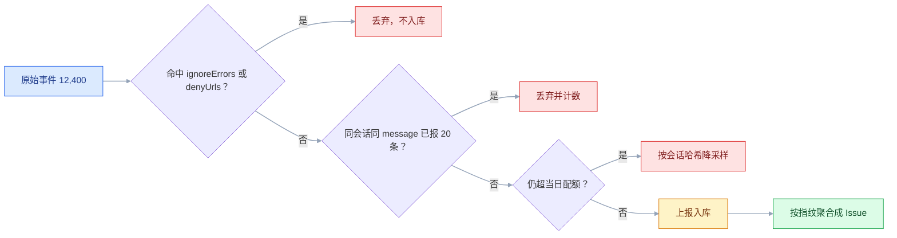
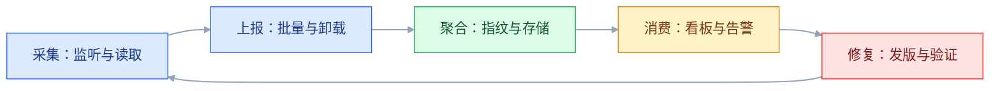
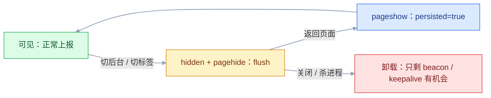

# 前端监控

## 一、工程案例：把每天一万两千条报错压到四十条

**场景**：`admin-app` 是一个已上线的 Vue 3 电商后台，技术栈 `Vue 3 + TS + Vite + Vue Router + Pinia + Element Plus`，接口走 `src/utils/request.ts` 里的 axios 实例，Nginx 同域反代 `/api`。上线半年，错误来源只有客服转述和用户截图。

**接入第一周的实测**：日均 12,400 个事件、1,860 条 Issue。按来源拆分，真正需要改代码的不到 3%：

| 来源 | 占比 | 典型内容 |
|---|---|---|
| 跨域脚本打码 | 34% | `Script error.`，没有文件名、没有行号 |
| 浏览器插件 | 21% | `chrome-extension://` 注入的脚本报错 |
| 良性浏览器警告 | 16% | `ResizeObserver loop limit exceeded` |
| 用户网络与取消 | 18% | `Network Error`、`Failed to fetch` |
| 发版后的旧 chunk | 8% | `Loading chunk 17 failed` |
| 真实业务缺陷 | 3% | 空数据渲染、字段缺失、契约不一致 |

**目标**：日均事件压到 500 以内；每周新增 Issue 少于 40 条；堆栈能落到 `.vue` 行号；影响用户的错误 5 分钟内到人；上报数据里不出现手机号、身份证、token。

### 1.1 接入 SDK，先只开错误

```bash
pnpm add @sentry/vue
# 版本以官方当前稳定版为准；Vue 3 用 @sentry/vue，React 用 @sentry/react
```

```typescript
// src/monitor/sentry.ts
import * as Sentry from '@sentry/vue'
import type { App } from 'vue'

export function initSentry(app: App) {
  Sentry.init({
    app,
    dsn: import.meta.env.VITE_SENTRY_DSN,
    environment: import.meta.env.MODE,
    release: `admin-app@${import.meta.env.VITE_APP_VERSION}`,
    sendDefaultPii: false,
    tracesSampleRate: 0, // 第一周只收错误，性能走 1.5 的自建通道
  })
}
```

`tracesSampleRate: 0` 时不要再加 `browserTracingIntegration`，采样率为 0 它只会白白挂一组监听。等要收 Sentry 事务时再补集成、把采样率调到 0.05~0.2（以官方当前稳定版为准）。

`release` 从第一天就必须有，并且和构建时上传 sourcemap 用的版本号来自同一个环境变量。少了它，后面堆栈还原一定失败。

```bash
# .env.production（DSN 会进前端包，可以公开；Auth Token 绝不能进仓库）
VITE_SENTRY_DSN=https://a1b2c3d4e5f6@o123456.ingest.sentry.io/1234567
VITE_APP_VERSION=2.3.1
```

### 1.2 补齐四个捕获面

Sentry 的全局集成能接住同步异常，但 Promise、资源、框架渲染、接口语义错误要自己接。四种手段汇到同一个入口，入口按对象去重；单会话限流放在 1.4 的 `beforeSend`，才能连 SDK 自己捕获的异常一起限住：

```typescript
// src/monitor/capture.ts
import * as Sentry from '@sentry/vue'

const seen = new WeakSet<object>()

export function captureOnce(err: unknown, context?: Record<string, unknown>) {
  if (err && typeof err === 'object') {
    if (seen.has(err)) return
    seen.add(err)
  }
  Sentry.captureException(err, { extra: context })
}
```

```typescript
// src/monitor/install.ts
import type { App } from 'vue'
import { captureOnce } from './capture'

export function installGlobalHandlers(app: App) {
  // ① Promise 未捕获：async 里的 throw 不会进 window.onerror
  window.addEventListener('unhandledrejection', (event) => {
    const reason = event.reason
    captureOnce(reason instanceof Error ? reason : new Error(String(reason)), {
      type: 'unhandledrejection',
    })
  })

  // ② 资源加载失败：不冒泡，只能捕获阶段拿
  window.addEventListener('error', (event) => {
    const el = event.target as HTMLElement | null
    const tag = el?.tagName?.toLowerCase()
    if (!tag || !['img', 'script', 'link', 'video', 'audio'].includes(tag)) return
    captureOnce(new Error(`resource load failed: ${tag}`), {
      type: 'resource_error',
      url: (el as HTMLImageElement).src || (el as HTMLLinkElement).href,
    })
  }, true)

  // ③ Vue 渲染 / 生命周期 / setup 里的错误
  app.config.errorHandler = (err, instance, info) => {
    captureOnce(err, {
      type: 'vue_error',
      info,
      component: (instance as { type?: { __name?: string } } | null)?.type?.__name,
    })
  }
}
```

```typescript
// src/utils/request.ts —— 接口错误只在这一层上报
import axios, { type AxiosError } from 'axios'
import { captureOnce } from '@/monitor/capture'

// request 是文件里已有的 axios 实例，baseURL 为 '/api'
request.interceptors.response.use(
  (response) => {
    const { code, message } = response.data ?? {}
    if (code !== 0) {
      const err = new Error(`business error [${code}]: ${message}`)
      captureOnce(err, { type: 'business_error', api: response.config.url })
      return Promise.reject(err)
    }
    return response.data
  },
  (error: AxiosError) => {
    if (axios.isCancel(error)) return Promise.reject(error) // 主动取消不报
    const status = error.response?.status
    if (status === 401 || status === 403) return Promise.reject(error) // 正常流转
    captureOnce(error, { type: 'api_error', status: status ?? 'network', api: error.config?.url })
    return Promise.reject(error)
  },
)
```

`WeakSet` 保证同一个 Error 对象只报一次：拦截器 reject 后如果调用方没 `catch`，浏览器还会再抛一次 `unhandledrejection`，两次拿到的是同一个对象，第二次直接短路。

### 1.3 sourcemap：让堆栈落到 `.vue` 行号

```bash
pnpm add -D @sentry/vite-plugin
# 版本以官方当前稳定版为准
```

```typescript
// vite.config.ts
import { defineConfig, loadEnv } from 'vite'
import vue from '@vitejs/plugin-vue'
import { sentryVitePlugin } from '@sentry/vite-plugin'

export default defineConfig(({ mode }) => {
  const env = loadEnv(mode, process.cwd())
  const uploadSourcemaps = env.SENTRY_AUTH_TOKEN
    ? [
        sentryVitePlugin({
          org: 'your-org',
          project: 'admin-app',
          authToken: env.SENTRY_AUTH_TOKEN, // 只放 CI 环境变量
          release: { name: `admin-app@${env.VITE_APP_VERSION}` },
          sourcemaps: { filesToDeleteAfterUpload: ['./dist/**/*.map'] },
        }),
      ]
    : [] // 本地没有 token 就不挂插件，否则构建会因上传失败而中断

  return {
    build: { sourcemap: 'hidden' }, // 生成 .map，但不写 sourceMappingURL 注释
    plugins: [vue(), ...uploadSourcemaps],
  }
})
```

```text
✓ 1243 modules transformed.
dist/assets/index-a3f9d1.js        486.21 kB │ gzip: 152.30 kB
dist/assets/index-a3f9d1.js.map      1.82 MB
> Uploaded 42 files to release admin-app@2.3.1
```

看到 `Uploaded 42 files` 才算成功。`sourcemap: 'hidden'` 与 `true` 的区别只在注释：`true` 会在 JS 末尾写一行 `//# sourceMappingURL=...`，map 被插件删掉后这行就成了 404；`hidden` 照样生成 map 供上传，但线上 JS 不指过去。上传后删本地 map，避免 `.map` 跟着静态资源一起发布到公网。

### 1.4 降噪：12,400 到 480

降噪分四层：先用 `ignoreErrors` / `denyUrls` 过滤已知噪音，再限制单会话上报量，最后才动采样率；入库之后由指纹把同类错误合并成一条 Issue。前三层削减事件量，指纹只削减 Issue 数量；采样必须放最后，否则真实错误会先被丢掉。



```typescript
// src/monitor/limit.ts
const counted = new Map<string, number>()
const LIMIT = 20

// key 用异常类型 + message；在 beforeSend 里调用，限额才会覆盖所有来源
export function overLimit(key: string) {
  const n = counted.get(key) ?? 0
  if (n >= LIMIT) return true
  counted.set(key, n + 1)
  return false
}
```

```typescript
// 下面三个字段并入 1.1 的 Sentry.init({ ... })，并补 import { overLimit } from './limit'
ignoreErrors: [
  'ResizeObserver loop limit exceeded',
  /^Script error\.?$/,
  /^Network Error$/,
  /Loading chunk \d+ failed/,
  /Failed to fetch/,
],
denyUrls: [/extensions\//i, /^chrome-extension:\/\//i, /^moz-extension:\/\//i],
beforeSend(event) {
  const ex = event.exception?.values?.[0]
  if (overLimit(`${ex?.type ?? 'message'}:${ex?.value ?? ''}`)) return null
  const headers = event.request?.headers
  if (headers) {
    // 头名大小写由各层代理决定，按名匹配会漏
    for (const key of Object.keys(headers)) {
      if (/^(authorization|cookie|x-api-key)$/i.test(key)) delete headers[key]
    }
  }
  if (typeof event.request?.query_string === 'string') {
    event.request.query_string = event.request.query_string.replace(
      /(token|phone|idcard|password)=[^&]*/gi,
      '$1=[Filtered]',
    )
  }
  if (event.request?.data) event.request.data = '[Filtered]'
  if (event.user) event.user = { id: event.user.id }
  return event
},
```

`query_string` 在 SDK 里可能是原始字符串，也可能是解析后的对象，对象分支要单独遍历键值，否则只过滤掉一半。

单会话 20 条限流同样关键：一个死循环错误能在 10 分钟内刷出 8,000 个事件，把当月配额烧光。放在 `beforeSend` 而不是 `captureOnce`，是因为前者能看到每一条事件，包括 SDK 全局监听直接捕获的同步异常。没有稳定堆栈、只有 message 的错误，还要手工指定指纹，避免裂成几百条 Issue：

```typescript
Sentry.captureException(err, { fingerprint: ['order-export', String(status ?? 'unknown')] })
```

### 1.5 性能与行为：只留能回答问题的指标

```bash
pnpm add web-vitals
# 版本以官方当前稳定版为准
```

```typescript
// src/monitor/performance.ts
import { onLCP, onINP, onCLS, onTTFB, type Metric } from 'web-vitals'

const queue: Metric[] = []

function send(metric: Metric) {
  const body = JSON.stringify({
    name: metric.name,
    value: metric.name === 'CLS' ? Number(metric.value.toFixed(4)) : Math.round(metric.value),
    rating: metric.rating,
    id: metric.id,
    path: location.pathname,
    release: import.meta.env.VITE_APP_VERSION,
  })
  navigator.sendBeacon('/api/monitor/perf', new Blob([body], { type: 'text/plain' }))
}

export function flushPerf() {
  queue.splice(0).forEach(send)
}

export function initPerformance() {
  const push = (metric: Metric) => {
    queue.push(metric)
    if (queue.length >= 10) flushPerf()
  }
  onLCP(push); onINP(push); onCLS(push); onTTFB(push)
  document.addEventListener('visibilitychange', () => {
    if (document.visibilityState === 'hidden') flushPerf() // LCP/CLS 往往在此刻才定稿
  })
}
```

同域也用 `text/plain`，是为了省掉一处只在跨域才暴露的差异：`application/json` 的 Blob 属于非 CORS 安全列表类型，跨域时会触发预检，而 `sendBeacon` 走 no-cors，预检做不了，请求会被直接丢掉。埋点通道将来换域名时，这行不用再改。

`sendBeacon` 的返回值也要看：返回 `false` 说明没排进队列（常见于单次超过 64KB），这时要退化成 `fetch(..., { keepalive: true })` 或直接不发，别当成发送成功。

行为埋点只留三个问题：导出有没有人用、下单成功率、从列表到详情的转化。事件名统一 `模块_对象_动作`：

```typescript
// src/monitor/track.ts
export function track(event: string, params: Record<string, string | number | boolean | undefined> = {}) {
  const body = JSON.stringify({ event, params, path: location.pathname, release: import.meta.env.VITE_APP_VERSION })
  navigator.sendBeacon('/api/monitor/track', new Blob([body], { type: 'text/plain' }))
}
// 点击在动作开始时上报，结果单独上报
track('order_list_export_click', { tab: 'all' })
track('order_list_export_result', { success: true, count: rows.length })
```

### 1.6 告警：三条规则，按影响面收敛

| 规则 | 条件 | 动作 | 理由 |
|---|---|---|---|
| 新错误 | 生产环境出现新 Issue | 企业微信 | 新问题必须有感知 |
| 大范围 | 1 小时内影响用户 > 10 | 企业微信 + 邮件 | 用户数比次数稳 |
| 核心流程 | `submit_order` 相关错误 ≥ 3 次/5 分钟 | 企业微信 + 电话 | 直接损失订单 |

钉钉用「加签」：`sign = base64(HMAC-SHA256(secret, timestamp + '\n' + secret))`，再 URL 编码，和 `timestamp` 一起拼进 webhook，少一层编码就会被判签名错误。企业微信只需 POST `{ msgtype: 'markdown', markdown: { content } }`，content 有长度上限，超长要先截断。两者都放在服务端，webhook 地址不能进前端包。

### 1.7 验收

| # | 检查项 | 命令或检查 | 通过标准 |
|---|---|---|---|
| 1 | SDK 生效 | 控制台执行 `throw new Error('probe-1')` | 30 秒内 Issues 出现 `probe-1` |
| 2 | Promise 捕获 | 控制台执行 `Promise.reject(new Error('probe-2'))` | 出现 `probe-2`，类型为 unhandledrejection |
| 3 | 资源捕获 | DevTools 把某张图改成 404 | 出现 `resource load failed: img` |
| 4 | 堆栈还原 | 打开任意 Issue 的 Stack Trace | 显示 `src/views/...vue:87`，不是 `index-a3f9d1.js:1:` |
| 5 | 降噪效果 | 看一周 Events 总量 | < 500，`Script error.` 占比 < 2% |
| 6 | 单会话限流 | 循环抛同一个错 100 次 | 该会话事件数 ≤ 20 |
| 7 | 隐私 | 在 Issue 里搜手机号、token | 均显示 `[Filtered]` 或不存在 |
| 8 | 性能数据 | 浏览几个页面后切走标签，再查 `/api/monitor/perf` 日志 | 有 LCP/INP/CLS，能算出 P75 |
| 9 | 告警到达 | 控制台执行 `throw new Error('probe-alert')` 制造一条新 Issue | 5 分钟内企业微信收到，含版本和页面 |
| 10 | 卸载不丢 | 点击站内链接跳转前触发一个错误 | Sentry 里能看到该事件，`release` 为当前版本 |

> 第 4 项最容易被跳过，也最能说明监控是否可用。堆栈还原不了，前面所有采集都只是在制造噪音。

### 1.8 一周后的复盘

| 指标 | 接入前 | 降噪后 |
|---|---|---|
| 日均事件 | 12,400 | 480 |
| 每周新增 Issue | 1,860 | 34 |
| 平均定位时间 | 客服转述，通常 > 1 天 | 看堆栈，10 分钟内 |
| 告警到达 | 无 | 5 分钟内 |
| 可处理的真实缺陷 | 被噪音淹没 | 每周 5~8 条，全部有主 |

维护节奏固定成三件事：每周一清 Top 10 错误（修 / 加过滤 / 降级三选一）；每次发版看新版本的事件数是否为 0；每月核对一次配额和采样率。**「忽略」也是正规处理动作**，但要在 Issue 里留一句原因，否则下个月没人知道为什么被静音。

---

## 二、高频问答：会卡住你的地方，也是面试最常问的

### 2.1 Issue 列表全是 `Script error.`

**现场**

看报错脚本的域名是否和页面不同；Network 里看该脚本响应有没有 `Access-Control-Allow-Origin`。

```html
<script src="https://cdn.example.com/app.js" crossorigin="anonymous"></script>
```

```nginx
add_header Access-Control-Allow-Origin https://admin.example.com always;
```

```bash
curl -sI https://cdn.example.com/app.js | grep -i '^access-control-allow-origin'
```

**要点**

- 跨域脚本没有开启 CORS，浏览器把异常信息抹成 `Script error.`，只留一个空壳。
- 这不是 SDK 的能力问题，而是同源策略在生效，换监控厂商也一样。
- 响应头要加在**脚本文件本身**的响应上，不是页面 HTML 上；用了 `crossorigin` 但响应没带这个头，报错仍是 `Script error.`。

**追问**

- 为什么加了 `crossorigin` 还要服务端配合？→ 浏览器要拿响应头确认来源被允许。
- 老版本的历史数据会补全吗？→ 不会，只影响加头之后的新版本。
- CORS 头能写 `*` 吗？→ 可以，匿名脚本不需要凭据。

### 2.2 Promise 里的错误一条都没有

**现场**

控制台执行 `Promise.reject(new Error('probe'))`，看 Issues 是否出现。

**要点**

- 这类错误只触发 `unhandledrejection`，不触发 `window.onerror`。
- 常见原因是 `await` 了但外层没有 `try/catch`，或 `.catch()` 里又 `throw`。
- 同步异常、Promise、资源加载是三条独立通道，任何一条没接都会漏。
- 核实要在生产构建里跑一次，而不是只在本地 dev 模式试。

**追问**

- 为什么 dev 里有时能看到？→ 开发模式有额外的错误覆盖，不能代表线上。
- 多个监听会重复上报吗？→ 会，要用 `WeakSet` 之类按对象去重。
- `try/catch` 能替代全局监听吗？→ 不能，只覆盖同步代码。

### 2.3 接口 4xx / 5xx 在 Sentry 里看不到

**现场**

在拦截器的 error 分支打日志，看 500 时是否进入该分支。

```typescript
const res = await fetch('/api/order')
if (!res.ok) throw new Error(`HTTP ${res.status}`) // fetch 必须自己抛
```

**要点**

- `fetch` 只有网络层失败才 reject；HTTP 500 对它来说是「成功收到响应」。
- axios 默认会 reject 4xx/5xx，但拦截器 error 分支里 `return error.response` 会把拒绝改成成功。
- HTTP 状态码和网络异常是两件事；Network 里有响应、状态 500，说明网络层是通的。
- `fetch` 必须自己判断 `res.ok`，业务码还要判断 `code !== 0`。

**追问**

- 401/403 要不要上报？→ 通常是正常流转，不该当异常。
- 网络错误和 HTTP 错误怎么区分？→ 看 `error.response` 是否存在。
- 为什么后端说没报错，前端也看不到？→ 后端 500 不一定进前端异常，要应用层判断。

### 2.4 sourcemap 上传了，堆栈还是压缩的

**现场**

对比 `Sentry.init` 的 `release`、插件的 `release.name`、Issue 详情里的 Release 三者。

```bash
> Uploaded 42 files to release admin-app@2.3.1   # 构建日志里必须有这行
find dist -name '*.map'                         # 上传后应无输出；还有 map 说明清理没生效
```

**要点**

- 三种原因：`release` 两边不一致；上传发生在构建产物被清理之后；`.map` 文件名和线上 JS 对不上（CDN 改了 hash）。
- 只验证「上传动作执行了」不够，堆栈还原是 `(release, 文件名)` 两个维度的匹配，缺一不可。
- 改了 `VITE_APP_VERSION` 却没重新构建，线上仍是旧值，只能靠对比确认。

**追问**

- 为什么改了版本号还要重新构建？→ `release` 是构建时写进产物和事件的。
- 怎么确认 map 没被发布？→ `find dist -name '*.map'` 应该没有输出。
- `sourcemap: 'hidden'` 和 `true` 的区别？→ 只差 `sourceMappingURL` 注释，前者不指过去。

### 2.5 一条错误裂成几百条 Issue

**现场**

对比几条 Issue 的标题，看是否只有中间一段数字或 ID 不同。

```typescript
Sentry.captureException(err, { fingerprint: ['order-export', String(status)] })
```

**要点**

- 错误信息里带了动态值（订单号、时间戳、用户 ID），默认按堆栈分组时每组都不同。
- 平台只能按它看到的字符串分组，字符串不稳定就聚不起来，不是平台去重坏了。
- message 保持稳定，动态值放进 `tags` / `extra`，或手工指定 `fingerprint`。

**追问**

- 改指纹会重排历史数据吗？→ 不会，只影响之后的事件。
- 为什么高基数 tag 也有问题？→ 每个值都要建索引，存储和查询都会变差。
- 去重和聚合的区别？→ 去重按 `event_id`，聚合按指纹。

### 2.6 页面白屏，但没有任何错误上报

**现场**

让用户提供 URL 和 UA；本地用同版本构建 + 弱网复现；看资源是否 404。

```typescript
function isBlank() {
  const root = document.querySelector('#app')
  if (root && root.children.length === 0) return true // 框架根本没挂上，只剩空壳
  return [[0.5, 0.5], [0.25, 0.25], [0.75, 0.75]].every(([x, y]) => {
    const el = document.elementFromPoint(innerWidth * x, innerHeight * y)
    return !el || ['HTML', 'BODY'].includes(el.tagName)
  })
}

window.addEventListener('load', () => {
  setTimeout(() => {
    if (isBlank()) captureOnce(new Error('white screen'), { type: 'white_screen', path: location.pathname })
  }, 3000)
})
```

**要点**

- 白屏可能不是异常：入口 chunk 404、`index.html` 被缓存成旧版、SSR 水合失败、渲染前就 `return`、内存不足导致标签页崩溃。
- 资源 404、缓存错配、进程崩溃都不产生 JS 异常，默认「白屏一定伴随异常」就会漏。
- 只判断 `HTML`/`BODY` 会漏掉最常见的一种：`#app` 还在，只是里面没渲染出任何东西。
- SPA 路由切换后要再查一次，挂到 `router.afterEach` 即可。

**追问**

- 为什么 3 秒后才判？→ 给渲染留时间，避免把慢加载误报成白屏。
- 标签页崩溃能上报吗？→ 不能，只能靠会话存活或心跳发现。
- 先看监控还是先看现场？→ 先看 Network 和 Elements，再谈监控。

### 2.7 上线后事件量突然暴涨

**现场**

按 `url`、`release`、`browser` 三个维度分组，看是否集中在某一类。

```typescript
const CHUNK_ERROR = /Loading chunk \d+ failed|Failed to fetch dynamically imported module|Importing a module script failed/

// chunk 失败的正确处理不是上报，而是引导刷新
router.onError((error) => {
  if (!CHUNK_ERROR.test(error.message)) return
  if (sessionStorage.getItem('chunk-reloaded')) return // 只自动刷一次，避免死循环
  sessionStorage.setItem('chunk-reloaded', '1')
  location.reload()
})
```

**要点**

- 常见是噪音：插件、切换 VPN 导致的 `Network Error`、旧页面拉新 chunk 失败、请求被主动取消。
- 事件量不等于故障量，先分组再判断，是监控排障的第一动作。
- chunk 失败的正确处理不是上报，而是引导刷新，且只自动刷一次。
- `chunk-reloaded` 要在应用成功启动后清掉，否则同一会话里第二次发版又会白屏。

**追问**

- 为什么只自动刷一次？→ 第二次还失败说明不是版本错配，继续刷就是死循环。
- Vite 的报错文案和 webpack 一样吗？→ 不一样，正则要覆盖多种。
- 怎么判断是不是新版本引入的？→ 看新增事件的 `release` 是否等于刚发的版本，以及有没有稳定堆栈。

### 2.8 自建上报的 `sendBeacon` 全丢了

**现场**

Network 里看不到该请求，或看到预检失败；后端访问日志为空。

```typescript
navigator.sendBeacon('/api/monitor/report', new Blob([body], { type: 'text/plain' }))
```

**要点**

- 跨域 + Blob 的 type 是 `application/json`：这属于非 CORS 安全列表类型，会触发预检，而 beacon 不能完成预检，请求被浏览器丢弃。
- `sendBeacon` 返回 `true` 只表示请求已排队，不表示送达。
- 同域也用 `text/plain`，是为了将来换域名时这行不用再改。

**追问**

- 为什么 beacon 不能预检？→ 它走 no-cors，拿不到预检响应。
- 超过 64KB 怎么办？→ 返回 `false`，退化成 `fetch(..., { keepalive: true })` 或直接不发。
- `keepalive` 有大小限制吗？→ 同样约 64KB。

### 2.9 性能指标是 0，或者只有一条

**现场**

在回调里打时间戳，看页面停留 10 秒以上是否仍有回调。

```typescript
onLCP((metric) => console.log('LCP final', metric.value, performance.now()))
// 停留 15 秒再切走，必须看到这行；一次都没有，说明回调没注册上
```

**要点**

- 指标是回调式的，LCP 要等页面隐藏或发生交互才最终确定。
- SPA 路由切换后 `id` 会变；页面被 bfcache 缓存时不会重新触发。
- 把性能指标当成同步返回值，是这类问题的共同误判。
- 在 `visibilitychange` 转 `hidden` 时统一 `flushPerf()`。

**追问**

- 只打开 1 秒就关会怎样？→ 指标还没定稿，样本也没有代表性。
- bfcache 返回后要重报吗？→ 要，`pageshow` 的 `persisted` 为真时重新初始化。
- SPA 里 LCP 怎么算？→ 可按路由分段，或只看首次进入。

### 2.10 手机号、token 被上报出去了

**现场**

在一条真实 Issue 里展开 Request、Breadcrumbs、Extra、Replay，搜索手机号格式和 `Bearer`。

```typescript
Sentry.init({
  sendDefaultPii: false,
  beforeSend(event) {
    const headers = event.request?.headers
    if (headers) {
      for (const key of Object.keys(headers)) {
        if (/^(authorization|cookie)$/i.test(key)) delete headers[key]
      }
    }
    if (event.request?.data) event.request.data = '[Filtered]'
    if (event.request?.query_string) event.request.query_string = '[Filtered]'
    return event
  },
})
```

**要点**

- 泄露路径很多：URL query 里的 `token`、axios 的 `config.params`、请求体、面包屑里的点击文本、录屏里的输入框、sourcemap 里的源码常量。
- 只盯着 `message` 字段会漏，上报是一个对象，请求、上下文、面包屑都会带数据。
- `beforeSend` 管不到 Replay：录屏的 DOM 快照和网络请求体走另一条链路，要在 Replay 配置里 `maskAllText` / `maskAllInputs`。
- 服务端再对入库数据做一次脱敏，不能指望一个钩子包打天下。

**追问**

- 最小采集和脱敏哪个优先？→ 不采比事后过滤可靠。
- 请求头为什么要忽略大小写匹配？→ 头名大小写由各层代理决定，按名匹配会漏。
- sourcemap 泄露怎么防？→ 上传后删除，禁止公开访问。

### 2.11 告警发了三天，最后被全员静音

**现场**

统计一周告警条数和其中真正需要处理的条数，算准确率。

**要点**

- 规则设计问题：按「次数」而不是「影响用户数」；没有持续时间，抖动就报；没有明确 owner。
- 告警的价值是准确率，不是数量，把告警当「越多越安全」就会走向全员静音。

| 规则 | 阈值 | 误报控制 |
|---|---|---|
| 新 Issue | 仅生产环境 | 排除已知噪音 |
| 影响面 | 1 小时 > 10 用户 | 不用次数 |
| 性能 | P75 超阈值持续 30 分钟 | 带持续时间 |
| 夜间 | 只报 fatal | 避免全员关通知 |

**追问**

- 为什么用影响用户数而不是次数？→ 一个用户刷 1000 次和 1000 个用户各一次，严重性完全不同。
- 持续时间解决什么？→ 过滤抖动，避免瞬时尖刺把人叫醒。
- 静默要注意什么？→ 必须带过期时间，永久静默等于删规则。
---

## 三、核心知识：从零开始要建立的东西

### 3.1 监控链路的四个环节



| 环节 | 失败表现 | 关键约束 |
|---|---|---|
| 采集 | 只有同步错误，Promise 和资源全漏 | 覆盖六类错误，不能只装一个监听 |
| 上报 | 页面一跳转数据就没了 | 用 `sendBeacon`，在 `pagehide` 前 flush |
| 聚合 | Issue 几千条，没人看 | 指纹稳定，动态值归一化 |
| 消费 | 有数据但没人处理 | 有 owner、有阈值、有验证闭环 |

**告警是「监控」和「日志」的分界线**：只存不报是日志平台，能在影响扩大前通知到人才是监控。

### 3.2 错误的分类与捕获面

| 错误类型 | 产生方式 | 捕获手段 | 容易漏的原因 |
|---|---|---|---|
| 同步运行时错误 | 读 `null` 属性、调不存在的函数 | `window.onerror` / 捕获监听 | 被 `try/catch` 吞掉 |
| Promise 未捕获 | `async` 里 throw、`Promise.reject` | `unhandledrejection` | 不触发 `onerror` |
| 资源加载失败 | img / script / link 404 | `addEventListener('error', fn, true)` | 事件不冒泡 |
| 接口语义错误 | HTTP 4xx/5xx、`code !== 0` | 请求库拦截器 | fetch 不 reject |
| 框架渲染错误 | 模板访问空对象 | `app.config.errorHandler` | 异步回调不在其范围 |
| 白屏 | chunk 404、缓存错配 | 定时探测 + 资源监控 | 根本不产生异常 |

**边界**：`try/catch` 只捕获同步代码；`ErrorBoundary` 捕获不到事件处理器和 `setTimeout` 里的错误；`window.onerror` 拿不到资源错误的 URL。这几种手段是并集关系，不是替代关系。

> **面试**：常问「前端错误分几类，各用什么捕获？」答：同步异常、Promise、资源加载、接口语义、框架渲染、白屏，六类走不同通道，是并集不是替代。

### 3.3 全局监听的合并

| 方式 | 运行时错误 | 资源错误 | Promise | 建议 |
|---|---|---|---|---|
| `window.onerror` | 收到 | 收不到 | 收不到 | 只做兜底 |
| `window` 上非捕获 `error` 监听 | 收到 | 收不到 | 收不到 | 不用 |
| `error` 捕获监听 | 收到 | 收到 | 收不到 | **主通道** |
| `unhandledrejection` | 收不到 | 收不到 | 收到 | **独立通道** |

**取舍**：捕获监听能同时处理资源和运行时错误，但跨域脚本和部分浏览器下 `event.error` 为空，需要回退到 `event.message`；此时拿到的只有一句 `Script error.`，先按 2.1 补 CORS。`window.onerror` 返回 `true` 可以阻止控制台打印，生产环境不要用，否则本地调试看不到错误。

### 3.4 错误指纹与聚合

指纹决定「哪些事件算同一条 Issue」。默认按堆栈分组：异常类型加上调用帧序列，最上层业务帧相同就归到一起。堆栈稳定，聚合就稳定。

```typescript
throw new Error(`订单 ${orderId} 创建失败`) // 每个订单一条 Issue
throw new Error(`timeout at ${Date.now()}`) // 每次一条

// 正确：message 保持稳定，动态值放进 tags / extra
Sentry.captureException(new Error('order create failed'), { tags: { orderId: String(orderId) } })
```

| 概念 | 作用 | 边界 |
|---|---|---|
| 指纹 | 决定聚合到哪条 Issue | 改了指纹，历史数据不会重新分组 |
| 去重 | 同一 `event_id` 重复发送只入库一次 | 不同 `event_id` 的同类事件仍靠指纹合并 |
| 限流 | 控制单会话上报量 | 会丢真实错误，阈值要留余量 |

### 3.5 sourcemap 的映射原理

构建后的文件是「一行几万列」的压缩代码。`.map` 里有一张表，把「生成文件的行列」映射回「源文件的行列」，同时带 `sources` 和可选的 `sourcesContent`。

```typescript
// 仅调试用：pnpm add -D source-map；浏览器端不要引
import { SourceMapConsumer } from 'source-map'

const consumer = await new SourceMapConsumer(mapJson)
const pos = consumer.originalPositionFor({ line: 1, column: 24871 })
// { source: 'src/views/order/OrderTable.vue', line: 87, column: 15, name: 'render' }
consumer.destroy()
```

| 项 | 作用 | 不一致的后果 |
|---|---|---|
| `release` | 把 map 和事件关联 | 堆栈显示压缩位置 |
| 文件名 | 找到对应的 map | 找不到 map，原样返回 |
| 行列号 | 定位到具体 token | 偏移几列，指到错误的表达式 |

**安全边界**：`.map` 含完整源码，等于把未压缩的业务代码公开。上传后删除本地文件，自建方案把 map 放内网，且不要给 `.map` 配静态资源路由。

### 3.6 核心 Web 指标

| 指标 | 衡量什么 | 好 | 差 | 采集时机 |
|---|---|---|---|---|
| LCP | 最大内容元素出现时间 | ≤ 2.5s | > 4.0s | 页面隐藏或交互后定稿 |
| INP | 交互到下一帧绘制的延迟 | ≤ 200ms | > 500ms | 整个会话的最差值 |
| CLS | 布局偏移累计 | ≤ 0.1 | > 0.25 | 会话期间持续累加 |
| TTFB | 首字节到达 | ≤ 800ms | > 1.8s | 导航响应开始时 |
| FCP | 首次内容绘制 | ≤ 1.8s | > 3.0s | 首次绘制时 |

**INP 在 2024 年 3 月取代 FID**，成为 Core Web Vitals 的交互指标。FID 只测第一次交互的输入延迟，INP 测整个会话里最慢的那次交互，更接近真实体感。

**实验室数据与真实用户数据**：Lighthouse 是实验室数据，固定设备、固定网络、单次加载；`web-vitals` 采集的是真实用户数据（RUM），设备、网络、地域都不同。优化时看实验室定位问题，验收时看 RUM 的 P75。

> **面试**：常问「Core Web Vitals 的三个指标和采集时机是什么？」答：LCP、INP、CLS；LCP 和 CLS 要等页面隐藏才定稿，所以上报要挂在生命周期上。

### 3.7 分位数与用户视角

平均值会被大量「很快的用户」拉平。100 个用户里 75 个 1 秒打开、25 个 8 秒打开，平均 2.75 秒看起来还行，但四分之一的人在骂。

| 统计量 | 含义 | 用途 |
|---|---|---|
| 平均值 | 总量 / 次数 | 看资源消耗，不看体验 |
| P50 | 一半用户比它快 | 典型体验 |
| P75 | 75% 用户比它快 | **Core Web Vitals 的验收口径** |
| P95 | 95% 用户比它快 | 看长尾和极端设备 |

**样本量边界**：P75 在样本少于 100 时波动很大，不要用一天的数据下结论。按页面、机型、版本分组后，每组都要满足最小样本量，否则会出现「某个版本只有 3 个用户，P75 是 9 秒」这种假信号。

### 3.8 上报通道与页面生命周期



| 通道 | 卸载时可靠 | 大小限制 | 适用 |
|---|---|---|---|
| `navigator.sendBeacon` | 是 | 约 64KB | 错误、性能、埋点 |
| `fetch(..., { keepalive: true })` | 是 | 约 64KB | 需要读响应时 |
| 同步 XHR | 是 | 无明确限制 | 已废弃，会阻塞卸载 |
| `new Image().src` | 是 | 受 URL 长度限制 | 极简 GET 上报 |

```typescript
function flushAll() {
  flushPerf()      // 1.5 的性能队列
  // flushTrack()  // 埋点若也做了队列，同样在这里刷
}
document.addEventListener('visibilitychange', () => {
  if (document.visibilityState === 'hidden') flushAll()
})
window.addEventListener('pagehide', flushAll) // 不用 beforeunload，它会破坏 bfcache
```

**边界**：`pagehide` 在移动端切后台、锁屏、杀进程时都可能触发，但不保证 100% 执行。真正不能丢的数据要在服务端做幂等和补偿。

### 3.9 采样与配额

| 数据类型 | 建议采样 | 理由 |
|---|---|---|
| 错误 | 1.0，另加客户端限流 | 低频高价值 |
| 性能事务 | 0.05~0.2 | 量大，采样后 P75 仍无偏，只是样本少、方差大 |
| 会话录屏 | 普通 1%，出错 100% | 存储最贵 |
| 埋点 | 全量或按用户哈希 | 要算转化率，不能随机丢 |

**采样一致性**：同一会话的所有事件要用同一个随机种子，否则会出现「有错误但没有对应的性能事务」，链路拼不起来。自建管道通常哈希 `sessionId`；Sentry 的事务链路用 trace 传播采样决策（以官方当前稳定版为准）。

**客户端不做尾部采样**：前端无法知道后面还会发生什么，只能做头部采样。需要「只保留慢请求」这类逻辑，得在服务端或网关做。

### 3.10 事件模型与维度

| 字段 | 作用 | 常见错误 |
|---|---|---|
| `event_id` | 唯一标识，由平台生成 | 手工复用同一个 id，会被服务端当成重复事件丢掉 |
| `release` | 版本 | 不填，导致无法定位引入版本 |
| `environment` | 生产 / 预发 | 混在一起，测试噪音淹没生产 |
| `user.id` | 影响用户数 | 放手机号，既不准又泄露隐私 |
| `tags` | 可筛选维度 | 放订单号这种高基数值，存储爆炸 |
| `breadcrumbs` | 出错前的操作轨迹 | 不裁剪，单条事件几百 KB |

**高基数标签的代价**：把 `orderId`、`requestId` 当 tag，每个值都要建索引，查询越来越慢，费用按可检索字段上涨。正确做法是放 `extra`，只做展示不做聚合。

### 3.11 埋点体系

| 维度 | 手动埋点 | 自动埋点 | 曝光埋点 |
|---|---|---|---|
| 侵入性 | 高，每个动作写一行 | 低，靠 `data-track` 属性 | 低，靠 Observer |
| 准确性 | 高，语义明确 | 中，容易把容器点击算进去 | 中，需处理滚动抖动 |
| 适用 | 下单、支付等关键转化 | 通用按钮点击 | 商品卡、广告位 |

**事件命名是埋点体系的地基**。统一 `模块_对象_动作`，参数带业务前缀（`order_type` 而不是 `type`），参数值用有意义的字符串（`wxpay` 而不是 `1`）。否则半年后没人能说清 `click_2` 是什么。

**ID-Mapping**：首次访问生成匿名 ID 存 `localStorage`，登录后把匿名 ID 和真实用户 ID 一起上报一次，服务端建立映射，登录前的浏览行为也能归到同一个人头上。

### 3.12 隐私边界与脱敏

上报的数据会离开用户浏览器，进入第三方或自建服务器，这是合规问题，不只是技术问题。

| 泄露位置 | 典型内容 | 处理 |
|---|---|---|
| URL query | `?token=...&phone=...` | `beforeSend` 正则替换 |
| 请求体 | 表单里的身份证、地址 | 整段替换为 `[Filtered]` |
| 请求头 | `Authorization`、`Cookie` | 直接删除 |
| 面包屑 | 点击元素文本、控制台参数 | 关闭控制台面包屑或裁剪 |
| 录屏 | 输入框、页面文本 | `maskAllText`、`maskAllInputs` |
| sourcemap | 源码里的测试账号、密钥 | 上传后删除，禁止公开访问 |

```typescript
Sentry.init({
  sendDefaultPii: false,
  integrations: [Sentry.replayIntegration({ maskAllText: true, maskAllInputs: true })],
})
```

**边界**：脱敏只能降低风险，不能替代「最小采集」。不需要的字段一开始就不要采，比事后过滤可靠。

### 3.13 告警规则设计

一条能长期存活的规则通常包含四件事：**范围**（只生产）、**阈值**（影响用户数，不是次数）、**持续时间**（避免抖动）、**动作与 owner**（谁来处理）。症状告警（下单成功率 < 95%）最贴近用户损失，原因告警（某接口 5xx > 1%）定位更快，新问题告警覆盖未知但噪音最多，三类要搭配使用。

**静默机制**：发版窗口、已知故障、压测期间可以临时静默，但必须带过期时间。永久静默等于删规则。

> **面试**：常问「一条能长期存活的告警规则包含什么？」答：范围只生产、阈值看影响用户数、带持续时间、有明确动作和 owner。

### 3.14 版本与发布健康

`release` 不只是一个字符串，它是把「错误、性能、发布」串起来的轴。

| 指标 | 定义 | 用途 |
|---|---|---|
| 崩溃率 | 有未处理错误（含 fatal）的会话 / 总会话 | 版本质量 |
| 无错会话率 | 没有错误的会话占比 | 发布健康度 |
| 版本采用率 | 新版本会话 / 全部会话 | 判断灰度是否生效 |
| 新版本事件数 | 修复后新版本是否还为 0 | 修复验证 |

**验证修复的正确姿势**：不是看 Issue 被标记为 Resolved，而是看 `release = 新版本` 的事件数是否为 0，且 `Last seen` 停在旧版本的时间点。如果新版本仍有事件，先看灰度是否全量、缓存是否更新、是否有别的入口调用了同一段代码。

---

## 四、冷门知识汇总

这一节只收低频、代价小、遇到时查一下就能用的点：会卡住大多数人的问题在第二节，需要从零建立的机制在第三节。

| 知识点 | 为什么冷门 | 用到时的关键词 |
|---|---|---|
| `Timing-Allow-Origin` | 跨域资源默认不给耗时，只有排查慢资源时才撞上 | `PerformanceResourceTiming`、`duration: 0` |
| `maxValueLength` | 长 message 被截断后才发现后半段没了 | 事件大小、截断 |
| 面包屑上限 | 默认只留最近一批，超出丢最早的 | `maxBreadcrumbs` |
| `beforeBreadcrumb` | 只在要丢某一类面包屑时才动 | `console` 面包屑、`level` |
| `tracesSampler` | 项目小的时候固定采样率就够 | 按路由采样、`tracesSampler` |
| `ignoreTransactions` | 只有健康检查类事务需要排除 | 事务名匹配、健康检查 |
| `event.error` 为空 | 跨域脚本和部分浏览器才出现 | `event.message` 回退 |
| `ReportingObserver` | 配了 CSP 或想收废弃 API 警告才用 | `deprecation`、`intervention` |
| `trace` 与 `span` 关联 | 前端事务要和后端调用链打通才有价值 | `sentry-trace`、`baggage` |
| `PerformanceObserver` | 有 `web-vitals` 后很少直接写 | `buffered: true`、`entryTypes` |
| LoAF 观察者 | INP 归因才用，日常只看总分 | `long-animation-frame` |
| Resource Timing 缓冲区 | 长会话里条目会被挤掉，平时不看 | `setResourceTimingBufferSize`、`resource` |
| `sourceMappingURL` 残留 | 删了 map 却没删注释才会 404 | `sourcemap: 'hidden'` |
| `sendBeacon` 返回 `false` | 只有超队列上限才发生 | 64KB、返回值 |
| `pageshow` 的 `persisted` | 只有 bfcache 命中才触发 | `pageshow`、`event.persisted` |
| `Error.captureStackTrace` | V8 专有，跨浏览器项目不碰 | 裁剪堆栈、`Error.stackTraceLimit` |
| Replay 的网络请求体 | 默认不记录，要显式放行域名 | `networkDetailAllowUrls`（以官方当前稳定版为准） |
| `frameContextLines` | 堆栈上下文行数，默认通常够用 | 源码片段、`stackParser` |
| 客户端时间不可信 | 用户改系统时间才会暴露 | 服务端补 `received_at` |
| 错误边界自身的错误 | 只有边界组件自己抛错才遇到 | 外层再包一层、`window.onerror` |
| Source Map 的 `sourcesContent` | 不开也能还原行号，开了会带完整源码 | 上传后删除、禁止公开访问 |
