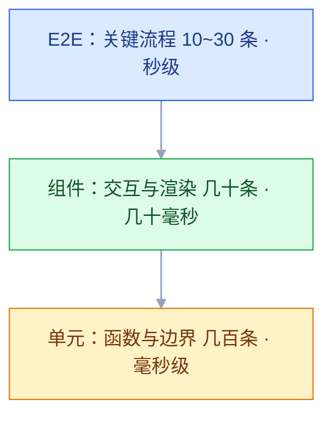
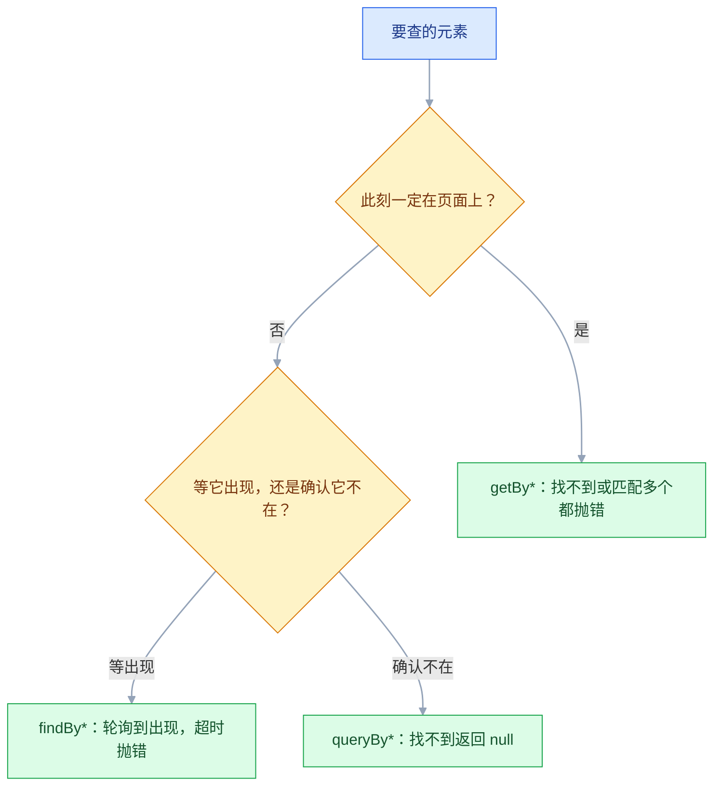

# 前端测试

## 一、工程案例：给退款表单补单测与端到端

**场景**：`admin-app` 的退款模块上线两个月，客服反馈过三次「同一笔订单退了两遍」。`RefundForm.vue` 负责金额与原因输入，`src/utils/refund.ts` 做校验，`src/api/refund.ts` 调提交接口。提交按钮只在请求成功后禁用，用户连点两下就会发两次请求。

**要锁住的行为**（先写清楚，再写测试）：

| 规则 | 输入 | 期望 |
|---|---|---|
| 金额格式 | `12.34` / `12.345` / `abc` | 合法 / 非法 / 非法 |
| 金额下限 | `0` / `0.01` | 拒绝 / 通过 |
| 金额上限 | 可退 100 元，输入 100.01 | 拒绝，提示「不能超过可退金额」 |
| 原因长度 | 4 个字 / 5 个字 | 拒绝 / 通过 |
| 重复提交 | 请求未返回时再点一次 | 只发一次请求 |
| 接口失败 | 500 | 展示「提交失败，请重试」，按钮恢复可用 |

**目标**：纯函数单测 15 条、组件测试 4 条、E2E 3 条；`pnpm test:run` 在 2 秒内跑完；覆盖率门槛拦住倒退；CI 里合并前必须全绿。

### 1.1 安装与配置

```bash
pnpm add -D vitest @vitest/coverage-v8 jsdom @vitejs/plugin-vue vue-tsc typescript \
  @vue/test-utils @testing-library/vue @testing-library/user-event \
  @testing-library/jest-dom msw @playwright/test
pnpm exec playwright install chromium
```

Linux CI 上把最后一行换成 `pnpm exec playwright install --with-deps chromium`，它会顺手补系统库；本机 macOS 不需要 `--with-deps`。

`package.json` 里要有这五个脚本，后面所有命令都依赖它们：

```json
{
  "scripts": {
    "dev": "vite",
    "typecheck": "vue-tsc --noEmit",
    "test": "vitest",
    "test:run": "vitest run",
    "e2e": "playwright test"
  }
}
```

```typescript
// vitest.config.ts
import { defineConfig } from 'vitest/config'
import vue from '@vitejs/plugin-vue'
import { fileURLToPath } from 'node:url'

export default defineConfig({
  plugins: [vue()],
  resolve: { alias: { '@': fileURLToPath(new URL('./src', import.meta.url)) } },
  test: {
    environment: 'jsdom',
    globals: true,
    setupFiles: ['./tests/setup.ts'],
    include: ['src/**/*.{test,spec}.ts'],
    css: false,
    clearMocks: true, mockReset: true, restoreMocks: true,
    coverage: {
      provider: 'v8',
      reporter: ['text', 'html'],
      include: ['src/utils/**/*.ts', 'src/components/**/*.vue'],
      exclude: ['src/**/*.d.ts', 'src/main.ts'],
      thresholds: { lines: 80, functions: 80, branches: 70 },
    },
  },
})
```

配置用 `fileURLToPath(new URL(...))` 而不是 `__dirname`：`type: module` 的项目里 `__dirname` 不存在，配 alias 会直接报错。

```typescript
// tests/setup.ts
import '@testing-library/jest-dom/vitest'
import { vi } from 'vitest'

// jsdom 没有实现 matchMedia，组件库和暗色模式逻辑常会用到
Object.defineProperty(window, 'matchMedia', {
  writable: true,
  value: vi.fn().mockImplementation((query: string) => ({
    matches: false, media: query, onchange: null,
    addEventListener: vi.fn(), removeEventListener: vi.fn(), dispatchEvent: vi.fn(),
  })),
})
```

`msw` 是给 3.9 的网络层拦截用的；1.3 到 1.5 走模块 mock，用不到它也不会报错。

`clearMocks` / `mockReset` / `restoreMocks` 是防「单独跑绿、一起跑红」的第一道闸，原因在 2.1 展开。

### 1.2 先把规则抽成纯函数

组件里的校验没法单独测，先抽出来。抽的时候顺手避开一个精度坑：`Math.round(Number('1.005') * 100)` 得到 100（浮点误差，按四舍五入应为 101），所以 `toCents` 按小数点拆字符串、全程整数运算。规则上只收两位小数，`1.005` 会被格式校验拒绝；真要支持三位小数，得先把舍入规则定下来。

```typescript
// src/utils/refund.ts
export const MAX_REASON = 200

export function toCents(input: string): number | null {
  const text = input.trim()
  if (!/^\d+(\.\d{1,2})?$/.test(text)) return null
  const [yuan, frac = ''] = text.split('.')
  return Number(yuan) * 100 + Number(frac.padEnd(2, '0'))
}

export type RefundCheck =
  | { ok: true; cents: number; reason: string }
  | { ok: false; field: 'amount' | 'reason'; message: string }

export function validateRefund(input: {
  amount: string; reason: string; refundable: number
}): RefundCheck {
  const cents = toCents(input.amount)
  if (cents === null) return { ok: false, field: 'amount', message: '金额格式不正确' }
  if (cents <= 0) return { ok: false, field: 'amount', message: '退款金额必须大于 0' }
  if (cents > input.refundable) return { ok: false, field: 'amount', message: '不能超过可退金额' }
  const reason = input.reason.trim()
  if (reason.length < 5) return { ok: false, field: 'reason', message: '请填写至少 5 个字的原因' }
  if (reason.length > MAX_REASON) return { ok: false, field: 'reason', message: '原因过长' }
  return { ok: true, cents, reason }
}
```

### 1.3 纯函数单测：用表驱动覆盖边界

```typescript
// src/utils/refund.test.ts
import { describe, expect, it } from 'vitest'
import { toCents, validateRefund } from './refund'

describe('toCents', () => {
  it.each([['12.34', 1234], ['0.01', 1], ['100', 10000], [' 8.5 ', 850]])(
    '把 %s 转成 %i 分', (input, expected) => expect(toCents(input)).toBe(expected),
  )
  it.each(['12.345', 'abc', '', '-1', '1,000', '.5'])('拒绝非法金额 %s', (input) => {
    expect(toCents(input)).toBeNull()
  })
})

describe('validateRefund', () => {
  const base = { amount: '10', reason: '商品破损无法使用', refundable: 10000 }

  it('合法输入返回分值', () => {
    expect(validateRefund(base)).toEqual({ ok: true, cents: 1000, reason: '商品破损无法使用' })
  })
  it('金额为 0 或负数时拒绝', () => {
    expect(validateRefund({ ...base, amount: '0' })).toMatchObject({ ok: false, field: 'amount' })
    expect(validateRefund({ ...base, amount: '-0.01' })).toMatchObject({ ok: false })
  })
  it('等于上限通过，超过一分钱就拒绝', () => {
    expect(validateRefund({ ...base, amount: '100' }).ok).toBe(true)
    expect(validateRefund({ ...base, amount: '100.01' })).toEqual({
      ok: false, field: 'amount', message: '不能超过可退金额',
    })
  })
  it('原因按 trim 后长度判断，4 字拒绝、5 字通过', () => {
    expect(validateRefund({ ...base, reason: '  包装破损  ' })).toMatchObject({ ok: false })
    expect(validateRefund({ ...base, reason: '  包装破损了  ' }).ok).toBe(true)
  })
  it('原因超过 200 字时拒绝', () => {
    expect(validateRefund({ ...base, reason: '破'.repeat(201) })).toMatchObject({ ok: false })
  })
})
```

```text
 ✓ src/utils/refund.test.ts (15 tests) 12ms
 Test Files  1 passed (1)      Tests  15 passed (15)      Duration 361ms
```

### 1.4 组件测试：只测用户看得到的行为

先看被测组件。相对线上版本只改一处：请求期间 `pending` 置真，按钮禁用，`submit` 入口再拦一次。

```vue
<!-- src/components/RefundForm.vue -->
<script setup lang="ts">
import { ref } from 'vue'
import { createRefund } from '@/api/refund'
import { validateRefund } from '@/utils/refund'

const props = defineProps<{ orderId: number; refundable: number }>()
const emit = defineEmits<{ success: [id: number] }>()

const amount = ref('')
const reason = ref('')
const error = ref('')
const pending = ref(false)

async function submit() {
  if (pending.value) return
  const checked = validateRefund({ amount: amount.value, reason: reason.value, refundable: props.refundable })
  if (!checked.ok) { error.value = checked.message; return }
  error.value = ''
  pending.value = true
  try {
    const { id } = await createRefund({ orderId: props.orderId, cents: checked.cents, reason: checked.reason })
    emit('success', id)
  } catch {
    error.value = '提交失败，请重试'
  } finally {
    pending.value = false
  }
}
</script>

<template>
  <form @submit.prevent="submit">
    <label for="refund-amount">退款金额</label>
    <input id="refund-amount" v-model="amount" />
    <label for="refund-reason">退款原因</label>
    <textarea id="refund-reason" v-model="reason" />
    <p v-if="error" role="alert">{{ error }}</p>
    <button type="submit" :disabled="pending">提交退款</button>
  </form>
</template>
```

```typescript
// src/components/RefundForm.test.ts
import { render, screen, waitFor } from '@testing-library/vue'
import userEvent from '@testing-library/user-event'
import { beforeEach, describe, expect, it, vi } from 'vitest'
import RefundForm from './RefundForm.vue'

const mockCreate = vi.hoisted(() => vi.fn())
vi.mock('@/api/refund', () => ({ createRefund: mockCreate }))

const props = { orderId: 9527, refundable: 10000 }
async function fill(amount: string, reason = '商品破损无法使用') {
  const user = userEvent.setup()
  await user.type(screen.getByLabelText('退款金额'), amount)
  await user.type(screen.getByLabelText('退款原因'), reason)
  return user
}

describe('RefundForm', () => {
  beforeEach(() => mockCreate.mockResolvedValue({ id: 1 }))

  it('金额超限时提示且不发请求', async () => {
    render(RefundForm, { props })
    const user = await fill('100.01')
    await user.click(screen.getByRole('button', { name: '提交退款' }))
    expect(await screen.findByRole('alert')).toHaveTextContent('不能超过可退金额')
    expect(mockCreate).not.toHaveBeenCalled()
  })

  it('提交成功时带上订单号与分值', async () => {
    const { emitted } = render(RefundForm, { props })
    const user = await fill('12.34')
    await user.click(screen.getByRole('button', { name: '提交退款' }))
    await waitFor(() => expect(emitted().success).toHaveLength(1))
    expect(mockCreate).toHaveBeenCalledWith({ orderId: 9527, cents: 1234, reason: '商品破损无法使用' })
  })

  it('请求未返回时按钮禁用，连点只发一次', async () => {
    let resolve!: (value: { id: number }) => void
    mockCreate.mockReturnValue(new Promise((r) => { resolve = r }))
    render(RefundForm, { props })
    const user = await fill('12.34')
    const button = screen.getByRole('button', { name: '提交退款' })

    await user.click(button)
    expect(button).toBeDisabled()
    await user.click(button)
    expect(mockCreate).toHaveBeenCalledTimes(1)
    resolve({ id: 1 })
    await waitFor(() => expect(button).toBeEnabled())
  })

  it('接口失败时展示提示并恢复按钮', async () => {
    mockCreate.mockRejectedValue(new Error('500'))
    render(RefundForm, { props })
    const user = await fill('12.34')
    await user.click(screen.getByRole('button', { name: '提交退款' }))
    expect(await screen.findByRole('alert')).toHaveTextContent('提交失败，请重试')
    expect(screen.getByRole('button', { name: '提交退款' })).toBeEnabled()
  })
})
```

```text
 ✓ src/components/RefundForm.test.ts (4 tests) 486ms
 Test Files  2 passed (2)   Tests  19 passed (19)   Duration 1.12s
```

三个断言点值得注意：`not.toHaveBeenCalled()` 验证「不该发生的事」；`toHaveBeenCalledWith` 验证对外契约（订单号与分值），不验证内部状态；`toBeDisabled()` 验证用户能感知的反馈。

### 1.5 E2E：三条关键流程

```typescript
// playwright.config.ts
import { defineConfig, devices } from '@playwright/test'

export default defineConfig({
  testDir: './e2e',
  timeout: 30_000, expect: { timeout: 5_000 },
  retries: process.env.CI ? 2 : 0,
  workers: process.env.CI ? 2 : undefined,
  reporter: [['html', { open: 'never' }], ['list']],
  use: { baseURL: 'http://localhost:5173', trace: 'on-first-retry', screenshot: 'only-on-failure' },
  projects: [
    { name: 'setup', testMatch: /auth\.setup\.ts/ },
    { name: 'chromium', use: { ...devices['Desktop Chrome'], storageState: 'e2e/.auth/user.json' }, dependencies: ['setup'] },
  ],
  webServer: { command: 'pnpm dev', url: 'http://localhost:5173', reuseExistingServer: !process.env.CI, timeout: 60_000 },
})
```

```typescript
// e2e/auth.setup.ts —— 只跑一次登录
import { expect, test as setup } from '@playwright/test'

setup('登录并保存状态', async ({ page }) => {
  await page.goto('/login')
  await page.getByLabel('用户名').fill('admin')
  await page.getByLabel('密码').fill(process.env.E2E_PASSWORD ?? 'admin123')
  await page.getByRole('button', { name: '登录' }).click()
  await expect(page).toHaveURL(/\/dashboard/)
  await page.context().storageState({ path: 'e2e/.auth/user.json' }) // 存 cookie/localStorage
})
```

```typescript
// e2e/refund.spec.ts
import { expect, test } from '@playwright/test'

test('提交退款成功后进入详情页', async ({ page }) => {
  await page.goto('/order/A001')
  await page.getByRole('button', { name: '申请退款' }).click()
  await page.getByLabel('退款金额').fill('12.34')
  await page.getByLabel('退款原因').fill('商品破损无法使用')
  await page.getByRole('button', { name: '提交退款' }).click()
  await expect(page.getByText('退款申请已提交')).toBeVisible()
  await expect(page).toHaveURL(/\/order\/A001$/) // 从 /refund 回到详情页，URL 断言才有意义
})

test('金额超限时停留在表单并提示', async ({ page }) => {
  await page.goto('/order/A001')
  await page.getByRole('button', { name: '申请退款' }).click()
  await page.getByLabel('退款金额').fill('99999')
  await page.getByLabel('退款原因').fill('商品破损无法使用')
  await page.getByRole('button', { name: '提交退款' }).click()
  await expect(page.getByRole('alert')).toHaveText('不能超过可退金额')
  await expect(page).toHaveURL(/\/order\/A001\/refund$/)
})

test('接口 500 时按钮恢复可用', async ({ page }) => {
  await page.route('**/api/refund', (route) => route.fulfill({ status: 500, body: '{"message":"boom"}' }))
  await page.goto('/order/A001')
  await page.getByRole('button', { name: '申请退款' }).click()
  await page.getByLabel('退款金额').fill('12.34')
  await page.getByLabel('退款原因').fill('商品破损无法使用')
  const submit = page.getByRole('button', { name: '提交退款' })
  await submit.click()
  await expect(page.getByRole('alert')).toHaveText('提交失败，请重试')
  await expect(submit).toBeEnabled()
})
```

```text
Running 3 tests using 2 workers
  ✓ 提交退款成功后进入详情页 (2.4s)
  ✓ 金额超限时停留在表单并提示 (1.1s)
  ✓ 接口 500 时按钮恢复可用 (0.9s)
  3 passed (4.8s)
```

第三条用 `page.route` 注入 500，是为了让失败分支稳定可测。真实环境里制造 500 要么改后端，要么等它自己坏。代价是这条用例不再验证真实接口，所以真实链路由第一条覆盖。

### 1.6 接到 CI

```yaml
# .github/workflows/test.yml
on: [pull_request]
jobs:
  test:
    runs-on: ubuntu-latest
    env:
      TZ: Asia/Shanghai
    steps:
      - uses: actions/checkout@v4
      - uses: pnpm/action-setup@v4
        with: { version: 9 }
      - uses: actions/setup-node@v4
        with: { node-version: 20, cache: pnpm }
      - run: pnpm install --frozen-lockfile
      - run: pnpm typecheck
      - run: pnpm test:run --coverage
      - run: pnpm exec playwright install --with-deps chromium
      - run: pnpm e2e
        env: { E2E_PASSWORD: "${{ secrets.E2E_PASSWORD }}" }
      - uses: actions/upload-artifact@v4
        if: failure()
        with:
          name: test-reports
          path: |
            coverage/
            playwright-report/
          retention-days: 7
```

`TZ` 放在 job 级，单测和 E2E 都吃得到；放在某一步上，另一步照旧跑在 UTC。typecheck、单测、E2E 拆成三步而不是一条 `&&`，失败时一眼看出卡在哪层。

### 1.7 验收

| # | 检查项 | 命令或检查 | 通过标准 |
|---|---|---|---|
| 1 | 单测全绿且快 | `pnpm test:run` | 19 passed，0 failed，Duration < 2s |
| 2 | 覆盖率门槛 | `pnpm test:run --coverage` | lines ≥ 80%、branches ≥ 70%，不达标退出码非 0 |
| 3 | 关键分支 | 打开 `coverage/index.html` | `validateRefund` 的五个拒绝分支均为绿色 |
| 4 | 防重复提交 | 组件用例「连点只发一次」 | `toHaveBeenCalledTimes(1)` |
| 5 | 契约 | 组件用例断言 `emitted().success` 与请求体 | 订单号、分值、原因均正确 |
| 6 | 失败分支 | 组件 + E2E 各一条 | 提示出现，按钮恢复可用 |
| 7 | 网络隔离 | 断网后跑 `pnpm test:run` | 全部通过，说明没有真实请求 |
| 8 | E2E 登录复用 | 看 `e2e/.auth/user.json` | 存在，且日志里没有重复登录 |
| 9 | E2E 稳定性 | 连续跑 5 次 | 5 次全绿，无 flaky |
| 10 | CI 全绿 | PR 检查列表 | typecheck、单测、E2E 三项通过 |
| 11 | 失败可诊断 | 故意改坏一个断言 | 报告含截图与 trace，能定位到行 |

第 9 项要真的连跑 5 次。只跑一次全绿说明不了稳定，偶发失败通常在第 3 次之后才出现。

---

## 二、高频问答：会卡住你的地方，也是面试最常问的

### 2.1 单个文件跑绿，全量跑红

**现场**

单独跑失败的那个文件；再 `--sequence.shuffle` 换顺序跑，看是否仍红。

```typescript
test: { clearMocks: true, mockReset: true, restoreMocks: true }
beforeEach(() => setActivePinia(createPinia()))
afterEach(() => { localStorage.clear(); vi.useRealTimers() })
```

**要点**

- 状态跨用例泄漏：mock 没重置、Pinia 单例没重建、`localStorage` 没清、假定时器没恢复、模块级变量被上一个用例改过。
- 文件之间默认隔离，但同一文件内的用例共享模块作用域；单独绿、全量红就一定是共享状态。
- 把「顺序相关」当成「框架不稳定」，就会一直找错方向。
- `clearMocks` / `mockReset` / `restoreMocks` 是防这类问题的第一道闸。

**追问**

- 为什么文件之间不串？→ 不同 worker 并行，模块注册表隔离。
- `isolate: false` 有什么风险？→ 模块状态跨文件泄漏，只在确认无状态依赖时用。
- 假定时器没恢复会怎样？→ 后续用例的时间不走，表现为超时。

### 2.2 `await` 漏写，测试假通过

**现场**

把实现故意改坏（让 `fetchData` 返回 `{ ok: false }`），看测试是否变红；再开 `@typescript-eslint/no-floating-promises`，让漏 `await` 在 lint 阶段就报错。

```typescript
// ❌ 都会通过，但什么都没验证
it('返回成功', () => { expect(fetchData()).resolves.toEqual({ ok: true }) })
it('不抛错', () => { expect(async () => { throw new Error('x') }).not.toThrow() })
it('失败时提示', async () => { // 断言时元素还没渲染
  render(Form); await user.click(btn)
  expect(screen.queryByText('提交失败')).toBeNull()
})

// ✅ 等 Promise 落地、等元素出现
it('返回成功', async () => { await expect(fetchData()).resolves.toEqual({ ok: true }) })
it('失败时提示', async () => {
  render(Form); await user.click(btn)
  expect(await screen.findByText('提交失败')).toBeInTheDocument()
})
```

**要点**

- `expect(promise).resolves` 返回的是 Promise，不 `await` 时用例在断言落地前就结束了。
- 失败要么被吞掉，要么只以未处理的 Promise 拒绝出现，指不到具体用例。
- `expect(async () => { throw }).not.toThrow()` 同理，只比同步调用，永远为真。
- 一个测试如果在实现完全错误时也能通过，它就不是测试。

**追问**

- 怎么系统性发现假通过？→ 故意改坏实现，做一次变异。
- 为什么 `findBy` 比 `getBy` 适合异步？→ 它会轮询等待元素出现。
- `flushPromises` 和 `nextTick` 的区别？→ 前者清微任务队列，后者等一次渲染。

### 2.3 `vi.mock` 工厂里引用外部变量报错

**现场**

报错通常是 `Cannot access 'xxx' before initialization`。

```typescript
// ❌ 工厂被提升到文件顶部，此时 mockGet 还在暂时性死区
vi.mock('@/utils/request', () => ({ default: { get: mockGet } }))
const mockGet = vi.fn()
// ✅ 改为 const mockGet = vi.hoisted(() => vi.fn())，假函数与工厂一起提升
```

**要点**

- `vi.mock` 会被提升到文件顶部，执行时外部 `const` 还没初始化，落到暂时性死区。
- 不是只有 `jest.mock` 会提升，Vitest 为了支持 ESM 同样会提升 `vi.mock`。
- 改用 `vi.hoisted` 让假函数与工厂一起提升，问题就消失。

**追问**

- 为什么换成字面量就好了？→ 工厂不再引用外部变量，提升后也能执行。
- `vi.hoisted` 什么时候执行？→ 在 import 之前。
- 能只 mock 模块的一部分吗？→ 用 `vi.importActual` 保留真实实现。

### 2.4 `getByText` 找不到，或者找到多个

**现场**

`screen.debug()` 打印当前 DOM，或用 `getAllByText` 看匹配到几个。

**要点**

- `getByText` 匹配的是「单个元素的完整文本内容」，不是整页搜索。
- 文本被拆到多个元素、被空格或注释隔开，或者页面上确实有多个相同文本，都会失败。
- 多匹配时先用 `within` 限定范围：`within(screen.getByRole('row', { name: /A001/ })).getByText('已支付')`。
- 先 `debug()` 看真实 DOM，再决定用 role、label 还是 testid。

**追问**

- 为什么优先 `getByRole`？→ 更接近用户和读屏器的行为，顺带验证可访问性。
- testid 什么时候用？→ 没有可访问名称时兜底。
- 文本被拆成多个元素怎么办？→ 用可访问名称或正则匹配。

### 2.5 E2E 偶发失败，重跑就过

**现场**

看 trace 里失败那一刻的截图、DOM 和网络面板；统计失败率与失败步骤。

```typescript
await page.waitForTimeout(3000) // ❌ 又慢又脆
await expect(page.getByText('成功')).toBeVisible() // ✅ 自动等待
```

**要点**

- 固定等待掩盖了真实竞态：动画未结束、接口未返回、上一个用例的数据还在、多个 worker 抢同一个账号。
- 「等得更久」不等于「更稳定」，固定等待既拖慢全量时间，又会在机器慢的时候继续失败。
- Playwright 的断言会自动轮询，用 `expect(...).toBeVisible()` 替代 `waitForTimeout`。
- 打开 trace 回放，看失败时页面到底停在什么状态。

**追问**

- trace 什么时候录最划算？→ `on-first-retry`，只录失败的第一次重试。
- 多个 worker 抢账号怎么解？→ 每个 worker 独立账号，或把这类用例串行。
- 动画为什么会造成不稳定？→ 元素位置连续变化，可操作性检查不通过。

### 2.6 本地全绿，CI 全红

**现场**

在 CI 日志里打印 `TZ`、`LANG`、`process.env.CI`，与本地逐项对比。

| 差异 | 本地 | CI | 处理 |
|---|---|---|---|
| 时区 | Asia/Shanghai | UTC | 设 `TZ=Asia/Shanghai`，或全部用固定时间 |
| 并发 | 按 CPU | 受限 | 显式配 `workers`，检查共享数据 |
| 网络 | 能访问内网 | 只能公网 | 全部 mock 或走测试环境 |
| 环境变量 | `.env.local` | 无 | 测试内给默认值，敏感值走 secrets |

**要点**

- 常见差异就四类：时区、语言与字体、环境变量缺失、并发 worker 数不同，还有依赖本机内网的用例。
- 把环境差异当成性能问题，就会去升级 CI 机器，而问题照旧。
- 把 CI 的时区和并发在本地复现一遍，能复现就不是机器的问题。

**追问**

- 为什么 `TZ` 要放 job 级？→ 单测和 E2E 都吃得到，放某一步另一步照旧跑 UTC。
- 并发不同会怎样？→ 共享数据竞争、端口冲突、账号互踢。
- 字体差异影响什么？→ 截图对比和文本宽度断言。

### 2.7 覆盖率 90%，但改坏代码测试还是绿

**现场**

做一次变异：把 `>` 改成 `>=`，看测试是否变红。

```typescript
it('渲染表单', () => { render(RefundForm) }) // ❌ 覆盖了，但没断言
it('金额超限时提示', async () => {            // ✅ 断言用户可见的结果
  render(RefundForm, { props })
  const user = await fill('100.01')
  await user.click(screen.getByRole('button', { name: '提交退款' }))
  expect(await screen.findByRole('alert')).toHaveTextContent('不能超过可退金额')
})
```

**要点**

- 覆盖率只统计「代码被执行过」，不统计「结果被断言过」，调用一下不报错也算覆盖。
- 覆盖率和测试有效性不能划等号，高覆盖率可能只是一堆无断言用例。
- 改一个边界条件再跑，全绿说明这批用例没有约束力。

**追问**

- 门槛该设多少？→ 当前值略低一点，用来防倒退，不要设成 100%。
- 哪个指标最能暴露漏测？→ Branches，`if/else` 和三元的方向最容易漏。
- 变异测试成本高吗？→ 高，通常只在核心模块做。

### 2.8 CI 只跑了一个用例

**现场**

`grep -rn "\.only(" src e2e`。

```bash
grep -rn "\.only(" src e2e && exit 1 || exit 0
```

**要点**

- 本地调试时留下的 `it.only` / `describe.only` 被提交了。
- `.only` 的优先级高于一切过滤参数，命中后其他用例全部跳过。
- 只检查工作流文件不够，要查测试源码；CI 里 grep 到就直接失败。

**追问**

- `.skip` 也要拦吗？→ 要，容易长期掩盖整块用例。
- 为什么本地没发现？→ 本地也只跑那几个，绿得很快。
- 还有哪些开关会改变执行范围？→ `--changed`、`-t` 过滤、测试文件 include 配置。

### 2.9 `getActivePinia() was called but there was no active Pinia`

**现场**

报错栈指向 `useXxxStore()` 的第一行；打印 `getActivePinia()` 为 `undefined`。

```typescript
beforeEach(() => {
  setActivePinia(createPinia())
})
```

**要点**

- 测试环境没有执行 `app.use(pinia)`，store 找不到活动实例。
- 测试里没有 `createApp`，必须手动设置活动 Pinia，每个用例一个全新实例。
- 拿应用的启动代码去修测试环境，是这类问题的常见误区。

**追问**

- 为什么每个用例都要新建？→ 避免 store 状态跨用例泄漏。
- 什么时候需要在组件里测 store？→ 要验证渲染联动时，用 `mount` 带插件。
- Pinia 和 Vuex 的测试差异？→ Vuex 用 `createStore` 再注入，思路一样。

### 2.10 接了 MSW，测试开始静默通过

**现场**

改成 `onUnhandledRequest: 'error'` 重跑，漏配的路径会直接抛错，日志里能看到具体 URL。

```typescript
// tests/msw.ts
import { setupServer } from 'msw/node'
import { afterAll, afterEach, beforeAll } from 'vitest'
import { handlers } from './handlers'

const server = setupServer(...handlers)
beforeAll(() => server.listen({ onUnhandledRequest: 'error' }))
afterEach(() => server.resetHandlers())
afterAll(() => server.close())
```

**要点**

- MSW 默认 `onUnhandledRequest: 'warn'`，没匹配到 handler 的请求会原样打到真实网络。
- 网络不通时用例照样绿，因为它断言的恰好是失败态。
- `warn` 不失败也不汇总，CI 里没人会翻。
- 提到 `'error'`，再给静态资源补 `ignore` 规则，漏配才会在合并前暴露。

**追问**

- 为什么真实网络会让用例假绿？→ 断言的失败态被真实网络错误命中了。
- 静态资源请求报错怎么办？→ 在 `ignore` 里排除。
- `resetHandlers` 什么时候调？→ 每个用例之后，避免 handler 串场。

## 三、核心知识：从零开始要建立的东西

### 3.1 测试金字塔与反馈成本



**越往上越接近真实用户，越往下反馈越快**。单元测试毫秒级、组件测试几十毫秒、E2E 秒级，写一条的成本也依次上升。策略不是「每层都写」，而是「把能往下压的验证往下压」：价格计算、权限判断、状态流转从组件里抽成纯函数，用毫秒级单测覆盖，E2E 只留主流程。

> **面试**：常问「测试金字塔是什么，为什么按这个比例分？」答：单元最多、组件居中、E2E 只留关键流程，越往下反馈越快、成本越低。

### 3.2 断言强度

| 断言 | 强度 | 适用 |
|---|---|---|
| `toBeTruthy()` | 弱 | 只关心「有值」 |
| `toBe(3)` | 强 | 原始值精确相等 |
| `toEqual({ id: 1 })` | 强 | 对象深比较 |
| `toHaveBeenCalled()` | 弱 | 只关心调用过 |
| `toHaveBeenCalledWith(payload)` | 强 | 关心参数契约 |
| `toMatchObject({ ok: false })` | 中 | 只关心部分字段 |
| `toMatchSnapshot()` | 视情况 | 小范围稳定结构 |

**边界**：`toBe` 用 `Object.is`，`NaN` 等于自身、`+0` 与 `-0` 不相等；浮点数一律用 `toBeCloseTo`。负向断言（`not.toHaveBeenCalled`）要放在动作完成之后，否则测的是「还没来得及发生」。

### 3.3 测试替身分类

| 类型 | 作用 | 例子 |
|---|---|---|
| dummy | 只为填参数，不会被使用 | `{} as User` |
| stub | 返回固定值 | `vi.fn().mockResolvedValue([])` |
| spy | 包住真实实现，记录调用 | `vi.spyOn(console, 'error')` |
| mock | 记录交互，事后按期望验证调用 | `vi.fn()` + `toHaveBeenCalledWith` |
| fake | 轻量可工作的实现 | 内存版 localStorage |

**取舍**：替身越重，测试离真实越远。优先用「假数据 + 真实现」，只有跨不过去的边界（网络、时间、随机数、文件系统）才替换。把整个数据层 mock 掉，测试只能证明「mock 被调用了」。

### 3.4 Vitest 的隔离模型

| 维度 | 默认行为 | 影响 |
|---|---|---|
| 文件 | 不同 worker 并行，模块注册表隔离 | 文件间不共享变量 |
| 文件内用例 | 共享模块作用域 | 模块级变量会串 |
| 环境 | `jsdom` 或 `node` | 每个文件可用 docblock 覆盖 |
| mock | 不自动重置 | 必须配 `clearMocks` 等开关 |

```typescript
// @vitest-environment node  —— 单个文件切换环境，纯函数测试更快
```

**边界**：`isolate: false` 能加快大项目启动，但会让模块状态跨文件泄漏，只在确认无状态依赖时使用。`globals: true` 省 import，代价是类型需要 `vitest/globals` 声明。

### 3.5 查询优先级与可访问性

| 优先级 | 查询 | 对应真实用户行为 |
|---|---|---|
| 1 | `getByRole` | 屏幕阅读器按角色和名称找元素 |
| 2 | `getByLabelText` | 表单里按标签找输入框 |
| 3 | `getByPlaceholderText` | 无标签时的占位提示 |
| 4 | `getByText` | 按可见文本找 |
| 5 | `getByDisplayValue` | 按已填的值找 |
| 6 | `getByAltText` | 按图片替代文本找 |
| 7 | `getByTestId` | 兜底，用户完全感知不到 |

```typescript
screen.getByRole('button', { name: '提交退款' }) // 可访问名称来自文本或 aria-label
screen.getByRole('textbox', { name: '退款金额' })
```



报错时先分清是「找不到」还是「找到多个」：前者查可访问名称，后者用 `getAllBy` 数一下，再拿 `within` 收窄范围。

> **面试**：常问「Testing Library 的查询优先级是什么？」答：Role、Label、Placeholder、Text、DisplayValue、AltText、TestId；越靠前越接近真实用户。

### 3.6 异步等待机制

```typescript
expect(await screen.findByText('订单 A')).toBeInTheDocument() // 默认 1000ms，每 50ms 轮询
await waitFor(() => expect(screen.getAllByRole('row')).toHaveLength(4))
await waitForElementToBeRemoved(() => screen.queryByText('加载中'))
```

| 场景 | 用法 | 不要用 |
|---|---|---|
| 元素稍后出现 | `findBy*` | `setTimeout` |
| 条件复杂 | `waitFor` | 固定 sleep |
| 元素稍后消失 | `waitForElementToBeRemoved` | 轮询 `queryBy` |
| 只等微任务 | `await nextTick()` / `flushPromises()` | `await Promise.resolve()` 一次 |

**边界**：`findBy` 默认超时 1000ms，接口慢的用例要显式传 `{ timeout: 3000 }`，而不是全局调大。假定时器开启后，Testing Library 未必能识别并自动推进 Vitest 的假定时器，`waitFor` 会一直轮询到超时；这类用例改用 `findBy*` 并手动 `advanceTimersByTimeAsync` 推进（具体行为以官方当前稳定版为准）。

### 3.7 假定时器

```typescript
beforeEach(() => vi.useFakeTimers())
afterEach(() => vi.useRealTimers())

it('输入 300ms 后才发请求（防抖）', async () => {
  render(SearchBox)
  const user = userEvent.setup({ advanceTimers: vi.advanceTimersByTime })
  await user.type(screen.getByRole('textbox'), '退款')
  expect(mockSearch).not.toHaveBeenCalled()
  await vi.advanceTimersByTimeAsync(300)
  expect(mockSearch).toHaveBeenCalledTimes(1)
})
```

**边界**：`advanceTimersByTime` 只推进同步定时器，Promise 链要用 `advanceTimersByTimeAsync`。`userEvent` 内部也有延时，必须把 `advanceTimers` 传进去，否则 `type` 会卡住。

### 3.8 组件契约

组件的对外契约只有三样：**props 进、emit 出、slot 填**。测试围绕这三样写，不碰 `setup` 里的局部变量。

```typescript
const { emitted } = render(TaskItem, { props: { task } })
await user.click(screen.getByRole('checkbox', { name: '写周报' }))
expect(emitted().toggle[0]).toEqual([7]) // 载荷是契约的一部分
```

| 该断言 | 不该断言 |
|---|---|
| 渲染出的文本、角色、状态 | `wrapper.vm.internalList` |
| emit 的事件名与载荷 | 私有函数的调用次数 |
| props 变化后的重新渲染 | CSS class 的具体命名 |
| 插槽内容是否渲染 | 组件内部的 ref 名 |

**取舍**：`data-testid` 是契约的延伸，加之前先问「有没有可访问的名称可用」。class 断言只在 class 本身是需求（如 `is-done` 的删除线）时才合理。

### 3.9 网络层拦截

| 方式 | 拦截点 | 真实度 | 适合 |
|---|---|---|---|
| mock 请求模块 | 应用代码 | 低 | 单测组件逻辑，最快 |
| mock axios 实例 | HTTP 客户端 | 中 | 项目统一封装了 request |
| MSW | 网络层 | 高 | 多接口、错误分支、契约 |

生命周期固定三步：`server.listen({ onUnhandledRequest: 'error' })` → 每个用例后 `resetHandlers()` → 最后 `close()`。

**边界**：MSW 的 handler 里 `request.json()` 只能读一次；`onUnhandledRequest: 'error'` 会让静态资源请求也报错，需要给 `ignore` 加规则。测试环境的 baseURL 要和 handler 的路径对齐，否则匹配不上。

### 3.10 状态容器与组合式函数

```typescript
beforeEach(() => setActivePinia(createPinia())) // store 每个用例一个全新实例
const { count, increment } = useCounter(0, { max: 2 }) // 无生命周期钩子：直接调用

// 有 onMounted / watch：必须挂到组件里
function withSetup<T>(composable: () => T) {
  let result!: T
  mount(defineComponent({ setup() { result = composable(); return () => h('div') } }))
  return result
}
```

**边界**：`withSetup` 里的 `mount` 会触发 `onMounted`，但不会等异步完成；断言前要 `await flushPromises()`。`watch` 的 `flush: 'post'` 需要等一次渲染，`nextTick` 一次不够时要 `await nextTick()` 两次。

### 3.11 浏览器自动等待

Playwright 的每个操作和断言都内置「可操作性检查」：元素存在、可见、稳定（连续两帧位置不变）、未被遮挡、可接收事件。任何一条不满足就重试，直到超时。

`click()` 会自己等可见、可点；`expect(...).toBeVisible()` 会自己轮询，都不需要额外等待。

| 现象 | 真实原因 | 处理 |
|---|---|---|
| 点击没反应 | 元素被 loading 遮罩挡住 | 等遮罩消失，或断言按钮可用 |
| 断言偶尔失败 | 动画导致位置不稳定 | 关动画，或等元素稳定 |
| 请求没发出去 | 点击发生在 hydration 之前 | 等页面可交互的标志元素 |

**边界**：自动等待只覆盖「元素状态」，不覆盖「业务状态」。接口返回前的骨架屏是可见的，`toBeVisible()` 会通过，所以断言要选最终态的元素。

> **面试**：常问「Playwright 为什么不需要 `waitForTimeout`？」答：每个操作和断言都有可操作性检查并自动重试，固定等待既慢又掩盖真实竞态。

### 3.12 覆盖率指标

| 指标 | 统计什么 | 用来看 |
|---|---|---|
| Statements | 语句被执行的比例 | 整体覆盖 |
| Branches | if/else、三元、`\|\|` 的每个方向 | **漏测最明显** |
| Functions | 函数被调用的比例 | 有没有整块没测 |
| Lines | 按行统计 | 与语句接近 |

**边界**：排除项要写清楚，把 `main.ts`、类型文件、第三方包装排除，否则数字虚高。门槛设在「当前值略低一点」用来防倒退，不要设成 100%——那会逼出大量无断言用例。

---

## 四、冷门知识汇总

| 知识点 | 为什么冷门 | 用到时的关键词 |
|---|---|---|
| `toMatchInlineSnapshot()` | 快照内联在源码里，review 更直观 | 内联快照 |
| `--shard` 分片 | 测试集不够大时用不上 | CI 并行、blob reporter |
| `--changed` | 只跑与改动文件相关的用例，依赖 git 历史 | 增量测试、本地提速 |
| `it.todo` | 用测试文件当需求文档 | 未实现用例 |
| `expect.soft` | 一条失败不中断，一次跑完看全部失败 | 软断言、批量排查 |
| `test.fails` | 已知缺陷先标记，修好后反而报错提醒摘标记 | 预期失败、缺陷追踪 |
| `vi.stubGlobal` | 替换 `fetch`、`matchMedia` 比逐个改属性干净 | 全局注入、`unstubAllGlobals` |
| `vi.importActual` | 只 mock 模块的一部分时才用 | 部分 mock、保留真实实现 |
| `vi.spyOn` 的恢复 | 忘记恢复会污染后续用例 | `mockRestore` |
| `vi.setSystemTime` | 冻结「现在」而不是整个计时器 | 日期断言、相对时间 |
| `test.step` | 报告里把长流程折成步骤 | 可读性、失败定位 |
| `locator.filter()` | 列表里定位不到唯一元素时 | 收窄范围、`hasText` |
| `test.use({ timezoneId })` | 单个文件换时区才用得上 | 时区隔离、CI |
| `--frozen-lockfile` | 依赖不变时看不出差别 | 可复现构建 |
| 变异测试 | 成本高，通常只在核心模块做 | Stryker、变异分数 |
| 视觉回归 | 截图对比对动态内容很敏感 | `toHaveScreenshot`、maxDiffPixelRatio |
| 属性测试 | 随机输入能发现手写用例想不到的组合 | fast-check |
| 契约测试 | 前后端独立发布时才需要 | Pact、消费者驱动 |
