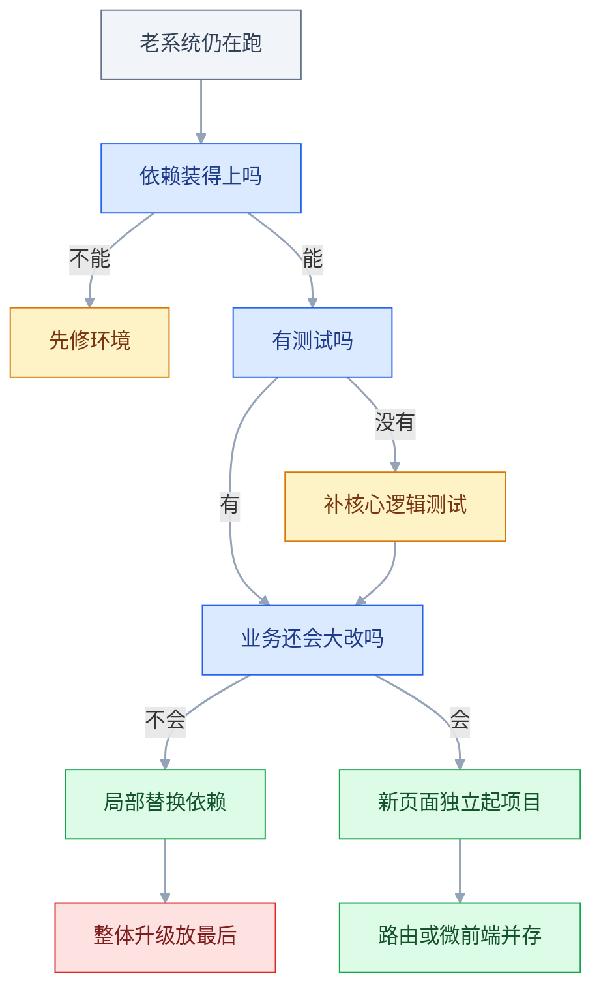
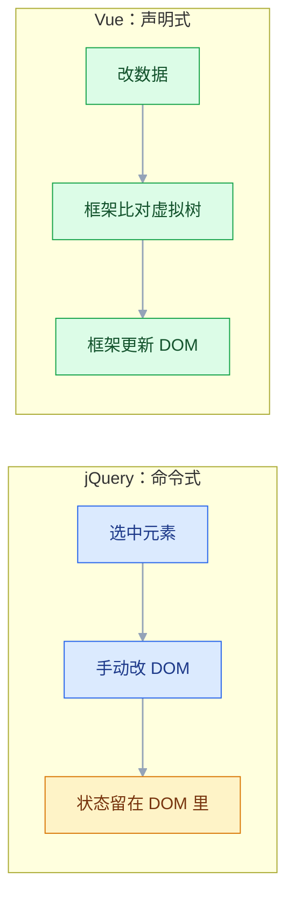
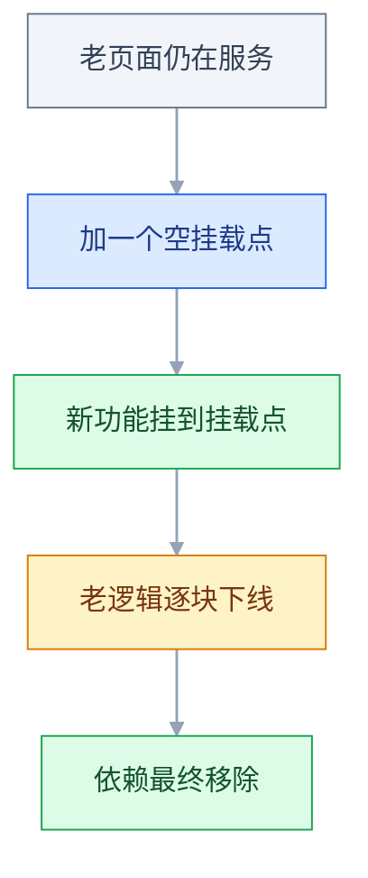

# 常用前端技术（存量项目）

## 一、工程案例：接手一个 jQuery + Vue2 + Element UI 的老后台，先跑起来再定迁移顺序

**场景**：`yyt-admin`，2019 年上线，约 4 万行代码、180 个 `.vue`、60 个 jQuery 老页面，日活 200+。技术栈是 `Vue 2.6 + Element UI 2.13 + Vuex 3 + jQuery 3.4 + Moment 2.24 + Webpack 4`。交接文档只有一句「`npm install && npm run dev`」。

**目标**：三天内做到四件事——本地能跑、jQuery 与 Vue2 各改一处、修一个表单校验老 bug、出一份可执行的迁移顺序表。**不做整体重写**：4 万行、零测试的系统重写通常要 3~6 个月，期间需求还在变，老代码里「看起来没道理」的分支往往对应真实的业务例外。

### 1.1 第一步：钉死 Node 版本

老项目装不上，九成不是代码问题，是 Node 版本和依赖的二进制不匹配。先看清单：

```bash
node -v && npm -v
grep -E '"(vue|webpack|node-sass|sass-loader|element-ui|moment|jquery)"' package.json
```

```text
"vue": "^2.6.10",
"webpack": "^4.41.0",
"node-sass": "^4.13.1",
"sass-loader": "^8.0.2",
"element-ui": "^2.13.0",
"moment": "^2.24.0",
"jquery": "^3.4.1",
```

`node-sass 4.x` 的预编译二进制只覆盖到 Node 14 一带；`webpack 4` 内部用 md4 摘要，Node 17+ 的 OpenSSL 3 默认禁用该算法。两条限制合起来，这个项目的 Node 上限就是 14：

```bash
echo "14.21.3" > .nvmrc
nvm install 14.21.3 && nvm use 14.21.3
node -v                                  # v14.21.3

npm config set registry https://registry.npmmirror.com
npm -v                                   # 6.14.x，Node 14 自带
npm ci                                   # 有 lockfile 时优先用 ci，不会改写它
```

`--legacy-peer-deps` 只在 npm 7+ 需要：老项目的 lockfile 多是 npm 6 写的（`lockfileVersion: 1`），npm 7+ 对 peer 依赖改为严格校验，直接装会 `ERESOLVE`，这时改用 `npm ci --legacy-peer-deps`。装完用 `git diff --stat package-lock.json` 确认 lockfile 没被整体重写——只该动少量行，不是几千行。

**不想降 Node 的两条替代路**：路 A 解决 node-sass，路 B 解决 Webpack 4 的 md4，两者治的不是同一个病。Node 已经是 17+ 时通常要同时用；想只留一条，就得把 Webpack 一起升到 5，那已经是另一项工程。

```bash
# 路 A：把 node-sass 换成 dart-sass（sass-loader 8 需要显式指定 implementation）
npm remove node-sass && npm i -D sass@1.32.13
# 路 B：留在 Node 17+，给构建进程放开旧算法（只是绕过，不是修复）
export NODE_OPTIONS=--openssl-legacy-provider
```

路 A 还要改 sass-loader 规则，否则它仍会去找 node-sass：

```javascript
// sass-loader 规则里显式指定实现
{
  loader: 'sass-loader',
  options: { implementation: require('sass') },
}
```

### 1.2 第二步：让页面真的连上后端

开发服务起来不等于接口通。老项目的代理写在 `config/index.js`（vue-cli 2 模板），`build` 段和 `dev` 段是两套配置，改错段是常见事故：

```javascript
module.exports = {
  dev: {
    assetsPublicPath: '/',
    proxyTable: {
      '/api': {
        target: 'http://10.0.8.21:8080',
        changeOrigin: true,             // 改 Host 头；网关按域名分流时不开就是 404/403
        pathRewrite: { '^/api': '' },   // 后端没有 /api 前缀才写；后端有就别写
      },
    },
  },
  build: {
    assetsPublicPath: '/admin/',        // ★ 部署在子路径，这里必须是 /admin/
  },
}
```

用一条命令判断代理到底通没通，比在浏览器里猜快得多：

```bash
curl -s -o /dev/null -w '%{http_code} %{content_type}\n' \
  'http://localhost:8080/api/user/list?page=1'
# 200 application/json  → 代理通
# 200 text/html         → 命中了 history 回退，/api 根本没被代理匹配
# 404                   → 路径拼错，或 pathRewrite 多删/少删了一段
```

`200 text/html` 是最迷惑的一种：页面不报错、Network 里也有响应，但 `res.data` 是 `undefined`，因为拿到的是 `index.html`。

### 1.3 第三步：各改一处，验证「改得动」

**jQuery 老页面：订单列表加批量导出。** 原有逻辑一行不动，只在文件末尾追加；行内按钮必须用事件委托，直接绑定只对当时已存在的行生效：

```javascript
$(function () {
  // ... 现有的 loadList / renderTable / 查询逻辑 ...

  $('#btn-batch-export').on('click', function () {
    const ids = $('.row-check:checked')
      .map(function () { return $(this).val() })   // map 返回 jQuery 对象
      .get()                                       // .get() 才是普通数组
    if (ids.length === 0) { alert('请先勾选要导出的订单'); return }
    window.open('/api/order/export?' + $.param({ ids: ids.join(',') }))
  })

  // 委托到容器上：之后插入的行也能响应
  $('#order-table').on('change', '.row-check', function () {
    $('#check-all').prop('checked', $('.row-check').length === $('.row-check:checked').length)
  })
})
```

**Vue2 页面：订单列表加一列「操作人」。** 接口已返回 `operatorName`，只动模板；项目是 2.6，没有内置 Composition API（要另装 `@vue/composition-api` 插件），为一个小改动引入它只会让后来人更困惑：

```vue
<el-table-column prop="operatorName" label="操作人">
  <template slot-scope="scope">{{ scope.row.operatorName || '-' }}</template>
</el-table-column>
```

### 1.4 第四步：修一个 Element UI 表单校验的老 bug

**现象**：编辑用户时「手机号」填合法号码仍提示「请输入正确的手机号」，新建时同样的号码能过。

先取证，不要凭感觉改正则：

```javascript
console.log(JSON.stringify(res.data.phone))   // "13800138000 "   ← 尾部有空格
/^1[3-9]\d{9}$/.test('13800138000 ')          // false
```

数据库 `varchar` 里的脏数据带了尾空格，正则要求精确 11 位，于是只有「编辑回显」这一条路径复现。修在两处：校验函数容错、数据入口清洗。

```javascript
const validatePhone = (rule, value, callback) => {
  const v = (value || '').toString().trim()
  if (!v) return callback(new Error('请输入手机号'))
  if (!/^1[3-9]\d{9}$/.test(v)) return callback(new Error('请输入正确的手机号'))
  callback()
}

this.form = { ...res.data, phone: (res.data.phone || '').toString().trim() }
```

> `required` 规则对纯空格字符串是放行的（`'   '` 是非空字符串），所以 `trim` 必须写在 validator 里，而不是指望 `required` 拦住。

### 1.5 第五步：定迁移顺序

顺序的判断依据只有三条：**风险、收益、可回滚性**。先做「改动小、收益立刻可见、出问题能单独回滚」的项。

| 顺序 | 动作 | 工作量 | 风险 | 收益 | 结论 |
|---|---|---|---|---|---|
| 1 | 给 utils / store 补测试 | 每周半天 | 低 | 后续改动有回归底 | 第一件做 |
| 2 | Moment → dayjs | 1~2 天 | 低 | 包体与首屏开销下降，幅度以构建报告实测为准 | 立刻做 |
| 3 | 路由懒加载 + splitChunks | 2~3 天 | 中 | 首屏变快，幅度以 Lighthouse 实测为准 | 优先做 |
| 4 | axios 0.19 → 1.x | 1~2 天 | 中 | 修掉旧版已知问题；取消与错误对象有破坏性变更 | 有测试后再做 |
| 5 | jQuery 页面按访问量迁 Vue2 | 每月 2~3 个 | 中 | 可维护性 | 持续做 |
| 6 | 升到 Vue 2.7 | 1~2 周 | 中 | 可用 `<script setup>` | 评估后做 |
| 7 | Vue3 + Element Plus 整体升级 | 3~5 个月 | 极高 | 性能、TS、新生态 | 暂不做 |

**测试必须排在依赖替换之前**：没有回归网时先升 axios 或动构建，出了问题分不清是升级引入还是原有 bug。Vue 2、Element UI 2.x、Moment 的维护状态和停止支持时间以官方公告为准；「暂不做」只针对整体升级，不等于继续在旧版本上堆新功能。



### 1.6 验收（10 项全过才算接手完成）

| # | 检查项 | 命令或检查 | 通过标准 |
|---|---|---|---|
| 1 | Node 版本一致 | `node -v` | 与 `.nvmrc` 完全一致 |
| 2 | 依赖可复现 | `npm ci`（npm 6）或 `npm ci --legacy-peer-deps`（npm 7+） | 无 `ERESOLVE`、无 gyp 报错 |
| 3 | 开发服务 | `npm run dev` | `Compiled successfully`，0 error |
| 4 | 接口连通 | `curl -i localhost:8080/api/user/list` | 200 且 `content-type: application/json` |
| 5 | 登录态 | 登录后刷新页面 | 不被踢回登录页，token 与路由守卫都正常 |
| 6 | jQuery 页面 | 打开 `/legacy/order/list.html` 勾选后导出 | 有数据、能下载文件、不勾选时弹提示 |
| 7 | Vue2 页面 | 订单列表查看「操作人」列 | 有值，空值显示 `-` |
| 8 | 表单校验 | 编辑带空格的手机号直接保存 | 通过；改 10 位则提示错误 |
| 9 | 构建 | `npm run build` | `dist/` 有 `index.html` 与 `static/js` |
| 10 | 子路径部署 | 把 `dist/` 放到 `/admin/` 下访问 | 资源全部 200，控制台无红色报错 |

> 第 10 项最容易漏：本地 `assetsPublicPath: '/'` 一切正常，一放到子路径就白屏。构建基址、路由 base、Nginx 回退三处必须同时改。

---

## 二、高频问答：会卡住你的地方，也是面试最常问的

### 2.1 `npm install` 报 node-sass 编译失败

**现场**

报错里出现 `Node Sass version ... incompatible with ...` 或 `gyp ERR!`；`node -v` 与项目要求不符。

```bash
node -v                       # v20.x 就是它
cat .nvmrc 2>/dev/null
npm ls node-sass
```

**要点**

- `node-sass` 是 C++ 扩展，要匹配当前 Node 的 ABI；本机 Node 太新，没有对应预编译包，转去源码编译又缺工具链。
- 重装只会重复同一次失败，缺的不是包，是匹配的二进制。
- `npm ls node-sass` 看实际版本，对照该版本支持的最高 Node；能降就降，不能降就换 dart-sass。
- Apple Silicon 还有一层：`node-sass` 4.x 没有 darwin-arm64 预编译包，要么用 Rosetta 跑 x64 的 Node，要么直接换 dart-sass。

**追问**

- 为什么不直接升 node-sass？→ 4.x 已停止维护，对应的继任者就是 dart-sass。
- `--openssl-legacy-provider` 能解决这个吗？→ 不能，那是 Webpack 4 的 md4 问题，两件事。
- 怎么确认是 ABI 不匹配？→ 报错里出现 `Node Sass version ... incompatible`。

### 2.2 `npm run dev` 报 `ERR_OSSL_EVP_UNSUPPORTED`

**现场**

报错栈里出现 `digital envelope routines::unsupported`，且换 Node 16/14 就正常。

```bash
node -v
export NODE_OPTIONS=--openssl-legacy-provider   # 临时绕过
npm run dev
```

**要点**

- Webpack 4 的 hash 实现调用 md4，Node 17+ 的 OpenSSL 3 默认不提供该算法。
- 这跟 hash 配置无关，改配置只会把问题藏到下一次构建。
- 同一条命令换 Node 14 跑一遍，能过就是环境问题；长期方案是钉 Node 版本，而不是让每个人手动加环境变量。

**追问**

- `--openssl-legacy-provider` 是修复吗？→ 只是绕过，不是修复。
- 为什么钉 Node 比加环境变量好？→ 每个人都要记得加，迟早漏一个。
- Webpack 5 还有这个问题吗？→ 不再用 md4，问题消失。

### 2.3 页面能打开，但接口全部 404

**现场**

Network 里看请求 URL 是不是 `localhost:8080/api/...`；响应体是不是 `index.html`。

```bash
curl -s -o /dev/null -w '%{http_code} %{content_type}\n' 'http://localhost:8080/api/user/list'
grep -n -A 6 "proxyTable" config/index.js
grep -rn "baseURL" src/utils/request.js
```

**要点**

- 代理没匹配上：`proxyTable` 写在 `build` 段、`pathRewrite` 多删了一段，或者请求走的是绝对地址，根本没经过 devServer。
- 返回 `index.html` 说明请求打到了前端服务并被 history 回退兜住，后端可能完全正常。
- 先 `curl` 本机代理地址，再 `curl` 后端真实地址，两次结果一对比就知道断在哪一跳。

**追问**

- `200 text/html` 意味着什么？→ 命中了 history 回退，`/api` 根本没被代理匹配。
- `changeOrigin` 不开会怎样？→ 网关按域名分流时 404/403。
- `pathRewrite` 什么时候写？→ 后端没有 `/api` 前缀才写，有就别写。

### 2.4 打包后部署到子路径，页面白屏

**现场**

打开 `dist/index.html` 看 `src` 前缀；F12 里资源 404 的路径少了 `/admin`。

```javascript
// config/index.js
build: { assetsPublicPath: '/admin/' }
```

```nginx
location /admin/ {
  try_files $uri $uri/ /admin/index.html;   # history 路由必须回退到 index
}
```

**要点**

- 构建基址还是 `/`，`index.html` 里引用的是 `/static/js/app.js`，而实际文件在 `/admin/static/js/`。
- 资源不是丢了，是请求到了错误路径；构建基址、路由 base、Nginx 回退三处必须同时改。
- `curl -I` 两个路径各一次，哪个 200 一目了然。

**追问**

- 为什么本地正常？→ 本地 `assetsPublicPath` 是 `/`，没有子路径。
- hash 路由为什么不受影响？→ 路径不进服务器，`#` 后面不参与请求。
- 三处只改两处会怎样？→ 白屏或刷新 404，表现取决于缺的是哪一处。

### 2.5 改了对象的新属性或数组下标，视图不动

**现场**

在控制台打印 `this.obj`，值已经变了但页面没变，就是它。

```javascript
this.obj.newKey = 1                       // ✘ 不触发
this.$set(this.obj, 'newKey', 1)          // ✔
this.arr[0] = 'x'                         // ✘
this.$set(this.arr, 0, 'x')               // ✔
this.arr.splice(0, 1, 'x')                // ✔ 重写过的数组方法可以
this.obj = { ...this.obj, newKey: 1 }     // ✔ 整体替换也触发
```

**要点**

- Vue 2 用 `Object.defineProperty` 在初始化时劫持**已存在**的属性；后加的键、数组下标赋值、`length` 截断都没有 setter。
- 不是缓存：刷新页面数据就「对」了，恰好说明是响应式没触发，而不是没保存。
- 用 `$set`、重写过的数组方法，或整体替换对象。

**追问**

- 为什么数组下标不行而 `splice` 行？→ Vue 2 重写了数组的变更方法，能手动通知更新。
- Vue 3 还有这个问题吗？→ `Proxy` 能感知新增、删除和下标赋值。
- `$set` 本质做了什么？→ 补一个 `defineProperty`，再通知依赖更新。

### 2.6 编辑弹窗一打开就满屏红字

**现场**

在 validator 里 `console.log(JSON.stringify(value))`，看第一次进来时的真实值。

```javascript
async initForm() {
  this.form = { ...(await getUserDetail(this.userId)).data }
  this.$nextTick(() => this.$refs.form.clearValidate())   // 清掉回显过程中的校验态
}
```

**要点**

- 回显发生在表单挂载之后，字段先以空值触发了一次 `blur`/`change`；或回显数据本身带空格、类型不一致。
- 规则通常是对的，错在「什么时候校验」。
- 临时把 `rules` 清空，红字消失就说明是触发时机；再逐条加回规则定位到具体字段。

**追问**

- `clearValidate` 和 `resetFields` 的区别？→ 前者只清校验状态，后者重置为挂载时的初值。
- 为什么回显会触发校验？→ `v-model` 赋值触发了 `change`。
- `$nextTick` 里清就够吗？→ 通常够；异步数据还有后续赋值时要再清一次。

### 2.7 弹窗第二次打开，还是上次的数据和红字

**现场**

在 `open` 时打印 `this.form`，看到的是上次编辑的对象引用。

```javascript
// 方案 A：每次打开重建表单对象（最稳）
open(row) {
  this.form = row ? { ...row } : this.emptyForm()
  this.$nextTick(() => this.$refs.form.clearValidate())
}
// 方案 B：让弹窗销毁内容
// <el-dialog :visible.sync="show" destroy-on-close>
```

**要点**

- 弹窗组件没销毁，`data` 复用；接口只返回一条数据，不存在「缓存」。
- `resetFields` 用的是各字段第一次挂载时记下的初值，后插入或复用的字段会沿用旧值。
- 每次打开重建表单对象最稳，或用 `destroy-on-close` 让内容销毁。

**追问**

- 为什么 `resetFields` 不可靠？→ 初值是挂载时记的，不是每次打开时的数据。
- `destroy-on-close` 有代价吗？→ 每次打开重建，略慢。
- 给 `form` 加随机标记能验证什么？→ 第二次打开还在，就说明组件没重建。

### 2.8 `this.$message is not a function`

**现场**

报错只出现在部分文件；`grep -rn "Vue.use(ElementUI" src/` 无结果。

```javascript
// main.js 或按需引入的插件入口，注册一次
import Vue from 'vue'
import { Message, MessageBox } from 'element-ui'

Vue.prototype.$message = Message
Vue.prototype.$confirm = MessageBox.confirm

// 业务组件里：this.$message.success('保存成功')
```

**要点**

- 项目改成了按需引入，只注册了用到的组件；`Message` 是**服务型组件**，不在 `components` 里，必须单独引。
- 同一个项目里有的页面能用、有的不能，说明依赖是好的，是引入方式不一致。
- 对比能用的文件和报错文件的 `import` 段，差的就是答案。

**追问**

- 还有哪些是服务型组件？→ `MessageBox`、`Notification`、`Loading`。
- 为什么有的页面能用？→ 那个文件自己 import 过，或者走了全量注册的入口。
- 按需引入还要注意什么？→ 服务型组件和它们对应的样式都要单独处理。

### 2.9 Moment 的 `add` 把原对象改了

**现场**

打印同一个变量在调用前后的 `format()`，值变了就是它。

```javascript
const a = moment('2026-10-11')
const b = a.add(1, 'day')
a.format('YYYY-MM-DD')   // '2026-10-12' ← a 被改了

const c = dayjs('2026-10-11')
const d = c.add(1, 'day')
c.format('YYYY-MM-DD')   // '2026-10-11' ← dayjs 返回新对象
```

**要点**

- Moment 对象是**可变**的，`add` / `startOf` / `utc` 都原地修改并返回自身。
- 接口只返回一个字符串，串日期的是本地计算。
- 把 `add` 换成 `clone().add()` 问题消失；迁移到 dayjs 能从根上消除这类 bug。

**追问**

- dayjs 为什么没这个问题？→ 不可变，所有操作返回新对象。
- 还有哪些 Moment 方法会改自身？→ `startOf`、`endOf`、`utc`、`locale`。
- 迁移时最容易漏什么？→ 插件要 `extend`，漏了是运行时 `is not a function`。

### 2.10 动态插入的表格行，按钮点不动

**现场**

控制台 `$('.btn').length` 与能响应点击的行数不一致。

```javascript
// ✘ 只对绑定那一刻存在的元素有效
$('.btn-del').on('click', fn)

// ✔ 委托到始终存在的容器
$('#order-table').on('click', '.btn-del', function () {
  const id = $(this).data('id')
})
```

**要点**

- 事件用 `$('.btn').click(fn)` 直接绑在当时的元素上；后插入的行没有监听器。
- 如果 CSS 挡住了点击，老行也点不动；只有新行不响应，就说明是监听器缺失。
- 委托到始终存在的容器上，之后插入的行也能响应。

**追问**

- 为什么委托能生效？→ 事件冒泡到容器，再按选择器匹配目标。
- 怎么直接看元素上挂了什么？→ `getEventListeners(el)`（仅调试用）。
- `return false` 有什么坑？→ 它同时阻止默认行为和冒泡，容易误伤委托。

### 2.11 列表勾选错行、输入框内容串行

**现场**

删掉第一行后，第二行的勾选状态跟着变；换成唯一 id 就正常。

```vue
<!-- ✘ 索引会变 -->
<tr v-for="(row, i) in list" :key="i">

<!-- ✔ 身份稳定 -->
<tr v-for="row in list" :key="row.id">
```

**要点**

- `v-for` 的 `:key` 用了 `index`；删除中间项后索引整体前移，Vue 按位置复用 DOM，把上一行的输入状态留给了下一行。
- 数据没重复，是 DOM 复用错了对象。
- 用唯一 id 做 key，节点身份才稳定。

**追问**

- 用 index 有什么场景可以接受？→ 纯展示、无内部状态、不增删的列表。
- 为什么 DOM 复用会导致输入串行？→ 节点被复用，受控值和内部状态跟着旧节点走。
- key 变了会怎样？→ 节点重建，状态丢弃。

### 2.12 `npm audit` 一片红，老依赖有已知漏洞

**现场**

先看 `npm audit --json` 里漏洞在**直接依赖**还是**传递依赖**，以及是否在运行时被打进产物。

```bash
npm audit --production          # npm 6；npm 7+ 用 --omit=dev，只看会进产物的依赖
npm ls lodash                   # 看是谁把它带进来的
npm audit fix                   # 只做 semver 范围内的修复，先跑这个
```

**要点**

- 老项目的依赖树是连锁的，`--force` 会跨大版本升级，把 Webpack 4 升到 5、Vue 2 升到 3，构建直接崩。
- 审计报告按「有没有漏洞」排序，不按「能不能被利用」排序；只用在构建期的包，风险远低于打进前端的包。
- `npm ls <包名>` 找到引入链，确认它是否进入 `dist/`，再决定升级、用 `overrides`（npm 8.3+）锁定传递版本，还是接受风险并记录。

**追问**

- 构建期依赖的风险为什么低？→ 不进产物、不面向用户。
- `overrides` 要注意什么？→ 绕过 semver，可能引入不兼容，要回归。
- 为什么不能一直忽略？→ 要有记录和复查时间，否则漏洞会一直留着。

### 2.13 改完数据马上读 DOM，拿到的还是旧值

**现场**

赋值后立刻打印 DOM 是旧值，包进 `$nextTick` 后变新。

```javascript
this.list = await fetchList()
console.log(this.$refs.list.children.length)   // 旧数量

await this.$nextTick()
console.log(this.$refs.list.children.length)   // 新数量

// 打开弹窗后要立刻聚焦输入框，同理
this.visible = true
await this.$nextTick()
this.$refs.keyword.focus()
```

**要点**

- Vue 的 DOM 更新是异步批量的：改完 `data` 后当前 tick 内 DOM 仍是旧的。
- 接口和赋值都可能没问题，只是读得太早。
- 把读取包进 `this.$nextTick`，值变新就说明是时序问题，而不是数据问题。

**追问**

- 为什么是异步批量？→ 同一 tick 多次修改只渲染一次，避免重复计算。
- `$nextTick` 和 `setTimeout` 的区别？→ 前者在微任务里，更早拿到更新后的 DOM。
- 什么时候必须用？→ 读 DOM 尺寸、聚焦、依赖渲染结果做下一步。
---

## 三、核心知识：从零开始要建立的东西

### 3.1 技术栈的层次结构

一个前端项目不是一个框架，而是几层叠起来的东西。读老项目时按层定位，比逐行看代码快得多。

| 层 | 职责 | 存量代表 | 现代代表 |
|---|---|---|---|
| 视图框架 | 把数据映射成 DOM | Vue 2 / React 16 | Vue 3 / React 18 |
| 组件库 | 表格、表单、弹窗 | Element UI / Ant Design 4 | Element Plus / Ant Design 5 |
| 状态 | 跨组件共享数据 | Vuex 3 | Pinia |
| 路由 | 页面切换、守卫、懒加载 | Vue Router 3 | Vue Router 4 |
| 构建 | 转译、打包、开发服务 | Webpack 4 / Gulp | Vite / Webpack 5 |
| 工具库 | 日期、请求、图表 | Moment / axios 0.x / ECharts 4 | dayjs / axios 1.x / ECharts 5 |

**层的替换成本不对称**：换日期库是一天的事，换组件库是几个月的事，换框架是半年的事。判断一个项目「有多老」，看构建工具和组件库比看框架版本更准。

### 3.2 命令式 DOM 与声明式渲染

jQuery 与 Vue 的根本差别不在语法，在「谁负责让 DOM 和数据一致」。



命令式的代价是**状态有两个副本**：JS 变量里一份，DOM 里一份，两处不同步就是 bug。声明式的代价是**必须通过框架改数据**，直接操作 DOM 会被下一次渲染覆盖。所以老项目里 jQuery 的 bug 多是「某处忘了同步 DOM」，Vue 的 bug 多是「改的数据不是响应式的」。

### 3.3 响应式系统的两代实现

Vue 2 的响应式是「初始化时把每个已有属性换成 getter/setter」；Vue 3 是「用 Proxy 包住整个对象」。差别不在性能，在**能感知哪些操作**。

```javascript
// Vue 2：只能劫持初始化时存在的属性
Object.defineProperty(obj, 'count', {
  get() { /* 收集依赖 */ },
  set(v) { /* 通知更新 */ },
})
obj.count = 1        // 触发
obj.newKey = 1       // 不触发：newKey 从没被 defineProperty 过
delete obj.count     // 不触发
Vue.set(obj, 'newKey', 1)

// Vue 3：所有读写都经过 handler
new Proxy(obj, {
  get(t, k) { /* 收集 */ },
  set(t, k, v) { t[k] = v; return true },
  deleteProperty(t, k) { delete t[k]; return true },
})
```

| 操作 | Vue 2 | Vue 3 |
|---|---|---|
| 新增属性 | 需 `Vue.set` | 直接赋值 |
| 删除属性 | 需 `Vue.delete` | `delete` 即可 |
| 数组下标赋值 | 不触发 | 触发 |
| 深层对象 | 初始化时递归转换，开销前置 | 访问到才代理，开销后置 |
| IE11 | 支持 | 不支持（Proxy 无法 polyfill） |

**边界**：Proxy 拦截的是「通过代理对象」的访问。把原始对象另存一份再改，两代都感知不到。所以 Vue 3 也不是「随便改都行」，只是少了一类限制。

> **面试**：常问「Vue 2 和 Vue 3 的响应式有什么区别？」答：`defineProperty` 劫持已有属性，`Proxy` 包住整个对象，能感知新增、删除和下标赋值。

### 3.4 虚拟 DOM 与列表复用

虚拟 DOM 是一棵描述界面的普通 JS 对象树。数据变化后，框架拿新树和旧树比对，只把差异写到真实 DOM。比对算法假设「同一位置、同一类型的节点是同一个东西」，`key` 就是用来打破这个假设的。

| 写法 | 复用依据 | 典型后果 |
|---|---|---|
| 无 `key` | 位置 | 插入/删除后状态错位 |
| `:key="index"` | 位置（换了名字） | 删除中间项后输入串行、勾选错行 |
| `:key="row.id"` | 身份 | 正确 |

**取舍**：`key` 用唯一 id 时，列表中间插入或删除会让后续节点移动，DOM 操作次数略多；用 index 时几乎不移动，但状态会错位。正确性优先，只有纯展示、不含内部状态的列表才可以用 index。

### 3.5 组件通信的五条通道

| 通道 | 方向 | 适用 | 存量写法 |
|---|---|---|---|
| props | 父 → 子 | 配置、数据下发 | `props: ['list']` |
| 自定义事件 | 子 → 父 | 用户操作上报 | `this.$emit('change', v)` |
| 事件总线 | 任意 → 任意 | 少量跨层通信 | `new Vue()` + `$on` / `$emit` |
| provide / inject | 祖先 → 后代 | 主题、权限、表单上下文 | `provide()` / `inject: []` |
| `$refs` | 父 → 子 | 直接调子组件方法 | `this.$refs.form.validate()` |

事件总线在 Vue 3 被移除（`$on`/`$off`/`$once` 不再存在），替代品是 mitt 之类的独立库。**它被移除的原因不是不好用，而是难排查**：任何组件都能发、都能收，出了问题是隐式耦合。

### 3.6 状态容器的职责边界

不是所有数据都该进 Vuex。判断标准只有一条：**这份数据是否需要被多个不相关的页面共享，并且要在页面切换后仍然存在**。

| 数据 | 放哪 | 理由 |
|---|---|---|
| 弹窗开关、表单临时值 | 组件 `data` | 只在本组件用，销毁即弃 |
| 列表数据、分页 | 组件 `data` | 每次进入重新拉，放全局反而要处理失效 |
| 登录 token、用户信息 | Vuex + 持久化 | 路由守卫、请求拦截器都要用 |
| 字典、权限码 | Vuex | 全站只拉一次 |
| 跨页面的草稿 | Vuex 或 sessionStorage | 取决于是否要跨标签页 |

Vuex 要求 mutation 同步，官方理由是 devtools 需要可回放的状态快照。更本质的理由是：**异步回调的执行顺序不确定，state 的最终值就无法从 mutation 列表推导出来**。所以约定是「同步改数据用 mutation，异步取数据用 action」。

### 3.7 UI 组件库的受控约定

组件库的弹窗、分页、输入框大多是「受控组件」：显示什么由外部传入，变化时通知外部。Vue 2 用 `.sync` 表达「双向绑定一个 prop」，Vue 3 统一成了 `v-model` 的带参形式。

| 场景 | Vue 2 + Element UI | Vue 3 + Element Plus |
|---|---|---|
| 弹窗显隐 | `:visible.sync="show"` | `v-model="show"` |
| 分页当前页 | `:current-page.sync="page"` | `v-model:current-page="page"` |
| 组件自身 v-model | `value` + `input` | `modelValue` + `update:modelValue` |
| 表格插槽 | `slot-scope="scope"` | `#default="{ row }"` |
| 日期格式 | `yyyy-MM-dd` | `YYYY-MM-DD` |

`.sync` 是语法糖，展开是 `:visible="show"` 加 `@update:visible="show = $event"`。知道这一点，看到老代码就不会以为它是某种特殊绑定。

### 3.8 表单校验的执行模型

Element 的表单校验建立在 `async-validator` 上，三件事必须对齐：`el-form` 的 `model`、`el-form-item` 的 `prop`、`rules` 里的键名。任何一处对不上，规则就不生效——而且不报错。

```javascript
rules: {
  phone: [                                  // 键名 = el-form-item 的 prop
    { required: true, message: '请输入手机号', trigger: 'blur' },
    { validator: validatePhone, trigger: 'blur' },
  ],
}

// validate 是异步的，回调形式容易漏掉失败分支
this.$refs.form.validate(async (valid) => {
  if (!valid) return
  await save(this.form)
})
```

| 方法 | 作用 | 容易误解的点 |
|---|---|---|
| `validate(cb)` | 校验全部字段 | 不传回调时返回 Promise，要 `await` |
| `validateField(['phone'])` | 只校验指定字段 | 参数是数组 |
| `clearValidate()` | 清校验状态，不动数据 | 回显后应该用它 |
| `resetFields()` | 重置为**挂载时**的初值 | 复用组件时，初值是上次的数据 |

> **面试**：常问「Element 表单校验为什么规则不生效？」答：`model`、`prop`、`rules` 键名三处必须对齐，对不上不报错，只是规则不执行。

### 3.9 模块化规范的代际

| 规范 | 语法特征 | 加载方式 | 常见场景 |
|---|---|---|---|
| AMD | `define(['a'], function (a) {})` | 异步，浏览器端 | RequireJS 老项目 |
| CMD | `define(function (require, exports) {})` | 就近依赖 | SeaJS，国内老项目 |
| CommonJS | `require()` / `module.exports` | 同步，运行时 | Node、Webpack 源码 |
| ESM | `import` / `export` | 静态，编译期可分析 | 现代标准 |

**关键差别是「能不能静态分析」**：ESM 的依赖在编译期就确定，所以能 tree-shaking、能按需加载；CommonJS 的 `require` 可以写在 `if` 里，打包器只能把整个文件带上。老项目体积大，很多时候不是代码多，是模块规范决定了删不掉。

### 3.10 构建工具的职责划分

| 环节 | 干什么 | Webpack 里的名字 |
|---|---|---|
| 入口 | 从哪开始找依赖 | `entry` |
| 转译 | 把 `.vue`、`.less`、新语法变成浏览器能跑的 | `module.rules` + loader |
| 增强 | 注入 HTML、抽 CSS、定义常量 | `plugins` |
| 输出 | 文件名、路径、分包 | `output` + `optimization` |
| 开发服务 | 本地起服务、代理、热更新 | `devServer` |

**老项目为什么构建慢**：① 全量 Babel 转译，`exclude: /node_modules/` 漏写；② 没有持久化缓存（Webpack 4 需要 `cache-loader`）；③ `vendor` 手动拆包把所有依赖塞进一个文件，任何改动都让它失效；④ 没开多进程（`thread-loader`）。

### 3.11 部署基址与资源路径

一个页面要正确加载资源，三个地方必须指向同一个前缀：

| 位置 | 配置 | 作用 |
|---|---|---|
| 构建产物 | `assetsPublicPath` / `publicPath` | `index.html` 里资源引用的前缀 |
| 路由 | `base` / `createWebHistory('/admin/')` | 前端路由匹配的基准 |
| 服务器 | `try_files $uri $uri/ /admin/index.html` | 刷新子路由时回退到入口 |

三者只要有一个是 `/`，表现就是白屏或刷新 404。**hash 路由（`#/order`）不需要服务器回退**，这是老项目偏爱 hash 的一个现实原因。

### 3.12 日期库的可变性与时区

| 维度 | Moment | dayjs |
|---|---|---|
| 对象可变性 | 可变，`add` 改自身 | 不可变，返回新对象 |
| 体积 | 大，含语言包通常在数百 KB 量级（以构建产物为准） | 核心约 2KB（gzip），功能靠插件 |
| 严格解析 | 默认宽松 | 需 `customParseFormat` 插件 |
| 时区 | 需 `moment-timezone` | 需 `utc` + `timezone` 两个插件 |
| 功能加载 | 内置全部功能 | 按需 `extend`，未装的方法不存在 |

迁移时最容易被忽略的是插件：dayjs 的 `fromNow`、`isSameOrBefore`、`customParseFormat` 都要先 `extend`，漏了不是编译期报错，而是运行时 `is not a function`。另一处是空值——两个库对 `null` 都返回 Invalid Date、对 `undefined` 都返回当前时间，差别不在库而在调用方：机械替换后，原本靠隐式转换兜住的空值会直接渲染成 `Invalid Date`，入口处必须显式判空。

**时区**是另一层：日期字符串不带时区时，浏览器按本地时区解析，服务器按服务器时区解析，同一个值在两边可能差 8 小时。跨时区系统里，存储用时间戳或带偏移的 ISO 字符串，展示时才格式化。

> **面试**：常问「Moment 和 dayjs 最大的区别是什么？」答：Moment 可变、体积大；dayjs 不可变、核心小，功能靠插件按需 `extend`。

### 3.13 浏览器兼容层的组成

兼容不是一件事，是四件事叠起来：

| 层 | 解决什么 | 工具 |
|---|---|---|
| 语法转译 | 箭头函数、可选链等新语法 | Babel |
| API 补齐 | `Promise`、`Array.includes` 等缺失方法 | core-js |
| CSS 前缀 | `flex`、`gap` 的厂商前缀 | Autoprefixer |
| 特性兜底 | 条件注释、polyfill 脚本 | html5shiv、respond |

总开关是 `.browserslistrc`：Babel 的 preset-env、Autoprefixer 都读它，core-js 注入哪些 API 也由它决定。改这一行，整个产物的兼容目标和体积都会变。

**边界**：polyfill 能补 API，补不了语言机制。`Proxy` 属于语言机制，无法用 polyfill 补齐，这是 Vue 3 不支持 IE11 的根本原因；`Object.defineProperty` 是 IE9+ 就提供的普通 API，所以 Vue 2 能跑在 IE11 上。

### 3.14 渐进式迁移的三种边界

整体重写的风险在于「一次性把所有未知都暴露出来」。渐进式改造把风险切成小块，每块都能独立回滚。



| 方式 | 隔离程度 | 成本 | 适用 |
|---|---|---|---|
| 同页挂载点 | 低，共享全局 | 最低 | jQuery 页面里嵌一小块 Vue |
| iframe | 高，样式与 JS 全隔离 | 中，通信靠 `postMessage` | 老中台里嵌独立子系统 |
| 微前端（qiankun / wujie） | 中高，路由与沙箱托管 | 高，要处理样式与依赖冲突 | 多个团队各自迭代 |

**取舍**：隔离越强，通信越麻烦。iframe 里弹一个确认框都要跨窗口传消息；同页挂载点最轻，但两边共享 `window`，jQuery 插件和 Vue 可能互相踩。

### 3.15 语义化版本与锁文件

| 写法 | 允许升级的范围 | 风险 |
|---|---|---|
| `2.6.10` | 只此一版 | 最低，但拿不到修复 |
| `~2.6.10` | 补丁版（2.6.x） | 低 |
| `^2.6.10` | 2.x（`>=2.6.10 <3.0.0`） | 中，可能引入行为变化 |
| `*` / `latest` | 任意 | 高，构建不可复现 |

`package-lock.json` 记录的是**实际装了什么**，`package.json` 记录的是**允许装什么**。`npm ci` 严格按 lockfile 装，`npm install` 可能改写 lockfile。团队协作里出现「我这儿能跑你那儿不能跑」，先对比 lockfile 有没有被改。

### 3.16 运行时与构建时的边界

老项目里常见 `process.env.NODE_ENV`，它**不是运行时读取的环境变量**，而是构建时被 `DefinePlugin` 替换成字符串字面量：

```javascript
if (process.env.NODE_ENV === 'production') { ... }
// 构建后变成 if ("production" === 'production')，整段被压缩器裁掉
```

这解释了两个现象：① 打包后改服务器环境变量不生效，必须重新构建；② `process` 在浏览器里本来不存在，能跑是因为被替换了，迁到 Vite 会报 `process is not defined`。Vite 用 `import.meta.env`，且只有 `VITE_` 前缀的变量会注入前端——这是防泄漏设计，不是限制。

---

## 四、冷门知识汇总

| 知识点 | 为什么冷门 | 用到时的关键词 |
|---|---|---|
| `$.fn` 原型扩展 | 只在老插件和团队自研组件里出现，业务代码看不到 | `$.fn.xxx`、`$.extend` |
| `return false` 的双重语义 | 被当成「只阻止默认行为」，实际还停了冒泡 | `preventDefault`、`stopPropagation` |
| Vue2 事件总线 | Vue3 移除后新代码不再出现 | `new Vue()`、`$on` / `$off`、mitt |
| Vue 2.7 | 版本号容易被略过，却决定能否写 `<script setup>` | 2.7、Composition API 反向移植 |
| `.native` 修饰符 | 组件上监听原生事件的老写法，Vue3 已移除 | `@click.native`、`$listeners` |
| `.sync` 修饰符 | Vue3 改成 `v-model:xxx` 后，老写法像另一种语法 | `:visible.sync`、`update:visible` |
| `filters` 的管道符 | 与按位或同符号，全局搜索容易误判 | `{{ x \| fmt }}`、`Vue.filter` |
| `keep-alive` 的 activated | 只在页面被缓存时触发，普通页面永远不进 | `activated`、`deactivated`、`include` |
| `Vue.observable` | 介于组件 data 与 Vuex 之间的轻量共享方案 | `Vue.observable`、2.6+ |
| `require.context` | 自动注册路由/组件的老手法，新构建里没有 | `require.context('./modules', true, /\.js$/)` |
| `webpackChunkName` 魔法注释 | 只有改懒加载分包名时才注意 | `import(/* webpackChunkName: "x" */)` |
| `slot="xxx"` 旧具名插槽 | Vue 2.6 后推荐 `#xxx`，老 Element UI 代码里仍常见前者 | `slot="footer"`、`#footer` |
| `postcss-px-to-viewport` | 老移动端适配方案，与 `vw` / `clamp` 并存 | `viewportWidth`、`vw` |
| ECharts 实例未 dispose | 只在反复进出图表页时暴露成内存增长 | `echarts.init`、`dispose`、`resize` |
| iframe 微前端 | 被 qiankun 的沙箱概念掩盖了原始做法 | `postMessage`、`sandbox`、`allow` |
| JSONP | 只在老跨域接口里，CORS 之后基本见不到 | `callback=`、`jsonpCallback` |
| IE 条件注释 | 现代构建会原样输出成普通注释 | `<!--[if lt IE 9]>`、`X-UA-Compatible` |
