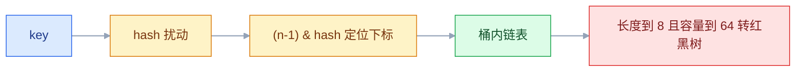
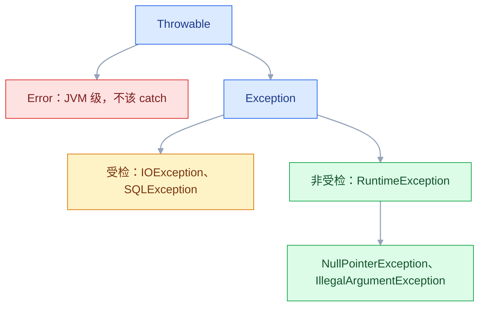
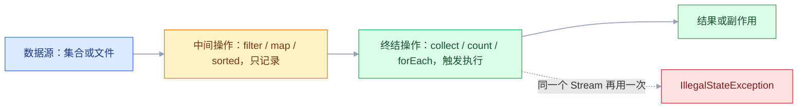

# Java 基础

## 一、工程案例：把一份支付流水对成商户结算单

**场景**：财务每周收到渠道给的一份 `orders.csv`（订单号、商户号、金额、状态、支付时间），要算出每个商户的应结金额（扣 0.6% 手续费），并把解析不了的行单独列出来。现在用 Excel 手工做，20 万行要十几分钟，金额列还偶发差 1 分钱。

**目标**：一个命令行程序，输入流水，输出 `settlement.csv`（每商户一行）和 `diff.txt`（汇总与跳过明细）。金额精确到分，坏行不中断整批，同一份输入重复跑结果完全一致。

**为什么必须做**：这个案例把 Java 基础里真正会用到的部分串成一条线——类型与 `BigDecimal`、`record`、集合分组、Stream、异常与资源关闭、文件 IO、Maven、JUnit。语法单独背记不住，跑通一遍才有手感。

**动手前确认**：`java -version` 与 `mvn -v` 都指向 JDK 17 或更高的 LTS（以官方当前 LTS 为准），且两者一致，否则 Maven 会用另一个 JDK 编译。

### 1.1 主线（按顺序执行，不要跳步）

**① 建项目骨架**

```bash
mkdir -p settlement/src/main/java/com/example/settle \
         settlement/src/test/java/com/example/settle settlement/data
cd settlement
```

`pom.xml`：

```xml
<?xml version="1.0" encoding="UTF-8"?>
<project xmlns="http://maven.apache.org/POM/4.0.0">
  <modelVersion>4.0.0</modelVersion>
  <groupId>com.example</groupId>
  <artifactId>settlement</artifactId>
  <version>1.0.0</version>
  <properties>
    <maven.compiler.release>17</maven.compiler.release>
    <project.build.sourceEncoding>UTF-8</project.build.sourceEncoding>
  </properties>
  <dependencies>
    <dependency>
      <groupId>org.junit.jupiter</groupId>
      <artifactId>junit-jupiter</artifactId>
      <version>5.10.2</version>
      <scope>test</scope>
    </dependency>
  </dependencies>
  <build><plugins>
    <plugin>
      <groupId>org.apache.maven.plugins</groupId>
      <artifactId>maven-surefire-plugin</artifactId>
      <version>3.2.5</version>
    </plugin>
  </plugins></build>
</project>
```

`<maven.compiler.release>17</maven.compiler.release>` 同时约束语法和 API：用了更高版本才有的方法会直接编译失败，比只写 source/target 可靠。

**② 准备输入** `data/orders.csv`（第 8 行是故意写坏的金额）：

```csv
orderId,merchantId,amount,status,paidAt
A1001,M01,199.00,PAID,2026-09-30T10:12:00
A1002,M01,58.50,PAID,2026-09-30T11:03:00
A1003,M02,1000.00,REFUNDED,2026-09-30T12:20:00
A1004,M02,88.80,PAID,2026-09-30T13:00:00
A1005,M03,0.10,PAID,2026-09-30T14:00:00
A1006,M03,0.20,PAID,2026-09-30T14:01:00
A1007,M01,abc,PAID,2026-09-30T15:00:00
```

**③ 订单模型** `Order.java`：`record` 承载不可变数据，解析失败直接抛 `RuntimeException`，由调用方决定「跳过这一行」。

```java
package com.example.settle;

import java.math.BigDecimal;
import java.time.LocalDateTime;
import java.time.format.DateTimeFormatter;
import java.util.Locale;

public record Order(String orderId, String merchantId, BigDecimal amount,
                    Status status, LocalDateTime paidAt) {

    public enum Status { PAID, REFUNDED, PENDING }
    private static final DateTimeFormatter TS = DateTimeFormatter.ISO_LOCAL_DATE_TIME;

    public static Order parse(String line) {
        String[] c = line.split(",", -1);
        if (c.length != 5) throw new IllegalArgumentException("期望 5 列，实际 " + c.length + " 列");
        BigDecimal amount = new BigDecimal(c[2].trim());   // 必须用字符串构造
        if (amount.signum() < 0) throw new IllegalArgumentException("金额为负: " + amount);
        return new Order(c[0].trim(), c[1].trim(), amount,
                Status.valueOf(c[3].trim().toUpperCase(Locale.ROOT)),
                LocalDateTime.parse(c[4].trim(), TS));
    }
}
```

`split(",", -1)` 的 `-1` 不能省：默认会丢掉所有末尾空列，`a,b,c,,` 会从 5 列变成 3 列，错误信息反而误导。

**④ 结算逻辑** `SettlementJob.java`：读一行、解析一行、聚合一行，坏行进 `skips` 而不影响整批。

```java
package com.example.settle;

import java.io.*;
import java.math.BigDecimal;
import java.math.RoundingMode;
import java.nio.charset.StandardCharsets;
import java.nio.file.*;
import java.util.*;

public final class SettlementJob {

    private static final BigDecimal FEE_RATE = new BigDecimal("0.006");
    private static final int SCALE = 2;

    public record Skip(int lineNo, String reason) { }
    public record MerchantSettlement(String merchantId, int count, BigDecimal gross,
                                     BigDecimal fee, BigDecimal net) { }
    public record Result(int dataRows, List<Skip> skips, List<MerchantSettlement> settlements) { }

    public Result run(Path csv) throws IOException {
        Map<String, BigDecimal> grossByMerchant = new HashMap<>();
        Map<String, Integer> countByMerchant = new HashMap<>();
        List<Skip> skips = new ArrayList<>();
        int dataRows = 0;

        try (BufferedReader reader = Files.newBufferedReader(csv, StandardCharsets.UTF_8)) {
            String line;
            int lineNo = 0;
            while ((line = reader.readLine()) != null) {
                lineNo++;
                if (lineNo == 1 || line.isBlank()) continue;   // 表头、空行
                try {
                    Order order = Order.parse(line);
                    dataRows++;
                    if (order.status() == Order.Status.PAID) {
                        grossByMerchant.merge(order.merchantId(), order.amount(), BigDecimal::add);
                        countByMerchant.merge(order.merchantId(), 1, Integer::sum);
                    }
                } catch (RuntimeException e) {
                    skips.add(new Skip(lineNo, e.getClass().getSimpleName() + ": " + e.getMessage()));
                }
            }
        }

        List<MerchantSettlement> rows = new TreeMap<>(grossByMerchant).entrySet().stream()
                .map(e -> {
                    BigDecimal gross = e.getValue();
                    BigDecimal fee = gross.multiply(FEE_RATE).setScale(SCALE, RoundingMode.HALF_UP);
                    return new MerchantSettlement(e.getKey(), countByMerchant.get(e.getKey()),
                            gross, fee, gross.subtract(fee));
                })
                .toList();
        return new Result(dataRows, List.copyOf(skips), rows);
    }

    public void write(Result r, Path outDir) throws IOException {
        Files.createDirectories(outDir);
        Path target = outDir.resolve("settlement.csv");
        Path tmp = outDir.resolve("settlement.csv.tmp");
        try (BufferedWriter w = Files.newBufferedWriter(tmp, StandardCharsets.UTF_8)) {
            w.write("merchantId,count,gross,fee,net");
            w.newLine();
            for (MerchantSettlement s : r.settlements()) {
                w.write("%s,%d,%s,%s,%s".formatted(s.merchantId(), s.count(),
                        s.gross().toPlainString(), s.fee().toPlainString(), s.net().toPlainString()));
                w.newLine();
            }
        }
        // 同目录改名：下游要么读到旧文件，要么读到完整的新文件
        Files.move(tmp, target, StandardCopyOption.REPLACE_EXISTING,
                StandardCopyOption.ATOMIC_MOVE);
        List<String> lines = new ArrayList<>();
        lines.add("有效行=%d 跳过=%d 参与结算=%d".formatted(r.dataRows(), r.skips().size(),
                r.settlements().stream().mapToInt(MerchantSettlement::count).sum()));
        BigDecimal gross = r.settlements().stream().map(MerchantSettlement::gross)
                .reduce(BigDecimal.ZERO, BigDecimal::add);
        BigDecimal fee = r.settlements().stream().map(MerchantSettlement::fee)
                .reduce(BigDecimal.ZERO, BigDecimal::add);
        lines.add("流水合计=%s 手续费合计=%s 结算合计=%s".formatted(
                gross.toPlainString(), fee.toPlainString(), gross.subtract(fee).toPlainString()));
        for (Skip s : r.skips()) lines.add("第 %d 行跳过：%s".formatted(s.lineNo(), s.reason()));
        Files.write(outDir.resolve("diff.txt"), lines, StandardCharsets.UTF_8);
    }
}
```

三个设计点：`TreeMap` 让商户号按字典序输出，结果与文件里出现的顺序无关；`merge` 一行完成「不存在则放入、存在则累加」，内存只留商户级汇总；手续费按单商户合计后再乘费率，与「逐笔乘再加总」可能差 1 分，规则必须和财务对齐，并且只写在一处。

**⑤ 入口** `Main.java`：只做参数校验和结果打印，不掺业务。参数个数不对时 `System.exit(2)`；异常不捕获，让 JVM 以非零码退出，cron 才会告警。

```java
package com.example.settle;

import java.nio.file.Path;

public final class Main {
    public static void main(String[] args) throws Exception {
        if (args.length != 2) {
            System.err.println("用法: java com.example.settle.Main <orders.csv> <outDir>");
            System.exit(2);
        }
        SettlementJob job = new SettlementJob();
        SettlementJob.Result result = job.run(Path.of(args[0]));
        job.write(result, Path.of(args[1]));
        System.out.printf("完成：有效 %d 行，跳过 %d 行，商户 %d 个%n",
                result.dataRows(), result.skips().size(), result.settlements().size());
    }
}
```

**⑥ 跑一遍，看真实输出**

```bash
mvn -q clean package
java -cp target/classes com.example.settle.Main data/orders.csv out
cat out/settlement.csv
cat out/diff.txt
```

```text
完成：有效 6 行，跳过 1 行，商户 3 个
merchantId,count,gross,fee,net
M01,2,257.50,1.55,255.95
M02,1,88.80,0.53,88.27
M03,2,0.30,0.00,0.30
有效行=6 跳过=1 参与结算=5
流水合计=346.60 手续费合计=2.08 结算合计=344.52
第 8 行跳过：NumberFormatException: Character a is neither a decimal digit number...
```

**⑦ 补一个测试**：`SettlementJobTest` 用 `@TempDir Path tmp` 造临时输入，覆盖退款排除、坏行跳过和金额精度。

```java
package com.example.settle;

import org.junit.jupiter.api.Test;
import org.junit.jupiter.api.io.TempDir;

import java.nio.charset.StandardCharsets;
import java.nio.file.Files;
import java.nio.file.Path;
import java.util.List;

import static org.junit.jupiter.api.Assertions.assertEquals;

class SettlementJobTest {

    @TempDir
    Path tmp;

    @Test
    void refundedExcludedAndBadRowSkipped() throws Exception {
        Path p = tmp.resolve("orders.csv");
        Files.write(p, List.of("orderId,merchantId,amount,status,paidAt",
                "A1,M01,0.10,PAID,2026-09-30T10:00:00",
                "A2,M01,0.20,PAID,2026-09-30T10:01:00",
                "A3,M01,50.00,REFUNDED,2026-09-30T10:02:00",
                "A4,M01,abc,PAID,2026-09-30T10:03:00"), StandardCharsets.UTF_8);
        SettlementJob.Result r = new SettlementJob().run(p);
        assertEquals(3, r.dataRows());
        assertEquals(1, r.skips().size());
        assertEquals(5, r.skips().get(0).lineNo());
        assertEquals("0.30", r.settlements().get(0).gross().toPlainString());
    }
}
```

### 1.2 验收（8 项全过才算交付）

| # | 检查 | 命令或检查 | 通过标准 |
|---|---|---|---|
| 1 | 能编译 | `mvn -q clean package` | 退出码 0，`target/classes` 有 `.class` |
| 2 | 单测 | `mvn test` | 输出 `Tests run: 1, Failures: 0, Errors: 0` |
| 3 | 汇总金额 | `cat out/diff.txt` | 流水 `346.60`、手续费 `2.08`、结算 `344.52` |
| 4 | 金额精度 | `grep M03 out/settlement.csv` | 总额 `0.30`，不出现 `0.30000000000000004` |
| 5 | 退款排除 | `grep M02 out/settlement.csv` | 只有 1 笔，总额 `88.80` |
| 6 | 坏行可追溯 | `grep 第 out/diff.txt` | 写出第 8 行和异常类型，其余行照常输出 |
| 7 | 结果确定 | 连跑两次后 `md5sum out/settlement.csv`（macOS 用 `md5`） | 两次哈希一致 |
| 8 | 内存有界 | `java -Xmx256m -cp target/classes com.example.settle.Main data/orders-big.csv out-big` | 退出码 0，不抛 `OutOfMemoryError` |

> 第 8 项是关键：代码逐行读，只保留每个商户的汇总，内存取决于商户数而不是行数。若先 `Files.readAllLines` 再处理，20 万行会一次性进堆，`-Xmx256m` 就可能撑不住。大文件用下面的命令生成（`data/orders-big.csv`，20 万行）：

```bash
awk 'BEGIN{print "orderId,merchantId,amount,status,paidAt";
for (i=1;i<=200000;i++) printf "B%d,M%02d,%d.%02d,PAID,2026-09-30T10:00:00\n", i, i%50, i%1000, i%100}' \
  > data/orders-big.csv
```

### 1.3 复制到定时任务

```bash
# write() 已按「同目录临时文件 + ATOMIC_MOVE」落盘，下游不会读到半个文件
# crontab 每一行都是独立 shell，变量不能跨行复用，参数直接写在命令里

# 每天 2 点跑，日志按月留存
0 2 * * * mkdir -p /data/logs && cd /opt/settlement && /usr/bin/java -Xms128m -Xmx256m -Dfile.encoding=UTF-8 -Duser.timezone=Asia/Shanghai -cp target/classes com.example.settle.Main /data/orders.csv /data/out >> /data/logs/settlement-$(date +\%Y\%m).log 2>&1
```

| 现实约束 | 处理 |
|---|---|
| 渠道偶尔给 GBK | 明确约定 UTF-8，或读入时探测编码；不要靠 `file.encoding` 猜 |
| 文件可能重复投递 | 按订单号去重或按日期分区，保证幂等 |
| 金额规则会变 | 费率、最小手续费、舍入方式集中成常量或配置 |
| 输出目录被下游占用 | 同目录临时文件 + `ATOMIC_MOVE`；跨文件系统会退化为复制，不再原子 |
| 失败要能重跑 | 异常非零退出，cron 才会告警；不要 catch 后打印「成功」 |

---

## 二、高频问答：会卡住你的地方，也是面试最常问的

### 2.1 `==` 比较 Integer，127 相等、128 不等

**现场**

先确认是「值相等」还是「对象相同」：打印 `System.identityHashCode(a)`，或改用 `equals` 验证；再 `javap -c` 看有没有 `Integer.valueOf`，对照缓存范围。

```java
Integer a = 127, b = 127;
System.out.println(a == b);        // true，缓存里的同一个对象
Integer c = 128, d = 128;
System.out.println(c == d);        // false，各自 valueOf 出新对象
System.out.println(c.equals(d));   // true
```

**要点**

- `==` 比的是引用，值相等不等于对象相同。
- 装箱走 `Integer.valueOf`，-128~127 命中缓存返回同一对象，超出范围就新建。
- 包装类、`String`、自定义对象一律用 `equals`，比较值不要用 `==`。

**追问**

- 为什么 127 相等、128 不等？→ 缓存范围是 -128~127，范围内复用同一个对象。
- `Integer` 和 `int` 比较时比的是什么？→ 一边是基本类型会触发拆箱，比的是数值。
- 缓存为什么要存在？→ 小整数装箱太频繁，缓存能省掉大量临时对象。

### 2.2 遍历集合时删除元素，抛 `ConcurrentModificationException`

**现场**

堆栈里出现 `ArrayList$Itr.checkForComodification` 就是它；也可以看 `modCount != expectedModCount`，或改成手动迭代器复现。

```java
List<String> list = new ArrayList<>(List.of("a", "b", "c"));
// ✘ for (String s : list) if (s.equals("b")) list.remove(s);

list.removeIf(s -> s.equals("b"));          // ✔ 最简洁

Iterator<String> it = list.iterator();       // ✔ 显式迭代器
while (it.hasNext()) if (it.next().equals("b")) it.remove();
```

**要点**

- 异常名里的「Concurrent」误导人，它和并发无关，只是「结构被改动过」。
- fail-fast 检查：增强 for 底层用迭代器，`list.remove` 改了 `modCount`，迭代器下次 `next()` 发现不一致就抛。
- 删除用 `removeIf`、迭代器的 `it.remove()`，或遍历副本。

**追问**

- 单线程也会抛吗？→ 会，只要绕开迭代器改结构就触发。
- 为什么 `removeIf` 不抛？→ 它由集合自己实现，改结构时同步维护了迭代器的期望值。
- 多线程安全集合还抛吗？→ `CopyOnWriteArrayList` 遍历的是快照，`ConcurrentHashMap` 是弱一致，都不做 fail-fast。

### 2.3 `List.of` 或 `Arrays.asList` 添加元素报 `UnsupportedOperationException`

**现场**

看运行时类名：`list.getClass().getName()` 出现 `Arrays$ArrayList` 或 `ImmutableCollections$ListN`，就说明拿到的是固定大小或不可变实现。

```java
List<String> a = Arrays.asList("x", "y");
a.set(0, "z");            // 合法，改的是底层数组
// a.add("w");            // UnsupportedOperationException
List<String> b = List.of("x", "y");
// b.set(0, "z");         // 也不可修改

List<String> mutable = new ArrayList<>(List.of("x", "y"));   // 要可变就复制
mutable.add("z");
```

**要点**

- 接口是 `List` 不代表实现可改，`Arrays.asList` 是固定大小视图，`List.of` 完全不可变。
- `Arrays.asList` 背后就是传入的原数组，所以 `set` 合法且会写回原数组，`add/remove` 都不支持。
- 要可变就 `new ArrayList<>(...)` 复制一份，别在只读视图上做增删。

**追问**

- `Arrays.asList(int[])` 为什么只有一个元素？→ 泛型只能装引用类型，整个 `int[]` 被当成单个元素。
- `List.of` 能放 null 吗？→ 不能，直接抛 NPE。
- 什么时候该用不可变 List？→ 常量和对外返回的集合，防止调用方改内部状态。

### 2.4 包装类为 null 时拆箱，抛空指针

**现场**

异常消息通常带 `Cannot invoke "java.lang.Integer.intValue()" ... is null`，看到 `intValue` 就沿调用栈回溯值是从哪来的。

```java
Map<String, Integer> stock = new HashMap<>();
stock.put("A", 10);
int n = stock.get("B");                    // ✘ NullPointerException
int safe = stock.getOrDefault("B", 0);     // ✔ 0
Integer boxed = stock.get("B");
int safe2 = boxed == null ? 0 : boxed;     // ✔ 显式判空
```

**要点**

- 没调用任何方法也可能 NPE：赋值给 `int` 时编译器自动插入了 `intValue()`。
- `map.get(k)` 返回 null 是最常见来源。
- 数据库 `SUM()`、`COUNT()` 无数据时也可能返回 null，同样会在拆箱时炸。

**追问**

- `getOrDefault` 能完全防住吗？→ 只防键不存在；键存在但值是 null 时仍返回 null。
- 三元表达式也会拆箱吗？→ 两个分支一个是 `int` 一个是 `Integer` 时，会有隐式拆箱。
- 怎么从异常定位？→ 看 `intValue` 所在的栈帧行号，再回溯那个值的来源。

### 2.5 用 double 算钱，出现 `0.30000000000000004`

**现场**

打印 `toPlainString()` 看有没有多余尾数；再用 `new BigDecimal(0.1)` 验证，它会打出 `0.10000000000000000555...`，说明 double 本身已经不准。

```java
System.out.println(0.1 + 0.2);                          // 0.30000000000000004
System.out.println(new BigDecimal("0.1").add(new BigDecimal("0.2")));  // 0.3
System.out.println(BigDecimal.valueOf(0.1));            // 0.1，valueOf 走字符串
System.out.println(new BigDecimal(0.1));                // 0.10000000000000000555...
```

**要点**

- `double` 是二进制浮点，0.1、0.2 都无法精确表示，相加后误差被放大，IEEE 754 都这样。
- 金额、费率、税额一律 `BigDecimal`，只用字符串或 `valueOf` 构造。
- 用 `double` 构造 `BigDecimal` 会把误差原样带进来，这是最隐蔽的一步。

**追问**

- 为什么 `BigDecimal.valueOf(0.1)` 就对了？→ 它走 `Double.toString`，拿到的是最短十进制表示。
- 用 `long` 存分可以吗？→ 可以，整数运算没有精度问题，但要约定好单位。
- `equals` 和 `compareTo` 有什么区别？→ scale 不同时 `equals` 为 false，比数值要用 `compareTo`。

### 2.6 整数乘法先溢出，再赋给 long 已经晚了

**现场**

把中间结果单独打印出来，或用 `Math.multiplyExact` 让溢出直接抛异常；也可以把第一个操作数写成 `365L` 对比结果。

```java
long wrong = 365 * 24 * 60 * 60 * 1000;          // 1471228928，已溢出
long right = 365L * 24 * 60 * 60 * 1000;         // 31536000000
int max = Integer.MAX_VALUE;
System.out.println(max + 1);                     // -2147483648，静默回绕
System.out.println(Math.addExact(max, 1));       // ArithmeticException
```

**要点**

- 表达式先按操作数类型算完再赋值，变量声明成 `long` 救不了已经溢出的中间结果。
- `365 * 24 * 60 * 60 * 1000` 全是 `int`，结果约 315 亿，超出约 21 亿的上限后静默回绕。
- 只要有一个操作数是 `long`，整个表达式才按 `long` 算；金额、时间戳统一用 `Math.*Exact` 兜底。

**追问**

- 为什么编译器不报错？→ `int` 溢出是运行时静默回绕，语言不做检查。
- `Math.addExact` 溢出时是什么行为？→ 抛 `ArithmeticException`，不会返回错值。
- `long` 就不会溢出吗？→ 也会，只是范围大得多，大数乘法仍要用 `multiplyExact`。

### 2.7 自定义对象当 HashMap 的 key，put 进去却 get 不出来

**现场**

`map.size()` 是 1 但 `map.get(new Key("a"))` 是 null、`containsKey` 也失败，就是 key 的哈希对不上；put 前后各打印一次 `hashCode()`，值变了说明 key 被改过。

```java
record Key(String id) { }                 // record 自动生成 equals/hashCode

Map<Key, String> map = new HashMap<>();
map.put(new Key("a"), "订单A");
System.out.println(map.get(new Key("a")));   // 订单A
```

**要点**

- HashMap 先按 `hashCode` 找桶、再按 `equals` 比，缺一个就找不到。
- 没重写 `equals/hashCode`，或重写后又修改了参与哈希的字段，两次计算的桶位置不同。
- 只重写 `equals` 不行，桶位置对不上，`get` 直接走空。

**追问**

- 为什么可变对象不适合当 key？→ 哈希值会变，桶位置跟着变。
- `record` 为什么能直接用？→ 它自动生成基于全部组件的 `equals/hashCode`。
- `hashCode` 相同就一定是同一个 key 吗？→ 不一定，还要过 `equals`，这就是哈希冲突。

### 2.8 Stream 用了第二次，抛 `IllegalStateException`

**现场**

异常消息是 `stream has already been operated upon or closed`；看调用链确认同一个 Stream 对象被用了两次。

```java
Stream<String> s = List.of("a", "b").stream().map(String::trim);
long n = s.count();                 // 终结操作，流被消费
// s.forEach(System.out::println);  // ✘ IllegalStateException

List<String> names = List.of("a", "b").stream().map(String::trim).toList();
// names.add("c");                  // ✘ toList() 返回不可变 List
```

**要点**

- Stream 是一次性管道，终结操作后已消费，不能重复遍历。
- 中间操作是懒的，只有终结操作才真正执行。
- 需要复用就每次从数据源重新 `stream()`，或先 `toList()` 落成集合。

**追问**

- 为什么 `toList()` 之后不能再 add？→ 它返回的是不可变 List。
- 惰性求值有什么实际影响？→ 没有终结操作就什么都不发生，副作用也不会执行。
- `parallelStream` 能复用吗？→ 同样只能消费一次。

### 2.9 编译通过，运行报 `NoClassDefFoundError`

**现场**

先用 `mvn dependency:tree -Dincludes=groupId:artifactId` 看版本从哪来，再用 `java -verbose:class` 看实际加载了哪个 jar。

```bash
mvn dependency:tree -Dincludes=com.mysql:mysql-connector-j
# 输出会画出完整路径，能看出是被哪个依赖传递引进来的
```

**要点**

- 编译期可见不等于运行期可用：编译期 classpath 有、运行期没有就报这个错。
- 常见来源是 `provided` 作用域、依赖冲突、打包漏了 jar；`provided` 只保证编译和测试，不会打进产物。
- 另一类是静态初始化抛过异常，第二次使用时报 `Could not initialize class`，要往上翻第一次的 `ExceptionInInitializerError`。

**追问**

- `ClassNotFoundException` 和它有什么区别？→ 前者是显式加载找不到，后者是类在链接或初始化阶段失败。
- 依赖冲突怎么定位？→ 看依赖树里同一 artifact 的多条路径，排除多余版本。
- 产物里到底有没有那个 jar？→ 解压产物看 `lib/` 目录，比看 pom 可靠。

---

## 三、核心知识：从零开始要建立的东西

### 3.1 从源码到字节码

`javac` 把 `.java` 编译成与平台无关的 `.class` 字节码，`java` 启动 JVM 加载并执行。字节码不是机器码，JVM 先用解释器逐条执行，热点方法再由 JIT 编译成本地机器码：源码 → `javac` → 字节码 → 类加载与校验 → 解释执行 → 热点 JIT。

| 概念 | 包含什么 | 谁需要 |
|---|---|---|
| JVM | 类加载器、运行时数据区、执行引擎 | 运行 Java 程序都靠它 |
| JRE | JVM + 核心类库 | 只运行、不开发 |
| JDK | JRE + `javac`、`jar`、`jcmd` 等 | 开发与排障 |

JDK 11 起官方不再单独发布 JRE，实际项目统一装 JDK。生产上常用 LTS，具体版本以官方当前 LTS 为准。`javap -c` 看指令，`javap -v` 看常量池和字节码版本（52 对应 Java 8，61 对应 17）。

### 3.2 基本类型与引用类型

Java 有 8 种基本类型，其余全是引用类型。基本类型变量里放值，引用类型变量里放「指向堆中对象的地址」。

| 类型 | 字节 | 典型用途 | 字面量 |
|---|---|---|---|
| `byte` | 1 | 文件、网络字节 | `(byte) 100` |
| `short` | 2 | 很少用 | `(short) 10` |
| `int` | 4 | 计数、状态码 | `100` |
| `long` | 8 | ID、时间戳、金额的分 | `100L` |
| `float` | 4 | 图形、非精确计算 | `3.14f` |
| `double` | 8 | 科学计算、非金额小数 | `3.14` |
| `char` | 2 | 单个 UTF-16 代码单元 | `'A'` |
| `boolean` | 1（实现相关） | 开关 | `true` |

字段不赋值有默认值（0、false、null），局部变量没有默认值，必须先赋值才能读。整数默认 `int`、小数默认 `double`，所以 `long x = 10000000000;` 和 `float f = 3.14;` 都编译不过，要写 `L` 和 `f`。

### 3.3 装箱、缓存与空值

泛型不能写 `List<int>`，所以基本类型要装箱成 `Integer/Long/...`。装箱是 `Integer.valueOf(x)`，拆箱是 `x.intValue()`，编译器自动插入。

`Integer` 默认缓存 -128~127。缓存范围内 `==` 为 true，范围外为 false：

```java
Integer a = 100, b = 100;
System.out.println(a == b);      // true
Integer c = 1000, d = 1000;
System.out.println(c == d);      // false
System.out.println(c.equals(d)); // true
```

装箱的代价是每次都可能新建对象。循环里 `Long sum = 0L; sum += i;` 会反复装箱拆箱，量大时既有 GC 压力又慢。`null` 装箱值拆箱必 NPE，这是 2.4 的根因；需要表达「没有值」时先判空，不要用魔法值 0 硬撑。

### 3.4 字符串与常量池

`String` 不可变：所有看起来像修改的方法都返回新对象。好处是线程安全、可安全做 `HashMap` 的 key、字面量可共享；代价是循环拼接产生大量临时对象。

```java
String s = "abc";              // 字面量，进常量池
String t = "abc";              // 复用同一个对象
String u = new String("abc");  // 强制在堆里新建
System.out.println(s == t);    // true
System.out.println(s == u);    // false
System.out.println(s.equals(u)); // true

String p = "ab";
String q = p + "c";            // 运行时新建，不进池（"ab" + "c" 才会编译期折叠）
```

| | String | StringBuilder | StringBuffer |
|---|---|---|---|
| 可变性 | 不可变 | 可变 | 可变 |
| 线程安全 | 安全（不可变） | 不安全 | 安全（同步） |
| 适用 | 常量、key、少量拼接 | 单线程循环拼接 | 多线程共享拼接（少见） |

循环里拼接用 `StringBuilder`；`+` 在编译期能折叠就折叠，不能折叠时每次都会生成新字符串（JDK 9 起走 `invokedynamic`，不再固定编译成 `StringBuilder`），量大时差距明显。

> **面试**：常问「String 为什么不可变？`==` 和 `equals` 有什么区别？」答：不可变换来线程安全和常量池复用，值比较必须用 `equals`。

### 3.5 值传递

Java 只有值传递。基本类型传的是值的副本；引用类型传的是地址的副本。所以「方法里改对象内容」能生效，「让参数指向新对象」不影响调用方。

```java
static void change(int x) { x = 100; }
static void rename(User u) { u.name = "李四"; }
static void replace(User u) { u = new User(); u.name = "王五"; }

int a = 1; change(a);                 // a 仍是 1
User user = new User(); user.name = "张三";
rename(user);                         // 变成李四，副本地址指向同一对象
replace(user);                        // 仍是李四，只改了副本的指向
```

`String` 看起来「改不动」不是特例，而是它不可变：方法里 `s = s + "x"` 只是让副本指向新字符串，原对象没变。

### 3.6 集合的接口与实现

集合分两大支：`Collection`（单个元素）和 `Map`（键值对）。选型的核心是「查找多还是插入多、要不要顺序、要不要线程安全」。

| 接口 | 常用实现 | 底层 | 随机访问 | 典型场景 |
|---|---|---|---|---|
| `List` | `ArrayList` | 动态数组 | O(1) | 默认选择，按位置取 |
| `List` | `LinkedList` | 双向链表 | O(n) | 频繁头尾增删；队列优先 `ArrayDeque` |
| `Set` | `HashSet` | `HashMap` | O(1) | 去重，不关心顺序 |
| `Set` | `LinkedHashSet` | 链表 + 哈希 | O(1) | 去重且保留插入顺序 |
| `Set` | `TreeSet` | 红黑树 | O(log n) | 去重且自动排序 |
| `Map` | `HashMap` | 数组 + 链表 + 红黑树 | O(1) | 默认选择 |
| `Map` | `LinkedHashMap` | 哈希 + 双向链表 | O(1) | 保留插入顺序、做 LRU |
| `Map` | `TreeMap` | 红黑树 | O(log n) | 按 key 排序 |

`ArrayList` 默认容量 10，满了扩到 1.5 倍；已知规模就 `new ArrayList<>(10000)`，省掉反复扩容和复制。`LinkedList` 的 `get(i)` 是 O(n)，当队列也不如 `ArrayDeque`，除维护老代码外几乎不用。遍历时删除用 `removeIf` 或迭代器（2.2）。`Collections.unmodifiableList` 是视图，原列表变了它也跟着变；`List.copyOf` 才是真拷贝。

### 3.7 HashMap 的定位与扩容



查找分三步：`hashCode()` 扰动、用 `(table.length - 1) & hash` 定桶、桶内用 `equals` 逐个比。所以 key 必须正确重写这两个方法，且参与哈希的字段不能在使用中修改（2.7）。

冲突多时链表变长，查询从 O(1) 退化到 O(n)；JDK 8 起链表长度到 8 且表容量到 64 会转红黑树，降到 O(log n)。容量不到 64 时优先扩容而不是树化。默认容量 16、负载因子 0.75，元素超过 12 就扩成 32 并重新分配。已知要放 N 个元素，初始容量写 `N / 0.75 + 1` 可避免扩容。`HashMap` 不是线程安全的：JDK 7 并发扩容可能成环，JDK 8 改成尾插不会成环，但仍可能丢数据、size 不准，并发场景用 `ConcurrentHashMap`。

> **面试**：常问「HashMap 的默认容量和负载因子是多少？什么时候转红黑树？」答：16 和 0.75，链表到 8 且容量到 64 才树化。

### 3.8 泛型与类型擦除

泛型把类型检查提前到编译期：`List<String>` 里放 `Integer` 直接编译失败，取出来也不用强转。

```java
public record Result<T>(int code, String message, T data) {
    public static <T> Result<T> ok(T data) {
        return new Result<>(0, "ok", data);
    }
}

Result<String> r1 = Result.ok("hello");
Result<List<Integer>> r2 = Result.ok(List.of(1, 2));
```

泛型只存在于编译期，运行时 `List<String>` 和 `List<Integer>` 都是 `List`，这叫类型擦除。由此带来三条限制：不能 `new T()`、不能 `T.class`、不能 `instanceof List<String>`；需要运行时类型时传 `Class<T>` 进去。通配符记住 PECS：生产者用 `? extends T`（只读），消费者用 `? super T`（只写）。

> **面试**：常问「什么是泛型擦除？带来哪些限制？」答：泛型只在编译期存在，运行时不能 `new T()`、不能 `T.class`、不能 `instanceof` 带参数类型。

### 3.9 equals 与 hashCode 契约

`Object` 默认的 `equals` 比地址，`hashCode` 按地址算。业务对象要按内容比较时必须同时重写，并遵守契约：`equals` 为 true 的两个对象，`hashCode` 必须相等。

```java
@Override
public boolean equals(Object o) {
    if (this == o) return true;
    if (!(o instanceof Order other)) return false;
    return Objects.equals(orderId, other.orderId);
}
@Override
public int hashCode() {
    return Objects.hash(orderId);
}
```

只重写 `equals` 不重写 `hashCode`，对象放进 `HashSet` 会被当成两个；只重写 `hashCode` 不重写 `equals`，同一个桶里仍然比地址。`record` 自动生成基于全部组件的 `equals/hashCode/toString`；普通实体用 IDE 生成，字段增删后要重新生成。

### 3.10 接口、抽象类与多态

| 维度 | 抽象类 | 接口 |
|---|---|---|
| 关键字 | `extends`，只能继承一个 | `implements`，可以实现多个 |
| 字段 | 普通字段、静态字段都行 | 只能是 `public static final` 常量 |
| 方法 | 抽象方法 + 普通方法 | 抽象方法 + `default` + `static` + `private` |
| 构造方法 | 有 | 没有 |
| 设计含义 | is-a，共享状态和部分实现 | can-do，只约定能力 |

多态是「父类引用指向子类对象，运行时执行子类实现」。调用方只依赖接口，新增实现不用改调用代码：

```java
interface PayChannel { BigDecimal fee(BigDecimal amount); }

class WechatPay implements PayChannel {
    public BigDecimal fee(BigDecimal amount) { return amount.multiply(new BigDecimal("0.006")); }
}

PayChannel channel = new WechatPay();
BigDecimal fee = channel.fee(new BigDecimal("100.00"));   // 0.60000，scale 是 2+3
```

接口的 `default` 方法用于「给已有接口加方法又不破坏实现类」，多个接口有同名 default 时实现类必须显式覆盖。抽象类适合「有共同字段 + 模板方法」，实际项目里接口用得更多，组合优于继承。

### 3.11 异常分类与资源关闭

`Throwable` 下分 `Error` 和 `Exception`。`Error` 是 JVM 级问题（`OutOfMemoryError`、`StackOverflowError`），不该 catch；`Exception` 又分受检（必须处理）和非受检（`RuntimeException`，不强制）。



| | 受检异常 | 非受检异常 |
|---|---|---|
| 代表 | `IOException`、`SQLException` | `NullPointerException`、`IllegalArgumentException` |
| 编译器要求 | 必须 catch 或 throws | 不强制 |
| 设计意图 | 可预期的外部故障 | 代码写错了 |

资源关闭用 try-with-resources，比手写 `finally` 安全：即使 `close()` 抛异常，也不会吞掉主异常，而是挂成 suppressed。

```java
try (BufferedReader r = Files.newBufferedReader(path, StandardCharsets.UTF_8)) {
    return r.readLine();
} catch (IOException e) {
    throw new UncheckedIOException("读取失败: " + path, e);
}
```

业务异常继承 `RuntimeException`，带上错误码，由统一入口转成响应；不要 `catch (Exception e) {}` 什么都不做，也不要 `e.printStackTrace()` 代替日志。异常构造会抓栈，高频路径上不要用异常做流程控制。

### 3.12 BigDecimal 与舍入

`BigDecimal` 由「无标度整数 + scale」组成，能精确表示十进制小数。构造必须用字符串或 `valueOf`，用 `double` 构造会把误差带进来。

```java
BigDecimal total = new BigDecimal("19.99").multiply(new BigDecimal("3"))
        .setScale(2, RoundingMode.HALF_UP);      // 59.97
BigDecimal x = new BigDecimal("1.0"), y = new BigDecimal("1.00");
System.out.println(x.equals(y));       // false，scale 不同
System.out.println(x.compareTo(y));    // 0，数值相同
```

`divide` 遇到除不尽（如 1 除以 3）且没指定舍入会抛 `ArithmeticException`，必须写 `divide(d, 2, RoundingMode.HALF_UP)`。`setScale` 统一入账精度，`stripTrailingZeros` 去掉多余的 0，但它可能返回科学计数法（`100.00` 变成 `1E+2`），对外输出要再配 `toPlainString()`。金额比较用 `compareTo`，不要用 `equals`；入库前统一 scale，避免 `1.0` 和 `1.00` 被当成不同值。

> **面试**：常问「BigDecimal 比较金额为什么不能用 equals？」答：`equals` 连 scale 一起比，`1.0` 和 `1.00` 不相等，比数值要用 `compareTo`。

### 3.13 时间 API 与时区

`java.time` 全部不可变且线程安全，替代了 `Date` 和 `SimpleDateFormat`。

| 类型 | 表示什么 | 典型用途 |
|---|---|---|
| `Instant` | UTC 时间戳 | 日志、跨时区存储 |
| `LocalDate` | 日期，无时间无时区 | 生日、账期 |
| `LocalDateTime` | 日期时间，无时区 | 本地业务时间 |
| `ZonedDateTime` | 带时区的完整时间 | 跨时区调度 |

`LocalDateTime` 不带时区，直接存库再跨时区读取会漂移。对外接口用 `Instant` 或带偏移的 ISO 字符串，展示时再按用户时区转。格式化用 `DateTimeFormatter.ofPattern("yyyy-MM-dd HH:mm:ss")`；`DateTimeFormatter` 不可变、线程安全，可以做成 `static final` 复用。

格式串里 `yyyy` 是日历年，`YYYY` 是「按周算的年份」，跨年那一周会打出下一年。`SimpleDateFormat` 不是线程安全的，别做成静态共享字段。

### 3.14 Stream 的惰性求值

Stream 是声明式管道：中间操作（`filter/map/sorted`）只记录步骤，终结操作（`collect/count/forEach`）才真正执行。没有终结操作，什么都不会发生。



```java
Map<String, BigDecimal> byMerchant = orders.stream()
        .filter(o -> o.status() == Order.Status.PAID)
        .collect(Collectors.groupingBy(Order::merchantId, TreeMap::new,
                Collectors.reducing(BigDecimal.ZERO, Order::amount, BigDecimal::add)));
```

流的三个边界：只能消费一次（2.8）；`toList()` 返回不可变列表；`parallelStream()` 只在数据量大、无共享可变状态、操作可分割时才可能更快，默认用串行。`Collectors.toMap` 遇到重复 key 会抛 `IllegalStateException`，必须给第三个参数决定保留哪个；`groupingBy` 指定 `TreeMap` 可保证输出顺序。

### 3.15 IO、NIO 与文件工具

IO 分字节流（`InputStream/OutputStream`，什么都能读）和字符流（`Reader/Writer`，只处理文本，负责编码转换）。文件、图片、压缩包用字节流；CSV、JSON、日志用字符流并显式指定 `UTF_8`。

```java
String all = Files.readString(Path.of("data/orders.csv"), StandardCharsets.UTF_8);   // 小文件

try (Stream<String> lines = Files.lines(Path.of("data/orders.csv"), StandardCharsets.UTF_8)) {
    long bad = lines.filter(l -> l.split(",").length != 5).count();                  // 大文件
}
```

`Files.lines` 返回的流持有文件句柄，不关闭会泄漏；`Files.readAllLines` 会把整个文件放进内存，大文件用它会 OOM。`File` 是旧 API，新代码用 `Path` + `Files`；写文件优先「临时文件 + 原子移动」。

---

## 四、冷门知识汇总

| 知识点 | 为什么冷门 | 用到时的关键词 |
|---|---|---|
| record 紧凑构造器 | 多数人只用自动生成的构造，不知道还能校验参数 | `record Range(int lo, int hi) { Range { if (lo > hi) throw new IllegalArgumentException(); } }` |
| 文本块的缩进规则 | 日常拼接 SQL 少，遇到多行字符串才发现缩进会被剥 | `"""`、incidental whitespace、行尾 `\` |
| sealed 与模式匹配 switch | 已是正式语法，但老项目见不到，版本演进快（以官方当前 LTS 为准） | `sealed interface Shape permits Circle, Rect`、`case Circle c` |
| 双花括号初始化 | 写法像语法糖，实际生成匿名子类并持有外部引用 | `new HashMap<>() {{ put("k", 1); }}`、内存泄漏 |
| `Class.getResource` 的路径规则 | 以 `/` 开头才从 classpath 根找，否则相对当前类所在包，写错就是 `null` | `getResource("/config/app.yml")`、`getClass()` |
| `String.intern` | 业务代码几乎不用，常量池分析常考 | `intern()`、字符串常量池、`-XX:StringTableSize` |
| `Comparator` 链式比较 | 多字段排序时手写容易漏条件 | `thenComparing`、`nullsFirst`、`reversed` |
| `Optional` 做字段 | 教程常说「用 Optional 替代 null」，实际不适合字段和参数 | 只做返回值、序列化、`orElseThrow` |
| `ThreadLocal` 与线程池 | 单机测试正常，线程池复用线程时数据串味 | `remove()`、`InheritableThreadLocal`、虚拟线程 |
| 强/软/弱/虚引用 | 只有框架和缓存库会用 | `WeakHashMap`、`SoftReference`、`ReferenceQueue` |
| 方法引用四种形式 | Lambda 写熟了反而说不清 `String::length` 是谁调谁 | `Integer::parseInt`、`out::println`、`String::length`、`ArrayList::new` |
| `var` 的真实类型 | 以为 `var` 是动态类型，其实是编译期推断 | 仅局部变量、匿名类、不能为 null |
| 异常栈的性能成本 | 业务异常用得多，没人注意 `fillInStackTrace` 的开销 | `fillInStackTrace`、高频校验、异常改返回值 |
| JUnit 5 的 `@TempDir` | 写文件测试常手工建目录、忘了清理 | `@TempDir`、`@DisplayName`、`assertAll` |
