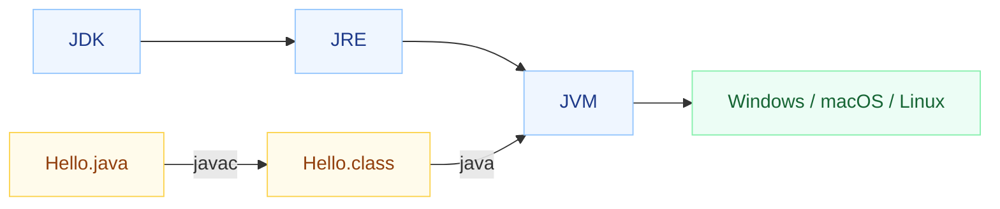
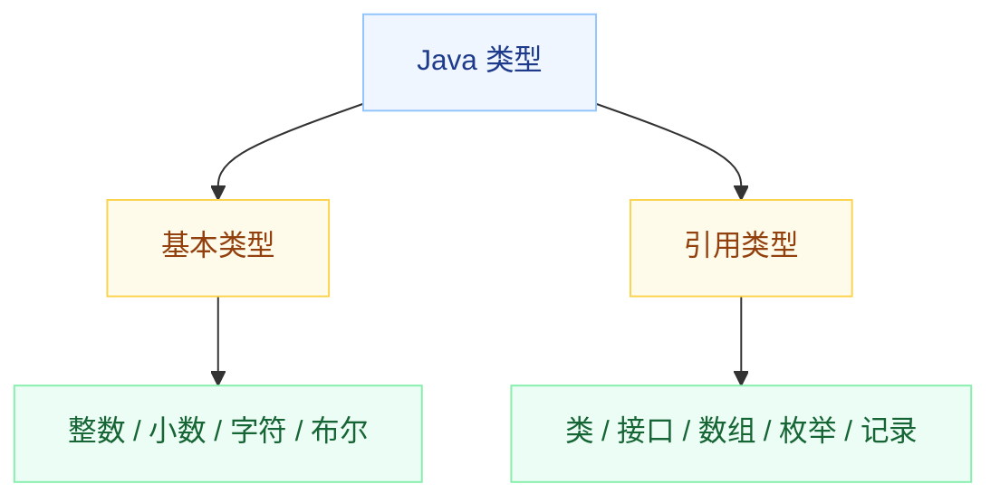

# Java基本语法

> 这篇从 Java 的运行模型讲起，经过环境、类型、运算符、控制流、方法、字符串和数组，最后落到一个完整程序和调试。
>
> 学完能独立编写、编译、运行和调试一个小型 Java 程序。

## 一、Java 的运行模型

Java 源码先由 `javac` 编译成字节码（`.class`），再由 JVM 加载和执行。字节码不是机器码，JVM 负责解释、即时编译（JIT）、垃圾回收和跨平台适配。

Java 的核心判断：一次编译、到处运行的前提是目标机器有对应版本的 JVM；JDK = JRE + 开发工具，JRE = JVM + 标准类库；Java 是静态类型、强类型语言，类型错误在编译期就会暴露一部分。



> 版本基线：Java 21 LTS 仍是企业主流，Java 25 LTS 可用于新项目；存量项目至少要知道自己运行在 8/11/17/21 的哪个版本。

## 二、环境与第一个程序

### 2.1 安装 JDK

| 环境 | 安装方式（2026-11） | 验证 |
|---|---|---|
| Windows 10/11 | `winget install EclipseAdoptium.Temurin.21.JDK`，或从 Adoptium 下载安装包 | `java -version`；在“系统属性”里设置 `JAVA_HOME` |
| macOS | `brew install --cask temurin@21`，或从 Adoptium 下载 | `java -version`；`/usr/libexec/java_home -V` |
| Ubuntu 24.04/26.04 | `sudo apt update && sudo apt install openjdk-21-jdk` | `java -version`；`readlink -f $(which java)` |
| Rocky/CentOS 9/10 | `sudo dnf install java-21-openjdk-devel` | `java -version`；`alternatives --config java` |

`JAVA_HOME` 的设置方式按系统区分：

```bash
# Linux
export JAVA_HOME=/usr/lib/jvm/java-21-openjdk-amd64
export PATH="$JAVA_HOME/bin:$PATH"

# macOS
export JAVA_HOME=$(/usr/libexec/java_home -v 21)
export PATH="$JAVA_HOME/bin:$PATH"

# Windows PowerShell（当前会话，路径以实际安装为准）
$env:JAVA_HOME = "C:\Program Files\Eclipse Adoptium\jdk-21.0.13.9-hotspot"
$env:Path = "$env:JAVA_HOME\bin;$env:Path"
```

安装完成后验证三个命令：

```bash
java -version
javac -version
echo $JAVA_HOME
```

预期输出（版本号可能不同）：

```text
openjdk version "21.0.13" 2026-10-22 LTS
javac 21.0.13
/usr/lib/jvm/java-21-openjdk-amd64
```

> 边界：后续命令默认在 Linux（Ubuntu 为主）下执行；Windows 把路径分隔符换成 `\`，macOS/Linux 用 `/`。`java`/`javac` 的参数在三端一致。

第一个程序：

```java
// Hello.java
public class Hello { // 类名必须与文件名 Hello.java 一致
    public static void main(String[] args) { // JVM 入口，签名不能改
        System.out.println("Hello, Java 21");
    }
}
```

```bash
javac Hello.java   # 生成 Hello.class
java Hello         # 运行，输出 Hello, Java 21
```

| 组成 | 含义 | 常见错误 |
|---|---|---|
| `public class Hello` | 类名必须与 `Hello.java` 一致 | 文件名大小写不一致 |
| `main` | JVM 入口 | 写成 `Main`、参数类型写错 |
| `String[] args` | 命令行参数 | 漏写 `[]` |
| `System.out.println` | 标准输出 | 拼写错误、漏分号 |

> 边界：`java Hello.java` 可以直接运行单文件源码（Java 11+），但多文件项目仍建议用 `javac` 或构建工具。

## 三、类型、变量与常量

Java 的类型分两大类：基本类型（primitive）和引用类型（reference）。

| 类别 | 类型 | 默认值 | 说明 |
|---|---|---|---|
| 整数 | `byte` / `short` / `int` / `long` | 0 | `int` 最常用；`long` 字面量加 `L` |
| 小数 | `float` / `double` | 0.0 | `double` 最常用；`float` 加 `F` |
| 字符 | `char` | `\u0000` | 单个 UTF-16 代码单元 |
| 布尔 | `boolean` | `false` | 只有 `true` / `false` |
| 引用 | 类、接口、数组、枚举、记录 | `null` | 指向对象，不是对象本身 |



```java
int age = 28;                 // 基本类型：存的是值
long orderId = 20261113001L;  // long 字面量必须加 L
double price = 99.9;          // 小数默认 double
char level = 'A';             // 单个字符用单引号
boolean active = true;        // 只有 true / false
String name = "Java";         // 引用类型：指向对象

var count = 10;         		  // 局部变量类型推断，编译期确定 int
final int MAX_RETRY = 3; 			// 常量，赋值后不可改
```

### 3.1 作用域

变量的作用域从声明处开始，到所在代码块结束。局部变量必须先赋值再使用；成员变量有默认值。

```java
{
    int a = 1;
    {
        int b = 2;
        System.out.println(a + b); // 3
    }
    // System.out.println(b); // 编译错误：b 已超出作用域
}
```

### 3.2 三个高频坑

```java
System.out.println(5 / 2);        // 2，整数除法截断
System.out.println(5 / 2.0);      // 2.5，有一个 double
System.out.println(0.1 + 0.2);    // 0.30000000000000004
System.out.println("a" == "a");   // true，字面量复用
System.out.println(new String("a") == new String("a")); // false

int max = Integer.MAX_VALUE;
System.out.println(max + 1);      // -2147483648，溢出
```

> 边界：小数比较不要用 `==`，用误差范围；字符串内容比较用 `equals`，`==` 比较的是引用。

## 四、运算符与表达式

| 类别 | 运算符 | 注意 |
|---|---|---|
| 算术 | `+ - * / %` | 整数除法截断；`%` 结果符号与被除数一致 |
| 比较 | `== != > >= < <=` | 引用类型 `==` 比较地址 |
| 逻辑 | `&&`、`||`、`!` | `&&`、`||` 短路 |
| 赋值 | `= += -= *= /=` | 复合赋值隐含强制类型转换 |
| 三元 | `条件 ? 值1 : 值2` | 两个分支类型要兼容 |
| 位运算 | `&`、按位或、`^`、`~`、移位 | 面试和底层场景使用 |

```java
int a = 10, b = 3;
System.out.println(a / b);        // 3，整数除法截断小数
System.out.println(a % b);        // 1，取余
System.out.println(a > b && b > 0); // true，&& 短路
System.out.println(a > b ? "大" : "小"); // 大，三元表达式
```

> 边界：`&&` 和 `&` 的区别是短路。`obj != null && obj.size() > 0` 必须用 `&&`，用 `&` 会提前求值右侧。

## 五、控制流

### 5.1 条件

```java
int score = 86;

// 区间判断：从高到低写，命中一个分支就结束
if (score >= 90) {
    System.out.println("优秀");
} else if (score >= 60) {
    System.out.println("及格");
} else {
    System.out.println("不及格");
}

// switch 表达式直接返回结果，不需要 break
String result = switch (score / 10) {
    case 10, 9 -> "优秀";
    case 8, 7, 6 -> "及格";
    default -> "不及格";
};
System.out.println(result);
```

### 5.2 循环

```java
// 传统 for：适合需要下标的场景
for (int i = 1; i <= 3; i++) {
    System.out.println("第 " + i + " 次");
}

int[] scores = {86, 92, 58};
// 增强 for：只读遍历，拿不到下标
for (int s : scores) {
    if (s < 60) continue; // 跳过本次
    System.out.println(s);
}

int n = 3;
while (n > 0) {
    System.out.println(n);
    n--;
}
```

> 边界：`switch` 表达式要覆盖所有分支或有 `default`；传统 `switch` 忘记 `break` 会贯穿到下一个分支。

## 六、方法与参数

方法是可复用的代码块。定义包含返回类型、方法名、参数列表和方法体。

```java
static int add(int a, int b) {
    return a + b;
}

static double average(int... scores) { // 可变参数
    if (scores.length == 0) return 0;
    int sum = 0;
    for (int s : scores) sum += s;
    return (double) sum / scores.length;
}

static int factorial(int n) { // 递归
    if (n <= 1) return 1;
    return n * factorial(n - 1);
}
```

### 6.1 重载与值传递

```java
static void print(int value)    { System.out.println("int: " + value); }
static void print(String value) { System.out.println("String: " + value); }

public static void main(String[] args) {
    print(1);        // int: 1
    print("hello");  // String: hello

    int x = 10;
    change(x);
    System.out.println(x); // 10，基本类型传的是副本

    int[] arr = {1, 2};
    change(arr);
    System.out.println(arr[0]); // 99，引用类型传的是地址副本
}

static void change(int value) { value = 99; }
static void change(int[] values) { values[0] = 99; }
```

> 边界：Java 只有值传递。对象传递的是引用的副本，所以方法能修改对象内容，但不能让外部引用指向新对象。

## 七、字符串与数组

### 7.1 String

`String` 不可变，每次拼接都会产生新对象。循环拼接用 `StringBuilder`。

```java
String s = "Java";
String upper = s.toUpperCase();
System.out.println(s);       // Java，原对象不变
System.out.println(upper);   // JAVA

StringBuilder sb = new StringBuilder();
for (int i = 0; i < 3; i++) {
    sb.append(i).append(",");
}
System.out.println(sb);      // 0,1,2,

System.out.println("a,b,c".split(",").length); // 3
System.out.println("  hi  ".trim());           // hi
```

### 7.2 数组

数组长度固定，索引从 0 开始。越界会抛 `ArrayIndexOutOfBoundsException`。

```java
int[] scores = {86, 92, 58};
System.out.println(scores.length);       // 3
System.out.println(scores[0]);           // 86

int[][] matrix = {{1, 2}, {3, 4}};
System.out.println(matrix[1][0]);        // 3

java.util.Arrays.sort(scores);
System.out.println(java.util.Arrays.toString(scores)); // [58, 86, 92]
```

> 边界：数组是引用类型，`int[] a = b` 复制的是地址，不是内容；需要独立副本用 `java.util.Arrays.copyOf`。

## 八、完整程序与调试

下面的程序把类型、循环、方法、数组和格式化输出串起来。

```java
public class GradeStats {
    public static void main(String[] args) {
        // 姓名和分数一一对应，下标相同代表同一个人
        String[] names = {"张三", "李四", "王五", "赵六"};
        int[] scores = {86, 92, 58, 74};

        printReport(names, scores);
        System.out.printf("平均分：%.2f%n", average(scores));
        System.out.println("最高分：" + max(scores));
        System.out.println("最低分：" + min(scores));
        System.out.println("及格人数：" + passCount(scores, 60));
    }

    static void printReport(String[] names, int[] scores) {
        System.out.println("姓名\t分数\t结果");
        for (int i = 0; i < names.length; i++) {
            // 三元表达式只负责显示，不改变原始分数
            System.out.printf("%s\t%d\t%s%n",
                names[i], scores[i], scores[i] >= 60 ? "及格" : "不及格");
        }
    }

    static double average(int[] scores) {
        // 空数组保护，避免除以 0
        if (scores.length == 0) return 0;
        int sum = 0;
        for (int score : scores) sum += score;
        // 先转 double 再除，避免整数除法截断
        return (double) sum / scores.length;
    }

    static int max(int[] scores) {
        // 假设数组非空；真实代码应在入口校验
        int result = scores[0];
        for (int score : scores) {
            if (score > result) result = score;
        }
        return result;
    }

    static int min(int[] scores) {
        int result = scores[0];
        for (int score : scores) {
            if (score < result) result = score;
        }
        return result;
    }

    static int passCount(int[] scores, int passLine) {
        int count = 0;
        for (int score : scores) {
            if (score >= passLine) count++; // 及格线作为参数，避免写死 60
        }
        return count;
    }
}
```

```bash
javac -g GradeStats.java
java GradeStats
```

预期输出：

```text
姓名	分数	结果
张三	86	及格
李四	92	及格
王五	58	不及格
赵六	74	及格
平均分：77.50
最高分：92
最低分：58
及格人数：3
```

### 8.1 调试

- 用 `javac -g` 保留调试信息；
- IDE 在行号处打断点，使用 Step Over / Step Into / Evaluate；
- 命令行可用 `jdb`：`stop at GradeStats:10`、`run`、`next`、`print scores[0]`；
- 先看异常栈的第一行和 `Caused by`，再看自己的代码行。

| 异常 | 常见原因 | 第一条检查 |
|---|---|---|
| `NullPointerException` | 调用 `null` 的方法/属性 | 哪个变量可能为 `null` |
| `ArrayIndexOutOfBoundsException` | 下标 < 0 或 ≥ length | 循环边界和数组长度 |
| `ArithmeticException` | 整数除以 0 | 除数是否可能为 0 |
| `NumberFormatException` | 字符串转数字格式不对 | 输入是否为空/含非数字 |
| `ClassCastException` | 强制类型转换不匹配 | 实际类型是什么 |

> 边界：`average` 对空数组做了保护，但 `max`/`min` 没有；真实代码要在方法入口校验参数，或明确抛出 `IllegalArgumentException`。

## 九、最佳实践案例

### 9.1 案例背景

一个命令行账单统计工具，需求是读入一组订单金额，输出总额、最高金额和平均金额，并跳过非法输入。金额不能使用 `double`，避免精度问题。

### 9.2 案例实操

```java
import java.math.BigDecimal;
import java.math.RoundingMode;
import java.util.ArrayList;
import java.util.List;

public class BillStats {
    public static void main(String[] args) {
        List<BigDecimal> amounts = new ArrayList<>();
        for (String arg : args) {
            try {
                // 用 BigDecimal 接收金额，避免 double 的精度误差
                amounts.add(new BigDecimal(arg));
            } catch (NumberFormatException e) {
                // 非法输入不中断程序，记录后跳过
                System.err.println("跳过非法金额: " + arg);
            }
        }
        // 空列表直接返回，避免 average 除零和 max 越界
        if (amounts.isEmpty()) {
            System.out.println("没有有效金额");
            return;
        }
        System.out.printf("总额: %.2f%n", sum(amounts));
        System.out.printf("最高: %.2f%n", max(amounts));
        System.out.printf("平均: %.2f%n", average(amounts));
    }

    static BigDecimal sum(List<BigDecimal> amounts) {
        BigDecimal total = BigDecimal.ZERO;
        for (BigDecimal amount : amounts) {
            total = total.add(amount);
        }
        return total;
    }

    static BigDecimal max(List<BigDecimal> amounts) {
        BigDecimal result = amounts.get(0);
        for (BigDecimal amount : amounts) {
            // compareTo 而不是 equals：BigDecimal 的 equals 会比较 scale
            if (amount.compareTo(result) > 0) result = amount;
        }
        return result;
    }

    static BigDecimal average(List<BigDecimal> amounts) {
        // 保留两位小数，HALF_UP 是常用的四舍五入
        return sum(amounts).divide(
            BigDecimal.valueOf(amounts.size()), 2, RoundingMode.HALF_UP);
    }
}
```


编译运行：

```bash
javac BillStats.java
java BillStats 12.50 8 99.99 abc
```

预期输出：

```text
跳过非法金额: abc
总额: 120.49
最高: 99.99
平均: 40.16
```

### 9.3 案例结果

程序能跳过非法输入，金额计算无精度损失，空列表有保护。复盘：`main` 只负责读入和输出，`sum`、`max`、`average` 各自只做一件事，方便单测和复用；金额用 `BigDecimal`，平均用 `HALF_UP` 保留两位。
