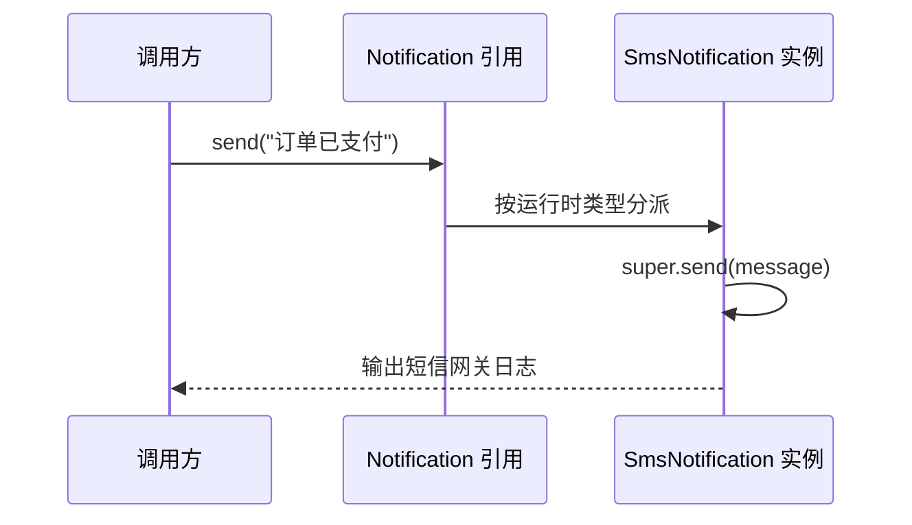
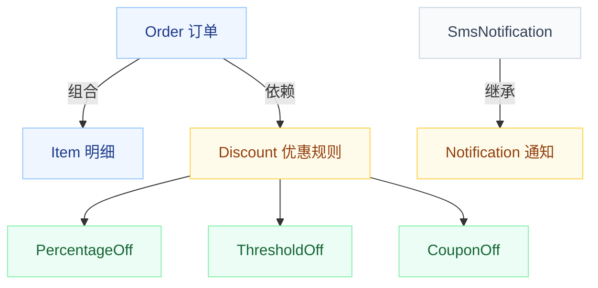

# Java面向对象

> 这篇从类与对象的关系讲起，经过封装、构造器、继承与多态、接口、内部类、枚举，再到 record、sealed 和泛型，最后落到一个可扩展的订单计价程序。
>
> 学完能为一组业务对象设计类型边界，用组合、接口和多态消除分支，并让编译器帮助检查状态与类型错误。

## 一、类、对象与封装

这章解决“数据和行为放在哪里、谁能改”的问题。

### 1.1 类与对象

类是模板，对象是堆上的实例；字段描述状态，方法描述行为，同一个类的对象共享方法代码但各自持有字段。

```java
import java.math.BigDecimal;

public class Account {
    private final long id;          // 账户号创建后不变，用 final 固定
    private final String owner;
    private BigDecimal balance;     // 余额会被修改，不能是 final

    public Account(long id, String owner, BigDecimal initial) {
        this.id = id;
        this.owner = owner;
        this.balance = initial;
    }

    public void deposit(BigDecimal amount) {
        // 在方法入口守住不变量，而不是让调用方自觉判断
        if (amount == null || amount.signum() <= 0) {
            throw new IllegalArgumentException("存入金额必须为正");
        }
        balance = balance.add(amount);
    }

    public BigDecimal balance() {
        return balance;
    }
}
```

```java
Account account = new Account(1001L, "张三", new BigDecimal("0.00"));
account.deposit(new BigDecimal("99.90"));
System.out.println(account.balance()); // 99.90
```

`new` 完成三件事：分配内存、把字段初始化为零值、执行构造器。变量 `account` 保存的是对象引用，赋值 `Account other = account` 只复制引用，两个变量指向同一个对象。

### 1.2 封装

封装的判断标准只有一条：对象能否阻止外部把它改到非法状态。字段全部 `private`、只提供必要方法，是达成这条标准最直接的做法。

| 修饰符 | 可见范围 | 典型用途 |
|---|---|---|
| `private` | 仅当前类 | 字段、内部辅助方法 |
| 无修饰符 | 当前包 | 包内协作类 |
| `protected` | 当前包与子类 | 可扩展的模板方法 |
| `public` | 所有代码 | 对外 API |

只写 getter/setter 不等于封装。`setBalance` 如果原样赋值，外部仍可写入负数；`deposit` 把校验和修改放在一起，才守住“余额不能为负”的规则。

边界：getter 返回可变对象会泄露内部状态。`List<Item> items()` 直接返回成员列表，调用方可以 `clear()`；应返回 `List.copyOf(items)` 或不可变视图。

### 1.3 构造器与初始化顺序

构造器负责让对象在离开 `new` 时就是合法的。声明了任意构造器后，编译器不再生成无参构造器；子类构造器第一行会隐式调用 `super()`，父类没有无参构造器时必须显式传参。

```java
public class InitOrder {
    static { System.out.println("1 静态块"); }   // 类首次初始化时执行一次
    { System.out.println("2 实例块"); }          // 每次创建对象都执行
    InitOrder() { System.out.println("3 构造器"); }

    public static void main(String[] args) {
        new InitOrder();
        new InitOrder();
    }
}
```

```text
1 静态块
2 实例块
3 构造器
2 实例块
3 构造器
```

`final` 字段必须在每个构造器结束前赋值，否则编译失败。构造器里不要调用可被子类重写的方法：此时子类字段还没初始化，重写方法读到的是零值。

### 1.4 equals、hashCode 与 toString

`Object` 默认的 `equals` 比较引用地址，`hashCode` 由地址推导。业务对象按值相等时，必须同时重写这两个方法，并保证“equals 为 true 的对象 hashCode 相同”。

```java
import java.util.Objects;

public final class Point {
    private final int x;
    private final int y;

    public Point(int x, int y) {
        this.x = x;
        this.y = y;
    }

    @Override
    public boolean equals(Object o) {
        if (this == o) return true;                 // 同一引用直接成立，省去字段比较
        if (!(o instanceof Point p)) return false;  // 模式匹配同时完成判空和类型检查
        return x == p.x && y == p.y;
    }

    @Override
    public int hashCode() {
        return Objects.hash(x, y);                  // 与 equals 使用的字段保持一致
    }

    @Override
    public String toString() {
        return "Point[x=" + x + ", y=" + y + "]";
    }
}
```

边界：用可变对象做 `HashMap` 的键，修改字段后哈希值变化，`get` 会找不到原条目。键对象应不可变，或至少在使用期间不修改参与哈希的字段。

## 二、继承与多态

这章解决“共同行为怎么复用、一次调用到底执行哪段实现”。

### 2.1 继承的适用条件

继承表达“is-a”关系：子类可以替换父类且不破坏调用方预期。只为了复用几行代码而继承，会把父类的字段和修改一起带进来，后续耦合更难拆。

```java
public class Notification {
    public void send(String message) {
        System.out.println("基础通道: " + message);
    }
}

public class SmsNotification extends Notification {
    @Override
    public void send(String message) {
        // 子类在保留父类行为的基础上追加渠道动作
        super.send(message);
        System.out.println("短信网关: " + message);
    }
}
```

重写规则：方法签名相同、返回类型可协变、访问权限不能收窄；`final`、`static`、`private` 方法不能被重写。`@Override` 让编译器检查签名，拼写错误会直接报错。

| 场景 | 选择 |
|---|---|
| 子类确实是父类的一种 | 继承 |
| 只是需要父类的部分实现 | 组合 |
| 多个无关类型共享能力 | 接口 |
| 父类字段需要被复用 | 优先组合，必要时抽象类 |

### 2.2 动态分派

调用哪段实现由对象的运行时类型决定，编译期类型只决定“能调用哪些方法”。

```java
Notification notification = new SmsNotification();
notification.send("订单已支付");
```

```text
基础通道: 订单已支付
短信网关: 订单已支付
```



边界：字段没有多态。`notification instanceof SmsNotification` 为 true，但通过父类引用只能访问父类声明的方法；子类新增方法需要先转换类型。

### 2.3 抽象类与模板方法

抽象类适合“固定流程 + 可变步骤”：父类把顺序写死，子类只实现差异部分。

```java
public abstract class ReportExporter {
    public final String export() {          // final 防止子类改掉流程顺序
        String body = render();
        return header() + body + footer();
    }

    protected abstract String render();     // 子类必须提供的内容

    protected String header() { return "=== 报表 ===\n"; }
    protected String footer() { return "\n=== 结束 ==="; }
}

public class CsvExporter extends ReportExporter {
    @Override
    protected String render() {
        return "id,amount\n1,99.00";
    }
}
```

`new CsvExporter().export()` 输出带固定页眉页脚的 CSV 文本。边界：Java 只能继承一个类，抽象类占用唯一的继承位置；如果子类还需要继承别的类型，改用接口加组合。

### 2.4 类型转换与模式匹配

向下转型前必须确认运行时类型，否则抛 `ClassCastException`。Java 16 的 `instanceof` 模式匹配把判断和绑定合并，Java 21 的 `switch` 模式匹配可以按类型分支。

```java
sealed interface Shape permits Circle, Rectangle {}
record Circle(double radius) implements Shape {}
record Rectangle(double width, double height) implements Shape {}

static double area(Shape shape) {
    return switch (shape) {                  // 封闭层次，编译器检查是否覆盖全部子类型
        case Circle c -> Math.PI * c.radius() * c.radius();
        case Rectangle r -> r.width() * r.height();
    };
}
```

边界：`switch` 模式匹配要求类型层次封闭或有 `default`；对开放接口使用 `default` 会丢掉新增类型的编译期提醒。

## 三、接口

这章解决“跨类型的能力契约怎么定义，默认实现怎么安全演进”。

### 3.1 接口定义

接口声明“能做什么”，不保存实例状态。方法隐式 `public abstract`，字段隐式 `public static final`，一个类可以实现多个接口。

```java
import java.math.BigDecimal;

public interface Discount {
    String label();
    BigDecimal apply(BigDecimal amount);

    // 默认方法用于给已有实现补充通用行为，不强迫所有实现类改动
    default boolean applicable(BigDecimal amount) {
        return amount.signum() > 0;
    }
}
```

接口要窄。一个接口超过三个方法，实现类往往只需要其中一部分，说明应该拆成多个能力接口。

### 3.2 默认方法与冲突

默认方法让接口在不破坏实现类的前提下增加方法。两个父接口提供同名默认方法时，编译器要求实现类显式解决冲突。

```java
interface A { default String name() { return "A"; } }
interface B { default String name() { return "B"; } }

class C implements A, B {
    @Override
    public String name() {
        return A.super.name() + B.super.name(); // 明确选择，避免编译错误
    }
}
```

`new C().name()` 返回 `AB`。边界：默认方法不能访问实现类字段，也不该承担复杂业务；它适合日志、空值处理这类与状态无关的通用逻辑。

### 3.3 函数式接口与 lambda

只有一个抽象方法的接口是函数式接口，可以用 lambda 或方法引用实现。`@FunctionalInterface` 让编译器检查抽象方法数量。

```java
import java.util.function.Function;
import java.util.function.Predicate;

Function<String, Integer> length = String::length;
Predicate<String> notBlank = s -> !s.isBlank();

System.out.println(length.apply("Java"));       // 4
System.out.println(notBlank.test("  "));        // false
```

| 接口 | 输入 | 输出 | 典型用途 |
|---|---|---|---|
| `Function<T,R>` | T | R | 转换 |
| `Predicate<T>` | T | boolean | 过滤 |
| `Consumer<T>` | T | 无 | 消费、打印 |
| `Supplier<T>` | 无 | T | 延迟创建 |
| `BiFunction<T,U,R>` | T、U | R | 合并 |

lambda 捕获的局部变量必须是 effectively final。边界：超过三行的 lambda 或需要单独测试的逻辑，写成具名类或方法，堆栈也更可读。

### 3.4 接口与抽象类的选择

| 维度 | 接口 | 抽象类 |
|---|---|---|
| 实例字段 | 不能有 | 可以有 |
| 构造器 | 不能有 | 可以有 |
| 多继承 | 可实现多个 | 只能继承一个 |
| 默认实现 | 可有默认方法 | 可有具体方法 |
| 适用 | 能力契约 | 共享状态与模板 |

规则：对外暴露能力用接口，内部复用代码用抽象类；两者都能表达时，优先接口加组合。

## 四、内部类与对象关系

这章解决“类写在哪里、是否持有外部对象”的问题。

### 4.1 成员内部类

成员内部类持有外部实例引用，可直接访问外部字段，创建方式是 `outer.new Inner()`。

```java
public class Order {
    private final String id;
    private int version;

    public Order(String id) { this.id = id; }

    public class Line {
        public String describe() {
            return id + "#" + (++version); // 隐式持有 Order.this，能改外部状态
        }
    }
}
```

边界：内部类实例比外部对象活得更久时，外部对象无法回收，容易形成内存泄漏。框架回调和长生命周期缓存里优先用静态嵌套类。

### 4.2 静态嵌套类

静态嵌套类不持有外部实例，本质是命名空间下的普通类，适合工具类、Builder 和值对象。

```java
public class Order {
    public static final class Builder {
        private String id;

        public Builder id(String id) { this.id = id; return this; }
        public Order build() { return new Order(id); }
    }

    private final String id;
    private Order(String id) { this.id = id; }
}
```

`new Order.Builder().id("O-1").build()` 不需要外部 `Order` 实例。边界：静态嵌套类不能直接访问外部类的实例字段。

### 4.3 局部类与匿名类

方法内部可以定义局部类；只使用一次的接口实现可以用匿名类。lambda 能替代大多数单方法匿名类。

```java
Runnable task = new Runnable() {
    @Override
    public void run() {
        System.out.println("只执行一次");
    }
};
task.run();
```

边界：匿名类仍然持有外部实例，且无法复用；需要多个方法或构造逻辑时，改成静态嵌套类。

### 4.4 组合、依赖与继承



组合表示“整体与部分同生命周期”，依赖表示“运行时使用”，继承表示“是一种”。订单删除时明细一起删除，用组合；订单使用某条优惠规则，用依赖。

## 五、枚举

这章解决“有限状态和固定选项怎么表达，才能避免非法值”。

### 5.1 枚举的本质

枚举编译后是继承 `java.lang.Enum` 的 final 类，每个常量是单例。`values()` 每次返回新数组，`valueOf` 遇到未知名称抛 `IllegalArgumentException`。

```java
enum OrderStatus { NEW, PAID, SHIPPED, CLOSED }

System.out.println(OrderStatus.PAID.ordinal());        // 1
System.out.println(OrderStatus.valueOf("PAID"));       // PAID
System.out.println(OrderStatus.values().length);       // 4
```

边界：`ordinal()` 依赖声明顺序，增减常量会改变数值，不能存进数据库。需要持久化时显式定义 `code` 字段。

### 5.2 带字段和行为的枚举

枚举可以有字段、构造器和方法，用来把“选项 + 规则”放在一起。

```java
enum MemberLevel {
    NORMAL("普通会员", 1.00),
    SILVER("银卡会员", 0.98),
    GOLD("金卡会员", 0.95);

    private final String label;
    private final double rate;

    MemberLevel(String label, double rate) { // 枚举构造器隐式 private
        this.label = label;
        this.rate = rate;
    }

    double apply(double amount) { return amount * rate; }
    String label() { return label; }
}

System.out.printf("%.2f%n", MemberLevel.GOLD.apply(348.00)); // 330.60
```

金额场景应把 `double` 换成 `BigDecimal`，这里只演示枚举行为。边界：枚举常量在类加载时全部创建，构造器里不要做阻塞 IO 或依赖尚未初始化的外部配置。

### 5.3 枚举实现接口

枚举可以实现接口，从而在不同枚举之间共享契约。

```java
interface Labeled { String label(); }

enum Channel implements Labeled {
    APP("App 推送"), SMS("短信"), EMAIL("邮件");

    private final String label;
    Channel(String label) { this.label = label; }
    @Override public String label() { return label; }
}
```

`switch` 对枚举做分支时，编译器知道全部常量；新增常量后没有 `default` 的 `switch` 会给出提醒，这是枚举相对字符串常量的主要收益。

## 六、record 与 sealed

这章解决“不可变数据载体和封闭类型层次怎么让编译器替人检查”。

### 6.1 record 的语义

`record` 用一行声明不可变数据载体：组件自动生成 `private final` 字段、全参构造器、同名访问器、`equals`、`hashCode`、`toString`。

```java
import java.math.BigDecimal;
import java.util.Objects;

public record Money(BigDecimal amount, String currency) {
    public Money {                                  // 紧凑构造器：校验和归一化
        Objects.requireNonNull(amount, "amount");
        Objects.requireNonNull(currency, "currency");
        if (amount.scale() > 2) {
            throw new IllegalArgumentException("金额最多两位小数");
        }
        amount = amount.setScale(2);                // 统一精度，避免 1.0 与 1.00 不相等
    }

    public Money plus(Money other) {
        if (!currency.equals(other.currency)) {
            throw new IllegalArgumentException("币种不一致");
        }
        return new Money(amount.add(other.amount), currency);
    }
}
```

`new Money(new BigDecimal("99.9"), "CNY")` 的 `amount()` 返回 `99.90`。record 不能继承类，但可以实现接口；所有字段天然 final，适合做 DTO、事件、查询结果和值对象。

边界：record 不是 JavaBean，没有无参构造器和 setter，不能直接交给需要反射写字段的旧框架；JPA 实体仍需普通类。record 里的数组字段仍可变，需要在使用处复制。

### 6.2 sealed 类型层次

`sealed` 限定哪些类型可以继承或实现，配合 `permits` 把子类型列成白名单，`switch` 才能做穷尽检查。

```java
sealed interface Payment permits CardPayment, WalletPayment {}
record CardPayment(String cardNo, BigDecimal amount) implements Payment {}
record WalletPayment(String walletId, BigDecimal amount) implements Payment {}

static String describe(Payment payment) {
    return switch (payment) {                       // 不需要 default，漏写子类型编译失败
        case CardPayment c -> "银行卡 " + c.cardNo();
        case WalletPayment w -> "钱包 " + w.walletId();
    };
}
```

子类型必须是 `final`、`sealed` 或 `non-sealed`。边界：`sealed` 要求子类型与父类型在同一模块（未命名模块则同一包），不适合做第三方插件扩展点；插件场景用普通接口加 `default`。

## 七、泛型

这章解决“类型参数化，把类型错误从运行时提前到编译期”。

### 7.1 泛型类与方法

```java
public class Box<T> {
    private T value;

    public void set(T value) { this.value = value; }
    public T get() { return value; }
}

static <T extends Comparable<T>> T max(List<T> values) {
    T result = values.get(0);
    for (T value : values) {
        if (value.compareTo(result) > 0) result = value;
    }
    return result;
}
```

`<T extends Comparable<T>>` 是上界，方法体里才能调用 `compareTo`。`Box<String>` 的 `get()` 直接返回 `String`，不需要强转。

### 7.2 通配符与 PECS

通配符描述“接收哪一类容器”，规则是生产者用 `extends`、消费者用 `super`（PECS，Producer Extends Consumer Super）。

```java
static <T> void copy(List<? super T> dest, List<? extends T> src) {
    for (T item : src) {          // src 是生产者，只能读
        dest.add(item);           // dest 是消费者，只能写
    }
}
```

| 声明 | 能读 | 能写 | 典型参数 |
|---|---|---|---|
| `List<? extends Number>` | Number | 不能写 | 只读数据源 |
| `List<? super Integer>` | Object | Integer | 写入目标 |
| `List<Number>` | Number | Number | 读写同一类型 |

边界：`List<? extends Number>` 不能 `add(1)`，因为实际类型可能是 `List<Double>`；编译器只能保证读出来是 `Number`。

### 7.3 类型擦除

泛型参数在编译后擦除为上界，运行时 `List<String>` 与 `List<Integer>` 是同一个类。由此产生四条限制：不能 `new T[]`、不能 `instanceof List<String>`、静态方法不能仅靠泛型参数重载、基本类型不能作类型参数。

```java
List<String> names = new ArrayList<>();
List<Integer> ages = new ArrayList<>();
System.out.println(names.getClass() == ages.getClass()); // true

// 需要运行时类型时，把 Class<T> 作为令牌传入
static <T> T create(Class<T> type) throws Exception {
    return type.getDeclaredConstructor().newInstance();
}
```

擦除是兼容旧字节码的代价。边界：需要保留泛型信息时用 `TypeToken`、`ParameterizedType` 或框架提供的类型引用，不要依赖 `getClass()`。

### 7.4 泛型使用规则

- 不写原始类型 `List`，否则失去编译期检查；
- API 参数用通配符提高兼容性，返回值用具体类型；
- 泛型只接受引用类型，性能敏感的大数组仍用基本类型数组；
- 数组是协变的，`Object[] o = new String[1]; o[0] = 1` 会在运行时抛 `ArrayStoreException`，泛型容器在编译期就会拒绝。

## 八、完整程序：库存预警

这章把枚举、record、sealed 接口和模式匹配串成一个可运行程序。

### 8.1 程序实现

```java
public class StockAlert {

    enum Severity { INFO, WARN, CRITICAL }

    sealed interface Event permits Inbound, Outbound, Adjustment {}
    record Inbound(String sku, int qty) implements Event {}
    record Outbound(String sku, int qty) implements Event {}
    record Adjustment(String sku, int delta, String reason) implements Event {}

    record Stock(String sku, int qty) {
        Stock {
            if (qty < 0) throw new IllegalArgumentException("库存不能为负: " + qty);
        }
    }

    record Alert(String sku, Severity severity, String message) {}

    static int apply(int current, Event event) {
        return switch (event) {
            case Inbound in -> current + in.qty();
            case Outbound out -> {
                // 出库前检查余额，避免把库存减成负数
                if (out.qty() > current) {
                    throw new IllegalStateException("库存不足: " + out.sku());
                }
                yield current - out.qty();
            }
            case Adjustment adj -> current + adj.delta();
        };
    }

    static Alert evaluate(Stock stock) {
        if (stock.qty() == 0) {
            return new Alert(stock.sku(), Severity.CRITICAL, "缺货");
        }
        if (stock.qty() < 10) {
            return new Alert(stock.sku(), Severity.WARN, "库存偏低");
        }
        return new Alert(stock.sku(), Severity.INFO, "库存正常");
    }

    public static void main(String[] args) {
        Stock stock = new Stock("SKU-1", 8);
        System.out.println(evaluate(stock));

        int afterInbound = apply(stock.qty(), new Inbound("SKU-1", 5));
        System.out.println("入库后: " + afterInbound
            + " -> " + evaluate(new Stock("SKU-1", afterInbound)).message());

        try {
            apply(afterInbound, new Outbound("SKU-1", 100));
        } catch (IllegalStateException e) {
            System.out.println("出库失败: " + e.getMessage());
        }

        System.out.println("盘点后: " + apply(3, new Adjustment("SKU-1", -1, "损耗")));
    }
}
```

```bash
javac -encoding UTF-8 StockAlert.java
java StockAlert
```

预期输出：

```text
Alert[sku=SKU-1, severity=WARN, message=库存偏低]
入库后: 13 -> 库存正常
出库失败: 库存不足: SKU-1
盘点后: 2
```

### 8.2 常见错误与调试

| 现象 | 原因 | 第一条检查 |
|---|---|---|
| `NullPointerException` | 引用未初始化或方法返回 null | 调用点哪个变量可能为 null |
| `ClassCastException` | 强转的实际类型不匹配 | 先打印 `getClass()` |
| `IllegalArgumentException` | 构造器或方法入口校验失败 | 异常消息里的字段值 |
| `StackOverflowError` | 递归缺少终止条件 | 递归参数是否收敛 |
| `equals` 判断失效 | 只重写了一个方法 | 两个方法字段是否一致 |

`javap` 可以直接看编译器生成了什么：

```bash
javap -p StockAlert\$Stock
```

```text
final class StockAlert$Stock extends java.lang.Record {
  private final java.lang.String sku;
  private final int qty;
  StockAlert$Stock(java.lang.String, int);
  public final java.lang.String toString();
  public final int hashCode();
  public final boolean equals(java.lang.Object);
  public java.lang.String sku();
  public int qty();
}
```

字段是 `private final`，访问器与 `Record` 基类方法都由编译器生成。排查“为什么没有 setter”“为什么 equals 行为和普通类不同”时，先看 `javap` 的实际结构，比猜编译器行为可靠。

## 九、最佳实践案例

### 9.1 案例背景

一个电商结算服务需要计算订单应付金额，规则依次是会员折扣、满减、优惠券。运营每周新增一种优惠，旧实现用一个三百行的 `if-else` 方法按类型分支，改一处要回归全部组合。约束是金额精确到分、优惠顺序固定、不能引入规则引擎，新增规则不能修改已有规则代码。

### 9.2 案例实操

用 `enum` 表达会员等级，用 `sealed interface` 表达优惠类型，用 `record` 承载不可变数据，用泛型方法统一输出明细。

```java
import java.math.BigDecimal;
import java.math.RoundingMode;
import java.util.ArrayList;
import java.util.List;

public class OrderPricing {

    enum MemberLevel {
        NORMAL("普通会员", new BigDecimal("1.00")),
        SILVER("银卡会员", new BigDecimal("0.98")),
        GOLD("金卡会员", new BigDecimal("0.95"));

        private final String label;
        private final BigDecimal rate;

        MemberLevel(String label, BigDecimal rate) {
            this.label = label;
            this.rate = rate;
        }

        BigDecimal apply(BigDecimal amount) {
            return amount.multiply(rate).setScale(2, RoundingMode.HALF_UP);
        }

        String label() { return label; }
    }

    sealed interface Discount permits PercentageOff, ThresholdOff, CouponOff {
        String label();
        BigDecimal apply(BigDecimal amount);
    }

    record PercentageOff(String label, BigDecimal rate) implements Discount {
        public BigDecimal apply(BigDecimal amount) {
            return amount.multiply(rate).setScale(2, RoundingMode.HALF_UP);
        }
    }

    record ThresholdOff(String label, BigDecimal threshold, BigDecimal off)
        implements Discount {
        public BigDecimal apply(BigDecimal amount) {
            if (amount.compareTo(threshold) < 0) return amount;
            return amount.subtract(off).max(BigDecimal.ZERO);
        }
    }

    record CouponOff(String label, BigDecimal off) implements Discount {
        public BigDecimal apply(BigDecimal amount) {
            return amount.subtract(off).max(BigDecimal.ZERO);
        }
    }

    record Item(String sku, BigDecimal price, int quantity) {
        Item {
            if (price.signum() < 0) {
                throw new IllegalArgumentException("单价不能为负: " + price);
            }
            if (quantity <= 0) {
                throw new IllegalArgumentException("数量必须为正: " + quantity);
            }
        }

        BigDecimal subtotal() {
            return price.multiply(BigDecimal.valueOf(quantity));
        }
    }

    record PriceLine(String label, BigDecimal before, BigDecimal after) {}

    record PriceResult(BigDecimal total, List<PriceLine> lines) {}

    record Order(String id, MemberLevel level, List<Item> items, List<Discount> discounts) {
        Order {
            items = List.copyOf(items);          // 防御性复制，外部改列表不影响订单
            discounts = List.copyOf(discounts);
        }

        BigDecimal originalTotal() {
            return items.stream()
                .map(Item::subtotal)
                .reduce(BigDecimal.ZERO, BigDecimal::add);
        }

        PriceResult price() {
            List<PriceLine> lines = new ArrayList<>();
            BigDecimal amount = originalTotal();
            BigDecimal afterMember = level.apply(amount);
            lines.add(new PriceLine(level.label(), amount, afterMember));
            amount = afterMember;
            for (Discount discount : discounts) {
                BigDecimal next = discount.apply(amount).setScale(2, RoundingMode.HALF_UP);
                lines.add(new PriceLine(discount.label(), amount, next));
                amount = next;
            }
            return new PriceResult(amount, List.copyOf(lines));
        }
    }

    static <T> void printAll(List<T> values) {
        for (T value : values) {
            System.out.println("  " + value);
        }
    }

    public static void main(String[] args) {
        List<Item> items = List.of(
            new Item("KB-01", new BigDecimal("99.00"), 2),
            new Item("MS-02", new BigDecimal("150.00"), 1)
        );
        Order order = new Order("O-1001", MemberLevel.GOLD, items, List.of(
            new ThresholdOff("满300减40", new BigDecimal("300.00"), new BigDecimal("40.00")),
            new CouponOff("优惠券 WELCOME20", new BigDecimal("20.00"))
        ));

        System.out.printf("订单 %s 原价 %.2f%n", order.id(), order.originalTotal());
        PriceResult result = order.price();
        for (PriceLine line : result.lines()) {
            System.out.printf("%s\t%.2f -> %.2f%n",
                line.label(), line.before(), line.after());
        }
        System.out.printf("应付 %.2f%n", result.total());
        System.out.println("商品明细:");
        printAll(order.items());
    }
}
```

```bash
javac -encoding UTF-8 OrderPricing.java
java OrderPricing
```

预期输出：

```text
订单 O-1001 原价 348.00
金卡会员	348.00 -> 330.60
满300减40	330.60 -> 290.60
优惠券 WELCOME20	290.60 -> 270.60
应付 270.60
商品明细:
  Item[sku=KB-01, price=99.00, quantity=2]
  Item[sku=MS-02, price=150.00, quantity=1]
```

### 9.3 案例结果

计价结果 348.00 经三步优惠得到 270.60，与手工核对一致。新增规则只需增加一个 `record` 实现 `Discount`，`Order.price()` 的循环不用改；sealed 层次让编译器在增加优惠类型时指出所有需要补分支的 `switch`。规则代码从三百行方法拆成三个十行左右的 record，新增规则的改动范围收敛到一个文件。

失败模式有三类。第一，优惠顺序写错：满减与优惠券交换顺序会得到不同金额，顺序必须由业务确认并存进配置或测试。第二，`BigDecimal` 用 `equals` 比较：`1.0` 与 `1.00` 的 scale 不同，金额比较统一用 `compareTo`。第三，折扣后未统一保留两位：每一步都要 `setScale(2, RoundingMode.HALF_UP)`，只在最后取整会与页面展示差一分。复盘结论：类型层次负责“有哪些规则”，`Order.price()` 负责“按什么顺序执行”，两者分开后，规则扩展不再触碰流程代码。
