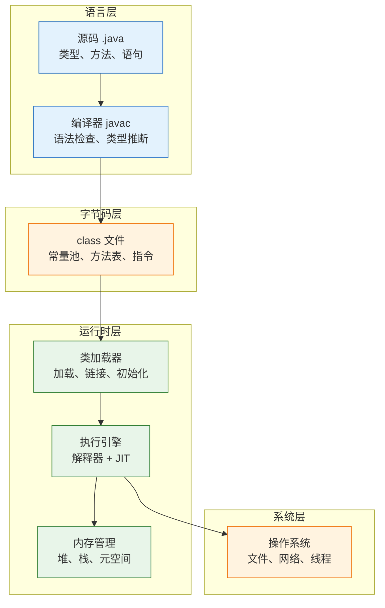
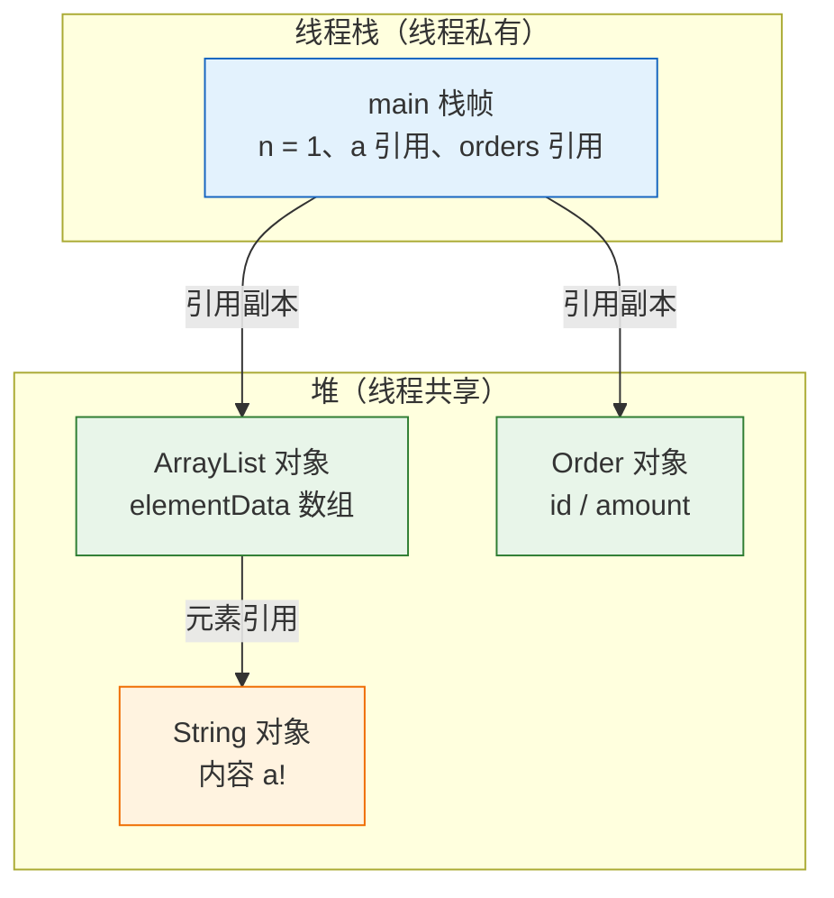
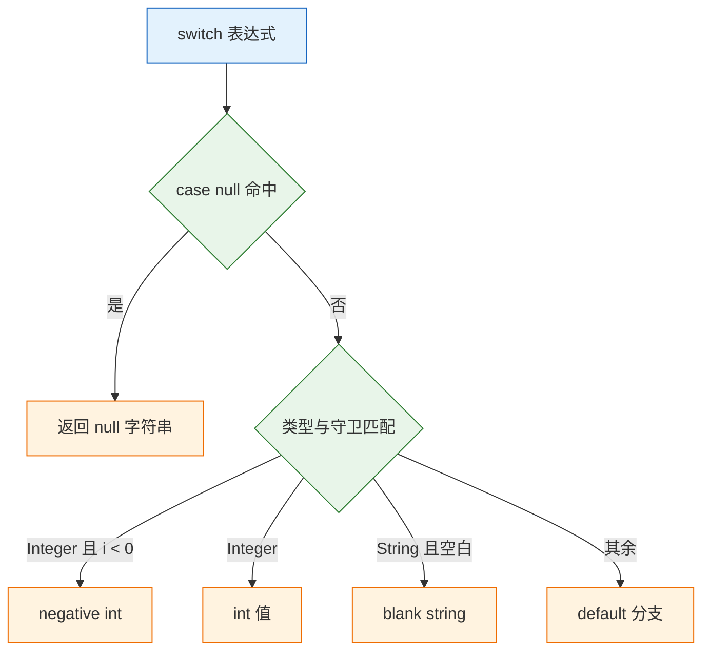
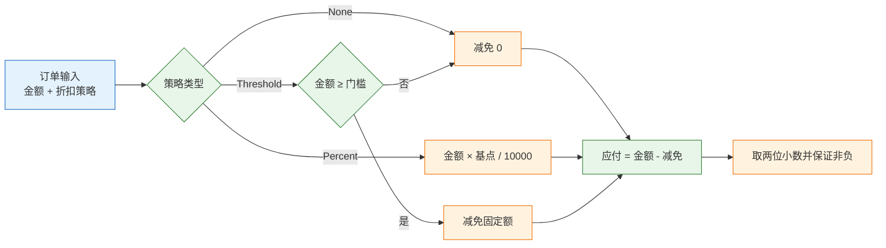

# Java 核心语法

---

## 一、Java 核心语法的定位

### 1.1 核心概念

Java 核心语法是一门静态类型、面向对象语言的书写规则集合。它规定三件事：值如何存储、对象如何创建、类型边界如何划定。业务规则最终要变成确定的机器行为，金额怎么算、状态怎么流转、坏数据怎么拒绝，都要先落成类型明确的代码。

Java 的定位是"一次编写，到处运行"。源码先由 `javac` 编译成字节码，再由 JVM 在目标机器上解释执行或即时编译。语法层负责把人的意图写成可检查的代码，JVM 负责内存布局、线程调度与运行期优化。这条分工解释了一个常见现象：类型错误在编译期暴露，空指针和数组越界只能等到运行时。

它解决的是大规模长期维护：静态类型让重构有编译器兜底，强类型让接口边界清楚，字节码让同一份产物跑在 Linux、macOS 与容器里。它不解决的是：语法不会替你选对数据结构，也不保证并发安全；`record` 不会自动让嵌套对象不可变；`BigDecimal` 用错构造器照样算错。

| 层面 | 负责方 | 典型产物 | 错误暴露时机 |
|---|---|---|---|
| 源码书写 | 开发者 | `.java` 文件 | 编译期 |
| 类型检查 | `javac` | `.class` 字节码 | 编译期 |
| 类加载与内存 | JVM | 栈帧、堆对象 | 运行期 |
| 热点优化 | JIT 编译器 | 本地机器码 | 运行期 |

静态类型和强类型是两个维度。静态指类型在编译期确定，变量声明后不能改指别的类型；强类型指隐式转换受限制，`int` 不会悄悄变成 `String`。Java 两者都具备，代价是书写更啰嗦，收益是重构和接口演进时有编译器参与检查。动态语言把这份检查推到运行期，出错时往往已经在生产环境。

> **开发提示**：把能交给编译器的检查尽量前置，是 Java 工程投入产出比最高的一步。类型越明确、分支越封闭，运行期需要手写的断言就越少。

### 1.2 与相邻技术的关系

最容易混淆的是 JDK、JRE、JVM 三个词。JVM 是执行字节码的虚拟机；JRE 是 JVM 加标准类库，只能运行不能编译；JDK 是 JRE 加编译器、打包工具和诊断工具，开发必须装 JDK。三者是包含关系，不是并列关系。

字节码是 Java 跨平台的中间产物。`.class` 文件记录常量池、方法表和指令序列，JVM 按虚拟机规范解释它。字节码不绑定操作系统，但绑定 JDK 版本：高版本编译的 class 文件不能被低版本 JVM 加载。

构建工具解决依赖与增量编译。手写 `javac` 只适合验证语法；真实项目由 Maven 或 Gradle 解析依赖树、管理多模块、执行测试与打包。框架建立在语法之上，Spring 的注解、代理和反射都要求先理解类型、方法与对象生命周期。

注解本身只是元数据，不改变程序行为；真正起作用的是读取注解的处理器。编译期处理器生成代码，运行期框架通过反射读取注解并注入依赖。反射能绕过访问控制、在运行时创建对象，代价是失去编译期检查、性能低于直接调用。语法知识在这里的作用，是判断哪些约束由编译器保证、哪些只能靠约定。

| 名称 | 包含内容 | 用途 |
|---|---|---|
| JVM | 字节码执行引擎、内存管理 | 运行 Java 程序 |
| JRE | JVM + 标准类库 | 运行已编译程序 |
| JDK | JRE + `javac`、`jar`、`javap` | 开发、编译、诊断 |
| 构建工具 | 依赖解析、编译、测试、打包 | 工程化管理 |

> **注意**：从 JDK 11 起，官方不再单独提供 JRE 安装包，需要精简运行时用 `jlink` 生成。不要再按"装 JRE 就能跑"的旧习惯准备环境，服务器上通常直接装 JDK 或用 `jlink` 产出的镜像。

### 1.3 整体结构

Java 技术栈可以纵向分成四层：语言层、字节码层、运行时层、系统层。每一层有独立的规范和工具，排障时先判断问题落在哪一层，比盲目改代码有效。



| 层 | 关键规范 | 常见问题 |
|---|---|---|
| 语言层 | JLS 语言规范 | 语法错误、类型不匹配 |
| 字节码层 | JVMS 虚拟机规范 | 版本不兼容、常量池异常 |
| 运行时层 | 类加载、GC、JIT | OOM、类冲突、卡顿 |
| 系统层 | 操作系统接口 | 编码、路径、时区差异 |

语言层的问题编译期就能定位；字节码层看 `javap`；运行时层看堆栈、GC 日志和线程转储；系统层看文件、网络和区域设置。顺序反了，就会在错误的层反复试错。

---

## 二、环境与第一个程序

### 2.1 安装与版本

> **版本现状（2026-10）**：Java 21 与 Java 25 都是 LTS。Java 21 生态最完整，多数中间件与框架已适配；Java 25 适合新项目起步。本文以 21 为基线，示例统一使用 `--release 21`，涉及更高版本特性会单独标注。

| 版本 | 发布年份 | class 文件主版本 | 定位 |
|---|---|---|---|
| Java 17 | 2021 | 61 | 上一个 LTS，存量系统多 |
| Java 21 | 2023 | 65 | 当前主流 LTS |
| Java 25 | 2025 | 69 | 最新 LTS |

安装方式按平台选择，装完必须确认 `java` 与 `javac` 指向同一个 JDK：

```bash
# ========== macOS ==========
brew install openjdk@21
# Homebrew 装的 JDK 不在系统默认路径，需按安装提示建立软链或设置 JAVA_HOME

# ========== Ubuntu / Debian ==========
sudo apt update
sudo apt install -y openjdk-21-jdk

# ========== 验证 ==========
java -version          # 输出 openjdk version "21.x"
javac -version         # 主版本必须与上一行一致
which java javac       # 确认两者来自同一个 JDK

# ========== 多版本切换 ==========
export JAVA_HOME=$(/usr/libexec/java_home -v 21)   # macOS
export PATH="$JAVA_HOME/bin:$PATH"
```

`java -version` 把版本信息写到标准错误，管道过滤时要加 `2>&1`。`JAVA_HOME` 只影响依赖它的脚本和构建工具，不影响已经写进 `PATH` 的 `java`，所以两者要一起改。

发行版选择不影响语言行为。Oracle JDK、Eclipse Temurin、Amazon Corretto、Azul Zulu 都实现同一套规范，差异在许可证、更新节奏和附带工具。服务器上优先选有长期安全更新的发行版，并在镜像或部署脚本中固定主版本，不要让不同机器各自升级到不同大版本。

> **注意**：机器上装了多个 JDK 时，IDE、Maven、命令行可能各用一个。出现 `UnsupportedClassVersionError` 时，分别执行 `java -version`、`javac -version`、`mvn -version`，确认三处主版本一致。

### 2.2 最小可运行示例

```java
// Hello.java
public class Hello {
    public static void main(String[] args) {
        // args 是启动参数数组，没有参数时长度为 0，不是 null
        String name = args.length > 0 ? args[0] : "world";
        System.out.printf("hello, %s%n", name);
    }
}
```

两种运行方式，先编译再运行适合观察产物，单文件模式适合快速验证：

```bash
# 方式一：编译后运行，class 文件落在当前目录
javac --release 21 Hello.java
java Hello

# 方式二：单文件源码启动（JDK 11+），不产生 class 文件
java Hello.java

# 传参
java Hello java
```

```text
hello, world
hello, java
```

`public class Hello` 要求文件名必须是 `Hello.java`，因为 JVM 按类名找入口。`main` 的签名固定为 `public static void main(String[])`，返回类型改成 `int` 或参数改成 `String` 都不会被当作入口，运行时报"找不到主方法"。

### 2.3 目录与工程结构

源码组织由包名决定。`package com.example.order;` 必须对应目录 `com/example/order/`，编译时 `javac` 会按包名生成子目录。包名与目录不一致时编译能过，运行时找不到类。

```text
demo/
├── src/main/java/com/example/
│   └── Hello.java
├── src/test/java/com/example/
│   └── HelloTest.java
├── target/                       # 编译产物，不入版本库
├── pom.xml                       # Maven 依赖与构建配置
└── .gitignore
```

| 路径 | 作用 | 是否入库 |
|---|---|---|
| `src/main/java` | 生产源码 | 是 |
| `src/test/java` | 测试源码 | 是 |
| `target/` | 编译与打包产物 | 否 |
| `pom.xml` | 依赖、插件、版本 | 是 |

```bash
# 按包编译到 out 目录
javac --release 21 -d out src/main/java/com/example/Hello.java

# 运行必须写全限定名，classpath 指向产物根目录
java -cp out com.example.Hello

# 打包成 jar 并指定入口类
jar --create --file hello.jar --main-class com.example.Hello -C out .
java -jar hello.jar
```

`--release` 同时限制语法、字节码版本和可用的 JDK API，等价于"用目标版本的 API 视图编译"。只写 `-source 21 -target 21` 不会阻止调用更高版本才有的方法，产物在旧 JVM 上仍会抛 `NoSuchMethodError`。多版本共存的环境统一用 `--release`，这是最省事的兼容手段。

`-d out` 让编译器把包结构复制到 `out` 下，`-cp out` 告诉 JVM 从 `out` 开始按包名找类。`--main-class` 把入口写进 `META-INF/MANIFEST.MF` 的 `Main-Class`，`java -jar` 才能直接启动。

classpath 是一个有序的类查找路径，顺序决定同名类谁先被加载。依赖冲突时表现为"方法不存在"或"行为与预期不符"，但编译期完全正常，因为编译用的是另一个版本。这就是构建工具要锁定依赖版本、并在打包前检查依赖树的原因。

---

## 三、值语义与类型基础

### 3.1 基本类型与取值范围

Java 有 8 种基本类型，其余都是引用类型。基本类型的宽度由语言规范固定，不随平台变化，这是"一次编写，到处运行"的一部分。

| 类型 | 宽度 | 范围或说明 |
|---|---|---|
| `byte` | 1 字节 | -128 ~ 127 |
| `short` | 2 字节 | -32768 ~ 32767 |
| `int` | 4 字节 | -2³¹ ~ 2³¹-1，默认整数类型 |
| `long` | 8 字节 | -2⁶³ ~ 2⁶³-1，字面量加 `L` |
| `float` | 4 字节 | 约 7 位十进制有效数字，字面量加 `f` |
| `double` | 8 字节 | 约 15~16 位有效数字，默认小数类型 |
| `char` | 2 字节 | UTF-16 代码单元，0 ~ 65535 |
| `boolean` | 未规定 | JVM 规范不规定大小，数组中通常 1 字节 |

整数运算溢出不会报错，直接回绕：

```java
int max = Integer.MAX_VALUE;
System.out.println(max + 1);                  // -2147483648，静默回绕

// 需要溢出即失败时用精确运算
try {
    int bad = Math.addExact(max, 1);          // 抛 ArithmeticException
} catch (ArithmeticException e) {
    System.out.println("overflow: " + e.getMessage());
}

// 金额相关不要用 double
System.out.println(0.1 + 0.2);                // 0.30000000000000004
System.out.println(new BigDecimal("0.1").add(new BigDecimal("0.2")));  // 0.3
```

金额、计数、时间戳这类不能回绕的值，用 `Math.addExact`、`Math.subtractExact`、`Math.multiplyExact`，让溢出在发生点抛出，而不是带着错误结果继续跑。

整数除法同样向零截断，`7 / 2` 得 3，`-7 / 2` 得 -3，余数的符号跟随被除数。求百分比或平均值时先乘后除，否则中间结果被截断，误差会放大。`char` 在运算中按整数处理，`'a' + 1` 得到 `int` 类型的 98，要得到字符必须显式强转 `(char) ('a' + 1)`。

### 3.2 参数传递的按值语义

变量里存的是基本类型的值，或者对象的引用；对象本身在堆上。调用方法时传递的是变量内容的副本，所以 Java 只有按值传递，没有引用传递。



```java
static void addOne(int x) { x++; }

static void append(StringBuilder sb) { sb.append("!"); }

static void reassign(StringBuilder sb) { sb = new StringBuilder("new"); }

public static void main(String[] args) {
    int n = 1;
    addOne(n);
    System.out.println(n);                 // 1，改的是副本

    StringBuilder a = new StringBuilder("a");
    append(a);
    System.out.println(a);                 // a!，副本指向同一个对象

    reassign(a);
    System.out.println(a);                 // a!，只改了副本的指向
}
```

结论有两条：方法内可以改对象内容，因为副本和原变量指向同一个对象；方法内不能改调用方变量指向哪个对象，因为副本被重新赋值后与原变量无关。把这两条分开记，就不会再纠结"Java 到底是值传递还是引用传递"。

这条语义对不可变对象尤其重要。`String`、`Integer` 这类不可变类的方法都返回新对象，传进方法后调用方看不到任何变化；`record` 没有修改器，同样只能整体替换。可变对象传参则要约定所有权：方法只是读取，还是允许修改，还是会把引用保存下来。没有约定的可变对象在多层调用之间传递，是共享状态 bug 的主要来源。

### 3.3 引用比较与内容比较

`==` 比较基本类型的值，或比较两个引用是否指向同一个对象。`equals` 是方法，`Object` 的默认实现仍是 `==`，`String`、`BigDecimal`、包装类型和 `record` 重写了它。

```java
String a = "abc";
String b = "abc";
String c = new String("abc");
System.out.println(a == b);        // true，同一个常量池对象
System.out.println(a == c);        // false，new 出来是新对象
System.out.println(a.equals(c));   // true，内容相同

Integer x = 127, y = 127;
Integer p = 128, q = 128;
System.out.println(x == y);        // true，命中 -128..127 缓存
System.out.println(p == q);        // false，超出缓存范围
System.out.println(p.equals(q));   // true
```

| 比较对象 | 推荐方式 | 原因 |
|---|---|---|
| 基本类型 | `==` | 直接比较值 |
| 字符串内容 | `equals` | 引用可能不同 |
| 包装类型 | `equals` 或先拆箱 | 缓存只覆盖 -128..127 |
| 枚举、`Class` | `==` | 单例，身份即语义 |

`Integer` 的缓存范围是 -128 到 127，上界可用 `-XX:AutoBoxCacheMax` 扩大，但依赖启动参数不是好设计。包装类型比较一律用 `equals`，或者先转成基本类型再比。

比较还有一层容易忽略：`equals` 的契约要求自反、对称、传递、一致，且与 `hashCode` 保持一致。自定义类重写 `equals` 时把参数写成 `Base` 而不是 `Object`，得到的是重载而非重写，集合里仍按默认实现比较，表现为"内容相同却找不到"。

> **安全警告**：自动拆箱时若包装对象是 `null`，会直接抛 `NullPointerException`，而且异常位置往往在表达式中间难以定位。方法返回值用包装类型表示"可能没有"时，调用方必须先判空，或改用 `Optional`。

`String` 不可变，`replace`、`substring`、`strip` 都返回新对象。循环里用 `+=` 会反复创建对象，应改用 `StringBuilder`。`null` 是合法的引用值而不是类型，它能赋给任何引用类型，但调用实例方法就抛 NPE；基本类型不能为 `null`。

### 3.4 字符串与字符边界

`String` 的 API 以 UTF-16 代码单元计数。JDK 9 起内部可能用紧凑字符串优化存储，但 `length()`、`charAt()` 的语义不变。一个 emoji 或部分生僻字占两个代码单元，构成代理对。

```java
String s = "😀";
System.out.println(s.length());                        // 2
System.out.println(s.codePointCount(0, s.length()));   // 1

// 按代码点截取，避免把代理对劈开
int cp = s.codePointAt(0);
String safe = new String(Character.toChars(cp));
```

| 操作 | 计数单位 | 适用场景 |
|---|---|---|
| `length()` | UTF-16 代码单元 | 校验存储长度 |
| `codePointCount` | Unicode 代码点 | 统计字符个数 |
| `getBytes(UTF_8).length` | 字节 | 限制网络与数据库长度 |
| `BreakIterator` | 用户感知字符簇 | 光标移动、截断显示 |

按 `charAt` 或 `substring` 切分可能把一个代理对劈开，得到乱码。大多数业务只需要按 UTF-8 字节长度限制输入，不要把 `length()` 当字数。

字符串拼接有三条规则：字面量拼接在编译期折叠成常量并进入常量池；含变量的简单拼接由 `invokedynamic` 调用 `StringConcatFactory` 生成，性能通常不差于手写 `StringBuilder`；循环内累加仍是反复创建对象，必须用 `StringBuilder`，能预估长度时传初始容量减少扩容。

```java
// 循环内拼接：一次分配，按需扩容
var sb = new StringBuilder(64);
for (String part : parts) {
    if (!sb.isEmpty()) sb.append(',');
    sb.append(part);
}
String joined = sb.toString();
```

`StringBuilder` 不是线程安全的，`StringBuffer` 在每个方法上加锁。单线程拼接用前者，跨线程共享同一个缓冲区才需要后者，而那种设计本身通常要重新考虑。

---

## 四、对象建模与类型系统

### 4.1 类与记录的分工

`class` 适合有身份、有生命周期、可能变化的对象，比如连接、缓存、需要延迟加载的实体。`record` 适合"一组值的载体"：构造后不再改，`equals`、`hashCode`、`toString` 由编译器按组件生成。

```java
record Money(BigDecimal amount, String currency) {
    // 紧凑构造器：参数校验与规范化，不用重复写字段赋值
    Money {
        if (amount == null || amount.signum() < 0) {
            throw new IllegalArgumentException("amount < 0");
        }
        if (currency == null || currency.length() != 3) {
            throw new IllegalArgumentException("currency");
        }
        amount = amount.setScale(2, RoundingMode.HALF_UP);
    }
}
```

| 特性 | `class` | `record` |
|---|---|---|
| 可变性 | 自由定义 | 组件隐式 `final` |
| `equals`/`hashCode` | 需手写或生成 | 编译器按组件生成 |
| 继承 | 可继承、可被继承 | 隐式 `final`，不能继承类 |
| 适用 | 有状态、有身份 | DTO、返回值、值对象 |

`record` 只保证引用不变。组件是 `List` 时，外部仍能改这个列表；需要真正不可变，就在构造器里 `List.copyOf(...)`。`record` 不能声明实例字段，静态字段可以，也可以实现接口。

选择的判断标准是"这个类型有没有身份"。两个金额都是 100 元时应当相等，这是值语义，用 `record`；两个数据库连接即使参数相同也不能互换，这是身份语义，用 `class`。把值对象写成可变类，会带来防御性拷贝、哈希键失效和并发可见性三类问题，而 `record` 从源头消掉了它们。

### 4.2 枚举与密封类型

`enum` 是真正的类，可以有字段、方法、构造器，天生线程安全，比较身份用 `==` 即可：

```java
enum Status {
    CREATED, PAID, SHIPPED, CLOSED;

    boolean canShip() {
        return this == PAID;
    }
}
```

用 `switch` 表达式覆盖枚举时，编译器要求穷尽，新增枚举值而漏写分支会直接编译失败；`switch` 语句不强制穷尽，漏掉的分支会静默落到 `default` 或什么都不做。这比用 `int` 常量可靠得多，前提是写成表达式而不是语句。

`sealed` 规定一个类型只允许指定的子类型实现或继承：

```java
sealed interface Discount permits None, Percent, Threshold {}
record None() implements Discount {}
record Percent(int bp) implements Discount {}
record Threshold(BigDecimal min, BigDecimal off) implements Discount {}
```

子类型必须是 `final`、`sealed` 或 `non-sealed` 之一，`record` 天然是 `final`。许可类型与父类型要在同一模块；没有模块时必须在同一包。密封的价值在于封闭分支集合：编译器知道所有实现，`switch` 不需要 `default`，将来新增实现时所有漏处理的 `switch` 会立刻编译失败。

### 4.3 模式匹配与分支封闭

```java
static String describe(Object o) {
    return switch (o) {
        case null -> "null";                          // 必须显式写，否则抛 NPE
        case Integer i when i < 0 -> "negative int";  // when 是守卫条件
        case Integer i -> "int " + i;
        case String s when s.isBlank() -> "blank string";
        case String s -> "string " + s;
        default -> "other";
    };
}
```

| 写法 | 匹配依据 | 注意 |
|---|---|---|
| `case Integer i` | 运行期类型 | 变量作用域限于该分支 |
| `case Integer i when i < 0` | 类型 + 守卫 | 自上而下匹配，具体分支在前 |
| `case null` | 显式空值 | 省略时 `switch` 对 `null` 抛 NPE |
| `case X:` | 旧式标签 | 会贯穿，新代码统一用 `->` |

`switch` 表达式每个分支都要产出值，用块时写 `yield`。`instanceof` 的模式变量只在条件为真时生效，可以继续参与后续条件：

```java
if (o instanceof String s && !s.isBlank()) {
    System.out.println(s.length());   // s 在这里已确定非空
}
```

`switch` 语句和 `switch` 表达式不是一回事。语句只执行分支，允许没有返回值，旧式的 `case X:` 会贯穿到下一个标签；表达式必须产出值，箭头标签不贯穿，编译器还会检查穷尽性。用表达式时忘记 `yield` 或漏掉分支，都会直接编译失败，这正是它比语句可靠的地方。



> **注意**：`default` 会掩盖新增类型。用密封接口或枚举做分支时，优先让编译器检查穷尽性，不要为了"编译通过"随手加 `default`。

### 4.4 局部类型推断与文本块

```java
var list = new ArrayList<String>();   // 推断为 ArrayList<String>
var n = 1;                            // int
var entry = Map.entry("k", 1);        // Map.Entry<String, Integer>
```

`var` 只能用于局部变量、循环变量和 try-with-resources，不能用于字段、方法参数和返回类型。类型在编译期确定，运行时不会变。它的价值是省掉重复的泛型书写，不是"动态类型"。

```java
String sql = """
        SELECT id, amount
        FROM t_order
        WHERE status = ?
        """;
```

文本块从 `"""` 后换行开始，公共缩进自动去掉；结尾 `"""` 的位置影响最后一行是否带换行。块内 `\` 表示续行，`\s` 表示一个不被去尾的空格。拼接变量用 `formatted`：

```java
String q = """
        SELECT * FROM t_order WHERE id = %d
        """.formatted(orderId);
```

| 特性 | 语法 | 边界 |
|---|---|---|
| 局部推断 | `var x = ...` | 仅局部变量，右侧必须能确定类型 |
| 文本块 | `"""..."""` | 自动去公共缩进，注意结尾换行 |
| 格式化 | `.formatted(...)` | 占位符与参数顺序必须对应 |
| 续行 | `\` 行尾 | 只用于文本块内 |

`var` 的使用边界可以概括为一句话：右侧表达式必须让读者一眼看出类型。`var list = new ArrayList<String>()` 合格，因为构造器写了泛型参数；`var result = service.find(id)` 不合格，读者必须跳进方法签名才知道 `result` 是什么。方法签名、字段和公开 API 永远写明确类型，推断只用于方法体内部。

---

## 五、常用能力

### 5.1 方法设计与分派

| 概念 | 决定时机 | 依据 |
|---|---|---|
| 重载 overload | 编译期 | 参数的静态类型 |
| 重写 override | 运行期 | 对象的实际类型 |
| 静态方法 | 编译期 | 声明类型，不参与重写 |
| `final` 方法 | 编译期禁止重写 | 不可被覆盖 |

```java
class Base {
    void hello(Object o) { System.out.println("base-object"); }
    void hello(String s) { System.out.println("base-string"); }
}

class Child extends Base {
    @Override
    void hello(Object o) { System.out.println("child-object"); }   // 重写
}

Base b = new Child();
b.hello("x");            // base-string：重载看静态类型 Base，String 版本未被重写
b.hello((Object) "x");   // child-object：重写按实际类型分派
```

重写方法加 `@Override`，让编译器检查签名。返回类型可以协变，参数类型不能。可变参数 `f(String... args)` 本质是数组，调用 `f(null)` 会产生歧义，可能被当成 `null` 数组或单个 `null` 元素，应避免传 `null`。方法参数超过四五个、布尔标志成串时，说明缺少一个参数对象，用 `record` 收起来。

`final` 修饰引用只保证指向不变，不保证对象内容不变。`final List<String> list` 仍可以 `add`；要让内容也不可变，必须用不可变实现或 `List.copyOf`。同理，`static final` 常量如果是可变对象，也会被任何调用方修改，公开常量应选不可变类型。

### 5.2 数组与集合的协作

数组是 JVM 原生结构，创建时长度固定，`length` 是字段不是方法。数组是协变的：`String[]` 可以赋给 `Object[]`，但运行时数组仍记得元素类型。

```java
Object[] arr = new String[1];
arr[0] = "ok";
arr[0] = 1;          // ArrayStoreException，编译通过，运行时抛
```

| 需求 | 用法 | 说明 |
|---|---|---|
| 复制并改长度 | `Arrays.copyOf(a, n)` | 返回新数组 |
| 复制区间 | `System.arraycopy` | 要求类型兼容 |
| 内容比较 | `Arrays.equals` / `deepEquals` | 直接 `equals` 比的是引用 |
| 排序 | `Arrays.sort` | 对象数组用稳定排序 |

二维数组是"数组的数组"，`int[][] a = new int[3][4]` 的每一行是独立对象，`a[0]` 与 `a[1]` 长度可以不同。通过 `Object[]` 接收 `String[]` 不是安全的泛型替代，需要容器语义时用 `List<String>`。

数组和泛型的关系是单向的：数组在运行期保留元素类型，泛型在运行期被擦除。数组协变配合写入检查，才让 `ArrayStoreException` 有机会在运行期发现错误；泛型选择在编译期拒绝这种写法，因此不能创建泛型数组。理解这条差异，才能解释为什么 `List<String>[]` 不合法，而 `List<List<String>>` 可以。

### 5.3 异常与资源管理

受检异常（`Exception` 的子类但非 `RuntimeException`）必须在签名声明或就地捕获；非受检异常（`RuntimeException` 及其子类）编译器不强制处理。资源必须关闭时用 try-with-resources，它按声明的逆序调用 `close()`，即使主体抛异常也会关闭。

```java
// BufferedReader 实现 AutoCloseable，离开 try 块自动关闭
try (var reader = Files.newBufferedReader(path, StandardCharsets.UTF_8)) {
    return reader.readLine();
} catch (IOException e) {
    throw new UncheckedIOException("read failed: " + path, e);   // 保留原因链
}
```

| 类型 | 是否强制处理 | 典型场景 |
|---|---|---|
| 受检异常 | 是 | IO、SQL、网络 |
| 非受检异常 | 否 | 参数非法、空指针 |
| `Error` | 否 | OOM、栈溢出，不捕获 |

> **开发提示**：捕获后要么处理，要么包装成业务异常继续抛，并保留 `cause`。只打日志不抛、或 `catch (Exception e) {}` 空实现，会把故障推迟到更难排查的位置。

异常的代价在构造时采集堆栈。高频路径上用异常做流程控制会明显拖慢性能，可预期的"没有值"应返回 `Optional` 或空集合。`finally` 块里不要 `return`，它会覆盖 `try` 中的返回值和异常；需要清理资源时优先用 try-with-resources，而不是手写 `finally`。

---

## 六、完整示例：订单折扣规则

### 6.1 需求与模型

订单有渠道、金额和折扣策略。折扣分为三种：不打折、按基点打折、满额减固定金额。应付金额保留两位小数，且不能为负。策略种类固定，用 `sealed interface` 封闭；每种策略是纯数据，用 `record`；渠道是有限集合，用 `enum`。

模型这样拆的理由是可扩展性和封闭性同时成立：新增一种折扣只需实现接口，但所有处理折扣的 `switch` 都会因为缺少分支而编译失败，不会出现"新类型被静默忽略"的情况。如果用字符串或整数表示策略，非法值和遗漏分支都要等到运行期才发现。

| 策略 | 参数 | 计算方式 |
|---|---|---|
| `None` | 无 | 应付等于原价 |
| `Percent` | 基点 `bp` | 金额 × bp / 10000 |
| `Threshold` | 门槛 `min`、减免 `off` | 达门槛减 `off`，否则不减 |

### 6.2 实现代码

```java
import java.math.BigDecimal;
import java.math.RoundingMode;
import java.util.List;

public class OrderRules {

    enum Channel { WEB, STORE }

    // 密封接口：编译器知道只有这三种实现
    sealed interface Discount permits None, Percent, Threshold {}
    record None() implements Discount {}
    record Percent(int bp) implements Discount {}
    record Threshold(BigDecimal min, BigDecimal off) implements Discount {}

    record Order(String id, Channel channel, BigDecimal amount, Discount discount) {
        Order {
            if (amount == null || amount.signum() < 0) {
                throw new IllegalArgumentException("amount < 0: " + amount);
            }
            // 统一到两位小数，避免后续比较和输出出现不同 scale
            amount = amount.setScale(2, RoundingMode.HALF_UP);
        }

        BigDecimal payable() {
            BigDecimal off = switch (discount) {
                case None n -> BigDecimal.ZERO;
                // 基点换算：500 bp = 5%，movePointLeft(4) 得到 0.0500
                case Percent p -> amount.multiply(BigDecimal.valueOf(p.bp())).movePointLeft(4);
                // 门槛比较用 compareTo，100.00 与 100 的 scale 不同但数值相等
                case Threshold t -> amount.compareTo(t.min()) >= 0 ? t.off() : BigDecimal.ZERO;
            };
            return amount.subtract(off).max(BigDecimal.ZERO).setScale(2, RoundingMode.HALF_UP);
        }
    }

    public static void main(String[] args) {
        List<Order> orders = List.of(
                new Order("A-1", Channel.WEB, new BigDecimal("199.00"), new Percent(500)),
                new Order("A-2", Channel.STORE, new BigDecimal("80.00"),
                        new Threshold(new BigDecimal("100.00"), new BigDecimal("10.00"))),
                new Order("A-3", Channel.WEB, new BigDecimal("100.00"),
                        new Threshold(new BigDecimal("100.00"), new BigDecimal("10.00")))
        );
        for (Order o : orders) {
            System.out.printf("%s %s %s -> %s%n", o.id(), o.channel(), o.amount(), o.payable());
        }
    }
}
```

三处设计值得注意。紧凑构造器把金额统一到两位小数，避免同一笔金额因 `scale` 不同而在比较时出分歧；`payable()` 把减免计算和最终取整分开，中间结果保留完整精度；`max(BigDecimal.ZERO)` 兜住"减免大于金额"的情况，保证应付不为负。三者合起来，才让这个模型在边界输入下仍给出合法结果。

### 6.3 编译运行与结果验证

```bash
javac --release 21 -d out OrderRules.java
java -cp out OrderRules
```

```text
A-1 WEB 199.00 -> 189.05
A-2 STORE 80.00 -> 80.00
A-3 WEB 100.00 -> 90.00
```



三行结果分别验证三条路径：`199.00` 打 5% 折，减免 9.95，应付 189.05；`80.00` 未达 100 门槛，应付 80.00；`100.00` 达到门槛，减 10 后应付 90.00。`switch` 没有 `default`，将来新增折扣类型时，这个表达式会编译失败，必须补分支。

把这个示例补成单元测试时，至少覆盖三类边界：金额正好等于门槛、折扣后金额为负、金额为 0。三者分别对应 `compareTo` 返回 0、`max(BigDecimal.ZERO)` 生效、构造器接受零值并保持应付为 0 的路径。断言金额时用 `compareTo` 或 `assertEquals` 比较 `BigDecimal`，不要用 `==`。

> **注意**：门槛判断不能用 `equals`。`new BigDecimal("100.00").equals(new BigDecimal("100"))` 返回 `false`，因为 `scale` 参与比较；`compareTo` 只比数值，返回 0。

---

## 七、工程实践

### 7.1 构建与依赖

命令行只用于验证，项目统一交给 Maven 或 Gradle。最小 `pom.xml` 要固定编译目标，否则不同机器上的默认 JDK 会让产物版本漂移：

```xml
<properties>
    <maven.compiler.release>21</maven.compiler.release>
    <project.build.sourceEncoding>UTF-8</project.build.sourceEncoding>
</properties>
```

```bash
# ========== Maven ==========
mvn -q clean verify          # 编译 + 测试 + 打包
mvn -q dependency:tree       # 查看依赖冲突

# ========== 运行产物 ==========
java -jar target/demo-1.0.0.jar
```

依赖要写清作用范围。`compile` 参与编译和运行，`runtime` 只在运行时需要（如 JDBC 驱动），`test` 只用于测试，`provided` 由运行环境提供（如 Servlet API）。范围写错不会立刻报错，而是在打包或部署时才暴露：测试库被打进生产包、驱动被误当作编译依赖，都属于这一类。

### 7.2 类型选择与代码审查

| 需求 | 选择 | 理由 |
|---|---|---|
| 不可变数据、返回值 | `record` | 自动生成值语义方法 |
| 有限状态、常量集合 | `enum` | 类型安全、可穷尽 |
| 分支固定的领域模型 | `sealed` + `record` | 封闭子类型，编译期检查 |
| 有身份、会变化、需代理 | `class` | 支持继承与可变状态 |

审查一段 Java 代码时，先扫这几处，比逐行看语法更快发现风险：

- 金额、利率、汇率是不是 `BigDecimal`，有没有明确 `scale` 与舍入模式。
- 时间字段是 `Instant` 还是 `LocalDateTime`，跨时区与跨天有没有测试。
- `==` 比较的是值还是引用，字符串与包装类型有没有用 `equals`。
- `record` 的集合组件有没有 `copyOf`，对象是不是真的不可变。
- `switch` 覆盖枚举或密封类型时有没有漏分支，有没有用 `default` 掩盖。
- 异常有没有被吞，`catch` 后是否保留 `cause`。

### 7.3 跨平台一致性

Java 的跨平台指字节码跨平台，不是行为无条件一致。文件路径分隔符、默认字符集、换行符、时区数据库、浮点严格程度都可能随系统变化。

```java
// 显式指定编码，不依赖平台默认值
Files.writeString(path, text, StandardCharsets.UTF_8);

// 显式指定时区，不用系统默认
var now = ZonedDateTime.now(ZoneId.of("Asia/Shanghai"));

// 路径拼接用 Path，不手写分隔符
Path p = Path.of("data", "input", "orders.csv");
```

> **注意**：JDK 18 起 `file.encoding` 默认值改为 UTF-8（JEP 400），但终端编码、数据库连接编码、HTTP 头仍可能不同。涉及读写文件与网络时，始终显式传 `Charset`。

区域设置同样影响输出。`String.format`、`toUpperCase`、日期格式化都可能依赖默认 `Locale`，在土耳其语环境下 `"i"` 转大写会得到 `"İ"` 而不是 `"I"`。面向固定语种的业务代码应显式传 `Locale.ROOT` 或目标区域，避免同一份程序在不同机器上产生不同结果。

---

## 八、常见错误与排查

### 8.1 故障对照表

这些故障有的在编译期暴露，有的要等到运行期；共同点是都能从版本、类路径与类型语义三个方向定位。下表按现象归类，处理列给出第一步动作。

| 现象 | 最可能原因 | 处理 |
|---|---|---|
| `UnsupportedClassVersionError` | 编译用高版本 JDK，运行用低版本 | 统一 JDK，或用 `--release` 锁定 |
| `ClassNotFoundException` | classpath 漏依赖或包名与目录不一致 | 检查 `-cp`、`package` 声明、产物 |
| `a == b` 为 `false` 但内容相同 | 比较了引用 | 改用 `equals`；枚举可 `==` |
| 金额差 1 分 | `new BigDecimal(0.1)` 或未定 `scale` | 字符串构造，明确舍入模式 |
| `record` 的 `List` 被外部修改 | 只做了浅拷贝 | 构造器里 `List.copyOf` |
| `switch` 报"不完整" | 密封类型或枚举新增了子类型 | 补分支，不要用 `default` 掩盖 |
| NPE 无具体变量名 | 字节码缺调试信息或来自 native | 用 `-XX:+ShowCodeDetailsInExceptionMessages`（默认开） |
| 中文输出乱码 | 终端、文件、JVM 编码不一致 | 统一 UTF-8，读写指定 `Charset` |

### 8.2 排查顺序

1. 确认 `java -version`、`javac -version`、构建工具使用的 JDK 主版本一致。
2. 读异常第一行与 `Caused by`，不要只看堆栈末尾。
3. 用 `javap -c -p` 查看编译器实际生成的内容，尤其是 lambda、字符串拼接和 `switch`。
4. 检查运行参数与编码设置，排除 classpath、`Charset`、时区干扰。
5. 最后才怀疑语法；语法错误通常编译期就已暴露。

能稳定复现是排查的前提。把触发条件缩到最小：一段输入、一个 JDK 版本、一条启动参数。缩小过程中如果现象消失，消失的那一步往往就是原因。无法复现时，先补齐环境信息——JDK 发行版与版本、启动参数、`LANG` 与 `TZ`、classpath 顺序，再讨论代码逻辑。

> **核心结论**：Java 语法的价值不在于写得短，而在于让错误尽早暴露。类型越明确、分支越封闭，编译器能挡掉的问题越多；把"不可能的状态"设计成编译不过，比写十个运行时断言更可靠。
