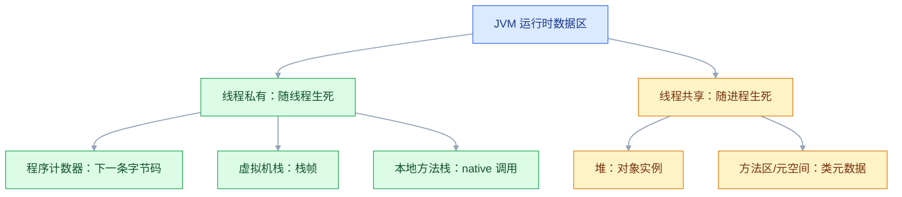
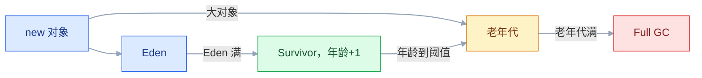
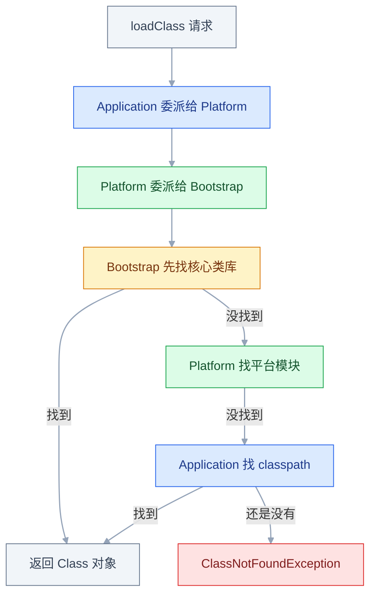

# JVM 基础

## 一、工程案例：定位一个每天被 OOMKilled 的订单服务

**场景**：`order-service` 跑在 K8s 里，容器内存限制 1Gi，JDK 17，G1。每天上午 9 点后接口逐渐变慢，下午 3 点左右 Pod 重启，`kubectl describe` 显示 `Reason: OOMKilled`、`Exit Code: 137`。重启后又能撑一天，已经循环了一周。

**目标**：判断到底是 Java 堆溢出还是容器杀进程，找到占内存的对象和引用链，改代码 + 调参数，并给出 24 小时可验证的验收标准。

**为什么必须做**：`OOMKilled` 和 `OutOfMemoryError` 是两件事。前者是内核杀进程，没有 Java 异常、没有堆快照；后者是 JVM 自己报错，只有开了 `HeapDumpOnOutOfMemoryError` 才留 dump。搞混这两个方向，会一直在「调大堆」和「怀疑代码」之间打转。

**动手前确认**：本机有 JDK 17 的 `jps/jstat/jmap/jcmd`；生产容器有可写的 `/data/dump` 和 `/data/logs`；`kubectl` 能拿到上一个容器的退出原因。

### 1.1 主线（按顺序执行，不要跳步）

**① 用一个最小程序复现同类的泄漏曲线**

```java
import java.util.HashMap;
import java.util.Map;

public class LeakDemo {
    // 静态集合只 put 不 remove，和线上问题同构
    private static final Map<String, byte[]> CACHE = new HashMap<>();

    public static void main(String[] args) throws Exception {
        System.out.println("PID=" + ProcessHandle.current().pid());
        long n = 0;
        while (true) {
            CACHE.put("ORDER-" + (++n), new byte[1024 * 1024]);   // 每单 1MB
            if (n % 50 == 0) System.out.println("orders=" + n);
            Thread.sleep(20);                                     // 约 50MB/s
        }
    }
}
```

```bash
mkdir -p dump logs
javac LeakDemo.java
java -Xms512m -Xmx512m -XX:+UseG1GC \
     -XX:+HeapDumpOnOutOfMemoryError -XX:HeapDumpPath=./dump \
     -Xlog:gc*:file=./logs/gc.log:time,uptime,level,tags:filecount=5,filesize=20M \
     LeakDemo
```

`HeapDumpPath` 指向的目录**必须先存在**，否则 OOM 时 dump 写不出来，只会在日志里留一行「Unable to create ...」。

这个最小程序约 10 秒就会自己抛 `java.lang.OutOfMemoryError: Java heap space` 并留下 dump——它是**堆泄漏**的死法，不是容器的 137。两种死法的区别正是下一步要判断的。

**② 先判断是谁杀的**

```bash
kubectl describe pod order-service-7d9f8b6c5-x2k4m | grep -A 5 "Last State"
#     Last State:  Terminated
#       Reason:    OOMKilled
#       Exit Code: 137          # 137 = 128 + 9，SIGKILL

dmesg | grep -i "killed process"
# Memory cgroup out of memory: Killed process 12345 (java) ...
```

| 现象 | 结论 |
|---|---|
| `Exit Code: 137` + `OOMKilled` + `dmesg` 有记录 | 容器内存超限，内核杀的 |
| 日志里有 `java.lang.OutOfMemoryError` | JVM 自己先报错，再看有没有 dump |
| 有 dump 但进程仍被 137 杀掉 | JVM 正在写 dump 时超出容器限制，两者同时发生 |

137 只说明「收到 SIGKILL」，不等于一定是内存；但和 `OOMKilled`、`dmesg` 对上，就可以确定是 cgroup 限制，而不是 Java 堆。

**③ 看 GC 趋势，不要先改参数**

```bash
jps -l
# 12345 LeakDemo
jstat -gcutil 12345 2000
```

```text
   S0     S1     E      O      M     CCS    YGC     YGCT    FGC    FGCT    CGC    CGCT     GCT
   0.00  68.00  72.31   8.42  91.20  88.10    12    0.045     0    0.000     0   0.000    0.045
   0.00   0.00   4.88  31.10  91.20  88.10    24    0.096     0    0.000     0   0.000    0.096
   0.00  45.00   3.11  62.40  91.20  88.10    41    0.180     1    0.210     0   0.000    0.390
   0.00   0.00   2.44  88.70  91.20  88.10    58    0.264     4    1.020     0   0.000    1.284
```

`O` 是老年代使用率，`FGC` 是 Full GC 次数。这里 `O` 从 8% 一路抬到 88%，Full GC 从 0 涨到 4，说明对象一直活着、回收不掉。健康的服务 `FGC` 长期为 0，`O` 在固定区间波动。较新的 `jstat` 还会多出 `CGC`、`CGCT` 两列，是并发回收（如 ZGC）的次数和耗时，G1 下长期为 0，读法不变。

**④ 看谁占内存**

```bash
jmap -histo:live 12345 | head -8
#  num     #instances         #bytes  class name (module)
#    1:            480      503316480  [B (java.base@17.0.10)
#    2:         145233       11618640  java.lang.String
```

`[B` 是 `byte[]`。480 个数组占 480MB，平均每个 1MB，正好等于 `new byte[1024 * 1024]`；数量也接近「已创建订单数」。到这步根因已经八成确定。

**⑤ 导出快照，找引用链**

```bash
jmap -dump:live,format=b,file=./dump/leak.hprof 12345
# Heap dump file created [512000000 bytes in 3.412 secs]

jcmd 12345 GC.heap_info       # 看各区容量，不触发 dump
jcmd 12345 VM.flags           # 确认线上到底用了哪些参数
```

用 MAT 打开 `leak.hprof`：先看 **Leak Suspects**，再按 **Retained Size** 排序。**Retained Size 才是「回收它能省多少内存」**，`jmap -histo` 显示的是 Shallow Size。右键 `Path to GC Roots`（排除弱引用/软引用），引用链会指到：

```text
LeakDemo.CACHE (static field)
  -> HashMap$Node
  -> byte[1048576]
```

**⑥ 修代码：把无界缓存换成有界缓存**

```java
// 依赖：com.github.ben-manes.caffeine:caffeine（版本以官方当前 LTS 兼容版本为准）
// 片段：替换原类里的静态 Map；需要 import com.github.benmanes.caffeine.cache.* 和 java.time.Duration
private final Cache<String, byte[]> cache = Caffeine.newBuilder()
        .maximumWeight(256L * 1024 * 1024)                  // 按字节封顶，约占 512MB 堆的一半
        .weigher((String k, byte[] v) -> v.length)          // value 是 1MB 时必须按重量，不能按条数
        .expireAfterWrite(Duration.ofMinutes(30))           // 到期自动释放
        .recordStats()                                      // 看命中率，判断缓存是否值得留
        .build();

public byte[] get(String orderId) {
    return cache.get(orderId, this::loadFromDb);
}
```

这里最容易埋新雷：`maximumSize(10_000)` 配 1MB 的 value，上限就是 10GB，比原来的泄漏还大。凡是 value 大小不固定，就用 `maximumWeight` + `weigher` 按字节封顶，再和 1.1 ⑦ 的堆预算对齐。不想引第三方库时，`LinkedHashMap` 的 `removeEldestEntry` 也能做有界 LRU，但它没有过期和并发优化，生产缓存优先用成熟库。修完再压一次，`[B` 的数量应该稳定在上限附近，而不是随订单数线性上涨。

**⑦ 按容器预算重配参数**

1Gi 的容器不能把 70% 都给堆。把非堆部分算清楚：

| 区域 | 预算 | 说明 |
|---|---|---|
| 堆 | 512MB | `MaxRAMPercentage=50`，G1 管理 |
| 元空间 | 128MB | 设上限，防动态类把机器吃光 |
| 线程栈 | 100MB | 200 线程 × 512KB |
| 直接内存 | 64MB | Netty/NIO 用，必须设上限 |
| JIT 代码缓存 | 48MB | 上限；默认约 240MB，收太小会让 JIT 停摆 |
| GC 自身与 JVM | 40MB | 卡片表、标记位图等 |
| 合计 | 892MB | 留约 132MB 给内核和突发 |

```bash
java \
  -XX:MaxRAMPercentage=50.0 -XX:InitialRAMPercentage=50.0 \
  -XX:MaxMetaspaceSize=128m -XX:MaxDirectMemorySize=64m -Xss512k \
  -XX:ReservedCodeCacheSize=48m \
  -XX:+UseG1GC -XX:MaxGCPauseMillis=100 -XX:InitiatingHeapOccupancyPercent=40 \
  -XX:+HeapDumpOnOutOfMemoryError -XX:HeapDumpPath=/data/dump \
  -Xlog:gc*:file=/data/logs/gc.log:time,uptime,level,tags:filecount=5,filesize=50M \
  -jar order-service.jar
```

`MaxRAMPercentage` 比写死 `-Xmx` 好：同一个镜像在 1Gi、2Gi、4Gi 的容器里都能自适应。**比例不是越高越好**，70% 只适合非堆开销很小的服务；有 Netty、线程多、动态类多的服务，50%~60% 更稳。

**⑧ 验证，而不是「感觉好了」**

```bash
# 压测 30 分钟，同时每 10 秒采样一次（timeout 让采样自己停，避免忘了杀）
timeout 1800 jstat -gcutil <pid> 10000 > /tmp/gc-30min.txt
wc -l /tmp/gc-30min.txt                 # 约 180 行，少太多说明进程中途重启了
jcmd <pid> GC.heap_dump /data/dump/after-fix.hprof    # 默认先整堆回收再导出
```

### 1.2 验收（8 项全过才算修完）

| # | 检查 | 命令或检查 | 通过标准 |
|---|---|---|---|
| 1 | 不再被容器杀 | `kubectl get pod` 观察 24h | 重启次数 0，无 `OOMKilled` |
| 2 | Full GC 消失 | `grep "Pause Full" /data/logs/gc.log` | 24h 内 0 次（手工 dump、`-histo:live` 触发的除外） |
| 3 | 老年代稳定 | `jstat -gcutil <pid> 10000` | `O` 在 30%~60% 波动，不单调上涨 |
| 4 | 接口延迟 | 监控 P99 | 稳定在 120ms 以内 |
| 5 | 堆快照可生成 | `jcmd <pid> GC.heap_dump /data/dump/manual.hprof` | 文件生成，MAT 能打开 |
| 6 | 参数确实生效 | `jcmd <pid> VM.flags` | 与启动脚本一致，没有被覆盖 |
| 7 | 日志能滚动 | `ls -lh /data/logs/gc.log*` | 总数不超过 6 个（`gc.log` 加 5 个归档），单文件不超过 50MB |
| 8 | 内存预算成立 | `kubectl top pod` | RSS 稳定在 limit 的 90% 以下 |

> 第 3 项要看「Full GC 后的回落点」，不是单个时刻的数字。只看一眼 `O=60%` 没有意义，连续 30 分钟的曲线才说明问题。第 2 项要排除自己制造的那几次回收：`jmap -histo:live`、`jmap -dump:live`、不带 `-all` 的 `jcmd GC.heap_dump` 都会先触发一次整堆回收。

### 1.3 复制到其他服务

| 约束 | 处理 |
|---|---|
| 每个服务非堆开销不同 | 先按 50% 给堆，压测后按 RSS 调整，不要照抄 |
| 容器 limit 可能被改 | 参数写比例，不写 `-Xmx` 绝对值 |
| dump 目录可能不存在 | 启动脚本先 `mkdir -p`，或用 initContainer |
| 磁盘可能被 dump 写满 | dump 单独挂盘，设置容量告警 |
| 多副本同时 OOM | 先限流/降副本，否则每个 Pod 都写一份大 dump，节点直接崩 |

---

## 二、高频问答：会卡住你的地方，也是面试最常问的

### 2.1 容器里堆没满，进程却被 `Killed`

**现场**

先看死因：`kubectl describe` 里的 `Exit Code: 137` 和 `OOMKilled`，`dmesg` 里的 `Memory cgroup out of memory`；再把 RSS 和 limit 放在一起看。

```bash
kubectl top pod order-service-xxx          # RSS 是否贴近 limit
cat /sys/fs/cgroup/memory.max              # cgroup v2 的上限
cat /sys/fs/cgroup/memory.current          # cgroup v2 的当前用量，含页缓存
jcmd <pid> VM.native_memory summary        # 需启动加 -XX:NativeMemoryTracking=summary
```

**要点**

- 容器限制的是整个 cgroup 的内存用量（进程匿名内存 + 页缓存），堆只是其中一部分。
- 元空间、线程栈、直接内存、代码缓存都算在这个 limit 里，超了就被 cgroup 杀。
- RSS 已经贴住 limit 而堆只占一半，就是非堆或线程吃掉了预算：先降 `MaxRAMPercentage`，再查泄漏。

**追问**

- 退出码 137 一定是内存问题吗？→ 不一定，137 是 128 + 9，只说明被 SIGKILL，还要看 `OOMKilled` 和 `dmesg`。
- 为什么监控显示堆使用率不高？→ 监控只统计了堆，没算 RSS、元空间和页缓存。
- `-Xmx` 该设多少？→ 按 limit 的 70%~75% 留出非堆空间。

### 2.2 堆很空，却报 `OutOfMemoryError: Metaspace`

**现场**

看异常后缀是不是 `Metaspace`；`jstat -gcutil` 的 `M` 列逼近满值只作线索，再看 `jcmd` 的元空间明细。

```bash
jstat -gcutil <pid> 1000        # 看 M 列
jcmd <pid> VM.metaspace         # 较新 JDK 可看元空间明细（以官方当前 LTS 为准）
```

**要点**

- 类元数据在元空间（本地内存），不在堆里，加 `-Xmx` 没用。
- 动态生成类、热部署、反复创建 ClassLoader 会让它涨到上限。
- 加参数只能拖延，类加载器泄漏必须修加载逻辑。

**追问**

- 元空间受 `-Xmx` 限制吗？→ 不受，它由 `-XX:MaxMetaspaceSize` 限制。
- 为什么 `M` 列只能作线索？→ 它是相对当前容量的百分比，不是绝对占用。
- 怎么知道是哪些类撑大的？→ 用 `jcmd VM.metaspace` 看明细，或 dump 后数 ClassLoader。

### 2.3 Full GC 很频繁，老年代却不高

**现场**

直接按触发原因过滤 GC 日志，先确认是元空间阈值、显式 `System.gc()`，还是 Humongous 分配。

```bash
grep -E "Metadata GC Threshold|System.gc|Humongous" /data/logs/gc.log | tail -20
```

**要点**

- Full GC 的触发条件不止「老年代满」，只盯占用会误判。
- 常见三种：元空间达到 `MetaspaceSize` 阈值、代码里显式 `System.gc()`、频繁分配大对象让 G1 提前做并发周期。
- 按日志的 `Cause` 字段处理：阈值就设 `MetaspaceSize` 和 `MaxMetaspaceSize` 相等，`System.gc()` 就全局搜代码和依赖，Humongous 就把大数组拆小或复用。

**追问**

- Humongous 是怎么判定的？→ 达到 Region 一半大小的对象，直接进老年代。
- 怎么确认是谁在调 `System.gc()`？→ 看 GC 日志的 Cause，或用 `-XX:+DisableExplicitGC` 验证。
- G1 的并发周期等于 Full GC 吗？→ 不等于，并发标记先发生，回收不掉才会走到 Full GC。

### 2.4 `-Xmx` 明明设了，`jcmd` 里却不是这个值

**现场**

不要看部署文件，直接看 JVM 最终的展开结果：`VM.flags` 看生效值，`VM.command_line` 看完整命令。

```bash
jcmd <pid> VM.flags | tr ' ' '\n' | grep -i maxheapsize
echo "$JAVA_TOOL_OPTIONS" "$JAVA_OPTS"
```

**要点**

- 重复参数后者覆盖前者，JVM 只看命令行最终展开的结果。
- `JAVA_TOOL_OPTIONS`、`JDK_JAVA_OPTIONS` 会被拼在命令行之前，命令行上的同名参数赢。
- `_JAVA_OPTIONS` 排在命令行之后，反而覆盖命令行，这是最容易被忽略的一个。

**追问**

- 三个环境变量的区别是什么？→ 拼接位置不同，决定了谁覆盖谁，`_JAVA_OPTIONS` 优先级最高。
- 同时写 `-Xmx` 和 `MaxRAMPercentage` 听谁的？→ 写了 `-Xmx` 比例参数就不生效。
- 为什么"参数没生效"不是 JVM 忽略了？→ 它只认最终命令行，前面的值本来就被覆盖了。

### 2.5 开了 `HeapDumpOnOutOfMemoryError`，OOM 后却没有 dump

**现场**

先确认死因和目录：日志里搜 `Unable to create`、`Dumping heap`、`Heap dump file created`，同时 `df -h` 看磁盘。

```bash
ls -ld /data/dump && df -h /data
grep -i "heap dump\|unable to create" /data/logs/*.log
```

**要点**

- 配了参数不等于一定会有文件。
- dump 目录不存在或不可写、磁盘满、进程被 `SIGKILL` 直接杀（根本没机会写）、dump 太大写到一半被杀。
- 容器 OOM Killer 是 SIGKILL，JVM 没有执行任何清理逻辑的机会。

**追问**

- 怎么区分 137 和 Java OOM？→ 137 的日志里只有 `Killed`，没有 Java 异常；Java OOM 会先打 `OutOfMemoryError`。
- dump 会拖垮服务吗？→ 写 dump 期间进程停顿，文件可能和堆一样大，磁盘要单独留。
- 多副本同时 OOM 怎么办？→ 先限流或降副本，否则每个 Pod 写一份大 dump，节点直接崩。

### 2.6 CPU 100%，`jstack` 里却找不到那个线程

**现场**

`top -Hp` 给的是十进制线程号，先转成十六进制，再按 `nid=0x...` 去 `jstack` 里搜。

```bash
top -Hp 12345                 # 记下最忙的线程，比如 12389
printf "%x\n" 12389           # 3065
jstack 12345 | grep -A 30 "nid=0x3065"
```

**要点**

- `top -Hp` 给的是十进制线程号，`jstack` 里的 `nid` 是十六进制，这是最常见的对不上原因。
- 也可能采样时线程刚好结束，连续抓两三次才可靠。
- 只出现一次可能是采样噪声，一直在栈顶才是热点。

**追问**

- `nid` 和 `tid` 是一回事吗？→ 都是操作系统线程号，只是一个用十六进制显示。
- 线程都在 WAITING 但 CPU 很高？→ 看 GC 线程和 JIT 编译线程，它们不执行业务栈。
- 为什么要连续抓几次？→ 线程状态转瞬即逝，单次快照可能刚好错过。

### 2.7 `OutOfMemoryError: Direct buffer memory`，堆却很正常

**现场**

看异常后缀和 NMT：`Direct buffer memory` 是堆外超限，`VM.native_memory summary` 的 `Other` 段（`Unsafe` 分配）会跟着涨。

```bash
jcmd <pid> VM.native_memory summary    # 需 -XX:NativeMemoryTracking=summary
jcmd <pid> GC.class_histogram | grep -i direct    # 间接看 DirectByteBuffer 数量，会先做一次整堆回收
```

**要点**

- NIO/Netty 的 `ByteBuf` 用的是堆外直接内存，不受 `-Xmx` 管。
- 不显式设置时 `MaxDirectMemorySize` 默认约等于最大堆，超了报这个 OOM，再往上就是容器 limit 杀进程。
- 单纯调大上限只是推迟崩溃，要查 `ByteBuf` 是否 `release()`、`ResourceLeakDetector` 有没有告警。

**追问**

- 堆外内存算在容器 limit 里吗？→ 算，它是进程内存的一部分，只是不在堆里。
- `class_histogram` 能看堆外占用吗？→ 只能间接看 `DirectByteBuffer` 的个数，看不到实际字节数。
- Netty 的泄漏怎么提前发现？→ 打开 `ResourceLeakDetector` 的检测级别。

### 2.8 `jmap -histo` 里对象不大，服务还是 OOM

**现场**

`jmap -histo:live` 只是入口，真正的结论要靠 dump 加 Retained Size；在 MAT 里按 Retained Size 排序，再用 `Path to GC Roots` 看谁在持有。

```bash
jmap -histo:live <pid> | head -20
# 只是入口，真正的结论要靠 dump + Retained Size
```

**要点**

- `-histo` 显示的是 Shallow Size，不含它引用的对象。
- 一个小 `HashMap` 可能持有几百 MB 的 value，看自身大小会漏掉。
- 导出 dump 看 Retained Size，才是「回收它能释放多少」的真实口径。

**追问**

- Shallow 和 Retained 的区别？→ 一个是对象自身占用，一个是回收它能释放的总量。
- `-histo:live` 有什么副作用？→ 它会先做一次整堆回收，生产高峰慎用。
- 为什么直方图里排第一的对象往往不是元凶？→ 排第一的常是 `byte[]` 这类被大量持有的底层数组，要看持有链。

### 2.9 照抄 JDK 8 的 GC 日志参数，日志缺失或没有滚动

**现场**

看启动输出有没有 `-Xloggc is deprecated. Will use -Xlog:...` 警告；再看日志里有没有 `time/uptime/tags`，以及是否按 `filecount` 滚动。

```bash
# JDK 8 的写法（新 JDK 上通常只给弃用警告，不等价于新格式）
-XX:+PrintGCDetails -Xloggc:/data/logs/gc.log

# JDK 9+ 的写法：装饰项、滚动、级别都在一条参数里
-Xlog:gc*:file=/data/logs/gc.log:time,uptime,level,tags:filecount=5,filesize=50M
```

**要点**

- 把「能启动」当成「配置正确」，是这里最常见的错。
- JDK 9 起 GC 日志统一到 `-Xlog`，`-Xloggc`、`PrintGCDetails` 只是被映射的兼容写法。
- 旧参数表达不了装饰项和滚动，映射细节还随版本变化；升级时以 `java -X` 和当前 LTS 文档为准。

**追问**

- `-Xloggc` 还能用吗？→ 能启动，但会提示弃用，且不等价于新格式。
- 滚动参数写在哪？→ `filecount`、`filesize` 写在 `-Xlog` 的 output 选项里。
- 为什么要带 `time,uptime,level,tags`？→ 才能和业务日志对齐时间，并区分级别和来源。

### 2.10 把 `MaxGCPauseMillis` 设成 20ms，GC 反而更频繁

**现场**

对比 GC 日志里的 GC 次数、总耗时和实际停顿分布，不要只看单次停顿。

```bash
grep "Pause Young" /data/logs/gc.log | awk '{print $NF}' | sort -n | tail
```

**要点**

- `MaxGCPauseMillis` 是软目标，不是保证。
- G1 为了满足它，每次停顿里只挑少量 Region 回收，回收速度赶不上分配速度，GC 次数和总开销反而上升。
- 判断标准是 `GCT` 占运行时间的比例和 P99，100~200ms 是更现实的起点。

**追问**

- 为什么它不能保证停顿？→ 它只是回收时的选择依据，堆大小和分配速率决定了下限。
- 吞吐优先该往哪调？→ 换 Parallel，或放宽停顿目标。
- GC 健康看哪些指标？→ GCT 占比 5% 以内、Full GC 长期为 0。

### 2.11 容器只给了 2 核，JVM 却按 64 核开线程

**现场**

对比容器配额、`nproc` 和 JVM 自己认定的核数，再看有没有被 `ActiveProcessorCount` 写死。

```bash
cat /sys/fs/cgroup/cpu.max            # 如 "200000 100000"，表示 2 核
nproc                                 # 宿主机核数，容器里常常偏大
jcmd <pid> VM.info | grep -i "cpu"    # JVM 当前认定的 CPU 信息
```

**要点**

- GC 线程数、JIT 编译线程、`ForkJoinPool.commonPool`、默认线程池大小都来自 `Runtime.availableProcessors()`。
- 老 JDK 读宿主机核数、不读 cgroup 配额，于是在 2 核容器里开几十个线程互相抢 CPU。
- 先确认 JVM 眼里的核数等于 limit，不一致就加 `-XX:ActiveProcessorCount=2` 对齐，再回看线程池核心数。

**追问**

- 现代 JDK 还会这样吗？→ 默认会读 cgroup 的 CPU 配额，具体行为以当前 LTS 为准，别照抄老脚本。
- `nproc` 为什么偏大？→ 它看的是宿主机可见 CPU，不一定反映 cgroup 配额。
- 对齐核数后线程池要改吗？→ 要，核心数按真实核数配，否则还是在自己人之间排队。

---

## 三、核心知识：从零开始要建立的东西

### 3.1 运行时数据区

JVM 运行时把内存分成几块，线程私有的随线程创建销毁，共享的随进程生命周期存在。



| 区域 | 存什么 | 私有/共享 | 典型错误 |
|---|---|---|---|
| 程序计数器 | 当前线程下一条字节码地址 | 私有 | 不会 OOM |
| 虚拟机栈 | 每个方法的栈帧：局部变量、操作数栈 | 私有 | `StackOverflowError` |
| 本地方法栈 | native 方法调用信息 | 私有 | 同虚拟机栈 |
| 堆 | 对象实例和数组 | 共享 | `Java heap space` |
| 方法区/元空间 | 类元信息、运行时常量池（字符串常量在堆） | 共享 | `Metaspace`（见 2.2） |

JDK 8 起方法区用元空间实现，位于本地内存，不再受 `-Xmx` 限制，改用 `-XX:MaxMetaspaceSize` 限制。栈深度由 `-Xss` 控制，递归没有终止条件就会撑爆。**静态字段的值挂在堆里的 `Class` 对象上，不在元空间**，所以排查元空间泄漏要看 ClassLoader 和动态类，而不是数 `static` 变量（见 3.9）。直接内存（NIO/Netty）也不在这张表里，它由进程向操作系统申请，只受 `MaxDirectMemorySize` 和容器 limit 约束（见 2.7）。

### 3.2 堆的分代与晋升

堆分新生代和老年代，新生代再分 Eden 和两个 Survivor。新对象先在 Eden 分配，Eden 满了触发 Young GC，存活对象复制到 Survivor，年龄加一，到阈值后晋升老年代。



以 Parallel/Serial 为例，默认 `NewRatio=2`（新生代:老年代 = 1:2）、`SurvivorRatio=8`（Eden:S0:S1 = 8:1:1），`-Xmx=3g` 时老年代约 2GB、Eden 800MB、两个 Survivor 各 100MB。G1 不按固定比例切新生代，而是用 `G1NewSizePercent`/`G1MaxNewSizePercent`（默认 5%/60%）动态调整，Survivor 仍按 `SurvivorRatio` 划分。

对象晋升的三条路径：年龄到 `MaxTenuringThreshold`（默认 15）；Survivor 中同年龄对象总和超过一半（动态年龄判定）；大对象直接进老年代。绝大多数对象死在新生代，所以 Young GC 频繁但快，这是设计目标，不是问题。

> **面试**：常问「对象什么时候晋升老年代？」答：年龄到阈值、Survivor 同年龄对象过半、大对象直接进老年代。

### 3.3 对象布局与引用类型

一个对象在内存里由三部分组成：对象头（Mark Word + 类型指针）、实例数据、对齐填充。64 位 JVM 要求对象起始地址是 8 的倍数，所以只含一个 `int` 的对象通常占 16 字节。

Mark Word 存哈希、GC 年龄、锁状态；类型指针指向类元数据，默认开启指针压缩（`-XX:+UseCompressedOops`），用 4 字节代替 8 字节。

| 引用类型 | 回收时机 | 典型用途 |
|---|---|---|
| 强引用 | 只要可达就不回收 | 99% 的业务代码 |
| 软引用 | 内存不足时回收 | 缓存 |
| 弱引用 | 下次 GC 必回收 | `WeakHashMap`、`ThreadLocal` 的 key |
| 虚引用 | 回收时收到通知 | 管理堆外内存 |

`ThreadLocal` 的 key 是弱引用，但 value 是强引用，线程池复用线程时 value 会一直挂着，所以必须 `remove()`。这不是「弱引用就不会泄漏」，而是「key 被回收后 value 变成没人能访问、又没人能回收」。

### 3.4 可达性分析与 GC Roots

Java 不用引用计数，因为解决不了循环引用。它从一组 GC Roots 出发做图遍历，能走到的对象算存活，走不到的就是垃圾。

GC Roots 包括：虚拟机栈和本地方法栈中引用的对象、类的静态字段引用的对象（值挂在堆里的 `Class` 对象上，同样算根）、常量引用的对象、JNI 引用、活跃线程，以及被同步监视器锁住的对象等。

```text
GC Roots
├── 线程栈局部变量 -> OrderService -> cache -> byte[]
├── 静态字段 -> LeakDemo.CACHE -> byte[]
└── JNI 引用 -> 本地对象
```

「不可达」不等于「立刻回收」：对象还有 `finalize()` 的话会被放到 F-Queue 里再判一次，但 `finalize` 已废弃，不要依赖它。可达性分析不是全程 STW：初始标记和重新标记要停，并发标记靠写屏障（如 G1 的 SATB）保证不漏标，这几段停顿正是 GC 影响接口延迟的主要来源。

### 3.5 标记、复制与整理

| 算法 | 做法 | 优点 | 缺点 | 用在哪 |
|---|---|---|---|---|
| 标记-清除 | 标记垃圾后直接清 | 不移动对象 | 碎片多、效率不稳定 | CMS 的清理阶段 |
| 复制 | 存活对象复制到另一块 | 快、无碎片 | 浪费空间 | 新生代 |
| 标记-整理 | 存活对象往一端挪 | 无碎片、不浪费 | 移动要更新引用，停顿长 | 老年代 |

新生代存活率低，复制只需搬一小撮，所以用复制；老年代存活率高，复制要搬一大半，所以用标记-整理。分代收集器就是「按对象年龄选择更划算的算法」。

### 3.6 回收器谱系与 G1 分区

| 回收器 | 停顿 | 吞吐 | 堆规模 | 典型场景 |
|---|---|---|---|---|
| Serial | 长（全程 STW） | 低 | 小堆 | 客户端、单核 |
| Parallel | 中（全程 STW） | 最高 | 中等堆 | 批处理、离线计算 |
| CMS | 短（并发） | 中 | 中等堆 | 仅老项目，JDK 14 已移除 |
| G1 | 可预测 | 高 | 数 GB~数十 GB | JDK 9+ 默认 |
| ZGC | 极短 | 中高 | 超大堆 | 大堆 + 低延迟 |

G1 把堆切成最多约 2048 个等大 Region（1~32MB），逻辑上仍有 Eden/Survivor/Old/Humongous。Young GC 只收新生代 Region；并发标记算出每个 Region 的垃圾比例后，按 `MaxGCPauseMillis` 的预测优先回收垃圾最多的 Region，这就是 Garbage First。

Humongous 是大小达到 Region 一半（≥ 50%）的对象，直接进老年代；频繁创建大数组会让 G1 不断做并发周期，表现为「老年代不高但 GC 很多」。

> **面试**：常问「G1 的 Region 是怎么回收的？Humongous 是什么？」答：按垃圾比例优先回收 Region；达到 Region 一半的对象直接进老年代。

### 3.7 STW 与停顿指标

STW（Stop The World）是暂停所有应用线程。停顿期间接口不响应，所以低延迟的本质是「缩短单次 STW」，不是「消灭 GC」。

| 指标 | 含义 | 健康参考 |
|---|---|---|
| Young GC 次数 | 新生代回收频率 | 与分配速率匹配，不看绝对值 |
| Young GC 停顿 | 单次新生代停顿 | 几毫秒到几十毫秒 |
| Full GC 次数 | 整堆回收 | 长期 0 最好 |
| GC 总耗时占比 | `GCT / 运行时间` | 控制在 5% 以内 |
| P99 延迟 | 用户感知 | 比平均停顿更有意义 |

「吞吐优先」和「低延迟」是取舍：Parallel 追求吞吐，G1/ZGC 追求停顿。批处理任务可以容忍长停顿换吞吐，在线接口则相反。

### 3.8 类加载的五个阶段

| 阶段 | 做什么 |
|---|---|
| 加载 | 读 class 字节流，方法区生成类元数据，堆里建 Class 对象 |
| 验证 | 文件格式、元数据、字节码、符号引用检查 |
| 准备 | 给静态变量分配内存并赋零值；`static final` 常量在这一步直接赋常量值 |
| 解析 | 常量池符号引用转直接引用 |
| 初始化 | 执行 `<clinit>()`：静态赋值和静态代码块 |

准备阶段 `static int a = 10` 此时是 0，到初始化才变成 10。触发初始化的情况包括 `new`、读写静态字段、调静态方法、`Class.forName`、初始化子类、启动主类。

被动引用不触发初始化：通过子类访问父类静态字段只初始化父类；`new Parent[10]` 只创建数组；访问编译期常量也不触发。

### 3.9 双亲委派与类唯一性



收到加载请求时，先查自己加载过没有，没有再委派父加载器，一路到 Bootstrap；父加载器加载不了才往下退。它保证核心类库不被篡改，也保证同一个类只被一个加载器加载一次。

**类的唯一性 = 全限定名 + 加载它的 ClassLoader。** 同一个 class 被两个加载器加载会产生两个不同的 Class 对象，强转时报 `ClassCastException: com.example.Person cannot be cast to com.example.Person`。热部署、Tomcat 多应用、OSGi 都会遇到。

打破双亲委派的典型场景：JDBC 的 SPI（接口在 Bootstrap，实现在 classpath，用线程上下文类加载器）、Tomcat 应用隔离（先自己加载）、热部署（丢弃旧加载器重新加载）。

> **面试**：常问「什么是双亲委派？为什么要打破它？」答：先委派父加载器，保证核心类不被篡改；SPI、Tomcat 隔离、热部署会打破它。

### 3.10 容器内存与堆参数

早期的 JDK 8 默认看不到容器限制，按宿主机内存算堆；8u191 之后默认支持 `-XX:+UseContainerSupport`，当前 LTS 都会读 cgroup 的内存上限（v2 是 `memory.max`，v1 是 `memory.limit_in_bytes`，具体行为以官方当前 LTS 为准）。但「看见限制」不等于「预算合理」：`MaxRAMPercentage` 默认 25，很多团队调到 50%~70%。

两个百分比各有前提：`MaxRAMPercentage` 只在没写 `-Xmx` 时生效，`InitialRAMPercentage` 只在没写 `-Xms` 时生效。一旦写死 `-Xmx`，堆上限就与比例参数无关，这也是同一份启动脚本在大小容器里表现不一致的常见原因。

| 参数 | 作用 | 建议 |
|---|---|---|
| `-Xms` / `-Xmx` | 堆初始/最大 | 相等，避免动态伸缩 |
| `-XX:MaxRAMPercentage` | 未设 `-Xmx` 时，按容器内存算堆上限 | 50~70，视非堆开销 |
| `-Xss` | 每线程栈 | 512k~1m |
| `-XX:MaxMetaspaceSize` | 元空间上限 | 128m~512m |
| `-XX:MaxDirectMemorySize` | 堆外内存上限 | NIO/Netty 必设 |
| `-XX:MaxGCPauseMillis` | G1 停顿目标 | 100~200 |
| `-XX:InitiatingHeapOccupancyPercent` | 并发标记启动阈值 | 40~45 |

`-Xms` 和 `-Xmx` 相等是为了避免堆反复伸缩带来的额外 GC；不设上限则可能被容器 OOM Killer 杀。堆不是越大越好：堆越大，单次 Full GC 要扫描的对象越多，停顿越长。

还要记住 cgroup 的账本包含页缓存：`memory.current` 会随文件读写上涨，`kubectl top pod` 的 RSS 却看不全。所以 limit 不能按「堆 + 非堆」刚刚好来设，留 10%~20% 缓冲，否则一次日志或镜像层读取就可能把 Pod 推到 OOMKilled。

> **面试**：常问「容器里 `-Xmx` 该怎么设？为什么不能等于 limit？」答：按 limit 的 70%~75%，堆外、元空间、栈都要占内存，堆顶满会被 OOMKilled。

### 3.11 GC 日志的读法

```text
[2026-09-30T15:40:02.123+0800][info][gc] GC(2412) Pause Full (G1 Compaction Pause) 715M->618M(716M) 1245.677ms
```

| 字段 | 含义 |
|---|---|
| `GC(2412)` | 第几次 GC |
| `Pause Full` | 回收类型，Full 是整堆 |
| `(G1 Compaction Pause)` | 触发原因/阶段 |
| `715M->618M` | 回收前 -> 回收后 |
| `(716M)` | 堆总容量 |
| `1245.677ms` | STW 停顿 |

读日志先看「回收后」：Young GC 后占用逐次抬高，说明对象在变老；Full GC 后仍接近总容量，说明回收不掉。再看停顿和频率，最后才看具体用了哪个回收器。

### 3.12 诊断工具链

| 目的 | 命令 |
|---|---|
| 找 Java 进程 | `jps -l` |
| GC 趋势 | `jstat -gcutil <pid> 1000` |
| 堆配置 | `jcmd <pid> GC.heap_info` |
| 对象直方图 | `jmap -histo:live <pid>` |
| 堆快照 | `jcmd <pid> GC.heap_dump /data/dump/x.hprof` |
| 线程栈 | `jstack <pid>` |
| 最终参数 | `jcmd <pid> VM.flags` |
| 在线诊断 | Arthas `dashboard` / `thread -b` / `trace` |

`jmap -histo:live` 和 `jmap -dump:live` 都会先做一次整堆回收，生产高峰慎用。`jcmd <pid> GC.heap_dump` 为了只导出存活对象，默认同样会先做一次整堆回收；加 `-all` 把不可达对象一起导出，反而跳过这次 GC。`jstack` 对安全点有影响，但通常可以接受；连续抓 3 次比抓 1 次可靠。

### 3.13 OOM 类型对照

| 错误信息 | 原因 | 方向 |
|---|---|---|
| `Java heap space` | 堆不够或泄漏 | dump + MAT |
| `Metaspace` | 类元数据超限 | 查 ClassLoader、动态类 |
| `GC overhead limit exceeded` | GC 花 98% 时间只回收不到 2% | 先解决泄漏 |
| `Direct buffer memory` | 堆外内存超限 | 查 ByteBuf 释放 |
| `unable to create new native thread` | 线程数到系统上限 | 查线程池和 `ulimit` |
| `StackOverflowError` | 栈深度超限 | 查递归终止条件 |

日志里只有 `Killed`、没有 Java 异常，是容器 OOM Killer，不是 `OutOfMemoryError`。这两者的排查路径完全不同。

### 3.14 JIT、逃逸分析与 TLAB

解释器启动快但执行慢，JIT 把热点方法编译成机器码。热点判定靠方法调用计数和回边计数，编译后还有去优化（deoptimization）机制。

逃逸分析判断对象是否逃出方法：没逃逸就可能被标量替换（拆成字段）、锁消除，甚至完全不在堆上分配。HotSpot 实际以标量替换和锁消除为主，**并没有真正的「栈上分配」**，面试里说的「栈上分配」通常就是指这个优化。它默认开启，但只作用于 JIT 编译后的热点代码，别把它当成「不用管内存」的理由。

TLAB（Thread Local Allocation Buffer）让每个线程在 Eden 里先占一小块专属空间，分配对象不用抢锁。TLAB 满了才走共享的 Eden 分配。`-XX:+UseTLAB` 默认开启。

### 3.15 虚拟线程与 JVM 边界

JDK 21 起虚拟线程正式可用，适合 IO 密集、线程数很多的场景。它由 JVM 调度到少量载体线程上，阻塞时自动让出，不需要为每个请求配一个平台线程。

虚拟线程不改变内存模型：栈数据存在堆里的 `StackChunk` 对象中，仍受堆大小约束；`ThreadLocal` 仍然可用，但数量大时要注意清理。JDK 24 起（JEP 491）`synchronized` 阻塞不再钉住载体线程；JDK 21 上在同步块里做阻塞 IO，会占住载体线程而失去并发优势。

CPU 密集任务用平台线程和固定线程池更合适；虚拟线程的收益在「等待多、计算少」。

---

## 四、冷门知识汇总

| 知识点 | 为什么冷门 | 用到时的关键词 |
|---|---|---|
| 卡表与写屏障 | 只有排查跨代引用和并发标记问题时才会碰到 | `CardTable`、`write barrier`、`-XX:+UseCondCardMark` |
| 三色标记 | 并发标记的理论基础，业务开发几乎不直接接触 | 白/灰/黑、漏标、增量更新、原始快照 |
| 偏向锁 | JDK 15 起默认关闭，相关选项随后废弃直至移除（以官方当前 LTS 为准），新项目见不到 | `-XX:-UseBiasedLocking`、锁升级 |
| 指针压缩 | 默认开启且透明，只有算对象大小时才想起 | `-XX:+UseCompressedOops`、32 位引用、4GB 边界 |
| 大页内存 | 大堆才能体现收益，云环境常被禁用 | `-XX:+UseLargePages`、TLB、`HugePages_Total` |
| CDS / AppCDS | 启动优化手段，业务稳定后很少有人再动 | `-Xshare:auto`、`AppCDS`、类数据共享 |
| JFR 飞行记录 | 比 profiler 轻，但很多人只会用 Arthas | `jcmd <pid> JFR.start duration=60s filename=x.jfr` |
| `jcmd` 一体化 | 老教程还在教 jstat/jmap 分开敲 | `jcmd <pid> GC.heap_info`、`VM.flags`、`Thread.print` |
| NMT 原生内存追踪 | 堆外泄漏才用，且要提前开启 | `-XX:NativeMemoryTracking=summary`、`VM.native_memory` |
| OOM 时执行脚本 | 容器里通常直接重启，脚本反而添乱 | `-XX:OnOutOfMemoryError`、`-XX:+ExitOnOutOfMemoryError` |
| ZGC 分代 | JDK 21 引入分代 ZGC，JDK 23 起启用 ZGC 时默认就走分代；没开 ZGC 时默认仍是 G1（以官方当前 LTS 为准） | `-XX:+UseZGC`、`ZGenerational`、低延迟 |
| 安全点停顿分析 | 只有抠 GC/偏向锁延迟时才看，平时感知不到 | `-Xlog:safepoint`、`safepoint poll`、`TTSP` |
| 软引用回收策略 | 缓存框架内部用，业务代码很少直接写 | `-XX:SoftRefLRUPolicyMSPerMB`、`SoftReference` |
| 类加载器泄漏 | 热部署和插件化才暴露，普通 Web 应用少见 | `ClassLoader` 未释放、`Metaspace`、动态代理 |
| core dump 与 jhsdb | 崩溃后才会碰，容器里默认还不生成 core | `jhsdb jmap --heap --pid`、`ulimit -c`、`core_pattern` |
| `hs_err_pid.log` | JVM 自己崩溃才出现，一年碰不到一次 | `-XX:ErrorFile`、`Internal Error`、`SIGSEGV` |
