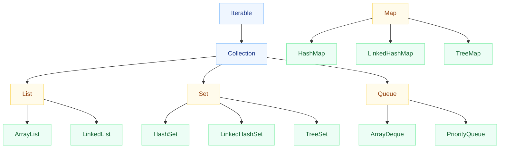

# Java集合框架

> 这篇从集合接口地图讲起，经过 List、Set、Map、Queue 的选型与底层结构，再到迭代器、排序和 Stream 管道，最后落到一个订单销售报表。
>
> 学完能按读写模式、顺序要求和并发约束选对集合，写出不含并发修改异常和空指针的聚合代码。

## 一、接口地图与选型方法

这章解决“面对一组数据，先选哪个接口、再选哪个实现”。

### 1.1 两条继承线

集合框架分两条线：`Collection` 存单个元素，`Map` 存键值对。`Collection` 下分 `List`、`Set`、`Queue`，`Iterable` 是最上层的可遍历契约。



`Collection` 的通用方法包括 `add`、`remove`、`contains`、`size`、`isEmpty`、`iterator`；`Map` 不继承 `Collection`，用 `put`、`get`、`entrySet` 操作。

### 1.2 选型四问

选型先回答四个问题，再看实现类的复杂度。

| 问题 | 是 | 否 |
|---|---|---|
| 是否键值对 | `Map` | `Collection` |
| 是否要求去重 | `Set` | `List` 或 `Queue` |
| 是否按索引访问 | `List` | `Set`、`Queue` |
| 是否按优先级出队 | `Queue` | 其他 |

并发场景再加一问：容器是否会被多个线程同时修改。是则用 `ConcurrentHashMap`、`CopyOnWriteArrayList` 或 `BlockingQueue`，不要给普通集合外面套一层 `synchronized` 就当作并发容器。

### 1.3 初始容量与扩容

`ArrayList` 默认容量 10，满了按 1.5 倍扩容；`HashMap` 默认容量 16、负载因子 0.75，超过阈值按 2 倍扩容并重新分布桶。已知数据量时预设容量，能避免多次复制和 rehash。

```java
// 预计放 1000 个元素，除以 0.75 向上取整，再留给哈希冲突一点余量
Map<String, Integer> counts = new HashMap<>(2048);
List<String> names = new ArrayList<>(1000);
```

边界：容量不是越大越好。一次创建百万容量的空 `ArrayList` 会立刻占用数组空间；数据量小于 10 时默认构造更省内存。

### 1.4 不可变集合

`List.of`、`Set.of`、`Map.of` 创建不可变集合，任何修改都抛 `UnsupportedOperationException`，且不接受 null 元素。

```java
List<String> fixed = List.of("a", "b");
Set<String> tags = Set.of("java", "backend");
Map<String, Integer> scores = Map.of("张三", 90, "李四", 85);

List<String> copy = List.copyOf(fixed); // 独立副本，修改原列表不影响 copy
```

边界：不可变集合的迭代顺序不保证。`Set.of("a", "b")` 多次运行的顺序可能不同，要稳定顺序用 `LinkedHashSet` 或 `List`。`Collections.unmodifiableList` 是视图，原列表改动仍会反映到视图里；`List.copyOf` 才是快照。

版本基线（2026-11-13）：Java 21 LTS。集合实现与 Stream API 按 Java 21 标准库描述；虚拟线程相关的并发容器放到多线程篇展开。

## 二、List

这章解决“有序可重复的数据怎么存、怎么改”。

### 2.1 ArrayList 与 LinkedList

`ArrayList` 用连续数组存储，随机访问 O(1)，尾部追加摊销 O(1)，中间插入删除 O(n)。`LinkedList` 用双向链表，头尾插入删除 O(1)，按下标访问 O(n)，每个节点还有前后指针开销。

| 操作 | ArrayList | LinkedList |
|---|---|---|
| `get(i)` | O(1) | O(n) |
| 尾部 `add` | 摊销 O(1) | O(1) |
| 中间 `add` | O(n) | O(n) 查找 + O(1) 插入 |
| 头部 `add` | O(n) | O(1) |
| 内存局部性 | 好 | 差 |

默认选 `ArrayList`。只有“频繁在头部插入删除、几乎不按索引访问”时才考虑 `LinkedList`；做队列或栈时 `ArrayDeque` 通常更合适。

### 2.2 常用操作

```java
List<String> list = new ArrayList<>();
list.add("b");
list.add("a");
list.add("c");
list.set(0, "B");              // 按索引替换，返回旧值
System.out.println(list);      // [B, a, c]
System.out.println(list.indexOf("a")); // 1
list.remove("a");              // 按值删除，返回 boolean
list.remove(0);                // 按索引删除，返回被删元素
System.out.println(list);      // [c]
```

`remove(int)` 和 `remove(Object)` 是重载：传 `Integer` 时容易误选。删除值为 1 的元素要写 `list.remove(Integer.valueOf(1))`，否则删的是下标 1。

### 2.3 subList 与 Arrays.asList

`subList` 返回原列表的视图，不是副本；对原列表做结构性修改后，视图会失效。

```java
List<Integer> numbers = new ArrayList<>(List.of(1, 2, 3, 4, 5));
List<Integer> view = numbers.subList(1, 4);
System.out.println(view);       // [2, 3, 4]
view.set(0, 20);                // 写视图等于写原列表
System.out.println(numbers);    // [1, 20, 3, 4, 5]

List<Integer> snapshot = List.copyOf(view); // 需要独立副本时复制
numbers.add(6);
// System.out.println(view);    // 抛 ConcurrentModificationException
```

`Arrays.asList` 返回固定长度列表，底层是数组：`set` 可以，`add`、`remove` 抛 `UnsupportedOperationException`。

### 2.4 批量删除

遍历中删除元素要用迭代器的 `remove`，或用 `removeIf`；for-each 里直接 `list.remove` 会抛 `ConcurrentModificationException`。

```java
List<String> names = new ArrayList<>(List.of("张三", "", "李四", " ", "王五"));
names.removeIf(String::isBlank);       // 一次遍历完成判断和删除
System.out.println(names);             // [张三, 李四, 王五]

Iterator<String> it = names.iterator();
while (it.hasNext()) {
    if (it.next().startsWith("李")) {
        it.remove();                    // 迭代器知道删除动作，不会破坏游标
    }
}
System.out.println(names);             // [张三, 王五]
```

边界：`removeIf` 的谓词不要修改同一个列表；需要跨元素判断时先收集下标，再统一删除。

## 三、Set

这章解决“去重和顺序怎么同时满足”。

### 3.1 三种 Set

| 实现 | 顺序 | 查找 | 典型用途 |
|---|---|---|---|
| `HashSet` | 无保证 | O(1) | 快速去重 |
| `LinkedHashSet` | 插入顺序 | O(1) | 去重且保留首次出现顺序 |
| `TreeSet` | 排序顺序 | O(log n) | 去重且需要范围查询 |

```java
Set<String> hash = new HashSet<>(List.of("b", "a", "b"));
Set<String> linked = new LinkedHashSet<>(List.of("b", "a", "b"));
Set<String> tree = new TreeSet<>(List.of("b", "a", "b"));
System.out.println(hash);    // [a, b]，顺序不保证
System.out.println(linked);  // [b, a]
System.out.println(tree);    // [a, b]
```

### 3.2 equals 与 hashCode 契约

`HashSet` 先用 `hashCode` 定位桶，再用 `equals` 比较。只重写 `equals` 不重写 `hashCode`，两个相等对象会落进不同桶，去重失效。

```java
final class User {
    private final String id;
    User(String id) { this.id = id; }

    @Override
    public boolean equals(Object o) {
        return o instanceof User u && id.equals(u.id);
    }

    @Override
    public int hashCode() {
        return id.hashCode();       // 必须与 equals 使用同一组字段
    }
}

Set<User> users = new HashSet<>();
users.add(new User("U-1"));
users.add(new User("U-1"));
System.out.println(users.size()); // 1
```

边界：把对象放进 `HashSet` 后再修改参与哈希的字段，集合找不到它，也删不掉。键对象应不可变，或在入集合后不再修改。

### 3.3 TreeSet 与 Comparator

`TreeSet` 按 `compareTo` 或构造器传入的 `Comparator` 排序，要求元素可比较；自然排序时插入 null 会抛 `NullPointerException`。

```java
Comparator<String> byLength = Comparator.comparingInt(String::length)
    .thenComparing(Comparator.naturalOrder());
Set<String> words = new TreeSet<>(byLength);
words.add("java");
words.add("go");
words.add("rust");
System.out.println(words); // [go, java, rust]
```

边界：`TreeSet` 判断重复用的是 `compareTo` 返回 0，不是 `equals`。比较器只按长度比较时，"ab" 和 "cd" 会被视为同一个元素，必须补上稳定的次关键字。

### 3.4 去重保序的选择

需要保留首次出现顺序时用 `LinkedHashSet`；只需要去重、不关心顺序时用 `HashSet`；需要排序或范围查询时用 `TreeSet`。Stream 的 `distinct()` 对有序流保留遇到顺序，但内部仍依赖 `equals/hashCode`。

## 四、Map

这章解决“键值数据怎么存、怎么算、怎么遍历”。

### 4.1 HashMap 的结构

`HashMap` 是数组 + 链表 + 红黑树。键的哈希经过扰动后映射到桶：`(n - 1) & (h ^ (h >>> 16))`，让高位也参与索引计算，减少冲突。链表长度达到 8 且容量至少 64 时转红黑树，节点减少到 6 时退回链表。

默认容量 16、负载因子 0.75：元素数超过 `容量 × 0.75` 就扩容为两倍，并把节点分到原索引或“原索引 + 旧容量”两个位置。扩容是 O(n)，所以预设容量比反复扩容划算。

### 4.2 常用实现对比

| 实现 | 顺序 | null 键/值 | 线程安全 | 典型用途 |
|---|---|---|---|---|
| `HashMap` | 无保证 | 允许一个 null 键 | 否 | 通用键值存储 |
| `LinkedHashMap` | 插入或访问顺序 | 允许 | 否 | 保序、LRU 缓存 |
| `TreeMap` | 键排序 | 不允许 null 键 | 否 | 范围查询、有序输出 |
| `ConcurrentHashMap` | 无保证 | 不允许 | 是 | 并发读写 |

`LinkedHashMap` 构造器第三个参数 `accessOrder=true` 时按访问顺序排列，重写 `removeEldestEntry` 可以实现简单的 LRU 缓存。

### 4.3 原子复合操作

`get` 后 `put` 不是原子操作，并发下会丢更新。`Map` 接口提供的 `computeIfAbsent`、`merge`、`compute` 把“读—算—写”收进一次调用。

```java
Map<String, Integer> counts = new HashMap<>();
for (String word : List.of("java", "go", "java", "rust", "java")) {
    counts.merge(word, 1, Integer::sum);   // 键不存在时放 1，存在时累加
}
System.out.println(counts); // 内容为 java=3、go=1、rust=1，遍历顺序不保证

Map<String, List<String>> byCity = new HashMap<>();
byCity.computeIfAbsent("北京", key -> new ArrayList<>()).add("张三");
System.out.println(byCity); // {北京=[张三]}
```

边界：`computeIfAbsent` 的映射函数里不要修改同一个 Map，`HashMap` 会抛 `ConcurrentModificationException`，`ConcurrentHashMap` 可能死锁。映射函数要短、无副作用。

### 4.4 遍历与顺序

遍历键值对用 `entrySet`，避免“遍历 key 再 get”的重复查找。

```java
Map<String, Integer> scores = new LinkedHashMap<>();
scores.put("张三", 90);
scores.put("李四", 85);

for (Map.Entry<String, Integer> entry : scores.entrySet()) {
    System.out.println(entry.getKey() + "=" + entry.getValue());
}

scores.forEach((name, score) -> System.out.println(name + ":" + score));
```

需要按值排序时，把 `entrySet` 转成流排序，不能直接对 `HashMap` 排序：

```java
scores.entrySet().stream()
    .sorted(Map.Entry.<String, Integer>comparingByValue().reversed())
    .forEach(entry -> System.out.println(entry.getKey()));
```

### 4.5 null 的边界

`HashMap` 允许一个 null 键和多个 null 值，`get` 返回 null 既可能表示“键不存在”，也可能表示“值就是 null”。需要区分时用 `containsKey`。`ConcurrentHashMap` 和 `Map.of` 都不允许 null 键或值，迁移代码时要先清理 null。

## 五、Queue 与 Deque

这章解决“排队、栈和优先级怎么表达”。

### 5.1 Queue 的两套方法

`Queue` 的每个操作都有“失败抛异常”和“失败返回特殊值”两个版本。

| 操作 | 抛异常 | 返回特殊值 |
|---|---|---|
| 入队 | `add(e)` | `offer(e)` |
| 出队 | `remove()` | `poll()` |
| 查看队首 | `element()` | `peek()` |

容量受限的队列用 `offer`，避免队列满时抛异常；普通场景两者等价。`poll` 和 `peek` 在空队列返回 null，适合“没有就继续”的循环。

### 5.2 ArrayDeque

`ArrayDeque` 用循环数组实现双端队列，同时支持队列和栈，性能优于遗留的 `Stack`（继承 `Vector`，方法同步）和 `LinkedList`。

```java
Deque<String> stack = new ArrayDeque<>();
stack.push("a");
stack.push("b");									// push插入队首，b a
System.out.println(stack.pop());  // b，pop取出队首

Deque<String> queue = new ArrayDeque<>();
queue.offer("a");
queue.offer("b");									// offer插入队尾，a b
System.out.println(queue.poll()); // a，poll取出队首
```

边界：`ArrayDeque` 不允许 null，`push(null)` 抛 `NullPointerException`；需要存 null 时改用 `LinkedList`，但通常应该先修数据。

### 5.3 PriorityQueue

`PriorityQueue` 是二叉堆，`offer`/`poll` 为 O(log n)，`peek` 为 O(1)。它只保证队首是最小（或按比较器的最优）元素，遍历顺序不排序。

```java
record Task(String name, int priority) {}

Queue<Task> tasks = new PriorityQueue<>(
    Comparator.comparingInt(Task::priority).reversed());
tasks.offer(new Task("发布", 1));
tasks.offer(new Task("修复线上", 3));
tasks.offer(new Task("写文档", 2));

while (!tasks.isEmpty()) {
    System.out.println(tasks.poll().name());
}
```

```text
修复线上
写文档
发布
```

边界：`PriorityQueue` 不是稳定队列，同优先级元素的出队顺序不确定；需要稳定顺序时在比较器里补一个自增序号。遍历 `PriorityQueue` 只看到堆数组顺序，不是有序结果。

### 5.4 BlockingQueue

`BlockingQueue` 在队列空时阻塞 `take`、队列满时阻塞 `put`，是生产者—消费者模型的基础。`ArrayBlockingQueue` 有界，`LinkedBlockingQueue` 默认近似无界（建议显式给容量），`SynchronousQueue` 不存储元素，直接交给消费者。

## 六、迭代器与并发修改

这章解决“遍历时能不能改集合、改了为什么报错”。

### 6.1 fail-fast

`ArrayList`、`HashMap` 等非并发集合用 `modCount` 记录结构性修改次数。迭代器每取一个元素就检查 `modCount` 是否变化，变化则抛 `ConcurrentModificationException`。这是“尽快失败”的保护，不是线程安全机制。

```java
List<String> list = new ArrayList<>(List.of("a", "b", "c"));
for (String item : list) {
    if (item.equals("b")) {
        list.remove(item); // 抛 ConcurrentModificationException
    }
}
```

### 6.2 正确删除

```java
Iterator<String> iterator = list.iterator();
while (iterator.hasNext()) {
    if (iterator.next().equals("b")) {
        iterator.remove();  // 通过迭代器删除，modCount 与游标同步
    }
}

list.removeIf(item -> item.equals("b")); // 更简洁，内部同样走迭代器
```

需要删除多个条件时，`removeIf` 的谓词只做判断，不要在谓词里再调用 `list.remove`。

### 6.3 遍历中修改的替代方案

先收集要改的内容，遍历结束后统一应用：

```java
List<String> toRemove = new ArrayList<>();
for (String item : list) {
    if (item.startsWith("tmp-")) toRemove.add(item);
}
list.removeAll(toRemove);
```

`ConcurrentHashMap` 的迭代器是弱一致的，遍历时允许其他线程修改，不抛 `ConcurrentModificationException`，但看到的是某个时刻的近似视图，不适合要求强一致的统计。

### 6.4 下标循环与 for-each

需要下标做 `set` 或按位置删除时用普通 `for`；只读遍历用 for-each。反向删除可以避免下标前移：

```java
for (int i = list.size() - 1; i >= 0; i--) {
    if (list.get(i).isBlank()) list.remove(i);
}
```

## 七、排序与比较器

这章解决“按多个字段排序、空值放哪、比较器怎么写才不溢出”。

### 7.1 Comparable 与 Comparator

`Comparable` 是类自身的自然顺序，`compareTo` 只能有一份；`Comparator` 是外部比较策略，可以按场景写多份。

```java
record Order(String city, BigDecimal amount) implements Comparable<Order> {
    @Override
    public int compareTo(Order other) {
        return amount.compareTo(other.amount);  // 自然顺序：金额升序
    }
}

Comparator<Order> byCity = Comparator.comparing(Order::city);
Comparator<Order> byAmountDesc = Comparator.comparing(Order::amount).reversed();
```

### 7.2 Comparator 链

多关键字排序用 `thenComparing`，不要写一个巨大的 lambda。

```java
Comparator<Order> byCityThenAmount = Comparator.comparing(Order::city)
    .thenComparing(Order::amount, Comparator.reverseOrder());

List<Order> sorted = new ArrayList<>(orders);
sorted.sort(byCityThenAmount);
```

空值用 `nullsFirst` / `nullsLast` 明确位置：

```java
Comparator<String> byName = Comparator.nullsLast(Comparator.naturalOrder());
```

边界：`Comparator.comparing(Order::amount).reversed()` 只反转金额，不反转后续的 `thenComparing`；链式调用要按“主关键字在前”的顺序写。

### 7.3 稳定性

对象数组和 `List.sort` 使用稳定的 TimSort：相等元素的相对顺序保持不变。基本类型数组的 `Arrays.sort` 使用双轴快排，不保证稳定，也没有“相等元素”的概念。

多关键字排序有两种写法：一个组合比较器，或先按次关键字排序、再按主关键字稳定排序。后者依赖稳定性，读起来更直观，但两次排序的成本更高。

### 7.4 比较器的契约

比较器必须满足自反、反对称、传递。常见错误是 `(a, b) -> a - b`，两个大整数相减会溢出，导致排序结果错乱甚至抛 `IllegalArgumentException: Comparison method violates its general contract`。

```java
// 错误：可能溢出
Comparator<Integer> bad = (a, b) -> a - b;

// 正确：用 JDK 的比较方法
Comparator<Integer> good = Integer::compare;
Comparator<Order> byAmount = Comparator.comparing(Order::amount);
```

`TreeMap`/`TreeSet` 用 `compareTo == 0` 判断键相同；如果比较结果与 `equals` 不一致，会出现“明明不相等却覆盖”的现象。

## 八、Stream 管道

这章解决“怎样用声明式写法完成过滤、转换和聚合”。

### 8.1 惰性与终止操作

Stream 由数据源、若干中间操作和终止操作组成。中间操作（`filter`、`map`、`sorted`、`distinct`）是惰性的，没有终止操作就不会执行。

```java
List<String> names = List.of("张三", "李四", "王五");
long count = names.stream()
    .filter(name -> name.startsWith("张"))  // 中间操作，先记录
    .count();                               // 终止操作，这时才真正遍历
System.out.println(count); // 1
```

同一个流只能消费一次，终止操作后再调用会抛 `IllegalStateException`。需要复用就重新 `stream()`。

### 8.2 常用收集器

| 收集器 | 结果 | 典型用途 |
|---|---|---|
| `toList()` | 列表 | 收集过滤结果 |
| `joining(",")` | 字符串 | 拼接名称 |
| `groupingBy(fn)` | `Map<K, List<T>>` | 分组 |
| `partitioningBy(pred)` | `Map<Boolean, List<T>>` | 按条件二分 |
| `counting()` / `summingInt()` | 数量 / 求和 | 聚合指标 |

```java
Map<String, Long> countByCity = orders.stream()
    .collect(Collectors.groupingBy(Order::city, Collectors.counting()));

Map<Boolean, List<Order>> bigOrders = orders.stream()
    .collect(Collectors.partitioningBy(o -> o.amount().compareTo(BigDecimal.TEN) > 0));
```

### 8.3 flatMap

`flatMap` 把“每个元素产生一个流”展平成一个流，适合处理嵌套集合或多值字段。

```java
List<List<String>> nested = List.of(List.of("a", "b"), List.of("c"));
List<String> flat = nested.stream()
    .flatMap(List::stream)
    .distinct()
    .toList();
System.out.println(flat); // [a, b, c]
```

`map` 是“一对一的转换”，`flatMap` 是“一对多再合并”；把 `map` 写成返回 `List` 会得到 `Stream<List<T>>`，后续还要再展平。

### 8.4 并行流的边界

`parallelStream` 使用公共 ForkJoinPool，适合“数据量大、CPU 密集、无共享可变状态”的计算。IO 等待、数据量小、需要顺序或依赖线程上下文时不要用。

```java
long total = IntStream.rangeClosed(1, 1_000_000)
    .parallel()
    .asLongStream()
    .sum();
System.out.println(total); // 500000500000
```

并行流的收集器必须线程安全，`forEachOrdered` 能保序但会抵消部分并行收益。生产环境先测吞吐和延迟，不要因为“看起来更快”就加 `parallel`。

### 8.5 调试 Stream

`peek` 只用于观察流水线，不作为业务逻辑；调试时可以在 lambda 里打断点，或把中间结果 `toList()` 后检查。

```java
List<String> result = names.stream()
    .filter(name -> !name.isBlank())
    .peek(name -> System.out.println("过滤后: " + name)) // 仅调试
    .map(String::trim)
    .toList();
```

## 九、最佳实践案例

### 9.1 案例背景

运营每天需要一张销售报表：按品类汇总订单数和金额、按城市取销售额前三、列出金额不低于 1000 的订单、给出每个品类覆盖的城市集合。数据来自订单表，当前只有 10 条示例数据，月底会增长到百万级。约束是金额精确到分、输出顺序稳定、同一份代码既能跑小数据也能换成分页查询。

### 9.2 案例实操

```java
import java.math.BigDecimal;
import java.math.RoundingMode;
import java.util.Comparator;
import java.util.List;
import java.util.Map;
import java.util.Set;
import java.util.TreeMap;
import java.util.TreeSet;
import java.util.stream.Collectors;

public class SalesReport {

    record Order(String id, String city, String category, BigDecimal amount) {}

    public static void main(String[] args) {
        List<Order> orders = List.of(
            new Order("O-1001", "北京", "数码", new BigDecimal("1299.00")),
            new Order("O-1002", "上海", "家电", new BigDecimal("899.00")),
            new Order("O-1003", "北京", "数码", new BigDecimal("399.00")),
            new Order("O-1004", "广州", "食品", new BigDecimal("128.50")),
            new Order("O-1005", "上海", "数码", new BigDecimal("2499.00")),
            new Order("O-1006", "北京", "家电", new BigDecimal("1599.00")),
            new Order("O-1007", "深圳", "食品", new BigDecimal("89.90")),
            new Order("O-1008", "广州", "家电", new BigDecimal("1102.00")),
            new Order("O-1009", "深圳", "数码", new BigDecimal("1001.00")),
            new Order("O-1010", "上海", "食品", new BigDecimal("66.00"))
        );

        BigDecimal total = orders.stream()
            .map(Order::amount)
            .reduce(BigDecimal.ZERO, BigDecimal::add);
        System.out.printf("订单总数: %d, 总金额: %.2f, 客单价: %.2f%n",
            orders.size(), total,
            total.divide(BigDecimal.valueOf(orders.size()), 2, RoundingMode.HALF_UP));

        System.out.println("\n按品类汇总（金额降序）");
        Map<String, BigDecimal> categoryTotals = orders.stream()
            .collect(Collectors.groupingBy(Order::category,
                Collectors.reducing(BigDecimal.ZERO, Order::amount, BigDecimal::add)));
        Map<String, Long> categoryCounts = orders.stream()
            .collect(Collectors.groupingBy(Order::category, Collectors.counting()));

        categoryTotals.entrySet().stream()
            .sorted(Map.Entry.<String, BigDecimal>comparingByValue().reversed())
            .forEach(entry -> {
                long count = categoryCounts.get(entry.getKey());
                BigDecimal avg = entry.getValue()
                    .divide(BigDecimal.valueOf(count), 2, RoundingMode.HALF_UP);
                System.out.printf("%s\t%d 单\t合计 %.2f\t均价 %.2f%n",
                    entry.getKey(), count, entry.getValue(), avg);
            });

        System.out.println("\n城市销售额 Top 3");
        List<Map.Entry<String, BigDecimal>> topCities = orders.stream()
            .collect(Collectors.groupingBy(Order::city,
                Collectors.reducing(BigDecimal.ZERO, Order::amount, BigDecimal::add)))
            .entrySet().stream()
            .sorted(Map.Entry.<String, BigDecimal>comparingByValue().reversed())
            .limit(3)
            .toList();
        for (int i = 0; i < topCities.size(); i++) {
            Map.Entry<String, BigDecimal> entry = topCities.get(i);
            System.out.printf("%d. %s %.2f%n", i + 1, entry.getKey(), entry.getValue());
        }

        System.out.println("\n金额 >= 1000 的订单（降序）");
        orders.stream()
            .filter(order -> order.amount().compareTo(new BigDecimal("1000")) >= 0)
            .sorted(Comparator.comparing(Order::amount).reversed())
            .forEach(order -> System.out.printf("%s %s %s %.2f%n",
                order.id(), order.city(), order.category(), order.amount()));

        System.out.println("\n品类 -> 城市集合");
        Map<String, Set<String>> citiesByCategory = orders.stream()
            .collect(Collectors.groupingBy(Order::category, TreeMap::new,
                Collectors.mapping(Order::city, Collectors.toCollection(TreeSet::new))));
        citiesByCategory.forEach((category, cities) ->
            System.out.println(category + " -> " + cities));
    }
}
```

```bash
javac -encoding UTF-8 SalesReport.java
java SalesReport
```

预期输出：

```text
订单总数: 10, 总金额: 9082.40, 客单价: 908.24

按品类汇总（金额降序）
数码	4 单	合计 5198.00	均价 1299.50
家电	3 单	合计 3600.00	均价 1200.00
食品	3 单	合计 284.40	均价 94.80

城市销售额 Top 3
1. 上海 3464.00
2. 北京 3297.00
3. 广州 1230.50

金额 >= 1000 的订单（降序）
O-1005 上海 数码 2499.00
O-1006 北京 家电 1599.00
O-1001 北京 数码 1299.00
O-1008 广州 家电 1102.00
O-1009 深圳 数码 1001.00

品类 -> 城市集合
家电 -> [上海, 北京, 广州]
数码 -> [上海, 北京, 深圳]
食品 -> [上海, 广州, 深圳]
```

### 9.3 案例结果

总额 9082.40、客单价 908.24 与逐条相加一致；品类合计 5198 + 3600 + 284.40 等于总额；城市 Top 3 的 3464 + 3297 + 1230.50 加上深圳的 1090.90 也回到总额。分组用 `TreeMap` 固定输出顺序，金额用 `BigDecimal` 避免 `0.1 + 0.2` 的精度误差。

失败模式有四个。第一，金额为 null 时 `map(Order::amount)` 直接 NPE，入口要校验或过滤。第二，订单号重复会让“订单数”虚高，聚合前按 `id` 去重。第三，`BigDecimal` 用 `equals` 比较会区分 `1000` 和 `1000.00`，阈值判断统一用 `compareTo`。第四，直接对 `HashMap` 的 `entrySet` 输出，顺序随哈希变化，报表每次跑出来不一样；需要稳定顺序就显式排序或换 `TreeMap`。

数据量到百万级时，这段代码仍然是一次全量遍历、O(n log n) 排序，主要成本在排序和分组对象分配。优化方向是先在数据库做 `GROUP BY`，Java 只处理聚合后的小结果；不要用 `parallelStream` 硬扛，公共 ForkJoinPool 被多个请求共享，容易把延迟放大。复盘：集合选型先看“是否需要顺序、是否需要去重、是否按键查找”，Stream 只负责表达聚合，不负责替数据库做它擅长的事。
