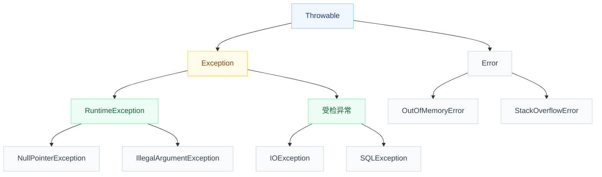

# Java异常与IO

> 这篇从异常体系和传播规则讲起，经过 try-with-resources、Path/Files、字节流与字符流、序列化，最后落到一个能处理坏行、原子写报告的 CSV 汇总程序。
>
> 学完能设计受检与非受检异常的边界，写出不泄漏文件句柄的 IO 代码，并在编码、换行和部分写入上快速定位问题。

## 一、异常体系与传播

这章解决“什么错误该抛、抛了由谁接、异常信息怎么保留”。

### 1.1 Throwable 的三层结构

Java 的异常都继承 `Throwable`，下分 `Error` 和 `Exception`；`Exception` 再分受检异常（checked）和运行时异常（unchecked）。



`Error` 表示 JVM 无法恢复的问题，如内存耗尽、栈溢出，业务代码不应捕获。`RuntimeException` 表示编程错误或状态错误，如空指针、数组越界、参数非法。受检异常表示调用方可以恢复的外部失败，如文件不存在、网络中断、数据库连接失败。

### 1.2 受检与非受检的选择

| 场景 | 选择 | 例子 |
|---|---|---|
| 调用方应重试或提示用户 | 受检异常 | 文件不存在、远程超时 |
| 参数或状态违反契约 | 运行时异常 | 金额为负、状态不允许 |
| JVM 级故障 | 不捕获 | `OutOfMemoryError` |
| 框架边界统一转换 | 自定义运行时异常 | 业务校验失败 |

规则：异常类型是 API 的一部分。方法声明 `throws IOException`，调用方就必须面对“IO 可能失败”；把可恢复失败包成 `RuntimeException`，会让调用方失去强制处理的机会。

边界：不要为了“少写 try-catch”把所有异常都改成运行时异常。检查型异常被吞掉后，故障只会在更远的地方以更模糊的形式出现。

### 1.3 异常链与上下文

捕获后重新抛出时，把原异常作为 `cause` 传入，保留完整调用链。

```java
public Order load(String id) {
    try {
        return repository.find(id);
    } catch (SQLException e) {
        // 保留底层 cause，同时补充业务上下文
        throw new OrderLoadException("加载订单失败: " + id, e);
    }
}
```

`printStackTrace()` 只适合本地调试；生产代码用日志框架记录一次，包含订单号、用户号、请求 ID 等定位信息。同一异常在多层重复打印，会把日志放大数倍。

### 1.4 finally 与 return 的陷阱

`finally` 在方法返回前执行，常用于释放资源；但在 `finally` 里写 `return` 会覆盖 `try` 的返回值，也会吞掉异常。

```java
static int bad() {
    try {
        return 1;
    } finally {
        return 2;   // 返回值被改成 2，异常也会被吞掉
    }
}
```

`System.exit()` 会直接终止 JVM，`finally` 不一定执行。资源释放统一用 try-with-resources，不手写 `finally` 里的 `close`。

版本基线（2026-11-13）：Java 21 LTS。try-with-resources、NIO.2、`ObjectInputFilter` 均按 Java 21 描述；字符集默认值与 JEP 400 一致。

## 二、异常处理策略

这章解决“捕获之后做什么，怎样让异常可诊断”。

### 2.1 捕获具体异常

只捕获能处理的异常，不要用 `catch (Exception e)` 包住整段业务。

```java
try {
    int port = Integer.parseInt(config.get("port"));
    start(port);
} catch (NumberFormatException e) {
    throw new IllegalArgumentException("端口不是数字: " + config.get("port"), e);
} catch (IOException e) {
    throw new IllegalStateException("端口被占用: " + config.get("port"), e);
}
```

多个异常处理方式相同时用多捕获：`catch (IOException | SQLException e)`。捕获后至少做一件事：恢复、转换、记录并重抛；空 `catch` 块是最危险的写法。

### 2.2 自定义异常

业务异常携带错误码和可展示消息，技术异常保留原始 cause。

```java
public class OrderException extends RuntimeException {
    private final String code;

    public OrderException(String code, String message, Throwable cause) {
        super(message, cause);
        this.code = code;
    }

    public String code() {
        return code;
    }
}
```

边界：自定义异常不要继承 `Throwable` 或 `Error`；不要把所有业务异常塞进一个类，按“调用方处理方式”分类，而不是按“出错模块”分类。

### 2.3 try-with-resources

实现了 `AutoCloseable` 的资源可以放在 `try` 的括号里，退出时按声明的逆序自动关闭；关闭时的异常作为 suppressed 附加到主异常上。

```java
try (BufferedReader reader = Files.newBufferedReader(path, StandardCharsets.UTF_8);
     BufferedWriter writer = Files.newBufferedWriter(report, StandardCharsets.UTF_8)) {
    String line;
    while ((line = reader.readLine()) != null) {
        writer.write(line);
        writer.newLine();
    }
} catch (IOException e) {
    // reader 和 writer 都会关闭，writer 的关闭异常不会覆盖这里的异常
    throw new UncheckedIOException("复制失败: " + path, e);
}
```

资源声明的顺序决定关闭顺序：先关 writer，再关 reader。多个资源共享同一底层流时，关闭最外层即可，重复关闭通常无害，但包装层各自关闭可能抛异常。

### 2.4 全局异常边界

异常处理集中在边界，不要每层都捕获。命令行程序在 `main` 捕获并设置退出码；Web 程序用统一异常处理器把异常映射成 HTTP 状态码和错误体。

```java
public static void main(String[] args) {
    try {
        run(args);
    } catch (OrderException e) {
        System.err.println("业务失败 [" + e.code() + "]: " + e.getMessage());
        System.exit(2);
    } catch (Exception e) {
        e.printStackTrace();
        System.exit(1);
    }
}
```

边界：全局捕获只负责“最后一层兜底”，不能代替局部处理。数据库连接失败可以在局部重试，参数错误应该立即返回 400，不需要重试。

### 2.5 日志与异常

记录异常时保留栈，但不要重复记录。日志中放业务标识（订单号、请求 ID），不放密码、令牌、完整身份证号。`log.error("加载失败", e)` 只写一次；上层再包装时，避免把同一个栈打印三次。

## 三、Path 与 Files

这章解决“怎样用现代 API 安全地读写文件和目录”。

### 3.1 Path 的构造与解析

`Path` 表示路径，不表示文件内容；`Paths.get` 是旧写法，`Path.of` 更直接。

```java
Path base = Path.of("data/orders");
Path file = base.resolve("2026-11.csv");
Path normalized = Path.of("data/./orders/../orders/2026-11.csv").normalize();

System.out.println(file);        // data/orders/2026-11.csv
System.out.println(normalized);  // data/orders/2026-11.csv
System.out.println(base.relativize(file)); // 2026-11.csv
```

| 方法 | 用途 | 注意 |
|---|---|---|
| `resolve` | 拼接路径 | 绝对路径参数会替换原路径 |
| `relativize` | 求相对路径 | 两个路径的根必须一致 |
| `normalize` | 去掉 `.` 和 `..` | 不访问文件系统 |
| `toAbsolutePath` | 转绝对路径 | 依赖当前工作目录 |
| `startsWith` / `endsWith` | 前缀判断 | 按路径段比较，不是字符串 |

`normalize` 只做字符串层面的简化，不检查文件是否存在，也不解析符号链接。安全校验要用 `toRealPath()` 后再比较根目录，防止 `../` 越界。

### 3.2 小文件读写

小文件直接用 `Files.readString`、`Files.writeString`，默认 UTF-8；需要按行处理时用 `readAllLines` 或 `lines()`。

```java
Path path = Path.of("data/note.txt");
Files.createDirectories(path.getParent());
Files.writeString(path, "第一行\n第二行\n", StandardCharsets.UTF_8);

String content = Files.readString(path, StandardCharsets.UTF_8);
System.out.println(content.lines().count()); // 2

List<String> lines = Files.readAllLines(path, StandardCharsets.UTF_8);
System.out.println(lines); // [第一行, 第二行]
```

边界：`readAllLines` 把整个文件读进内存，大文件用 `Files.lines` 流式读取，并在 try-with-resources 中关闭流。

### 3.3 目录遍历

```java
try (Stream<Path> paths = Files.walk(Path.of("data"), 2)) {
    paths.filter(Files::isRegularFile)
        .forEach(path -> System.out.println(path));
}
```

`Files.walk` 返回的流必须关闭，否则目录句柄会泄漏；`Files.list` 只列一层，同样需要关闭。遍历大目录时用 `Files.find` 加条件，避免先列出再过滤。

### 3.4 文件操作

```java
Path source = Path.of("data/orders.csv");
Path target = Path.of("data/backup/orders.csv");

Files.createDirectories(target.getParent());
System.out.println(Files.exists(source));
System.out.println(Files.size(source));
Files.copy(source, target, StandardCopyOption.REPLACE_EXISTING);
Files.move(target, Path.of("data/backup/orders-2026-11.csv"),
    StandardCopyOption.REPLACE_EXISTING);
Files.deleteIfExists(Path.of("data/tmp.txt"));
```

`Files.copy` 默认不覆盖，目标存在时抛 `FileAlreadyExistsException`；`Files.move` 跨文件系统时可能退化为复制加删除，不是原子操作。

### 3.5 原子写

先写同目录临时文件，写完再原子改名，读者要么看到旧文件，要么看到完整的新文件，不会看到写了一半的内容。

```java
Path target = Path.of("data/report.txt");
Path tmp = Files.createTempFile(target.getParent(), "report-", ".tmp");
try (BufferedWriter writer = Files.newBufferedWriter(tmp, StandardCharsets.UTF_8)) {
    writer.write("完整内容");
    writer.newLine();
}
try {
    Files.move(tmp, target,
        StandardCopyOption.REPLACE_EXISTING, StandardCopyOption.ATOMIC_MOVE);
} catch (AtomicMoveNotSupportedException e) {
    Files.move(tmp, target, StandardCopyOption.REPLACE_EXISTING); // 退化方案
}
```

临时文件必须和目标在同一目录、同一文件系统，跨目录的 `move` 不保证原子。`ATOMIC_MOVE` 不是所有文件系统都支持，捕获 `AtomicMoveNotSupportedException` 后要有明确降级。

## 四、字节流与字符流

这章解决“二进制和文本分别用什么流、编码在哪里指定”。

### 4.1 四个抽象基类

| 基类 | 数据单位 | 典型实现 |
|---|---|---|
| `InputStream` | 字节 | `FileInputStream`、`BufferedInputStream` |
| `OutputStream` | 字节 | `FileOutputStream`、`BufferedOutputStream` |
| `Reader` | 字符 | `FileReader`、`BufferedReader` |
| `Writer` | 字符 | `FileWriter`、`BufferedWriter` |

字节流处理图片、压缩包、协议数据；字符流处理文本，负责把字节按字符集解码成 `char`。`InputStreamReader` 和 `OutputStreamWriter` 是字节与字符之间的桥。

### 4.2 字节流复制文件

```java
Path source = Path.of("data/logo.png");
Path target = Path.of("data/logo-copy.png");

try (InputStream in = new BufferedInputStream(Files.newInputStream(source));
     OutputStream out = new BufferedOutputStream(Files.newOutputStream(target))) {
    in.transferTo(out);   // Java 9+，内部按缓冲区循环读写
}
```

缓冲区把多次小粒度系统调用合并成较大块，复制大文件时差异明显。`transferTo` 不需要手写 `byte[]` 循环，但仍然是流式复制，不把整个文件读进内存。

### 4.3 字符流与编码

```java
try (BufferedReader reader = Files.newBufferedReader(path, StandardCharsets.UTF_8)) {
    String line;
    while ((line = reader.readLine()) != null) {
        System.out.println(line);
    }
}
```

`Files.newBufferedReader` 默认就是 UTF-8，但显式写出字符集能防止“换环境就乱码”。`FileReader` 使用平台默认字符集，在 Windows 中文环境下可能是 GBK，跨平台代码不要用它。

### 4.4 缓冲与 flush

`BufferedWriter` 把字符攒在内存里，缓冲区满或调用 `flush` 时才写入底层。`close` 会先 `flush` 再关闭；只 `flush` 不关闭会留下未释放的句柄。

```java
try (BufferedWriter writer = Files.newBufferedWriter(path, StandardCharsets.UTF_8)) {
    writer.write("第一行");
    writer.newLine();
    writer.flush();          // 需要立刻让其他进程看到时才手动 flush
    writer.write("第二行");
}                            // 退出时自动 flush 并 close
```

`PrintWriter` 会吞掉 IO 异常，只在内部记录状态；用它写文件时要调用 `checkError()`，否则磁盘满也不会抛异常。

### 4.5 乱码的三个原因

1. 写入和读取用了不同字符集，例如写入 UTF-8、读取 GBK；
2. 同一段文本被重复编码，例如 UTF-8 字节被当成 Latin-1 再转一次；
3. 终端或编辑器字体不支持，文件本身没问题。

排查顺序：先用 `file -i data.txt` 看声明编码，再用 `xxd -l 64 data.txt` 看字节序列。UTF-8 的中文通常以 `e4` 到 `e9` 开头，GBK 常见 `c4`、`d6` 等双字节组合。

## 五、NIO 与高性能 IO

这章解决“大文件和高吞吐场景什么时候需要 Channel 和 Buffer”。

### 5.1 Buffer 与 Channel

`ByteBuffer` 是通道读写的数据容器，核心是 position、limit、capacity 三个指针。写完后 `flip()` 切换到读模式，读完 `clear()` 或 `compact()` 复位。

```java
try (FileChannel channel = FileChannel.open(path, StandardOpenOption.READ)) {
    ByteBuffer buffer = ByteBuffer.allocate(1024);
    while (channel.read(buffer) != -1) {
        buffer.flip();                 // 从写模式切到读模式
        while (buffer.hasRemaining()) {
            System.out.print((char) buffer.get());
        }
        buffer.clear();                // 清空，准备下一次写
    }
}
```

边界：`flip` 和 `clear` 用错会导致读不到数据或死循环；文本解码仍应交给 `CharsetDecoder`，不要把字节直接强转 `char`。

### 5.2 transferTo 与内存映射

`FileChannel.transferTo` 让内核直接把数据从文件通道送到另一个通道，减少用户态拷贝；`MappedByteBuffer` 把文件映射到内存，适合随机访问大文件。

```java
try (FileChannel in = FileChannel.open(source, StandardOpenOption.READ);
     FileChannel out = FileChannel.open(target, StandardOpenOption.WRITE,
         StandardOpenOption.CREATE, StandardOpenOption.TRUNCATE_EXISTING)) {
    long position = 0;
    while (position < in.size()) {
        position += in.transferTo(position, in.size() - position, out);
    }
}
```

边界：内存映射的释放依赖垃圾回收，删除或重命名映射文件在 Windows 上可能失败；大文件映射要分段，不要一次映射几个 GB。

### 5.3 什么时候不用 NIO

小文件、低频读写、逻辑简单时，`Files` 加缓冲流更短、更容易维护。NIO 的收益在连接数多、数据量大、需要零拷贝或非阻塞的场景；为了“看起来高级”引入 Channel，通常只会增加边界条件。

## 六、序列化

这章解决“对象怎样变成字节、跨版本怎样兼容、为什么不能反序列化不可信数据”。

### 6.1 Java 序列化机制

实现 `Serializable` 的类可以通过 `ObjectOutputStream` 写成字节流，通过 `ObjectInputStream` 读回对象。`Serializable` 是标记接口，没有方法；`serialVersionUID` 用来判断类的版本是否兼容。

```java
import java.io.Serializable;

public class Session implements Serializable {
    private static final long serialVersionUID = 1L; // 显式固定，避免编译器生成值随字段变化

    private final String user;
    private final transient String token;            // 不写入字节流

    public Session(String user, String token) {
        this.user = user;
        this.token = token;
    }
}
```

不写 `serialVersionUID` 时，编译器根据类结构生成一个值；增加字段或修改方法后值会变化，旧数据反序列化抛 `InvalidClassException`。

### 6.2 transient 与自定义读写

`transient` 字段不参与默认序列化，反序列化后是默认值（对象为 null，数字为 0）。需要恢复派生字段或做校验时，实现 `readObject`。

```java
private void readObject(ObjectInputStream in)
        throws IOException, ClassNotFoundException {
    in.defaultReadObject();          // 先按默认规则读入非 transient 字段
    if (user == null || user.isBlank()) {
        throw new InvalidObjectException("user 不能为空");
    }
}
```

边界：`readObject` 是反序列化的构造入口，必须把它当成“接收外部输入”的校验点；不要在这里调用可被子类重写的方法。

### 6.3 反序列化的安全边界

Java 原生反序列化会根据流里的类名创建对象，攻击者可以构造 gadget chain 在反序列化阶段执行代码。不可信来源的字节流不要用 `ObjectInputStream` 直接读。

JDK 9 起提供 `ObjectInputFilter`，可以按类名、数组长度、引用深度做白名单：

```java
ObjectInputFilter filter = ObjectInputFilter.Config.createFilter(
    "com.example.dto.*;java.base/*;!*");
ObjectInputStream in = new ObjectInputStream(input);
in.setObjectInputFilter(filter);
```

边界：过滤器是纵深防御，不是“可以安全反序列化任意数据”的许可证。对外接口优先用 JSON，并且只映射明确的 DTO 字段。

### 6.4 JSON 替代与版本演进

新系统用 JSON（Jackson、Gson）而不是 Java 原生序列化：跨语言、可读、字段增删更宽容。Spring Boot 默认关闭“未知字段报错”，裸 Jackson 需要显式配置 `FAIL_ON_UNKNOWN_PROPERTIES=false`；新增字段对旧消费者通常无影响，删除字段要保留兼容期。

```java
ObjectMapper mapper = new ObjectMapper();
String json = mapper.writeValueAsString(order);
Order copy = mapper.readValue(json, Order.class);
```

边界：JSON 也有多态反序列化风险，开启默认类型信息（`activateDefaultTyping`）会把类名写进 JSON，等于把反序列化攻击面搬到 JSON 层；只在可信边界内使用。

## 七、资源管理与文件句柄

这章解决“为什么程序跑久了报 Too many open files”。

### 7.1 文件句柄泄漏的现象

Linux 上每个进程有文件描述符上限，流、通道、目录遍历流没有关闭都会占用描述符。典型现象是运行一段时间后抛 `IOException: Too many open files`，重启后暂时恢复。

```bash
# 查看进程打开的 fd 数量
lsof -p <pid> | wc -l

# 查看具体是哪些文件
lsof -p <pid> | grep -E 'REG|DIR'

# 查看系统上限
ulimit -n
```

### 7.2 正确关闭的规则

- 谁打开谁关闭；包装流关闭最外层，底层流随之关闭；
- 多个资源用 try-with-resources，按“后打开先关闭”的顺序释放；
- 返回流的方法要把关闭责任写进契约，或返回 `Stream` 让调用方用 try-with-resources；
- 不要依赖 `finalize` 或 `Cleaner` 做常规资源释放，时机不可控。

### 7.3 连接与流的边界

HTTP 客户端、数据库连接池通常有自己的关闭语义：连接要 `close()` 归还池，流要关闭以释放网络缓冲。关闭流不等于关闭连接，关闭连接也不一定关闭所有派生流；按客户端文档的层级关闭，避免“关了流导致连接不可复用”。

## 八、编码、换行与现场排障

这章解决“文件内容看起来不对时，第一条命令查什么”。

### 8.1 编码基线

Java 18 起，`file.encoding` 默认 UTF-8（JEP 400），但 `FileReader`/`FileWriter` 仍可能受平台默认影响。代码里显式传 `StandardCharsets.UTF_8`，不依赖默认值。

```java
byte[] bytes = "中文".getBytes(StandardCharsets.UTF_8);
String text = new String(bytes, StandardCharsets.UTF_8);
System.out.println(text); // 中文
```

### 8.2 换行符

`\n` 是 LF，`\r\n` 是 CRLF。Linux/macOS 文本用 LF，Windows 记事本历史上偏好 CRLF；CSV 的 RFC 4180 规定记录分隔是 CRLF，但多数解析器也接受 LF。

读取时 `BufferedReader.readLine()` 会自动去掉行尾的 `\n`、`\r\n`、`\r`；写出时用 `writer.newLine()` 跟随平台，或显式写 `\n` 保证跨平台一致。二进制文件不要做换行转换。

### 8.3 排障表

| 现象 | 原因 | 第一条命令 |
|---|---|---|
| 中文乱码 | 读写字符集不一致 | `file -i data.txt` |
| 首行字段名带 BOM | UTF-8 BOM 未剥离 | `xxd -l 8 data.csv` |
| `Too many open files` | 流或通道未关闭 | `lsof -p <pid> \| wc -l` |
| `No space left on device` | 磁盘或 inode 满 | `df -h`、`df -i` |
| 报告只写了一半 | 直接写目标文件未用原子改名 | 检查临时文件与 `move` |
| `AccessDeniedException` | 权限或文件被占用 | `ls -l`、`lsof data/report.txt` |

### 8.4 检查清单

1. 所有流、通道、目录流都在 try-with-resources 中；
2. 字符集显式写 `UTF_8`，不依赖平台默认；
3. 大文件用流式读取，不 `readAllLines`；
4. 覆盖写报告先写临时文件，再原子移动；
5. 捕获异常后保留 cause，日志只打一次；
6. 不在日志里输出密码、令牌和完整个人敏感信息。

## 九、最佳实践案例

### 9.1 案例背景

订单团队每天从业务系统导出 CSV，字段为 `orderId,city,amount`，需要按城市汇总订单数和金额，并生成一份可被下游读取的报告。现状是 Excel 手工汇总，坏行会导致整批失败，报告写到一半被中断时下游会读到残缺文件。约束是文件使用 UTF-8、金额精确到分、坏行跳过但必须计数、报告必须原子替换。

### 9.2 案例实操

```java
import java.io.BufferedReader;
import java.io.BufferedWriter;
import java.io.IOException;
import java.math.BigDecimal;
import java.nio.charset.StandardCharsets;
import java.nio.file.Files;
import java.nio.file.Path;
import java.nio.file.StandardCopyOption;
import java.util.ArrayList;
import java.util.Comparator;
import java.util.List;
import java.util.Map;
import java.util.TreeMap;

public class CsvReport {

    static class DataFormatException extends Exception {
        DataFormatException(String message) {
            super(message);
        }
    }

    record Sale(String orderId, String city, BigDecimal amount) {}

    record CityTotal(String city, int count, BigDecimal amount) {}

    public static void main(String[] args) throws IOException {
        Path dir = Path.of("data");
        Path csv = dir.resolve("orders.csv");
        Path report = dir.resolve("report.txt");
        Files.createDirectories(dir);
        Files.writeString(csv, """
            orderId,city,amount
            O-1001,北京,1299.00
            O-1002,上海,899.00
            O-1003,北京,399.00
            O-1004,广州,128.50
            O-1005,上海,2499.00
            O-1006,北京,1599.00
            O-1007,深圳,abc
            O-1008,广州,1102.00
            O-1009,深圳,1001.00
            O-1010,上海,66.00
            """, StandardCharsets.UTF_8);

        List<Sale> sales = new ArrayList<>();
        int totalLines = 0;
        int invalid = 0;
        try (BufferedReader reader = Files.newBufferedReader(csv, StandardCharsets.UTF_8)) {
            reader.readLine();                     // 跳过表头
            String line;
            while ((line = reader.readLine()) != null) {
                totalLines++;
                try {
                    sales.add(parse(line));
                } catch (DataFormatException e) {
                    invalid++;
                    System.err.println("跳过第 " + (totalLines + 1) + " 行: "
                        + e.getMessage());
                }
            }
        }

        Map<String, List<Sale>> byCity = new TreeMap<>();
        for (Sale sale : sales) {
            byCity.computeIfAbsent(sale.city(), key -> new ArrayList<>()).add(sale);
        }

        List<CityTotal> totals = new ArrayList<>();
        for (Map.Entry<String, List<Sale>> entry : byCity.entrySet()) {
            BigDecimal amount = entry.getValue().stream()
                .map(Sale::amount)
                .reduce(BigDecimal.ZERO, BigDecimal::add);
            totals.add(new CityTotal(entry.getKey(), entry.getValue().size(), amount));
        }
        totals.sort(Comparator.comparing(CityTotal::amount).reversed());

        BigDecimal grand = totals.stream()
            .map(CityTotal::amount)
            .reduce(BigDecimal.ZERO, BigDecimal::add);
        System.out.printf("读取 %d 行，有效 %d 行，跳过 %d 行%n",
            totalLines, sales.size(), invalid);
        for (CityTotal total : totals) {
            System.out.printf("%s\t%d 单\t%.2f%n",
                total.city(), total.count(), total.amount());
        }
        System.out.printf("合计\t%d 单\t%.2f%n", sales.size(), grand);

        Path tmp = Files.createTempFile(dir, "report-", ".tmp");
        try (BufferedWriter writer = Files.newBufferedWriter(tmp, StandardCharsets.UTF_8)) {
            writer.write("城市\t单数\t金额");
            writer.newLine();
            for (CityTotal total : totals) {
                writer.write("%s\t%d\t%.2f".formatted(
                    total.city(), total.count(), total.amount()));
                writer.newLine();
            }
            writer.write("合计\t%d\t%.2f".formatted(sales.size(), grand));
            writer.newLine();
        }
        Files.move(tmp, report,
            StandardCopyOption.REPLACE_EXISTING, StandardCopyOption.ATOMIC_MOVE);
        System.out.println("报告写入: " + report);
        System.out.println(Files.readString(report, StandardCharsets.UTF_8));
    }

    static Sale parse(String line) throws DataFormatException {
        String[] parts = line.split(",");
        if (parts.length != 3) {
            throw new DataFormatException("列数不是 3: " + line);
        }
        try {
            BigDecimal amount = new BigDecimal(parts[2]);
            if (amount.signum() < 0) {
                throw new DataFormatException("金额为负: " + amount);
            }
            return new Sale(parts[0], parts[1], amount);
        } catch (NumberFormatException e) {
            throw new DataFormatException("金额格式错误: " + parts[2]);
        }
    }
}
```

```bash
javac -encoding UTF-8 CsvReport.java
rm -rf data
java CsvReport
```

预期输出（第一行来自 stderr，终端里可能先于 stdout 出现）：

```text
跳过第 8 行: 金额格式错误: abc
读取 10 行，有效 9 行，跳过 1 行
上海	3 单	3464.00
北京	3 单	3297.00
广州	2 单	1230.50
深圳	1 单	1001.00
合计	9 单	8992.50
报告写入: data/report.txt
城市	单数	金额
上海	3	3464.00
北京	3	3297.00
广州	2	1230.50
深圳	1	1001.00
合计	9	8992.50
```

### 9.3 案例结果

10 行数据中 9 行有效，跳过 1 行坏金额；城市合计 3464.00 + 3297.00 + 1230.50 + 1001.00 = 8992.50，与“合计”一致。报告先写 `report-*.tmp`，再用 `ATOMIC_MOVE` 替换，下游不会读到半份文件。异常分层也清楚：`DataFormatException` 表示单行数据问题，`IOException` 表示文件系统问题，前者跳过并计数，后者向上抛出让进程失败。

失败模式有四个。第一，Excel 导出的 UTF-8 文件可能带 BOM，表头会变成 `\uFEFForderId`，读取前要剥离 BOM 或用支持 BOM 的 CSV 库。第二，简单 `split(",")` 不支持字段内逗号和引号，真实 CSV 要用 RFC 4180 解析器。第三，金额用 `double` 会丢精度，必须 `BigDecimal`。第四，`ATOMIC_MOVE` 在部分网络文件系统上不支持，代码要捕获 `AtomicMoveNotSupportedException` 并降级为普通替换。

复盘：这个程序把“读、解析、聚合、写报告”拆成独立步骤，坏行不会中断整批，写报告不会暴露中间状态。下一步优化是流式聚合而不是先把所有 `Sale` 放进内存；数据量到百万行时，`List<Sale>` 会成为主要内存占用。
