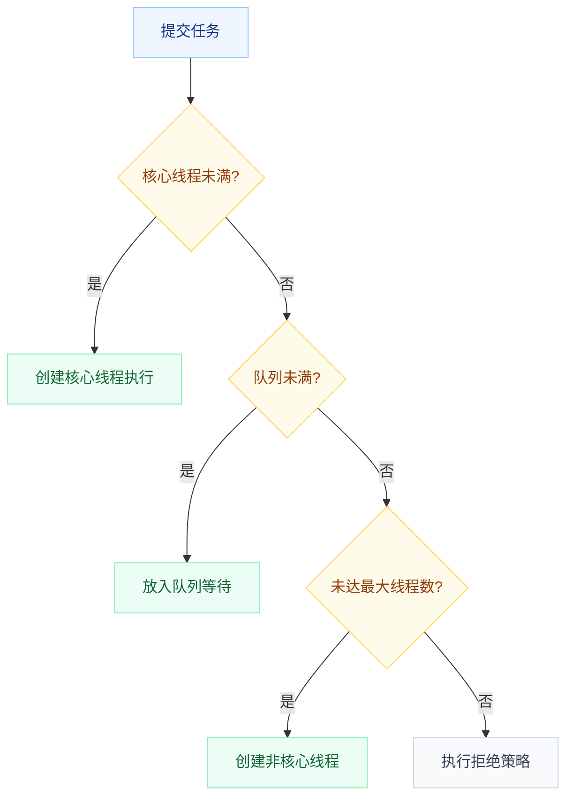

# Java多线程与并发

> 这篇从线程的生命周期和共享状态讲起，经过 synchronized、volatile、原子类、线程池、CompletableFuture，最后落到虚拟线程和一次并行聚合的完整实现。
>
> 学完能判断一段并发代码是锁的问题、可见性问题还是线程池配置问题，并用线程转储把故障定位到具体线程。

## 一、线程模型与生命周期

这章解决“线程怎么创建、怎么停、状态怎么变化”。

### 1.1 平台线程与任务

平台线程（platform thread）由 JVM 映射到操作系统线程，创建和切换成本较高。任务用 `Runnable` 表示无返回值，用 `Callable` 表示有返回值、可抛异常。

```java
Thread worker = Thread.ofPlatform()
    .name("order-worker")
    .start(() -> System.out.println("处理订单"));

worker.join(); // 主线程等待 worker 结束
```

`start()` 才会创建新线程并执行 `run()`；直接调用 `run()` 只是普通方法调用，仍在当前线程执行。一个 `Thread` 对象只能 `start` 一次，第二次抛 `IllegalThreadStateException`。

### 1.2 六种线程状态

| 状态 | 含义 | 进入方式 |
|---|---|---|
| `NEW` | 已创建未启动 | `new Thread(...)` |
| `RUNNABLE` | 可运行或正在运行 | `start()` 后 |
| `BLOCKED` | 等待监视器锁 | 进入 `synchronized` 失败 |
| `WAITING` | 无限等待 | `wait()`、`join()`、`park()` |
| `TIMED_WAITING` | 限时等待 | `sleep`、`wait(timeout)` |
| `TERMINATED` | 已结束 | `run()` 正常返回或抛异常 |

`RUNNABLE` 包含“正在等 CPU”和“正在执行”两种情况，不能从状态判断线程是否真的占着 CPU。`BLOCKED` 只表示等 `synchronized` 锁，等 `ReentrantLock` 或 IO 时通常是 `WAITING` 或 `RUNNABLE`。

### 1.3 start、join 与 interrupt

`join` 让当前线程等待目标线程结束；`interrupt` 设置中断标志，并唤醒处于 `sleep`、`wait`、`join` 的线程（抛 `InterruptedException`）。

```java
Thread worker = new Thread(() -> {
    while (!Thread.currentThread().isInterrupted()) {
        // 执行可中断的任务；阻塞调用会抛 InterruptedException
    }
    System.out.println("收到中断，退出");
});

worker.start();
Thread.sleep(100);
worker.interrupt();
worker.join();
```

捕获 `InterruptedException` 后要么继续向上抛，要么恢复中断标志 `Thread.currentThread().interrupt()`，不要吞掉。`stop()`、`suspend()`、`resume()` 已废弃，会留下不一致状态；用标志位或 `Future.cancel(true)` 协作取消。

### 1.4 守护线程与优先级

守护线程（daemon）不阻止 JVM 退出，适合后台清理、监控心跳；业务任务不要设为守护线程，否则主线程结束时任务会被直接终止。线程优先级在不同操作系统上映射不同，不能用来保证执行顺序。

版本基线（2026-11-13）：Java 21 LTS 为主，Java 25 LTS 可用。虚拟线程固定与结构化并发的变化单独标注 JDK 24/25；正文示例不依赖预览 API。

## 二、共享状态与 synchronized

这章解决“多个线程同时改一个变量，怎样不丢更新”。

### 2.1 竞态条件

`count++` 不是原子操作，它包含读取、加一、写回三步。两个线程可能同时读到旧值，各自加一后写回，最终只增加一次。

```java
class Counter {
    private int value;

    void increment() {
        value++; // 读-改-写三步，任何一步之间都可能被切换
    }

    int value() { return value; }
}
```

“先检查再执行”同样是竞态：`if (map.get(id) == null) map.put(id, new Item())` 在并发下会创建两个对象并互相覆盖。

### 2.2 监视器锁

`synchronized` 用对象的内置监视器实现互斥。普通实例方法锁 `this`，静态方法锁 `Class` 对象，代码块锁括号里的对象。

```java
class SafeCounter {
    private int value;

    synchronized void increment() { // 锁 this，同一实例的 increment 互斥
        value++;
    }

    synchronized int value() {      // 读也要加锁，否则可能读到中间状态
        return value;
    }
}
```

锁是可重入的：同一线程再次进入同一把锁不会死锁。`synchronized` 还建立 happens-before：解锁前的写，对随后获得同一把锁的线程可见。

### 2.3 锁的粒度

锁只包住共享状态的读写，不要把 IO、远程调用、日志格式化放进临界区。临界区越长，线程排队越久，吞吐越低。

```java
// 错误：整个方法加锁，远程调用期间所有线程都在等
synchronized void refresh() {
    Config config = remote.load(); // 可能几百毫秒
    this.config = config;
}

// 正确：只在发布结果时加锁
void refresh() {
    Config config = remote.load();
    synchronized (this) {
        this.config = config;
    }
}
```

多个无关状态用多把锁，避免所有操作争同一把锁；但锁越多，死锁风险越高，需要统一的获取顺序。

### 2.4 死锁

死锁需要四个条件同时成立：互斥、持有并等待、不可抢占、循环等待。最实用的预防手段是固定锁顺序，或给等待加超时。

```java
// 两个线程分别先锁 A 再锁 B、先锁 B 再锁 A，可能互相等待
synchronized (lockA) {
    synchronized (lockB) { /* ... */ }
}
```

`jstack` 会在转储末尾直接标出 `Found one Java-level deadlock`，并列出互相等待的线程和锁地址。预防规则：按对象 ID 排序后加锁、用 `ReentrantLock.tryLock(timeout)`、避免在持锁时调用外部回调。

### 2.5 wait 与 notify

`wait`/`notify` 必须在持有监视器时调用，等待条件要用 `while` 而不是 `if`，因为线程被唤醒后条件可能再次不成立。

```java
synchronized (queue) {
    while (queue.isEmpty()) {
        queue.wait();       // 释放锁并等待，被唤醒后重新检查条件
    }
    return queue.remove(0);
}
```

`notify` 只唤醒一个线程，可能唤醒错的对象；多数场景用 `notifyAll`。更好的选择是 `BlockingQueue`，它把等待、唤醒和中断处理都封装好了。

## 三、可见性与有序性

这章解决“一个线程改了变量，另一个线程为什么看不见”。

### 3.1 Java 内存模型与 happens-before

Java 内存模型（Java Memory Model，JMM）规定线程之间的可见性。若操作 A happens-before 操作 B，则 A 的写对 B 可见。常见规则：

- 程序顺序：同一线程内，前面的操作先于后面的操作；
- 监视器：解锁 happens-before 后续对同一把锁的加锁；
- `volatile`：写 happens-before 后续对同一变量的读；
- 线程启动：`start()` happens-before 新线程的 `run()`；
- 线程结束：`join()` 返回 happens-before 后续操作。

### 3.2 volatile

`volatile` 保证可见性和禁止指令重排，不保证复合操作原子性。

```java
class Worker {
    private volatile boolean running = true;

    void stop() { running = false; } // 写 volatile，其他线程立即可见

    void run() {
        while (running) {
            // 读 volatile，每次循环都从主内存刷新
        }
    }
}
```

`volatile int count; count++` 仍然会丢更新，因为自增是三步。需要原子自增用 `AtomicInteger`，需要互斥用锁。

### 3.3 双重检查单例

```java
public final class Singleton {
    private static volatile Singleton instance; // volatile 禁止创建对象的写重排到引用赋值之后

    private Singleton() {}

    public static Singleton getInstance() {
        if (instance == null) {                 // 第一次检查，避免每次加锁
            synchronized (Singleton.class) {
                if (instance == null) {         // 第二次检查，防止重复创建
                    instance = new Singleton();
                }
            }
        }
        return instance;
    }
}
```

没有 `volatile` 时，另一个线程可能看到“引用已赋值但构造器还没执行完”的半初始化对象。更简单的写法是静态内部类或枚举单例。

### 3.4 安全发布

对象在构造完成前不能被其他线程看到。不要在构造器里把 `this` 传给线程、注册监听器或放进全局集合；`final` 字段在构造完成后保证可见，是不可变对象安全发布的基础。

## 四、原子类与 CAS

这章解决“不用锁，怎样安全地做计数和状态更新”。

### 4.1 CAS 原理

CAS（Compare-And-Swap）比较内存中的当前值与期望值，相等才写入新值，否则失败重试。`AtomicInteger.incrementAndGet()` 内部循环执行“读取—计算—CAS”，失败就重来。

```java
AtomicInteger sequence = new AtomicInteger();
System.out.println(sequence.incrementAndGet()); // 1
System.out.println(sequence.compareAndSet(1, 10)); // true
System.out.println(sequence.get()); // 10
```

### 4.2 常用原子类

| 类 | 用途 | 注意 |
|---|---|---|
| `AtomicInteger` / `AtomicLong` | 计数、序号 | 高竞争下自旋成本高 |
| `AtomicReference<T>` | 原子替换引用 | 比较的是引用地址 |
| `AtomicStampedReference<T>` | 带版本号的引用 | 解决 ABA |
| `LongAdder` | 高并发求和 | `sum()` 不是原子快照 |

ABA 是“值从 A 改成 B 又改回 A”，CAS 只比较值会误判没有变化。带版本号的 `AtomicStampedReference` 把值和版本一起比较。

### 4.3 复合操作不能拼接

多个原子操作组合起来不是原子的：

```java
// 错误：检查和更新之间可能被其他线程插入
if (counter.get() < 10) {
    counter.incrementAndGet();
}

// 正确：用一个原子更新函数完成检查和更新
counter.updateAndGet(current -> current < 10 ? current + 1 : current);
```

`ConcurrentHashMap` 的 `compute`、`merge`、`computeIfAbsent` 也是同样的思路：把复合逻辑收进容器的一次原子操作。

### 4.4 LongAdder

`LongAdder` 把计数分散到多个单元格，线程在不同单元格上累加，最后求和，竞争激烈时比 `AtomicLong` 吞吐更高。

```java
LongAdder requests = new LongAdder();
requests.increment();
requests.add(10);
System.out.println(requests.sum()); // 11
```

边界：`sum()` 遍历所有单元格，返回的不是某一瞬间的精确快照；需要强一致读数时用 `AtomicLong` 或加锁。

## 五、线程池

这章解决“怎样复用线程、控制并发量、避免任务把系统打垮”。

### 5.1 ThreadPoolExecutor 的七个参数

| 参数 | 用途 | 常见错误 |
|---|---|---|
| `corePoolSize` | 常驻核心线程数 | 设得过大，空闲也占资源 |
| `maximumPoolSize` | 最大线程数 | 无界队列下永远用不到 |
| `keepAliveTime` | 非核心线程空闲存活时间 | 设得过短，频繁创建销毁 |
| `unit` | `keepAliveTime` 的时间单位 | 与数值不匹配 |
| `workQueue` | 等待队列 | 无界队列导致内存膨胀 |
| `threadFactory` | 线程命名与异常处理 | 不命名，排障找不到线程 |
| `handler` | 拒绝策略 | 默认 Abort 直接抛异常 |

### 5.2 任务提交后的执行顺序



关键顺序是“核心线程 → 队列 → 非核心线程 → 拒绝”。`newFixedThreadPool` 用无界 `LinkedBlockingQueue`，任务会一直排队，`maximumPoolSize` 形同虚设；`newCachedThreadPool` 的最大线程数是 `Integer.MAX_VALUE`，高并发下可能创建过多线程。

### 5.3 队列与拒绝策略

| 队列 | 特点 | 适用 |
|---|---|---|
| `ArrayBlockingQueue` | 有界数组 | 明确容量、需要背压 |
| `LinkedBlockingQueue` | 默认近似无界 | 建议显式给容量 |
| `SynchronousQueue` | 不存储元素 | 直接移交，配合大 max |
| `PriorityBlockingQueue` | 按优先级 | 任务有优先级 |

拒绝策略：`AbortPolicy` 抛 `RejectedExecutionException`；`CallerRunsPolicy` 让提交线程自己执行，形成天然背压；`DiscardPolicy` 和 `DiscardOldestPolicy` 会静默丢任务，生产环境慎用。

### 5.4 容量规划

CPU 密集型任务的线程数接近 CPU 核数，常用 `N + 1`；IO 密集型任务按等待时间与计算时间的比例放大：

```text
线程数 ≈ CPU 核数 × 目标利用率 × (1 + 等待时间 / 计算时间)
```

例如 8 核、目标利用率 80%、每个任务等待 90ms、计算 10ms，线程数约为 `8 × 0.8 × (1 + 9) = 64`。这只是起点，最终要用压测和线上指标校准；队列长度也要有界，否则线程池只是把过载推迟到内存溢出。

### 5.5 关闭与监控

```java
pool.shutdown();                              // 不再接收新任务，等待已提交任务完成
if (!pool.awaitTermination(30, TimeUnit.SECONDS)) {
    pool.shutdownNow();                       // 中断正在执行的任务，返回未执行列表
}
```

监控至少看四个指标：活跃线程数、队列长度、已完成任务数、拒绝次数。没有指标时，线程池故障表现为“请求越来越慢”，很难区分是下游慢还是队列堆积。

### 5.6 线程池隔离

不要用一个线程池处理所有依赖。数据库、HTTP、文件导出各自用独立线程池，某个下游变慢时只会耗尽自己的池，不会拖垮整个应用。这种隔离叫舱壁（bulkhead），比单纯调大线程数有效。

## 六、CompletableFuture

这章解决“多个异步任务怎样组合、超时和异常怎样处理”。

### 6.1 创建异步任务

`supplyAsync` 有返回值，`runAsync` 无返回值；不传执行器时使用公共 `ForkJoinPool.commonPool()`，生产代码应传自己的线程池，避免和别的任务互相影响。

```java
ExecutorService pool = Executors.newFixedThreadPool(8);
CompletableFuture<Integer> future = CompletableFuture.supplyAsync(() -> 10, pool);
System.out.println(future.join()); // 10
```

### 6.2 组合操作

| 方法 | 用途 | 注意 |
|---|---|---|
| `thenApply` | 转换结果 | 在完成线程上执行，返回普通值 |
| `thenCompose` | 串联另一个异步任务 | 返回 `CompletableFuture` |
| `thenCombine` | 合并两个独立结果 | 两个任务并行 |
| `allOf` | 等待全部完成 | 返回 `CompletableFuture<Void>` |
| `anyOf` | 任一完成 | 结果是 `Object` |

`thenApply` 和 `thenCompose` 的区别是“返回普通值还是返回 Future”。用错会得到 `CompletableFuture<CompletableFuture<T>>`，后续还要再展开。

### 6.3 异常与超时

```java
CompletableFuture<String> result = CompletableFuture
    .supplyAsync(() -> callRemote(), pool)
    .orTimeout(300, TimeUnit.MILLISECONDS)          // 超时后以 TimeoutException 完成
    .exceptionally(ex -> "降级结果");                // 统一兜底，返回默认值

System.out.println(result.join());
```

`handle` 同时处理正常值和异常；`whenComplete` 只观察，不改变结果。`orTimeout` 让 Future 以超时完成，但不会自动取消底层任务，底层线程可能继续跑；需要取消时保留 `Future` 引用并调用 `cancel(true)`。

### 6.4 常见坑

- 在同一个线程池里 `join` 另一个任务，池满时会互相等待，形成死锁；
- 公共 `ForkJoinPool` 被阻塞任务占满，其他并行流一起变慢；
- `allOf` 的 `join` 抛 `CompletionException`，要拆 `getCause()` 才能看到业务异常；
- 在异步回调里修改非线程安全集合，结果随机丢数据；
- `orTimeout` 不是“总预算”，每个阶段都设超时才能控制端到端延迟。

### 6.5 批量任务与限流

`allOf` 适合等待一批任务全部完成；要限制同时访问下游的数量，用 `Semaphore` 比无限创建任务更稳。

```java
Semaphore permits = new Semaphore(5);
try (ExecutorService pool = Executors.newVirtualThreadPerTaskExecutor()) {
    List<CompletableFuture<Void>> tasks = ids.stream()
        .map(id -> CompletableFuture.runAsync(() -> {
            try {
                permits.acquire();
                try {
                    callRemote(id);
                } finally {
                    permits.release();
                }
            } catch (InterruptedException e) {
                Thread.currentThread().interrupt();
            }
        }, pool))
        .toList();
    CompletableFuture.allOf(tasks.toArray(CompletableFuture[]::new)).join();
}
```

## 七、虚拟线程

这章解决“高并发 IO 场景怎样用更少资源承载更多请求”。

### 7.1 虚拟线程的模型

虚拟线程（virtual thread）由 JVM 管理，多个虚拟线程复用少量载体线程（carrier thread）。遇到阻塞 IO 时，虚拟线程从载体上卸载，IO 完成后再挂载，载体可以去执行别的虚拟线程。

虚拟线程适合 IO 密集型、线程数很多的场景；它不会让 CPU 计算变快，CPU 密集型任务用平台线程池更合适。

### 7.2 创建与使用

```java
try (ExecutorService pool = Executors.newVirtualThreadPerTaskExecutor()) {
    Future<String> future = pool.submit(() -> {
        Thread.sleep(100);                  // 阻塞时自动卸载，不占载体线程
        return Thread.currentThread().toString();
    });
    System.out.println(future.get().startsWith("VirtualThread"));
}
```

`Thread.ofVirtual().name("io-", 0).start(task)` 可以创建单个虚拟线程。虚拟线程不应该池化：每个任务创建一个，用完即弃，池化会失去“廉价创建”的意义。

### 7.3 适用与不适用

| 场景 | 是否适合 | 原因 |
|---|---|---|
| HTTP 调用下游 | 适合 | 大部分时间在等待 |
| 数据库查询 | 适合 | 阻塞 IO 可卸载 |
| 文件读写 | 适合 | 阻塞时让出载体 |
| 大数组计算 | 不适合 | 一直占 CPU，不会卸载 |
| 持有锁做长任务 | 谨慎 | 可能阻塞其他虚拟线程 |

迁移时先看线程池是否因为“等待”而膨胀；如果线程都在做计算，换虚拟线程不会提升吞吐。

### 7.4 pinning 与 Java 21 的边界

Java 21 中，虚拟线程在 `synchronized` 块里阻塞会钉住（pin）载体线程，载体无法执行其他虚拟线程。JDK 24 的 JEP 491 解决了这个问题；运行在 Java 21 时，把长阻塞临界区换成 `ReentrantLock`。

```java
private final ReentrantLock lock = new ReentrantLock();

void update() {
    lock.lock();                 // 虚拟线程阻塞在 ReentrantLock 上可以卸载
    try {
        remote.call();
    } finally {
        lock.unlock();
    }
}
```

排查钉住可以用 `-Djdk.tracePinnedThreads=full` 启动，日志会打印被钉住的栈。原生方法（JNI）和部分外部调用也可能钉住载体，迁移前要压测。

### 7.5 ThreadLocal 与结构化并发

每个虚拟线程都有自己的 `ThreadLocal`，线程数到百万级时，线程本地变量会占用大量内存。请求上下文优先用方法参数或框架的上下文传播机制，Java 25 的 ScopedValue 提供了更轻的替代。

结构化并发（Structured Concurrency）用 `StructuredTaskScope` 把一组子任务的生命周期绑定到父任务，任一失败可以取消其余任务。Java 21 和 25 中它仍是预览 API，生产使用要开启预览并接受 API 变化；不急的场景用 `CompletableFuture.allOf` 加超时也能达到类似效果。

## 八、并发排障

这章解决“线程卡住、CPU 打满、吞吐下降时，第一条命令查什么”。

### 8.1 线程转储

```bash
# 推荐：jcmd 输出到文件，带锁和死锁信息
jcmd <pid> Thread.print > thread.txt

# 等价的老命令
jstack <pid> > thread.txt

# 触发一次转储到标准错误
kill -3 <pid>
```

连续采三次、间隔 5 秒，比较同一线程的栈是否移动，能区分“卡在同一个调用”和“正在慢慢处理”。

### 8.2 读转储

| 状态 | 常见栈 | 判断 |
|---|---|---|
| `BLOCKED` | `waiting to lock` | 争同一把锁，找锁持有者 |
| `WAITING` | `park`、`wait` | 等条件或任务队列 |
| `TIMED_WAITING` | `sleep`、`parkNanos` | 定时任务或超时等待 |
| `RUNNABLE` | `socketRead`、循环 | 可能正常，也可能死循环 |
| 死锁 | `Found one Java-level deadlock` | 直接看互相等待的线程 |

大量线程卡在 `socketRead0`，说明下游响应慢；大量线程 `BLOCKED` 在同一把锁，说明临界区太长；线程数持续增长且不回收，检查线程池创建和关闭。

### 8.3 常见症状与第一条命令

| 症状 | 可能原因 | 第一条命令 |
|---|---|---|
| CPU 100% | 死循环、频繁 GC、正则回溯 | `top -H -p <pid>` 找线程，再转十六进制查栈 |
| 请求全部超时 | 线程池耗尽、下游挂起 | `jcmd <pid> Thread.print` 看池线程 |
| 吞吐逐渐下降 | 队列堆积、锁竞争 | 看活跃线程数、队列长度、拒绝数 |
| 内存持续上涨 | 任务对象堆积、ThreadLocal 泄漏 | `jcmd <pid> GC.heap_info`、堆转储 |
| 服务无响应但 CPU 低 | 死锁、全部等待 | 转储搜 `deadlock` |

### 8.4 JFR 与异步采样

JFR 是 JDK 自带的低开销诊断工具，适合抓一段时间内的线程、锁、GC、IO 事件：

```bash
jcmd <pid> JFR.start duration=60s filename=app.jfr
jcmd <pid> JFR.stop
jfr print --events jdk.JavaMonitorEnter,jdk.ThreadPark app.jfr
```

CPU 火焰图用 async-profiler 或 JFR 的 `jdk.ExecutionSample`，不要在生产环境长期开高开销采样。

### 8.5 检查清单

1. 线程是否有名字，能否从转储直接定位业务；
2. 线程池是否有界，拒绝策略是否可观测；
3. 锁是否只包住共享状态，是否存在嵌套锁；
4. 异步任务是否使用独立线程池，是否处理了异常和超时；
5. 虚拟线程是否跑在 Java 21 的 `synchronized` 长临界区里；
6. 是否采集了活跃线程、队列、拒绝数、任务耗时指标。

## 九、最佳实践案例

### 9.1 案例背景

商品详情页需要聚合三个下游：用户服务约 120ms、优惠券服务约 400ms、库存服务约 150ms。旧实现串行调用，页面平均 670ms；优惠券服务偶尔超时，导致整个页面失败。目标是并行调用、把优惠券超时降级为“无可用券”、总耗时控制在 350ms 内，并且不引入额外中间件。

### 9.2 案例实操

用虚拟线程执行器承载 IO 任务，用 `CompletableFuture` 组合结果，用 `orTimeout` 加 `exceptionally` 做降级。

```java
import java.util.concurrent.CompletableFuture;
import java.util.concurrent.ExecutorService;
import java.util.concurrent.Executors;
import java.util.concurrent.TimeUnit;

public class DashboardAggregator {

    record User(String id, String name) {}
    record Coupon(String code, int discount) {}
    record Stock(String sku, int available) {}
    record Dashboard(User user, Coupon coupon, Stock stock) {}

    static void sleep(long millis) {
        try {
            Thread.sleep(millis);
        } catch (InterruptedException e) {
            Thread.currentThread().interrupt();
            throw new RuntimeException(e);
        }
    }

    public static void main(String[] args) {
        long start = System.nanoTime();
        try (ExecutorService pool = Executors.newVirtualThreadPerTaskExecutor()) {
            CompletableFuture<User> userFuture = CompletableFuture.supplyAsync(() -> {
                sleep(120);
                return new User("U-1", "张三");
            }, pool);

            CompletableFuture<Coupon> couponFuture = CompletableFuture.supplyAsync(() -> {
                sleep(400);
                return new Coupon("WELCOME20", 20);
            }, pool)
                .orTimeout(300, TimeUnit.MILLISECONDS)   // 超过 300ms 不再等
                .exceptionally(ex -> new Coupon("无可用券(超时降级)", 0));

            CompletableFuture<Stock> stockFuture = CompletableFuture.supplyAsync(() -> {
                sleep(150);
                return new Stock("SKU-1", 42);
            }, pool);

            Dashboard dashboard = CompletableFuture
                .allOf(userFuture, couponFuture, stockFuture)
                .thenApply(ignored -> new Dashboard(
                    userFuture.join(), couponFuture.join(), stockFuture.join()))
                .join();

            long elapsed = (System.nanoTime() - start) / 1_000_000;
            System.out.println("user=" + dashboard.user().name());
            System.out.println("coupon=" + dashboard.coupon().code()
                + ", discount=" + dashboard.coupon().discount());
            System.out.println("stock=" + dashboard.stock().available());
            System.out.println("elapsed=" + elapsed + " ms");
        }
    }
}
```

```bash
javac -encoding UTF-8 DashboardAggregator.java
java DashboardAggregator
```

预期输出（耗时为本机实测，随机器波动）：

```text
user=张三
coupon=无可用券(超时降级), discount=0
stock=42
elapsed=318 ms
```

### 9.3 案例结果

三个下游并行后，总耗时接近最慢的优惠券超时上限 300ms，而不是 120 + 400 + 150 = 670ms；实测在 310 到 320ms 之间。库存和用户结果正常返回，优惠券超时被降级为无券，页面仍可展示。

失败模式有五个。第一，`orTimeout` 只让 Future 以超时完成，底层睡眠 400ms 的虚拟线程仍在跑；真实 HTTP 客户端要同时设置连接和读取超时。第二，使用公共 `ForkJoinPool` 时，阻塞任务会占满公共线程，必须传独立执行器。第三，超时降级要区分“无券”和“服务故障”，前者是正常业务，后者要打指标告警。第四，`ThreadLocal` 里的用户上下文不会自动传到异步任务，需要显式传递或在任务入口恢复。第五，下游整体变慢时所有请求同时重试会放大故障，重试要加退避、抖动和熔断。

复盘：并行的收益来自“等待重叠”，不是“线程越多越快”。先用串行基线确认瓶颈在等待，再选虚拟线程或平台线程池；超时和降级要在聚合层统一处理，避免每个调用点各写一套。上线后监控三个指标：聚合总耗时 P99、降级次数、各下游超时率，才能判断是容量问题还是依赖问题。
