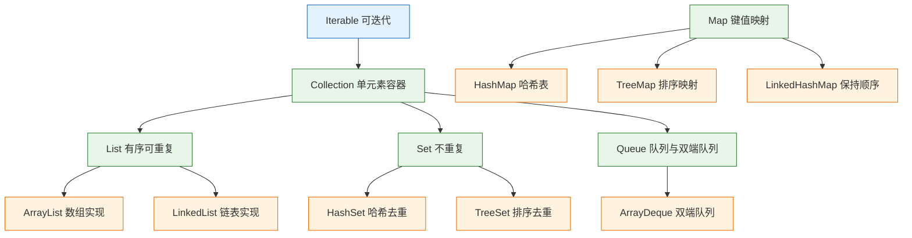
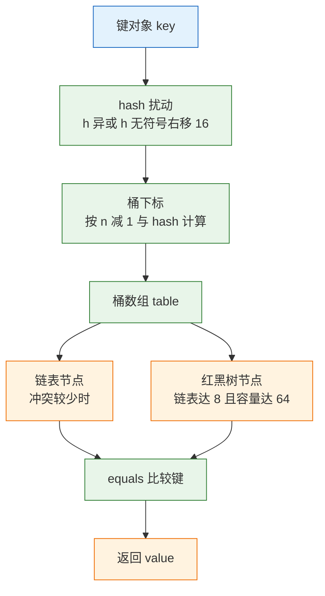
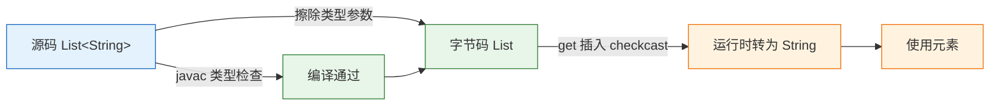
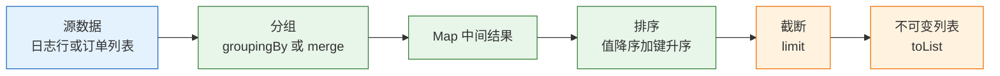

# 集合与泛型

---

## 一、集合与泛型的定位

### 1.1 核心概念

集合框架（Collections Framework）是 JDK 提供的一组接口与实现，用于存放和操作一组对象。它解决四件事：长度可变、按内容查找、排序去重、并发访问。数组长度固定、只能按下标访问；业务中的订单列表、用户到权限的映射、待处理任务队列，都需要更贴合的容器。

泛型（Generics）把"这个列表只装 Order"从注释变成编译期约束。没有泛型时，元素取出都是 `Object`，转型错误要到运行时才抛 `ClassCastException`；有泛型后，放错类型直接编译失败。泛型在 JVM 中会被擦除，这条事实决定了它的全部边界：不能 `new T()`、不能 `instanceof List<String>`、不能按泛型参数重载。

两者合起来才是可维护的用法：集合决定复杂度与内存，泛型决定类型安全。选错容器，代码能跑但慢一个数量级；泛型写错，编译期保护被绕过，问题推迟到生产环境。

日常代码里的集合操作可以归为四类：按位置访问、按内容查找、按顺序遍历、按规则更新。四类操作的权重决定容器选择。若一次写入、长期只读，不可变集合最合适；若持续追加并按 key 查找，哈希表优先；若需要范围扫描，只有排序结构才有优势。先统计这四类操作的频次，再谈具体类名。

| 关注点 | 集合框架 | 泛型 |
|---|---|---|
| 解决的问题 | 数据如何组织与访问 | 类型如何约束与复用 |
| 生效阶段 | 运行期 | 编译期，运行期擦除 |
| 选错后果 | 复杂度退化、内存膨胀 | 类型转换异常、警告堆积 |
| 核心接口 | `Collection`、`Map` | `List<E>`、`Map<K,V>` |

> **开发提示**：集合的默认答案通常只有四个——`ArrayList`、`HashMap`、`HashSet`、`ArrayDeque`。先把默认答案用对，再根据复杂度或并发需求替换，比一开始就挑"高级容器"更可靠。

### 1.2 与相邻技术的关系

数组是集合的底层结构。`ArrayList` 内部就是 `Object[]`，`HashMap` 内部是节点数组。集合在数组之上补了扩容、哈希、排序和迭代协议。

Stream 是集合的处理管道，不存储数据。`stream()` 把集合转成惰性求值的流，`collect` 或 `toList` 再把结果落回集合。流适合一次性遍历与转换，不适合随机访问和多次复用；同一个流对象只能消费一次。

并发容器是另一套实现，位于 `java.util.concurrent`。它们不靠给整个容器加一把锁，而是用 CAS、桶级锁或写时复制换取吞吐。普通集合加 `synchronized` 只能保证单次调用原子，复合操作仍会竞态。

| 技术 | 是否存储数据 | 与集合的关系 |
|---|---|---|
| 数组 | 是 | 底层结构，长度固定 |
| Stream | 否 | 集合的声明式处理管道 |
| 并发容器 | 是 | 线程安全的独立实现 |
| 数据库 | 是 | 外部存储，集合是内存视图 |

选择顺序通常是：先用接口表达语义，再选默认实现，最后按度量替换。不要一开始就为"可能的并发"选 `ConcurrentHashMap`，也不要为"可能的排序"选 `TreeMap`。`TreeMap` 的单次操作是 O(log n)，`ConcurrentHashMap` 的写入需要桶级协调且拒绝 `null`；等需求确认后再替换，改动只在构造处一行。

### 1.3 整体结构

集合框架分两大支：`Collection` 管单个元素的序列或集合，`Map` 管键值映射。`Collection` 下分 `List`（有序可重复）、`Set`（不重复）、`Queue`（按进出规则）。`Map` 独立成支，不继承 `Collection`。



| 接口 | 语义 | 常用实现 |
|---|---|---|
| `List` | 有序、可重复、按下标访问 | `ArrayList`、`LinkedList` |
| `Set` | 不重复，去重依据 `equals` | `HashSet`、`TreeSet`、`EnumSet` |
| `Queue` / `Deque` | 按队首队尾进出 | `ArrayDeque`、`LinkedBlockingQueue` |
| `Map` | 键到值的映射，键唯一 | `HashMap`、`TreeMap`、`EnumMap` |

选型先看接口语义，再看实现代价。方法参数和返回值声明成 `List` 还是 `ArrayList`，决定了后续能否替换实现；写成接口，调用方就不会依赖具体类的扩容行为。

---

## 二、环境与第一个程序

### 2.1 版本与环境

> **版本现状（2026-10）**：集合框架自 JDK 1.2 起就是标准库的一部分，不需要额外依赖。本文以 Java 21 为基线。不可变工厂、`copyOf`、`Stream.toList` 和 `newHashMap` 等方法有明确的最低版本，跨版本项目要逐项核对。

| API | 最低版本 | 用途 |
|---|---|---|
| `List.of` / `Set.of` / `Map.of` | 9 | 创建不可变集合 |
| `List.copyOf` / `Set.copyOf` | 10 | 创建不可变快照 |
| `Stream.toList` | 16 | 流结果转为不可变列表 |
| `HashMap.newHashMap` | 19 | 按预期元素数创建映射 |

```bash
# 只需 JDK，无需第三方依赖
java -version          # 确认主版本
javac -version         # 必须与 java 一致

# 单文件编译运行
javac --release 21 -d out FirstLook.java
java -cp out FirstLook
```

IDE 与命令行使用同一个 JDK 时行为一致。项目语言级别设为 21，才能使用 `switch` 的类型模式与 `record` 解构模式；设为 17 时，密封接口和 `record` 仍可用，但带模式的 `switch` 会报语法错误。错误信息指向的是语法而不是语言级别，容易被误判为代码写错。构建文件里的 `maven.compiler.release` 与 IDE 的 language level 要保持同步。

### 2.2 最小可运行示例

```java
import java.util.*;

public class FirstLook {
    record Item(String name, int qty) {}

    public static void main(String[] args) {
        List<Item> items = List.of(
                new Item("pen", 2),
                new Item("book", 1),
                new Item("pen", 3));

        Map<String, Integer> totals = new HashMap<>();
        for (Item it : items) {
            // key 不存在时放入 qty，存在时用 Integer::sum 合并
            totals.merge(it.name(), it.qty(), Integer::sum);
        }

        System.out.println(totals);              // 输出类似 {book=1, pen=5}
        System.out.println(totals.get("pen"));   // 5
        System.out.println(items.get(0).name()); // pen
    }
}
```

```text
{book=1, pen=5}
5
pen
```

`HashMap` 的迭代顺序不保证，输出中 `book` 与 `pen` 的先后可能不同，不要把它写进断言。需要稳定顺序时换 `LinkedHashMap` 或 `TreeMap`。

这几行覆盖了集合最常用的三种动作：`List.of` 创建不可变列表，`merge` 完成"不存在则插入、存在则合并"，`get` 按键取值。`items.get(0)` 是按位置访问，只有 `List` 支持；`totals.get("pen")` 是按内容查找，哈希表把它做成平均 O(1)。两种访问方式混用是常见的性能问题来源，比如在 `List` 里循环 `get` 找某个名字，复杂度会退化成 O(n²)。

### 2.3 工程结构

集合是标准库，没有独立目录约定。工程上只需遵守两条：对外返回接口类型而非实现类；集合字段声明为 `final` 并优先用不可变实现。

```text
demo/
├── src/main/java/com/example/
│   ├── FirstLook.java
│   └── report/MerchantReport.java
├── src/test/java/com/example/
│   └── CollectionTest.java
└── pom.xml
```

| 约定 | 写法 | 原因 |
|---|---|---|
| 返回接口 | `List<Order>` | 调用方不依赖实现 |
| 字段不可变 | `final List<Order> items` | 防止替换引用 |
| 参数校验 | 入口处 `Objects.requireNonNull` | 尽早失败 |
| 空结果 | `List.of()` | 避免返回 `null` |

导入语句按需逐个写，不要在生产代码里用 `import java.util.*`。通配符导入在类名冲突时靠编译器选择，来源不明确；显式导入能让读者直接看到这个类依赖了哪些集合类型。IDE 可以自动整理，不需要手写。

> **开发提示**：方法返回 `null` 表示"没有"时，每个调用方都要判空，漏一处就是 NPE。返回空集合能让调用方直接遍历，代价只是一个共享的不可变实例。

---

## 三、List 与 Deque 的实现机制

### 3.1 ArrayList 的数组语义

`ArrayList` 底层是 `Object[]`，默认容量 10，但构造时不分配，第一次 `add` 才创建数组。元素数超过容量时扩容为原容量的 1.5 倍（`old + (old >> 1)`），并把旧数组复制过去。

```java
// 已知规模时预分配，避免多次扩容与复制
List<Order> orders = new ArrayList<>(10_000);
orders.add(order);

// 分批加入前预留空间
var buffer = new ArrayList<String>();
buffer.ensureCapacity(4096);
```

`get(i)` 是 O(1)，尾部 `add` 均摊 O(1)，中间插入或删除要移动后续元素，O(n)。删除元素后数组不缩容，大量删除后仍占着原容量，需要主动 `trimToSize()`。

扩容的代价不只是复制数组，还包括旧数组变成垃圾、下一次 GC 压力上升。容量从 10 增长到能放 100 万个元素，需要约 29 次扩容，累计复制量约为最终容量的两倍多。预分配把这段成本压到一次分配，是批处理场景最有效的优化之一。

```java
// 反例：每次 add 都可能触发扩容与整数组复制
List<Order> all = new ArrayList<>();
for (Order o : hugeBatch) all.add(o);

// 正例：先按批大小分配，扩容次数为 0
List<Order> planned = new ArrayList<>(hugeBatch.size());
planned.addAll(hugeBatch);
```

### 3.2 LinkedList 与 ArrayDeque

`LinkedList` 是双向链表，头尾插入删除 O(1)，但定位第 i 个元素要遍历，O(n)。每个节点额外存前驱和后继引用，内存开销明显高于数组。它同时实现了 `Deque`，可以当队列用，但通常不是最优选择。

`ArrayDeque` 用循环数组实现双端队列，头尾操作均摊 O(1)，不允许 `null`，扩容为原容量 2 倍。它既能当队列也能当栈，连续内存、无节点分配，通常比 `LinkedList` 快。

| 容器 | 底层结构 | 头尾操作 | 随机访问 | 内存 |
|---|---|---|---|---|
| `ArrayList` | 动态数组 | 头部 O(n) | O(1) | 最省 |
| `LinkedList` | 双向链表 | O(1) | O(n) | 每节点两个引用 |
| `ArrayDeque` | 循环数组 | 均摊 O(1) | 不支持 | 连续数组 |

> **注意**：栈优先用 `ArrayDeque`，不要用 `Stack`。`Stack` 继承 `Vector`，每个方法都加锁，属于早期设计的遗留类，单线程场景下既慢又容易误用。

`ArrayDeque` 的队列与栈两种用法要选对方法。队列用 `offer`/`poll`/`peek`，栈用 `push`/`pop`/`peek`；`poll` 和 `pop` 在空容器上返回 `null` 或抛异常的行为不同，混用会让空值处理变得混乱。

```java
// 当队列：先进先出
Deque<Task> queue = new ArrayDeque<>();
queue.offer(first);
queue.offer(second);
Task head = queue.poll();      // first，空时返回 null

// 当栈：后进先出
Deque<Task> stack = new ArrayDeque<>();
stack.push(first);
stack.push(second);
Task top = stack.pop();        // second，空时抛 NoSuchElementException
```

### 3.3 复杂度对照

| 操作 | `ArrayList` | `LinkedList` | `ArrayDeque` |
|---|---|---|---|
| 按下标读 | O(1) | O(n) | 不支持 |
| 尾部添加 | 均摊 O(1) | O(1) | 均摊 O(1) |
| 中间插入 | O(n) | O(n) 定位 | O(n) |
| 按内容查找 | O(n) | O(n) | O(n) |

复杂度只是选型的一半，另一半是常数因子与内存局部性。同样是 O(n) 遍历，数组连续访问的缓存命中率远高于链表逐节点跳转，数据量大时差距会放大。

### 3.4 视图与拷贝

`subList(from, to)` 返回原列表的视图，不是拷贝。改子列表会改原列表；原列表结构变化后，子列表操作可能抛 `ConcurrentModificationException`。

```java
List<String> all = new ArrayList<>(List.of("a", "b", "c", "d"));
List<String> part = all.subList(1, 3);   // 视图，内容为 b、c
part.set(0, "B");                        // 原列表变成 a、B、c、d

List<String> copy = List.copyOf(part);   // 独立快照，之后互不影响
```

`Arrays.asList(array)` 是固定大小视图，`set` 会写回原数组，`add` 和 `remove` 抛 `UnsupportedOperationException`。需要可变列表时用 `new ArrayList<>(Arrays.asList(array))`。

| 写法 | 是否独立 | 是否可修改 | 写回原数组 |
|---|---|---|---|
| `subList` | 否，视图 | 部分支持 | 是 |
| `Arrays.asList` | 否，视图 | 固定大小 | 是 |
| `List.copyOf` | 是，快照 | 否 | 否 |
| `new ArrayList<>(...)` | 是，拷贝 | 是 | 否 |

---

## 四、Map 与 Set 的实现机制

### 4.1 HashMap 的哈希结构

`HashMap` 的结构是"数组 + 链表 + 红黑树"。数组长度是 2 的幂，下标用 `(n - 1) & hash` 计算；`hash` 先经过 `h ^ (h >>> 16)` 扰动，让高位也参与低位索引，减少冲突。



默认容量 16、负载因子 0.75，阈值 12。第 13 个元素插入时触发扩容到 32，所有元素重新分桶。同一个桶内链表长度达到 8，且数组长度至少 64，才转成红黑树；否则优先扩容。树化后查找最坏 O(log n)，删除到 6 退回链表。

`HashMap` 允许一个 `null` key 和多个 `null` value，`null` key 固定放在 0 号桶。迭代顺序不保证，且会随容量与哈希变化，不要依赖它的输出顺序。

一次 `put` 的流程是：计算扰动后的哈希，定位桶，桶为空就放新节点；桶非空则逐个比较哈希与 `equals`，命中就覆盖 value，未命中原链表尾部追加；追加后判断是否达到树化条件。一次 `get` 走前半段，命中返回，未命中返回 `null`。这条流程解释了为什么 `hashCode` 分布差会让链表变长，也解释了为什么修改 key 的字段会让条目"消失"。

### 4.2 顺序与排序变体

`LinkedHashMap` 在哈希表外维护双向链表，默认保持插入顺序；构造时传 `accessOrder=true` 则按访问顺序，可实现 LRU：

```java
// 访问顺序模式：get 也会把条目移到链表尾部
Map<String, Integer> lru = new LinkedHashMap<>(16, 0.75f, true) {
    @Override
    protected boolean removeEldestEntry(Map.Entry<String, Integer> eldest) {
        return size() > 100;   // 超过 100 条淘汰最久未访问的
    }
};
```

匿名子类不是线程安全的。并发场景要加锁，或换用专门的缓存库。

`TreeMap` 按 key 排序，要求 key 实现 `Comparable` 或构造时提供 `Comparator`，`get`、`put`、`remove` 都是 O(log n)。自然排序下不允许 `null` key。需要按范围查询时，`subMap`、`headMap`、`tailMap` 比全量过滤高效。

```java
// 按时间区间取子映射：视图，不复制元素
NavigableMap<LocalDate, BigDecimal> range =
        daily.subMap(from, true, to, false);

// 取最近一条小于给定 key 的记录
Map.Entry<LocalDate, BigDecimal> prev = daily.lowerEntry(date);
```

`EnumMap` 用枚举的 `ordinal` 做数组下标，键只能是枚举，内存紧凑，遍历顺序就是枚举声明顺序。枚举做 key 时优先用它。

| 实现 | 顺序 | 单次操作 | 适用场景 |
|---|---|---|---|
| `HashMap` | 不保证 | 平均 O(1) | 通用映射 |
| `LinkedHashMap` | 插入或访问顺序 | 平均 O(1) | 稳定顺序、LRU |
| `TreeMap` | key 排序 | O(log n) | 范围查询、有序遍历 |
| `EnumMap` | 枚举声明顺序 | O(1) | 枚举键 |

### 4.3 容量与扩容

`HashMap` 的容量总是 2 的幂。元素数超过 `容量 × 0.75` 就扩容一倍，所有元素重新分桶。数据量大时反复扩容既费 CPU 又费内存，能在构造时估出规模就估：

```java
int expected = 1_000_000;
Map<String, Long> m = HashMap.newHashMap(expected);   // JDK 19+
```

`newHashMap` 会按 expected 反推容量，避免自己算 `(int) (n / 0.75) + 1` 再取 2 的幂。`ArrayList` 同理，已知大小用 `new ArrayList<>(expected)`。

容量不是越大越好。空桶也占数组空间，一个百万容量的 `ArrayList` 即使只放 10 个元素，也要占数 MB（取决于是否启用压缩指针）。按实际规模设置，不要"先开一千万再说"。

负载因子决定空间与冲突的平衡。0.75 是时间与空间的折中：更低会减少冲突但浪费桶，更高会节省空间但链表变长。除非有实测数据支持，不要改这个值；把 `HashMap` 构造器的负载因子调成 1.0 往往只是把查找成本转移到链表遍历上。

### 4.4 equals 与 hashCode 契约

`HashMap` 先用 `hashCode` 找桶，再用 `equals` 在桶里找键。两条约定必须同时满足：`equals` 相等则 `hashCode` 必须相等；`hashCode` 相等的对象 `equals` 不一定相等。

只重写 `equals` 不重写 `hashCode`，两个"相等"的对象会落到不同桶，`get` 取不到；只重写 `hashCode`，冲突链里仍用默认引用比较，同样取不到。

```java
record UserId(long value) {}   // record 自动生成 equals 与 hashCode

Map<UserId, String> names = new HashMap<>();
names.put(new UserId(7), "alice");
System.out.println(names.get(new UserId(7)));   // alice
```

| 错误做法 | 后果 | 纠正 |
|---|---|---|
| 只重写 `equals` | 落到不同桶，查不到 | 同时重写 `hashCode` |
| 用可变对象做 key | 改字段后哈希变化，条目丢失 | 用 `record` 或不可变对象 |
| `hashCode` 用随机数 | 每次调用结果不同 | 用稳定字段计算 |
| 数组字段用 `equals` | 比较引用而非内容 | 用 `Arrays.equals` |

手写 `hashCode` 时用 `Objects.hash(...)` 或 `Objects.hashCode(...)`，参与计算的字段必须与 `equals` 使用的字段一致，且字段本身在对象作为键期间不能变化。用随机数、时间戳或自增 ID 生成哈希，会让同一个对象每次查询落到不同桶。

> **安全警告**：把可变对象放进 `HashMap` 后修改参与 `hashCode` 的字段，桶位置没变但再也找不到该条目，而且它会一直占着内存。需要可变 key 时，先 `remove`，改完再 `put`；更稳妥的做法是改用不可变值对象作为键。

`HashSet` 内部就是一个 `HashMap`，value 是固定占位对象；`TreeSet` 内部是 `TreeMap`。因此 Set 的去重规则、排序规则和 `null` 限制与对应 Map 完全一致。`LinkedHashSet` 保持插入顺序，适合"去重但输出顺序要稳定"的场景；`EnumSet` 用位向量，是枚举集合的首选，比 `HashSet` 省内存且更快。

---

## 五、泛型机制

### 5.1 类型擦除

泛型是编译期能力。编译器检查放入和取出的类型，并在字节码里插入强制转换；运行时 `List<String>` 与 `List<Integer>` 是同一个类。



由此产生几条硬边界：

- 不能 `new T()`、`new T[]`，运行时不知道 `T` 是什么。
- 不能 `instanceof List<String>`，只能 `instanceof List<?>`。
- 不能按泛型参数重载，`m(List<String>)` 与 `m(List<Integer>)` 擦除后签名相同。
- 静态成员不能使用类的类型参数。
- 不能创建泛型数组，`new List<String>[10]` 编译失败。

| 写法 | 是否允许 | 替代方案 |
|---|---|---|
| `new T()` | 否 | 传入 `Class<T>` 或工厂 |
| `new T[10]` | 否 | `List<T>` 或 `Array.newInstance` |
| `instanceof List<String>` | 否 | `instanceof List<?>` |
| `new List<String>[10]` | 否 | `List<List<String>>` |

擦除还带来桥接方法。子类重写泛型父类的方法时，编译器生成一个参数类型为 `Object` 的桥接方法，内部转调真实实现。这就是为什么 `javap` 有时会看到两个同名方法，也是为什么"按泛型参数重载"在字节码层无法区分。排查反射相关的 `NoSuchMethodException` 时，需要把桥接方法一并纳入检查，而不是只看源码。

### 5.2 上界与通配符

```java
// 只读：生产者用 extends
static BigDecimal total(List<? extends Number> values) {
    BigDecimal sum = BigDecimal.ZERO;
    for (Number n : values) {
        sum = sum.add(new BigDecimal(n.toString()));
    }
    return sum;
}

// 只写：消费者用 super
static void addInts(List<? super Integer> target) {
    target.add(1);
    target.add(2);
}
```

`List<? extends Number>` 可以读成 `Number`，不能 `add`（`null` 除外），因为实际可能是 `List<Integer>`，放入 `Double` 会破坏类型。`List<? super Integer>` 可以 `add(Integer)`，读出来只能是 `Object`，因为实际可能是 `List<Object>`。记忆口诀是 PECS：Producer Extends，Consumer Super。

泛型方法的上界常写 `T extends Comparable<? super T>`，这样 `T` 自己或它的父类实现比较都能用：

```java
static <T extends Comparable<? super T>> T max(List<T> list) {
    T best = list.get(0);
    for (T t : list) {
        if (t.compareTo(best) > 0) best = t;
    }
    return best;
}
```

`?` 与 `T` 的分工：`T` 让方法内部把同一个类型用在多个位置，建立参数与返回值之间的约束；`?` 只表达"某种未知类型"，不能命名，也不能在多个参数间建立关系。

通配符还会产生捕获（capture）。编译器为 `?` 生成一个临时的匿名类型变量，所以 `List<? extends Number>` 读出的元素可以赋给 `Number`，但不能把读出的值再写回同一个列表。需要"读出来再写回去"时，把签名改成泛型方法 `<T extends Number> void copy(List<T> src, List<T> dst)`，用同一个 `T` 绑定两端。

### 5.3 原始类型与 unchecked 警告

`List list = new ArrayList();` 是原始类型，编译器放弃所有类型检查，取出时隐式转 `Object`。除反射和遗留接口外不要使用。

可变参数与泛型一起用时会创建泛型数组，编译器给出 unchecked 警告。如果方法不修改数组、不把数组暴露出去，可以加 `@SafeVarargs`：

```java
@SafeVarargs
static <T> List<T> of(T... items) {
    return List.of(items);   // 不保存、不修改传入数组
}
```

`@SafeVarargs` 只能用在 `static`、`final`、`private` 方法或构造器上，因为它要求方法不可被重写，否则子类可能破坏约定。看到 unchecked 警告要逐条处理，不要在整个类上加 `@SuppressWarnings` 盖掉。

| 现象 | 含义 | 处理 |
|---|---|---|
| `unchecked` 赋值警告 | 擦除后无法验证类型 | 消除原始类型，或局部抑制并注明理由 |
| `unchecked` 可变参数 | 创建了泛型数组 | 确认不暴露数组后加 `@SafeVarargs` |
| `rawtypes` 警告 | 使用了原始类型 | 补全类型参数 |

确实无法消除的警告，把 `@SuppressWarnings("unchecked")` 放在最小作用域上——单个变量或单个方法，而不是整个类。旁边写一行注释说明为什么安全，例如"数组由本方法创建且不对外暴露"。这样审查时能直接判断假设是否仍成立，而不是面对一个全局静默。

---

## 六、遍历、删除与不可变集合

### 6.1 迭代器与 fail-fast

`for-each` 底层是迭代器。遍历中 `add` 或 `remove` 改变结构，迭代器会抛 `ConcurrentModificationException`。这是 fail-fast 设计，用于尽早暴露错误，不保证一定检测到。

```java
// 正确：用迭代器删除
Iterator<String> it = list.iterator();
while (it.hasNext()) {
    if (it.next().isBlank()) it.remove();
}

// 更简洁：removeIf
list.removeIf(String::isBlank);

// Map 遍历中删除
map.entrySet().removeIf(e -> e.getValue() == 0);
```

`ConcurrentModificationException` 不代表有多个线程。单线程里边遍历边删同样会触发，判断依据是 `modCount` 与迭代器记录的期望值不一致。

按下标遍历与用迭代器遍历的适用场景不同。`for (int i = 0; i < list.size(); i++)` 每轮都调用 `size()`，在 `LinkedList` 上还会每次从头定位，复杂度变成 O(n²)；`for-each` 用迭代器保存当前位置，链表上也是 O(n)。只有在需要下标参与计算、或遍历中按位置删除时，才用下标循环，并且倒序删除或每次删除后修正下标。

### 6.2 删除方法与重载歧义

`List.remove` 有两个重载：`remove(int index)` 按下标删，`remove(Object o)` 按值删。传入 `Integer` 时编译器选哪个，取决于参数的静态类型。

```java
List<Integer> nums = new ArrayList<>(List.of(10, 20, 30));
nums.remove(1);                       // 删下标 1，剩 10、30
nums.remove(Integer.valueOf(10));     // 删值 10，剩 30
```

| 调用 | 选中重载 | 结果 |
|---|---|---|
| `remove(1)` | `remove(int)` | 删除下标 1 |
| `remove(Integer.valueOf(1))` | `remove(Object)` | 删除值 1 |
| `removeIf(x -> x > 20)` | 批量条件删除 | 删除所有匹配 |

`Map.forEach` 遍历时修改映射同样可能抛异常。需要删除用 `entrySet().removeIf`，需要改值用 `replaceAll` 或 `compute`。

### 6.3 不可变集合与只读视图

`List.of`、`Set.of`、`Map.of` 返回不可变集合：不允许 `null` 元素、键或值；`add`、`remove`、`put` 抛 `UnsupportedOperationException`；`Map.of` 的重复 key 在运行时抛 `IllegalArgumentException`。

| 工厂 | 保留顺序 | 允许 null | 可修改 |
|---|---|---|---|
| `List.of` | 是 | 否 | 否 |
| `Set.of` | 不保证 | 否 | 否 |
| `Map.of` | 不保证 | 否 | 否 |
| `Collections.unmodifiableList` | 跟随原集合 | 跟随原集合 | 否，但原集合可变 |

需要"对外只读、内部可变"时，用 `Collections.unmodifiableList(inner)` 返回视图：外部不能改，内部改了外部能看到。需要快照就 `List.copyOf(inner)`，它复制一份，之后互不影响，并且拒绝 `null` 元素。

> **注意**：`Collections.unmodifiableList` 只挡住通过该引用的写操作。持有内部集合的代码仍能修改，视图会同步变化。对外发布数据时用 `List.copyOf`，避免调用方看到后续变更。

不可变集合的价值不止是"防止修改"。它天然线程安全，可以被多个线程同时读取而无需加锁；它的 `hashCode` 可以缓存，作为 `Map` 的键更稳定；它还能把"这份数据不会再变"表达在类型上，调用方不需要防御性拷贝。代价是每次变更都要创建新集合，因此只适合读多写少或一次构建、长期使用的数据。

---

## 七、完整示例：日志频次统计与商户聚合

### 7.1 请求行频次统计

```java
import java.util.*;
import java.util.stream.*;

public class TopRequests {
    public static void main(String[] args) {
        String log = """
                GET /api/orders 200
                GET /api/orders 200
                POST /api/orders 201
                GET /api/orders 500
                GET /api/users 200
                GET /api/users 404
                """;

        // lines 按行切分，strip 去掉行首尾空白，空行过滤掉
        Map<String, Long> counts = log.lines()
                .map(String::strip)
                .filter(line -> !line.isEmpty())
                .collect(Collectors.groupingBy(line -> line, Collectors.counting()));

        // 先按次数降序，次数相同按请求行升序，保证结果稳定
        List<Map.Entry<String, Long>> top = counts.entrySet().stream()
                .sorted(Map.Entry.<String, Long>comparingByValue().reversed()
                        .thenComparing(Map.Entry.comparingByKey()))
                .limit(3)
                .toList();

        top.forEach(e -> System.out.printf("%-22s %d%n", e.getKey(), e.getValue()));
    }
}
```

### 7.2 按商户聚合金额

```java
import java.math.BigDecimal;
import java.util.*;

public class MerchantReport {
    record Order(String id, String merchant, BigDecimal amount) {}

    public static void main(String[] args) {
        List<Order> orders = List.of(
                new Order("A1", "M01", new BigDecimal("199.00")),
                new Order("A2", "M02", new BigDecimal("80.00")),
                new Order("A3", "M01", new BigDecimal("58.50")),
                new Order("A4", "M03", new BigDecimal("10.00")),
                new Order("A5", "M02", new BigDecimal("20.00"))
        );

        Map<String, BigDecimal> gross = new HashMap<>();
        for (Order o : orders) {
            // key 不存在放入 amount，存在则用 BigDecimal::add 累加
            gross.merge(o.merchant(), o.amount(), BigDecimal::add);
        }

        List<Map.Entry<String, BigDecimal>> ranking = gross.entrySet().stream()
                .sorted(Map.Entry.<String, BigDecimal>comparingByValue().reversed()
                        .thenComparing(Map.Entry.comparingByKey()))
                .limit(2)
                .toList();

        ranking.forEach(e -> System.out.printf("%s %s%n", e.getKey(), e.getValue()));
    }
}
```

### 7.3 运行验证与结果解释

```bash
javac --release 21 -d out TopRequests.java MerchantReport.java
java -cp out TopRequests
java -cp out MerchantReport
```

```text
GET /api/orders 200    2
GET /api/orders 500    1
GET /api/users 200     1
M01 257.50
M02 100.00
```

| 操作 | 类型 | 作用 |
|---|---|---|
| `lines` / `stream` | 创建流 | 把字符串或集合转为流 |
| `map` / `filter` | 中间操作，惰性 | 转换与过滤，不立即执行 |
| `sorted` | 有状态中间操作 | 缓存全部元素后排序 |
| `collect` / `toList` | 终端操作 | 触发执行并收集结果 |



频次统计用到三个关键点：`groupingBy` 的默认下游是 `toList`，这里显式给 `counting()`，得到 `Map<String, Long>`；排序先按值降序、再按键升序，不写第二排序键时同数量行的顺序不稳定；`Stream.toList()` 返回不可变列表，后面不能再 `add`。

`log.lines()` 是惰性流，`map` 与 `filter` 只登记操作，直到 `collect` 才真正遍历。中间操作不会改变源字符串，也不会产生中间集合。这意味着流只能消费一次：对同一个 `Stream` 对象第二次调用终端操作会抛 `IllegalStateException`，需要重新从数据源创建。

商户聚合正好相反，用的是命令式循环加 `merge`。数据量小、需要复用中间状态、或要在循环里处理异常时，命令式写法更直观；数据量大、处理步骤多、需要并行时，流更合适。两种写法不冲突，同一个方法里也可以混用。

`merge` 的语义是：key 不存在就放入 value，存在就用 `remapping(old, value)` 合并，合并结果为 `null` 时删除该 key。它比"先 get 判空再 put"少一次查找，也更不容易写错。

> **注意**：直接写 `Collectors.toMap(line -> line, line -> 1L)` 遇到重复 key 会抛 `IllegalStateException: Duplicate key`。必须给合并函数 `(a, b) -> a + b`，或先用 `groupingBy` 聚合。

需要按商户保留每笔订单时，用 `computeIfAbsent`：

```java
Map<String, List<Order>> byMerchant = new HashMap<>();
for (Order o : orders) {
    // key 不存在才创建列表，返回 null 则不建立映射
    byMerchant.computeIfAbsent(o.merchant(), k -> new ArrayList<>()).add(o);
}
```

映射函数只在 key 不存在时调用。不要在映射函数里修改同一个 `Map`：`HashMap` 可能抛 `ConcurrentModificationException`，`ConcurrentHashMap` 可能死锁。

---

## 八、并发容器与锁粒度

### 8.1 同步包装的边界

`Collections.synchronizedMap(new HashMap<>())` 让每个方法调用加同一把锁，只保证单次调用原子。`if (!map.containsKey(k)) map.put(k, v)` 这种复合操作仍会竞态，遍历时也必须手动 `synchronized (map)`。

| 写法 | 原子范围 | 是否够用 |
|---|---|---|
| `synchronizedMap` 单次 `get`/`put` | 单方法 | 简单读写可用 |
| 先 `containsKey` 再 `put` | 无 | 复合操作会竞态 |
| `synchronized (map)` 包住整段 | 代码块 | 可用但串行化 |
| `ConcurrentHashMap.computeIfAbsent` | 单 key | 复合更新首选 |

同步包装的另一个问题是锁的粒度。所有方法共用对象自身的监视器，读与读之间也互斥，吞吐随线程数增加反而下降。读多写少的场景，`ConcurrentHashMap` 用 CAS 完成无锁读，只在写入冲突时加锁；`CopyOnWriteArrayList` 让读完全无锁，代价是写时复制整个数组。

### 8.2 并发容器对照

| 容器 | 适用场景 | 代价与边界 |
|---|---|---|
| `ConcurrentHashMap` | 高并发读写、按 key 原子更新 | 不允许 `null` 键值；`size()` 是估算值 |
| `CopyOnWriteArrayList` | 读多写极少，如监听器、白名单 | 每次写复制整个数组；迭代器是快照 |
| `ArrayBlockingQueue` | 有界生产者消费者 | 容量固定；满或空时阻塞 |
| `LinkedBlockingQueue` | 吞吐较高的阻塞队列 | 默认容量 `Integer.MAX_VALUE`，容易堆爆 |
| `SynchronousQueue` | 直接交接，不存储 | 没有消费者时生产者阻塞 |
| `ConcurrentLinkedQueue` | 非阻塞队列 | 无界；`size()` 遍历统计，O(n) |

> **安全警告**：`LinkedBlockingQueue` 不传容量时上界是 `Integer.MAX_VALUE`。生产速度长期高于消费速度，队列会持续增长直到 `OutOfMemoryError`。生产消费场景一律显式设置有界容量，并定义满队列时的拒绝或降级策略。

```java
// 有界队列：容量写死，满时由调用方决定策略
BlockingQueue<Task> queue = new ArrayBlockingQueue<>(1024);

// put 在满时阻塞，offer 带超时，add 满时直接抛异常
// 前两行需在声明 throws InterruptedException 的方法内调用
queue.put(task);
boolean accepted = queue.offer(task, 200, TimeUnit.MILLISECONDS);
```

选哪种入队方法，等价于选背压策略。阻塞式 `put` 把压力传回生产者，适合上游可以等待的批处理；带超时的 `offer` 让生产者有机会降级或记录丢弃；`add` 直接失败，适合不能静默丢任务的场景。三种都要在监控里能看到队列深度，否则容量设置只是把问题推迟。

### 8.3 复合操作的原子性

`ConcurrentHashMap` 的 `computeIfAbsent`、`merge`、`compute` 对单个 key 是原子的；但"先查一个 key 再决定另一个 key"仍需要业务层协调。

```java
// 单 key 原子累加
counts.merge(key, 1L, Long::sum);

// 单 key 原子初始化
cache.computeIfAbsent(key, k -> load(k));
```

`ConcurrentHashMap` 的迭代器是弱一致的，遍历时不会抛 `ConcurrentModificationException`，但不保证看到遍历开始后的所有更新。`HashMap` 的迭代器是 fail-fast 的，遍历中结构被改会抛异常。

---

## 九、常见错误与排查

### 9.1 故障对照表

集合故障的共同点是"编译通过、结果错误"，定位时优先检查数据契约而不是语法。下表按现象归类，处理列给出第一步动作。

| 现象 | 最可能原因 | 处理 |
|---|---|---|
| `get` 返回 `null` 但确实 put 过 | `hashCode`/`equals` 不一致，或 key 被修改 | 用 `record` 或不可变对象做 key |
| `toMap` 抛 `Duplicate key` | 源数据重复 key，未给合并函数 | 加 `(a, b) -> b` 或先分组 |
| `List.of` 抛 NPE | 不可变工厂不允许 `null` | 过滤 `null`，或改用 `ArrayList` |
| `Arrays.asList(...).add` 抛异常 | 返回固定大小视图 | `new ArrayList<>(Arrays.asList(...))` |
| 子列表操作影响原列表 | `subList` 是视图 | 需要独立副本用 `List.copyOf` |
| `ConcurrentModificationException` | 遍历中结构性修改 | `Iterator.remove`、`removeIf`、并发容器 |
| `ConcurrentHashMap` put null 报 NPE | 它不允许 `null` 键值 | 用哨兵值或 `Optional` 包装 |
| 数据量大时 HashMap 变慢 | 初始容量太小或哈希分布差 | `HashMap.newHashMap(n)`，检查 `hashCode` |
| `OutOfMemoryError: Java heap space` | 无界队列或集合持续增长 | 设容量上限，分页处理，查引用链 |

### 9.2 排查顺序

1. 确认"找不到"是 `equals` 问题还是键被改，打印 `hashCode` 与关键字段。
2. 检查集合是否有界；无界集合在高并发下等同内存泄漏。
3. 怀疑性能时先估算数据量，再看是否频繁扩容或存在 O(n²) 查找。
4. 并发问题用线程转储看锁与阻塞点，不要靠加 `synchronized` 碰运气。
5. 最后再怀疑 API 用法；多数问题在数据结构选型和键的契约上。

能稳定复现是排查的前提。把触发条件缩到最小：一组输入、一个容器实现、一次并发操作。缩小过程中现象消失，消失的那一步往往就是原因。无法复现时，先补齐环境信息——JDK 版本、集合实现类、初始容量、并发线程数，再讨论代码逻辑。

> **核心结论**：集合的选择是复杂度问题，不是风格问题；先确定最频繁的操作，再选容器。泛型的价值在于把类型错误挡在编译期，代价是擦除带来的边界。默认答案越简单，代码越容易审查；只有复杂度或并发确实需要时，才引入 `TreeMap`、`ConcurrentHashMap`、`CopyOnWriteArrayList` 这些有明确代价的容器。
