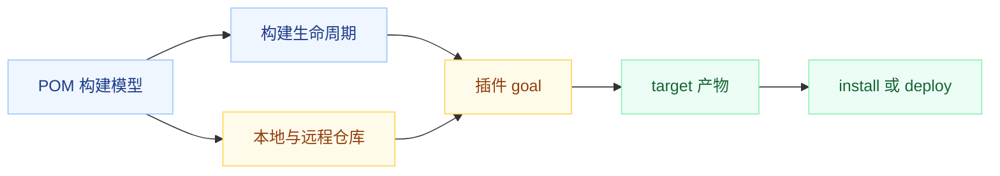
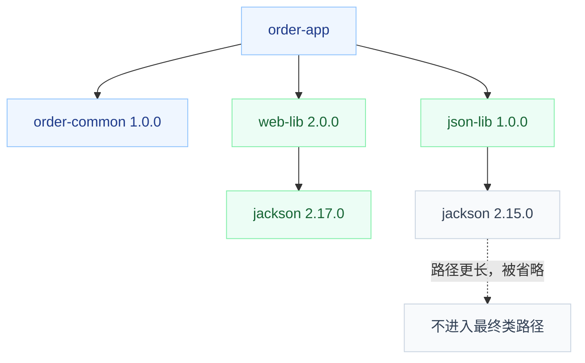

# Maven项目构建

> 这篇从 Maven 的坐标、仓库和依赖解析讲起，经过依赖范围、生命周期、插件、多模块聚合与继承、BOM 版本治理，最后落到私服发布、故障排查和一套可重复的多模块构建流程。
>
> 学完能独立搭建并维护 Java 21 多模块 Maven 工程，定位依赖冲突，固化构建产物并发布到私服。

## 一、Maven 的构建模型与约定

Maven 用 POM（Project Object Model，项目对象模型）描述项目，用一套约定目录减少配置，用生命周期把编译、测试、打包、发布串成固定阶段。核心判断：Maven 管理的是“构建模型 + 依赖图”，不是“写构建脚本”；只有构建逻辑高度定制时，才需要换 Gradle。

一个 Maven 项目的最小信息是坐标：`groupId` 组织、`artifactId` 模块、`version` 版本。打包方式由 `packaging` 决定，默认是 `jar`；父工程用 `pom`，Web 应用打成 `war` 时也在这里声明。

| 目录 | 约定内容 | 不按约定时 |
|---|---|---|
| `src/main/java` | 主代码 | 需要改 `sourceDirectory` |
| `src/main/resources` | 主资源 | 打包后可能缺配置 |
| `src/test/java` | 测试代码 | Surefire 找不到测试 |
| `src/test/resources` | 测试资源 | 测试配置不生效 |
| `target` | 构建输出 | `mvn clean` 清理 |



> 边界：Maven 不管代码质量、运行环境和服务编排。`pom.xml` 里只放构建与依赖信息；数据库地址、密钥这类运行期配置放到配置中心或环境变量。超大型单体仓库如果增量构建时间是硬指标，再评估 Gradle，不要为了“新”而迁移。

## 二、安装与最小验证

Maven 3.9 及以上配合 JDK 21 是当前企业主流组合；Maven 自身只要求 Java 8，但项目编译级别由 `maven.compiler.release` 决定。安装后先确认 `mvn -v` 里的 Java 运行时，而不是只看 `java -version`。

| 环境 | 安装方式 | 验证 |
|---|---|---|
| Windows 10/11 | `winget install Apache.Maven`，或解压二进制包后配置 `MAVEN_HOME` | `mvn -v` |
| macOS | `brew install maven` | `mvn -v` |
| Ubuntu 24.04/26.04 | 下载 `apache-maven-3.9.9-bin.tar.gz` 解压到 `/opt`，把 `bin` 加入 `PATH` | `mvn -v` |
| Rocky/CentOS 9/10 | 同样使用二进制包，避免发行版仓库里的旧版本 | `mvn -v` |

```bash
# Ubuntu / Rocky：安装到 /opt，避免依赖发行版仓库的旧 Maven
curl -fsSLO https://archive.apache.org/dist/maven/maven-3/3.9.9/binaries/apache-maven-3.9.9-bin.tar.gz
sudo tar -xzf apache-maven-3.9.9-bin.tar.gz -C /opt
sudo ln -sfn /opt/apache-maven-3.9.9 /opt/maven
export PATH="/opt/maven/bin:$PATH"   # 写入 ~/.bashrc 或 /etc/profile.d/maven.sh 后长期生效
mvn -v
```

预期输出：

```text
Apache Maven 3.9.9 (8e8579a9e76f7d015ee5ec7bfcdc97d260186937)
Maven home: /opt/maven
Java version: 21.0.13, vendor: Eclipse Adoptium, runtime: /opt/jdk-21
Default locale: zh_CN, platform encoding: UTF-8
OS name: "linux", version: "6.8.0", arch: "amd64", family: "unix"
```

`settings.xml` 放在 `~/.m2/settings.xml`，用于配置本地仓库、镜像和私服凭证；不要提交到项目仓库。

```xml
<settings xmlns="http://maven.apache.org/SETTINGS/1.2.0"
          xmlns:xsi="http://www.w3.org/2001/XMLSchema-instance"
          xsi:schemaLocation="http://maven.apache.org/SETTINGS/1.2.0 https://maven.apache.org/xsd/settings-1.2.0.xsd">
    <localRepository>${user.home}/.m2/repository</localRepository>
    <mirrors>
        <mirror>
            <id>company-nexus</id>
            <mirrorOf>central</mirrorOf>       <!-- 只代理 central，私服自己的仓库仍走原地址 -->
            <url>https://nexus.example.com/repository/maven-public/</url>
        </mirror>
    </mirrors>
</settings>
```

最小工程只保留一个 POM 和一个类：

```text
hello-maven/
├── pom.xml
└── src/main/java/com/example/App.java
```

```xml
<?xml version="1.0" encoding="UTF-8"?>
<project xmlns="http://maven.apache.org/POM/4.0.0"
         xmlns:xsi="http://www.w3.org/2001/XMLSchema-instance"
         xsi:schemaLocation="http://maven.apache.org/POM/4.0.0 https://maven.apache.org/xsd/maven-4.0.0.xsd">
    <modelVersion>4.0.0</modelVersion>
    <groupId>com.example</groupId>
    <artifactId>hello-maven</artifactId>
    <version>1.0.0</version>

    <properties>
        <maven.compiler.release>21</maven.compiler.release> <!-- 用 release 同时约束字节码和 API -->
        <project.build.sourceEncoding>UTF-8</project.build.sourceEncoding>
    </properties>
</project>
```

```java
package com.example;

public class App {
    public static void main(String[] args) {
        System.out.println("Hello, Maven"); // 最小验证：能编译、能运行
    }
}
```

```bash
mvn -B clean package
java -cp target/hello-maven-1.0.0.jar com.example.App
```

预期输出（省略下载日志）：

```text
[INFO] --- compiler:3.13.0:compile (default-compile) @ hello-maven ---
[INFO] Building jar: /work/hello-maven/target/hello-maven-1.0.0.jar
[INFO] BUILD SUCCESS
Hello, Maven
```

> 边界：`mvn` 使用 `JAVA_HOME` 指向的 JDK。IDE 能编译、命令行报 `release version 21 not supported`，先看 `mvn -v` 的 Java 行；`JAVA_HOME` 与 `PATH` 里的 `java` 不是同一个版本，是这类故障的最常见原因。

## 三、坐标、仓库与依赖解析

依赖解析的顺序是：先查本地仓库，再查 `settings.xml` 配置的镜像或私服，最后才访问远程仓库。Maven 不会每次构建都联网；本地仓库已有对应版本时直接复用，`-U` 才会强制检查 SNAPSHOT 更新。

| 坐标元素 | 作用 | 示例 |
|---|---|---|
| `groupId` | 组织或项目组 | `org.springframework.boot` |
| `artifactId` | 模块名 | `spring-boot-starter-web` |
| `version` | 版本 | `3.5.6` |
| `packaging` | 产物类型 | `jar`、`pom`、`war` |
| `classifier` | 同一版本的不同产物 | `sources`、`javadoc` |

依赖范围（dependency scope）决定依赖进入哪条类路径、是否传递给下游：

| 范围 | 编译类路径 | 运行类路径 | 传递性 | 典型用途 |
|---|---|---|---|---|
| `compile` | 是 | 是 | 是 | 业务依赖，默认值 |
| `provided` | 是 | 否 | 否 | Servlet API、容器提供 |
| `runtime` | 否 | 是 | 是 | JDBC 驱动、日志实现 |
| `test` | 仅测试 | 仅测试 | 否 | JUnit、Mockito |
| `import` | 否 | 否 | 否 | 仅用于 BOM 导入 |

传递依赖按“路径最短优先”解析；路径长度相同时，先声明的依赖获胜。这个规则能解释“本地能跑、换一台机器版本变了”的大部分问题：依赖树里被省略的版本并没有消失，只是被调解掉了。



```xml
<dependency>
    <groupId>com.fasterxml.jackson.core</groupId>
    <artifactId>jackson-databind</artifactId>
    <version>2.17.0</version>
    <exclusions>
        <!-- 排除旧版 core，避免与 Spring Boot BOM 管理的版本并存 -->
        <exclusion>
            <groupId>com.fasterxml.jackson.core</groupId>
            <artifactId>jackson-core</artifactId>
        </exclusion>
    </exclusions>
</dependency>
```

排查命令：

```bash
mvn -B dependency:tree
mvn -B dependency:tree -Dverbose -Dincludes=com.fasterxml.jackson.core
mvn -B dependency:analyze
```

预期输出（片段）：

```text
[INFO] com.example.order:order-app:jar:1.0.0
[INFO] \- com.example.order:order-common:jar:1.0.0:compile
[INFO] \- org.springframework.boot:spring-boot-starter-web:jar:3.5.6:compile
```

> 边界：`system` 范围要求写本机绝对路径，CI 上必然失败，不要使用；版本范围 `[1.0,2.0)` 会让构建不可重复，也不要使用。排除依赖前先确认冲突版本确实来自哪条路径，盲目排除会把运行期需要的类一起删掉。

## 四、生命周期与常用命令

Maven 有三套互相独立的生命周期：`clean` 清理、`default` 构建、`site` 生成站点。执行某个阶段时，会按顺序执行它之前的所有阶段；插件目标（goal）绑定到阶段上，才真正干活。

| 阶段 | 做什么 | 产物或副作用 |
|---|---|---|
| `validate` | 校验 POM 和工程结构 | 无 |
| `compile` | 编译主代码 | `target/classes` |
| `test` | 运行单元测试 | `target/surefire-reports` |
| `package` | 打包 | `target/*.jar` |
| `verify` | 运行集成测试和校验 | 质量门禁结果 |
| `install` | 安装到本地仓库 | `~/.m2/repository` |
| `deploy` | 发布到远程仓库 | 私服制品 |

| 命令 | 用途 |
|---|---|
| `mvn clean package` | 清理后打包，最常用的本地验证 |
| `mvn test` | 只跑到测试阶段，不打包 |
| `mvn install` | 把当前版本装进本地仓库，供其他模块引用 |
| `mvn deploy` | 发布到 `distributionManagement` 指定的仓库 |
| `mvn -pl order-app -am package` | 只构建指定模块及其依赖 |
| `mvn help:effective-pom` | 查看合并继承后的最终 POM |

```bash
mvn -B clean package
```

预期输出（片段）：

```text
[INFO] --- surefire:3.5.2:test (default-test) @ order-common ---
[INFO] Tests run: 1, Failures: 0, Errors: 0, Skipped: 0
[INFO] --- jar:3.4.2:jar (default-jar) @ order-app ---
[INFO] Building jar: /work/order-platform/order-app/target/order-app-1.0.0.jar
[INFO] BUILD SUCCESS
[INFO] Total time:  2.959 s
```

跳过测试要区分两个参数：`-DskipTests` 仍编译测试代码，只是不执行；`-Dmaven.test.skip=true` 连测试编译都跳过。CI 的发布流水线不应默认跳过测试，只在已经单独跑过测试的阶段使用。

> 边界：`package` 只产物到 `target`，不会让其他模块引用到新版本；多模块本地联调要用 `install`。`deploy` 会先执行 `verify` 之前的全部阶段，不要在没跑测试的情况下直接 `deploy`。

## 五、插件与构建定制

插件是 Maven 的执行单元，`pom.xml` 里的 `<build><plugins>` 决定绑定哪些 goal、用什么参数。`pluginManagement` 只管理版本和默认配置，不会自动激活插件；子模块真正声明 `<plugin>` 时才生效。

```xml
<build>
    <pluginManagement>
        <plugins>
            <plugin>
                <groupId>org.apache.maven.plugins</groupId>
                <artifactId>maven-compiler-plugin</artifactId>
                <version>3.13.0</version>
                <configuration>
                    <release>21</release> <!-- 同时约束字节码版本和可用的 JDK API -->
                    <parameters>true</parameters> <!-- Spring MVC 绑定参数名时需要 -->
                </configuration>
            </plugin>
            <plugin>
                <groupId>org.apache.maven.plugins</groupId>
                <artifactId>maven-surefire-plugin</artifactId>
                <version>3.5.2</version>
            </plugin>
        </plugins>
    </pluginManagement>
</build>
```

普通 `maven-jar-plugin` 只打当前模块的类，不会把依赖打进去。下面的 `java -jar` 报 `NoClassDefFoundError` 就是典型现象：

```text
Exception in thread "main" java.lang.NoClassDefFoundError: com/example/order/common/Money
```

两种常见解法：

- Spring Boot 项目用 `spring-boot-maven-plugin` 的 `repackage`，生成可执行 fat jar，依赖放在 `BOOT-INF/lib`；
- 普通 Java 项目用 `maven-shade-plugin` 生成 uber jar，或保留普通 jar 并用 `java -cp` 显式列出依赖。

```xml
<plugin>
    <groupId>org.springframework.boot</groupId>
    <artifactId>spring-boot-maven-plugin</artifactId>
    <executions>
        <execution>
            <goals><goal>repackage</goal></goals>
        </execution>
    </executions>
</plugin>
```

```xml
<plugin>
    <groupId>org.apache.maven.plugins</groupId>
    <artifactId>maven-shade-plugin</artifactId>
    <version>3.6.0</version>
    <executions>
        <execution>
            <phase>package</phase>
            <goals><goal>shade</goal></goals>
            <configuration>
                <createDependencyReducedPom>false</createDependencyReducedPom>
                <transformers>
                    <transformer implementation="org.apache.maven.plugins.shade.resource.ManifestResourceTransformer">
                        <mainClass>com.example.order.app.OrderApp</mainClass>
                    </transformer>
                </transformers>
            </configuration>
        </execution>
    </executions>
</plugin>
```

资源过滤把 POM 属性写进配置文件；Spring Boot 父工程默认用 `@...@` 作为分隔符，避免和 Spring 的 `${...}` 占位符冲突：

```yaml
info:
  app:
    version: @project.version@
```

```xml
<resources>
    <resource>
        <directory>src/main/resources</directory>
        <filtering>true</filtering>
    </resource>
</resources>
```

> 边界：`<release>` 比 `<source>`/`<target>` 更严格，能防止用 JDK 21 编译却在 JDK 17 运行；如果公司父 POM 已经锁了插件版本，子模块不要再写版本号。shade 合并多个 jar 时，`META-INF/services` 需要 `ServicesResourceTransformer`，否则 SPI 实现会丢。

## 六、多模块聚合与继承

多模块工程把“聚合”和“继承”分开：父 POM 用 `<modules>` 聚合构建顺序，用 `<parent>` 让子模块继承配置和依赖管理。父 POM 的 `packaging` 必须是 `pom`，它本身不产出业务 jar。

```text
order-platform/
├── pom.xml                  # 父 POM：聚合 + dependencyManagement
├── order-common/
│   ├── pom.xml              # 公共模型，被 app 依赖
│   └── src/main/java/...
└── order-app/
    ├── pom.xml              # 可执行应用
    └── src/main/java/...
```

```xml
<!-- 父 POM 的关键片段 -->
<packaging>pom</packaging>
<modules>
    <module>order-common</module>
    <module>order-app</module>
</modules>
<dependencyManagement>
    <dependencies>
        <dependency>
            <groupId>com.example.order</groupId>
            <artifactId>order-common</artifactId>
            <version>${project.version}</version>
        </dependency>
    </dependencies>
</dependencyManagement>
```

```xml
<!-- order-app/pom.xml 的关键片段 -->
<parent>
    <groupId>com.example.order</groupId>
    <artifactId>order-platform</artifactId>
    <version>1.0.0</version>
    <relativePath>../pom.xml</relativePath>
</parent>
<artifactId>order-app</artifactId>
<dependencies>
    <dependency>
        <groupId>com.example.order</groupId>
        <artifactId>order-common</artifactId>
        <!-- 版本由父 POM 的 dependencyManagement 提供 -->
    </dependency>
</dependencies>
```

Reactor（反应堆）按模块依赖关系排序，不按 `<modules>` 的书写顺序。`order-app` 依赖 `order-common`，所以先构建 common，再构建 app。

```bash
mvn -B clean verify                    # 构建全部模块
mvn -B -pl order-app -am package       # 只构建 app 及它依赖的模块
mvn -B -pl order-app -am -rf :order-common   # 从失败模块继续
mvn -B -T 1C clean verify              # 按 CPU 核数并行，模块无交叉依赖时使用
```

预期输出（片段）：

```text
[INFO] Reactor Summary for order-platform 1.0.0:
[INFO] order-platform ..................................... SUCCESS [  0.107 s]
[INFO] order-common ....................................... SUCCESS [  2.570 s]
[INFO] order-app .......................................... SUCCESS [  0.222 s]
[INFO] BUILD SUCCESS
```

> 边界：子模块的 `<relativePath>` 默认就是 `../pom.xml`，目录结构变化时要显式写；父 POM 没 `install` 时，子模块靠相对路径找父 POM，脱离源码目录单独构建会失败。`spring-boot-maven-plugin` 只放在需要可执行 jar 的模块，放在父 POM 会让所有模块都被 repackage。

## 七、BOM 与依赖版本治理

BOM（Bill of Materials，物料清单）是一个只含 `dependencyManagement` 的 POM，用来统一一组依赖的版本。`import` 范围只在这个位置有效，它不会把依赖加进项目，只把版本约束带进来。

```xml
<dependencyManagement>
    <dependencies>
        <!-- 公司父 POM 已存在时，用 import 引入 Spring Boot BOM -->
        <dependency>
            <groupId>org.springframework.boot</groupId>
            <artifactId>spring-boot-dependencies</artifactId>
            <version>3.5.6</version>
            <type>pom</type>
            <scope>import</scope>
        </dependency>
    </dependencies>
</dependencyManagement>
```

如果项目直接继承 `spring-boot-starter-parent`，就已经获得同一套版本管理，不需要再 import 一次。需要覆盖某个依赖时，在本 POM 的 `dependencyManagement` 里直接声明版本，优先级高于导入的 BOM。

```xml
<dependencyManagement>
    <dependencies>
        <!-- 直接声明优先于 import 进来的 BOM -->
        <dependency>
            <groupId>com.fasterxml.jackson.core</groupId>
            <artifactId>jackson-databind</artifactId>
            <version>2.17.3</version>
        </dependency>
    </dependencies>
</dependencyManagement>
```

构建门禁用 `maven-enforcer-plugin` 固定 JDK 和 Maven 版本，避免“某个同学用 JDK 17 打出的包在 21 环境跑”：

```xml
<plugin>
    <groupId>org.apache.maven.plugins</groupId>
    <artifactId>maven-enforcer-plugin</artifactId>
    <version>3.5.0</version>
    <executions>
        <execution>
            <goals><goal>enforce</goal></goals>
            <configuration>
                <rules>
                    <requireJavaVersion><version>[21,22)</version></requireJavaVersion>
                    <requireMavenVersion><version>[3.9,)</version></requireMavenVersion>
                </rules>
            </configuration>
        </execution>
    </executions>
</plugin>
```

> 边界：BOM 只统一版本，不保证依赖之间二进制兼容；升级 BOM 后仍要跑集成测试。不要用 `LATEST`、`RELEASE` 这类动态版本，构建结果会随仓库变化，无法复现。

## 八、私服与制品发布

私服（private repository）通常用 Nexus 3 或 Artifactory，仓库分三类：hosted 存公司自己的 release/snapshot，proxy 代理 Maven Central，group 把多个仓库聚合成一个地址给开发者使用。发布只写 hosted，读取走 group。

| 仓库 | 内容 | 是否允许覆盖 |
|---|---|---|
| `maven-releases` | 正式版本 | 不允许 |
| `maven-snapshots` | 快照版本 | 允许，按时间戳保留 |
| `maven-central` | Central 代理 | 只读 |
| `maven-public` | group 聚合 | 只读 |

`settings.xml` 中的 `<server>` 的 `id` 必须与 `distributionManagement` 的 `id` 一致，否则 Maven 找不到凭证：

```xml
<servers>
    <server>
        <id>company-nexus</id>
        <username>deploy-bot</username>
        <password>{加密后的密码}</password> <!-- 用 mvn --encrypt-password 生成 -->
    </server>
</servers>
```

```xml
<distributionManagement>
    <repository>
        <id>company-nexus</id>
        <url>https://nexus.example.com/repository/maven-releases/</url>
    </repository>
    <snapshotRepository>
        <id>company-nexus</id>
        <url>https://nexus.example.com/repository/maven-snapshots/</url>
    </snapshotRepository>
</distributionManagement>
```

```bash
mvn -B clean deploy
```

预期输出（片段）：

```text
[INFO] Uploading to company-nexus: https://nexus.example.com/repository/maven-releases/com/example/order/order-app/1.0.0/order-app-1.0.0.jar
[INFO] Uploaded to company-nexus: .../order-app-1.0.0.jar (8.0 kB at 12 kB/s)
[INFO] BUILD SUCCESS
```

没有私服时，可以用本地文件仓库验证发布配置：

```bash
mvn -B deploy -DskipTests \
  -DaltDeploymentRepository=local::file:///tmp/m2-deploy
find /tmp/m2-deploy -name "*.jar" | sort
```

预期输出：

```text
/tmp/m2-deploy/com/example/order/order-app/1.0.0/order-app-1.0.0.jar
/tmp/m2-deploy/com/example/order/order-common/1.0.0/order-common-1.0.0.jar
```

> 边界：release 仓库不允许覆盖同版本制品，发布错了只能升版本重发；SNAPSHOT 适合联调，不要把它当正式交付。CI 用独立的部署账号和 Token，不要把个人密码写进 `pom.xml` 或流水线明文变量。

## 九、常见故障排查

排障先固定三件事：当前 JDK、当前 Maven、当前生效的 POM。多数“Maven 坏了”不是 Maven 的问题，而是环境或依赖树与预期不一致。

| 现象 | 常见原因 | 第一条命令 |
|---|---|---|
| `Could not resolve dependencies` | 私服不可达、坐标写错、本地缓存损坏 | `mvn -B -U dependency:resolve` |
| `release version 21 not supported` | `JAVA_HOME` 指向旧 JDK | `mvn -v` |
| 私服返回 401/403 | `server id` 与仓库 `id` 不一致 | `mvn -B help:effective-settings` |
| 测试数为 0 | 命名不符、测试依赖是 `provided` | `mvn -B test -Dtest=*Test` |
| `java -jar` 报 `NoClassDefFoundError` | 普通 jar 未打依赖 | `unzip -l target/*.jar` |
| 多模块找不到父 POM | `relativePath` 错误或父 POM 未安装 | `mvn -B -pl :模块 -am install` |
| 同一个类出现两个版本 | 传递依赖冲突 | `mvn -B dependency:tree -Dverbose` |
| IDE 正常、CI 失败 | 本地仓库有私货、CI 无凭证 | `mvn -B -ntp clean verify` |

依赖冲突的定位顺序：

```bash
# 1. 看冲突依赖从哪来
mvn -B dependency:tree -Dverbose -Dincludes=org.slf4j:slf4j-api

# 2. 看最终生效的 POM（排除父 POM 和 profile 的干扰）
mvn -B help:effective-pom -Doutput=effective-pom.xml

# 3. 看依赖是否有声明但未使用、使用但未声明
mvn -B dependency:analyze
```

> 边界：`-U` 会强制更新 SNAPSHOT 和失败过的元数据，不能替代排查；`mvn -o` 离线模式要求本地仓库完整，CI 上不要用离线模式掩盖网络问题。

## 十、最佳实践案例

### 10.1 案例背景

一个 4 人维护的订单平台原本是单模块项目：公共金额模型、订单应用和测试混在一个 `jar` 里，任何改动都全量构建，构建时间约 6 分钟；依赖版本靠开发者各自在 IDE 里选，线上出现过 `jackson` 两个版本共存导致的序列化差异。

目标是把工程拆成 `order-common` 与 `order-app` 两个模块，统一 Java 21 和依赖版本，产出可直接运行的 jar，并让 CI 用同一条命令完成测试、打包和发布。约束是不能引入 Gradle，私服只接受 `deploy` 上传的制品。

### 10.2 案例实操

完整工程结构：

```text
order-platform/
├── pom.xml
├── order-common/
│   ├── pom.xml
│   └── src/
│       ├── main/java/com/example/order/common/Money.java
│       └── test/java/com/example/order/common/MoneyTest.java
└── order-app/
    ├── pom.xml
    └── src/main/java/com/example/order/app/OrderApp.java
```

父 POM 固定编译级别、JUnit 版本和子模块：

```xml
<?xml version="1.0" encoding="UTF-8"?>
<project xmlns="http://maven.apache.org/POM/4.0.0"
         xmlns:xsi="http://www.w3.org/2001/XMLSchema-instance"
         xsi:schemaLocation="http://maven.apache.org/POM/4.0.0 https://maven.apache.org/xsd/maven-4.0.0.xsd">
    <modelVersion>4.0.0</modelVersion>
    <groupId>com.example.order</groupId>
    <artifactId>order-platform</artifactId>
    <version>1.0.0</version>
    <packaging>pom</packaging>

    <modules>
        <module>order-common</module>
        <module>order-app</module>
    </modules>

    <properties>
        <java.version>21</java.version>
        <project.build.sourceEncoding>UTF-8</project.build.sourceEncoding>
        <junit.version>5.11.4</junit.version>
    </properties>

    <dependencyManagement>
        <dependencies>
            <dependency>
                <groupId>org.junit.jupiter</groupId>
                <artifactId>junit-jupiter</artifactId>
                <version>${junit.version}</version>
                <scope>test</scope>
            </dependency>
        </dependencies>
    </dependencyManagement>

    <build>
        <pluginManagement>
            <plugins>
                <plugin>
                    <groupId>org.apache.maven.plugins</groupId>
                    <artifactId>maven-compiler-plugin</artifactId>
                    <version>3.13.0</version>
                    <configuration><release>${java.version}</release></configuration>
                </plugin>
                <plugin>
                    <groupId>org.apache.maven.plugins</groupId>
                    <artifactId>maven-surefire-plugin</artifactId>
                    <version>3.5.2</version>
                </plugin>
            </plugins>
        </pluginManagement>
    </build>
</project>
```

公共模块只放领域模型和它的测试：

```xml
<project xmlns="http://maven.apache.org/POM/4.0.0"
         xmlns:xsi="http://www.w3.org/2001/XMLSchema-instance"
         xsi:schemaLocation="http://maven.apache.org/POM/4.0.0 https://maven.apache.org/xsd/maven-4.0.0.xsd">
    <modelVersion>4.0.0</modelVersion>
    <parent>
        <groupId>com.example.order</groupId>
        <artifactId>order-platform</artifactId>
        <version>1.0.0</version>
    </parent>
    <artifactId>order-common</artifactId>

    <dependencies>
        <dependency>
            <groupId>org.junit.jupiter</groupId>
            <artifactId>junit-jupiter</artifactId>
            <scope>test</scope>
        </dependency>
    </dependencies>
</project>
```

```java
package com.example.order.common;

import java.math.BigDecimal;
import java.math.RoundingMode;
import java.util.Objects;

public record Money(BigDecimal amount) implements Comparable<Money> {
    public Money {
        // 金额统一保留两位，避免不同调用点 scale 不一致
        amount = amount.setScale(2, RoundingMode.HALF_UP);
    }

    public static Money of(String value) {
        return new Money(new BigDecimal(value));
    }

    public Money add(Money other) {
        return new Money(this.amount.add(other.amount));
    }

    @Override
    public int compareTo(Money other) {
        return this.amount.compareTo(other.amount);
    }

    @Override
    public boolean equals(Object o) {
        return o instanceof Money m && amount.compareTo(m.amount) == 0;
    }

    @Override
    public int hashCode() {
        return Objects.hash(amount.stripTrailingZeros());
    }
}
```

```java
package com.example.order.common;

import org.junit.jupiter.api.Test;
import static org.junit.jupiter.api.Assertions.assertEquals;

class MoneyTest {
    @Test
    void addsWithoutBinaryRoundingError() {
        assertEquals("0.30", Money.of("0.10").add(Money.of("0.20")).amount().toString());
    }
}
```

应用模块依赖公共模块，并用 shade 打成可执行 jar：

```xml
<project xmlns="http://maven.apache.org/POM/4.0.0"
         xmlns:xsi="http://www.w3.org/2001/XMLSchema-instance"
         xsi:schemaLocation="http://maven.apache.org/POM/4.0.0 https://maven.apache.org/xsd/maven-4.0.0.xsd">
    <modelVersion>4.0.0</modelVersion>
    <parent>
        <groupId>com.example.order</groupId>
        <artifactId>order-platform</artifactId>
        <version>1.0.0</version>
    </parent>
    <artifactId>order-app</artifactId>

    <dependencies>
        <dependency>
            <groupId>com.example.order</groupId>
            <artifactId>order-common</artifactId>
            <version>${project.version}</version>
        </dependency>
    </dependencies>

    <build>
        <plugins>
            <plugin>
                <groupId>org.apache.maven.plugins</groupId>
                <artifactId>maven-shade-plugin</artifactId>
                <version>3.6.0</version>
                <executions>
                    <execution>
                        <phase>package</phase>
                        <goals><goal>shade</goal></goals>
                        <configuration>
                            <createDependencyReducedPom>false</createDependencyReducedPom>
                            <transformers>
                                <transformer implementation="org.apache.maven.plugins.shade.resource.ManifestResourceTransformer">
                                    <mainClass>com.example.order.app.OrderApp</mainClass>
                                </transformer>
                            </transformers>
                        </configuration>
                    </execution>
                </executions>
            </plugin>
        </plugins>
    </build>
</project>
```

```java
package com.example.order.app;

import com.example.order.common.Money;

public class OrderApp {
    public static void main(String[] args) {
        Money total = Money.of("19.90").add(Money.of("5.10"));
        System.out.println("order total = " + total.amount() + " CNY");
    }
}
```

构建与运行：

```bash
mvn -B clean verify
java -jar order-app/target/order-app-1.0.0.jar
```

预期输出（本机实测，时间会随机器变化）：

```text
[INFO] Tests run: 1, Failures: 0, Errors: 0, Skipped: 0
[INFO] order-platform ..................................... SUCCESS [  0.107 s]
[INFO] order-common ....................................... SUCCESS [  2.570 s]
[INFO] order-app .......................................... SUCCESS [  0.222 s]
[INFO] BUILD SUCCESS
order total = 25.00 CNY
```

发布到本地文件仓库验证 `deploy` 生命周期：

```bash
mvn -B deploy -DskipTests \
  -DaltDeploymentRepository=local::file:///tmp/m2-deploy
ls /tmp/m2-deploy/com/example/order/order-app/1.0.0/
```

预期输出：

```text
order-app-1.0.0.jar  order-app-1.0.0.jar.md5  order-app-1.0.0.jar.sha1
order-app-1.0.0.pom  order-app-1.0.0.pom.md5  order-app-1.0.0.pom.sha1
```

### 10.3 案例结果

拆分后本机完整构建 2.959 秒，`order-app` 可执行 jar 约 8 KB（示例工程，不含第三方依赖）；`order-common` 的单测在每次构建中执行。CI 命令固定为 `mvn -B -ntp clean deploy`，版本由父 POM 统一，release 仓库不允许覆盖同版本，发布失败只能升版本重发。

复盘三个失败模式：第一，父 POM 的 `relativePath` 写错会让子模块在 CI 上找不到父工程；第二，SNAPSHOT 被覆盖后无法追溯，正式交付必须用 release 版本；第三，shade 不合并 `META-INF/services` 时 SPI 扩展会静默丢失。下一步是把 `mvn dependency:analyze` 和 Enforcer 加进流水线，阻止未声明依赖和 JDK 版本漂移。
