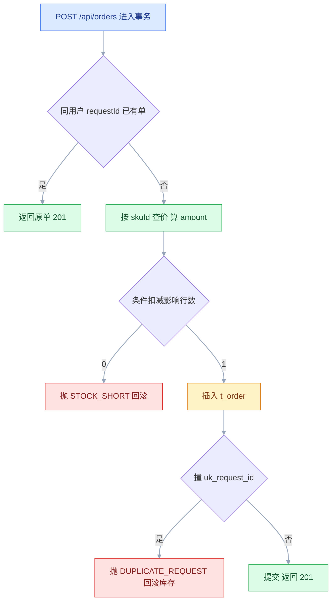
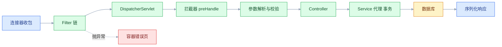
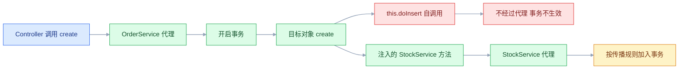

# Spring Boot

## 一、工程案例：做一个重复提交也只下一单的下单接口

**场景**：单体服务，MySQL 两张表，`t_stock` 存库存、`t_order` 存订单。对外一个 `POST /api/orders`，请求体只有 `requestId`、`skuId`、`qty`。验收三句话：库存扣不成负数；同一 `requestId` 重试多少次只落一单；任何失败都有稳定错误码，且一次请求的日志能用同一个 id 串起来。

**为什么拿它当第一个案例**：这个接口同时压到五条主线——入参校验、事务边界、并发下的唯一性、异常到 HTTP 的映射、日志链路。这五件事做对，增删改查只是重复劳动；做错，后面每个写接口都会重犯。

**动手前确认**：JDK 17 及以上（Boot 3 的基线是 17，新的大版本以官方当前稳定版的要求为准）、MySQL 8 已启动、8080 空闲。账号密码走环境变量，不进仓库。

### 1.1 表结构与初始数据

约束尽量交给数据库，应用层只做快速失败和错误翻译。`uk_request_id` 是幂等的最终防线，`CHECK` 是库存的最后一道闸。

```sql
CREATE DATABASE IF NOT EXISTS shop DEFAULT CHARACTER SET utf8mb4;
USE shop;

CREATE TABLE t_stock (
    sku_id    BIGINT        NOT NULL PRIMARY KEY,
    available INT           NOT NULL,
    price     DECIMAL(10,2) NOT NULL,
    CONSTRAINT chk_stock_nonneg CHECK (available >= 0)
) ENGINE = InnoDB;

CREATE TABLE t_order (
    id          BIGINT        NOT NULL AUTO_INCREMENT,
    order_no    VARCHAR(32)   NOT NULL,
    request_id  VARCHAR(64)   NOT NULL,
    user_id     BIGINT        NOT NULL,
    sku_id      BIGINT        NOT NULL,
    qty         INT           NOT NULL,
    amount      DECIMAL(10,2) NOT NULL,
    status      VARCHAR(16)   NOT NULL DEFAULT 'CREATED',
    create_time DATETIME      NOT NULL DEFAULT CURRENT_TIMESTAMP,
    PRIMARY KEY (id),
    UNIQUE KEY uk_order_no (order_no),
    UNIQUE KEY uk_request_id (request_id)
) ENGINE = InnoDB;

INSERT INTO t_stock VALUES (1001, 5, 99.00), (1002, 1, 59.00);
```

`CHECK` 在 MySQL 8.0.16 起才真正执行，更早的版本只解析。`uk_request_id` 必须是数据库唯一索引，不能只在代码里查重——并发下「先查后插」必漏。上面这段存成 `sql/schema.sql`，用 `mysql -h127.0.0.1 -uroot -p < sql/schema.sql` 执行一次。

### 1.2 依赖与配置

pom 只列结构：`parent` 的版本用 Initializr 生成的值，不手抄小版本号；starter 的版本由 BOM 统一管理，一律不写 `<version>`。骨架直接生成，省得漏坐标：

```bash
curl -G https://start.spring.io/starter.zip -d type=maven-project -d javaVersion=17 \
  -d groupId=com.example -d artifactId=shop -d name=shop \
  -d dependencies=web,validation,jdbc,actuator,mysql,lombok -o shop.zip
unzip shop.zip -d shop && cd shop
```

```xml
<parent>
    <groupId>org.springframework.boot</groupId>
    <artifactId>spring-boot-starter-parent</artifactId>
    <!-- 版本以官方当前稳定版为准，Initializr 生成什么就用什么 -->
    <relativePath/>
</parent>

<groupId>com.example</groupId>
<artifactId>shop</artifactId>
<version>0.1.0</version>

<dependencies>
    <dependency><groupId>org.springframework.boot</groupId><artifactId>spring-boot-starter-web</artifactId></dependency>
    <dependency><groupId>org.springframework.boot</groupId><artifactId>spring-boot-starter-validation</artifactId></dependency>
    <dependency><groupId>org.springframework.boot</groupId><artifactId>spring-boot-starter-jdbc</artifactId></dependency>
    <dependency><groupId>org.springframework.boot</groupId><artifactId>spring-boot-starter-actuator</artifactId></dependency>
    <dependency><groupId>com.mysql</groupId><artifactId>mysql-connector-j</artifactId><scope>runtime</scope></dependency>
    <dependency><groupId>org.projectlombok</groupId><artifactId>lombok</artifactId><optional>true</optional></dependency>
    <dependency><groupId>org.springframework.boot</groupId><artifactId>spring-boot-starter-test</artifactId><scope>test</scope></dependency>
</dependencies>

<build>
    <finalName>shop</finalName>
    <plugins><plugin><groupId>org.springframework.boot</groupId><artifactId>spring-boot-maven-plugin</artifactId></plugin></plugins>
</build>
```

```yaml
server:
  port: 8080
  shutdown: graceful
spring:
  application:
    name: shop
  datasource:
    url: jdbc:mysql://127.0.0.1:3306/shop?useSSL=false&characterEncoding=utf8&serverTimezone=Asia/Shanghai
    username: ${DB_USER}
    password: "${DB_PASSWORD}"
    hikari:
      maximum-pool-size: 20
      connection-timeout: 2000
  jackson:
    default-property-inclusion: non_null
management:
  endpoints:
    web:
      exposure:
        include: health,info,env,beans,conditions,loggers   # 仅本地排障用
logging:
  file:
    name: logs/shop.log
  pattern:
    console: "%d{HH:mm:ss.SSS} %-5level [%X{traceId}] %logger{36} - %msg%n"
    file: "%d{HH:mm:ss.SSS} %-5level [%X{traceId}] %logger{36} - %msg%n"
```

上面这段放在 `src/main/resources/application.yml`。本地起服务前先导出变量，缺变量会在启动时直接报占位符解析失败，比跑到一半才发现密码错好：`export DB_USER=shop_user DB_PASSWORD='S3cret!'`，再 `./mvnw spring-boot:run`。

### 1.3 统一响应与错误码

响应体固定四个字段，`traceId` 从 MDC 带出，把「用户看到的报错」和「日志里的那次请求」直接对上。HTTP 状态按错误类别返回，业务码再细分。

```java
public record ApiResponse<T>(int code, String msg, T data, String traceId) {
    public static <T> ApiResponse<T> ok(T data) {
        return new ApiResponse<>(0, "ok", data, MDC.get("traceId"));
    }
    public static <T> ApiResponse<T> fail(ErrorCode ec, String detail) {
        String msg = (detail == null || detail.isBlank()) ? ec.message() : detail;
        return new ApiResponse<>(ec.code(), msg, null, MDC.get("traceId"));
    }
}
```

```java
public enum ErrorCode {
    PARAM_INVALID(40001, "参数不合法", HttpStatus.BAD_REQUEST),
    NOT_FOUND(40401, "资源不存在", HttpStatus.NOT_FOUND),
    STOCK_SHORT(40901, "库存不足", HttpStatus.CONFLICT),
    DUPLICATE_REQUEST(40902, "请勿重复提交", HttpStatus.CONFLICT),
    SYSTEM_ERROR(50000, "系统繁忙", HttpStatus.INTERNAL_SERVER_ERROR);

    private final int code;
    private final String message;
    private final HttpStatus status;
    ErrorCode(int code, String message, HttpStatus status) { this.code = code; this.message = message; this.status = status; }
    public int code() { return code; } public String message() { return message; } public HttpStatus status() { return status; }
}
```

```java
public class BizException extends RuntimeException {
    private final ErrorCode errorCode;
    public BizException(ErrorCode ec) { super(ec.message()); this.errorCode = ec; }
    public BizException(ErrorCode ec, String detail) { super(detail); this.errorCode = ec; }
    public ErrorCode errorCode() { return errorCode; }
}
```

### 1.4 接口层：只收参、校验、转发

DTO 用 record，字段少、天然不可变。金额不在入参里——价格由服务端按 `skuId` 查出，否则客户端可以传 `0.01` 买走一切。

```java
public record CreateOrderRequest(
        @NotBlank(message = "requestId 不能为空") @Size(max = 64, message = "requestId 最长 64 位") String requestId,
        @NotNull(message = "skuId 不能为空") Long skuId,
        @NotNull(message = "qty 不能为空")
        @Min(value = 1, message = "qty 至少为 1")
        @Max(value = 5, message = "单次最多购买 5 件") Integer qty) {
}
```

```java
@RestController
@RequestMapping("/api/orders")
public class OrderController {
    private final OrderService orderService;
    public OrderController(OrderService orderService) { this.orderService = orderService; }

    @PostMapping
    public ResponseEntity<ApiResponse<OrderView>> create(
            @RequestBody @Valid CreateOrderRequest req,
            @RequestHeader(name = "X-User-Id", defaultValue = "1") long userId) {
        OrderView view = orderService.create(req, userId);
        return ResponseEntity.status(HttpStatus.CREATED).body(ApiResponse.ok(view));
    }
}
```

### 1.5 业务层：条件扣减 + 唯一索引 + 单事务

顺序有讲究：先走「已成功」快路径；再算钱、扣库存；最后插订单。插订单撞唯一索引就抛出，整个事务回滚，刚扣的库存一并退回。



```java
public record OrderView(String orderNo, Long skuId, Integer qty, BigDecimal amount) { }

@Service
public class OrderService {
    private static final DateTimeFormatter NO_FMT = DateTimeFormatter.ofPattern("yyyyMMddHHmmssSSS");
    private static final SecureRandom RANDOM = new SecureRandom();
    private final JdbcTemplate jdbc;
    public OrderService(JdbcTemplate jdbc) { this.jdbc = jdbc; }

    @Transactional
    public OrderView create(CreateOrderRequest req, long userId) {
        // ① 快路径：本用户这个 requestId 已成功下过单，返回原结果
        List<OrderView> hit = jdbc.query(
                "SELECT order_no, sku_id, qty, amount FROM t_order WHERE request_id = ? AND user_id = ?",
                (rs, i) -> new OrderView(rs.getString("order_no"), rs.getLong("sku_id"),
                        rs.getInt("qty"), rs.getBigDecimal("amount")),
                req.requestId(), userId);
        if (!hit.isEmpty()) return hit.get(0);

        // ② 价格从库里取，不信任客户端
        List<BigDecimal> prices = jdbc.queryForList(
                "SELECT price FROM t_stock WHERE sku_id = ?", BigDecimal.class, req.skuId());
        if (prices.isEmpty()) throw new BizException(ErrorCode.NOT_FOUND, "商品不存在");
        BigDecimal amount = prices.get(0).multiply(BigDecimal.valueOf(req.qty()));

        // ③ 条件更新：一条 SQL 完成判断和扣减，避免先查后改的竞态
        int affected = jdbc.update(
                "UPDATE t_stock SET available = available - ? WHERE sku_id = ? AND available >= ?",
                req.qty(), req.skuId(), req.qty());
        if (affected == 0) throw new BizException(ErrorCode.STOCK_SHORT, "库存不足");

        // ④ 插订单：request_id 唯一索引是并发下的最终防线
        String orderNo = LocalDateTime.now().format(NO_FMT) + (1000 + RANDOM.nextInt(9000));
        try {
            jdbc.update("INSERT INTO t_order (order_no, request_id, user_id, sku_id, qty, amount) "
                            + "VALUES (?, ?, ?, ?, ?, ?)",
                    orderNo, req.requestId(), userId, req.skuId(), req.qty(), amount);
        } catch (DuplicateKeyException e) {
            throw new BizException(ErrorCode.DUPLICATE_REQUEST);   // 继续抛，事务才会回滚
        }
        return new OrderView(orderNo, req.skuId(), req.qty(), amount);
    }
}
```

> 单号只保证「大概率不重复」，真正兜底的是 `uk_order_no`。`@Transactional` 默认只回滚运行时异常和 `Error`；`DuplicateKeyException`、`BizException` 都满足这条。

### 1.6 异常映射与 traceId

三类分开处理：校验失败、业务拒绝、兜底。兜底必须打完整堆栈，但只把安全文案返回前端。

```java
@Slf4j
@RestControllerAdvice
public class GlobalExceptionHandler {

    @ExceptionHandler(MethodArgumentNotValidException.class)
    public ResponseEntity<ApiResponse<Void>> onInvalid(MethodArgumentNotValidException e) {
        String msg = e.getBindingResult().getFieldErrors().stream()
                .map(FieldError::getDefaultMessage)
                .collect(Collectors.joining("; "));
        log.warn("参数校验失败: {}", msg);
        return build(ErrorCode.PARAM_INVALID, msg);
    }

    @ExceptionHandler(BizException.class)
    public ResponseEntity<ApiResponse<Void>> onBiz(BizException e) {
        log.warn("业务拒绝: code={}, msg={}", e.errorCode().code(), e.getMessage());
        return build(e.errorCode(), null);
    }

    @ExceptionHandler(Exception.class)
    public ResponseEntity<ApiResponse<Void>> onOther(Exception e) {
        log.error("未处理异常", e);
        return build(ErrorCode.SYSTEM_ERROR, null);
    }

    private ResponseEntity<ApiResponse<Void>> build(ErrorCode ec, String detail) {
        return ResponseEntity.status(ec.status()).body(ApiResponse.fail(ec, detail));
    }
}
```

```java
@Slf4j
@Component
@Order(Ordered.HIGHEST_PRECEDENCE)
public class TraceIdFilter extends OncePerRequestFilter {
    @Override
    protected void doFilterInternal(HttpServletRequest req, HttpServletResponse res, FilterChain chain)
            throws ServletException, IOException {
        String traceId = req.getHeader("X-Trace-Id");
        if (traceId == null || traceId.isBlank()) {
            traceId = UUID.randomUUID().toString().replace("-", "").substring(0, 8);
        }
        MDC.put("traceId", traceId);
        res.setHeader("X-Trace-Id", traceId);
        try {
            chain.doFilter(req, res);
        } finally {
            log.info("{} {} -> {}", req.getMethod(), req.getRequestURI(), res.getStatus());
            MDC.remove("traceId");   // 线程复用，必须清
        }
    }
}
```

### 1.7 跑起来验证

```bash
# 正常下单：带固定 traceId，后面去日志里捞
curl -s -i -X POST http://localhost:8080/api/orders \
  -H 'Content-Type: application/json' -H 'X-User-Id: 7' -H 'X-Trace-Id: 8f3a2b1c' \
  -d '{"requestId":"req-001","skuId":1001,"qty":2}'

# 同一 requestId、同一用户再发：走快路径，返回同一单（X-User-Id 必须一致）
curl -s -X POST http://localhost:8080/api/orders \
  -H 'Content-Type: application/json' -H 'X-User-Id: 7' \
  -d '{"requestId":"req-001","skuId":1001,"qty":2}'

# 参数校验：qty=0
curl -s -X POST http://localhost:8080/api/orders -H 'Content-Type: application/json' \
  -d '{"requestId":"req-002","skuId":1001,"qty":0}'

# 库存不足：1002 只剩 1 件，买 5 件，能过 @Max 校验
curl -s -X POST http://localhost:8080/api/orders -H 'Content-Type: application/json' \
  -d '{"requestId":"req-003","skuId":1002,"qty":5}'

# 20 个不同 requestId 抢库存
seq 1 20 | xargs -P20 -I{} curl -s -o /dev/null -w '%{http_code}\n' \
  -X POST http://localhost:8080/api/orders -H 'Content-Type: application/json' \
  -d '{"requestId":"race-{}","skuId":1001,"qty":1}'

grep 8f3a2b1c logs/shop.log        # 按 traceId 捞完整链路
```

```text
HTTP/1.1 201
X-Trace-Id: 8f3a2b1c
{"code":0,"msg":"ok","data":{"orderNo":"202610211532111234567","skuId":1001,"qty":2,"amount":198.00},"traceId":"8f3a2b1c"}

{"code":40001,"msg":"qty 至少为 1","data":null,"traceId":"c1d2e3f4"}
{"code":40901,"msg":"库存不足","data":null,"traceId":"a9b8c7d6"}
```

### 1.8 验收表

| # | 检查项 | 命令或检查 | 通过标准 |
|---|---|---|---|
| 1 | 唯一索引存在 | `SHOW INDEX FROM t_order;` | 有 `uk_request_id`、`uk_order_no` |
| 2 | 正常下单 | 1.7 第一条 curl | 201，`orderNo` 非空，库存 5→3 |
| 3 | 参数校验 | `qty=0` | 400，`code=40001`，`msg` 含 `qty` |
| 4 | 库存不足 | `skuId=1002&qty=5`（1002 只有 1 件） | 409，`code=40901`，`available` 不变 |
| 5 | 顺序重复 | 同 `requestId`、同 `X-User-Id` 再发 | 返回同一 `orderNo`，订单数仍为 1 |
| 6 | 并发重复 | `xargs -P20` 固定同一 `requestId` | 订单只有 1 条，库存只扣一次；其余返回 201（快路径）或 409（撞唯一索引） |
| 7 | 并发抢库存 | `xargs -P20` 不同 `requestId` | 成功数等于剩余库存，`available` 不为负 |
| 8 | 事务回滚 | 插订单后临时 `throw new RuntimeException` | 订单 0 条，库存回到原值 |
| 9 | 错误不泄露 | 停 MySQL 再请求 | 500，`code=50000`，响应无 SQL，日志有堆栈 |
| 10 | traceId | 响应头与 `logs/shop.log` 对比 | 同一 id 串起访问日志与异常日志 |
| 11 | 健康检查 | `curl -s localhost:8080/actuator/health` | `{"status":"UP"}` |
| 12 | 可执行 jar | `./mvnw clean package` 后 `java -jar target/shop.jar` | 启动成功，第 2 项重跑通过 |

> 第 6 项考唯一索引，第 7 项考条件扣减，两者不能互相替代。第 8 项验证完记得删掉临时代码。

---

## 二、高频问答：会卡住你的地方，也是面试最常问的

### 2.1 启动直接失败：`Port 8080 was already in use`

**现场**

先别改端口，先查是谁占的：`lsof -nP -iTCP:8080 -sTCP:LISTEN`，看 PID 和命令行是不是自己的项目；是自己的就 `kill <PID>`，只是临时避让才用 `-Dspring-boot.run.arguments=--server.port=8081`。

**要点**

- 端口冲突绝大多数是自己的僵尸进程，不是环境问题。
- IDE 里点停止只杀了 Maven 父进程，fork 出来的 Java 进程还在监听。
- 核实要看监听进程的启动命令，而不是只看端口号；改端口只是把它藏起来。

**追问**

- 为什么 IDE 停了进程还在？→ 停的是 Maven，fork 出来的 JVM 是独立进程。
- 怎么确认是自己的进程？→ 看命令行里有没有本项目的 jar 或启动类。
- 直接改端口有什么问题？→ 旧进程还在跑，下次部署照样撞，而且可能连到旧实例。

### 2.2 服务起来了，所有业务接口都 404

**现场**

先请求 `/actuator/health`：通了说明容器正常、是映射没注册；再开 `RequestMappingHandlerMapping` 的 TRACE 日志，看有没有 `Mapped` 记录。

**要点**

- Spring MVC 的 404 是「没有匹配映射」，与网络和调用方无关。
- 启动类不在最顶层包，`@ComponentScan` 只扫启动类所在包及子包；或 Controller 漏了 `@RestController`；或 `context-path` 与 `@RequestMapping` 叠加成双前缀。
- 核实顺序固定：健康检查通不通 → 日志有没有 Mapped → 启动类包路径是不是最顶层。

**追问**

- 为什么健康检查能通？→ 它是独立端点，不依赖业务 Controller 的映射。
- 只有部分接口 404 呢？→ 查那个 Controller 的包路径和类上的 `@RequestMapping` 前缀。
- `context-path` 和 `@RequestMapping` 叠加会怎样？→ URL 变成双前缀，前端按旧路径请求就 404。

### 2.3 启动报数据库连接失败

**现场**

用同账号在同机复现：`mysql -h127.0.0.1 -P3306 -u$DB_USER -p -e 'select 1'`。命令行能连上，问题在配置或驱动；连不上，才轮到网络和防火墙。

**要点**

- 应用报错被几十行堆栈包着，根因在最深一层 `Caused by`，先看它。
- `Connection refused` 是 MySQL 没起或端口不对；`Access denied` 是账号密码或来源主机不对；`Unknown database` 是库没建。
- `Public Key Retrieval is not allowed` 是 MySQL 8 的 `caching_sha2_password` 在非 SSL 下的限制，连接串加 `allowPublicKeyRetrieval=true`。

**追问**

- 为什么本地能连、容器里连不上？→ 容器里的 `localhost` 是容器自己，要用服务名。
- `Access denied` 还要看什么？→ 账号的 host 授权范围，`%` 和 `localhost` 不是一回事。
- 连接失败该先改哪？→ 先看最深一层 `Caused by`，不要从头改连接串。

### 2.4 校验注解写了，非法参数照样进业务

**现场**

在 Controller 第一行加日志，看非法请求有没有进来；再看响应是 `40001` 还是 `50000`。方法能进，说明校验的触发链断了。

**要点**

- 校验在「进方法之前」由框架触发，方法能进就说明根本没校验。
- 参数前漏了 `@Valid`；嵌套对象或集合元素没在字段上加 `@Valid`；分组后没写 `groups` 的注解属于 `Default` 组、全部失效。
- 类上 `@Validated` 的方法校验抛 `ConstraintViolationException`，没有处理器就落到兜底 500。

**追问**

- `@Valid` 和 `@Validated` 有什么区别？→ 前者用在参数上触发级联，后者在类上开启方法级校验和分组。
- 为什么分组后默认约束全失效？→ 指定了组就只校验该组，没写 `groups` 的约束不在里面。
- 集合里的元素怎么校验？→ 在字段上再加 `@Valid`，否则只校验容器本身。

### 2.5 方法抛了异常，事务没回滚

**现场**

打开 `logging.level.org.springframework.transaction=DEBUG`，看有没有 `Creating new transaction` 和 `Rolling back` 这两行。

**要点**

- 声明式事务是 AOP 代理实现的，调用没穿过代理，注解就是没人读的注释。
- 同类 `this.method()` 自调用、异常被 `try-catch` 吞掉、抛受检异常没配 `rollbackFor`、方法非 public、多数据源用错事务管理器，都会失效。
- 日志里没有开启事务那一行说明代理没生效；有开启但没有 Rolling back 说明异常没传到代理层。

**追问**

- 为什么自调用不生效？→ 走的是原始对象，不经过代理。
- 受检异常默认回滚吗？→ 不回滚，要显式写 `rollbackFor = Exception.class`。
- 怎么让自调用也生效？→ 拆到另一个 Bean，或注入自身代理。

### 2.6 唯一索引冲突变成 500，或者库存扣了却没订单

**现场**

同时看三处：响应 `code` 是不是 `50000`、日志有没有 `Duplicate entry`、用 `SELECT available` 对账库存值。三者不一致，就是事务边界被吃掉了。

**要点**

- 索引冲突本身是插入失败，但事务最终提交还是回滚，取决于异常有没有穿出事务边界。
- `DuplicateKeyException` 没被翻译成业务异常，就落到兜底 500。
- 更隐蔽的是 catch 住之后正常 `return`，事务照常提交，扣库存那一步留下了。

**追问**

- 为什么 catch 了还会提交？→ 异常没传到代理层，事务管理器认为方法正常结束。
- 唯一索引和先查后插怎么选？→ 唯一索引是最终兜底，先查只能减少冲突窗口。
- 这个异常该翻译成什么？→ 409，并带业务错误码。

### 2.7 启动报循环依赖，`form a cycle`

**现场**

启动失败信息会画出 `┌─────┐` 的依赖环，按图找到互相注入的两个类，先问「它们为什么互相需要」。

**要点**

- 两个 Bean 构造器互相注入，通常是职责切错了：A 里有一段逻辑本属于 B，或两者都需要的东西该抽成第三个 Bean。
- 打开 `spring.main.allow-circular-references=true` 只是让容器能把对象建出来，互相依赖这件事本身还在。
- 延迟初始化后可能就是 NPE，调用栈也可能打转，开关不是解法。

**追问**

- 为什么构造器注入的环开不了？→ 对象还没建完，没法提前暴露引用。
- 字段注入为什么能绕过去？→ 先建空对象再填属性，能暴露早期引用。
- 正确的拆法是什么？→ 共用逻辑抽成第三个 Bean，或把那段逻辑挪回它该在的类。

### 2.8 时间字段返回 ISO 格式，或者差 8 小时

**现场**

先看输出形态：返回 `2026-10-21T15:32:11` 还是 `2026-10-21 15:32:11`；再查 `date` 和 JVM 的 `user.timezone`。

**要点**

- `spring.jackson.date-format` 只作用于 `java.util.Date`，管不了 `LocalDateTime`。
- `LocalDateTime` 由 JavaTimeModule 按 ISO-8601 输出，格式要在字段上写 `@JsonFormat`。
- 时区还受 JVM 默认时区影响，容器里常是 UTC，差 8 小时通常就是它。

**追问**

- 带 `T` 的格式是谁输出的？→ JSR-310 的默认 ISO 格式。
- 全局改时间格式怎么做？→ 配 ObjectMapper 的 JavaTimeModule，但字段级 `@JsonFormat` 更可控。
- 跨时区该存什么类型？→ 用 `Instant` 或带偏移的时间，展示时再按用户时区转。

### 2.9 浏览器报跨域，Postman 却正常

**现场**

手动发预检 `OPTIONS`，看响应里有没有 `Access-Control-Allow-Origin`，并检查响应头有没有被网关剥掉。

**要点**

- 跨域是浏览器行为，Postman 不受同源策略约束，Postman 正常恰恰说明服务本身通。
- 带 Cookie 时 `allowedOrigins("*")` 非法，必须用 `allowedOriginPatterns`。
- 预检 `OPTIONS` 被安全框架或拦截器提前拦掉、Nginx 没透传 `Access-Control-*`，都会表现为跨域失败。

**追问**

- 为什么简单请求不预检？→ 只有非简单请求才先发 `OPTIONS`。
- 网关层还要不要配？→ 要，响应头可能被网关重写或丢掉。
- 生产能写 `*` 吗？→ 不带凭证可以，带凭证必须写具体来源。

### 2.10 改了配置不生效

**现场**

打印 `Environment.getActiveProfiles()` 确认激活了哪些 profile，再用 `/actuator/env` 看这个键最终从哪个来源取值（注意脱敏）。

**要点**

- 配置不生效是「来源优先级」问题，不是缓存问题，反复重启没用。
- profile 没激活；在 profile 专属文件里写 `spring.profiles.active` 会被直接拒绝；环境变量名与配置键对不上。
- `@Value` 不做松散绑定，`app.maxSize`、`app-max-size` 与 `app.max-size` 互不相认，键名必须一字不差。

**追问**

- 为什么 profile 文件里不能写 active？→ 得先知道激活哪个 profile 才能读到这个文件，逻辑上矛盾。
- 环境变量怎么映射到配置键？→ 下划线转点、大写转小写，由系统环境属性源负责。
- 怎么从根上避免？→ 统一用 `@ConfigurationProperties`，让绑定规则一致。

### 2.11 注入的依赖运行时是 null

**现场**

`curl -s localhost:8080/actuator/beans`，按类名搜容器里到底有没有这个 Bean；没有就查扫描路径和注解。

**要点**

- 问题不是「注解放错了位置」，而是「容器里没有这个 Bean」。
- 对象不是容器管的：`new OrderService()`、`@Async` 方法里自己 `new`、Filter 用 `new` 注册；或类漏了 `@Service`、不在扫描路径下。
- `@Autowired(required = false)` 只是把启动期报错改成运行期 NPE，问题没消失。

**追问**

- 为什么手工 `new` 出来的对象注解不生效？→ 注解由容器处理，没进容器的对象没人给你注入。
- Filter 怎么注册才能注入？→ 注册成 Bean，而不是 `new` 完再塞进链里。
- 怎么早点发现？→ 用构造器注入，缺依赖启动就失败。

---

## 三、核心知识：从零开始要建立的东西

### 3.1 约定优于配置与起步依赖

Spring Boot 不改变 Spring 的能力，它做三件事：把默认配置放在固定位置、把一组依赖打包成 starter、把 Servlet 容器嵌进应用。结果是一个 jar 就是一个能跑的服务。

| starter | 拉进来的关键内容 | 典型用途 |
|---|---|---|
| `spring-boot-starter-web` | Spring MVC、Jackson、内嵌 Tomcat | 同步 HTTP 接口 |
| `spring-boot-starter-jdbc` | JdbcTemplate、HikariCP | 直接写 SQL |
| `spring-boot-starter-data-jpa` | Hibernate、Spring Data | 以实体为中心的持久化 |
| `spring-boot-starter-validation` | Hibernate Validator | `@Valid` 参数校验 |
| `spring-boot-starter-actuator` | 健康检查、指标、环境端点 | 运维可观测 |
| `spring-boot-starter-test` | JUnit 5、Mockito、AssertJ、MockMvc | 测试 |

边界：starter 不是越多越好。`web` 与 `webflux` 同时在 classpath 上时默认仍走 MVC，响应式不生效；`jpa` 与 `jdbc` 同时引入会共享连接池，但两套映射容易互相打架。选一套主路径。

### 3.2 自动配置的生效条件

`@EnableAutoConfiguration` 读取依赖包里的自动配置清单（`META-INF/spring/org.springframework.boot.autoconfigure.AutoConfiguration.imports`），逐条判断条件，满足才注册 Bean。判断依据是一组条件注解，不是「引入了依赖」这么粗。

| 条件注解 | 判断什么 | 典型场景 |
|---|---|---|
| `@ConditionalOnClass` | classpath 上有没有某个类 | 有 `DataSource` 才配连接池 |
| `@ConditionalOnMissingBean` | 容器里有没有同类 Bean | 用户自己配了就不覆盖 |
| `@ConditionalOnProperty` | 配置项是不是指定值 | 按开关启用某功能 |
| `@ConditionalOnWebApplication` | 是不是 Web 环境 | 只在 Servlet 环境注册 Filter |

排查用启动参数 `--debug`，输出分 `Positive matches`（生效）和 `Negative matches`（未生效，附原因）；运行时看 `/actuator/conditions`。

这些端点默认只暴露 `health`，要先在 `management.endpoints.web.exposure.include` 里放开。`env`、`beans` 会把配置项和 Bean 清单摊开，生产只留 `health`、`info`，或用 `management.server.port` 挪到内网端口。

边界：覆盖自动配置的首选方式是「自己声明一个同类型 Bean」，因为多数自动配置带 `@ConditionalOnMissingBean`。改源码、排除自动配置类都是下策，升级时容易断。

> **面试**：常问「Spring Boot 自动配置的原理是什么？」答：读自动配置清单，按条件注解逐条判断，满足才注册 Bean。

### 3.3 IoC 容器与 Bean 生命周期

容器先读配置得到 Bean 定义，再实例化、注入依赖、执行初始化，最后在关闭时销毁。单例 Bean 默认在启动阶段创建，所以启动慢往往不是代码多，而是某个 Bean 的初始化里做了远程调用。

| 阶段 | 发生什么 | 扩展点 |
|---|---|---|
| 注册 | 扫描注解、读配置类，形成 BeanDefinition | `BeanDefinitionRegistryPostProcessor` |
| 实例化 | 调构造方法创建对象 | 构造器注入 |
| 属性填充 | 注入依赖、解析 `@Value` | `Aware` 系列接口 |
| 初始化 | 执行 `@PostConstruct`、`afterPropertiesSet` | `InitializingBean` |
| 使用 | 业务调用 | 代理在此生效 |

边界：单例 Bean 里不要放请求级状态。`private Long userId` 在并发下会被后一个请求覆盖，正确做法是方法参数传递，或 `ThreadLocal` 且在 `finally` 里清理。

> **面试**：常问「Bean 的生命周期有哪些阶段？」答：注册、实例化、属性填充、初始化、使用、销毁，扩展点分别挂在各阶段。

### 3.4 依赖注入方式与取舍

| 维度 | 构造器注入 | 字段注入 | setter 注入 |
|---|---|---|---|
| 能否 `final` | 能 | 不能 | 不能 |
| 依赖是否显式 | 构造方法签名就是清单 | 看不出来 | 部分显式 |
| 单元测试 | 直接 `new` | 必须起容器或反射 | `new` 后 set |
| 循环依赖 | 启动即失败，开关救不了 | 默认失败，开开关可绕过 | 默认失败，开开关可绕过 |
| 推荐度 | 首选 | 避免 | 可选依赖时用 |

```java
@Service
public class OrderService {
    private final JdbcTemplate jdbc;          // final：不可变
    public OrderService(JdbcTemplate jdbc) {  // 单构造器可省略 @Autowired
        this.jdbc = jdbc;
    }
}
```

边界：构造器参数超过四五个，通常说明职责太多，该拆。可选依赖用 `ObjectProvider<T>` 或 `Optional<T>`，不要用 `@Autowired(required = false)` 加 null 判断，那会把「缺失」推迟到运行期。

### 3.5 配置来源与优先级

同一配置键可能出现在多处，最终值由优先级决定。常用顺序从高到低：命令行参数、Java 系统属性、操作系统环境变量、jar 外部 profile 配置、jar 内部 profile 配置、`application.yml`、默认值。

| 写法 | 能绑定到 `app.max-size` | 说明 |
|---|---|---|
| `app.max-size: 10` | 是 | 配置文件标准写法 |
| `APP_MAX_SIZE=10` | 是 | 环境变量，系统环境属性源负责下划线映射 |
| `--app.max-size=10` | 是 | 命令行，优先级最高 |
| `@Value("${app.maxSize}")` 配 `app.max-size` | 否 | `@Value` 不做松散绑定，键名要一字不差 |

```java
@ConfigurationProperties(prefix = "app")
@Validated
public record AppProps(@NotBlank String name, @Min(1) @Max(1000) int maxSize) { }
```

边界：`@ConfigurationProperties` 需要 `@EnableConfigurationProperties`、`@ConfigurationPropertiesScan` 或声明成 Bean，三者选一。密钥走环境变量或密钥管理；`spring.profiles.active` 只能写在非 profile 专属文件里。

### 3.6 内嵌容器与请求处理链路

一个请求大致经过：连接器收包 → Filter 链 → `DispatcherServlet` → 拦截器 → 参数解析与校验 → Controller → Service 代理 → 数据库 → 序列化响应。异常只要还在 `DispatcherServlet` 内，都能被 `@RestControllerAdvice` 接住。



| 资源 | 关键配置 | 默认值 | 调大之前先想 |
|---|---|---|---|
| Tomcat 工作线程 | `server.tomcat.threads.max` | 200 | 线程多了只是换地方排队 |
| 最大连接数 | `server.tomcat.max-connections` | 8192 | 受文件描述符与内存限制 |
| 数据库连接池 | `spring.datasource.hikari.maximum-pool-size` | 10 | 数据库连接是全局稀缺资源 |

边界：一个请求占一个线程直到响应结束，慢 SQL 会先耗光连接池，再耗光 Tomcat 线程，表现为「所有接口都慢」而不是「数据库慢」。连接池不是越大越好，超过数据库承受范围只是把故障挪到数据库。

### 3.7 分层边界与对象模型

| 层 | 职责 | 不该做 |
|---|---|---|
| Controller | 收参、`@Valid`、调 Service、组装响应 | 写业务规则、直接碰数据库 |
| Service | 业务规则、事务边界、编排多个仓储 | 处理 `HttpServletRequest`、拼 URL |
| Repository | 一条 SQL 一个方法 | 判断业务状态、抛业务语义异常 |

| 对象 | 对应什么 | 为什么单独存在 |
|---|---|---|
| Entity | 数据库表的一行 | 表结构变化只影响它，绝不直接返回前端 |
| DTO | 接口入参 | 能加校验注解，能挡住客户端多传的字段 |
| VO | 接口出参 | 能脱敏、拼装、格式化，不暴露内部字段 |

边界：小项目可以省 VO，但不要省 DTO。直接把 Entity 当入参，等于允许客户端改 `id`、`status`、`amount` 这些本该服务端决定的字段，这类漏洞在评审里很难一眼看出。

### 3.8 代理机制与事务边界

声明式事务、`@Async`、`@Cacheable`、自定义切面全部依赖代理。调用方拿到的是代理对象，代理先增强再进目标方法；目标方法内部用 `this` 调另一个方法，走的是原始对象，增强不生效。



| 失效场景 | 机制原因 | 改法 |
|---|---|---|
| 同类 `this.method()` | 没经过代理 | 拆到另一个 Bean，或注入自身代理 |
| 方法非 public | 接口代理只拦 public | 改 public，并确认走哪个代理 |
| 异常被 catch | 代理收不到异常 | catch 里重新抛 |
| 抛受检异常 | 默认只回滚运行时异常 | `rollbackFor = Exception.class` |
| 多数据源 | 用了默认事务管理器 | 指定 `transactionManager` |

边界：事务注解放 Service 公开方法，Controller 不开事务。需要在提交后做的动作（发消息、清缓存），用 `@TransactionalEventListener` 或事务同步回调，不要在事务里直接调外部系统。

> **面试**：常问「`@Transactional` 为什么会失效？」答：没经过代理、方法非 public、异常被吞、受检异常没配 `rollbackFor`、多数据源用错管理器。

### 3.9 事务传播与回滚规则

| 传播行为 | 有外层事务时 | 没有外层时 | 典型场景 |
|---|---|---|---|
| `REQUIRED`（默认） | 加入 | 新建 | 绝大多数业务方法 |
| `REQUIRES_NEW` | 挂起外层，新建 | 新建 | 审计日志，主事务回滚也要留 |
| `NESTED` | 建保存点 | 新建 | 局部失败可回滚（需 JDBC 支持） |
| `NOT_SUPPORTED` | 挂起外层 | 不用事务 | 耗时操作，别占连接 |

回滚规则：运行时异常和 `Error` 默认回滚；受检异常默认不回滚；`rollbackFor` / `noRollbackFor` 可改写。只读事务是给驱动和 ORM 的提示，不是强制约束。

边界：事务里不要做 HTTP 调用、发消息、传大文件。事务持有连接和行锁，外部系统慢一秒，连接就多占一秒。拆大事务的标准是「锁的持有时间」，不是代码行数。

### 3.10 参数校验的两套机制

| 入口 | 写法 | 校验对象 | 失败异常 |
|---|---|---|---|
| 请求体 / 表单 | 参数前 `@Valid` | DTO 字段，级联需在字段上加 `@Valid` | `MethodArgumentNotValidException` |
| 方法参数 / 分组 | 类上 `@Validated` | 方法参数本身 | `ConstraintViolationException` |
| 分组校验 | `@Validated(Create.class)` | 指定组的约束 | 取决于位置 |

```java
public record CreateOrderRequest(
        @NotBlank String requestId,
        @NotNull @Min(1) Integer qty,
        @Valid @NotNull Address address) { }   // 嵌套对象必须加 @Valid
```

边界：校验只管「形状」，不管业务唯一性。标题是否重复、库存是否够、有没有权限，都要查库或依赖唯一索引；写成自定义注解去查数据库，会把一次请求变成 N 次查询，并发下依然不可靠。

### 3.11 统一响应与异常映射

两种常见风格：HTTP 全 200 + 业务码；HTTP 语义状态 + 业务码。前者前端简单，后者对网关、监控、重试更友好。选一种写进团队约定。

| 异常 | 触发场景 | 处理器 |
|---|---|---|
| `MethodArgumentNotValidException` | `@RequestBody @Valid` 失败 | 提取字段错误，返回 400 |
| `BindException` | `@ModelAttribute` 绑定失败（`MethodArgumentNotValidException` 的父类） | 返回 400，两个处理器别写反 |
| `ConstraintViolationException` | 方法参数 `@Validated` 校验失败 | 返回 400，取 `violation.getPropertyPath()` |
| `HttpMessageNotReadableException` | JSON 语法错、类型不匹配 | 返回 400 |
| `DuplicateKeyException` | 唯一索引冲突 | 翻译成 409；不翻译就落兜底 500 |
| `BizException` | 业务规则拒绝 | 按错误码返回 |
| `Exception` | 其余全部 | 500，记完整堆栈 |

边界：`@ExceptionHandler` 最具体优先，兜底 `Exception` 一定要有，但绝不能把 `e.getMessage()` 原样返回——里面可能有 SQL、表名、路径。兜底不打日志，线上就只剩一句「系统繁忙」。

### 3.12 拦截器与过滤器

| 维度 | Filter | Interceptor | AOP |
|---|---|---|---|
| 规范来源 | Servlet | Spring MVC | Spring AOP |
| 生效范围 | 所有请求，含静态资源 | 进入 `DispatcherServlet` 的请求 | 被代理的 Bean 方法 |
| 能拿方法信息 | 不能 | 能（`HandlerMethod`） | 能 |
| 典型用途 | 编码、traceId、访问日志 | 登录校验、用户上下文 | 事务、日志、权限 |

执行顺序：Filter → `DispatcherServlet` → `preHandle` → Controller → `postHandle` → `afterCompletion` → Filter 后半段。`preHandle` 返回 false 中断后续链路，`afterCompletion` 仍执行，适合清理 `ThreadLocal`。

边界：Filter 里抛的异常不进 `@RestControllerAdvice`，会走容器错误页；Interceptor 的 `preHandle` 异常在 `DispatcherServlet` 内，能被 advice 接住。需要统一错误格式的校验，放 Interceptor 或 Controller 层。

### 3.13 日志与 traceId

Spring Boot 默认 SLF4J + Logback。门面让代码不绑定实现，换 Log4j2 只改依赖。级别从低到高：`TRACE < DEBUG < INFO < WARN < ERROR`，生产根级别通常 INFO。

| 场景 | 级别 | 注意 |
|---|---|---|
| 请求入参、SQL 参数 | DEBUG | 生产默认关闭，别长期开 |
| 业务状态变更 | INFO | 带业务主键，便于对账 |
| 可预期的业务拒绝 | WARN | 不要打堆栈，量大 |
| 未处理异常 | ERROR | 必须带异常对象，打完整堆栈 |

`MDC` 是挂在当前线程上的键值表，格式里写 `%X{traceId}` 就自动带上。请求进来写入、结束 `remove`，线程池复用才不会串。

边界：MDC 基于 `ThreadLocal`，切到 `@Async` 或自建线程池就丢，需要 `TaskDecorator` 复制；日志里不要打完整请求体、密码、身份证号；同步日志会阻塞业务线程。

### 3.14 幂等与并发控制

| 方案 | 原理 | 适用 | 局限 |
|---|---|---|---|
| 唯一索引 | 数据库拒绝重复键 | 创建类操作 | 要能抽象出业务唯一键 |
| 状态机 | 只允许特定状态流转 | 支付、订单状态 | 依赖状态设计完整 |
| 去重表 / token | 先占位再处理 | 跨服务、非数据库操作 | 多一次写，需清理 |
| 分布式锁 | 同一时刻只放一个 | 定时任务、批处理 | 锁失效、续期、脑裂 |

扣库存用条件更新一条 SQL 完成判断与扣减，看影响行数即可；先查后改在并发下会丢失更新，乐观锁则要多一轮重试。

边界：分布式锁不能替代唯一索引。锁会过期、会因 GC 停顿失效、会被别的入口绕过；唯一索引是数据库层的最终约束。幂等键要由客户端生成并在重试时保持不变。

> **面试**：常问「幂等怎么做？分布式锁能替代唯一索引吗？」答：唯一索引、状态机、去重表、分布式锁各有边界，锁不能替代数据库唯一约束。

### 3.15 打包产物与运行形态

`spring-boot-maven-plugin` 的 `repackage` 生成两个文件：`shop.jar` 是可执行 fat jar，`shop.jar.original` 是只含自己代码的普通 jar（名字来自 pom 的 `finalName`）。前者的 `Main-Class` 是 Spring Boot 启动器，`Start-Class` 才是你的主类。所以 `java -jar target/*.jar` 会同时匹配两个文件，要写确定的那个。

```bash
./mvnw clean package
ls -lh target/*.jar
java -Xms512m -Xmx512m -XX:+HeapDumpOnOutOfMemoryError -XX:HeapDumpPath=/data/dump/ \
     -Duser.timezone=Asia/Shanghai -jar target/shop.jar --spring.profiles.active=prod
```

边界：容器里 `-Xmx` 必须小于 memory limit 并留余量，否则会被 OOM Killer 杀掉而不是抛 Java 堆溢出；时区要显式指定，基础镜像默认 UTC。前台 `java -jar` 只适合排障，生产用 systemd 或容器托管，并配 `Restart=always` 一类的重启策略。

### 3.16 测试分层

| 方式 | 加载范围 | 速度 | 适合测什么 |
|---|---|---|---|
| 纯 Mockito | 不加载容器 | 毫秒 | Service 分支与异常 |
| `@WebMvcTest` | 只加载 Web 层 | 秒 | 路由、校验、状态码、JSON |
| `@SpringBootTest` | 整个容器 | 数秒到十几秒 | 跨层集成、SQL、事务 |

```java
@WebMvcTest(OrderController.class)
class OrderControllerTest {
    @Autowired MockMvc mockMvc;
    @MockitoBean OrderService orderService;

    @Test
    void invalidQty() throws Exception {
        mockMvc.perform(post("/api/orders").contentType(MediaType.APPLICATION_JSON)
                        .content("{\"requestId\":\"r1\",\"skuId\":1001,\"qty\":0}"))
                .andExpect(status().isBadRequest())
                .andExpect(jsonPath("$.code").value(40001));
    }
}
```

`@MockitoBean` 从 Spring Boot 3.4 起取代 `@MockBean`（版本细节以官方当前稳定版为准）；更早的版本用 `@MockBean`，两者不能混用。切片测试只加载 Web 层，`OrderService` 必须被 mock 掉，否则启动时就报找不到 Bean。

边界：`@SpringBootTest` 加 `@Transactional` 会在每个测试方法后回滚，很方便，但也会掩盖真实事务行为——测试本身就在事务里，`REQUIRES_NEW`、提交后回调、唯一索引冲突的可见性都可能与生产不同。这类场景单独写不加 `@Transactional` 的测试，并自己清理数据。

---

## 四、冷门知识汇总

| 知识点 | 为什么冷门 | 用到时的关键词 |
|---|---|---|
| 配置树导入 | K8s 把 Secret 挂成目录时才用，日常都是环境变量 | `spring.config.import=configtree:/etc/secrets/` |
| 懒初始化 | 启动慢时才想起，代价是错误从启动期推迟到首次请求 | `spring.main.lazy-initialization=true` |
| Bean 覆盖开关 | 同名 Bean 默认直接失败，老项目迁移才遇到 | `spring.main.allow-bean-definition-overriding=true` |
| 事务提交后事件 | 发消息、清缓存的正确时机，平时写在事务里也「能跑」 | `@TransactionalEventListener(phase = AFTER_COMMIT)` |
| MDC 跨线程传递 | 异步化之后日志突然没有 traceId | `TaskDecorator`、`MDC.getCopyOfContextMap()` |
| 异步异常处理 | `@Async` 的异常不回调用方，默认只打一行日志 | `AsyncUncaughtExceptionHandler` |
| 暴露当前代理 | 自调用要事务生效时的应急手段，容易滥用 | `AopContext.currentProxy()`、`exposeProxy` |
| 反向代理头 | 拿到的 IP 全是网关地址、重定向变 http | `server.forward-headers-strategy=framework` |
| 管理端口分离 | 生产要求业务端口不暴露 actuator 时 | `management.server.port=9090` |
| 自定义 JSON 组件 | 全局序列化特殊类型（金额、枚举、脱敏） | `@JsonComponent`、`JsonSerializer` |
| 优雅停机 | 发版时少量请求 502，量小很难复现 | `server.shutdown=graceful` |
| 虚拟线程开关 | 新版本才有，IO 密集服务收益明显但并非万能 | `spring.threads.virtual.enabled=true` |
| 未知配置键校验 | 键名拼错时默认静默忽略，值一直是默认值 | `@ConfigurationProperties(ignoreUnknownFields = false)` |
