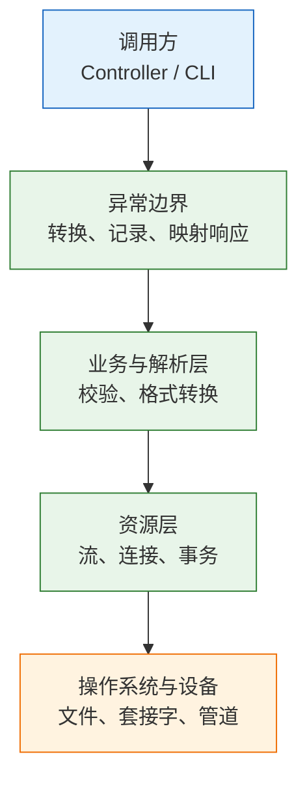
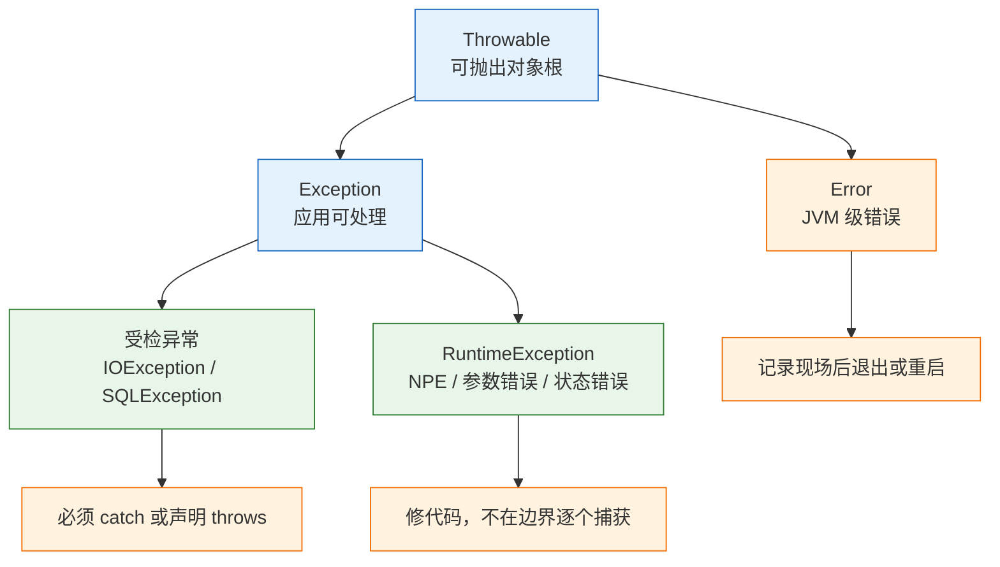
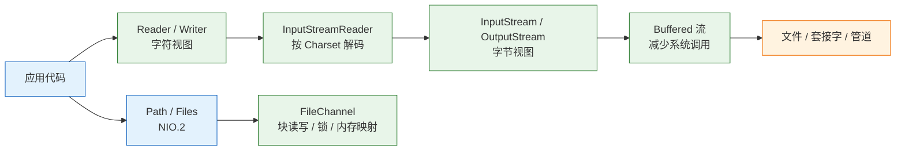
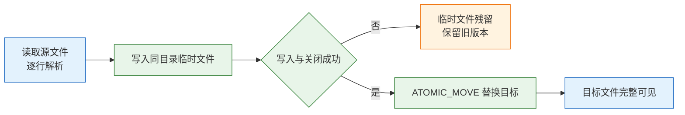

# 异常与 IO

---

## 一、异常与 IO 的定位

### 1.1 核心概念

异常是 Java 在方法返回值之外传递失败信息的机制。方法正常结束时返回声明类型的值，失败时抛出 `Throwable` 的实例，当前调用栈立即停止向下执行，控制权交给最近的匹配 `catch`。这套机制把主流程与失败分支从代码结构上分开，避免每个调用点都写 `if (ret != OK)`。

IO 是把数据在程序与外部设备之间搬运的抽象。输入流代表从外部读入，输出流代表向外部写出；数据单位可以是字节，也可以是按字符集解码后的字符。文件、套接字、管道、压缩包、内存缓冲区都能套进同一组接口，调用方不需要关心底层设备。

| 概念 | 含义 | 解决的问题 |
|---|---|---|
| `Throwable` | 所有可抛出对象的根类型 | 统一失败传递通道 |
| 受检异常 | 编译器强制处理的异常 | 迫使调用方选择恢复或上抛 |
| 非受检异常 | 编译器不强制处理的异常 | 表达编程错误与状态错误 |
| 流 | 有方向的字节或字符序列 | 屏蔽文件、网络、管道的差异 |
| 字符集 | 字节与字符之间的映射规则 | 文本的正确编码与解码 |

异常不负责回滚业务数据，事务边界要由数据库或框架控制；异常也不负责关闭文件句柄和连接，资源生命周期要由 `try-with-resources` 或显式 `finally` 控制。把这三件事混在一起，是生产事故的常见起点。

### 1.2 与相邻技术的关系

异常、日志、事务、序列化经常被放在同一个错误处理话题里讨论，但它们解决的是不同问题。异常决定控制流，日志决定现场留存，事务决定数据一致性，序列化决定对象如何跨进程传输。任何一项缺失，都不能由另一项替代。

| 相邻技术 | 关系 | 边界 |
|---|---|---|
| 错误码 | 用返回值表达可预期的失败 | 不适合跨多层调用，容易被忽略 |
| 日志 | 记录异常现场与上下文 | 记录不等于处理，不能代替抛出 |
| 事务 | 保证一组写操作的原子性 | 异常触发回滚依赖框架配置 |
| 序列化 | 决定对象如何落盘或传输 | 反序列化不可信数据是安全风险 |
| NIO 与异步 IO | 另一种 IO 模型 | 不改变编码与资源关闭规则 |

错误码在系统边界（HTTP 状态、gRPC 状态码、命令行退出码）仍然必要，边界之内用异常表达失败更清晰。日志的作用是让失败可追溯，捕获后只写一行 `log.error` 再继续执行，等于把故障变成静默的数据错误。

断言（`assert`）不属于异常处理机制。它默认关闭，只在开启 `-ea` 时生效，适合检查内部不变量，不适合校验用户输入或外部数据。把参数校验写成断言，测试环境正常、生产环境跳过，问题会直接进入数据库。

### 1.3 整体结构

一条完整的 IO 链路可以拆成四层：调用方发起请求，异常边界负责统一转换和记录，业务层负责校验与解析，资源层负责打开和关闭流，最底下是操作系统与设备。



| 层 | 职责 | 典型 API |
|---|---|---|
| 调用方 | 发起请求、决定重试或终止 | 业务方法、命令行入口 |
| 异常边界 | 把底层异常转成对外错误 | 全局异常处理器、退出码 |
| 业务与解析 | 校验字段、转换类型、记录行号 | `BigDecimal`、正则、校验器 |
| 资源层 | 打开、缓冲、关闭、提交或回滚 | `InputStream`、`Files`、`Connection` |

分层的价值在于定位。路径错误、权限不足属于资源层；字段缺失、金额为负属于业务层；对外返回 500 还是 400 属于异常边界。排查时先确定故障落在哪一层，比从头读一遍代码快得多。

---

## 二、环境与最小示例

### 2.1 JDK 版本与工具链

> **版本现状（2026）**：JDK 25 与 JDK 21 均为 LTS，JDK 17 仍在大量存量系统中使用。本文示例以 JDK 21 为编译目标，所用 API 在三个 LTS 上均可运行；涉及 JDK 18 之后默认字符集变化的段落会单独标注。

| 版本 | 状态 | 与本文的关系 |
|---|---|---|
| JDK 25 | LTS，2025 年发布 | 新项目基线，API 与工具链最新 |
| JDK 21 | LTS，2023 年发布 | 示例编译目标，文件 API 完整 |
| JDK 17 | LTS，2021 年发布 | 存量系统，示例代码同样适用 |
| JDK 11 | 旧 LTS | 可用，但缺少部分文件 API 便利方法 |

```bash
# ========== 确认工具链 ==========
java -version
javac -version

# ========== 编译到独立目录 ==========
# --release 21 同时约束语言特性和可用 API，避免误用高版本方法
javac --release 21 -d out LineCount.java

# ========== 运行 ==========
java -cp out LineCount sample.txt
```

### 2.2 最小可运行示例

下面的程序读取一个 UTF-8 文本文件，统计行数、字符数和字节数。它覆盖后续要展开的三个要点：显式字符集、`try-with-resources` 关闭资源、区分字符数与字节数。

```java
import java.io.BufferedReader;
import java.io.IOException;
import java.nio.charset.StandardCharsets;
import java.nio.file.Files;
import java.nio.file.Path;

public class LineCount {
    public static void main(String[] args) throws IOException {
        if (args.length != 1) {
            System.err.println("usage: java LineCount <file>");
            System.exit(2);
        }

        // 转绝对路径并化简，排障时能直接看到实际读取的位置
        Path path = Path.of(args[0]).toAbsolutePath().normalize();

        long lines = 0;
        long chars = 0;

        // 显式指定 UTF-8，资源在 try 结束时自动关闭
        try (BufferedReader reader = Files.newBufferedReader(path, StandardCharsets.UTF_8)) {
            String line;
            while ((line = reader.readLine()) != null) {
                lines++;
                chars += line.length();   // length() 统计 UTF-16 代码单元，不等于字节数
            }
        }

        System.out.println("path=" + path);
        System.out.println("lines=" + lines);
        System.out.println("chars=" + chars);
        System.out.println("bytes=" + Files.size(path));
    }
}
```

```bash
# 生成三行 UTF-8 文本，每行三个汉字
printf '第一行\n第二行\n第三行\n' > sample.txt

# 编译并运行
javac --release 21 -d out LineCount.java
java -cp out LineCount sample.txt
```

输出类似：

```text
path=/当前工作目录/sample.txt
lines=3
chars=9
bytes=30
```

每个汉字在 UTF-8 中占 3 字节，三个汉字 9 字节，加换行 1 字节，每行 10 字节。`chars` 统计字符数，`bytes` 统计磁盘上的字节数；把两者混为一谈，会在截断、分页、限长时出现越界或乱码。

### 2.3 编译与运行

| 命令 | 作用 | 常见错误 |
|---|---|---|
| `javac --release 21 -d out X.java` | 编译并约束 API 版本 | 忘记 `-d`，`.class` 散落在源码目录 |
| `java -cp out X` | 从指定目录加载类 | 类名误带 `.class` 后缀 |
| `java -cp out X file.txt` | 传入程序参数 | 相对路径基准是启动目录，不是源码目录 |
| `java -Dfile.encoding=UTF-8 -cp out X` | 覆盖默认字符集 | 误以为它能修复文件本身的编码 |

`--release` 比 `-source` 与 `-target` 更严格，它会同时限制可用的 JDK API。类路径上的第一个匹配类会被加载，排查“改了代码没生效”时先确认 `-cp` 指向的是新编译的目录。

---

## 三、异常的分类与传播机制

### 3.1 异常体系与分类

`Throwable` 之下分成两支：`Error` 表示 JVM 自身无法恢复的问题，`Exception` 表示应用可以处理的失败。`Exception` 再分为受检异常与 `RuntimeException`，分界线是编译器是否强制调用方处理。



| 类型 | 是否受检 | 典型例子 | 处理策略 |
|---|---|---|---|
| `Error` | 否 | `OutOfMemoryError`、`StackOverflowError` | 记录现场后退出或重启，不捕获 |
| 受检异常 | 是 | `IOException`、`SQLException`、`InterruptedException` | 就近恢复，或带上上下文上抛 |
| `RuntimeException` | 否 | `NullPointerException`、`IllegalArgumentException` | 视为编程错误，修代码 |
| 自定义业务异常 | 通常否 | `BadRowException`、`InsufficientStockException` | 携带上下文，在边界映射为错误码 |

受检异常的价值是强制调用方思考失败了怎么办，代价是 `throws` 沿调用链扩散。实践中的分界可以归结为四句话：能恢复的在就近层处理；不能恢复的在启动阶段快速失败；编程错误用非受检异常；跨层时把底层异常转换成上层能理解的类型。

`InterruptedException` 是受检异常中的特例，它代表线程被请求停止，而不是数据错误。捕获后要么继续向上抛，要么调用 `Thread.currentThread().interrupt()` 恢复中断标志，不能静默吞掉。

受检异常在语言设计上一直有争议。支持者认为它把失败策略写进类型系统，调用方无法假装看不见；反对者认为它让签名被 `throws` 污染，实际代码里大量出现“捕获后包一层再抛”的样板。工程上的折中是：资源层保留受检异常，业务层用非受检异常表达规则，接口边界统一转换成对外错误码。转换过程必须保留 `cause`，否则类型换了、根因也丢了。

### 3.2 栈展开与 finally

异常抛出后，当前方法剩余代码不执行，JVM 沿调用栈向上查找匹配的 `catch`；每退出一层，执行该层 `finally` 中的代码。找不到匹配项时，异常交给线程的未捕获异常处理器，主线程随后终止。

```java
static String readFirstLine(Path path) throws IOException {
    BufferedReader reader = Files.newBufferedReader(path, StandardCharsets.UTF_8);
    try {
        return reader.readLine();
    } finally {
        // close() 自己抛异常时会覆盖 try 中的业务异常
        reader.close();
    }
}
```

| 边界 | 行为 | 后果 |
|---|---|---|
| `catch` 顺序 | 从上到下匹配，子类在前 | 父类写在前面会导致具体分支不可达 |
| `finally` 中的 `return` | 覆盖 `try` 的返回值 | 返回值被悄悄改写 |
| `finally` 中的 `throw` | 覆盖原异常 | 真正的故障原因丢失 |
| `System.exit` | 不执行后续 `finally` | 清理逻辑被跳过 |

`finally` 适合放释放资源、恢复状态这类必须执行的收尾动作，不适合放业务返回。需要返回值时，把结果保存在局部变量里，在 `try` 结束后统一返回，避免 `finally` 改写控制流。

```java
static int parseOrDefault(String raw, int fallback) {
    try {
        return Integer.parseInt(raw);
    } catch (NumberFormatException e) {
        return fallback;
    } finally {
        // 这里只做清理，不 return、不 throw
        System.out.println("parsed: " + raw);
    }
}
```

捕获异常后要么处理，要么带上上下文再抛。空的 `catch` 块是最危险的写法，问题被静默吞掉，等到数据对不上时已经无法还原当时的输入和堆栈。

### 3.3 异常转换与上下文

底层异常往往带有实现细节，例如 JSON 解析器的 `JsonProcessingException`、JDBC 的 `SQLException`。直接把这些异常抛到接口层，会让调用方依赖具体实现；转换成业务异常时保留 `cause`，排障才能沿异常链追到根因。

```java
static Order parseOrder(String json) {
    try {
        return mapper.readValue(json, Order.class);
    } catch (JsonProcessingException e) {
        // 保留 cause，日志里才能看到解析器的具体位置
        throw new IllegalArgumentException("invalid order json: " + json, e);
    }
}
```

自定义异常携带业务上下文，比一句“系统错误”有用得多：

```java
static class BadRowException extends RuntimeException {
    private final int lineNo;

    BadRowException(int lineNo, String message) {
        super("line " + lineNo + ": " + message);
        this.lineNo = lineNo;
    }

    BadRowException(int lineNo, String message, Throwable cause) {
        super("line " + lineNo + ": " + message, cause);
        this.lineNo = lineNo;
    }

    int lineNo() {
        return lineNo;
    }
}
```

| 转换方式 | 保留的信息 | 适用场景 |
|---|---|---|
| 原样上抛 | 完整堆栈与类型 | 当前层无法处理，且上层认识该类型 |
| 包装并保留 `cause` | 原异常链加业务语义 | 跨层转换，最常见 |
| 包装但丢弃 `cause` | 只有新消息 | 不推荐，根因丢失 |
| 转成返回值 | 错误码与提示 | 可预期的校验失败 |

不要把所有异常都包装成同一种 `RuntimeException("系统错误")`。调用方需要区分“坏行可以跳过”和“磁盘不可写必须停止”，异常类型就是这种区分能力的载体。

---

## 四、资源生命周期与关闭语义

### 4.1 try-with-resources 的展开过程

`try-with-resources` 在编译后会展开成嵌套的 `try/finally`，但比手写版本多做了三件事：按逆序关闭、把关闭异常挂到主异常上、对 `null` 资源安全跳过。资源必须实现 `AutoCloseable`，其 `close()` 声明抛出 `Exception`；更常见的 `Closeable` 把异常收窄为 `IOException`。

```java
try (BufferedReader reader = Files.newBufferedReader(path, StandardCharsets.UTF_8);
     BufferedWriter writer = Files.newBufferedWriter(out, StandardCharsets.UTF_8)) {
    String line;
    while ((line = reader.readLine()) != null) {
        writer.write(line);
        writer.newLine();
    }
}
```

| 阶段 | 动作 | 异常归属 |
|---|---|---|
| 进入 `try` | 按声明顺序创建资源 | 创建失败则已创建的资源仍会关闭 |
| 执行代码块 | 读写数据 | 业务异常成为主异常 |
| 退出代码块 | 按声明逆序调用 `close()` | 关闭异常成为抑制异常 |
| 无主异常时 | 关闭异常直接向外抛 | 第一个关闭异常生效 |

Java 9 起可以使用已有的 effectively final 变量，写法更紧凑：

```java
BufferedReader reader = Files.newBufferedReader(path, StandardCharsets.UTF_8);
try (reader) {
    System.out.println(reader.readLine());
}
```

对象在 `try` 块之前已经创建，若创建过程本身失败，`try` 不会接管；因此创建语句仍要放在可能抛异常的位置，并由外层处理。

### 4.2 抑制异常与关闭顺序

当 `try` 块抛出异常、`close()` 又抛出异常时，主异常不会被覆盖，关闭异常通过 `getSuppressed()` 附加在主异常上。下面的程序可以观察到顺序：

```java
public class SuppressedDemo {
    public static void main(String[] args) {
        try {
            run();
        } catch (Exception e) {
            System.out.println("primary=" + e.getMessage());
            for (Throwable s : e.getSuppressed()) {
                System.out.println("suppressed=" + s.getMessage());
            }
        }
    }

    static void run() throws Exception {
        try (AutoCloseable first = () -> {
                 throw new IllegalStateException("close-first");
             };
             AutoCloseable second = () -> {
                 throw new IllegalStateException("close-second");
             }) {
            throw new java.io.IOException("body");
        }
    }
}
```

输出：

```text
primary=body
suppressed=close-second
suppressed=close-first
```

逆序关闭不仅是语法规定，也有实际意义：写端先关闭能把缓冲区内容刷到磁盘，读端后关闭不会影响已读数据。两个资源存在业务依赖时，例如先提交事务再关闭连接，不能依赖声明顺序碰运气，应显式控制提交与回滚。

> **注意**：`close()` 抛异常不代表资源一定没释放。有的实现先释放句柄再抛状态异常，有的实现先抛异常再释放。排障时要看具体实现的文档和源码，不能只看异常类型。

### 4.3 AutoCloseable 的实现约束

自定义资源类实现 `AutoCloseable` 时，`close()` 应当幂等：重复调用不抛异常，也不重复释放底层句柄。关闭后再调用读写方法，应给出明确的 `IllegalStateException`，而不是让空指针或半关闭状态继续传播。

```java
final class Resource implements AutoCloseable {
    private boolean closed;

    void read() {
        if (closed) {
            throw new IllegalStateException("resource already closed");
        }
        // 读取数据
    }

    @Override
    public void close() {
        if (closed) {
            return;              // 幂等：重复关闭直接返回
        }
        closed = true;
        // 释放文件句柄、连接或本地内存
    }
}
```

`closed` 被多个线程访问时，需要 `volatile` 或同步保护，否则关闭动作对其他线程不可见。关闭方法本身不应长时间阻塞，也不应调用可能失败的外部服务；把清理逻辑做成“尽力而为并记录失败”，比让 `close()` 抛出一连串异常更容易维护。

> **安全警告**：文件流、套接字、数据库连接、`FileChannel` 都属于有限的操作系统资源。循环中打开而不关闭，会触发 `Too many open files`，并让进程在耗尽句柄后无法建立新连接。所有资源必须放进 `try-with-resources`，或在 `finally` 中关闭。

---

## 五、IO 的分层与编码

### 5.1 字节流、字符流与缓冲

Java IO 分成字节与字符两套抽象。字节流面向二进制，字符流面向文本；字符流本质上是在字节流之上加了一层 `Charset` 解码器。缓冲流不改变语义，只减少系统调用次数。



| 抽象 | 数据单位 | 典型实现 | 适用场景 |
|---|---|---|---|
| `InputStream` / `OutputStream` | 字节 | `FileInputStream`、`SocketInputStream` | 图片、压缩包、协议报文 |
| `Reader` / `Writer` | 字符 | `FileReader`、`StringWriter` | 文本文件、日志、配置 |
| 缓冲流 | 字节或字符 | `BufferedInputStream`、`BufferedReader` | 小批量多次读写 |
| `Channel` | 字节块 | `FileChannel`、`SocketChannel` | 大文件、零拷贝、文件锁 |

不缓冲时，一次读一个字节可能触发一次系统调用。`BufferedReader` 的默认缓冲区是 8192 个字符，`BufferedInputStream` 默认 8192 字节；处理大文件时按块读写，比逐字节循环快一个数量级。

### 5.2 NIO.2 的路径与文件操作

`Path` 不只是字符串，它理解分隔符、根路径和父子关系。`Files` 提供静态方法完成创建、复制、移动、删除和属性读取，异常类型比旧 IO 更具体。

```java
Path base = Path.of("/srv/app/data");
Path file = base.resolve("2026/03/orders.csv").normalize();
Path relative = base.relativize(file);

System.out.println(file.toAbsolutePath());
System.out.println(relative);
System.out.println(Files.exists(file));
System.out.println(Files.isRegularFile(file));
```

| API | 作用 | 注意 |
|---|---|---|
| `resolve` | 拼接路径 | 参数是绝对路径时直接返回参数 |
| `normalize` | 字面化简 `.` 与 `..` | 不访问文件系统，不解析符号链接 |
| `toRealPath` | 解析符号链接后的真实路径 | 文件不存在时抛 `IOException` |
| `Files.move` | 移动或重命名 | 跨分区时可能退化为复制加删除 |
| `Files.walk` | 递归遍历 | 默认不跟随符号链接，跟随要防环 |

路径拼接不要用字符串加斜杠。Windows 分隔符、重复斜杠、`..` 和符号链接都会让字符串拼接得到错误结果；交给 `Path.resolve` 与 `normalize`，跨平台行为由 JDK 保证。

`Files.createTempFile` 与 `Files.createTempDirectory` 创建临时文件，默认权限通常只对当前用户可读写。敏感数据落临时目录前要确认权限，POSIX 系统可以用 `Files.setPosixFilePermissions` 收紧。

压缩包也可以当作文件系统读写。`jar:` 与 `zip:` 协议把 zip 映射成目录树，适合批量读取包内文件，而不必反复创建 `ZipInputStream`：

```java
// 只读打开 zip，路径分隔符使用 /，与压缩包内部结构一致
try (FileSystem zip = FileSystems.newFileSystem(Path.of("data.zip"))) {
    Path entry = zip.getPath("/2026/orders.csv");
    try (BufferedReader reader = Files.newBufferedReader(entry, StandardCharsets.UTF_8)) {
        System.out.println(reader.readLine());
    }
}
```

zip 文件系统同样要关闭，否则底层通道和文件句柄会泄漏。读取不可信压缩包时，要先限制条目数量和解压后总大小，防止 zip bomb 把磁盘写满。

### 5.3 字符编码的边界

编码问题很少以异常形式出现，更多表现为乱码、截断或行数对不上。`FileReader`、`FileWriter`、`InputStreamReader` 的无参构造器使用平台默认字符集；JDK 18 起默认字符集是 UTF-8（JEP 400），但生产代码仍应显式传 `StandardCharsets.UTF_8`，因为换 JDK、换容器、改 `file.encoding` 都可能改变行为。

| 场景 | 推荐写法 | 风险 |
|---|---|---|
| 读 UTF-8 文本 | `Files.newBufferedReader(path, UTF_8)` | 省略字符集，依赖平台默认值 |
| 写 UTF-8 文本 | `Files.newBufferedWriter(path, UTF_8)` | 用 `FileWriter` 无参构造器 |
| 读整个小文件 | `Files.readString(path, UTF_8)` | 文件大时占用大量堆内存 |
| 按行流式处理 | `Files.lines(path, UTF_8)` | 返回的 `Stream` 未关闭 |
| 二进制复制 | `Files.copy` 或 `transferTo` | 先解码再编码，破坏原始字节 |

UTF-8 的 BOM 是字节序列 `EF BB BF`，Java 的 UTF-8 解码器不会自动去掉它，第一行可能带一个不可见的 `\uFEFF`。解析配置或 CSV 时，应在读取后检查并剥离 BOM，或者要求上游不写 BOM。

`MalformedInputException` 表示字节序列不符合声明的字符集。常见原因是文件实际是 GBK、ISO-8859-1，或者把二进制文件当文本读。用 `file -i`、`xxd` 看前几个字节，再决定字符集，不要靠反复改代码猜。

> **注意**：`PrintWriter` 与 `PrintStream` 会吞掉底层 `IOException`，只在内部置一个错误标志。写文件后必须调用 `checkError()`，否则磁盘满、管道断开时程序仍以为写入成功。日志框架和 `System.out` 也有类似行为，不能拿它们当作“数据已落盘”的保证。

---

## 六、文件复制与原子落盘

### 6.1 复制与校验的完整实现

复制文件时不需要理解内容，直接用字节流或 `Files.copy`。复制完成后要校验，不能只看“没有抛异常”。

```java
import java.io.IOException;
import java.io.InputStream;
import java.io.OutputStream;
import java.nio.charset.StandardCharsets;
import java.nio.file.Files;
import java.nio.file.Path;

public class CopyDemo {
    public static void main(String[] args) throws IOException {
        Path dir = Files.createTempDirectory("io-demo-");
        Path src = dir.resolve("source.txt");
        Path dst = dir.resolve("copy.txt");

        // 两行文本，每行 3 个汉字加换行，共 20 字节
        Files.writeString(src, "第一行\n第二行\n", StandardCharsets.UTF_8);

        // transferTo 内部按缓冲区搬运，不需要手写 read 循环
        try (InputStream in = Files.newInputStream(src);
             OutputStream out = Files.newOutputStream(dst)) {
            in.transferTo(out);
        }

        System.out.println("size=" + Files.size(dst));
        System.out.println("same=" + (Files.mismatch(src, dst) == -1L));
        System.out.println("lines=" + Files.readAllLines(dst, StandardCharsets.UTF_8).size());
    }
}
```

```bash
javac --release 21 -d out CopyDemo.java
java -cp out CopyDemo
```

输出：

```text
size=20
same=true
lines=2
```

| 校验手段 | 能发现的问题 | 代价 |
|---|---|---|
| 文件大小 | 截断、写入中断 | 极低，但无法发现内容损坏 |
| `Files.mismatch` | 任意字节差异 | 需要读两个文件，返回首个差异位置 |
| CRC32 | 传输或存储中的随机损坏 | 计算快，抗碰撞能力弱 |
| SHA-256 | 内容被篡改或损坏 | 计算较慢，适合发布包与备份 |

`Files.mismatch` 返回第一个不同字节的偏移，完全相同返回 `-1`。自己写 `while (read != -1)` 时，最容易漏掉“读到的字节数可能小于缓冲区大小”，把缓冲区剩余旧数据一起写出。

### 6.2 CSV 导入的完整实现

需求是读 UTF-8 的 `orders.csv`，每行格式为 `id,amount`；金额非法或为负的行记录行号并跳过；成功行写到 `report.csv`；任何时刻不能留下写了一半的报表。

```java
import java.io.BufferedReader;
import java.io.BufferedWriter;
import java.io.IOException;
import java.math.BigDecimal;
import java.math.RoundingMode;
import java.nio.charset.StandardCharsets;
import java.nio.file.AtomicMoveNotSupportedException;
import java.nio.file.Files;
import java.nio.file.Path;
import java.nio.file.StandardCopyOption;
import java.util.ArrayList;
import java.util.List;

public class ImportOrders {

    record Order(String id, BigDecimal amount) {}

    static class BadRowException extends RuntimeException {
        private final int lineNo;

        BadRowException(int lineNo, String message) {
            super("line " + lineNo + ": " + message);
            this.lineNo = lineNo;
        }

        BadRowException(int lineNo, String message, Throwable cause) {
            super("line " + lineNo + ": " + message, cause);
            this.lineNo = lineNo;
        }

        int lineNo() {
            return lineNo;
        }
    }

    static Order parse(String line, int lineNo) {
        // -1 保留末尾空列，避免少一列时悄无声息
        String[] cols = line.split(",", -1);
        if (cols.length != 2) {
            throw new BadRowException(lineNo, "expected 2 columns, got " + cols.length);
        }

        String id = cols[0].strip();
        String raw = cols[1].strip();
        if (id.isEmpty()) {
            throw new BadRowException(lineNo, "empty id");
        }

        try {
            BigDecimal amount = new BigDecimal(raw);
            if (amount.signum() < 0) {
                throw new BadRowException(lineNo, "negative amount: " + raw);
            }
            return new Order(id, amount.setScale(2, RoundingMode.HALF_UP));
        } catch (NumberFormatException e) {
            // 保留原始异常，排障时能看到非法输入
            throw new BadRowException(lineNo, "bad amount: " + raw, e);
        }
    }

    public static void main(String[] args) throws IOException {
        Path dir = Files.createTempDirectory("import-");
        Path input = dir.resolve("orders.csv");
        Path report = dir.resolve("report.csv");
        Path tmp = dir.resolve("report.csv.tmp");

        Files.writeString(input, """
                A1,199.00
                A2,58.50
                A3,abc
                A4,-1.00
                A5,20.00
                """, StandardCharsets.UTF_8);

        List<Order> ok = new ArrayList<>();
        List<String> skipped = new ArrayList<>();
        int read = 0;

        // 逐行读取，内存占用与文件大小无关
        try (BufferedReader reader = Files.newBufferedReader(input, StandardCharsets.UTF_8)) {
            String line;
            int lineNo = 0;
            while ((line = reader.readLine()) != null) {
                lineNo++;
                if (line.isBlank()) {
                    continue;
                }
                read++;
                try {
                    ok.add(parse(line, lineNo));
                } catch (BadRowException e) {
                    skipped.add(e.getMessage());
                }
            }
        }

        // 先写临时文件，成功后再替换目标
        try (BufferedWriter writer = Files.newBufferedWriter(tmp, StandardCharsets.UTF_8)) {
            for (Order o : ok) {
                writer.write(o.id() + "," + o.amount());
                writer.newLine();
            }
        }

        try {
            Files.move(tmp, report,
                    StandardCopyOption.REPLACE_EXISTING,
                    StandardCopyOption.ATOMIC_MOVE);
        } catch (AtomicMoveNotSupportedException e) {
            // 跨文件系统时退化为普通移动，原子性不再保证
            Files.move(tmp, report, StandardCopyOption.REPLACE_EXISTING);
        }

        BigDecimal total = ok.stream()
                .map(Order::amount)
                .reduce(BigDecimal.ZERO, BigDecimal::add);

        System.out.printf("read=%d ok=%d skipped=%d total=%s%n",
                read, ok.size(), skipped.size(), total);
        System.out.println("report=" + report.getFileName());
        skipped.forEach(System.out::println);
    }
}
```

```bash
javac --release 21 -d out ImportOrders.java
java -cp out ImportOrders
```

输出：

```text
read=5 ok=3 skipped=2 total=277.50
report=report.csv
line 3: bad amount: abc
line 4: negative amount: -1.00
```

| 阶段 | 关键动作 | 失败后的状态 |
|---|---|---|
| 读取 | 逐行解析，坏行记录行号 | 源文件不变，已读数据在内存 |
| 写入 | 写同目录临时文件 | 目标文件仍是旧版本 |
| 替换 | `ATOMIC_MOVE` 覆盖目标 | 要么旧版本，要么完整新版本 |
| 校验 | 比对大小、行数、总额 | 发现差异可回退到备份 |

坏行在行级捕获，保留行号，磁盘错误等 `IOException` 继续向上抛。这种分层处理让“数据问题”和“系统问题”分开：前者可以跳过并汇总，后者必须停止并告警。

### 6.3 原子替换的适用边界



| 场景 | 是否原子 | 处理方式 |
|---|---|---|
| 同目录内 `ATOMIC_MOVE` | 是 | 临时文件与目标必须同一文件系统 |
| 跨分区移动 | 否 | 捕获 `AtomicMoveNotSupportedException`，改用复制加校验 |
| 覆盖已有文件 | 取决于文件系统 | 同时指定 `REPLACE_EXISTING` |
| 断电后的持久性 | 不保证 | 替换前对临时文件执行 `FileChannel.force(true)` |

`ATOMIC_MOVE` 保证的是“目录项切换”原子，不保证数据已经落到物理介质。要求掉电后仍完整时，先对临时文件 `force(true)`，再执行移动；对目录本身是否需要同步，取决于文件系统与平台，生产环境应通过实际断电演练确认。

---

## 七、工程实践

### 7.1 异常设计规范

异常设计的目标是让调用方在不读实现的情况下知道该做什么。异常类型、消息、上下文和记录位置要一起设计，不能只在出错时随手 `new RuntimeException("失败")`。

| 场景 | 异常类型 | 处理位置 | 是否记录日志 |
|---|---|---|---|
| 用户输入不合法 | `IllegalArgumentException` | 接口边界转 400 | 否，属于预期分支 |
| 文件不存在 | `NoSuchFileException` | 资源层转业务异常 | 是，带路径 |
| 磁盘写满 | `IOException` | 立即停止并告警 | 是，带目标路径 |
| 远程调用超时 | 自定义 `RemoteTimeoutException` | 重试或降级 | 是，带耗时与目标 |
| 线程被中断 | `InterruptedException` | 恢复中断标志并退出 | 视情况 |

异常消息要包含定位所需的最小上下文：文件路径、行号、字段名、目标地址。不要把整段敏感数据拼进消息，也不要只写“操作失败”。日志记录一次即可，层层打印会造成重复堆栈。

异常层次不宜过深。一个业务异常基类加少量按处理策略划分的子类就够了，例如“可重试”“不可重试”“数据问题”。按业务模块建几十个异常类，调用方仍然只能靠消息判断，反而增加维护成本。异常也不应参与正常分支，能用校验结果表达的失败不要用异常表达。

> **注意**：捕获 `Throwable` 会同时捕获 `Error`，包括 `OutOfMemoryError` 和 `StackOverflowError`。OOM 之后继续分配对象只会让进程更不稳定，正确做法是记录现场并让进程退出，由外部监督机制重启。

### 7.2 性能与日志

构造异常需要填充堆栈，`fillInStackTrace` 要遍历当前调用栈，成本远高于一次普通返回。在几十万行的循环里用异常表达“坏行跳过”，可能比解析本身还慢。

| 做法 | 收益 | 代价 |
|---|---|---|
| 预期失败返回结果对象 | 不填充堆栈，流程可控 | 调用方必须检查结果 |
| 异常只用于意外 | 堆栈完整，排障方便 | 构造与抛出有成本 |
| 复用异常实例 | 减少构造开销 | 堆栈停留在创建位置，误导排障 |
| 关闭堆栈优化 | 保留完整堆栈 | 重复抛出时性能下降 |

JIT 有一个默认开启的优化：同一位置反复抛出隐式异常时，会省略堆栈以提高性能。需要完整堆栈时可以用 `-XX:-OmitStackTraceInFastThrow` 关闭该优化，但这会带来性能代价，只适合排障阶段短期使用。

日志打印异常要把异常对象作为最后一个参数传给日志框架，而不是只拼 `e.getMessage()`。堆栈是排障的主要线索，消息只说明“发生了什么”，堆栈说明“在哪一层发生”。

```java
try {
    importFile(path);
} catch (IOException e) {
    // 参数化日志：保留异常对象，输出完整堆栈
    log.error("import failed, path={}", path, e);
    throw new ImportException("import failed: " + path, e);
}
```

### 7.3 大文件与并发写入

文件超过堆内存的十分之一，就不应该用 `readAllBytes` 或 `readString` 一次读入。流式处理的核心是固定内存占用，而不是追求最短代码。

| 场景 | 方案 | 限制 |
|---|---|---|
| 按行处理文本 | `BufferedReader` 或 `Files.lines` | 单行可能极长，要限制最大行长度 |
| 二进制复制 | `InputStream.transferTo` | 不解释内容，无法做字段校验 |
| 随机读写 | `FileChannel` 加 `ByteBuffer` | 注意字节序、偏移与并发定位 |
| 超大文件扫描 | `MappedByteBuffer` | 释放依赖 GC，不适合频繁创建 |
| 压缩包处理 | `ZipFile` 或 zipfs | 防 zip bomb，限制条目数与解压总量 |

多个进程同时写同一个文件时，`FileLock` 是进程间的 advisory 锁，不是线程锁。它要求所有参与者都遵守同一把锁文件，锁在通道关闭或进程退出时释放。更简单的方案是单写者：一个进程负责落盘，其他进程通过队列发送消息。

`Files.lines(...).parallel()` 看似能加速，实际受公共 `ForkJoinPool` 和磁盘顺序读的限制，顺序读通常更快。流式处理还要配背压：读得快、写得慢时，不要无限往队列里塞任务，应使用有界队列或阻塞写。

> **安全警告**：Java 原生序列化反序列化不可信数据可以构造任意对象链，是已知的高危入口。跨进程、跨服务传输应使用 JSON、Protobuf 等明确格式；必须使用原生序列化时，要限制来源、校验类型、显式声明 `serialVersionUID`，并把它当作内部临时格式。

---

## 八、常见错误与排查

### 8.1 故障对照表

| 现象 | 最可能原因 | 处理 |
|---|---|---|
| `NoSuchFileException` | 路径拼错、相对路径基准不对、文件未生成 | 打印 `toAbsolutePath()`，先确认工作目录 |
| `AccessDeniedException` | 权限不足、只读文件系统、容器非 root | 查目录权限与挂载选项，不要用 `chmod 777` 掩盖 |
| `MalformedInputException` | 文件不是声明的 UTF-8，或二进制当文本读 | 用 `file -i`、`xxd` 确认编码 |
| 中文乱码但不报错 | 写和读用了不同编码 | 全链路显式 UTF-8，检查终端与 `file.encoding` |
| 文件写成功但内容为空 | `PrintWriter` 吞异常，或未 flush、未关闭 | 用 `try-with-resources`，写后 `checkError()` |
| `Too many open files` | 流未关闭，循环中不断打开 | 查 `lsof -p <pid>`，全部改为自动关闭 |
| `OutOfMemoryError: Java heap space` | `readAllBytes` 或 `readString` 读大文件 | 改流式逐行或分块 |
| `AtomicMoveNotSupportedException` | 临时文件与目标跨分区 | 放同一目录，或接受非原子并加校验 |
| `DirectoryNotEmptyException` | 删除非空目录 | 先递归删除，再删目录 |
| 读到的行数比预期少 | 最后一行无换行、编码错误、空行被跳过 | 明确空行策略，用 `readLine` 而非 `split` |
| 文件句柄泄漏但代码有 `close` | 异常路径跳过了关闭 | 检查是否所有分支都经过 `try-with-resources` |
| 日志只有“系统错误” | 包装异常时丢弃了 `cause` | 构造异常时传入原异常，保留异常链 |

### 8.2 排查顺序

1. 确认路径：打印 `toAbsolutePath()`，检查 `Files.exists` 与当前工作目录。
2. 确认编码：用 `xxd` 看前几个字节，判断是否 UTF-8、是否带 BOM。
3. 读异常链：从最内层 `Caused by` 看起，不要只看最外层的业务消息。
4. 查资源：用 `lsof`、线程栈、连接池指标确认句柄是否泄漏。
5. 查失败路径：重点看异常分支是否跳过 `close`、`flush`、临时文件清理。
6. 最后才怀疑业务逻辑；IO 故障大多集中在路径、权限、编码、关闭四件事上。

> **注意**：排障时不要急着删文件重建。先保留现场，复制一份临时文件用于复现，确认根因后再清理；直接删除可能把唯一可分析的证据一起丢掉。
