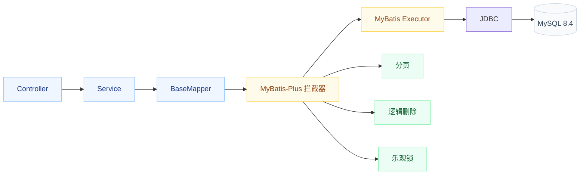

# MyBatis-Plus数据访问

> 这篇从 MyBatis-Plus 与 MyBatis 的关系讲起，经过工程配置、实体映射、BaseMapper 与 IService、条件构造器、分页、逻辑删除、乐观锁和事务批量，最后落到库存扣减案例与故障排查。
>
> 学完能独立用 MyBatis-Plus 完成单表增删改查、分页查询和并发安全更新，并能判断什么时候必须回到手写 SQL。

## 一、MyBatis-Plus 的能力边界

MyBatis-Plus（MP）是 MyBatis 的增强层，不是替代品：它保留 MyBatis 的 SQL 映射能力，同时为单表 CRUD 自动生成语句，并提供条件构造器、分页、逻辑删除、乐观锁等插件。核心判断：**单表规则用 MP 省代码，多表关联和复杂查询回到 XML 或自定义 Mapper 方法**。



| 场景 | 推荐做法 | 原因 |
|---|---|---|
| 单表按主键 CRUD | `BaseMapper` | 零 SQL，字段映射稳定 |
| 单表条件查询 | Lambda 条件构造器 | 列名编译期检查 |
| 多表 join、窗口函数 | XML 或 `@Select` | MP 不生成复杂 SQL |
| 分库分表 | ShardingSphere 等 | MP 只管单库 SQL 增强 |
| 大批量导入 | JDBC batch 或专门工具 | 逐条 Service 调用开销大 |

> 版本基线（2026-11）：Spring Boot 3.5.6、MyBatis-Plus 3.5.12、MySQL 8.4 LTS、Java 21。Spring Boot 3 使用 `mybatis-plus-spring-boot3-starter`；从 3.5.9 起，分页插件依赖拆到 `mybatis-plus-jsqlparser`，只引 starter 会导致分页不生效或类缺失。

## 二、环境与最小可运行工程

最小工程需要四样东西：数据源、Mapper 扫描、实体与 Mapper、一个能查空的测试。下面用 H2 的 MySQL 兼容模式保证开箱即跑；生产把 URL 和驱动换成 MySQL 8.4 即可，SQL 行为一致。

```xml
<parent>
    <groupId>org.springframework.boot</groupId>
    <artifactId>spring-boot-starter-parent</artifactId>
    <version>3.5.6</version>
    <relativePath/>
</parent>
<properties>
    <java.version>21</java.version>
    <mybatis-plus.version>3.5.12</mybatis-plus.version>
</properties>
<dependencies>
    <dependency>
        <groupId>org.springframework.boot</groupId>
        <artifactId>spring-boot-starter</artifactId>
    </dependency>
    <dependency>
        <groupId>com.baomidou</groupId>
        <artifactId>mybatis-plus-spring-boot3-starter</artifactId>
        <version>${mybatis-plus.version}</version>
    </dependency>
    <dependency>
        <groupId>com.baomidou</groupId>
        <artifactId>mybatis-plus-jsqlparser</artifactId>
        <version>${mybatis-plus.version}</version>
    </dependency>
    <dependency>
        <groupId>com.h2database</groupId>
        <artifactId>h2</artifactId>
        <scope>runtime</scope>
    </dependency>
    <dependency>
        <groupId>com.mysql</groupId>
        <artifactId>mysql-connector-j</artifactId>
        <scope>runtime</scope>
    </dependency>
    <dependency>
        <groupId>org.projectlombok</groupId>
        <artifactId>lombok</artifactId>
        <optional>true</optional>
    </dependency>
    <dependency>
        <groupId>org.springframework.boot</groupId>
        <artifactId>spring-boot-starter-test</artifactId>
        <scope>test</scope>
    </dependency>
</dependencies>
```

```yaml
spring:
  datasource:
    url: jdbc:h2:mem:mp;MODE=MySQL;DATABASE_TO_LOWER=TRUE;DB_CLOSE_DELAY=-1
    driver-class-name: org.h2.Driver
    username: sa
    password:
  sql:
    init:
      mode: always
mybatis-plus:
  configuration:
    map-underscore-to-camel-case: true
    log-impl: org.apache.ibatis.logging.stdout.StdOutImpl # 开发期看真实 SQL
  global-config:
    db-config:
      logic-delete-field: deleted
      logic-delete-value: 1
      logic-not-delete-value: 0
```

生产数据源换成 MySQL：

```yaml
spring:
  datasource:
    url: jdbc:mysql://127.0.0.1:3306/demo?useUnicode=true&characterEncoding=utf8&serverTimezone=Asia/Shanghai&rewriteBatchedStatements=true
    driver-class-name: com.mysql.cj.jdbc.Driver
    username: demo
    password: ${DB_PASSWORD} # 生产从环境变量或配置中心注入
  sql:
    init:
      mode: never # 生产禁止每次启动执行 schema.sql
```

| 环境 | 安装 MySQL 8.x | 验证 |
|---|---|---|
| Windows 10/11 | MySQL Installer 选择 8.4 LTS | `mysql --version` |
| macOS | `brew install mysql@8.4` | `brew services start mysql@8.4` |
| Ubuntu 24.04 | 官方 APT 源安装 8.4；发行版仓库通常是 8.0 | `systemctl status mysql` |
| Rocky/CentOS 9 | `sudo dnf install mysql-server` | `systemctl enable --now mysqld` |

```bash
# 没有本地 MySQL 时，用容器跑一个 8.4，端口映射到 3306
docker run --name mysql84 -e MYSQL_ROOT_PASSWORD=root \
  -e MYSQL_DATABASE=demo -p 3306:3306 -d mysql:8.4
mysql -h127.0.0.1 -uroot -proot -e "select version();"
```

预期输出：

```text
+-----------+
| version() |
+-----------+
| 8.4.5     |
+-----------+
```

建表脚本：

```sql
DROP TABLE IF EXISTS product;
CREATE TABLE product (
    id BIGINT AUTO_INCREMENT PRIMARY KEY,
    name VARCHAR(64) NOT NULL,
    remark VARCHAR(255),
    price DECIMAL(10, 2) NOT NULL,
    stock INT NOT NULL,
    version INT NOT NULL DEFAULT 0,
    deleted TINYINT NOT NULL DEFAULT 0,
    create_time TIMESTAMP NOT NULL,
    update_time TIMESTAMP NOT NULL
);
```

最小启动类与 Mapper 扫描：

```java
@SpringBootApplication
@MapperScan("com.example.mp.mapper") // 没有它，BaseMapper 代理不会注册
public class MpApplication {
    public static void main(String[] args) {
        SpringApplication.run(MpApplication.class, args);
    }
}
```

```java
public interface ProductMapper extends BaseMapper<Product> {
}
```

> 边界：H2 只用于本地和 CI 验证，不要拿它替代 MySQL 做 SQL 兼容性验收；`MODE=MySQL` 能覆盖大部分语法，但锁、隔离级别和优化器行为仍不同。

## 三、实体与表字段映射

映射的第一原则是：**实体字段名按驼峰写，数据库列名下划线写，靠 `map-underscore-to-camel-case` 自动对应；只有对不上时才用注解**。主键类型必须与数据库自增策略一致，否则会出现 `Field 'id' doesn't have a default value`。

```java
@Data
@TableName("product")
public class Product {
    @TableId(type = IdType.AUTO) // 与 MySQL AUTO_INCREMENT 对齐
    private Long id;
    private String name;
    private String remark;
    private BigDecimal price;
    private Integer stock;

    @Version // 乐观锁列，更新时由插件生成 version 条件
    private Integer version;

    @TableLogic // 删除变成 UPDATE，查询自动追加 deleted = 0
    private Integer deleted;

    @TableField(fill = FieldFill.INSERT)
    private LocalDateTime createTime;

    @TableField(fill = FieldFill.INSERT_UPDATE)
    private LocalDateTime updateTime;

    @TableField(exist = false) // 不是数据库列，MP 不会拼进 SQL
    private String categoryName;
}
```

| 注解 | 作用 | 最容易错的地方 |
|---|---|---|
| `@TableName` | 指定表名 | 表名含前缀时漏写 |
| `@TableId` | 指定主键与生成策略 | `AUTO` 与 UUID 混用 |
| `@TableField` | 列名、填充、忽略 | 非数据库字段忘加 `exist = false` |
| `@Version` | 乐观锁版本列 | 没有配置拦截器 |
| `@TableLogic` | 逻辑删除列 | 数据库默认值与配置不一致 |
| `@EnumValue` | 枚举入库值 | 枚举序列化配置冲突 |

自动填充时间字段：

```java
@Configuration
public class MpConfig {
    @Bean
    public MetaObjectHandler metaObjectHandler() {
        return new MetaObjectHandler() {
            @Override
            public void insertFill(MetaObject metaObject) {
                LocalDateTime now = LocalDateTime.now();
                strictInsertFill(metaObject, "createTime", LocalDateTime.class, now);
                strictInsertFill(metaObject, "updateTime", LocalDateTime.class, now);
            }

            @Override
            public void updateFill(MetaObject metaObject) {
                // 只有实体更新会触发；Wrapper 的 set 不会自动填 updateTime
                strictUpdateFill(metaObject, "updateTime", LocalDateTime.class, LocalDateTime.now());
            }
        };
    }
}
```

> 边界：`IdType.ASSIGN_ID` 使用雪花算法生成 `Long`，适合分库分表，但前端 JS 会丢精度，需要序列化成字符串；`IdType.AUTO` 依赖数据库自增，批量插入后要等数据库返回主键。枚举、JSON 字段需要额外的 `TypeHandler`，不要假设 MP 会自动处理。

## 四、BaseMapper 的单表 CRUD

`BaseMapper<T>` 提供的方法覆盖了绝大多数单表操作，方法名和语义固定，不需要自己写 SQL。关键行为是：`insert` 回填主键，`selectById` 查不到返回 `null`，`updateById` 只更新非 `null` 字段，`deleteById` 在逻辑删除开启后生成 `UPDATE`。

| 方法 | 语义 | 备注 |
|---|---|---|
| `insert(entity)` | 插入 | 回填自增主键 |
| `deleteById(id)` | 按主键删除 | 有 `@TableLogic` 时是更新 |
| `updateById(entity)` | 按主键更新 | 忽略 `null` 字段 |
| `selectById(id)` | 按主键查询 | 查不到返回 `null` |
| `selectList(wrapper)` | 条件列表 | 无条件下查全表 |
| `selectCount(wrapper)` | 计数 | 返回 `Long` |
| `selectPage(page, wrapper)` | 分页 | 需要分页插件 |
| `selectMaps(wrapper)` | 返回 Map | 适合窄表投影 |

```java
@Autowired
private ProductMapper productMapper;

Product product = new Product();
product.setName("机械键盘");
product.setPrice(new BigDecimal("399.00"));
product.setStock(10);
product.setVersion(0);
productMapper.insert(product);
System.out.println(product.getId()); // 1

Product loaded = productMapper.selectById(product.getId());
loaded.setStock(9);
boolean updated = productMapper.updateById(loaded) > 0;
```

实际生成的 SQL（开发期日志）：

```text
==>  Preparing: INSERT INTO product ( name, price, stock, version, deleted, create_time, update_time ) VALUES ( ?, ?, ?, ?, ?, ?, ? )
==>  Preparing: SELECT id,name,remark,price,stock,version,deleted,create_time,update_time FROM product WHERE id=? AND deleted=0
==>  Preparing: UPDATE product SET name=?, price=?, stock=?, version=?, create_time=?, update_time=? WHERE id=? AND version=? AND deleted=0
```

`updateById` 的“忽略 null”是双刃剑：只想改备注时，不需要先查完整实体；但要把字段清空，`updateById` 做不到，必须用 `LambdaUpdateWrapper.set` 显式写 `null`。

```java
Product patch = new Product();
patch.setId(1L);
patch.setRemark("需要发票");
productMapper.updateById(patch); // 只更新 remark 和 update_time

productMapper.update(null, Wrappers.<Product>lambdaUpdate()
        .eq(Product::getId, 1L)
        .set(Product::getRemark, null)); // 显式置空
```

> 边界：`selectList(null)` 会查全表，线上禁止无分页、无条件的列表查询；`deleteById` 在逻辑删除下不会释放磁盘空间；`selectMaps` 的 key 是列名，不是驼峰属性名，跨数据库时要确认大小写。

## 五、IService 与批量操作

`IService<T>` 和 `ServiceImpl<M, T>` 把 Mapper 包了一层，提供 `save`、`saveBatch`、`updateBatchById`、`removeById`、`list`、`page` 等常用方法。它适合业务服务直接继承，但不适合把领域逻辑全部塞进 ServiceImpl。

```java
@Service
public class ProductService extends ServiceImpl<ProductMapper, Product> {
    @Transactional
    public void importProducts(List<Product> products) {
        // 分批提交，避免单条 SQL 过大和长事务
        saveBatch(products, 500);
    }
}
```

批量性能的关键不在 MP，而在 JDBC 驱动。MySQL 连接串必须加 `rewriteBatchedStatements=true`，否则 `saveBatch` 仍可能逐条发送；同时确认事务边界，避免每批都自动提交。

```yaml
spring:
  datasource:
    url: jdbc:mysql://127.0.0.1:3306/demo?rewriteBatchedStatements=true&serverTimezone=Asia/Shanghai
```

| 方法 | 适用场景 | 注意 |
|---|---|---|
| `saveBatch(list)` | 批量插入 | 默认批大小 1000 |
| `saveBatch(list, 500)` | 控制单批大小 | 结合数据库 `max_allowed_packet` |
| `updateBatchById(list)` | 按主键批量更新 | 每条都走乐观锁拦截器 |
| `saveOrUpdate(entity)` | 有 id 更新、无 id 插入 | 先查后写，非原子 |
| `getOne(wrapper)` | 查单条 | 多条会抛异常 |

> 边界：`saveOrUpdate` 不是数据库 upsert，高并发下仍可能主键冲突；批量插入不会逐条触发数据库触发器之外的全部业务逻辑。需要“存在则更新、不存在则插入”的原子语义时，用 MySQL 的 `INSERT ... ON DUPLICATE KEY UPDATE` 自定义 SQL。

## 六、条件构造器

条件构造器把 SQL 的 `WHERE`、`ORDER BY`、`SET` 变成 Java 链式调用。优先用 `LambdaQueryWrapper`，因为列名通过方法引用取得，重构字段时编译期就能发现；`QueryWrapper` 用字符串列名，适合动态表或旧代码。

```java
LambdaQueryWrapper<Product> query = Wrappers.lambdaQuery();
query.select(Product::getId, Product::getName, Product::getPrice)
     .like(StringUtils.hasText(keyword), Product::getName, keyword)
     .between(Product::getPrice, new BigDecimal("100"), new BigDecimal("500"))
     .in(Product::getStock, List.of(5, 10, 20))
     .and(w -> w.eq(Product::getDeleted, 0).or().isNull(Product::getRemark))
     .orderByDesc(Product::getId)
     .last("LIMIT 20"); // last 拼原始 SQL，只能放常量
List<Product> list = productMapper.selectList(query);
```

生成的 SQL：

```sql
SELECT id,name,price FROM product
WHERE deleted=0
  AND (name LIKE ? AND price BETWEEN ? AND ? AND stock IN (?,?,?))
  AND (deleted = ? OR remark IS NULL)
ORDER BY id DESC LIMIT 20
```

更新条件同样用 Lambda，显式 `set` 可以写 `null`，也可以做原子自增：

```java
productMapper.update(null, Wrappers.<Product>lambdaUpdate()
        .eq(Product::getId, 1L)
        .set(Product::getRemark, "加急")
        .setSql("stock = stock - 1")); // 常量 SQL，不能拼用户输入
```

| 写法 | 用途 | 风险 |
|---|---|---|
| `eq/ne/like/in/between` | 常规条件 | 参数自动绑定，安全 |
| `and(w -> ...)` | 括号分组 | 不分组会改变优先级 |
| `last("LIMIT 10")` | 追加尾 SQL | 拼接用户输入会注入 |
| `apply("price > {0}", x)` | 参数化片段 | 占位符用 `{0}` |
| `setSql("stock = stock - 1")` | 原子运算 | 只能放常量 |

> 边界：`last`、`apply`、`setSql` 都接受原始 SQL，任何来自请求参数的字符串都不能直接拼进去；`lambdaQuery()` 的列名解析依赖实体 getter，实体字段改名后要全局搜索字符串形式的旧列名。

## 七、分页

分页不是 `LIMIT` 的简单拼接：MP 的分页插件要负责生成 count SQL、改写分页 SQL、处理 `ORDER BY` 和最大页深。配置一次即可，但少一个依赖就会静默失效。

```java
@Bean
public MybatisPlusInterceptor mybatisPlusInterceptor() {
    MybatisPlusInterceptor interceptor = new MybatisPlusInterceptor();
    PaginationInnerInterceptor pagination = new PaginationInnerInterceptor(DbType.MYSQL);
    pagination.setMaxLimit(100L); // 防止 size=100000 拖垮数据库
    pagination.setOverflow(false); // 页码越界返回空页，不回到第一页
    interceptor.addInnerInterceptor(pagination);
    interceptor.addInnerInterceptor(new OptimisticLockerInnerInterceptor());
    return interceptor;
}
```

```java
Page<Product> page = new Page<>(1, 2);
Page<Product> result = productMapper.selectPage(page,
        Wrappers.<Product>lambdaQuery().orderByAsc(Product::getId));
System.out.println("total=" + result.getTotal()
        + ", pages=" + result.getPages()
        + ", records=" + result.getRecords().size());
```

实际输出：

```text
==>  Preparing: SELECT COUNT(*) AS total FROM product WHERE deleted = 0
==>  Preparing: SELECT id,name,remark,price,stock,version,deleted,create_time,update_time FROM product WHERE deleted=0 ORDER BY id ASC LIMIT ?
==>  Parameters: 2(Long)
total=6, pages=3, records=2
```

`Page` 对象包含 `records`、`total`、`size`、`current`、`pages`。对外接口不要直接暴露 MP 的 `Page`，用项目自己的 `PageResult<T>`，避免前端依赖框架字段名。

```java
public record PageResult<T>(List<T> records, long total, long page, long size) {
    public static <T> PageResult<T> of(Page<T> page) {
        return new PageResult<>(page.getRecords(), page.getTotal(), page.getCurrent(), page.getSize());
    }
}
```

> 边界：分页插件只对 MP 的 Mapper 方法生效，自定义 XML 分页要传 `IPage` 参数并让插件改写；`LIMIT 100000, 20` 这类深分页仍然会扫描大量行，数据量大时改用基于游标的条件分页，例如 `WHERE id > lastId ORDER BY id LIMIT 20`。

## 八、逻辑删除

逻辑删除把 `DELETE` 改成 `UPDATE deleted = 1`，查询自动追加 `deleted = 0`。它适合需要留痕、可恢复的业务数据；不适合日志、临时表和高频写入表，因为数据只增不减，索引会持续膨胀。

```java
@TableLogic
private Integer deleted;
```

```yaml
mybatis-plus:
  global-config:
    db-config:
      logic-delete-field: deleted
      logic-delete-value: 1
      logic-not-delete-value: 0
```

实际 SQL：

```text
==>  Preparing: UPDATE product SET update_time=?, deleted=1 WHERE id=? AND deleted=0
==>  Preparing: SELECT id,name,remark,price,stock,version,deleted,create_time,update_time FROM product WHERE id=? AND deleted=0
```

逻辑删除与唯一索引冲突是设计阶段就要解决的问题：`UNIQUE(sku)` 加上 `deleted` 后，删除过的 `sku` 不能再插入；把 `deleted` 放进唯一键 `UNIQUE(sku, deleted)` 只能容忍一次删除。常见做法是为删除行生成唯一标记（例如把 `sku` 改成 `sku + '#' + id`），或把历史数据归档到独立表。

| 方案 | 可重复删除 | 代价 |
|---|---|---|
| `UNIQUE(sku)` | 否 | 删除后不能复用 |
| `UNIQUE(sku, deleted)` | 仅一次 | 第二次删除冲突 |
| 删除时改写业务键 | 是 | 需要自定义 SQL |
| 归档表 | 是 | 多一套表和迁移 |

> 边界：逻辑删除不是数据脱敏，也不是 GDPR 的“被遗忘权”；需要真正物理删除时，用自定义 SQL 或归档任务。MP 默认查询会自动过滤删除行，后台需要查看已删除数据时必须写自定义 SQL，不能靠 `wrapper` 绕过。

## 九、乐观锁

乐观锁用版本号解决“读出来、改完、写回去”之间的并发覆盖：更新时带上旧版本号，数据库只有版本匹配才更新，并把版本加一。它适合冲突不频繁、读多写少的场景；冲突频繁时，重试成本会高于悲观锁。

```java
@Version
private Integer version;
```

```java
@Bean
public MybatisPlusInterceptor mybatisPlusInterceptor() {
    MybatisPlusInterceptor interceptor = new MybatisPlusInterceptor();
    interceptor.addInnerInterceptor(new OptimisticLockerInnerInterceptor());
    return interceptor;
}
```

```java
Product first = productMapper.selectById(1L);  // version = 0
Product second = productMapper.selectById(1L); // version = 0
first.setStock(first.getStock() - 1);
second.setStock(second.getStock() - 1);
boolean a = productMapper.updateById(first) > 0;  // true
boolean b = productMapper.updateById(second) > 0; // false
```

实际 SQL：

```text
==>  Preparing: UPDATE product SET stock=?, version=?, update_time=? WHERE id=? AND version=? AND deleted=0
==>  Parameters: 9(Integer), 1(Integer), ..., 1(Long), 0(Integer)
<==    Updates: 1
==>  Parameters: 9(Integer), 1(Integer), ..., 1(Long), 0(Integer)
<==    Updates: 0
```

业务层通常要加重试，但重试次数必须有上限，并且只对“版本冲突”重试，不要把所有异常都吞掉：

```java
@Transactional
public void deduct(Long id, int quantity) {
    for (int attempt = 1; attempt <= 3; attempt++) {
        Product product = getById(id);
        if (product == null || product.getStock() < quantity) {
            throw new IllegalArgumentException("库存不足");
        }
        product.setStock(product.getStock() - quantity);
        if (updateById(product)) {
            return;
        }
        // 版本冲突：重新读取再试，不能复用旧实体
    }
    throw new IllegalStateException("库存更新冲突，请重试");
}
```

> 边界：乐观锁要求先查询再更新，`version` 为 `null` 时不会生效；`updateById` 会带上实体里的所有非空字段，若实体是旧快照，可能把其他字段一并覆盖。库存扣减这类“只改一个字段”的场景，原子 SQL `UPDATE ... SET stock = stock - ? WHERE stock >= ?` 往往更直接，乐观锁更适合需要校验多个字段的业务。

## 十、事务与批量性能

事务边界放在 Service 的公开方法上，且只包住数据库操作。`@Transactional` 默认只回滚 `RuntimeException` 和 `Error`，受检异常要显式写 `rollbackFor`；同类内部调用不会经过代理，事务注解会失效。

```java
@Service
public class StockService {
    private final ProductMapper productMapper;

    public StockService(ProductMapper productMapper) {
        this.productMapper = productMapper;
    }

    @Transactional(rollbackFor = Exception.class)
    public void createOrderAndDeduct(Product product, int quantity) {
        if (quantity <= 0) {
            throw new IllegalArgumentException("扣减数量必须大于 0");
        }
        productMapper.insert(product);
        // 原子扣减：库存判断和减法在同一条 SQL 里完成，避免先查后改的竞态
        int updated = productMapper.update(null, Wrappers.<Product>lambdaUpdate()
                .eq(Product::getId, product.getId())
                .ge(Product::getStock, quantity)
                .setSql("stock = stock - " + quantity));
        if (updated == 0) {
            throw new IllegalStateException("库存不足"); // 运行时异常触发回滚
        }
    }
}
```

批量写入优先用一条 SQL 或 JDBC batch，而不是在循环里调用 `save`：

```java
@Transactional
public void batchInsert(List<Product> products) {
    for (int i = 0; i < products.size(); i += 500) {
        saveBatch(products.subList(i, Math.min(i + 500, products.size())), 500);
    }
}
```

| 做法 | 1 万条耗时量级 | 说明 |
|---|---|---|
| 循环 `save` | 秒到十秒级 | 每条一次网络往返 |
| `saveBatch` + rewrite | 百毫秒到秒级 | 依赖驱动批处理 |
| `LOAD DATA` | 最快 | 适合离线导入 |

> 边界：事务里不要调用远程 HTTP、发消息或做长时间计算，连接会被占住；批量失败时先确认是整个事务回滚还是部分提交，`saveBatch` 只有在外层事务中才具备整体回滚语义。

## 十一、常见故障排查

排障先打开 SQL 日志，确认 MP 实际生成了什么，再判断是映射、插件还是数据库问题。没有 SQL 日志时，很多问题会被误判为“MP 的 bug”。

| 现象 | 常见原因 | 第一条检查 |
|---|---|---|
| `Invalid bound statement (not found)` | Mapper 未扫描、XML namespace 错 | 检查 `@MapperScan` 与 XML 路径 |
| 分页返回全量数据 | 缺分页插件或 jsqlparser | `dependency:tree` 查 jsqlparser |
| 逻辑删除条件没出现 | 字段没加 `@TableLogic` | 看 SQL 是否含 `deleted=0` |
| 乐观锁更新 0 行 | 版本号过期或没配拦截器 | 看 SQL 是否含 `version=?` |
| `Field 'id' doesn't have a default value` | `IdType` 与表定义不一致 | 对比 `@TableId` 与 DDL |
| 批量插入很慢 | 未开 `rewriteBatchedStatements` | 看连接串与 general log |
| `TooManyResultsException` | `getOne` 查到多条 | 加唯一条件或改 `list` |
| 时区差 8 小时 | 连接串时区与 JVM 不一致 | 查 `serverTimezone` 与 `date` |

```bash
# 看 MP 与 jsqlparser 的实际版本
mvn -B dependency:tree -Dincludes=com.baomidou

# 打开 MyBatis 日志（开发环境）
# application.yml: mybatis-plus.configuration.log-impl=org.apache.ibatis.logging.stdout.StdOutImpl
```

> 边界：生产环境不要把 `StdOutImpl` 长期打开，SQL 参数会进日志；用 `Slf4jImpl` 配合日志级别，并对敏感字段脱敏。

## 十二、最佳实践案例

### 12.1 案例背景

一个商品库存服务需要支持商品分页查询、库存扣减和商品下架。现状是 DAO 层手写 SQL，分页和逻辑删除各写一套，两个运营同时改同一商品时后写覆盖先写，库存出现负数。目标是：单表 CRUD 用 MP 统一，分页可验证，删除可恢复，库存更新在并发下不超卖，并且所有时间字段自动维护。

约束是 MySQL 8.4、Spring Boot 3.5.x、MyBatis-Plus 3.5.x，团队不接受在业务代码里拼 SQL 字符串。下面用 H2 的 MySQL 模式复现，生产只替换数据源。

### 12.2 案例实操

完整工程包含启动类、配置、实体、Mapper、Service 和测试：

```text
src/main/java/com/example/mp/
├── MpApplication.java
├── config/MpConfig.java
├── entity/Product.java
├── mapper/ProductMapper.java
└── service/ProductService.java
src/main/resources/
├── application.yml
└── schema.sql
```

实体与表结构：

```java
@Data
@TableName("product")
public class Product {
    @TableId(type = IdType.AUTO)
    private Long id;
    private String name;
    private String remark;
    private BigDecimal price;
    private Integer stock;
    @Version
    private Integer version;
    @TableLogic
    private Integer deleted;
    @TableField(fill = FieldFill.INSERT)
    private LocalDateTime createTime;
    @TableField(fill = FieldFill.INSERT_UPDATE)
    private LocalDateTime updateTime;
}
```

```sql
CREATE TABLE product (
    id BIGINT AUTO_INCREMENT PRIMARY KEY,
    name VARCHAR(64) NOT NULL,
    remark VARCHAR(255),
    price DECIMAL(10, 2) NOT NULL,
    stock INT NOT NULL,
    version INT NOT NULL DEFAULT 0,
    deleted TINYINT NOT NULL DEFAULT 0,
    create_time TIMESTAMP NOT NULL,
    update_time TIMESTAMP NOT NULL
);
```

配置分页、乐观锁和自动填充：

```java
@Configuration
@MapperScan("com.example.mp.mapper")
public class MpConfig {
    @Bean
    public MybatisPlusInterceptor mybatisPlusInterceptor() {
        MybatisPlusInterceptor interceptor = new MybatisPlusInterceptor();
        PaginationInnerInterceptor pagination = new PaginationInnerInterceptor(DbType.MYSQL);
        pagination.setMaxLimit(100L);
        interceptor.addInnerInterceptor(pagination);
        interceptor.addInnerInterceptor(new OptimisticLockerInnerInterceptor());
        return interceptor;
    }

    @Bean
    public MetaObjectHandler metaObjectHandler() {
        return new MetaObjectHandler() {
            @Override
            public void insertFill(MetaObject metaObject) {
                LocalDateTime now = LocalDateTime.now();
                strictInsertFill(metaObject, "createTime", LocalDateTime.class, now);
                strictInsertFill(metaObject, "updateTime", LocalDateTime.class, now);
            }

            @Override
            public void updateFill(MetaObject metaObject) {
                strictUpdateFill(metaObject, "updateTime", LocalDateTime.class, LocalDateTime.now());
            }
        };
    }
}
```

库存扣减 Service 用乐观锁重试，最多三次：

```java
@Service
public class ProductService extends ServiceImpl<ProductMapper, Product> {

    @Transactional(rollbackFor = Exception.class)
    public void deduct(Long id, int quantity) {
        if (quantity <= 0) {
            throw new IllegalArgumentException("扣减数量必须大于 0");
        }
        for (int attempt = 1; attempt <= 3; attempt++) {
            Product product = getById(id);
            if (product == null || product.getStock() < quantity) {
                throw new IllegalArgumentException("库存不足");
            }
            product.setStock(product.getStock() - quantity);
            if (updateById(product)) {
                return;
            }
            // 版本冲突后重新读取，旧实体的 version 已经过期
        }
        throw new IllegalStateException("库存更新冲突，请重试");
    }
}
```

验证用例覆盖分页、逻辑删除和版本冲突：

```java
@SpringBootTest
class ProductTest {
    @Autowired ProductService service;
    @Autowired JdbcTemplate jdbc;

    @BeforeEach
    void cleanTable() {
        jdbc.update("DELETE FROM product"); // 每个用例从空表开始，避免执行顺序影响断言
    }

    @Test
    void paginationAndLogicDelete() {
        for (int i = 0; i < 6; i++) {
            Product p = new Product();
            p.setName("商品-" + i);
            p.setPrice(new BigDecimal("10.00"));
            p.setStock(10);
            p.setVersion(0);
            p.setDeleted(0);
            service.save(p);
        }

        Page<Product> page = service.page(new Page<>(1, 2),
                Wrappers.<Product>lambdaQuery().orderByAsc(Product::getId));
        System.out.println("PAGE total=" + page.getTotal() + ", pages=" + page.getPages()
                + ", records=" + page.getRecords().size());

        Long id = page.getRecords().get(0).getId();
        service.removeById(id);
        System.out.println("AFTER_DELETE select=" + service.getById(id));
        Integer rows = jdbc.queryForObject("select count(*) from product where id = ?", Integer.class, id);
        Integer deleted = jdbc.queryForObject("select deleted from product where id = ?", Integer.class, id);
        System.out.println("LOGIC_DELETE raw_rows=" + rows + ", deleted=" + deleted);
    }

    @Test
    void staleVersionLoses() {
        Product p = new Product();
        p.setName("并发商品");
        p.setPrice(new BigDecimal("99.00"));
        p.setStock(10);
        p.setVersion(0);
        p.setDeleted(0);
        service.save(p);

        Product first = service.getById(p.getId());
        Product second = service.getById(p.getId());
        first.setStock(9);
        second.setStock(9);
        System.out.println("FIRST=" + service.updateById(first));
        System.out.println("SECOND=" + service.updateById(second));

        service.deduct(p.getId(), 1);
        System.out.println("AFTER_DEDUCT=" + service.getById(p.getId()).getStock());
    }
}
```

启动测试：

```bash
mvn -B test
```

预期输出（时间与 id 随环境变化）：

```text
PAGE total=6, pages=3, records=2
AFTER_DELETE select=null
LOGIC_DELETE raw_rows=1, deleted=1
FIRST=true
SECOND=false
AFTER_DEDUCT=8
```

对应的 SQL 关键片段：

```text
==>  Preparing: SELECT COUNT(*) AS total FROM product WHERE deleted = 0
==>  Preparing: SELECT ... FROM product WHERE deleted=0 ORDER BY id ASC LIMIT ?
==>  Preparing: UPDATE product SET update_time=?, deleted=1 WHERE id=? AND deleted=0
==>  Preparing: UPDATE product SET stock=?, version=?, update_time=? WHERE id=? AND version=? AND deleted=0
<==    Updates: 0
```

### 12.3 案例结果

测试通过，分页总数和页数正确，逻辑删除后 `selectById` 返回 `null`，但数据库仍保留 `deleted=1` 的行；两个并发更新只有一个成功，另一个更新 0 行，库存没有出现覆盖。自动填充让 `create_time` 和 `update_time` 不再依赖业务代码。

复盘三个失败模式：第一，只引 starter 不引 `mybatis-plus-jsqlparser`，分页会退化成全量查询；第二，逻辑删除与唯一索引冲突，商品下架后同一个 SKU 无法重新上架；第三，乐观锁重试没有上限，流量高峰时会把线程拖在循环里。下一步是把库存扣减改成原子 SQL 或 Redis 预扣，把 MP 的乐观锁留给需要多字段校验的场景。
