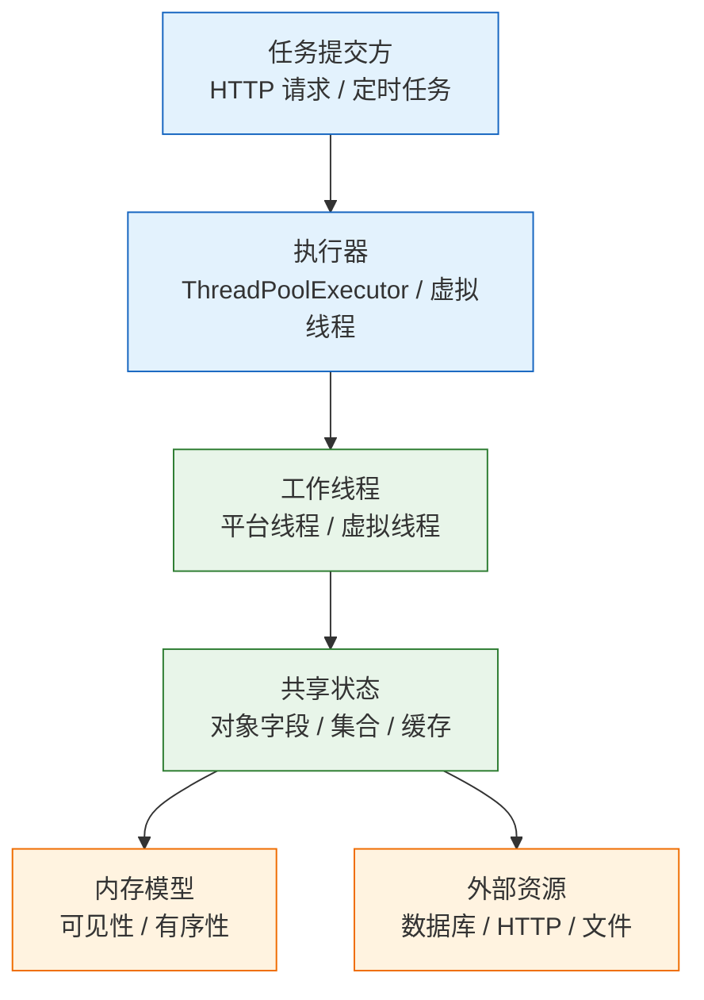
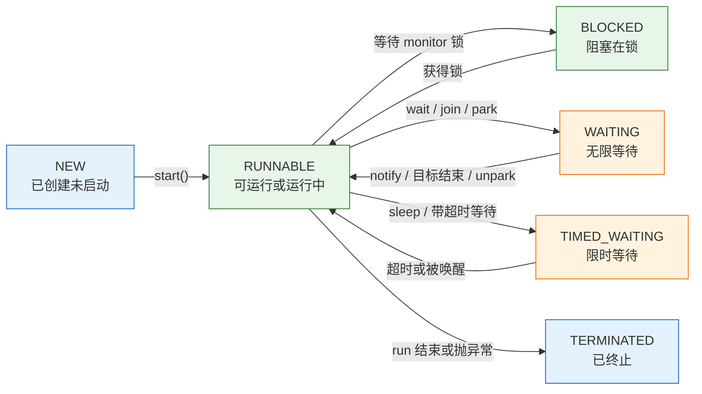
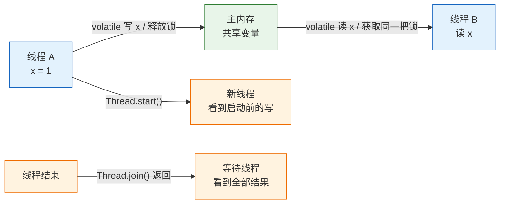
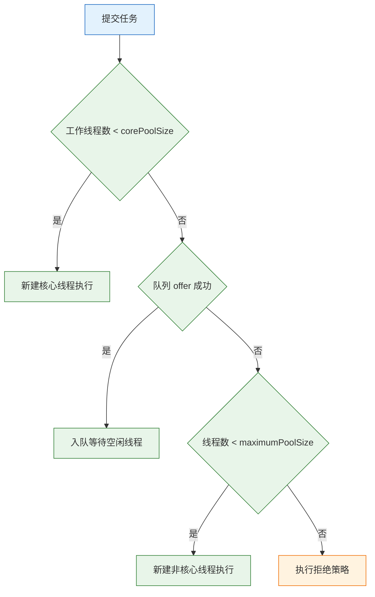

# 并发与线程

---

## 一、并发与线程的定位

### 1.1 核心概念

并发（Concurrency）指多个任务在重叠的时间段内推进，并行（Parallelism）指多个任务在同一时刻真正同时执行。单核 CPU 通过时间片轮转也能并发，多核才能并行。Java 的线程模型把这两件事统一成“多个执行流共享同一进程的堆内存”，于是所有并发问题都集中到共享可变状态上。

一个线程从创建到终止有明确的生命周期；多个线程访问同一变量时，需要回答三个问题：复合操作是否原子、一个线程的写对另一个线程是否可见、指令是否会被重排。并发工具的作用就是为这三件事提供保证，而不是让业务逻辑自动正确。

| 概念 | 含义 | 失效时的表现 |
|---|---|---|
| 原子性 | 一组操作不可被其他线程插入 | 计数偏小、库存超卖 |
| 可见性 | 一个线程的写能被其他线程读到 | 循环不退出、状态不更新 |
| 有序性 | 指令按程序意图生效 | 对象未初始化就被使用 |
| 竞态条件 | 结果依赖线程执行的先后顺序 | 偶发、难复现、加日志后消失 |
| 临界区 | 访问共享状态的那段代码 | 锁范围不对，等于没锁 |

并发工具不解决业务竞态。库存扣减需要数据库行锁或条件更新，接口幂等需要唯一键或状态机，消息顺序需要分区键与单消费者。把这些责任推给 `synchronized`，只能在单进程内暂时掩盖问题。

### 1.2 与相邻技术的关系

并发编程站在操作系统、语言内存模型和框架的交汇处。操作系统提供线程调度与阻塞唤醒，JVM 提供 Java 内存模型与同步原语，`java.util.concurrent` 提供高层工具，框架再把这些能力封装成线程池、异步注解和响应式流。

| 相邻技术 | 关系 | 边界 |
|---|---|---|
| 操作系统线程 | 平台线程的一对一实现 | 创建成本高，数量受内核限制 |
| Java 内存模型 | 规定可见性与有序性 | 不保证复合操作原子 |
| `java.util.concurrent` | 锁、原子类、队列、执行器 | 不替代业务约束与事务 |
| 响应式编程 | 用事件循环减少阻塞线程 | 不自动解决共享状态 |
| 数据库并发控制 | 行锁、MVCC、唯一约束 | 跨进程的最终防线 |

响应式框架用少量事件循环线程处理大量连接，适合 IO 密集且链路可组合的场景；虚拟线程让阻塞代码也能获得类似吞吐，二者不是替代关系。选择依据是团队能否维护回调链、是否需要背压、调用栈是否需要可读性，而不是“哪个更新”。

### 1.3 整体结构

一条并发链路可以分成四层：任务提交方、执行器、工作线程、共享状态与外部资源。执行器决定任务何时、在哪个线程上运行；工作线程负责实际计算；共享状态与外部资源决定并发上限。



| 层 | 组件 | 职责 |
|---|---|---|
| 提交方 | 请求线程、定时器、消息消费者 | 产生任务、决定优先级与超时 |
| 执行器 | 线程池、虚拟线程执行器 | 排队、调度、拒绝、关闭 |
| 工作线程 | 平台线程或虚拟线程 | 执行任务、响应中断 |
| 共享状态 | 对象、集合、缓存、连接池 | 决定锁粒度与并发上限 |

分层之后，容量问题和技术选型就有了落点。任务积压看执行器的队列与线程数；CPU 飙高看工作线程的临界区与自旋；吞吐上不去看下游连接池与外部资源。把所有问题都归因于“线程不够”，通常会得到更糟的结果。

---

## 二、环境与最小示例

### 2.1 JDK 版本与线程模型

> **版本现状（2026）**：JDK 25 与 JDK 21 均为 LTS。虚拟线程在 JDK 21 正式发布（JEP 444），JDK 24 起 `synchronized` 内阻塞不再钉住载体线程（JEP 491）。本文示例以 JDK 21 为编译目标，涉及 JDK 24 之后行为差异的段落会单独标注。

| 版本 | 线程模型 | 与本文的关系 |
|---|---|---|
| JDK 25 | 平台线程加虚拟线程 | 新项目基线，虚拟线程限制更少 |
| JDK 21 | 平台线程加虚拟线程 | 示例编译目标，结构化并发为预览 |
| JDK 17 | 仅平台线程 | 存量系统，虚拟线程不可用 |

```bash
# ========== 确认 JDK 与进程 ==========
java -version
jps -l

# ========== 查看线程栈 ==========
# 平台线程与锁信息，排查死锁的常用入口
jstack <pid>

# 虚拟线程不出现在传统线程栈里，需要导出转储
jcmd <pid> Thread.dump_to_file -format=json /tmp/threads.json
```

`jstack` 输出的是平台线程。虚拟线程由 JVM 调度，数量可能达到十万级，传统线程栈既装不下也没有意义；JDK 21 起用 `Thread.dump_to_file` 导出，分析工具再按状态聚合。

### 2.2 最小可运行示例

下面的程序分别创建平台线程与虚拟线程，打印线程对象并等待结束。它展示两种线程的创建方式，也说明 `join()` 的作用。

```java
public class HelloThreads {
    public static void main(String[] args) throws InterruptedException {
        // 平台线程：一对一映射到操作系统线程
        Thread platform = Thread.ofPlatform()
                .name("worker-platform")
                .start(() -> print("platform"));

        // 虚拟线程：由 JVM 调度到载体线程
        Thread virtual = Thread.ofVirtual()
                .name("worker-virtual")
                .start(() -> print("virtual"));

        // 等待两个线程结束，否则主线程可能先退出
        platform.join();
        virtual.join();

        System.out.println("done");
    }

    static void print(String kind) {
        System.out.println(kind + " thread=" + Thread.currentThread());
    }
}
```

```bash
javac --release 21 -d out HelloThreads.java
java -cp out HelloThreads
```

输出类似（两行顺序不固定）：

```text
platform thread=Thread[#22,worker-platform,5,main]
virtual thread=VirtualThread[#23,worker-virtual]/runnable@ForkJoinPool-1-worker-1
done
```

平台线程的 `toString()` 包含线程编号、名称、优先级和线程组；虚拟线程显示为 `VirtualThread`，后面是载体池与载体线程名。线程编号每次运行不同，不能拿来当业务标识。

### 2.3 编译与运行

| 命令 | 作用 | 常见错误 |
|---|---|---|
| `javac --release 21 -d out X.java` | 编译并约束 API | 用 JDK 17 编译虚拟线程代码会失败 |
| `java -cp out X` | 运行示例 | 类路径缺少依赖 |
| `jps -l` | 列出 Java 进程 | 容器内看不到宿主机进程 |
| `jcmd <pid> Thread.print` | 打印线程栈 | 权限不足或 PID 错误 |
| `jcmd <pid> Thread.dump_to_file` | 导出含虚拟线程的转储 | 文件路径不可写 |

`--release 21` 会拒绝预览 API，除非显式加 `--enable-preview`；`Thread.ofVirtual()` 在 JDK 21 已转正，不受此限制。生产构建不建议依赖预览特性，升级 JDK 时 API 可能变化。

---

## 三、线程生命周期与中断机制

### 3.1 状态迁移

Java 定义了六种线程状态。`RUNNABLE` 既包括正在 CPU 上运行，也包括等待操作系统调度或阻塞在文件、网络 IO 上；`BLOCKED` 只表示等待 monitor 锁；`WAITING` 与 `TIMED_WAITING` 表示主动等待。



| 状态 | 进入条件 | 退出条件 |
|---|---|---|
| `NEW` | 创建后尚未 `start()` | 调用 `start()` |
| `RUNNABLE` | 已启动，等待 CPU 或正在运行 | 进入阻塞、等待或终止 |
| `BLOCKED` | 等待进入 `synchronized` 块 | 获得 monitor 锁 |
| `WAITING` | `wait()`、`join()`、`park()` 无超时 | 被通知、目标结束或 `unpark` |
| `TIMED_WAITING` | `sleep`、带超时的 `wait`、`join` | 超时或被唤醒 |
| `TERMINATED` | `run()` 正常返回或抛出未捕获异常 | 不可再次启动 |

`start()` 才会创建新线程；直接调用 `run()` 只是普通方法调用，代码跑在当前线程。一个 `Thread` 只能 `start()` 一次，第二次抛 `IllegalThreadStateException`。线程终止后不能复用，需要新任务就创建新线程或交给线程池。

### 3.2 中断协议

`interrupt()` 只是设置中断标志，不会强制停止线程。线程在 `sleep`、`wait`、`join` 等阻塞点收到中断时，会抛出 `InterruptedException` 并清除标志；`LockSupport.park()` 则直接返回并保留标志。是否停止、何时停止，由任务自己决定。

```java
static void work() {
    while (!Thread.currentThread().isInterrupted()) {
        try {
            Thread.sleep(100);
            // 执行一小段可中断的工作
        } catch (InterruptedException e) {
            // 恢复中断标志，让上层知道停止请求发生过
            Thread.currentThread().interrupt();
            break;
        }
    }
}
```

| 调用 | 行为 | 说明 |
|---|---|---|
| `interrupt()` | 设置中断标志 | 阻塞中的线程会收到异常 |
| `isInterrupted()` | 查询标志，不清除 | 循环条件常用 |
| `Thread.interrupted()` | 查询并清除标志 | 会吞掉状态，慎用 |
| `sleep` / `wait` / `join` | 抛 `InterruptedException` 并清除标志 | 必须恢复或继续抛 |
| `LockSupport.park()` | 返回，不抛异常 | 需要自行检查标志 |
| `InterruptibleChannel` | 关闭通道并抛 `ClosedByInterruptException` | IO 任务可借此退出 |

捕获 `InterruptedException` 后吞掉，是线程停不下来的主要原因。上层调用 `shutdownNow()` 只能发出中断请求，任务不响应，线程就会一直占着执行器，直到进程退出。

### 3.3 守护线程与 join

守护线程不阻止 JVM 退出：所有非守护线程结束时，JVM 直接终止，守护线程的 `finally` 不保证执行。它适合做监控、心跳、清理这类可随时放弃的工作，不适合数据落盘。

| 方法 | 语义 | 注意 |
|---|---|---|
| `setDaemon(true)` | 设为守护线程 | 必须在 `start()` 前调用 |
| `join()` | 等待目标线程终止 | 可能永久阻塞，调用方要能中断 |
| `join(millis)` | 最多等待指定时间 | 返回不代表线程已结束，要查 `isAlive()` |
| `Thread.onSpinWait()` | 提示 CPU 处于自旋 | 只适合极短等待，不能替代锁 |

`join()` 本身会抛出 `InterruptedException`，等待线程被中断时应停止等待并恢复标志。带超时的 `join` 返回值无法区分“线程结束”和“超时”，必须再用 `isAlive()` 判断。

---

## 四、Java 内存模型与可见性

### 4.1 happens-before 规则

Java 内存模型（JMM）用 happens-before（HB）描述操作之间的可见性与顺序：如果 A HB B，那么 A 的写对 B 可见，且 A 之前的操作不会被重排到 B 之后。HB 不是“时间上先发生”，而是语言层面给出的保证。



| 规则 | 含义 |
|---|---|
| 程序顺序 | 同一线程内，前面的操作 HB 后面的操作 |
| monitor | 对同一把锁的 `unlock` HB 后续 `lock` |
| volatile | 对同一变量的写 HB 后续读 |
| start | `Thread.start()` HB 新线程中的任何操作 |
| join | 线程中的所有操作 HB 其他线程从 `join()` 成功返回 |
| 传递性 | A HB B 且 B HB C，则 A HB C |

没有 HB 关系时，两个线程看到的写入顺序没有保证。CPU 缓存、编译器重排、JIT 优化都可能让读线程看到旧值；这不是 JVM 的 bug，而是缺少同步的必然结果。

### 4.2 volatile 的边界

`volatile` 保证可见性与有序性：每次读都从共享内存获取最新值，写之前的操作不会被重排到写之后，读之后的操作不会被重排到读之前。它不保证复合操作的原子性。

```java
final class Worker implements Runnable {
    // 停止标志：一个线程写，多个线程读
    private volatile boolean running = true;

    void stop() {
        running = false;
    }

    @Override
    public void run() {
        while (running) {
            // 执行任务
        }
    }
}
```

| 操作 | 原子性 | 可见性 |
|---|---|---|
| `volatile` 读或写 | 单次读、单次写原子 | 保证 |
| `count++` | 不保证，读加写三步 | 变量是 `volatile` 也不保证 |
| 64 位 `long` / `double` 非 `volatile` | 规范允许非原子（实际平台多为原子） | 不保证 |
| 数组引用 | 引用读写原子 | 元素内容不保证 |

`volatile int count; count++` 仍然会丢更新，因为读、加、写之间可以插入其他线程。计数用 `AtomicInteger`、`LongAdder`，或用锁包住完整的读改写。`volatile` 数组只保证引用可见，`arr[i]` 的读写不受保护。

### 4.3 双重检查锁与安全发布

双重检查锁（DCL）用两次 `null` 判断减少加锁次数，但实例字段必须加 `volatile`。`new` 分成分配内存、初始化、赋值引用三步，没有 `volatile` 时初始化和赋值可能重排，其他线程会看到“引用非空但对象未初始化完”。

```java
final class Singleton {
    // volatile 禁止初始化与引用赋值重排
    private static volatile Singleton instance;

    static Singleton get() {
        if (instance == null) {
            synchronized (Singleton.class) {
                if (instance == null) {
                    instance = new Singleton();
                }
            }
        }
        return instance;
    }

    private Singleton() {
    }
}
```

| 发布方式 | 线程安全 | 说明 |
|---|---|---|
| 静态初始化 | 是 | 类加载时完成，JVM 保证可见 |
| 静态内部类 | 是 | 延迟加载，利用类初始化锁 |
| 枚举单例 | 是 | 防反射与反序列化破坏 |
| 双重检查锁 | 需 `volatile` | 漏写会看到半初始化对象 |
| 普通字段直接赋值 | 否 | 可能读到未初始化状态 |

更简单的写法是枚举或静态持有类，不给重排留机会。安全发布的核心是让“构造完成”对读线程可见，`final` 字段、`volatile` 字段、锁、并发容器和静态初始化都能提供这种保证。

---

## 五、原子类与锁

### 5.1 CAS 与原子类

CAS（Compare-And-Swap）是一条 CPU 原子指令：只有当前值等于预期值时才写入新值，否则返回失败。`AtomicInteger.incrementAndGet()` 在失败时自旋重试，不需要操作系统锁，低竞争下比 `synchronized` 轻。

| 工具 | 适用 | 注意 |
|---|---|---|
| `AtomicInteger` / `AtomicLong` | 单变量原子更新 | 高竞争下自旋多，CPU 升高 |
| `AtomicReference` | 原子替换对象引用 | 只保证引用，不保证对象内部状态 |
| `LongAdder` / `LongAccumulator` | 高并发计数、求和 | `sum()` 不是原子快照 |
| `AtomicStampedReference` | 需要版本号，避免 ABA | 多一个 stamp，开销更大 |
| `VarHandle` | 精细控制内存语义 | API 复杂，普通业务少用 |

`LongAdder` 在写多时把更新分散到多个 cell，最后求和，适合监控计数；它不适合“先读当前值再判断”的业务状态。CAS 还存在 ABA 问题：值从 A 改成 B 又改回 A，比较者以为没变。需要版本号时用 `AtomicStampedReference`，或者干脆用锁。

### 5.2 锁的类型与取舍

| 锁 | 特性 | 代价 | 适用 |
|---|---|---|---|
| `synchronized` | 可重入、自动释放、JVM 优化 | 不可中断、无超时、非公平 | 临界区短、逻辑简单 |
| `ReentrantLock` | 可中断、可超时、可选公平、多条件 | 必须 `finally` 解锁 | 需要超时或取消 |
| `ReadWriteLock` | 读锁共享、写锁独占 | 读写切换有开销 | 读多写少 |
| `StampedLock` | 乐观读、性能高 | 不可重入、API 复杂 | 读极多且能校验 |

```java
private final ReentrantLock lock = new ReentrantLock();

boolean update(long timeoutMs) throws InterruptedException {
    // 带超时的尝试加锁，避免无限等待
    if (!lock.tryLock(timeoutMs, TimeUnit.MILLISECONDS)) {
        return false;
    }
    try {
        // 临界区：读、判断、写必须完整覆盖
        return true;
    } finally {
        lock.unlock();   // 必须放在 finally，异常时也要释放
    }
}
```

锁对象必须是所有线程共享的同一个实例。`new Object()` 放在方法里，每次调用都是新锁，等于没锁；锁字符串常量、包装类对象还可能与其他代码意外共享。锁范围要覆盖完整的“读、判断、写”，只锁写不锁读，判断仍然基于过期值。

持锁时不要调用外部服务、不要做长时间 IO、不要等待其他锁。临界区越长，争用越严重，死锁概率越高。

> **注意**：`ReentrantLock` 不会自动释放，任何提前返回或异常分支都必须经过 `finally`。使用 `tryLock` 时，只有返回 `true` 才调用 `unlock()`；对未持有的锁解锁会抛 `IllegalMonitorStateException`。

### 5.3 死锁的成因与定位

死锁需要同时满足四个条件：互斥、持有并等待、不可抢占、循环等待。破坏任意一个就能避免，工程上最容易做的是统一加锁顺序，或用带超时的 `tryLock` 放弃重试。

```java
// 片段：LockSupport、Thread 等 import 与外围类省略
static final Object A = new Object();
static final Object B = new Object();

static void left() {
    synchronized (A) {
        LockSupport.parkNanos(50_000_000L);   // 放大交错窗口
        synchronized (B) {
            // 永远不会执行到这里
        }
    }
}

static void right() {
    synchronized (B) {
        LockSupport.parkNanos(50_000_000L);
        synchronized (A) {
            // 与 left 互相等待
        }
    }
}
```

| 条件 | 说明 | 破坏方式 |
|---|---|---|
| 互斥 | 资源一次只能被一个线程持有 | 尽量用无锁结构或不可变对象 |
| 持有并等待 | 持有一把锁再申请另一把 | 一次性申请全部锁 |
| 不可抢占 | 已获得的锁不能被强制收回 | 用 `tryLock` 超时后释放 |
| 循环等待 | 线程形成环形等待链 | 全局统一加锁顺序 |

定位死锁用 `jstack <pid>` 或 `jcmd <pid> Thread.print`，搜索 `Found one Java-level deadlock`，看每个线程持有什么锁、等待什么锁。JFR 的 `jdk.JavaMonitorEnter` 事件也能看到长时间锁等待。

> **安全警告**：嵌套锁必须全局统一顺序，例如永远按对象地址或业务 ID 排序后加锁。依赖调用顺序“通常不会反过来”的代码，在并发压力、异常重试或未来重构后会变成死锁；死锁发生时线程永久挂起，线程池很快被占满，表现为服务整体无响应。

---

## 六、线程池与任务调度

### 6.1 七个参数与执行顺序

`ThreadPoolExecutor` 的行为由七个参数决定。理解执行顺序比背参数名重要：核心线程、队列、非核心线程、拒绝策略，顺序不能颠倒。



| 参数 | 作用 | 设错的后果 |
|---|---|---|
| `corePoolSize` | 常驻核心线程数 | 太小排队，太大空耗内存 |
| `maximumPoolSize` | 最大线程数 | 配合无界队列时永远用不上 |
| `keepAliveTime` | 非核心线程空闲存活时间 | 频繁创建销毁，抖动增加 |
| `workQueue` | 等待队列 | 无界队列导致任务堆积与 OOM |
| `threadFactory` | 线程命名与异常处理 | 线程名重复，排障无法定位 |
| `handler` | 拒绝策略 | 静默丢弃，故障不可见 |

```java
AtomicInteger seq = new AtomicInteger();

// 命名线程并设置未捕获异常处理器，排障时能直接定位来源
ThreadFactory factory = runnable -> {
    Thread t = new Thread(runnable, "order-worker-" + seq.incrementAndGet());
    t.setUncaughtExceptionHandler((thread, e) ->
            System.err.println("uncaught in " + thread.getName() + ": " + e));
    return t;
};

ThreadPoolExecutor pool = new ThreadPoolExecutor(
        4,                                  // 核心线程数
        8,                                  // 最大线程数
        60, TimeUnit.SECONDS,               // 非核心线程空闲存活
        new ArrayBlockingQueue<>(200),      // 有界队列，形成背压
        factory,
        new ThreadPoolExecutor.CallerRunsPolicy());
```

核心线程默认按需创建，不会在构造时全部启动；需要预热时调用 `prestartAllCoreThreads()`。队列容量与最大线程数要一起算：队列 200、最大线程 8，意味着最坏情况下积压 200 个任务后开始扩容，再满就拒绝。

### 6.2 队列与拒绝策略

`Executors` 的工厂方法隐藏了队列与最大线程数，用起来简单，但风险也在这里。

| 工厂方法 | 队列与线程 | 风险 |
|---|---|---|
| `newFixedThreadPool(n)` | 固定 n，无界 `LinkedBlockingQueue` | 任务堆积导致 OOM |
| `newCachedThreadPool()` | `SynchronousQueue`，最大 `Integer.MAX_VALUE` | 线程数失控 |
| `newSingleThreadExecutor()` | 1 个线程，无界队列 | 堆积，但保证顺序 |
| `newScheduledThreadPool(n)` | 延迟队列 | 任务异常会取消后续执行 |
| `newVirtualThreadPerTaskExecutor()` | 每任务一个虚拟线程 | 不限制下游并发，需要额外限流 |

| 拒绝策略 | 行为 | 适用 |
|---|---|---|
| `AbortPolicy` | 抛 `RejectedExecutionException` | 默认，让调用方感知 |
| `CallerRunsPolicy` | 提交线程自己执行 | 形成背压，但会阻塞提交者 |
| `DiscardPolicy` | 静默丢弃新任务 | 生产环境基本不该用 |
| `DiscardOldestPolicy` | 丢弃最旧任务再提交 | 只适合可丢弃的实时数据 |

`CallerRunsPolicy` 不是万能背压。提交线程可能是 Web 容器的 IO 线程，让它执行长任务会拖慢整个请求处理。使用前要确认提交线程能承受这段执行时间。

> **注意**：`Executors` 的工厂方法不暴露队列容量与最大线程数，参数在实现里固定。生产环境需要可观测、可拒绝的线程池时，直接用 `ThreadPoolExecutor` 构造，不要用工厂方法绕一圈再强转。

### 6.3 关闭与优雅停机

`shutdown()` 停止接收新任务，已提交任务继续执行；`shutdownNow()` 尝试中断正在执行的任务，并返回队列中未开始的任务。两者都不保证任务一定停止，取决于任务是否响应中断。

```java
pool.shutdown();
if (!pool.awaitTermination(30, TimeUnit.SECONDS)) {
    // 超时后强制中断，并记录被丢弃的任务数量
    List<Runnable> dropped = pool.shutdownNow();
    System.err.println("dropped=" + dropped.size());
}
```

| 方法 | 是否接收新任务 | 是否中断运行中任务 | 是否等待结束 |
|---|---|---|---|
| `shutdown()` | 否 | 否 | 否 |
| `shutdownNow()` | 否 | 是（尽力） | 否 |
| `awaitTermination` | 不改变状态 | 否 | 是，带超时 |
| `close()` | 否 | 中断后强制 | 是 |

`ExecutorService` 在 Java 19 起实现 `AutoCloseable`，`close()` 等价于发起有序关闭并等待终止；被中断时转为 `shutdownNow()`。虚拟线程执行器常配合 `try-with-resources` 使用。

> **安全警告**：线程池未关闭、任务无限创建线程、`ThreadLocal` 未清理，都会造成线程或内存泄漏。泄漏初期只表现为内存缓慢上涨、线程数缓慢增加，等到句柄或栈内存耗尽时服务才整体崩溃。线程池必须纳入应用生命周期管理，停机时按“先停流量、再 shutdown、最后超时强停”的顺序执行。

---

## 七、虚拟线程与并发容量

### 7.1 虚拟线程的调度模型

虚拟线程由 JVM 调度到少量载体线程（carrier）上。遇到阻塞 IO 时，虚拟线程把载体让给其他虚拟线程，自己挂起；阻塞结束后再由调度器恢复。创建成本从“操作系统线程”降到“堆上的对象”，因此可以一个请求一个线程。

```java
try (ExecutorService executor = Executors.newVirtualThreadPerTaskExecutor()) {
    // 每个任务一个虚拟线程，阻塞时自动让出载体
    Future<String> future = executor.submit(() -> callRemote());
    System.out.println(future.get());
}
```

| 维度 | 平台线程 | 虚拟线程 |
|---|---|---|
| 映射 | 一对一映射到操作系统线程 | 多对多调度到载体线程 |
| 栈 | 默认约 1MB，受 `-Xss` 影响 | 按需增长，初始占用远小于平台线程 |
| 创建成本 | 高，数量受内核限制 | 低，可创建数十万 |
| 阻塞行为 | 占住操作系统线程 | 让出载体，等待恢复 |
| 适用任务 | CPU 密集、数量有限 | 大量阻塞 IO、生命周期短 |

虚拟线程不改变 CPU 并行度。CPU 密集型任务创建再多虚拟线程，也只是在少量载体上轮流执行，反而增加调度开销。它的价值在于把“等待”从线程成本里剥离出来。

### 7.2 容量边界与固定风险

| 场景 | 是否适合 | 原因 |
|---|---|---|
| 大量短生命周期 HTTP 调用 | 适合 | 阻塞时让出载体，代码保持同步写法 |
| CPU 密集计算 | 不适合 | 载体数量等于核数，创建更多没有收益 |
| 长事务持锁 | 不适合 | 持锁阻塞会占住载体或连接 |
| 依赖 `ThreadLocal` 的框架 | 谨慎 | 每个虚拟线程一份，内存放大 |
| 需要池化控制的资源 | 谨慎 | 虚拟线程不应池化，改用信号量限流 |

JDK 21 上，虚拟线程在 `synchronized` 块内阻塞会钉住载体线程（pinning），高并发时载体耗尽，吞吐骤降。JDK 24 的 JEP 491 解除了这一限制，但执行 native 方法或外部函数调用时仍可能钉住载体。跑在 JDK 21 上时，阻塞 IO 的临界区改用 `ReentrantLock`。

`ThreadLocal` 在虚拟线程上仍然可用，但每个虚拟线程一份，数量大时内存放大。请求结束要 `remove()`，或改用作用域值（ScopedValue）传递上下文。不要池化虚拟线程：池化会失去按需创建的意义，还会让阻塞任务占住池位。

### 7.3 下游限流与结构化并发

虚拟线程可以瞬间创建十万个，但数据库连接池只有几十个。真正的并发上限由下游资源决定，必须用信号量、连接池或限流器做背压。

```java
// 片段：Task、callDownstream、import 与外围类省略
Semaphore permits = new Semaphore(20);   // 同时最多 20 个下游调用

try (ExecutorService executor = Executors.newVirtualThreadPerTaskExecutor()) {
    for (Task t : tasks) {
        executor.submit(() -> {
            try {
                permits.acquire();
            } catch (InterruptedException e) {
                Thread.currentThread().interrupt();   // 未拿到许可，直接退出
                return;
            }
            try {
                callDownstream(t);
            } finally {
                permits.release();       // 拿到许可后，无论成功失败都要归还
            }
        });
    }
}
```

| 限流手段 | 限制对象 | 适用 |
|---|---|---|
| `Semaphore` | 同时进行的调用数 | 虚拟线程访问有限下游 |
| 连接池上限 | 数据库或 HTTP 连接 | 资源型下游 |
| 有界队列 | 排队任务数 | 平台线程池 |
| 令牌桶 | 单位时间请求数 | 对外 API 配额 |

信号量限的是“同时进行的调用数”，不是线程数；虚拟线程阻塞在 `acquire` 上成本很低，这比给虚拟线程池设大小更符合它的模型。

结构化并发在 JDK 21 是预览 API，JDK 25 仍是预览。它把一组子任务绑定到同一个作用域，任一失败就取消其余任务，避免“父任务返回、子任务还在跑”。生产代码若使用，需要 `--enable-preview`，并接受 API 可能变化；普通项目用 `invokeAll` 加超时已经足够。

---

## 八、完整示例

### 8.1 竞态复现与原子修复

下面的程序用四个线程各加一万次，对比普通 `int` 与 `AtomicInteger`。`CountDownLatch` 让线程尽量同时起跑，放大竞态窗口。

```java
import java.util.concurrent.CountDownLatch;
import java.util.concurrent.ExecutorService;
import java.util.concurrent.Executors;
import java.util.concurrent.atomic.AtomicInteger;

public class RaceDemo {
    static int unsafe = 0;
    static final AtomicInteger safe = new AtomicInteger();

    public static void main(String[] args) throws Exception {
        int threads = 4;
        int perThread = 10_000;

        try (ExecutorService pool = Executors.newFixedThreadPool(threads)) {
            CountDownLatch start = new CountDownLatch(1);
            CountDownLatch done = new CountDownLatch(threads);

            for (int i = 0; i < threads; i++) {
                pool.submit(() -> {
                    try {
                        start.await();          // 等待统一起跑
                        for (int j = 0; j < perThread; j++) {
                            unsafe++;           // 读、加、写三步，非原子
                            safe.incrementAndGet();
                        }
                    } catch (InterruptedException e) {
                        Thread.currentThread().interrupt();
                    } finally {
                        done.countDown();
                    }
                });
            }

            start.countDown();                  // 发令
            done.await();                       // 等全部完成
        }

        System.out.println("unsafe=" + unsafe);
        System.out.println("safe=" + safe.get());
    }
}
```

```bash
javac --release 21 -d out RaceDemo.java
java -cp out RaceDemo
```

某次运行的输出：

```text
unsafe=20097
safe=40000
```

| 计数方式 | 结果 | 原因 |
|---|---|---|
| 普通 `int` 自增 | 小于 40000，且每次不同 | 读改写三步可被其他线程插入 |
| `AtomicInteger` | 恒为 40000 | 单变量 CAS 保证原子 |
| `LongAdder` | 最终求和为 40000 | 分段累加，适合高并发统计 |
| 锁包住自增 | 恒为 40000 | 互斥保证复合操作原子 |

`unsafe` 偶尔也可能正好等于 40000，这恰恰说明它不可靠：一次正确不代表没有竞态。`CountDownLatch` 只提高复现概率，不保证一定出错；验证并发正确性要靠压力测试和代码审查，不能靠一次运行结果。

### 8.2 并发取数与超时兜底

四个远程报价并行获取，总耗时接近最慢的一个，而不是四个耗时之和。`invokeAll` 带超时，超时后取消未完成任务。

```java
import java.util.List;
import java.util.concurrent.Callable;
import java.util.concurrent.ExecutorService;
import java.util.concurrent.Executors;
import java.util.concurrent.Future;
import java.util.concurrent.TimeUnit;

public class QuoteDemo {

    record Quote(String sku, int cents) {}

    static Quote fetch(String sku, int cents, long delayMs) throws InterruptedException {
        Thread.sleep(delayMs);           // 模拟远程调用
        return new Quote(sku, cents);
    }

    public static void main(String[] args) throws Exception {
        List<Callable<Quote>> tasks = List.of(
                () -> fetch("A-100", 19900, 120),
                () -> fetch("B-200", 5800, 80),
                () -> fetch("C-300", 12000, 150),
                () -> fetch("D-400", 800, 60)
        );

        long start = System.nanoTime();
        int total = 0;

        try (ExecutorService pool = Executors.newVirtualThreadPerTaskExecutor()) {
            // 1 秒是整批任务的截止时间，超时后取消未完成项
            List<Future<Quote>> futures = pool.invokeAll(tasks, 1, TimeUnit.SECONDS);
            for (Future<Quote> f : futures) {
                total += f.get().cents();
            }
        }

        long elapsedMs = (System.nanoTime() - start) / 1_000_000;
        System.out.println("total=" + total);
        System.out.println("elapsedMs=" + elapsedMs);
    }
}
```

```bash
javac --release 21 -d out QuoteDemo.java
java -cp out QuoteDemo
```

预期结果（耗时每次不同，远小于串行的 410 毫秒）：

```text
total=38500
elapsedMs=159
```

| 提交方式 | 超时行为 | 结果获取 |
|---|---|---|
| `invokeAll(tasks)` | 无超时，全部完成才返回 | 按提交顺序返回 `Future` |
| `invokeAll(tasks, timeout, unit)` | 超时取消未完成任务 | 已取消项 `get()` 抛 `CancellationException` |
| `submit` 逐个提交 | 每个任务独立控制 | 需要自己收集与取消 |
| `CompletableFuture.allOf` | 等全部完成 | 结果要自己汇总 |

`invokeAll` 返回时，超时任务已经被取消，但取消是协作式的：任务若不响应中断，仍可能在后台继续跑。真实代码要逐个处理 `CancellationException` 和 `ExecutionException`，并记录哪个下游超时，而不是让一个失败拖垮整批。

---

## 九、工程实践

### 9.1 线程数估算

线程数不是越多越好。平台线程过多会增加上下文切换、栈内存和调度延迟；虚拟线程过多会把压力转移到下游连接池。

| 任务类型 | 线程数 | 依据 |
|---|---|---|
| CPU 密集 | 约等于核数，或核数加一 | 超过核数只增加切换开销 |
| IO 密集（平台线程） | 核数乘以（1 加等待时间除以计算时间） | 等待占比越高，需要越多线程 |
| 混合型 | 拆分 CPU 与 IO 两段，分别配置 | 避免长等待占住计算线程 |
| 虚拟线程 | 不设池大小，按任务创建 | 用信号量限制下游并发 |

公式只是起点，真实值要通过压测确定。压测时同时观察 CPU 使用率、线程状态分布、队列长度、下游错误率和尾延迟；只追求吞吐会把尾延迟推高，只追求延迟会浪费容量。

### 9.2 可观测性

并发问题难排，是因为现场消失得快。线程池、锁、队列、虚拟线程都要有指标和转储能力。

| 指标 | 来源 | 告警建议 |
|---|---|---|
| 活跃线程数 | `ThreadPoolExecutor.getActiveCount()` | 持续接近最大值 |
| 队列长度 | `getQueue().size()` | 持续增长或接近容量 |
| 拒绝次数 | 自定义拒绝策略计数 | 出现即告警 |
| 任务耗时 | 埋点或 Micrometer | P99 超过下游超时 |
| 锁等待 | JFR `jdk.JavaMonitorEnter` | 长时间等待集中在同一把锁 |
| 线程转储 | `jstack`、`Thread.dump_to_file` | 故障时自动采集 |

线程池指标要按池分别上报，不能只报一个全局值。线程名要带业务前缀和序号，转储时才能一眼看出哪个池、哪类任务。

### 9.3 共享状态规避

| 手段 | 做法 | 适用 |
|---|---|---|
| 不可变对象 | 字段 `final`，构造后不修改 | 配置、快照、消息 |
| 线程封闭 | 状态只在一个线程内使用 | 请求上下文、临时缓冲 |
| 消息传递 | 通过队列转移所有权 | 生产者消费者、流水线 |
| 并发容器 | `ConcurrentHashMap`、`BlockingQueue` | 共享缓存与任务队列 |
| 同步原语 | 锁、原子类、信号量 | 必须共享的可变状态 |

能用不可变对象、线程封闭、消息传递，就不要共享可变状态。临界区尽量短，锁的粒度按“必须一起成立的读写”划分，不是按方法划分。简单计数用 `LongAdder`，需要读当前值做判断时用锁或 CAS 循环。

不要使用 `Thread.stop`、`suspend`、`resume`，这些方法已被废弃，会留下不一致状态；也不要依赖线程优先级，不同平台行为差异很大。并发正确性靠设计、代码审查和压力测试，不靠“看起来没问题”。

---

## 十、常见错误与排查

### 10.1 故障对照表

| 现象 | 最可能原因 | 处理 |
|---|---|---|
| 计数偶尔偏小 | `count++` 非原子 | 改 `AtomicInteger` 或锁住完整读改写 |
| 循环永远不退出 | 共享标志缺少 `volatile` | 加 `volatile` 或用 `AtomicBoolean` |
| 对象引用非空但字段为默认值 | 未安全发布，构造与赋值重排 | 用 `volatile`、`final` 或锁发布 |
| 线程池任务越积越多 | 无界队列加消费慢 | 有界队列、拒绝策略、监控队列长度 |
| `OutOfMemoryError: unable to create native thread` | 平台线程过多或栈过大 | 减线程、调 `-Xss`、改用虚拟线程 |
| 服务停止时任务丢失 | 只 `shutdownNow`，没等 `awaitTermination` | 先停流量，再 shutdown，最后超时强停 |
| 死锁 | 嵌套锁顺序不一致 | 统一锁顺序、`tryLock` 超时、`jstack` 定位 |
| `InterruptedException` 后任务停不下来 | 捕获后吞掉，未恢复标志 | 恢复中断标志或继续抛 |
| `ThreadLocal` 越用越多 | 线程池复用线程，未 `remove` | `try/finally` 清理 |
| 虚拟线程吞吐反而下降 | JDK 21 上 `synchronized` 内阻塞导致 pinning | 改用 `ReentrantLock` 或升级 JDK 24 以上 |
| `parallelStream` 拖垮服务 | 共用 `ForkJoinPool.commonPool`，任务阻塞 | 自定义池，或改用虚拟线程与普通线程池 |
| 线程数持续上涨不下降 | 线程池重复创建、任务泄漏 | 单例管理线程池，检查关闭逻辑 |

### 10.2 排查顺序

1. 确认是否存在共享可变状态；没有共享就没有数据竞争，先排除误判。
2. 有共享时先问复合操作是否原子，再问写对读是否可见，最后问是否存在重排。
3. 看线程状态：`jstack` 或 `Thread.dump_to_file`，统计 `BLOCKED`、`WAITING` 与死锁段落。
4. 看线程池：活跃数、队列长度、最大线程数、拒绝次数，判断是容量不足还是任务卡住。
5. CPU 高时看线程栈是否自旋或频繁 GC；CPU 低但吞吐差时看锁等待与下游超时。
6. 最后才调参数；参数调不好，通常是持锁太久、队列无界或下游限流缺失。

> **注意**：并发故障的复现依赖时序，生产环境不要为了复现而长时间打开调试日志或暂停线程。优先采集线程转储、JFR 录制和线程池指标，再在压测环境复现；现场被破坏后，剩下的只有猜测。
