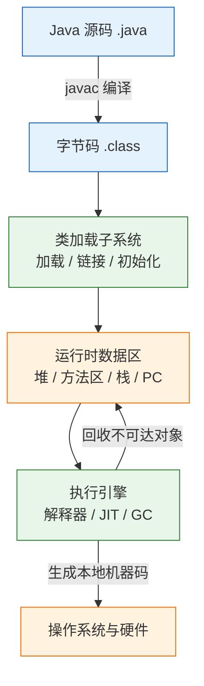
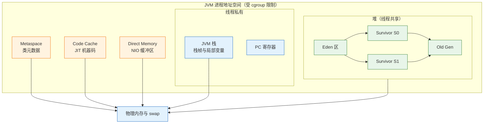
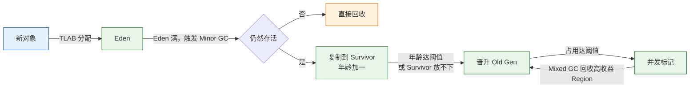
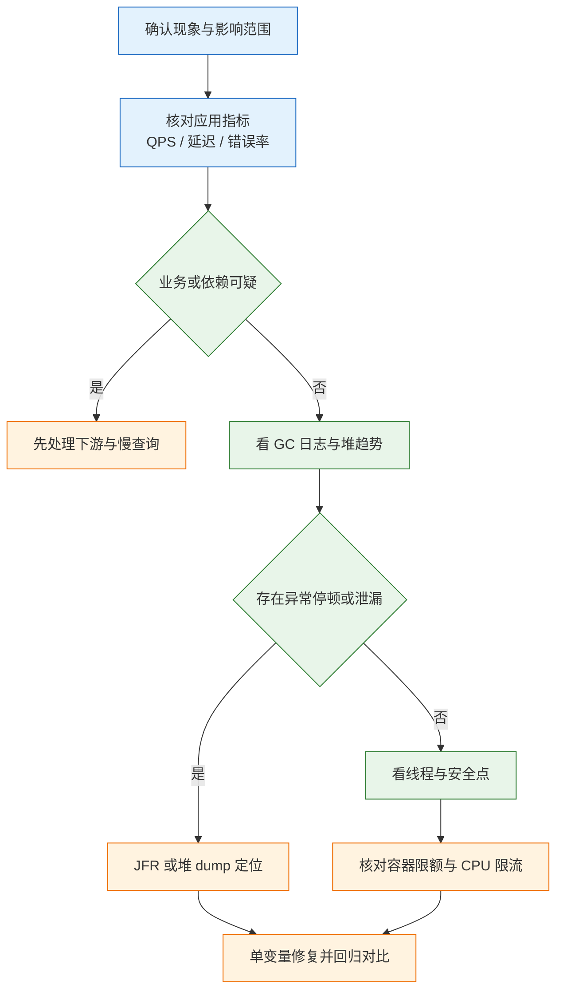

# JVM 与性能

---

## 一、JVM 与性能的定位

### 1.1 核心概念

JVM（Java Virtual Machine，Java 虚拟机）是 Java 程序的运行时容器。它把编译后的 `.class` 字节码加载进内存，先解释执行，再把热点方法即时编译成本地机器码，并在托管堆上自动分配与回收对象。开发者因此不必手写 `free`，同一份字节码也能在不同操作系统和 CPU 架构上保持相同语义。

这层抽象把运行状态压缩成三个可观测对象：内存、停顿、CPU。生产环境的性能问题几乎都能落进这三类，区别只在证据从哪里取。

| 问题域 | 直接证据 | 常见根因 |
|---|---|---|
| 内存 | 进程 RSS、堆使用曲线、`GC.heap_info` | 集合无界、缓存未淘汰、Metaspace 泄漏、直接内存未释放 |
| 停顿 | GC 日志、JFR 事件、P99 曲线 | Full GC、Humongous 分配、晋升失败、Safepoint 等待 |
| CPU | 线程栈、JFR 采样、`top -H` | 自旋、锁竞争、正则回溯、GC 线程占用、编译线程 |

JVM 不负责业务语义。慢 SQL、下游超时、连接池耗尽、消息积压都会表现为接口变慢，但根因不在虚拟机内部。进入 JVM 排查之前，必须先用应用指标把业务与依赖排除；否则容易把一次数据库慢查询误判成 GC 故障。

> **注意**：堆占用高不等于内存泄漏。判断标准是 Full GC 之后老年代占用能否回落；只看绝对值，会把缓存预热误判为泄漏。

### 1.2 与相邻技术的关系

JVM 是 JDK 的一部分。JDK 包含编译器 `javac`、运行时 JVM、标准类库和诊断工具；JRE 只包含运行时与类库。JDK 11 起官方不再单独分发 JRE，需要精简运行时用 `jlink` 生成自定义镜像。日常说“装 Java”，装的是 JDK。

JVM 与操作系统之间隔着 cgroup 和内核调度。容器限制的是进程总 RSS 与 CPU 配额，不是堆大小。JVM 从 cgroup 读取上限来决定默认堆和可用核数，读错或配置不当，就会出现“堆没满却被 kill”的现象。

JVM 与 APM 是证据与被观测对象的关系。APM 给出接口耗时与调用链，JVM 工具给出内存、线程、编译和 GC 细节；先用前者缩小范围，再用后者定位。

| 相邻技术 | 解决的问题 | 与 JVM 的边界 |
|---|---|---|
| JDK | 编译、运行、诊断的完整工具链 | JVM 只是其中运行时部分 |
| cgroup / 容器 | 限制进程组的内存与 CPU | JVM 读取限制，但不控制调度 |
| APM / 指标系统 | 接口级耗时与错误归因 | 不提供对象与线程级细节 |
| GC 算法 | 自动回收不可达对象 | 属于 JVM 内部实现，可替换 |
| JIT 编译器 | 把热点字节码编译为机器码 | 与解释器共同构成执行引擎 |

### 1.3 整体结构

JVM 按职责分为类加载、运行时数据区、执行引擎和本地接口四个子系统。



| 组件 | 职责 | 故障表现 |
|---|---|---|
| 类加载子系统 | 读取字节码、验证、准备、解析、初始化 | `ClassNotFoundException`、`NoClassDefFoundError`、Metaspace 增长 |
| 运行时数据区 | 保存对象、类元数据、线程栈 | 堆 OOM、栈溢出、直接内存 OOM |
| 执行引擎 | 解释执行、JIT 编译、垃圾回收 | 编译线程占 CPU、GC 停顿、去优化抖动 |
| 本地接口 | 调用 JNI、系统调用、文件与网络 | 本地库崩溃、`UnsatisfiedLinkError` |

---

## 二、环境与最小观测示例

### 2.1 JDK 版本与工具集

> **版本现状（2026）**：JDK 25 是当前长期支持版本，JDK 21 与 JDK 17 仍在维护期内。三者都包含统一的日志框架 `-Xlog`、JFR 和 `jcmd`；JDK 21 起虚拟线程正式可用，JDK 24 起虚拟线程阻塞在 `synchronized` 上不再钉住载体线程，JDK 25 起紧凑对象头转正。

诊断工具随 JDK 分发，无需额外安装。现代 JDK 中 `jstack`、`jmap`、`jinfo` 多数功能已由 `jcmd` 承接，脚本优先用 `jcmd`。

| 工具 | 观察对象 | 主要用途 |
|---|---|---|
| `jps` | Java 进程与主类 | 找到 PID，确认启动参数 |
| `jcmd` | VM、GC、线程、堆、JFR | 统一诊断入口 |
| `jstat` | 各代容量与 GC 计数 | 低成本连续采样 |
| `jstack` | 平台线程栈 | 死锁、阻塞、线程泄漏 |
| `jmap` | 堆直方图与 dump | 对象占用与离线分析 |
| `jfr` | 分配、GC、锁、IO 事件 | 带时间线的低开销记录 |
| `jinfo` | 启动参数与系统属性 | 核对实际生效配置 |

```bash
# ========== 确认运行时版本 ==========
# 查看当前 java 的版本与供应商
java -version

# 查看 javac 版本，必须与 java 主版本一致
javac -version

# 查看 java 可执行文件路径，排查多版本共存
which java
readlink -f "$(which java)"

# ========== 确认进程与参数 ==========
# 列出 Java 进程、主类与完整启动参数
jps -lvm

# 查看某个进程实际生效的堆参数
jcmd <pid> VM.flags
```

> **注意**：`java -version` 输出到标准错误，脚本里用 `java -version 2>&1` 才能捕获。`JAVA_HOME` 指向的 JDK 与 `PATH` 里的 `java` 可能不是同一个，版本不一致时先修环境变量。

### 2.2 最小可观测程序

下面的程序分配固定大小的数组并保持引用，同时打印 PID，用于后续所有采集命令。它不制造泄漏，只让堆占用稳定在可观察的水平。

```java
import java.util.ArrayList;
import java.util.List;

public class HoldDemo {
    public static void main(String[] args) throws Exception {
        List<byte[]> hold = new ArrayList<>();
        // 40 个 1 MiB 数组，约 40 MiB 存活对象
        for (int i = 0; i < 40; i++) {
            hold.add(new byte[1_000_000]);
        }
        System.out.println("pid=" + ProcessHandle.current().pid());
        // 留出采集窗口，避免进程立刻退出
        Thread.sleep(120_000);
        System.out.println("held=" + hold.size());
    }
}
```

```bash
# ========== 编译与启动 ==========
# 按 JDK 21 语法编译，输出到 out 目录
javac --release 21 -d out HoldDemo.java

# 固定 64 MiB 堆启动，便于观察各代变化
java -Xms64m -Xmx64m -cp out HoldDemo

# ========== 采集现场 ==========
# 用上一步输出的 pid 替换 <pid>
# 查看堆总量、各代占用与 Region 数量
jcmd <pid> GC.heap_info

# 每秒采样一次，共 3 次，观察 Eden 与 Old 的变化
jstat -gcutil <pid> 1000 3

# 查看存活对象占用排名，前 15 行
jcmd <pid> GC.class_histogram | head -15
```

`GC.heap_info` 的输出类似下面这样，具体数值随 JDK 版本与机器变化：

```text
garbage-first heap   total 65536K, used 43xxxK
region size 1024K, 2 young (2048K), 1 survivors (1024K)
Metaspace used xxxK, committed xxxK, reserved 1114112K
```

读这段输出要看三件事：`used` 与 `total` 的距离、young 区还剩多少、Metaspace 的 committed 是否持续上涨。单次采样只能说明现状，连续采样才能看出趋势。

### 2.3 启动参数与日志落点

GC 日志是排查停顿的第一份证据，必须在启动时打开。JDK 9 起统一用 `-Xlog`，旧的 `-XX:+PrintGCDetails` 已失效。

```bash
# ========== 基础日志 ==========
# 打开全部 GC 标签，写入文件，带时间、运行时长、级别、标签
java -Xms512m -Xmx512m \
  -Xlog:gc*:file=gc.log:time,uptime,level,tags \
  -jar app.jar

# ========== 生产轮转配置 ==========
# 按 PID 分文件，单文件 50 MiB，保留 5 个，避免日志撑满磁盘
java -Xms2g -Xmx2g \
  -Xlog:gc*:file=/var/log/app/gc-%p.log:time,uptime,level,tags:filecount=5,filesize=50M \
  -jar app.jar

# ========== 按需补充 ==========
# 记录类加载与卸载，排查 Metaspace 增长
java -Xlog:class+load=info,class+unload=info -jar app.jar

# 记录安全点等待，排查非 GC 停顿
java -Xlog:safepoint=info -jar app.jar

# 启动时开启原生内存追踪，供 jcmd 查询
java -XX:NativeMemoryTracking=summary -jar app.jar
```

| 参数 | 作用 | 使用建议 |
|---|---|---|
| `-Xms` / `-Xmx` | 堆初始值与上限 | 生产设为相同值，减少动态扩缩 |
| `-Xlog:gc*` | 全部 GC 事件 | 默认开启，写独立文件 |
| `-Xlog:class+load` | 类加载明细 | 仅排障期开启，日志量大 |
| `-Xlog:safepoint` | 安全点进入与等待 | 怀疑非 GC 停顿时开启 |
| `-XX:NativeMemoryTracking` | 原生内存分类统计 | 有约 5% 性能开销，按需开启 |

> **注意**：`-Xlog` 的文件选项写在冒号后的位置参数区，轮转参数放在最后一段。顺序写错会启动失败，报 `Invalid -Xlog option`。

---

## 三、运行时内存结构

### 3.1 堆与分代

堆是对象的主要存放地，线程共享，由 GC 管理。G1 把堆切成大小相等的 Region，每个 Region 在逻辑上属于 Eden、Survivor 或 Old；不再要求物理连续，因此堆可以很大而回收粒度仍然可控。



| 区域 | 存放内容 | 上限参数 | 典型故障 |
|---|---|---|---|
| 堆 | 对象实例、数组 | `-Xmx`，默认物理内存的 1/4 | 堆 OOM、GC 频繁 |
| Metaspace | 类结构、方法字节码、常量池 | 默认无上限，受本机内存限制 | 类加载器泄漏、Metaspace OOM |
| JVM 栈 | 每线程的栈帧 | `-Xss`，Linux x64 默认约 1 MiB | 递归过深、线程过多 |
| PC 寄存器 | 当前字节码位置 | 每线程一个 | 无需干预 |
| Code Cache | JIT 编译后的机器码 | 分层编译默认约 240 MiB | 编译停止、性能回落 |
| Direct Memory | `ByteBuffer.allocateDirect` | 默认约等于 `-Xmx` | 直接内存 OOM、RSS 上涨 |

堆的容量是上限而不是预分配。只有 `-Xms` 等于 `-Xmx` 并开启 `-XX:+AlwaysPreTouch`，物理页才会在启动时全部触达；否则堆按需向操作系统申请，RSS 随分配上涨。

### 3.2 堆外内存区域

进程 RSS 由堆和一堆堆外区域共同构成。堆 dump 只能看到堆，因此“堆很干净但进程一直涨”几乎总是堆外问题。

Metaspace 保存类的元数据。类卸载的前提是类加载器不可达，且没有存活实例与 `Class` 对象。热部署、脚本引擎、动态代理持续产生新类，旧加载器一旦被静态字段或线程上下文持有，Metaspace 就只涨不落。

Code Cache 保存 JIT 生成的机器码。它被写满后编译器停止工作，应用退回解释执行，表现为 CPU 升高而吞吐下降。`-XX:ReservedCodeCacheSize` 可以调大，但先要确认不是动态生成类导致编译量异常。

Direct Memory 由 `ByteBuffer.allocateDirect` 和 Netty 等框架使用，回收依赖 `Cleaner` 在对象不可达后触发。分配速率高于回收速率时，`-XX:MaxDirectMemorySize` 会先于堆触发 OOM；没有显式设置时，上限约等于最大堆。

线程栈按线程计费。每个平台线程默认预留约 1 MiB 虚拟地址空间，1000 个线程就是约 1 GiB。虚拟线程的栈挂在堆上，按需增长，不适用这个换算。

> **注意**：`jmap -histo` 只统计堆内对象。排查堆外问题时它显示正常，不能据此排除内存泄漏。

### 3.3 内存预算模型

容器里给 JVM 的内存预算必须按 RSS 计算，而不是按 `-Xmx`。一个可用的近似式是：RSS ≈ 堆 + Metaspace + 线程栈 + Code Cache + Direct Memory + GC 自身结构 + JVM 与 native 库。

| 组成 | 1 GiB 容器参考值 | 说明 |
|---|---|---|
| 堆 | 650–750 MiB | 建议占上限的 60%–75% |
| Metaspace | 100–200 MiB | 类多的应用取上限 |
| 线程栈 | 线程数 × 栈大小 | 200 个平台线程约 200 MiB |
| Code Cache | 50–100 MiB | 分层编译实际占用 |
| Direct Memory | 64–128 MiB | 有 NIO、Netty 时显式限制 |
| GC 与 JVM 自身 | 50–100 MiB | 卡表、标记位图、原生库 |

```bash
# ========== 查看进程总内存 ==========
# 查看 RSS 与虚拟内存，RSS 才是容器计费依据
ps -o pid,rss,vsz,comm -p <pid>

# 容器内查看 cgroup v2 的内存上限与当前用量
cat /sys/fs/cgroup/memory.max
cat /sys/fs/cgroup/memory.current

# ========== 查看内存构成 ==========
# 需要启动时加 -XX:NativeMemoryTracking=summary
jcmd <pid> VM.native_memory summary

# 查看 Metaspace 的 committed 与 reserved
jcmd <pid> VM.metaspace
```

`VM.native_memory summary` 按 Java Heap、Class、Thread、Code、GC、Compiler、Internal、Other 分类。堆外增长时先看哪一类在涨：Class 对应 Metaspace，Thread 对应线程数，Code 对应编译产物。

---

## 四、类加载机制

### 4.1 加载过程与双亲委派

类加载分五个阶段：加载读取字节码并生成 `Class` 对象，验证检查格式与语义，准备为静态字段分配内存并赋零值，解析把符号引用替换为直接引用，初始化执行 `<clinit>` 与静态赋值。中间三个阶段合称链接。

双亲委派指加载请求先交给父加载器，父加载器无法完成时才由子加载器尝试。这样核心类不会被应用自定义的同名类替换，`java.lang.String` 始终来自 `java.base`。自定义加载器可以打破这一模型，OSGi、Tomcat、热部署框架都这么做，代价是可见性与卸载变得复杂。

初始化有明确的触发条件：`new` 实例、访问非编译期常量的静态字段、调用静态方法、反射、初始化子类、虚拟机启动时加载主类。`static final` 的字符串与数字常量在编译期内联到调用方，不会触发初始化。

```java
public class InitOrder {
    static class Parent {
        // 编译期常量，不会触发 Parent 初始化
        static final String TAG = "parent";
        static { System.out.println("Parent init"); }
    }

    public static void main(String[] args) {
        // 只读取常量，输出为空
        System.out.println(Parent.TAG);
        // 首次主动使用，触发初始化
        new Parent();
    }
}
```

### 4.2 类加载器层次

JDK 9 之后类加载器与模块系统配合工作。Bootstrap 由虚拟机用本地代码实现，负责 `java.base` 等核心模块；Platform 负责 `java.sql`、`java.xml` 等平台模块；Application 负责类路径与应用模块；自定义加载器承担插件、容器与热部署。

| 加载器 | 加载范围 | 实现 | 常见问题 |
|---|---|---|---|
| Bootstrap | 核心模块与 `rt` 类 | C++ | 一般不可见，`getClassLoader()` 返回 null |
| Platform | 平台模块 | Java | 扩展类冲突较少 |
| Application | classpath、模块路径 | Java | 依赖版本冲突、类重复 |
| 自定义 | 插件、容器、热部署 | Java | 泄漏、可见性错乱、TCCL 失效 |

两个异常经常被混用。`ClassNotFoundException` 出现在显式按名字加载时，例如 `Class.forName`、`ClassLoader.loadClass`，表示找不到字节码。`NoClassDefFoundError` 表示编译期存在、运行期链接或初始化失败，常见原因是依赖缺失、版本不匹配，或静态初始化抛了异常；后者要顺着 `ExceptionInInitializerError` 找根因。

`Class.forName("com.example.Foo")` 默认执行初始化，`ClassLoader.loadClass` 只加载不初始化。JDBC 驱动注册依赖前者，因此驱动的静态块一旦抛错，报错会出现在加载处而不是连接处。

### 4.3 类加载故障定位

类冲突的典型现象是 `NoSuchMethodError`、`AbstractMethodError`、`LinkageError`。编译时用的是新版本接口，运行时类路径上排在前面的却是旧版本，方法签名对不上。

```bash
# ========== 确认类来自哪个文件 ==========
# 打印类加载来源，定位重复依赖
jcmd <pid> VM.class_hierarchy com.example.Foo

# 记录类加载与卸载，观察是否有类持续增长
java -Xlog:class+load=info,class+unload=info -jar app.jar

# ========== 查看类加载器统计 ==========
# 类加载器数量与已加载类数，判断是否有加载器泄漏
jcmd <pid> VM.classloader_stats

# 查看 Metaspace 使用与类加载器分布
jcmd <pid> VM.metaspace
```

依赖冲突要在构建期解决。Maven 用 `mvn dependency:tree -Dincludes=groupId:artifactId` 找重复坐标，Gradle 用 `gradle dependencyInsight --dependency <name>`。运行期靠日志确认来源，再回到依赖树排掉旧版本。

> **安全警告**：不要为了消除冲突把多个版本的 jar 一起打进 fat jar 再靠类加载顺序碰运气。重复类会导致行为随打包顺序变化，故障不可复现。

---

## 五、垃圾回收器与停顿控制

### 5.1 分代回收流程

新对象优先在 TLAB（Thread Local Allocation Buffer）内分配，TLAB 是 Eden 中线程私有的小块，避免分配时全局竞争。Eden 满触发 Minor GC，存活对象复制到 Survivor 并增加年龄；年龄达到阈值或 Survivor 放不下时晋升 Old。



G1 把堆划成 1–32 MiB 的 Region，目标约 2048 个。Young GC 回收全部年轻 Region；并发标记周期统计各 Region 的存活比例，随后 Mixed GC 优先回收垃圾最多的 Old Region。Region 超过一半大小的对象进入 Humongous Region，通常要求连续空间，频繁创建大数组会造成碎片与提前触发回收。

### 5.2 回收器对比与选型

| 回收器 | 停顿特征 | 适用场景 | 开启参数 |
|---|---|---|---|
| Serial | 全停，停顿随堆增长 | 单核、小容器、命令行工具 | `-XX:+UseSerialGC` |
| Parallel | 全停，吞吐优先 | 批处理、离线计算 | `-XX:+UseParallelGC` |
| G1 | 可设停顿目标，默认 200 ms | 大多数在线服务，JDK 9 起默认 | `-XX:+UseG1GC` |
| ZGC | 亚毫秒级，停顿与堆大小基本无关 | 大堆、低延迟服务 | `-XX:+UseZGC` |
| Shenandoah | 低停顿，并发回收 | 部分发行版提供 | `-XX:+UseShenandoahGC` |

几个判断点决定选型是否成立：

- G1 的 `-XX:MaxGCPauseMillis` 是目标不是承诺。堆太大、存活对象太多、分配太快，停顿照样超标；调小目标只会让 G1 缩小每次回收的 Region 数量，可能换来更频繁的 Young GC。
- ZGC 不是“没有 GC”。它把停顿压到很低，但并发标记与转移消耗 CPU，预算不足时吞吐下降。JDK 21 引入分代 ZGC，需 `-XX:+ZGenerational` 开启；JDK 23 起分代成为默认。
- Parallel 适合批处理：不追求单次停顿，追求单位时间处理量，堆大、核多、可接受数秒停顿时比 G1 更划算。
- Serial 适合堆小于数 GiB、CPU 只有一两个核的场景。容器里盲目用 G1 会多出并发线程与卡表开销。

> **注意**：不要同时指定多个 `-XX:+Use*GC`。后出现的参数会覆盖前面的，但日志与监控里看到的可能是混合配置，排查时先 `jcmd <pid> VM.flags` 确认实际生效值。

### 5.3 GC 日志格式与解读

统一日志的每条记录由时间、级别、标签、内容和停顿时间组成。下面是一段 G1 的示例，数值仅用于说明结构：

```text
[2026-03-01T10:00:01.120+0800][info][gc] GC(0) Pause Young (Normal) (G1 Evacuation Pause) 24M->4M(64M) 3.215ms
[2026-03-01T10:00:05.880+0800][info][gc] GC(1) Pause Young (Normal) (G1 Evacuation Pause) 61M->18M(64M) 8.402ms
[2026-03-01T10:00:09.310+0800][info][gc] GC(2) Pause Full (G1 Compaction Pause) 63M->62M(64M) 120.554ms
```

- `24M->4M(64M)` 表示回收前占用、回收后占用、堆总容量。三者一起看，才能判断是“垃圾多”还是“堆太小”。
- 末尾的 `3.215ms` 是应用线程实际停下的墙钟时间，不是 GC 线程消耗的 CPU 时间。
- `Pause Young` 通常是短停顿；`Pause Full` 长，且回收后占用几乎不降，说明对象都活着或存在泄漏。
- `to-space exhausted` 表示 Survivor 或 Old 放不下晋升对象，往往伴随长停顿。先看分配率与存活对象，不要只加堆。
- `Humongous` 表示大对象直接占用连续 Region，频繁出现要查大数组、大字符串、一次性读取的大报文。
- `Metadata GC Threshold` 是 Metaspace 触发的回收，要结合类加载数判断是否存在类加载器泄漏。

| 日志线索 | 含义 | 下一步 |
|---|---|---|
| Full GC 后占用不降 | 存活对象过多或泄漏 | 堆 dump，查支配树 |
| `to-space exhausted` | 晋升失败 | 看分配率、Survivor 比例、是否过早晋升 |
| `Humongous` 频繁 | 大对象分配密集 | 查大数组、批量查询、报文大小 |
| `Metadata GC Threshold` 反复 | Metaspace 压力 | 查动态类生成与类加载器 |
| 单次停顿远超目标 | 存活对象多或堆过大 | 看 Region 分布与回收类型 |

把日志按时间聚合，只需要算两个数：GC 总停顿除以总运行时间，得到停顿占比；每次 Full GC 后的老年代占用，得到泄漏趋势。前者决定延迟是否可接受，后者决定要不要 dump。GC 次数本身没有意义，十次短停顿远好过一次长停顿。

### 5.4 Safepoint 与停顿来源

GC 不是线程停下的唯一原因。偏向锁撤销、去优化、`jstack`、`jmap`、部分 JNI 操作都要求所有线程到达安全点（Safepoint）。日志里的总停顿可能远大于单次 GC 标注的时间，差额就出在安全点等待上。

安全点等待分两段：应用线程走到轮询点的耗时（TTSP），以及虚拟机在安全点内执行操作的耗时；前者受长循环、大方法与线程调度影响，后者可能是 GC 或类重定义。

```bash
# ========== 观察安全点 ==========
# 输出每次进入安全点的原因、TTSP 与总耗时
java -Xlog:safepoint=info -jar app.jar

# ========== 用 JFR 看时间线 ==========
# 记录 60 秒，包含 GC、安全点、线程与锁事件
jcmd <pid> JFR.start name=profile settings=profile duration=60s filename=/tmp/app.jfr

# 汇总事件数量与类型
jfr summary /tmp/app.jfr

# 打印安全点事件明细
jfr print --events jdk.SafepointBegin,jdk.SafepointEnd /tmp/app.jfr
```

如果 P99 抖动而 GC 日志干净，优先看安全点与线程状态。大量线程在 `BLOCKED` 上排队、某个线程长时间不进入安全点、容器 CPU 被限流，都会制造与 GC 无关的停顿。

---

## 六、JIT 编译与性能波动

### 6.1 分层编译

HotSpot 用分层编译平衡启动速度与峰值性能。方法先解释执行，调用计数与循环回边计数达到阈值后进入编译队列，先由 C1 生成带性能计数代码，再由 C2 做深度优化。

| 层级 | 编译器 | 触发条件 | 特点 |
|---|---|---|---|
| 0 | 解释器 | 启动初期 | 启动快，执行慢，带完整计数 |
| 1 | C1 | 简单方法或快速预热 | 编译快，优化少 |
| 2 | C1 | 调用次数有限 | 采集少量性能数据 |
| 3 | C1 | 中等热度 | 采集完整性能数据，供 C2 使用 |
| 4 | C2 | 高热度 | 内联、逃逸分析、标量替换、锁消除 |

阈值受编译队列长度、方法大小、计数器衰减影响，不能依赖“第几次调用开始编译”；压测数据要等预热完成再采集。

C2 的优化里，逃逸分析最容易被误解。只有对象不逃逸出方法或线程，才可能被拆成标量放在栈上。对象被放入集合、返回或赋给字段，都会阻止优化，因此它不能当成免费减少 GC 的手段。

### 6.2 去优化与代码缓存

去优化（Deoptimization）发生在编译假设失效时：新类加载改变了类型层次，某个调用点出现了新的实现，或观察到的类型剖面不再成立。虚拟机会丢弃已编译代码，退回解释执行，随后重新收集剖面并再次编译。表现是偶发的性能抖动，通常持续几十毫秒到数秒。

Code Cache 写满时，JIT 停止编译并可能回收旧代码，应用长期停在低优化级别，日志出现 `CodeCache is full` 一类提示，动态生成大量类的框架更容易触发。

```bash
# ========== 观察编译活动 ==========
# 输出编译任务、层级、耗时，日志量大，仅排障期使用
java -Xlog:jit+compilation=info -jar app.jar

# 查看代码缓存使用情况
jcmd <pid> Compiler.codecache

# 查看编译线程与队列状态
jcmd <pid> Compiler.queue
```

> **注意**：`-Xint` 只解释执行，`-Xcomp` 只编译执行。两者都用于对比实验，不能用于生产；`-Xcomp` 会跳过剖面采集，得到的性能不代表真实运行。

### 6.3 编译日志观察

编译日志的价值在于确认热点方法有没有被优化。记录包含编译 ID、层级、方法名、字节码大小与耗时；关键方法长期停留在层级 3，说明还没热到触发 C2，或编译队列被更大的方法占满。确认顺序是先看是否编译，再看层级，最后看去优化；JFR 的 `jdk.Compilation` 与 `jdk.Deoptimization` 事件带时间线，更易与请求延迟对齐。

---

## 七、诊断工具与现场采集

### 7.1 工具矩阵

工具的选择取决于问题类型。堆 dump 会触发 Full GC 并写大文件，JFR 开销通常在 1%–2%，`jstat` 几乎无感。

| 场景 | 首选工具 | 理由 |
|---|---|---|
| 快速看堆与 GC 趋势 | `jstat -gcutil` | 开销极低，可连续采样 |
| 看对象占用排名 | `jcmd GC.class_histogram` | 比 dump 轻，能快速定位大类 |
| 分析泄漏引用链 | 堆 dump + MAT | 需要完整对象图 |
| 线程阻塞与死锁 | `jcmd Thread.print` | 直接给出锁与栈 |
| 虚拟线程 | `Thread.dump_to_file` | 文本栈不含虚拟线程 |
| 延迟抖动归因 | JFR | 多事件同一时间线 |
| 原生内存 | NMT + `VM.native_memory` | 按类别拆分 RSS |

```bash
# ========== 基础快照 ==========
# 堆容量、各代占用、Region 分布
jcmd <pid> GC.heap_info

# 类直方图，按实例占用排序
jcmd <pid> GC.class_histogram | head -20

# 线程栈，附带锁信息
jcmd <pid> Thread.print -l

# ========== 深度采集 ==========
# 堆 dump，会暂停应用，文件大小接近堆占用
jcmd <pid> GC.heap_dump /tmp/app.hprof

# 原生内存分类，需要启动参数支持
jcmd <pid> VM.native_memory summary

# JFR 采样 60 秒
jcmd <pid> JFR.start name=profile settings=profile duration=60s filename=/tmp/app.jfr
jfr summary /tmp/app.jfr
```

`jstat -gcutil` 的列固定为 `S0 S1 E O M CCS YGC YGCT FGC FGCT CGC CGCT GCT`。`E`、`O` 是 Eden 与 Old 的使用率，`M` 是 Metaspace，`CCS` 是压缩类空间，`YGC`、`FGC` 是次数，`GCT` 是累计停顿。连续看十行以上才有判断价值。

### 7.2 采集脚本

故障现场讲究“先留存、后分析”。下面的脚本把常用证据一次性收进目录，避免反复登录错过现场。脚本只读，不触发 dump。

```bash
#!/usr/bin/env bash
set -euo pipefail

# ========== 参数检查 ==========
# 第一个参数为 Java 进程 PID
PID="${1:?用法: collect.sh <pid>}"
# 输出目录按时间戳命名，避免覆盖
OUT="jvm-$(date +%Y%m%d-%H%M%S)"
mkdir -p "$OUT"

# ========== 基础信息 ==========
# 记录 JVM 版本与启动参数
java -version 2> "$OUT/version.txt"
jcmd "$PID" VM.flags > "$OUT/flags.txt"
jcmd "$PID" VM.info > "$OUT/vm-info.txt"

# ========== 内存与 GC ==========
# 堆概况与 GC 计数快照
jcmd "$PID" GC.heap_info > "$OUT/heap.txt"
jstat -gcutil "$PID" 1000 10 > "$OUT/gcutil.txt"
jcmd "$PID" GC.class_histogram > "$OUT/histogram.txt"

# ========== 线程 ==========
# 平台线程栈，连续三次间隔 5 秒，便于看变化
for i in 1 2 3; do
  jcmd "$PID" Thread.print -l > "$OUT/thread-$i.txt"
  sleep 5
done

# ========== 打包 ==========
# 压缩后交给分析者，原始文件保留在服务器
tar czf "$OUT.tar.gz" "$OUT"
echo "collected: $OUT.tar.gz"
```

> **注意**：`GC.class_histogram` 默认会先做一次 Full GC 以保证统计准确，大堆上可能停顿数秒。线上高峰期先采集 `jstat` 与 JFR，直方图放到低峰或维护窗口。

### 7.3 JFR 事件模型

JFR（JDK Flight Recorder）是内建的低开销记录器，按事件组织数据。每个事件带开始时间、持续时间、线程、栈轨迹和自定义字段。常用事件分四组：分配与 GC、线程与锁、IO 与网络、编译与类加载。

`jdk.ObjectAllocationSample` 给出分配热点，`jdk.ExecutionSample` 是 CPU 采样，`jdk.JavaMonitorEnter` 记录锁等待，`jdk.SocketRead` 记录网络耗时。一次慢请求若同时出现长 `SocketRead` 与 GC 停顿，就能判断等待来自下游还是本地。配置 `default` 适合常开，`profile` 采样更密，适合短时排障。

---

## 八、容器内存限制与 OOMKilled

### 8.1 cgroup 与 JVM 的感知

容器用 cgroup 限制进程组的内存与 CPU。JDK 10 起 `-XX:+UseContainerSupport` 默认开启，JVM 读取限额计算默认堆、核数与 GC 线程数；JDK 8 早期版本需手动开启，且对 cgroup v2 支持不完整。

关键区别在于：cgroup 限制的是进程总 RSS，JVM 的 `-Xmx` 只限制堆。容器 limit 设为 512 MiB 而 `-Xmx512m`，堆还没满，Metaspace、线程栈、Code Cache 已经把总量推过上限，内核直接发 SIGKILL，退出码 137，堆日志里看不到 OOM。

```bash
# ========== 确认容器限制 ==========
# cgroup v2 的内存上限，max 表示不限制
cat /sys/fs/cgroup/memory.max
# 当前用量与峰值
cat /sys/fs/cgroup/memory.current
cat /sys/fs/cgroup/memory.peak

# ========== 确认 JVM 的识别结果 ==========
# 查看最大堆、初始堆与 CPU 核数
jcmd <pid> VM.flags
java -XX:+PrintFlagsFinal -version | grep -E "MaxHeapSize|ActiveProcessorCount"

# ========== 确认是否被内核杀死 ==========
# 查看 OOM Killer 记录与退出码
dmesg -T | grep -i "killed process"
```

### 8.2 内存预算与参数

容器里推荐用百分比参数而不是固定 `-Xmx`，这样调整 limit 时堆会跟着变。`-XX:MaxRAMPercentage` 默认 25，对多数服务偏低；设为 70 左右可以留出堆外空间。

```bash
# ========== 推荐基线 ==========
# 堆占容器上限 70%，同时限制 Metaspace 与直接内存
java -XX:MaxRAMPercentage=70 \
     -XX:InitialRAMPercentage=70 \
     -XX:MaxMetaspaceSize=256m \
     -XX:MaxDirectMemorySize=128m \
     -Xss512k \
     -XX:+HeapDumpOnOutOfMemoryError \
     -XX:HeapDumpPath=/tmp \
     -jar app.jar
```

| 区域 | 1 GiB 容器预算 | 调整依据 |
|---|---|---|
| 堆 | 700 MiB | 占上限 70%，不超过 75% |
| Metaspace | 128–256 MiB | 类数量与动态代理规模 |
| 直接内存 | 64–128 MiB | NIO、Netty、大文件传输 |
| 线程栈 | 线程数 × 512 KiB | 线程多时下调，注意递归深度 |
| Code Cache | 64–128 MiB | 动态生成类多时上调 |

`-XX:MaxMetaspaceSize` 和 `-XX:MaxDirectMemorySize` 的作用是让问题以 `OutOfMemoryError` 暴露，而不是让进程被内核静默杀死。OOM 至少会留下异常栈和可选的堆 dump，SIGKILL 什么都留不下。

> **安全警告**：不要用 `-Xmx` 直接等于容器 limit。堆外内存没有预算，容器必然在堆满之前被 OOMKilled；这类故障在应用日志里完全没有痕迹，只能靠 `dmesg` 与退出码确认。

### 8.3 CPU 感知与线程池

JDK 10 起 JVM 尊重 cgroup CPU 配额，`Runtime.getRuntime().availableProcessors()` 返回的是配额折算后的核数，而不是宿主机核数。线程池大小若按宿主机核数硬编码，容器里会创建过量线程，引发上下文切换与内存上涨。

旧内核、cgroup v1 与 v2 混跑、Kubernetes 未正确挂载 cgroup 信息时，识别仍可能出错。用 `jcmd <pid> VM.info` 看 `ActiveProcessorCount`，与容器 CPU limit 对比；不一致时用 `-XX:ActiveProcessorCount=2` 显式指定。

```bash
# ========== 核对 CPU 识别 ==========
# 查看容器 CPU 配额（v2）
cat /sys/fs/cgroup/cpu.max

# 查看 JVM 认为可用的核数
jcmd <pid> VM.info | grep -i "active processor"

# 显式指定核数，覆盖自动识别
java -XX:ActiveProcessorCount=2 -jar app.jar
```

CPU 被限流时线程仍在运行，只是被内核强制暂停。表现为延迟升高而 CPU 使用率不高，GC 停顿也被拉长。查 cgroup `cpu.stat` 的 `nr_throttled` 与 `throttled_usec`，不要只看 `top`。

---

## 九、堆增长与停顿抖动的排障示例

### 9.1 现场构造

下面的程序用一个无界 `HashMap` 当缓存，键不断增长，值固定 512 KiB。堆设为 128 MiB，运行一段时间后必然 OOM。

```java
import java.util.HashMap;
import java.util.Map;

public class CacheLeakDemo {
    // 无界缓存：只增不删，模拟缺少淘汰策略的本地缓存
    static final Map<String, byte[]> CACHE = new HashMap<>();

    public static void main(String[] args) throws Exception {
        System.out.println("pid=" + ProcessHandle.current().pid());
        for (int i = 0; ; i++) {
            CACHE.put("order-" + i, new byte[512 * 1024]);
            // 放慢速度，留出采样窗口
            if (i % 20 == 0) {
                Thread.sleep(50);
            }
        }
    }
}
```

```bash
# ========== 编译并带 dump 参数启动 ==========
javac --release 21 -d out CacheLeakDemo.java

# 128 MiB 堆，OOM 时自动 dump 到 /tmp，同时记录 GC 日志
java -Xms128m -Xmx128m \
  -XX:+HeapDumpOnOutOfMemoryError \
  -XX:HeapDumpPath=/tmp \
  -Xlog:gc*:file=gc.log:time,uptime,level,tags \
  -cp out CacheLeakDemo

# ========== 观察增长过程 ==========
# 每秒一次，共 10 次，看 Old 区是否只涨不落
jstat -gcutil <pid> 1000 10

# 查看当前堆占用与 Region 分布
jcmd <pid> GC.heap_info
```

### 9.2 采集与判读

| 观测点 | 正常表现 | 本例表现 | 判断 |
|---|---|---|---|
| Old 区使用率 | 周期性回落 | 单调上升 | 存活对象持续增加 |
| Full GC 后占用 | 明显下降 | 几乎不降 | 存在强引用链 |
| GC 停顿 | 短且稳定 | 逐渐变长 | 标记与复制成本上升 |
| 直方图首位 | 业务对象 | `byte[]` 占绝对多数 | 大数组持有者可疑 |
| 进程 RSS | 与堆同步 | 略高于堆 | 堆外正常，问题在堆内 |

OOM 发生后，`/tmp` 下会出现 `java_pid<pid>.hprof`。用 MAT 或 VisualVM 打开，先看 dominator tree，再看 `byte[]` 的入边引用，通常能直接落到 `CacheLeakDemo.CACHE`。直方图只说明谁占得多，支配树才说明谁让它活着。

```bash
# ========== OOM 后确认 ==========
# 确认 dump 文件生成
ls -lh /tmp/java_pid*.hprof

# 查看 OOM 前后的 GC 记录，确认 Full GC 是否频繁
grep -c "Pause Full" gc.log

# ========== 在线分析替代方案 ==========
# 不想 dump 时，先看直方图与类加载统计
jcmd <pid> GC.class_histogram | head -10
jcmd <pid> VM.classloader_stats
```

### 9.3 定位与修复

根因是缓存没有容量上限，键随订单号无限增长。修复不是加堆，而是给缓存设边界与过期策略。JDK 自带的 `LinkedHashMap` 可以通过重写 `removeEldestEntry` 实现 LRU，适合小规模场景。

```java
import java.util.LinkedHashMap;
import java.util.Map;

public class BoundedCache<K, V> extends LinkedHashMap<K, V> {
    private final int maxEntries;

    public BoundedCache(int maxEntries) {
        // accessOrder=true 表示按访问顺序排序，实现 LRU
        super(16, 0.75f, true);
        this.maxEntries = maxEntries;
    }

    @Override
    protected boolean removeEldestEntry(Map.Entry<K, V> eldest) {
        // 超过上限时淘汰最久未访问的条目
        return size() > maxEntries;
    }
}
```

修复后要验证三件事：堆占用是否进入平台期、Full GC 后能否回落、命中率是否满足业务。只把容量调小而不看命中率，会把内存问题换成性能问题。

确需保留大量数据时应外置到 Redis 或磁盘，而不是扩大堆；堆越大，Full GC 停顿与恢复时间越长。

> **安全警告**：堆 dump 内含完整业务数据，可能包括手机号、身份证、令牌。文件必须落在我方控制的加密磁盘，分析完按保留策略删除，不能随意上传到外部工具或工单系统。

---

## 十、JVM 参数基线与工程实践

### 10.1 参数基线

参数分三类：必须显式设置的、按环境调整的、排障期临时开启的。基线只保留前两类，排障参数通过启动脚本的开关注入，避免长期开销。

| 参数 | 建议值 | 依据 |
|---|---|---|
| `-Xms` / `-Xmx` | 相同，或 `MaxRAMPercentage=70` | 避免堆反复伸缩 |
| `-XX:+UseG1GC` | 在线服务默认 | JDK 9 起已是默认，显式写出便于审计 |
| `-XX:MaxGCPauseMillis` | 200，按 SLA 调整 | 是目标不是保证 |
| `-XX:MaxMetaspaceSize` | 256m | 防止类加载器泄漏吃光内存 |
| `-XX:MaxDirectMemorySize` | 128m | 与 NIO 用量匹配 |
| `-Xss` | 512k–1m | 线程多时下调 |
| `-XX:+HeapDumpOnOutOfMemoryError` | 开启 | 事故现场唯一完整证据 |
| `-XX:+ExitOnOutOfMemoryError` | 按编排策略 | 让编排系统尽快重启 |

`-XX:+ExitOnOutOfMemoryError` 让进程立即退出、由编排系统重启，恢复快但丢失现场；需配合自动 dump 与集中日志。未完成事务要有幂等与补偿设计。

### 10.2 监控指标

JVM 监控至少覆盖五组指标：堆与各代使用率、GC 停顿时间与次数、线程数与死锁、类加载数、进程 RSS 与容器限额。

| 指标 | 采集方式 | 告警阈值参考 |
|---|---|---|
| 堆使用率 | JMX 或 Micrometer | 持续高于 85% 且 Full GC 后不降 |
| GC 停顿占比 | GC 日志聚合 | 每分钟超过 5% |
| Full GC 次数 | GC 日志或 JMX | 每小时大于 0 需关注 |
| 线程数 | JMX | 接近上限或持续单调上升 |
| Metaspace 使用 | JMX | 持续上涨且不回落 |
| 容器 RSS / limit | cAdvisor 或 cgroup | 高于 90% |

阈值要按服务定：批处理允许长停顿，在线交易的 P99 可能要求 GC 停顿小于 50 ms，照搬他人阈值只会频繁误报。

### 10.3 变更纪律

调优是一次受控实验，不是参数堆叠。每次只改一个变量，保留改动前后的同口径数据，观察至少一个完整业务周期再下结论。

顺序上先改代码再改参数：减少临时对象、去掉无界集合、限制并发。分配率降下来，GC 压力同步下降，比调堆更根本。

版本升级往往比调参收益更大。JDK 21 的虚拟线程降低线程内存与上下文切换，JDK 25 的紧凑对象头减少对象占用，分代 ZGC 改善大堆停顿。升级前要在预发环境用真实流量压测，确认依赖与反射框架兼容。

> **运维提示**：把生效参数、GC 日志路径、dump 路径写进运行手册，事故时按手册取证据，不必重新推理机器配置。

---

## 十一、常见错误与排查

### 11.1 故障表

| 现象 | 最可能原因 | 处理 |
|---|---|---|
| 接口 P99 抖动 | Full GC、Humongous 分配、安全点等待 | 看 GC 日志与 JFR，区分停顿类型 |
| 进程退出码 137 | 超过 cgroup 内存上限 | 查 `dmesg`，按 RSS 重算堆外预算 |
| `OutOfMemoryError: Java heap space` | 集合无界、缓存未淘汰、一次读大文件 | dump 后看支配树，修引用链 |
| `OutOfMemoryError: Metaspace` | 热部署、动态类无限生成 | 查类加载器统计与动态代理配置 |
| `OutOfMemoryError: Direct buffer memory` | 直接内存未释放或上限太小 | 查 Netty 与 NIO，设 `MaxDirectMemorySize` |
| `unable to create native thread` | 线程泄漏、池无界、`-Xms` 过大 | 查线程数与 `ulimit -u`，改有界池 |
| CPU 100% 但 QPS 不高 | 自旋、死循环、正则回溯、GC 线程 | `top -H` 加线程栈，JFR 采样 |
| 启动慢 | 类扫描过多、JIT 冷启动、依赖冲突 | 看类加载数与启动 JFR |
| GC 后老年代不降 | 真实泄漏或大缓存 | dump 分析，不要继续加堆 |
| 容器 CPU 未跑满但延迟高 | CPU 被限流 | 查 `cpu.stat` 的 throttled 计数 |

### 11.2 排查顺序



1. 确认现象与范围：单实例还是全部、从何时开始、与发布或流量高峰是否相关。
2. 核对应用指标：QPS、延迟、错误率、连接池、下游耗时，先排除业务与依赖。
3. 看 JVM 内存：GC 日志、`jcmd GC.heap_info`、`jstat -gcutil`，判断是分配率高还是存活对象多。
4. 看线程：`jcmd Thread.print -l` 找死锁、`BLOCKED`、大量 `WAITING`；虚拟线程用 `Thread.dump_to_file`。
5. 看分配与编译：JFR 的分配采样与执行采样，确认热点方法与分配来源。
6. 核对容器：RSS 与 limit、CPU throttling、退出码，排除被内核杀死的可能。
7. 单变量修复，保留前后同口径数据，观察完整业务周期后再推广。

> **核心结论**：JVM 调优的终点不是参数好看，而是知道每次停顿和每 MB 内存花在哪里；没有测量数据的调参，只是换一种方式赌。
