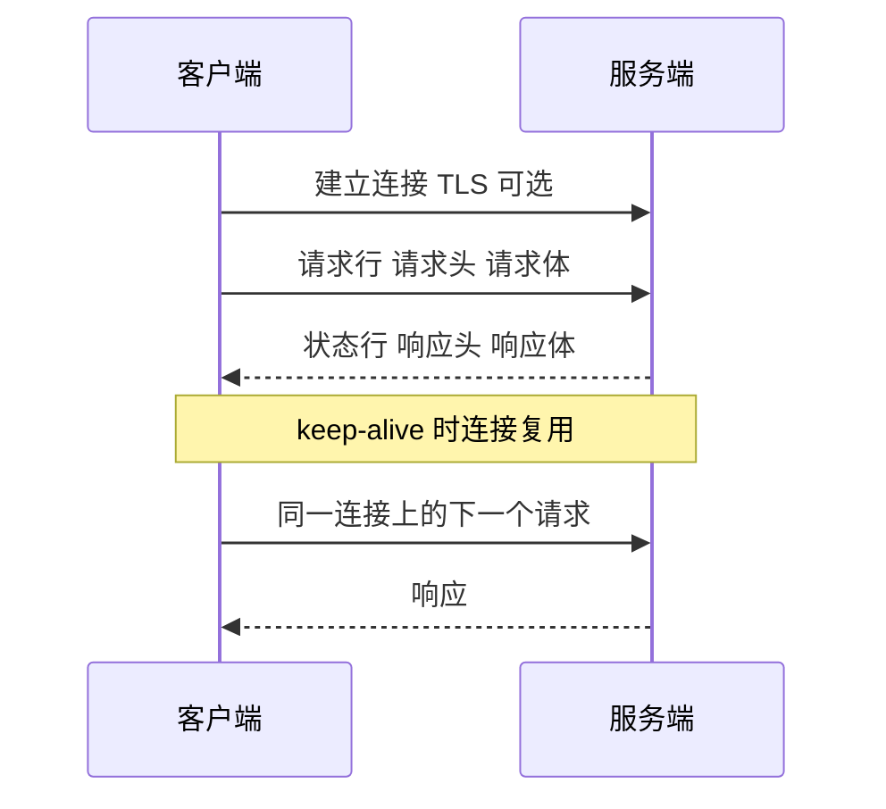
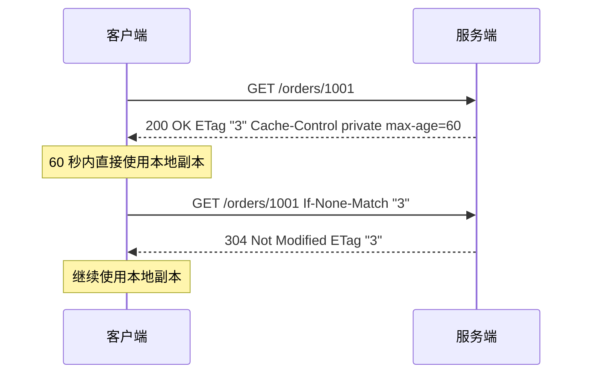
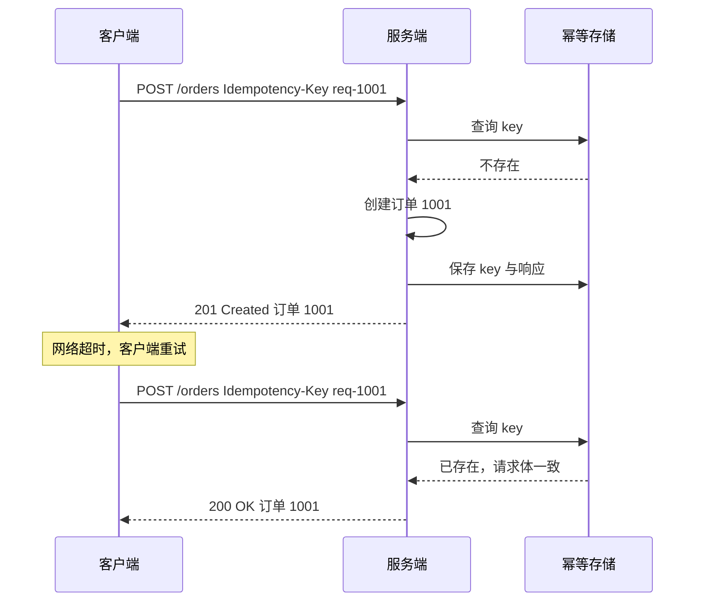

# HTTP协议与REST

> 这篇从 HTTP 的报文和连接模型讲起，经过方法、状态码、Header、缓存、REST 资源建模、幂等与错误契约，最后落到一个订单 API 的完整实现和 curl 验收。
>
> 学完能设计并实现一套可缓存、可重试、错误可解析的 REST 接口，并用 curl 验证协议行为。

## 一、HTTP 的报文与连接模型

HTTP 是“请求—响应”式的应用层协议，语义由 RFC 9110 定义，不依赖底层是 HTTP/1.1、HTTP/2 还是 HTTP/3。一次交互由请求行、请求头、空行、请求体，以及状态行、响应头、空行、响应体组成；连接是否复用、是否加密，由传输层和服务器配置决定。

```text
GET /api/v1/orders/1001 HTTP/1.1						
Host: api.example.com												
Accept: application/json
If-None-Match: "3"
																						
HTTP/1.1 200 OK														 
Content-Type: application/json							
ETag: "3"
Cache-Control: max-age=60, private
																						
{"id":1001,"status":"CREATED"}							
```

| 版本 | 传输 | 多路复用 | 典型场景 |
|---|---|---|---|
| HTTP/1.1 | TCP 或 TLS | 靠多个连接 | 兼容性最好 |
| HTTP/2 | TLS 为主 | 单连接多流 | 现代浏览器和网关 |
| HTTP/3 | QUIC/UDP | 单连接多流 | 弱网、移动端 |



> 边界：HTTP 是无状态协议，登录态靠 Cookie、Token 或服务端 Session 维护；“无状态”不等于“不能有会话”，而是每个请求必须自带足够上下文。HTTP/2 的多路复用不能替代业务幂等，网络重试仍可能产生重复请求。

## 二、方法与状态码

方法表达“要做什么”，状态码表达“结果如何”，两者必须匹配。核心规则：GET/HEAD 安全且幂等，PUT/DELETE 幂等，POST 不幂等，PATCH 默认不保证幂等；不要把查询做成 POST，也不要用 200 包裹一个错误对象。

| 方法 | 安全 | 幂等 | 请求体 | 典型用途 |
|---|---|---|---|---|
| `GET` | 是 | 是 | 通常无 | 查询资源 |
| `POST` | 否 | 否 | 有 | 创建资源、提交命令 |
| `PUT` | 否 | 是 | 有 | 整体替换资源 |
| `PATCH` | 否 | 不一定 | 有 | 局部更新 |
| `DELETE` | 否 | 是 | 通常无 | 删除资源 |

| 状态码 | 含义 | 使用场景 |
|---|---|---|
| `200` | 成功 | 查询、更新后返回资源 |
| `201` | 已创建 | POST 创建成功，配合 `Location` |
| `202` | 已接受 | 异步任务已排队 |
| `204` | 无内容 | 删除成功、无需响应体 |
| `304` | 未修改 | 条件请求命中缓存 |
| `400` | 请求错误 | JSON 解析失败、参数格式错 |
| `401` | 未认证 | 缺少或无效凭证 |
| `403` | 无权限 | 已认证但无权访问 |
| `404` | 不存在 | 资源不存在或不愿暴露 |
| `409` | 冲突 | 幂等键冲突、状态机冲突 |
| `412` | 前置条件失败 | `If-Match` 版本不匹配 |
| `415` | 媒体类型不支持 | `Content-Type` 不是 JSON |
| `422` | 语义错误 | 字段格式对但业务校验失败 |
| `429` | 请求过多 | 限流，配合 `Retry-After` |
| `500` | 服务端错误 | 未捕获异常 |
| `503` | 暂不可用 | 过载、维护、下游不可用 |

**1xx：信息性状态码**

**2xx：成功状态码（200）**

**3xx：重定向状态码（304）**

**4xx：客户端错误状态码（401、403、404、429）**

**5xx：服务器错误状态码（500、503）**

```text
POST /api/v1/orders
Content-Type: application/json

{"sku":"SKU-1","quantity":2}

HTTP/1.1 201 Created
Location: /api/v1/orders/1001
Content-Type: application/json

{"id":1001,"sku":"SKU-1","quantity":2,"status":"CREATED"}
```

## 三、Header 与内容协商

Header 是 HTTP 的元数据通道：`Content-Type` 描述请求体或响应体是什么，`Accept` 描述客户端希望收到什么，`Authorization` 携带凭证，`ETag`/`If-None-Match` 支撑缓存校验。内容协商失败时返回 `406`，请求体类型不支持时返回 `415`。

| Header | 方向 | 作用 |
|---|---|---|
| `Content-Type` | 请求/响应 | 媒体类型与字符集 |
| `Accept` | 请求 | 期望的响应类型 |
| `Authorization` | 请求 | Bearer Token 等凭证 |
| `ETag` | 响应 | 资源版本标识 |
| `If-None-Match` | 请求 | 条件 GET |
| `If-Match` | 请求 | 条件更新 |
| `Cache-Control` | 响应 | 缓存策略 |
| `Vary` | 响应 | 缓存键维度 |
| `X-Request-Id` | 请求/响应 | 链路追踪 |
| `Retry-After` | 响应 | 限流或维护后重试时间 |

```bash
curl -i http://localhost:8080/api/v1/orders/1001 \
  -H 'Accept: application/json' \
  -H 'X-Request-Id: demo-001'
```

```text
HTTP/1.1 200 OK
Content-Type: application/json
Vary: Accept-Encoding
X-Request-Id: demo-001
Cache-Control: max-age=60, private
ETag: "3"

{"id":1001,"status":"CREATED"}
```

内容协商可以带权重：

```text
Accept: application/json;q=1.0, application/xml;q=0.8
```

> 边界：`Accept` 是客户端的偏好，不是命令；服务端可以不支持 XML 并返回 `406`。`Vary` 必须列出所有会影响响应内容的请求头，漏掉 `Accept-Language` 会让缓存把中文响应发给英文用户；`Authorization` 通常不放进 `Vary`，而是用 `Cache-Control: private` 避免共享缓存。

## 四、缓存与条件请求

缓存的价值在于减少重复传输，前提是“缓存键 + 新鲜度 + 校验”三件事都正确。`Cache-Control` 决定能缓存多久、谁能缓存；`ETag` 决定过期后能否用 304 复用本地副本。

| 指令 | 含义 |
|---|---|
| `max-age=60` | 60 秒内可直接使用 |
| `s-maxage=300` | 共享缓存的有效期 |
| `private` | 只允许浏览器缓存 |
| `public` | 允许 CDN 等共享缓存 |
| `no-cache` | 可缓存，但每次使用前要校验 |
| `no-store` | 完全不存储 |
| `must-revalidate` | 过期后必须校验 |
| `stale-while-revalidate=30` | 过期后先返回旧值并后台刷新 |



```bash
# 第一次请求，记录 ETag
curl -i http://localhost:8080/api/v1/orders/1001

# 带上 ETag 再请求，命中则返回 304 且无响应体
curl -i http://localhost:8080/api/v1/orders/1001 \
  -H 'If-None-Match: "3"'
```

```text
HTTP/1.1 304 Not Modified
ETag: "3"
Cache-Control: max-age=60, private
```

写请求用 `If-Match` 做乐观并发控制：版本不匹配返回 `412`，而不是静默覆盖。

```bash
curl -i -X PUT http://localhost:8080/api/v1/orders/1001 \
  -H 'Content-Type: application/json' \
  -H 'If-Match: "3"' \
  -d '{"sku":"SKU-1","quantity":3}'
```

> 边界：`no-cache` 不是“不缓存”，`no-store` 才是；304 响应仍然要带 `ETag`、`Cache-Control` 等缓存相关头，否则客户端下次无法继续校验。带用户隐私的响应必须用 `private`，不能为了 CDN 命中率把用户数据放进共享缓存。

## 五、REST 资源建模

REST 建模的核心是“用名词表示资源，用 HTTP 方法表示动作，用查询参数表示过滤和分页”。URI 里出现动词通常意味着把 RPC 风格硬套成 REST；确实无法用资源表达的命令，可以建模成子资源。

| 不推荐 | 推荐 | 原因 |
|---|---|---|
| `GET /getOrder?id=1` | `GET /orders/1` | 资源用路径标识 |
| `POST /orders/create` | `POST /orders` | 创建由方法表达 |
| `POST /orders/1/cancelOrder` | `POST /orders/1/cancel` | 命令作为子资源 |
| `GET /orders?page=1&size=20` | 同左 | 分页是查询参数 |
| `GET /orders/all` | `GET /orders` | 集合本身就有全部语义 |

一个订单 API 的资源设计：

| 方法 | 路径 | 成功状态 | 说明 |
|---|---|---|---|
| `GET` | `/api/v1/orders/{id}` | 200 | 查询单个订单 |
| `GET` | `/api/v1/orders?status=CREATED&page=0&size=20` | 200 | 过滤与分页 |
| `POST` | `/api/v1/orders` | 201 | 创建订单 |
| `DELETE` | `/api/v1/orders/{id}` | 204 | 取消订单，幂等 |
| `POST` | `/api/v1/orders/{id}/cancel` | 200 或 409 | 状态机命令 |

> 边界：REST 不是“只能 CRUD”。复杂命令可以用子资源或动作端点，但要在文档里写清幂等性和状态码；内部服务间高频率、强类型的调用，gRPC 往往比 REST 更合适。URI 版本号 `/api/v1` 适合公开 API，内部 API 也可以用 Header 或域名做版本。
>
> **REST**：适合面向用户的 API、公开接口、浏览器访问、松耦合系统。
>
> **gRPC**：适合内部微服务通信、实时数据流、低延迟和高吞吐量场景，如 IoT、实时风控、批量数据处理。

## 六、幂等与并发控制

幂等的意思是“同一个请求执行一次和执行多次，业务结果相同”。网络超时、客户端重试、网关重放都会产生重复请求；POST 创建订单天然不幂等，必须由客户端生成幂等键，服务端持久化“键 → 结果”的映射。



| 机制 | 适用场景 | 限制 |
|---|---|---|
| `Idempotency-Key` | 创建订单、支付、发券 | 需要持久化与过期清理 |
| `PUT` 全量替换 | 配置、用户资料 | 客户端必须带完整资源 |
| `If-Match` 版本号 | 并发更新 | 需要版本字段 |
| 数据库唯一索引 | 防重复插入 | 只能防同一业务键 |
| 状态机 | 取消、退款 | 非法状态返回 409 |

幂等键的实现要点：

- 键由客户端为“一次业务操作”生成，重试时复用，不能每次 HTTP 尝试都换新键；
- 服务端保存键、请求体哈希、响应状态和响应体，重放时返回原结果；
- 同一个键配不同请求体返回 `409`，不能静默执行第二次；
- 键要有 TTL，支付类场景通常保留 24 小时以上，按业务定；
- 多实例部署要放在 Redis/数据库，不能只放 JVM 内存。

> 边界：幂等键不是“防重放攻击”的完整方案，凭证泄露后攻击者仍可重放；还需要认证、签名、时间戳和限流。`PUT` 的幂等性来自“整体替换”，如果服务端把缺失字段当成“保持不变”，它就不再是幂等替换。

## 七、错误契约与 ProblemDetail

错误响应必须是机器可解析的固定结构，不能一个接口返回字符串、另一个返回 `{code,msg}`。RFC 9457 定义的 Problem Details 用 `type`、`title`、`status`、`detail`、`instance` 五个标准字段，扩展字段放业务信息。

```json
{
  "type": "https://api.example.com/problems/order-not-found",
  "title": "订单不存在",
  "status": 404,
  "detail": "订单 9999 不存在",
  "instance": "/api/v1/orders/9999",
  "orderId": 9999
}
```

| 字段 | 作用 | 写法 |
|---|---|---|
| `type` | 问题类型的稳定 URI | 指向文档，不要随请求变化 |
| `title` | 人类可读的短标题 | 同类问题固定 |
| `status` | HTTP 状态码 | 与响应状态一致 |
| `detail` | 本次问题的具体说明 | 可含订单号，不泄露内部实现 |
| `instance` | 本次请求的 URI | 便于日志关联 |

Spring Boot 3 直接支持 `ProblemDetail`，返回时内容类型是 `application/problem+json`：

```java
@ExceptionHandler(OrderNotFoundException.class)
public ProblemDetail handleNotFound(OrderNotFoundException e) {
    ProblemDetail problem = ProblemDetail.forStatusAndDetail(HttpStatus.NOT_FOUND, e.getMessage());
    problem.setTitle("订单不存在");
    problem.setType(URI.create("https://api.example.com/problems/order-not-found"));
    problem.setProperty("orderId", e.orderId()); // 扩展字段进入 JSON 顶层
    return problem;
}
```

校验错误把字段列表放进扩展字段：

```json
{
  "type": "https://api.example.com/problems/validation-failed",
  "title": "参数校验失败",
  "status": 400,
  "detail": "请求字段校验失败",
  "errors": [
    {"field": "sku", "message": "不能为空"},
    {"field": "quantity", "message": "最小不能小于1"}
  ]
}
```

> 边界：`detail` 不能放异常栈、SQL、内部主机名；`type` 一旦对外发布就要保持稳定，改语义要换新 URI。5xx 响应给用户看通用文案，把 `traceId` 放扩展字段，详细信息只进服务端日志。

## 八、Spring Boot 的 REST 实现机制

Spring MVC 用 `@RestController` 把返回值直接写进响应体，用 `ResponseEntity` 控制状态码和 Header，用 `@RestControllerAdvice` 统一异常。REST 语义的落地不靠框架自动完成，状态码、ETag、幂等键都要显式写。

```java
@RestController
@RequestMapping("/api/v1/orders")
public class OrderController {
    @GetMapping("/{id}")
    public ResponseEntity<Order> get(@PathVariable long id,
                                     @RequestHeader(value = "If-None-Match", required = false) String ifNoneMatch) {
        Order order = service.get(id);
        String etag = "\"" + order.version() + "\"";
        if (etag.equals(ifNoneMatch)) {
            return ResponseEntity.status(HttpStatus.NOT_MODIFIED)
                    .eTag(etag)
                    .cacheControl(CacheControl.maxAge(Duration.ofSeconds(60)).cachePrivate())
                    .build();
        }
        return ResponseEntity.ok()
                .eTag(etag)
                .cacheControl(CacheControl.maxAge(Duration.ofSeconds(60)).cachePrivate())
                .body(order);
    }

    @PostMapping
    public ResponseEntity<Order> create(@RequestHeader("Idempotency-Key") String key,
                                        @Valid @RequestBody CreateOrderRequest request) {
        // 幂等逻辑见案例，核心是同一个 key 返回同一结果
        Order order = service.create(request);
        return ResponseEntity.created(URI.create("/api/v1/orders/" + order.id()))
                .eTag("\"" + order.version() + "\"")
                .body(order);
    }
}
```

`ShallowEtagHeaderFilter` 可以自动根据响应体计算 ETag，适合小 JSON；它会把响应体缓冲到内存，不适合大文件或流式响应。需要精确控制版本时，像上面一样手写 ETag。

```java
@Bean
public FilterRegistrationBean<ShallowEtagHeaderFilter> shallowEtag() {
    FilterRegistrationBean<ShallowEtagHeaderFilter> bean =
            new FilterRegistrationBean<>(new ShallowEtagHeaderFilter());
    bean.addUrlPatterns("/api/*");
    return bean;
}
```

> 边界：`@RestController` 等于 `@Controller` + `@ResponseBody`，返回 `String` 时不会再走视图解析；`ResponseEntity` 适合需要控制状态码/Header 的场景，普通 200 JSON 直接返回对象更简洁。ETag 的值要加双引号，弱 ETag 用 `W/` 前缀。

## 九、常见故障排查

协议问题先用 `curl -i` 看完整响应，再用 `curl -v` 看请求行、Header 和 TLS 握手；只看浏览器 Network 面板容易漏掉缓存和重定向。

| 现象 | 常见原因 | 第一条命令 |
|---|---|---|
| 404 | 路径、context-path、尾斜杠不匹配 | `curl -i` 对比实际路径 |
| 405 | 方法不支持 | 看响应 `Allow` 头 |
| 415 | 缺少或错误的 `Content-Type` | `curl -i -H 'Content-Type: application/json'` |
| 406 | `Accept` 与服务端 `produces` 不匹配 | 去掉 `Accept` 再试 |
| 400 JSON 解析失败 | 字段类型、未知字段、空 body | `curl -v` 看请求体 |
| 304 但内容没更新 | ETag 没随资源版本变化 | 对比 `ETag` 与资源版本 |
| POST 重复创建 | 没有幂等键或键每次变化 | 查幂等存储与访问日志 |
| ProblemDetail 没生效 | 异常处理器没扫描到 | 检查包路径与 `@RestControllerAdvice` |
| 502/504 | 网关到上游失败或超时 | 查网关日志与上游健康检查 |

```bash
# 看完整请求与响应（含 Header）
curl -v http://localhost:8080/api/v1/orders/1001

# 强制 HTTP/1.1，排查 HTTP/2 协商问题
curl --http1.1 -i https://api.example.com/api/v1/orders/1001

# 看 TLS 证书链
openssl s_client -connect api.example.com:443 -servername api.example.com </dev/null
```

> 边界：`curl` 默认不发送 `Accept` 时服务端通常会返回 JSON，但代理和缓存的行为可能不同；排查缓存问题时加 `-H 'Cache-Control: no-cache'` 只能绕过客户端缓存，绕不过 CDN，需要看 `Age`、`X-Cache` 等响应头。

## 十、最佳实践案例

### 10.1 案例背景

一个订单服务要给外部合作伙伴提供创建、查询和取消接口。上线首月出现三类问题：合作方超时重试导致重复订单；订单状态更新后查询仍拿到旧数据；错误响应有的是 HTML，有的是 `{code,msg}`，对接方无法统一处理。

目标是：创建接口支持幂等重试，查询接口支持 ETag/304，取消接口幂等，所有错误统一为 ProblemDetail，并用一套 curl 脚本验收。约束是 Spring Boot 3.5.x、Java 21，不引入额外网关。

### 10.2 案例实操

完整工程包含启动类、订单模型、服务、幂等存储、控制器和异常处理：

```text
src/main/java/com/example/http/
├── HttpApiApplication.java
└── api/
    ├── Order.java
    ├── CreateOrderRequest.java
    ├── OrderService.java
    ├── IdempotencyService.java
    ├── OrderController.java
    ├── OrderNotFoundException.java
    ├── IdempotencyConflictException.java
    └── ApiExceptionHandler.java
```

```xml
<parent>
    <groupId>org.springframework.boot</groupId>
    <artifactId>spring-boot-starter-parent</artifactId>
    <version>3.5.6</version>
    <relativePath/>
</parent>
<properties><java.version>21</java.version></properties>
<dependencies>
    <dependency>
        <groupId>org.springframework.boot</groupId>
        <artifactId>spring-boot-starter-web</artifactId>
    </dependency>
    <dependency>
        <groupId>org.springframework.boot</groupId>
        <artifactId>spring-boot-starter-validation</artifactId>
    </dependency>
</dependencies>
<build>
    <plugins>
        <plugin>
            <groupId>org.springframework.boot</groupId>
            <artifactId>spring-boot-maven-plugin</artifactId>
        </plugin>
    </plugins>
</build>
```

```java
@SpringBootApplication
public class HttpApiApplication {
    public static void main(String[] args) {
        SpringApplication.run(HttpApiApplication.class, args);
    }
}
```

```java
public record Order(Long id, String sku, int quantity, String status, long version, Instant createdAt) {
}

public record CreateOrderRequest(
        @NotBlank @Size(max = 32) String sku,
        @Min(1) @Max(99) int quantity) {
}
```

```java
@Service
public class OrderService {
    private final Map<Long, Order> orders = new ConcurrentHashMap<>();
    private final AtomicLong ids = new AtomicLong(1000);

    public Order create(CreateOrderRequest request) {
        long id = ids.incrementAndGet();
        Order order = new Order(id, request.sku(), request.quantity(), "CREATED", 0, Instant.now());
        orders.put(id, order);
        return order;
    }

    public Order get(long id) {
        Order order = orders.get(id);
        if (order == null) {
            throw new OrderNotFoundException(id);
        }
        return order;
    }

    public void cancel(long id) {
        orders.computeIfPresent(id, (key, order) ->
                new Order(order.id(), order.sku(), order.quantity(), "CANCELLED",
                        order.version() + 1, order.createdAt()));
    }
}
```

两个业务异常分别对应 404 和 409：

```java
public class OrderNotFoundException extends RuntimeException {
    private final long orderId;

    public OrderNotFoundException(long orderId) {
        super("订单 " + orderId + " 不存在");
        this.orderId = orderId;
    }

    public long orderId() {
        return orderId;
    }
}

public class IdempotencyConflictException extends RuntimeException {
    public IdempotencyConflictException(String key) {
        super("幂等键 " + key + " 已用于不同的请求体");
    }
}
```

幂等存储用“每个 key 一把锁”保证同一进程内只创建一次；生产多实例要换成 Redis `SETNX` 或数据库唯一键：

```java
@Service
public class IdempotencyService {
    public record Outcome(Order order, boolean replayed) {
    }

    private record Entry(String bodyHash, Order order) {
    }

    private final Map<String, Entry> entries = new ConcurrentHashMap<>();
    private final Map<String, Object> locks = new ConcurrentHashMap<>();

    public Outcome execute(String key, String bodyHash, Supplier<Order> creator) {
        Object lock = locks.computeIfAbsent(key, ignored -> new Object());
        synchronized (lock) {
            Entry existing = entries.get(key);
            if (existing != null) {
                if (!existing.bodyHash().equals(bodyHash)) {
                    throw new IdempotencyConflictException(key);
                }
                return new Outcome(existing.order(), true);
            }
            Order created = creator.get();
            entries.put(key, new Entry(bodyHash, created));
            return new Outcome(created, false);
        }
    }

    public String hash(String value) {
        try {
            MessageDigest digest = MessageDigest.getInstance("SHA-256");
            return HexFormat.of().formatHex(digest.digest(value.getBytes(StandardCharsets.UTF_8)));
        } catch (NoSuchAlgorithmException e) {
            throw new IllegalStateException("JVM 必须支持 SHA-256", e);
        }
    }
}
```

控制器把 ETag、Location、幂等重放和 204 串起来：

```java
@RestController
@RequestMapping("/api/v1/orders")
public class OrderController {
    private final OrderService orders;
    private final IdempotencyService idempotency;

    public OrderController(OrderService orders, IdempotencyService idempotency) {
        this.orders = orders;
        this.idempotency = idempotency;
    }

    @GetMapping("/{id}")
    public ResponseEntity<Order> get(@PathVariable long id,
                                     @RequestHeader(value = "If-None-Match", required = false) String ifNoneMatch) {
        Order order = orders.get(id);
        String etag = "\"" + order.version() + "\"";
        if (etag.equals(ifNoneMatch)) {
            return ResponseEntity.status(HttpStatus.NOT_MODIFIED)
                    .eTag(etag)
                    .cacheControl(CacheControl.maxAge(Duration.ofSeconds(60)).cachePrivate())
                    .build();
        }
        return ResponseEntity.ok()
                .eTag(etag)
                .cacheControl(CacheControl.maxAge(Duration.ofSeconds(60)).cachePrivate())
                .body(order);
    }

    @PostMapping
    public ResponseEntity<Order> create(@RequestHeader("Idempotency-Key") String key,
                                        @Valid @RequestBody CreateOrderRequest request) {
        String bodyHash = idempotency.hash(request.toString());
        IdempotencyService.Outcome outcome =
                idempotency.execute(key, bodyHash, () -> orders.create(request));
        if (outcome.replayed()) {
            return ResponseEntity.ok()
                    .header("Idempotent-Replayed", "true")
                    .eTag("\"" + outcome.order().version() + "\"")
                    .body(outcome.order());
        }
        return ResponseEntity.created(URI.create("/api/v1/orders/" + outcome.order().id()))
                .eTag("\"" + outcome.order().version() + "\"")
                .body(outcome.order());
    }

    @DeleteMapping("/{id}")
    public ResponseEntity<Void> cancel(@PathVariable long id) {
        orders.cancel(id); // 不存在也返回 204，DELETE 必须幂等
        return ResponseEntity.noContent().build();
    }
}
```

异常统一返回 ProblemDetail：

```java
@RestControllerAdvice
public class ApiExceptionHandler {
    @ExceptionHandler(OrderNotFoundException.class)
    public ProblemDetail handleNotFound(OrderNotFoundException e) {
        ProblemDetail problem = ProblemDetail.forStatusAndDetail(HttpStatus.NOT_FOUND, e.getMessage());
        problem.setTitle("订单不存在");
        problem.setType(URI.create("https://api.example.com/problems/order-not-found"));
        problem.setProperty("orderId", e.orderId());
        return problem;
    }

    @ExceptionHandler(MethodArgumentNotValidException.class)
    public ProblemDetail handleValidation(MethodArgumentNotValidException e) {
        ProblemDetail problem = ProblemDetail.forStatusAndDetail(HttpStatus.BAD_REQUEST, "请求字段校验失败");
        problem.setTitle("参数校验失败");
        problem.setType(URI.create("https://api.example.com/problems/validation-failed"));
        problem.setProperty("errors", e.getBindingResult().getFieldErrors().stream()
                .map(error -> Map.of("field", error.getField(), "message", error.getDefaultMessage()))
                .toList());
        return problem;
    }

    @ExceptionHandler(IdempotencyConflictException.class)
    public ProblemDetail handleIdempotency(IdempotencyConflictException e) {
        ProblemDetail problem = ProblemDetail.forStatusAndDetail(HttpStatus.CONFLICT, e.getMessage());
        problem.setTitle("幂等键冲突");
        problem.setType(URI.create("https://api.example.com/problems/idempotency-conflict"));
        return problem;
    }

    @ExceptionHandler({MissingRequestHeaderException.class, HttpMessageNotReadableException.class})
    public ProblemDetail handleBadRequest(Exception e) {
        ProblemDetail problem = ProblemDetail.forStatusAndDetail(HttpStatus.BAD_REQUEST, e.getMessage());
        problem.setTitle("请求格式错误");
        problem.setType(URI.create("https://api.example.com/problems/bad-request"));
        return problem;
    }
}
```

启动与验收：

```yaml
server:
  port: 18081
```

```bash
mvn -B package
java -jar target/http-case-0.0.1-SNAPSHOT.jar
```

```bash
# 1. 创建订单，记录 Location 和 ETag
curl -i -X POST http://localhost:18081/api/v1/orders \
  -H 'Content-Type: application/json' \
  -H 'Idempotency-Key: req-1001' \
  -d '{"sku":"SKU-1","quantity":2}'

# 2. 用同一个幂等键重试，返回 200 且带 Idempotent-Replayed
curl -i -X POST http://localhost:18081/api/v1/orders \
  -H 'Content-Type: application/json' \
  -H 'Idempotency-Key: req-1001' \
  -d '{"sku":"SKU-1","quantity":2}'

# 3. 条件查询，命中 ETag 返回 304
curl -i http://localhost:18081/api/v1/orders/1001 -H 'If-None-Match: "0"'

# 4. 取消两次，均返回 204
curl -i -X DELETE http://localhost:18081/api/v1/orders/1001
curl -i -X DELETE http://localhost:18081/api/v1/orders/1001
```

预期输出（关键行）：

```text
HTTP/1.1 201
Location: /api/v1/orders/1001
ETag: "0"
{"id":1001,"sku":"SKU-1","quantity":2,"status":"CREATED","version":0,...}

HTTP/1.1 200
Idempotent-Replayed: true
ETag: "0"
{"id":1001,"sku":"SKU-1","quantity":2,"status":"CREATED","version":0,...}

HTTP/1.1 304
ETag: "0"

HTTP/1.1 204
HTTP/1.1 204
```

校验失败与幂等冲突：

```text
HTTP/1.1 400
Content-Type: application/problem+json
{"type":".../validation-failed","title":"参数校验失败","status":400,"detail":"请求字段校验失败","errors":[...]}

HTTP/1.1 409
Content-Type: application/problem+json
{"type":".../idempotency-conflict","title":"幂等键冲突","status":409,"detail":"幂等键 req-1001 已用于不同的请求体"}
```

### 10.3 案例结果

验收脚本覆盖 201、200 重放、304、204、400、409 六种结果，合作方可以用同一套状态码和 ProblemDetail 处理所有错误。重复订单从“每次重试都可能新增”变成“同一幂等键只创建一次”，查询在 60 秒内命中本地缓存，取消接口重复调用结果一致。

复盘三个失败模式：第一，幂等键只放 JVM 内存，多实例部署仍会重复创建，生产必须用 Redis/数据库并加唯一约束；第二，ETag 用 `System.currentTimeMillis()` 生成，每次请求都变，304 永远不会命中；第三，业务异常直接返回 500，合作方无法区分“参数错”和“服务故障”。下一步是把幂等键 TTL、请求体哈希和响应快照落到数据库，并给 5xx 响应补 `traceId`。
