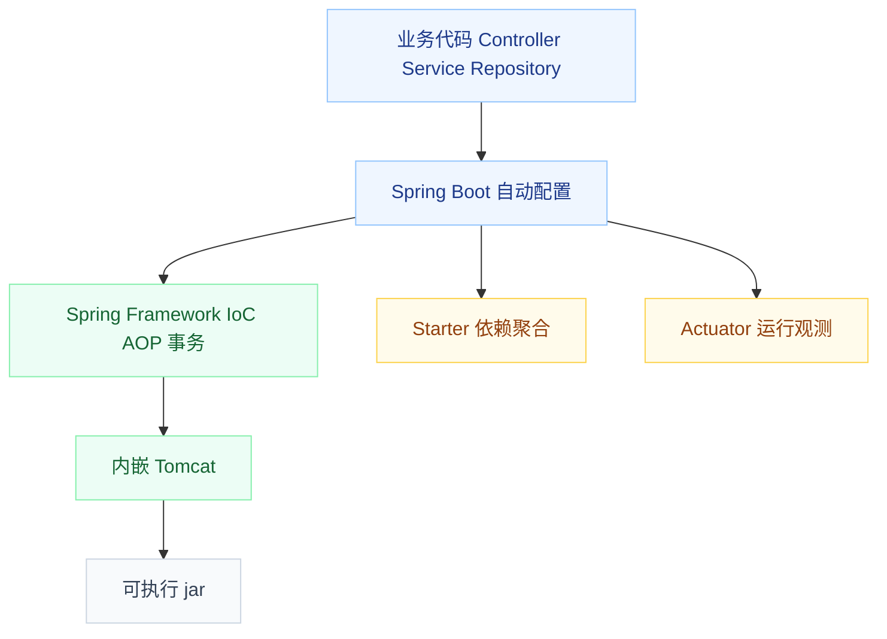
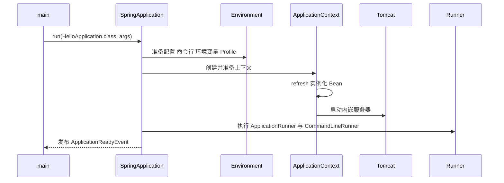

# SpringBoot应用框架

> 这篇从 Spring Boot 的约定和版本边界讲起，经过工程创建、自动配置、Starter、配置与 Profile、启动流程、三层结构、Actuator，最后落到打包部署、故障排查和一个可上线的库存服务案例。
>
> 学完能独立搭建 Spring Boot 3.5 应用，解释自动配置从哪来，按环境管理配置，并用 Actuator 和日志定位启动与运行问题。

## 一、Spring Boot 的约定与版本边界

Spring Boot 不是新的框架，而是 Spring Framework 的“装配层”：它用自动配置（auto-configuration）根据类路径推断 Bean，用 Starter 聚合依赖，用内嵌服务器把应用打成可执行 jar，用 Actuator 暴露运行指标。核心判断：**Spring Boot 减少的是装配和部署的样板代码，不替代 Spring 的 IoC、AOP 和事务模型**。

| 版本 | Spring Framework | Java | 主要变化 |
|---|---|---|---|
| Spring Boot 3.5.x | 6.2.x | 17–25 | 存量系统主线，OSS 支持 2026-06 截止，Jakarta EE 10 |
| Spring Boot 4.1.x | 7.x | 17+ | 当前 OSS 主线，新项目首选 |
| Spring Boot 2.7.x | 5.3.x | 8–17 | 已停止维护，不用于新项目 |



> 版本基线（2026-11）：本文使用 Spring Boot 3.5.x、Java 21 LTS、Maven 3.9+（3.5.16 是 3.5.x 最后一个 OSS 版本，2026-06-30 后仅剩商业支持）。Spring Boot 4.0/4.1 已发布；存量 3.5 系统不必为版本号紧急迁移，但新项目应直接从 4.1 开始。

## 二、创建与最小运行

最小应用只需要一个启动类和一个 Controller。`spring-boot-starter-web` 会带入 Spring MVC、Jackson、内嵌 Tomcat 和自动配置；`spring-boot-maven-plugin` 负责把依赖重打成可执行 jar。

```xml
<parent>
    <groupId>org.springframework.boot</groupId>
    <artifactId>spring-boot-starter-parent</artifactId>
    <version>3.5.6</version>
    <relativePath/>
</parent>
<groupId>com.example</groupId>
<artifactId>hello-boot</artifactId>
<version>0.0.1-SNAPSHOT</version>
<properties><java.version>21</java.version></properties>
<dependencies>
    <dependency>
        <groupId>org.springframework.boot</groupId>
        <artifactId>spring-boot-starter-web</artifactId>
    </dependency>
</dependencies>
<build>
    <plugins>
        <plugin>
            <groupId>org.springframework.boot</groupId>
            <artifactId>spring-boot-maven-plugin</artifactId>
        </plugin>
    </plugins>
</build>
```

```java
@SpringBootApplication
public class HelloApplication {
    public static void main(String[] args) {
        SpringApplication.run(HelloApplication.class, args);
    }
}
```

```java
@RestController
@RequestMapping("/api")
public class HelloController {
    @GetMapping("/hello")
    public Map<String, String> hello(@RequestParam(defaultValue = "world") String name) {
        return Map.of("message", "hello " + name); // Map 由 Jackson 序列化为 JSON
    }
}
```

```bash
# macOS / Linux
./mvnw spring-boot:run
# Windows PowerShell
.\mvnw.cmd spring-boot:run

# 另一个终端验证
curl -s http://localhost:8080/api/hello?name=Spring
```

预期输出：

```text
  .   ____          _            __ _ _
 /\\ / ___'_ __ _ _(_)_ __  __ _ \ \ \ \
( ( )\___ | '_ | '_| | '_ \/ _` | \ \ \ \
 \\/  ___)| |_)| | | | | || (_| |  ) ) ) )
  '  |____| .__|_| |_|_| |_\__, | / / / /
 =========|_|==============|___/=/_/_/_/
 :: Spring Boot ::                (v3.5.6)

Tomcat started on port 8080 (http)
Started HelloApplication in 1.234 seconds
{"message":"hello Spring"}
```

| 环境 | 启动命令 | 说明 |
|---|---|---|
| Windows | `.\mvnw.cmd spring-boot:run` | 提交 `mvnw.cmd` 和 `.mvn/` |
| macOS | `./mvnw spring-boot:run` | 首次执行 `chmod +x mvnw` |
| Ubuntu/Rocky | `./mvnw spring-boot:run` | 用项目自带 Maven Wrapper |

> 边界：`spring-boot:run` 只用于开发，生产用 `java -jar`；Maven Wrapper 要提交到仓库，否则 CI 会依赖机器上恰好装了正确版本的 Maven。内嵌 Tomcat 只监听 8080 时，先确认端口未被占用。

## 三、自动配置的工作方式

自动配置的本质是“条件装配”：Spring Boot 读取 `META-INF/spring/org.springframework.boot.autoconfigure.AutoConfiguration.imports`，按顺序加载配置类，每个配置类再用 `@ConditionalOnClass`、`@ConditionalOnMissingBean`、`@ConditionalOnProperty` 判断是否生效。

```java
@SpringBootApplication // 等价于 @SpringBootConfiguration + @EnableAutoConfiguration + @ComponentScan
public class HelloApplication {
}
```

```text
# spring-boot-autoconfigure 包内的 imports 文件（片段）
org.springframework.boot.autoconfigure.web.servlet.WebMvcAutoConfiguration
org.springframework.boot.autoconfigure.jdbc.DataSourceAutoConfiguration
org.springframework.boot.autoconfigure.jackson.JacksonAutoConfiguration
```

排除某个自动配置：

```java
@SpringBootApplication(exclude = DataSourceAutoConfiguration.class)
public class HelloApplication {
}
```

```bash
# 打印条件评估报告，定位“为什么这个 Bean 没生效”
java -jar hello-boot.jar --debug
```

```text
============================
CONDITIONS EVALUATION REPORT
============================
Positive matches:
-----------------
   DataSourceAutoConfiguration matched:
      - @ConditionalOnClass found required classes 'javax.sql.DataSource', 'org.springframework.jdbc.datasource.embedded.EmbeddedDatabaseType'

Negative matches:
-----------------
   RedisAutoConfiguration:
      Did not match:
         - @ConditionalOnClass did not find required class 'org.springframework.data.redis.core.RedisOperations'
```

| 条件注解 | 判断依据 | 典型用途 |
|---|---|---|
| `@ConditionalOnClass` | 类路径是否有类 | 有 Jackson 才配置序列化 |
| `@ConditionalOnMissingBean` | 容器是否已有 Bean | 用户自定义优先 |
| `@ConditionalOnProperty` | 配置项值 | 开关某个功能 |
| `@ConditionalOnWebApplication` | 是否 Web 环境 | 只在 Servlet 环境生效 |
| `@ConditionalOnBean` | 依赖 Bean 是否存在 | 装配顺序有依赖 |

> 边界：自动配置类之间有顺序，`@AutoConfigureAfter`/`@AutoConfigureBefore` 控制先后；用户 Bean 通常通过 `@ConditionalOnMissingBean` 覆盖默认实现，但覆盖是否生效取决于条件判断顺序。不要靠 Bean 名称猜测自动配置行为，`--debug` 报告才是证据。

## 四、Starter 与自定义自动配置

Starter 是“依赖聚合 + 自动配置”的组合：`xxx-spring-boot-starter` 只负责引入依赖，`xxx-spring-boot-autoconfigure` 放自动配置和 `imports` 文件。公司内部中间件通常按这个结构封装，业务项目只引一个 Starter。

下面实现一个审计日志 Starter：默认开启，`audit.enabled=false` 时关闭，业务方可以自定义 `AuditService` 覆盖默认实现。

```java
@ConfigurationProperties(prefix = "audit")
public record AuditProperties(boolean enabled, String channel) {
}
```

```java
public class AuditService {
    private final AuditProperties properties;

    public AuditService(AuditProperties properties) {
        this.properties = properties;
    }

    public void record(String action) {
        System.out.println("[audit][" + properties.channel() + "] " + action);
    }
}
```

```java
@AutoConfiguration
@ConditionalOnProperty(prefix = "audit", name = "enabled", havingValue = "true", matchIfMissing = true)
@EnableConfigurationProperties(AuditProperties.class)
public class AuditAutoConfiguration {
    @Bean
    @ConditionalOnMissingBean // 业务方声明自己的 AuditService 时，默认实现退让
    public AuditService auditService(AuditProperties properties) {
        return new AuditService(properties);
    }
}
```

```text
# src/main/resources/META-INF/spring/org.springframework.boot.autoconfigure.AutoConfiguration.imports
com.example.audit.AuditAutoConfiguration
```

业务项目引入：

```xml
<dependency>
    <groupId>com.example</groupId>
    <artifactId>audit-log-spring-boot-starter</artifactId>
    <version>1.0.0</version>
</dependency>
```

用 `ApplicationContextRunner` 验证条件装配，不需要启动完整 Web 容器：

```java
class AuditAutoConfigurationTest {
    private final ApplicationContextRunner runner = new ApplicationContextRunner()
            .withConfiguration(AutoConfigurations.of(AuditAutoConfiguration.class))
            .withPropertyValues("audit.channel=console");

    @Test
    void createsServiceByDefault() {
        runner.run(context -> assertThat(context).hasSingleBean(AuditService.class));
    }

    @Test
    void backsOffWhenDisabled() {
        runner.withPropertyValues("audit.enabled=false")
              .run(context -> assertThat(context).doesNotHaveBean(AuditService.class));
    }
}
```

> 边界：自动配置类不要加 `@ComponentScan`，否则会把业务包扫进来；Starter 的自动配置模块不要依赖使用方的类，否则形成反向依赖。`@ConditionalOnMissingBean` 只应在自动配置里用，业务配置里用它会让装配顺序变得不可预测。

## 五、配置绑定与 Profile

配置绑定优先用 `@ConfigurationProperties`，它支持宽松绑定、类型转换、校验和 IDE 元数据；`@Value` 适合单个简单值，不适合一组配置。Profile 用来隔离环境差异，但不应成为“把生产密码写进仓库”的理由。

```java
@Validated
@ConfigurationProperties(prefix = "inventory")
public record InventoryProperties(
        @NotBlank String warehouse,
        @Min(1) int reorderThreshold,
        Duration refreshInterval) {
}
```

```java
@SpringBootApplication
@ConfigurationPropertiesScan // 扫描 @ConfigurationProperties，省去逐个 @EnableConfigurationProperties
public class InventoryApplication {
}
```

`application.yml` 用多文档划分默认配置和 Profile：

```yaml
spring:
  application:
    name: inventory-service

inventory:
  warehouse: WH-SH-01
  reorder-threshold: 20
  refresh-interval: 30s

---
spring:
  config:
    activate:
      on-profile: dev
inventory:
  warehouse: WH-DEV-01
  reorder-threshold: 50
```

```bash
# 启动 dev Profile
java -jar inventory-service.jar --spring.profiles.active=dev

# 环境变量覆盖， relaxed binding 会把 INVENTORY_REORDER_THRESHOLD 映射到 inventory.reorder-threshold
INVENTORY_REORDER_THRESHOLD=80 java -jar inventory-service.jar
```

| 配置来源 | 优先级 | 说明 |
|---|---|---|
| 命令行参数 | 最高 | `--server.port=9090` |
| 操作系统环境变量 | 高 | 容器和 CI 常用 |
| Profile 专属文件 | 中 | `application-prod.yml` |
| `application.yml` | 低 | 默认值 |
| 代码默认值 | 最低 | record 构造器或字段默认值 |

> 边界：Profile 专属文件会覆盖基础文件中的同名键，但不会“合并列表”；列表配置要整体重写。密码、Token 放环境变量、密钥管理服务或配置中心，不要提交到 Git；`@ConfigurationProperties` 的校验失败会让应用启动失败，这是期望行为，不要用 `ignoreInvalidFields` 掩盖。

## 六、启动流程与生命周期

`SpringApplication.run` 的主线是：准备环境 → 创建 ApplicationContext → 刷新容器（实例化 Bean、启动内嵌服务器）→ 执行 Runner → 发布 Ready 事件。启动失败时，FailureAnalyzer 会把异常翻译成可读的“Description / Action”。



```java
@Component
public class StartupProbe implements ApplicationRunner {
    @Override
    public void run(ApplicationArguments args) {
        // Runner 在容器刷新后执行，适合做一次性的预热或校验
        System.out.println("startup args: " + args.getOptionNames());
    }
}
```

```yaml
server:
  shutdown: graceful # 收到 SIGTERM 后停止接收新请求，等待在途请求完成
spring:
  lifecycle:
    timeout-per-shutdown-phase: 20s
```

> 边界：`@PostConstruct` 里做远程调用会拖长启动时间，失败还会让整个上下文起不来；Runner 抛异常同样会终止启动。需要“启动成功后再异步初始化”时，用 `ApplicationReadyEvent` 监听器并自行处理失败，不要阻塞主线程。

## 七、三层结构与依赖注入

三层结构的分工是：Controller 负责协议和参数校验，Service 负责业务规则和事务，Repository 负责数据访问。依赖注入用构造器，字段用 `final`，这样单元测试可以直接 new 出对象，不依赖反射。

```java
@RestController
@RequestMapping("/api/v1/inventory")
public class InventoryController {
    private final InventoryService inventory;

    public InventoryController(InventoryService inventory) { // 构造器注入，依赖不可变
        this.inventory = inventory;
    }

    @GetMapping("/{sku}")
    public InventoryResponse get(@PathVariable String sku) {
        return inventory.get(sku); // Controller 不写业务判断
    }
}
```

```java
@Service
public class InventoryService {
    private final InventoryRepository repository;

    public InventoryService(InventoryRepository repository) {
        this.repository = repository;
    }

    @Transactional(readOnly = true)
    public InventoryResponse get(String sku) {
        return repository.findBySku(sku)
                .map(InventoryResponse::from)
                .orElseThrow(() -> new InventoryNotFoundException(sku));
    }
}
```

| 层 | 可以做什么 | 不应该做什么 |
|---|---|---|
| Controller | 参数绑定、校验、状态码 | 写 SQL、开事务 |
| Service | 业务规则、事务边界 | 直接拼 HTTP 响应 |
| Repository | 数据访问、查询 | 写业务分支 |
| DTO | 对外契约 | 暴露实体内部字段 |

> 边界：不要让 Controller 直接注入 Repository，否则事务和业务规则会散落；不要用字段注入（`@Autowired` 直接标在字段上），循环依赖往往就是职责不清的信号。DTO 与实体分离，避免把数据库字段直接暴露给外部。

## 八、Actuator 与运行观测

Actuator 把应用内部状态暴露成 HTTP 端点，默认只开放 `health`；生产至少要开放 `health`、`info`、`metrics`，并严格限制 `env`、`heapdump` 这类敏感端点。

```xml
<dependency>
    <groupId>org.springframework.boot</groupId>
    <artifactId>spring-boot-starter-actuator</artifactId>
</dependency>
```

```yaml
management:
  endpoints:
    web:
      exposure:
        include: health,info,metrics,loggers
  endpoint:
    health:
      show-details: always
      probes:
        enabled: true
  info:
    env:
      enabled: true

info:
  app:
    name: @project.artifactId@
    version: @project.version@
```

| 端点 | 用途 | 生产建议 |
|---|---|---|
| `/actuator/health` | 健康状态 | 必须开放 |
| `/actuator/health/liveness` | 进程是否活着 | K8s liveness |
| `/actuator/health/readiness` | 是否可接流量 | K8s readiness |
| `/actuator/info` | 版本与构建信息 | 开放 |
| `/actuator/metrics` | JVM、HTTP、连接池指标 | 开放并接 Prometheus |
| `/actuator/loggers` | 动态调整日志级别 | 鉴权后开放 |
| `/actuator/env` | 配置属性 | 默认关闭 |
| `/actuator/heapdump` | 堆转储 | 默认关闭 |

```bash
curl -s http://localhost:18083/actuator/health
curl -s http://localhost:18083/actuator/health/liveness
curl -s http://localhost:18083/actuator/info
curl -s http://localhost:18083/actuator/metrics/jvm.memory.used
```

预期输出：

```text
{"status":"UP","groups":["liveness","readiness"],"components":{"inventory":{"status":"UP","details":{"warehouse":"WH-DEV-01","lowStockSkus":["SKU-2","SKU-3"]}}}}

{"status":"UP"}

{"app":{"name":"inventory-service","version":"1.2.0"}}

{"name":"jvm.memory.used","measurements":[{"statistic":"VALUE","value":9.5490784E7}],...}
```

自定义健康指标：

```java
@Component
public class InventoryHealthIndicator implements HealthIndicator {
    private final InventoryService inventory;

    public InventoryHealthIndicator(InventoryService inventory) {
        this.inventory = inventory;
    }

    @Override
    public Health health() {
        // 库存低是业务状态，不是进程故障；保持 UP，把细节放进 details
        return Health.up()
                .withDetail("warehouse", inventory.warehouse())
                .withDetail("lowStockSkus", inventory.lowStock().keySet())
                .build();
    }
}
```

> 边界：liveness 只判断进程是否需要重启，不能依赖数据库或下游；readiness 才判断能否接流量。`show-details: always` 只适合内网或带鉴权的管理端口，公网暴露会泄露数据库地址、磁盘路径等信息。

## 九、打包、部署与优雅停机

Spring Boot 的可执行 jar 由 `spring-boot-maven-plugin` 重打：业务类在 `BOOT-INF/classes`，依赖在 `BOOT-INF/lib`，启动器在 jar 根目录。生产用 `java -jar`，配置文件通过外部路径或环境变量覆盖，不打进镜像。

```bash
mvn -B clean package
java -jar target/inventory-service-1.2.0.jar \
  --spring.profiles.active=prod \
  --server.port=8080
```

```text
java -jar app.jar --spring.profiles.active=prod   # 正确：命令行参数优先级最高
java -Dspring.profiles.active=prod -jar app.jar   # 也生效：系统属性会被 Spring 读取
java -jar app.jar -Dspring.profiles.active=prod   # 错误：-D 被当成应用参数，JVM 不识别
```

优雅停机配置：

```yaml
server:
  shutdown: graceful
spring:
  lifecycle:
    timeout-per-shutdown-phase: 20s
```

容器场景用分层 jar，把依赖层和业务层分开，业务更新时只重建最后一层：

```dockerfile
FROM eclipse-temurin:21-jre AS builder
WORKDIR /app
COPY target/inventory-service-1.2.0.jar app.jar
RUN java -Djarmode=layertools -jar app.jar extract

FROM eclipse-temurin:21-jre
WORKDIR /app
COPY --from=builder /app/dependencies/ ./
COPY --from=builder /app/spring-boot-loader/ ./
COPY --from=builder /app/snapshot-dependencies/ ./
COPY --from=builder /app/application/ ./
ENTRYPOINT ["java", "org.springframework.boot.loader.launch.JarLauncher"]
```

> 边界：`server.shutdown=graceful` 只对支持优雅停机的服务器和请求生效，长轮询、SSE、文件上传要单独设置超时；K8s 的 `terminationGracePeriodSeconds` 必须大于 Spring 的停机超时，否则容器会被强杀。

## 十、常见故障排查

启动问题先看第一段 `APPLICATION FAILED TO START` 的 Description，再看 `Caused by`；运行问题先看 `/actuator/health` 和日志中的 traceId，不要从依赖树开始猜。

| 现象 | 常见原因 | 第一条命令 |
|---|---|---|
| 端口被占用 | 上一个实例未退出 | `lsof -i :8080` |
| `NoSuchBeanDefinitionException` | 包不在扫描范围、条件未生效 | `--debug` 看条件报告 |
| 循环依赖 | 构造器互相注入 | 画依赖图，拆出第三层 |
| 配置绑定失败 | 类型不匹配、校验不通过 | 看启动日志的 `Property` 与 `Reason` |
| Profile 没生效 | 参数位置错、文件名错 | `--spring.profiles.active=dev` |
| Actuator 404 | 未引入 starter 或未暴露 | 查 `management.endpoints.web.exposure.include` |
| Actuator 401 | Spring Security 拦截 | 放行 `/actuator/health` |
| 启动 OOM | 堆太小、初始化加载过多 | `-Xmx`、堆转储、`jcmd` |
| jar 无主清单 | 未执行 repackage | `unzip -p app.jar META-INF/MANIFEST.MF` |

```bash
# 看条件评估，定位自动配置为什么没生效
java -jar app.jar --debug

# 看运行中的线程与堆
jcmd <pid> Thread.print
jcmd <pid> GC.heap_info

# 看端口占用
lsof -i :8080
```

> 边界：`--debug` 输出很长，只用于启动阶段；生产开启会拖慢启动并暴露配置结构。`jcmd` 需要与目标 JVM 相同用户权限，容器里要 exec 进去执行。

## 十一、最佳实践案例

### 11.1 案例背景

一个仓储团队要把库存查询服务部署到开发、预发、生产三套环境。现状是一个 `main` 方法里手工 new 服务、读 `System.getenv`、用 `System.out` 打日志；每次换环境都要改代码，K8s 不知道服务是否就绪，发布时在途请求被直接切断。

目标是：用 Spring Boot 3.5 建立标准三层结构，配置按 Profile 隔离并在启动时校验，暴露健康检查给 K8s，开启优雅停机，产出可执行 jar。约束是 Java 21、Maven 3.9+，不引入注册中心和配置中心。

### 11.2 案例实操

完整工程：

```text
inventory-service/
├── pom.xml
└── src/main/
    ├── java/com/example/inventory/
    │   ├── InventoryApplication.java
    │   ├── InventoryProperties.java
    │   ├── InventoryService.java
    │   ├── InventoryController.java
    │   └── InventoryHealthIndicator.java
    └── resources/
        ├── application.yml
        ├── application-dev.yml
        └── application-prod.yml
```

```xml
<parent>
    <groupId>org.springframework.boot</groupId>
    <artifactId>spring-boot-starter-parent</artifactId>
    <version>3.5.6</version>
    <relativePath/>
</parent>
<groupId>com.example</groupId>
<artifactId>inventory-service</artifactId>
<version>1.2.0</version>
<properties><java.version>21</java.version></properties>
<dependencies>
    <dependency>
        <groupId>org.springframework.boot</groupId>
        <artifactId>spring-boot-starter-web</artifactId>
    </dependency>
    <dependency>
        <groupId>org.springframework.boot</groupId>
        <artifactId>spring-boot-starter-validation</artifactId>
    </dependency>
    <dependency>
        <groupId>org.springframework.boot</groupId>
        <artifactId>spring-boot-starter-actuator</artifactId>
    </dependency>
</dependencies>
<build>
    <plugins>
        <plugin>
            <groupId>org.springframework.boot</groupId>
            <artifactId>spring-boot-maven-plugin</artifactId>
        </plugin>
    </plugins>
</build>
```

```java
@SpringBootApplication
@ConfigurationPropertiesScan
public class InventoryApplication {
    public static void main(String[] args) {
        SpringApplication.run(InventoryApplication.class, args);
    }
}
```

```java
@Validated
@ConfigurationProperties(prefix = "inventory")
public record InventoryProperties(
        @NotBlank String warehouse,
        @Min(1) int reorderThreshold,
        Duration refreshInterval) {
}
```

```java
@Service
public class InventoryService {
    private final Map<String, Integer> stock = new LinkedHashMap<>();
    private final InventoryProperties properties;

    public InventoryService(InventoryProperties properties) {
        this.properties = properties;
        stock.put("SKU-1", 120);
        stock.put("SKU-2", 8);
        stock.put("SKU-3", 3);
    }

    public int get(String sku) {
        return stock.getOrDefault(sku, 0);
    }

    public Map<String, Integer> lowStock() {
        Map<String, Integer> low = new LinkedHashMap<>();
        stock.forEach((sku, quantity) -> {
            if (quantity < properties.reorderThreshold()) {
                low.put(sku, quantity);
            }
        });
        return low;
    }

    public synchronized int reserve(String sku, int quantity) {
        int current = get(sku);
        if (quantity <= 0 || current < quantity) {
            throw new IllegalArgumentException("库存不足或数量非法: " + sku);
        }
        stock.put(sku, current - quantity);
        return current - quantity;
    }

    public String warehouse() {
        return properties.warehouse();
    }
}
```

```java
@RestController
@RequestMapping("/api/v1/inventory")
public class InventoryController {
    private final InventoryService inventory;

    public InventoryController(InventoryService inventory) {
        this.inventory = inventory;
    }

    @GetMapping("/{sku}")
    public Map<String, Object> get(@PathVariable String sku) {
        return Map.of("sku", sku, "quantity", inventory.get(sku), "warehouse", inventory.warehouse());
    }

    @GetMapping("/low-stock")
    public Map<String, Integer> lowStock() {
        return inventory.lowStock();
    }

    @PostMapping("/{sku}/reserve")
    public Map<String, Object> reserve(@PathVariable String sku, @RequestParam int quantity) {
        return Map.of("sku", sku, "remaining", inventory.reserve(sku, quantity));
    }
}
```

```java
@Component
public class InventoryHealthIndicator implements HealthIndicator {
    private final InventoryService inventory;

    public InventoryHealthIndicator(InventoryService inventory) {
        this.inventory = inventory;
    }

    @Override
    public Health health() {
        return Health.up()
                .withDetail("warehouse", inventory.warehouse())
                .withDetail("lowStockSkus", inventory.lowStock().keySet())
                .build();
    }
}
```

```java
@RestControllerAdvice
public class ApiExceptionHandler {
    @ExceptionHandler(IllegalArgumentException.class)
    public ProblemDetail handleConflict(IllegalArgumentException e) {
        ProblemDetail problem = ProblemDetail.forStatusAndDetail(HttpStatus.CONFLICT, e.getMessage());
        problem.setTitle("库存操作失败");
        problem.setType(URI.create("https://api.example.com/problems/inventory-conflict"));
        return problem;
    }
}
```

```yaml
server:
  port: 18083
  shutdown: graceful
spring:
  application:
    name: inventory-service
  lifecycle:
    timeout-per-shutdown-phase: 20s
inventory:
  warehouse: WH-SH-01
  reorder-threshold: 20
  refresh-interval: 30s
management:
  endpoints:
    web:
      exposure:
        include: health,info,metrics,loggers
  endpoint:
    health:
      show-details: always
      probes:
        enabled: true
  info:
    env:
      enabled: true
info:
  app:
    name: @project.artifactId@
    version: @project.version@
```

```yaml
# application-dev.yml
inventory:
  warehouse: WH-DEV-01
  reorder-threshold: 50
logging:
  level:
    com.example.inventory: DEBUG
```

```yaml
# application-prod.yml
inventory:
  warehouse: WH-PROD-01
  reorder-threshold: 30
management:
  endpoint:
    health:
      show-details: when-authorized
```

构建、启动、验收：

```bash
mvn -B clean package
java -jar target/inventory-service-1.2.0.jar --spring.profiles.active=dev
```

```bash
curl -s http://localhost:18083/api/v1/inventory/SKU-2
curl -s http://localhost:18083/api/v1/inventory/low-stock
curl -s -X POST 'http://localhost:18083/api/v1/inventory/SKU-3/reserve?quantity=99'
curl -s http://localhost:18083/actuator/health
```

预期输出：

```text
{"sku":"SKU-2","quantity":8,"warehouse":"WH-DEV-01"}
{"SKU-2":8,"SKU-3":3}
{"type":"https://api.example.com/problems/inventory-conflict","title":"库存操作失败","status":409,"detail":"库存不足或数量非法: SKU-3"}

{"status":"UP","groups":["liveness","readiness"],"components":{"inventory":{"status":"UP","details":{"warehouse":"WH-DEV-01","lowStockSkus":["SKU-2","SKU-3"]}},...}}
```

配置校验失败的启动输出（命令与预期）：

```bash
java -jar target/inventory-service-1.2.0.jar --inventory.warehouse=
```

```text
***************************
APPLICATION FAILED TO START
***************************

Description:

Binding to target com.example.inventory.InventoryProperties failed:

    Property: inventory.warehouse
    Value: ""
    Reason: 不能为空

Action:

Update your application's configuration
```

### 11.3 案例结果

服务在 1.5 秒左右启动，`SKU-2` 返回 `WH-DEV-01` 仓库和库存 8，低库存列表包含 `SKU-2`、`SKU-3`，健康检查同时暴露 liveness/readiness，K8s 可以直接使用。空仓库名在启动阶段就被校验拦截，不会带病上线；开启 `server.shutdown=graceful` 后，滚动发布时在途请求有 20 秒完成窗口。

复盘三个失败模式：第一，配置文件放在 jar 内导致换环境必须重打包，生产应使用外部 `application-prod.yml` 或环境变量；第二，健康检查里查数据库并把异常映射成 DOWN，会让数据库抖动触发整批 Pod 重启；第三，`terminationGracePeriodSeconds` 小于应用停机超时，优雅停机没有实际效果。下一步是把指标接入 Prometheus，并用 `@Timed` 记录库存查询的 P99。
