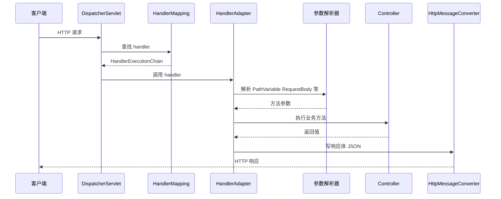

# SpringMVC请求处理

> 这篇从 DispatcherServlet 的请求链路讲起，经过参数绑定、请求体转换、校验、统一异常、拦截器、上传下载和异步响应，最后落到一个工单接口的完整实现与排障。
>
> 学完能独立编写 Spring MVC 控制器，处理 JSON、表单、文件上传下载和 SSE 流式响应，并定位 400、404、415、500 等常见问题。

## 一、DispatcherServlet 的请求链路

Spring MVC 是前端控制器（Front Controller）模式：所有请求先到 `DispatcherServlet`，它查 HandlerMapping 找到处理方法，再通过 HandlerAdapter 调用，参数解析、返回值处理、消息转换都由框架组件完成。核心判断：**Controller 只写业务入口，协议细节交给参数解析器和消息转换器**。



| 组件 | 职责 | 出问题时看什么 |
|---|---|---|
| `DispatcherServlet` | 统一入口 | 是否映射到 `/` |
| `HandlerMapping` | 路径到方法 | 路径、方法、`@RequestMapping` |
| `HandlerAdapter` | 调用方法 | 参数类型、解析器 |
| `HandlerExceptionResolver` | 异常转响应 | `@ExceptionHandler` |
| `HttpMessageConverter` | JSON/XML 读写 | `Content-Type`、`Accept` |

> 边界：Spring Boot 3.x 默认使用 `PathPatternParser`，尾斜杠默认不再匹配；`@RestController` 返回对象时走消息转换器，返回 `String` 时也不会走 JSP。过滤器（Filter）在 DispatcherServlet 之前执行，拦截器（Interceptor）在 handler 调用前后执行，两者解决的不是同一类问题。

## 二、控制器与参数绑定

参数绑定的规则是“看注解、看类型、看位置”：路径变量用 `@PathVariable`，查询参数或表单字段用 `@RequestParam`，JSON 请求体用 `@RequestBody`，请求头用 `@RequestHeader`，文件用 `@RequestPart`。不写注解时，Spring 会按类型尝试绑定，容易产生歧义。

| 注解 | 数据来源 | 典型类型 |
|---|---|---|
| `@PathVariable` | URI 模板 | `Long`、`String` |
| `@RequestParam` | 查询串或表单 | 基本类型、`List` |
| `@RequestBody` | 请求体 | DTO、`Map` |
| `@RequestHeader` | Header | `String`、枚举 |
| `@CookieValue` | Cookie | `String` |
| `@ModelAttribute` | 表单或查询参数 | POJO |
| `@RequestPart` | multipart 部分 | `MultipartFile`、DTO |

```java
@RestController
@RequestMapping("/api/v1/tickets")
public class TicketController {
    @GetMapping("/{id}")
    public Ticket get(@PathVariable long id,
                      @RequestHeader(value = "X-Request-Id", required = false) String requestId) {
        return service.get(id); // 片段：省略 service 字段与构造器注入
    }

    @GetMapping
    public List<Ticket> list(@RequestParam(defaultValue = "0") int page,
                             @RequestParam(defaultValue = "20") int size) {
        return service.list(page, size);
    }

    @PostMapping
    public ResponseEntity<Ticket> create(@Valid @RequestBody CreateTicketRequest request) {
        Ticket ticket = service.create(request);
        return ResponseEntity.created(URI.create("/api/v1/tickets/" + ticket.id())).body(ticket);
    }
}
```

```bash
curl -s 'http://localhost:18082/api/v1/tickets?page=0&size=2'
curl -s -X POST http://localhost:18082/api/v1/tickets \
  -H 'Content-Type: application/json' \
  -d '{"title":"打印机卡纸","priority":"HIGH"}'
```

> 边界：`@RequestParam` 默认 `required=true`，缺参数会返回 400；需要可选时写 `required=false` 或 `defaultValue`。`@RequestBody` 只能读一次流，不能在 Controller 里再读 `HttpServletRequest.getInputStream()`；需要缓存请求体时用 `ContentCachingRequestWrapper`。

## 三、请求体、类型转换与内容协商

JSON 的读写由 Jackson 完成，Spring MVC 根据 `Content-Type` 选择 `HttpMessageConverter`，根据 `Accept` 选择响应格式。日期、枚举、金额的格式必须在入口统一，否则每个 Controller 都会出现不同的解析规则。

```java
public record CreateTicketRequest(
        @NotBlank @Size(max = 80) String title,
        @Pattern(regexp = "LOW|NORMAL|HIGH") String priority,
        @JsonFormat(pattern = "yyyy-MM-dd HH:mm:ss") LocalDateTime dueAt) {
}
```

全局日期格式：

```yaml
spring:
  jackson:
    date-format: yyyy-MM-dd HH:mm:ss
    time-zone: Asia/Shanghai
    default-property-inclusion: non_null
    deserialization:
      fail-on-unknown-properties: true # 拼错字段时直接 400，避免静默丢参数
```

枚举默认按 `name()` 序列化。需要自定义入库值时，用 `@JsonValue`：

```java
public enum Priority {
    LOW("低"), NORMAL("中"), HIGH("高");

    private final String label;

    Priority(String label) {
        this.label = label;
    }

    @JsonValue
    public String label() {
        return label;
    }
}
```

内容协商由 `produces` 和 `consumes` 约束：

```java
@PostMapping(value = "/import", consumes = MediaType.APPLICATION_JSON_VALUE,
             produces = MediaType.APPLICATION_JSON_VALUE)
public ImportResult importTickets(@RequestBody List<CreateTicketRequest> requests) {
    return service.importAll(requests);
}
```

| 情况 | 响应 | 触发点 |
|---|---|---|
| 请求体不是 JSON | 415 | `Content-Type` 与 `consumes` 不匹配 |
| JSON 字段类型错 | 400 | Jackson 反序列化失败 |
| `Accept` 不支持 | 406 | 无法找到匹配的 converter |
| 日期格式错 | 400 | `@JsonFormat` 或全局格式不匹配 |

> 边界：金额不要用 `double`，用 `BigDecimal` 并把 `WRITE_BIGDECIMAL_AS_PLAIN` 打开，避免科学计数法；`fail-on-unknown-properties=true` 能暴露拼写错误，但对外 API 增加字段时要先通知客户端，否则旧客户端会被新字段打挂。

## 四、Bean Validation 校验

校验发生在参数解析之后、Controller 方法之前。`@Valid` 触发级联校验，`@Validated` 用在类上开启方法级校验；校验失败抛 `MethodArgumentNotValidException`，由统一异常处理器转成 400。

```java
public record CreateTicketRequest(
        @NotBlank(message = "title 不能为空")
        @Size(max = 80, message = "title 最多 80 个字符")
        String title,

        @NotBlank(message = "priority 不能为空")
        @Pattern(regexp = "LOW|NORMAL|HIGH", message = "priority 只能是 LOW/NORMAL/HIGH")
        String priority,

        @Min(value = 1, message = "quantity 至少为 1")
        @Max(value = 99, message = "quantity 最多为 99")
        int quantity) {
}
```

```java
@PostMapping
public ResponseEntity<Ticket> create(@Valid @RequestBody CreateTicketRequest request) {
    return ResponseEntity.ok(service.create(request));
}
```

嵌套对象要加 `@Valid`，否则内部字段不校验：

```java
public record CreateOrderRequest(
        @NotBlank String sku,
        @Valid @NotNull DeliveryAddress address) {
}

public record DeliveryAddress(
        @NotBlank String province,
        @NotBlank String detail) {
}
```

| 注解 | 约束 | 常见误用 |
|---|---|---|
| `@NotNull` | 不为 null | 空字符串仍通过 |
| `@NotBlank` | 非 null 且去空格非空 | 只能用于字符串 |
| `@Size` | 长度或集合大小 | 不校验 null |
| `@Min`/`@Max` | 数值范围 | 用在 `String` 上无效 |
| `@Pattern` | 正则 | 默认不校验 null |
| `@Email` | 邮箱格式 | 空字符串需配合 `@NotBlank` |

> 边界：`@Valid` 加在 `@RequestBody` 参数上，`@Validated` 加在类上用于方法参数校验；二者不要混用到同一个参数上。校验消息默认跟随 JVM Locale，中文环境输出中文，英文环境输出英文；对外 API 最好固定消息语言或返回错误码。

## 五、统一异常处理

统一异常处理把“业务异常 → HTTP 状态码 → 错误结构”收口到一个地方。优先级规则是：越具体的异常处理器越优先；`@ExceptionHandler` 方法可以返回 `ProblemDetail`、`ResponseEntity` 或普通对象。

```java
@RestControllerAdvice
public class GlobalExceptionHandler {

    @ExceptionHandler(TicketNotFoundException.class)
    public ProblemDetail handleNotFound(TicketNotFoundException e) {
        ProblemDetail problem = ProblemDetail.forStatusAndDetail(HttpStatus.NOT_FOUND, e.getMessage());
        problem.setTitle("工单不存在");
        problem.setType(URI.create("https://api.example.com/problems/ticket-not-found"));
        problem.setProperty("ticketId", e.ticketId());
        return problem;
    }

    @ExceptionHandler(MethodArgumentNotValidException.class)
    public ProblemDetail handleValidation(MethodArgumentNotValidException e) {
        ProblemDetail problem = ProblemDetail.forStatusAndDetail(HttpStatus.BAD_REQUEST, "请求字段校验失败");
        problem.setTitle("参数校验失败");
        problem.setType(URI.create("https://api.example.com/problems/validation-failed"));
        problem.setProperty("errors", e.getBindingResult().getFieldErrors().stream()
                .map(error -> Map.of("field", error.getField(), "message", error.getDefaultMessage()))
                .toList());
        return problem;
    }

    @ExceptionHandler(MaxUploadSizeExceededException.class)
    public ProblemDetail handleUploadTooLarge(MaxUploadSizeExceededException e) {
        ProblemDetail problem = ProblemDetail.forStatusAndDetail(HttpStatus.PAYLOAD_TOO_LARGE, "上传文件超过 1 MB");
        problem.setTitle("文件过大");
        problem.setType(URI.create("https://api.example.com/problems/file-too-large"));
        return problem;
    }
}
```

实际响应：

```text
HTTP/1.1 400
Content-Type: application/problem+json

{"type":".../validation-failed","title":"参数校验失败","status":400,
 "detail":"请求字段校验失败","instance":"/api/v1/tickets",
 "errors":[{"field":"priority","message":"priority 只能是 LOW/NORMAL/HIGH"},
           {"field":"title","message":"title 不能为空"}]}
```

| 异常 | 默认状态 | 处理建议 |
|---|---|---|
| `MethodArgumentNotValidException` | 400 | 返回字段错误列表 |
| `HttpMessageNotReadableException` | 400 | 提示 JSON 格式错误 |
| `MissingRequestHeaderException` | 400 | 指出缺失的 Header |
| `MaxUploadSizeExceededException` | 413 | 提示文件大小限制 |
| `NoResourceFoundException` | 404 | 不要转成 500 |
| 未捕获 `Exception` | 500 | 记日志，返回 traceId |

> 边界：不要用一个 `@ExceptionHandler(Exception.class)` 把所有异常都返回 200；不要把异常栈、SQL、内部 URL 放进 `detail`。多个 `@RestControllerAdvice` 用 `@Order` 控制顺序，否则具体处理器可能被通用处理器覆盖。

## 六、拦截器、过滤器与横切逻辑

拦截器适合“与 handler 有关”的横切逻辑：登录校验、权限、TraceId、执行时间；过滤器适合“请求进入 Servlet 之前”的逻辑：编码、CORS、请求体缓存、全链路日志。AOP 适合 Service 层的方法级事务、重试、埋点。

| 机制 | 执行位置 | 能拿到 handler | 能改响应 | 典型用途 |
|---|---|---|---|---|
| Filter | DispatcherServlet 之前 | 否 | 是 | 编码、CORS、TraceId |
| Interceptor | handler 前后 | 是 | 是 | 登录、权限、耗时 |
| AOP | Bean 方法调用 | 方法信息 | 否 | 事务、重试、埋点 |

```java
@Component
public class TraceIdInterceptor implements HandlerInterceptor {
    @Override
    public boolean preHandle(HttpServletRequest request, HttpServletResponse response, Object handler) {
        String traceId = request.getHeader("X-Request-Id");
        if (traceId == null || traceId.isBlank()) {
            traceId = UUID.randomUUID().toString().substring(0, 8);
        }
        MDC.put("traceId", traceId);
        response.setHeader("X-Trace-Id", traceId);
        return true; // 返回 false 会中断后续拦截器和 handler
    }

    @Override
    public void afterCompletion(HttpServletRequest request, HttpServletResponse response,
                                Object handler, Exception ex) {
        MDC.remove("traceId"); // 线程池复用线程，必须清理
    }
}
```

```java
@Configuration
public class WebConfig implements WebMvcConfigurer {
    private final TraceIdInterceptor traceIdInterceptor;

    public WebConfig(TraceIdInterceptor traceIdInterceptor) {
        this.traceIdInterceptor = traceIdInterceptor;
    }

    @Override
    public void addInterceptors(InterceptorRegistry registry) {
        registry.addInterceptor(traceIdInterceptor)
                .addPathPatterns("/api/**")
                .excludePathPatterns("/actuator/**")
                .order(1);
    }
}
```

> 边界：`preHandle` 返回 `false` 后必须自己写响应，否则客户端会收到空响应；拦截器不处理静态资源，除非显式映射。异步请求要使用 `AsyncHandlerInterceptor` 的 `afterConcurrentHandlingStarted`，普通的 `afterCompletion` 可能在新线程里执行，MDC 需要额外传递。

## 七、文件上传与下载

上传用 `MultipartFile` 接收，限制大小在配置层做；下载用 `ResponseEntity<Resource>` 流式写出，文件名按 RFC 5987 编码，避免中文乱码。核心安全规则：**永远不要相信客户端文件名，永远不要把整个大文件读进内存**。

```yaml
spring:
  servlet:
    multipart:
      max-file-size: 1MB
      max-request-size: 2MB
      file-size-threshold: 0
```

```java
@PostMapping(path = "/{id}/attachments", consumes = MediaType.MULTIPART_FORM_DATA_VALUE)
public ResponseEntity<Map<String, Object>> upload(@PathVariable long id,
                                                  @RequestPart("file") MultipartFile file) throws IOException {
    String original = file.getOriginalFilename() == null ? "file" : file.getOriginalFilename();
    String safeName = original.replace("\\", "/");
    safeName = safeName.substring(safeName.lastIndexOf('/') + 1); // 去掉客户端路径
    if (safeName.isBlank() || safeName.contains("..")) {
        throw new IllegalArgumentException("非法文件名");
    }
    byte[] content = file.getBytes(); // 小文件示例；大文件用流式存储
    return ResponseEntity.ok(Map.of("name", safeName, "size", content.length));
}
```

```java
@GetMapping("/{id}/attachments/{name}")
public ResponseEntity<Resource> download(@PathVariable long id, @PathVariable String name) {
    StoredFile stored = service.load(id, name);
    ContentDisposition disposition = ContentDisposition.attachment()
            .filename(stored.name(), StandardCharsets.UTF_8) // 中文文件名走 filename*
            .build();
    return ResponseEntity.ok()
            .header(HttpHeaders.CONTENT_DISPOSITION, disposition.toString())
            .contentType(MediaType.APPLICATION_OCTET_STREAM)
            .body(new ByteArrayResource(stored.content()));
}
```

```bash
curl -i -X POST http://localhost:18082/api/v1/tickets/2001/attachments \
  -F 'file=@note.txt;type=text/plain'

curl -i http://localhost:18082/api/v1/tickets/2001/attachments/note.txt
```

预期输出：

```text
HTTP/1.1 200
Content-Type: application/json
{"ticketId":2001,"size":16,"name":"note.txt","contentType":"text/plain"}

HTTP/1.1 200
Content-Disposition: attachment; filename*=UTF-8''note.txt
Content-Type: application/octet-stream
Content-Length: 16
```

> 边界：`MultipartFile.getBytes()` 会把文件读进堆，大文件要用 `transferTo` 或对象存储；`file-size-threshold: 0` 表示所有文件直接落盘，不再内存缓冲。下载大文件用 `InputStreamResource` 或 `ResourceRegion` 支持断点续传，不要一次性读入 `byte[]`。

## 八、异步请求与流式响应

异步请求把 Servlet 线程还给容器，适合等待下游、推送进度和 SSE；CPU 密集型任务不应该靠异步解决，而应该交给消息队列或独立线程池。Spring MVC 支持 `Callable`、`DeferredResult`、`CompletableFuture`、`SseEmitter` 和 `ResponseBodyEmitter`。

```java
@GetMapping(value = "/export", produces = MediaType.TEXT_EVENT_STREAM_VALUE)
public SseEmitter export() {
    SseEmitter emitter = new SseEmitter(Duration.ofSeconds(10).toMillis());
    exporter.execute(() -> {
        try {
            for (Ticket ticket : service.list(0, 50)) {
                emitter.send(SseEmitter.event()
                        .id(String.valueOf(ticket.id()))
                        .name("ticket")
                        .data(ticket));
            }
            emitter.complete();
        } catch (IOException e) {
            emitter.completeWithError(e); // 客户端断开时结束，不要继续写
        }
    });
    return emitter;
}
```

```bash
curl -N --max-time 12 http://localhost:18082/api/v1/tickets/export
```

预期输出：

```text
id:2001
event:ticket
data:{"id":2001,"title":"打印机卡纸","priority":"HIGH","status":"OPEN"}

id:2002
event:ticket
data:{"id":2002,"title":"VPN 无法连接","priority":"NORMAL","status":"OPEN"}
```

| 方式 | 适用场景 | 注意 |
|---|---|---|
| `Callable<T>` | 阻塞调用转异步 | 需要 TaskExecutor |
| `DeferredResult<T>` | 等待外部事件 | 超时要设置结果 |
| `CompletableFuture<T>` | 组合异步任务 | 异常传播 |
| `SseEmitter` | 服务器推送 | 心跳、代理超时 |
| `ResponseBodyEmitter` | 分块写任意内容 | 手动 flush |

> 边界：异步方法返回后，原请求线程不再持有响应；异常发生在响应提交之后，无法再改状态码。SSE 经过 Nginx 时要关闭缓冲（`proxy_buffering off`），并设置足够长的 `proxy_read_timeout`；移动端断网后服务端要能感知并释放 emitter。

## 九、常见故障排查

MVC 问题先看“请求有没有到 Controller”：加一行日志或断点，确认是路由、参数绑定、校验还是序列化阶段失败。`curl -i` 能看到状态码和响应头，`curl -v` 能看到实际请求。

| 现象 | 常见原因 | 第一条检查 |
|---|---|---|
| 404 | 路径、context-path、尾斜杠 | 对比 `@RequestMapping` 与实际 URL |
| 405 | 方法不匹配 | 看响应 `Allow` 头 |
| 415 | `Content-Type` 不是 JSON | `curl -H 'Content-Type: application/json'` |
| 406 | `Accept` 与 `produces` 不匹配 | 去掉 `Accept` 再试 |
| 400 JSON 解析失败 | 字段类型、未知字段、空 body | `curl -v` 看请求体 |
| 校验不生效 | 缺 `@Valid` 或嵌套缺 `@Valid` | 看 DTO 注解 |
| 413 | 超过 multipart 限制 | 查 `max-file-size` |
| 异步超时 | 超过 `spring.mvc.async.request-timeout` | 查日志与下游耗时 |
| 拦截器不执行 | 路径不匹配或没注册 | 看 `addPathPatterns` |
| 中文乱码 | 编码不是 UTF-8 | 查 `server.servlet.encoding` |

```bash
# 看完整请求和响应
curl -v http://localhost:18082/api/v1/tickets/2001

# 上传文件并指定类型
curl -i -X POST http://localhost:18082/api/v1/tickets/2001/attachments \
  -F 'file=@note.txt;type=text/plain'

# 持续读取 SSE，12 秒后断开
curl -N --max-time 12 http://localhost:18082/api/v1/tickets/export
```

> 边界：`curl` 默认不会发送浏览器那样的 `Accept`，某些内容协商问题只在浏览器出现；排查 CORS 时看预检 `OPTIONS`，不要只看实际请求。`spring.mvc.async.request-timeout` 只影响 MVC 异步，不影响 Tomcat 的连接超时。

## 十、最佳实践案例

### 10.1 案例背景

一个工单系统需要给客服提供创建工单、分页查询、上传附件、下载附件和导出功能。现状是所有接口写在一个 Controller 里，参数用 `Map` 接收，校验靠手写 `if`，异常直接返回 500；附件下载中文名乱码，导出接口同步查全表导致请求超时。

目标是：用 DTO + Bean Validation 统一入参，用 ProblemDetail 统一错误，用拦截器注入 TraceId，用 multipart 限制附件大小，用 SSE 分页推送导出结果。约束是 Spring Boot 3.5.x、Java 21，不引入消息队列。

### 10.2 案例实操

完整工程：

```text
src/main/java/com/example/mvc/
├── MvcApplication.java
└── api/
    ├── Ticket.java
    ├── CreateTicketRequest.java
    ├── TicketNotFoundException.java
    ├── TicketService.java
    ├── TicketController.java
    ├── TraceIdInterceptor.java
    ├── WebConfig.java
    └── GlobalExceptionHandler.java
src/main/resources/application.yml
```

```xml
<parent>
    <groupId>org.springframework.boot</groupId>
    <artifactId>spring-boot-starter-parent</artifactId>
    <version>3.5.6</version>
    <relativePath/>
</parent>
<groupId>com.example</groupId>
<artifactId>mvc-case</artifactId>
<version>0.0.1-SNAPSHOT</version>
<properties><java.version>21</java.version></properties>
<dependencies>
    <dependency>
        <groupId>org.springframework.boot</groupId>
        <artifactId>spring-boot-starter-web</artifactId>
    </dependency>
    <dependency>
        <groupId>org.springframework.boot</groupId>
        <artifactId>spring-boot-starter-validation</artifactId>
    </dependency>
</dependencies>
<build>
    <plugins>
        <plugin>
            <groupId>org.springframework.boot</groupId>
            <artifactId>spring-boot-maven-plugin</artifactId>
        </plugin>
    </plugins>
</build>
```

```java
@SpringBootApplication
public class MvcApplication {
    public static void main(String[] args) {
        SpringApplication.run(MvcApplication.class, args);
    }
}
```

```java
public record Ticket(Long id, String title, String priority, String status, Instant createdAt) {
}

public record CreateTicketRequest(
        @NotBlank(message = "title 不能为空")
        @Size(max = 80, message = "title 最多 80 个字符")
        String title,

        @NotBlank(message = "priority 不能为空")
        @Pattern(regexp = "LOW|NORMAL|HIGH", message = "priority 只能是 LOW/NORMAL/HIGH")
        String priority) {
}

public class TicketNotFoundException extends RuntimeException {
    private final long ticketId;

    public TicketNotFoundException(long ticketId) {
        super("工单 " + ticketId + " 不存在");
        this.ticketId = ticketId;
    }

    public long ticketId() {
        return ticketId;
    }
}
```

```java
@Service
public class TicketService {
    public record StoredFile(String name, String contentType, byte[] content) {
    }

    private final Map<Long, Ticket> tickets = new ConcurrentHashMap<>();
    private final Map<Long, Map<String, StoredFile>> files = new ConcurrentHashMap<>();
    private final AtomicLong ids = new AtomicLong(2000);

    public Ticket create(CreateTicketRequest request) {
        long id = ids.incrementAndGet();
        Ticket ticket = new Ticket(id, request.title(), request.priority(), "OPEN", Instant.now());
        tickets.put(id, ticket);
        return ticket;
    }

    public Ticket get(long id) {
        Ticket ticket = tickets.get(id);
        if (ticket == null) {
            throw new TicketNotFoundException(id);
        }
        return ticket;
    }

    public List<Ticket> list(int page, int size) {
        List<Ticket> all = new ArrayList<>(tickets.values());
        int from = Math.min(page * size, all.size());
        int to = Math.min(from + size, all.size());
        return all.subList(from, to);
    }

    public StoredFile store(long ticketId, MultipartFile file) throws IOException {
        get(ticketId); // 工单不存在时先 404，避免产生孤儿附件
        String original = file.getOriginalFilename() == null ? "file" : file.getOriginalFilename();
        String safeName = original.replace("\\", "/");
        safeName = safeName.substring(safeName.lastIndexOf('/') + 1);
        if (safeName.isBlank() || safeName.contains("..")) {
            throw new IllegalArgumentException("非法文件名");
        }
        StoredFile stored = new StoredFile(safeName, file.getContentType(), file.getBytes());
        files.computeIfAbsent(ticketId, key -> new ConcurrentHashMap<>()).put(safeName, stored);
        return stored;
    }

    public StoredFile load(long ticketId, String name) {
        StoredFile file = files.getOrDefault(ticketId, Map.of()).get(name);
        if (file == null) {
            throw new TicketNotFoundException(ticketId);
        }
        return file;
    }
}
```

```java
@RestController
@RequestMapping("/api/v1/tickets")
public class TicketController {
    private final TicketService tickets;
    private final ExecutorService exporter = Executors.newVirtualThreadPerTaskExecutor();

    public TicketController(TicketService tickets) {
        this.tickets = tickets;
    }

    @PostMapping
    public ResponseEntity<Ticket> create(@Valid @RequestBody CreateTicketRequest request) {
        Ticket ticket = tickets.create(request);
        return ResponseEntity.created(URI.create("/api/v1/tickets/" + ticket.id())).body(ticket);
    }

    @GetMapping("/{id}")
    public Ticket get(@PathVariable long id) {
        return tickets.get(id);
    }

    @GetMapping
    public Map<String, Object> list(@RequestParam(defaultValue = "0") int page,
                                    @RequestParam(defaultValue = "10") int size) {
        if (page < 0 || size < 1 || size > 50) {
            throw new IllegalArgumentException("page >= 0 且 1 <= size <= 50");
        }
        return Map.of("page", page, "size", size, "items", tickets.list(page, size));
    }

    @PostMapping(path = "/{id}/attachments", consumes = MediaType.MULTIPART_FORM_DATA_VALUE)
    public ResponseEntity<Map<String, Object>> upload(@PathVariable long id,
                                                      @RequestPart("file") MultipartFile file) throws IOException {
        TicketService.StoredFile stored = tickets.store(id, file);
        return ResponseEntity.ok(Map.of(
                "ticketId", id,
                "name", stored.name(),
                "size", stored.content().length,
                "contentType", stored.contentType() == null ? "application/octet-stream" : stored.contentType()));
    }

    @GetMapping("/{id}/attachments/{name}")
    public ResponseEntity<Resource> download(@PathVariable long id, @PathVariable String name) {
        TicketService.StoredFile stored = tickets.load(id, name);
        ContentDisposition disposition = ContentDisposition.attachment()
                .filename(stored.name(), StandardCharsets.UTF_8)
                .build();
        return ResponseEntity.ok()
                .header(HttpHeaders.CONTENT_DISPOSITION, disposition.toString())
                .contentType(MediaType.APPLICATION_OCTET_STREAM)
                .body(new ByteArrayResource(stored.content()));
    }

    @GetMapping(value = "/export", produces = MediaType.TEXT_EVENT_STREAM_VALUE)
    public SseEmitter export() {
        SseEmitter emitter = new SseEmitter(Duration.ofSeconds(10).toMillis());
        exporter.execute(() -> {
            try {
                for (Ticket ticket : tickets.list(0, 50)) {
                    emitter.send(SseEmitter.event()
                            .id(String.valueOf(ticket.id()))
                            .name("ticket")
                            .data(ticket));
                }
                emitter.complete();
            } catch (IOException e) {
                emitter.completeWithError(e);
            }
        });
        return emitter;
    }

    @PreDestroy
    void shutdown() {
        exporter.shutdown();
    }
}
```

```java
@Component
public class TraceIdInterceptor implements HandlerInterceptor {
    @Override
    public boolean preHandle(HttpServletRequest request, HttpServletResponse response, Object handler) {
        String traceId = request.getHeader("X-Request-Id");
        if (traceId == null || traceId.isBlank()) {
            traceId = UUID.randomUUID().toString().substring(0, 8);
        }
        MDC.put("traceId", traceId);
        response.setHeader("X-Trace-Id", traceId);
        return true;
    }

    @Override
    public void afterCompletion(HttpServletRequest request, HttpServletResponse response,
                                Object handler, Exception ex) {
        MDC.remove("traceId");
    }
}
```

```java
@Configuration
public class WebConfig implements WebMvcConfigurer {
    private final TraceIdInterceptor traceIdInterceptor;

    public WebConfig(TraceIdInterceptor traceIdInterceptor) {
        this.traceIdInterceptor = traceIdInterceptor;
    }

    @Override
    public void addInterceptors(InterceptorRegistry registry) {
        registry.addInterceptor(traceIdInterceptor).addPathPatterns("/api/**");
    }
}
```

```java
@RestControllerAdvice
public class GlobalExceptionHandler {
    @ExceptionHandler(TicketNotFoundException.class)
    public ProblemDetail handleNotFound(TicketNotFoundException e) {
        ProblemDetail problem = ProblemDetail.forStatusAndDetail(HttpStatus.NOT_FOUND, e.getMessage());
        problem.setTitle("工单不存在");
        problem.setType(URI.create("https://api.example.com/problems/ticket-not-found"));
        problem.setProperty("ticketId", e.ticketId());
        return problem;
    }

    @ExceptionHandler(MethodArgumentNotValidException.class)
    public ProblemDetail handleValidation(MethodArgumentNotValidException e) {
        ProblemDetail problem = ProblemDetail.forStatusAndDetail(HttpStatus.BAD_REQUEST, "请求字段校验失败");
        problem.setTitle("参数校验失败");
        problem.setProperty("errors", e.getBindingResult().getFieldErrors().stream()
                .map(error -> Map.of("field", error.getField(), "message", error.getDefaultMessage()))
                .toList());
        return problem;
    }

    @ExceptionHandler(MaxUploadSizeExceededException.class)
    public ProblemDetail handleUploadTooLarge(MaxUploadSizeExceededException e) {
        ProblemDetail problem = ProblemDetail.forStatusAndDetail(HttpStatus.PAYLOAD_TOO_LARGE, "上传文件超过 1 MB");
        problem.setTitle("文件过大");
        return problem;
    }

    @ExceptionHandler(IllegalArgumentException.class)
    public ProblemDetail handleIllegalArgument(IllegalArgumentException e) {
        ProblemDetail problem = ProblemDetail.forStatusAndDetail(HttpStatus.BAD_REQUEST, e.getMessage());
        problem.setTitle("请求参数不合法");
        return problem;
    }
}
```

```yaml
server:
  port: 18082
spring:
  servlet:
    multipart:
      max-file-size: 1MB
      max-request-size: 2MB
  mvc:
    async:
      request-timeout: 10s
```

构建与验收：

```bash
mvn -B package
java -jar target/mvc-case-0.0.1-SNAPSHOT.jar
```

```bash
# 创建工单
curl -i -X POST http://localhost:18082/api/v1/tickets \
  -H 'Content-Type: application/json' \
  -H 'X-Request-Id: trace-abc' \
  -d '{"title":"打印机卡纸","priority":"HIGH"}'

# 校验失败
curl -i -X POST http://localhost:18082/api/v1/tickets \
  -H 'Content-Type: application/json' \
  -d '{"title":"","priority":"URGENT"}'

# 上传与下载
printf 'hello attachment' > note.txt
curl -i -X POST http://localhost:18082/api/v1/tickets/2001/attachments \
  -F 'file=@note.txt;type=text/plain'
curl -i http://localhost:18082/api/v1/tickets/2001/attachments/note.txt

# SSE 导出
curl -N --max-time 12 http://localhost:18082/api/v1/tickets/export
```

预期输出：

```text
HTTP/1.1 201
X-Trace-Id: trace-abc
Location: /api/v1/tickets/2001
{"id":2001,"title":"打印机卡纸","priority":"HIGH","status":"OPEN",...}

HTTP/1.1 400
Content-Type: application/problem+json
{"title":"参数校验失败","status":400,"errors":[...]}

HTTP/1.1 200
{"ticketId":2001,"size":16,"name":"note.txt","contentType":"text/plain"}

HTTP/1.1 200
Content-Disposition: attachment; filename*=UTF-8''note.txt

id:2001
event:ticket
data:{"id":2001,...}
```

### 10.3 案例结果

创建接口返回 201 和 `Location`，校验失败返回 400 + ProblemDetail，上传返回文件名/大小/类型，下载带 `filename*=UTF-8`，SSE 按事件逐条推送。TraceId 在响应头 `X-Trace-Id` 中可见，异常响应也能关联到同一请求。附件超过 1 MB 时返回 413，不会进入 Controller。

复盘三个失败模式：第一，直接把 `MultipartFile.getBytes()` 用在 100 MB 文件上会 OOM，生产要流式写对象存储；第二，SSE 没配心跳和代理超时，Nginx 60 秒后断开连接；第三，用一个 `@ExceptionHandler(Exception.class)` 兜底所有异常，会把 `NoResourceFoundException` 这类 404 也变成 500，兜底处理器必须放在最后并显式排除框架异常。下一步是把导出改为分页游标 + 异步任务，并给 SSE 增加心跳事件。
