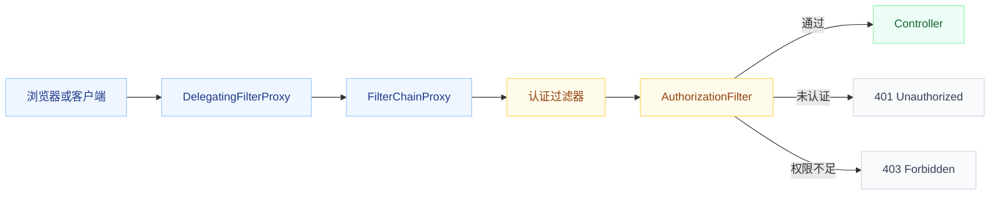
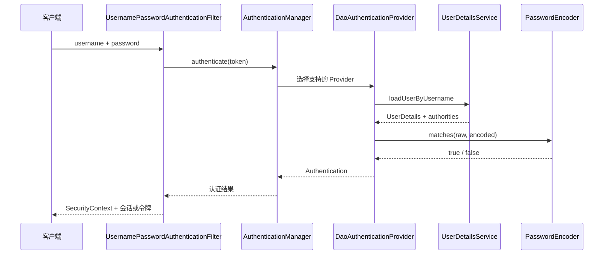

# SpringSecurity安全认证

> 这篇从 Spring Security 的过滤器链讲起，经过最小工程、用户认证、JWT 无状态登录、请求级与方法级授权、CSRF 与 CORS，最后落到一个可运行的后台订单 API 防护案例。
>
> 学完能独立给 Spring Boot 接口加上登录、令牌校验和角色权限，并能判断 401、403、跨域和 CSRF 问题出在哪一层。

## 一、认证、授权与过滤器链

Spring Security 的核心是一条 Servlet 过滤器链（Filter Chain）：认证（authentication）确认请求是谁发的，授权（authorization）判断这个身份能不能访问目标资源，两步都在进入 Controller 之前完成。

`DelegatingFilterProxy` 把 Servlet 容器注册的 Filter 转交给 Spring 容器里的 `FilterChainProxy`。后者按顺序匹配 `SecurityFilterChain`，只执行第一条匹配的链；没有匹配的链时请求直接放行。自定义多条链必须用 `@Order` 排序，并把范围窄的链放在前面。



过滤器顺序决定行为，认证必须排在授权之前：

| 顺序 | 过滤器 | 职责 |
|---|---|---|
| 1 | `SecurityContextHolderFilter` | 从仓库读取安全上下文 |
| 2 | `BearerTokenAuthenticationFilter` | 解析 `Authorization: Bearer` |
| 3 | `ExceptionTranslationFilter` | 把异常翻译成 401 或 403 |
| 4 | `AuthorizationFilter` | 执行请求级授权规则 |

`ExceptionTranslationFilter` 只处理它后面的过滤器抛出的 `AuthenticationException` 和 `AccessDeniedException`。把自定义认证过滤器放到它后面，认证失败不会被翻译成 401，而是直接冒成 500。

### 1.1 认证与授权的边界

认证失败返回 401，授权失败返回 403，这是排查时最先看的分界线。

| 结果 | 含义 | 常见原因 |
|---|---|---|
| 401 | 没有有效身份 | 没带令牌、令牌过期、签名错误 |
| 403 | 身份有效但权限不够 | 角色不匹配、URL 规则顺序错 |
| 302 | 被重定向到登录页 | 仍启用表单登录，API 未自定义入口 |
| 500 | 认证异常没被翻译 | 自定义过滤器顺序错、登录接口没捕获异常 |

角色（role）和权限（authority）在 Spring Security 里都是 `GrantedAuthority`，区别只在写法：`hasRole("ADMIN")` 会自动补 `ROLE_` 前缀，实际比较的是 `ROLE_ADMIN`；`hasAuthority("order:read")` 精确比较，不补前缀。

```java
// 数据库里存 order:read，代码里就必须用 hasAuthority("order:read")
http.authorizeHttpRequests(auth -> auth
    .requestMatchers(HttpMethod.GET, "/api/orders/**").hasAuthority("order:read"));
```

最常见的 403 是混用两种写法：令牌里放的是 `ADMIN`，规则写 `hasRole("ADMIN")`，实际需要 `ROLE_ADMIN`，于是永远不匹配。

> 边界：Spring Security 管的是 Web 层“能不能进这个接口”。订单 42 是否属于当前用户，属于数据权限，必须在 Service 里按当前用户 ID 查一次，不能只靠 URL 规则。

### 1.2 什么时候不该自己写认证

网关已经完成统一认证、并且用签名头把用户身份传给下游时，下游仍要校验签名和有效期，不能无条件信任 `X-User-Id`。直接解析手写 JWT、自己比较字符串签名、用 `Base64` 当加密，都是典型的错误做法。

需要标准协议时优先用现成方案：浏览器单点登录用 OAuth2/OIDC，服务间调用用客户端凭证（client credentials），不要把用户名密码塞进自定义请求头。

## 二、最小工程与版本基线

最小闭环是“一个受保护接口 + 一个内存用户 + HTTP Basic”，跑通后再替换成 JWT。版本基线如下，补丁号随 Spring Boot 3.5.x 更新，写法不变。

| 组件 | 版本 | 说明 |
|---|---|---|
| JDK | 21 LTS | Java 25 可用于新项目 |
| Spring Boot | 3.5.x | 本文按 3.5.6 验证 |
| Spring Security | 6.5.x | 由 Boot BOM 管理 |
| Maven | 3.9+ | Gradle 8.x 等价 |
| springdoc | 2.8.x | 可选，用于接口文档 |

`pom.xml` 的关键依赖：

```xml
<parent>
    <groupId>org.springframework.boot</groupId>
    <artifactId>spring-boot-starter-parent</artifactId>
    <version>3.5.6</version>
</parent>

<properties>
    <java.version>21</java.version>
</properties>

<dependencies>
    <dependency>
        <groupId>org.springframework.boot</groupId>
        <artifactId>spring-boot-starter-web</artifactId>
    </dependency>
    <dependency>
        <groupId>org.springframework.boot</groupId>
        <artifactId>spring-boot-starter-security</artifactId>
    </dependency>
    <!-- JWT 编解码在 oauth2-jose 中，resource-server 会把它带进来 -->
    <dependency>
        <groupId>org.springframework.boot</groupId>
        <artifactId>spring-boot-starter-oauth2-resource-server</artifactId>
    </dependency>
    <dependency>
        <groupId>org.springframework.boot</groupId>
        <artifactId>spring-boot-starter-validation</artifactId>
    </dependency>
    <dependency>
        <groupId>org.springframework.boot</groupId>
        <artifactId>spring-boot-starter-test</artifactId>
        <scope>test</scope>
    </dependency>
</dependencies>
```

启动命令三端一致，Windows 用 `mvnw.cmd`：

```bash
# macOS / Linux
./mvnw spring-boot:run

# Windows PowerShell
.\mvnw.cmd spring-boot:run
```

### 2.1 内存用户与 HTTP Basic

下面的配置先不接数据库，用 `InMemoryUserDetailsManager` 建立最小身份，密码用 BCrypt 编码。

```java
@Configuration
@EnableWebSecurity
public class BasicSecurityConfig {

    @Bean
    SecurityFilterChain basicChain(HttpSecurity http) throws Exception {
        http
            // Basic 认证没有 Cookie 会话，CSRF 不适用
            .csrf(AbstractHttpConfigurer::disable)
            .authorizeHttpRequests(auth -> auth
                .requestMatchers("/api/public/**").permitAll()
                .anyRequest().authenticated())
            .httpBasic(Customizer.withDefaults());
        return http.build();
    }

    @Bean
    PasswordEncoder passwordEncoder() {
        // strength 10 是默认值；生产可调到 12，代价是每次登录更慢
        return new BCryptPasswordEncoder(10);
    }

    @Bean
    UserDetailsService users(PasswordEncoder encoder) {
        UserDetails alice = User.withUsername("alice")
            .password(encoder.encode("Passw0rd!"))
            .roles("ADMIN")
            .build();
        return new InMemoryUserDetailsManager(alice);
    }
}
```

```java
@RestController
@RequestMapping("/api")
public class PingController {
    @GetMapping("/public/ping")
    public Map<String, String> ping() {
        return Map.of("status", "ok");
    }

    @GetMapping("/me")
    public Map<String, Object> me(Authentication authentication) {
        return Map.of(
            "name", authentication.getName(),
            "authorities", authentication.getAuthorities());
    }
}
```

用 `curl` 验证，`-u` 会把用户名密码做 Base64 后放进请求头：

```bash
curl -i http://localhost:8080/api/public/ping
curl -i http://localhost:8080/api/me
curl -i -u alice:Passw0rd! http://localhost:8080/api/me
```

预期输出（截取关键行）：

```text
# 无凭据
HTTP/1.1 401
WWW-Authenticate: Basic realm="Realm"

# 正确凭据
HTTP/1.1 200
{"name":"alice","authorities":[{"authority":"ROLE_ADMIN"}]}
```

> 边界：HTTP Basic 每个请求都携带可逆的 Base64 凭据，只允许在 TLS 上使用；浏览器前端不应把用户名密码存在 JS 里反复发送。它适合内部工具和调试，不适合作为 SPA 的最终方案。

## 三、认证：UserDetailsService 与密码编码

`AuthenticationManager` 是认证入口，默认实现 `ProviderManager` 把请求交给 `DaoAuthenticationProvider`；后者用 `UserDetailsService` 查用户，用 `PasswordEncoder` 比对密码。数据库用户只需要实现 `UserDetailsService`，不要自己写密码比较。



从数据库加载用户的最小实现：

```java
@Service
public class DatabaseUserDetailsService implements UserDetailsService {

    private final JdbcTemplate jdbc;

    public DatabaseUserDetailsService(JdbcTemplate jdbc) {
        this.jdbc = jdbc;
    }

    @Override
    public UserDetails loadUserByUsername(String username) {
        // 一条 SQL 取用户，避免先查存在再查详情造成两次往返
        List<UserDetails> users = jdbc.query("""
                select username, password, enabled
                from app_user
                where username = ?
                """, (rs, rowNum) -> User.withUsername(rs.getString("username"))
                .password(rs.getString("password"))
                .disabled(!rs.getBoolean("enabled"))
                .authorities(loadAuthorities(rs.getString("username")))
                .build(), username);

        if (users.isEmpty()) {
            // 不暴露“用户不存在”和“密码错误”的区别，防止用户名枚举
            throw new UsernameNotFoundException("bad credentials");
        }
        return users.get(0);
    }

    private List<GrantedAuthority> loadAuthorities(String username) {
        return jdbc.query("""
                select r.code
                from app_role r
                join app_user_role ur on ur.role_id = r.id
                join app_user u on u.id = ur.user_id
                where u.username = ?
                """, (rs, rowNum) -> new SimpleGrantedAuthority(rs.getString("code")), username);
    }
}
```

角色表里存 `ROLE_ADMIN` 或 `ADMIN` 都可以，但全库必须统一。采用“角色存 `ADMIN`、权限存 `order:read`”的模型时，给角色补前缀后再放进 `UserDetails`：

```java
// 数据库存 ADMIN，Spring Security 的 hasRole 需要 ROLE_ADMIN
new SimpleGrantedAuthority("ROLE_" + rs.getString("code"));
```

从本地缓存返回同一个 `UserDetails` 实例时有一个坑：认证成功后 `ProviderManager` 会擦除 principal 的凭据，`User.eraseCredentials()` 会把 password 置空，同一用户第二次登录就会拿到空密码。缓存 `User` 时返回 `User.withUserDetails(cached).build()` 的副本，或自定义一个不实现 `CredentialsContainer` 的 `UserDetails`。

密码编码器按场景选：

| 编码器 | 特点 | 适用 |
|---|---|---|
| `BCryptPasswordEncoder` | 自带盐、可调强度 | 默认选择 |
| `Argon2PasswordEncoder` | 抗 GPU，内存开销大 | 安全要求高 |
| `Pbkdf2PasswordEncoder` | FIPS 场景常见 | 合规系统 |
| `DelegatingPasswordEncoder` | 支持 `{bcrypt}` 前缀迁移 | 多算法共存 |

BCrypt 只处理前 72 字节，超过部分会被忽略。允许超长密码时，先做一次 SHA-256 再交给 BCrypt，并在文档里写清楚，否则同一前缀的不同密码会被视为相同。

> 边界：`UserDetailsService` 每次认证都会查库。高频登录接口要在用户表上建唯一索引，并对失败次数做限流或锁定；不要用“缓存用户密码”换性能。

## 四、JWT 无状态认证

JWT（JSON Web Token）把身份声明放在令牌里，服务端只验签不存会话，适合水平扩容的 API。代价是撤销困难：令牌签发后，在过期前天然有效；需要立即踢人时，必须配合短有效期、刷新令牌或 Redis 黑名单。

JWT 的 payload 只是 Base64URL 编码，不是加密。姓名、手机号、内部角色 ID 不应直接放进去；放 `sub`、`roles`、`iss`、`exp` 这类必要声明即可。

### 4.1 签发与校验配置

```yaml
app:
  jwt:
    issuer: https://api.example.com
    # 至少 32 字节；生产从环境变量或密钥管理系统注入
    secret: ${JWT_SECRET:local-dev-secret-change-me-32-bytes}
    ttl: 30m
```

```java
@ConfigurationProperties(prefix = "app.jwt")
public record JwtProperties(String issuer, String secret, Duration ttl) {
}
```

`JwtProperties` 单独放在 `JwtProperties.java`，`JwtConfig` 用 `@EnableConfigurationProperties` 注册它。`ImmutableSecret` 是 nimbus-jose-jwt 的 JWK 源，`spring-boot-starter-oauth2-resource-server` 已经把它带进来，不需要额外声明版本。

```java
@Configuration
@EnableConfigurationProperties(JwtProperties.class)
public class JwtConfig {

    @Bean
    JwtEncoder jwtEncoder(JwtProperties properties) {
        // HS256 是对称签名，签发和校验共用同一密钥，只适合单服务或可信内网
        // ImmutableSecret 来自 nimbus-jose-jwt，由 resource-server 传递引入
        return new NimbusJwtEncoder(new ImmutableSecret<>(key(properties)));
    }

    @Bean
    JwtDecoder jwtDecoder(JwtProperties properties) {
        NimbusJwtDecoder decoder = NimbusJwtDecoder.withSecretKey(key(properties))
            .macAlgorithm(MacAlgorithm.HS256)
            .build();
        // 校验 iss 和 exp；默认允许 60 秒时钟偏差
        decoder.setJwtValidator(JwtValidators.createDefaultWithIssuer(properties.issuer()));
        return decoder;
    }

    private static SecretKey key(JwtProperties properties) {
        byte[] bytes = properties.secret().getBytes(StandardCharsets.UTF_8);
        if (bytes.length < 32) {
            // 短密钥可被暴力破解，启动时直接失败比上线后出事好
            throw new IllegalStateException("app.jwt.secret 至少需要 32 字节");
        }
        return new SecretKeySpec(bytes, "HmacSHA256");
    }
}
```

多服务共享令牌时改用 RS256/ES256：认证中心持私钥签发，业务服务只配置公钥或 JWK Set URI，泄露公钥不会导致伪造。

### 4.2 登录接口签发令牌

```java
@Service
public class TokenService {

    private final JwtEncoder encoder;
    private final JwtProperties properties;

    public TokenService(JwtEncoder encoder, JwtProperties properties) {
        this.encoder = encoder;
        this.properties = properties;
    }

    public String issue(UserDetails user) {
        Instant now = Instant.now();
        List<String> roles = user.getAuthorities().stream()
            .map(GrantedAuthority::getAuthority)
            .toList();

        JwtClaimsSet claims = JwtClaimsSet.builder()
            .issuer(properties.issuer())
            .subject(user.getUsername())
            .issuedAt(now)
            .expiresAt(now.plus(properties.ttl()))
            .claim("roles", roles)
            .build();

        JwsHeader header = JwsHeader.with(MacAlgorithm.HS256).build();
        return encoder.encode(JwtEncoderParameters.from(header, claims)).getTokenValue();
    }
}
```

```java
@RestController
@RequestMapping("/api/auth")
public class AuthController {

    private final AuthenticationManager authenticationManager;
    private final TokenService tokenService;
    private final JwtProperties properties;

    public AuthController(AuthenticationManager authenticationManager,
                          TokenService tokenService,
                          JwtProperties properties) {
        this.authenticationManager = authenticationManager;
        this.tokenService = tokenService;
        this.properties = properties;
    }

    @PostMapping("/login")
    public TokenResponse login(@Valid @RequestBody LoginRequest request) {
        Authentication authentication = authenticationManager.authenticate(
            UsernamePasswordAuthenticationToken.unauthenticated(
                request.username(), request.password()));
        UserDetails user = (UserDetails) authentication.getPrincipal();
        return new TokenResponse(
            tokenService.issue(user), "Bearer", properties.ttl().toSeconds());
    }

    public record LoginRequest(@NotBlank String username, @NotBlank String password) {
    }

    public record TokenResponse(String accessToken, String tokenType, long expiresIn) {
    }
}
```

`AuthenticationManager` 需要显式暴露为 Bean：

```java
@Bean
AuthenticationManager authenticationManager(AuthenticationConfiguration configuration) throws Exception {
    return configuration.getAuthenticationManager();
}
```

登录失败会抛 `BadCredentialsException`，必须转成 401，否则默认变成 500：

```java
@RestControllerAdvice
public class AuthExceptionHandler {

    @ExceptionHandler(AuthenticationException.class)
    public ResponseEntity<Map<String, String>> onAuthentication(AuthenticationException ex) {
        return ResponseEntity.status(HttpStatus.UNAUTHORIZED)
            .body(Map.of("code", "BAD_CREDENTIALS"));
    }

    @ExceptionHandler(MethodArgumentNotValidException.class)
    public ResponseEntity<Map<String, String>> onValidation(MethodArgumentNotValidException ex) {
        return ResponseEntity.badRequest().body(Map.of("code", "INVALID_REQUEST"));
    }
}
```

### 4.3 资源服务器校验令牌

```java
http
    .csrf(AbstractHttpConfigurer::disable)
    .sessionManagement(session -> session.sessionCreationPolicy(SessionCreationPolicy.STATELESS))
    .authorizeHttpRequests(auth -> auth
        .requestMatchers(HttpMethod.POST, "/api/auth/login").permitAll()
        .requestMatchers("/actuator/health", "/error").permitAll()
        .requestMatchers("/api/admin/**").hasRole("ADMIN")
        .anyRequest().authenticated())
    // 不创建会话，每个请求都从 Bearer 令牌重建 SecurityContext
    .oauth2ResourceServer(oauth2 -> oauth2.jwt(Customizer.withDefaults()));
```

令牌里的 `roles` 是自定义声明，默认的 `JwtAuthenticationConverter` 只读 `scope`，需要显式映射：

```java
@Bean
JwtAuthenticationConverter jwtAuthenticationConverter() {
    JwtAuthenticationConverter converter = new JwtAuthenticationConverter();
    converter.setJwtGrantedAuthoritiesConverter(jwt -> {
        List<String> roles = jwt.getClaimAsStringList("roles");
        if (roles == null) {
            return List.of();
        }
        // 令牌里存的是 ROLE_ADMIN，这里原样转成权限，不能再补一次前缀
        return roles.stream()
            .map(SimpleGrantedAuthority::new)
            .map(GrantedAuthority.class::cast)
            .toList();
    });
    return converter;
}
```

> 边界：资源服务器只校验签名、有效期和签发者，不查用户是否被禁用、角色是否被回收。要求“改角色立即生效”时，把令牌有效期压到 5–15 分钟，或在过滤器里查一次 Redis 版本号；不要既要求无状态又要求实时撤销。

## 五、授权：请求级与方法级

请求级授权写在 `SecurityFilterChain` 里，适合粗粒度的 URL 边界；方法级授权写在 Service 上，适合“这个操作需要什么权限”以及带参数的判断。两层可以同时存在，方法级是最后一道闸。

规则按声明顺序匹配，先具体后宽泛：

```java
http.authorizeHttpRequests(auth -> auth
    // 顺序不能反：anyRequest 会吞掉后面所有规则
    .requestMatchers(HttpMethod.POST, "/api/auth/login").permitAll()
    .requestMatchers(HttpMethod.GET, "/api/orders/**").hasAnyRole("USER", "ADMIN")
    .requestMatchers("/api/admin/**").hasRole("ADMIN")
    .requestMatchers(HttpMethod.DELETE, "/api/orders/**").hasRole("ADMIN")
    .anyRequest().authenticated());
```

方法级授权需要 `@EnableMethodSecurity`，Spring Boot 3.x 默认开启 `prePostEnabled`：

```java
@Configuration
@EnableMethodSecurity
public class MethodSecurityConfig {
}
```

```java
@Service
public class ReportService {

    // 只有管理员能看汇总；URL 层只要求登录，权限判断在这里收口
    @PreAuthorize("hasRole('ADMIN')")
    public Map<String, Object> summary() {
        return Map.of("orders", 42, "users", 2);
    }
}
```

带业务参数的判断交给独立的 Guard Bean，避免在 SpEL 里写复杂逻辑：

```java
@Service
public class OrderGuard {

    private final JdbcTemplate jdbc;

    public OrderGuard(JdbcTemplate jdbc) {
        this.jdbc = jdbc;
    }

    public boolean canRead(long orderId, String username) {
        Integer count = jdbc.queryForObject("""
                select count(*) from orders where id = ? and owner = ?
                """, Integer.class, orderId, username);
        return count != null && count > 0;
    }
}
```

```java
@PreAuthorize("@orderGuard.canRead(#orderId, authentication.name)")
public OrderView get(long orderId) {
    // 能走到这里，说明当前用户就是订单所有者，或拥有管理员角色
    return jdbc.queryForObject("select id, status from orders where id = ?",
        (rs, i) -> new OrderView(rs.getLong("id"), rs.getString("status")), orderId);
}
```

常用表达式：

| 表达式 | 含义 |
|---|---|
| `hasRole('ADMIN')` | 具备 `ROLE_ADMIN` |
| `hasAnyAuthority('order:read','order:write')` | 具备任一权限 |
| `#orderId == authentication.name` | 参数与当前用户比较 |
| `@orderGuard.canRead(#id, authentication.name)` | 调用 Bean 做数据权限 |
| `permitAll()` / `denyAll()` | 放行 / 拒绝 |

> 边界：方法级授权依赖代理，同类内部调用 `this.method()` 不经过代理，注解不生效；`private`、`final` 方法也无法被 CGLIB 覆盖。需要自调用生效时，把方法拆到另一个 Bean，或注入自身代理。

## 六、CSRF 与 CORS

CSRF（Cross-Site Request Forgery，跨站请求伪造）利用浏览器自动携带 Cookie 的特性：用户登录了银行站点，攻击页面诱导浏览器向银行发一笔转账，Cookie 自动带上，服务端以为是用户本人。防御的核心是让攻击者无法伪造一个只有本站页面能拿到的令牌。

是否启用 CSRF 只看凭证放在哪里：

| 凭证位置 | CSRF | 原因 |
|---|---|---|
| Cookie 会话 | 必须启用 | 浏览器自动携带 |
| Cookie 存 JWT | 必须启用 | 仍是自动携带 |
| `Authorization: Bearer` | 可关闭 | 攻击页面无法读取令牌 |
| HTTP Basic | 可关闭 | 浏览器不会自动附带 |

无状态 Bearer API 的配置：

```java
http.csrf(AbstractHttpConfigurer::disable);
```

如果确实要用 Cookie 存令牌，保留 CSRF，并把令牌写进前端可读的 `XSRF-TOKEN` Cookie，要求写请求带 `X-XSRF-TOKEN` 头；同时设置 `SameSite=Lax` 或 `Strict`。`SameSite=None` 必须配合 `Secure`，只适合跨站嵌入场景。

CORS（Cross-Origin Resource Sharing，跨域资源共享）由浏览器执行：页面在 `http://localhost:5173`，接口在 `http://localhost:8080`，浏览器先发 `OPTIONS` 预检，服务端返回允许的来源、方法和头，浏览器才发真实请求。

```java
@Bean
CorsConfigurationSource corsConfigurationSource() {
    CorsConfiguration config = new CorsConfiguration();
    // 开发期允许 Vite 默认端口；生产改成确切域名
    config.setAllowedOriginPatterns(List.of("http://localhost:5173"));
    config.setAllowedMethods(List.of("GET", "POST", "PUT", "DELETE", "OPTIONS"));
    config.setAllowedHeaders(List.of("Authorization", "Content-Type", "X-Request-Id"));
    config.setExposedHeaders(List.of("X-Request-Id"));
    // Bearer 令牌不需要 Cookie；要带 Cookie 时改为 true 且不能用通配来源
    config.setAllowCredentials(false);
    config.setMaxAge(3600L);

    UrlBasedCorsConfigurationSource source = new UrlBasedCorsConfigurationSource();
    source.registerCorsConfiguration("/api/**", config);
    return source;
}
```

```java
http.cors(Customizer.withDefaults());
```

> 边界：CORS 不是访问控制。`curl`、Postman、服务端脚本完全忽略 CORS，真正的安全仍靠认证和授权。预检返回 401，通常是安全链在 CORS 之前拒绝了 `OPTIONS`；把 `OPTIONS` 放行，或确保 `CorsFilter` 排在安全过滤器之前。

## 七、排障与上线检查

安全问题的排查顺序是“请求有没有到过滤器链 → 身份有没有建立 → 规则有没有匹配”，不要先改代码猜。

| 现象 | 原因 | 第一条检查 |
|---|---|---|
| 所有接口 401 | 没带令牌或头名写错 | `curl -v` 看 `Authorization` |
| 令牌正确仍 401 | 签名、iss、exp 不匹配 | 用同一 `JwtDecoder` 解一次 |
| 登录成功但接口 403 | 角色前缀不一致 | 打印 `getAuthorities()` |
| `@PreAuthorize` 不生效 | 未开方法安全或自调用 | 看代理类型与调用方 |
| 预检 401 | `OPTIONS` 被拦截 | 浏览器 Network 看预检响应 |
| 登录 500 | 认证异常未捕获 | 看 `BadCredentialsException` |
| 一直 302 | 仍启用表单登录 | 检查是否自定义了入口 |

打开安全调试日志能看到过滤器链和匹配结果，但会打印请求细节，只能在本地短时开启：

```yaml
logging:
  level:
    org.springframework.security: TRACE
```

生产上线前逐项确认：

- 全站 HTTPS，HSTS 开启，禁止 HTTP 回退；
- JWT 密钥来自环境变量或密钥管理，长度 ≥32 字节，定期轮换；
- 访问令牌 15–30 分钟，刷新令牌单独存储并可撤销；
- 密码用 BCrypt/Argon2，登录失败有速率限制；
- 默认拒绝：`anyRequest().authenticated()`，只放行登录、健康检查、静态资源；
- Actuator 只暴露 `health`，其余端点加管理员权限或关闭；
- 错误响应不返回堆栈、SQL、内部类名；
- 依赖漏洞扫描进 CI，例如 `mvn org.owasp:dependency-check-maven:check`。

## 八、最佳实践案例

### 8.1 案例背景

一个后台订单系统，前端是 Vue 3 的 SPA，后端是 Spring Boot 3.5 的单体服务。系统有两类人：运营可以查订单，管理员还能看汇总报表。目标是去掉服务器会话，改用 30 分钟有效的 JWT，接口按角色授权，前端跨域调用，错误统一返回 JSON。

约束：本期不引入 Redis，不接统一认证中心；用户先放内存，下一期换数据库；所有接口必须能用 `curl` 复现；令牌密钥从环境变量注入。

### 8.2 案例实操

工程结构：

```text
security-demo/
├── pom.xml
└── src/main/
    ├── java/com/example/security/
    │   ├── SecurityDemoApplication.java
    │   ├── config/SecurityConfig.java
    │   ├── config/JwtConfig.java
    │   ├── auth/AuthController.java
    │   ├── auth/TokenService.java
    │   ├── auth/DemoUserDetailsService.java
    │   ├── order/OrderController.java
    │   ├── report/ReportService.java
    │   └── web/GlobalExceptionHandler.java
    └── resources/application.yml
```

`application.yml`：

```yaml
server:
  port: 8080

app:
  jwt:
    issuer: https://api.example.com
    secret: ${JWT_SECRET:local-dev-secret-change-me-32-bytes}
    ttl: 30m

logging:
  level:
    org.springframework.security: INFO
```

用户服务用内存实现，密码在启动时编码；换成数据库时只替换这个类：

```java
@Service
public class DemoUserDetailsService implements UserDetailsService {

    private final Map<String, UserDetails> users;

    public DemoUserDetailsService(PasswordEncoder encoder) {
        this.users = Map.of(
            "alice", User.withUsername("alice")
                .password(encoder.encode("Passw0rd!"))
                .roles("ADMIN").build(),
            "bob", User.withUsername("bob")
                .password(encoder.encode("Passw0rd!"))
                .roles("USER").build());
    }

    @Override
    public UserDetails loadUserByUsername(String username) {
        UserDetails user = users.get(username);
        if (user == null) {
            throw new UsernameNotFoundException("bad credentials");
        }
        // 认证成功后 ProviderManager 会擦除 principal 的凭据；返回副本，保证同一用户能再次登录
        return User.withUserDetails(user).build();
    }
}
```

安全配置把登录、订单、报表三条边界一次写清：

```java
@Configuration
@EnableWebSecurity
@EnableMethodSecurity
public class SecurityConfig {

    @Bean
    SecurityFilterChain apiChain(HttpSecurity http,
                                 JwtAuthenticationConverter jwtConverter) throws Exception {
        http
            // 无 Cookie 会话，关闭 CSRF；令牌放在 Authorization 头
            .csrf(AbstractHttpConfigurer::disable)
            .cors(Customizer.withDefaults())
            .sessionManagement(session ->
                session.sessionCreationPolicy(SessionCreationPolicy.STATELESS))
            .authorizeHttpRequests(auth -> auth
                .requestMatchers(HttpMethod.POST, "/api/auth/login").permitAll()
                .requestMatchers("/actuator/health", "/error").permitAll()
                .requestMatchers("/api/admin/**").hasRole("ADMIN")
                .requestMatchers(HttpMethod.GET, "/api/orders/**")
                    .hasAnyRole("USER", "ADMIN")
                // 报表只要求登录，管理员校验在方法上完成
                .requestMatchers("/api/reports/**").authenticated()
                .anyRequest().authenticated())
            .oauth2ResourceServer(oauth2 -> oauth2
                .jwt(jwt -> jwt.jwtAuthenticationConverter(jwtConverter)))
            .exceptionHandling(ex -> ex
                .authenticationEntryPoint((request, response, e) ->
                    writeError(response, 401, "UNAUTHORIZED"))
                .accessDeniedHandler((request, response, e) ->
                    writeError(response, 403, "FORBIDDEN")));
        return http.build();
    }

    private static void writeError(HttpServletResponse response,
                                   int status, String code) throws IOException {
        response.setStatus(status);
        response.setContentType("application/json;charset=UTF-8");
        response.getWriter().write("{\"code\":\"" + code + "\"}");
    }

    @Bean
    PasswordEncoder passwordEncoder() {
        return new BCryptPasswordEncoder(10);
    }

    @Bean
    AuthenticationManager authenticationManager(AuthenticationConfiguration configuration)
            throws Exception {
        return configuration.getAuthenticationManager();
    }

    @Bean
    JwtAuthenticationConverter jwtAuthenticationConverter() {
        JwtAuthenticationConverter converter = new JwtAuthenticationConverter();
        converter.setJwtGrantedAuthoritiesConverter(jwt -> {
            List<String> roles = jwt.getClaimAsStringList("roles");
            return roles == null ? List.of()
                : roles.stream().map(SimpleGrantedAuthority::new)
                    .map(GrantedAuthority.class::cast).toList();
        });
        return converter;
    }

    @Bean
    CorsConfigurationSource corsConfigurationSource() {
        CorsConfiguration config = new CorsConfiguration();
        config.setAllowedOriginPatterns(List.of("http://localhost:5173"));
        config.setAllowedMethods(List.of("GET", "POST", "PUT", "DELETE", "OPTIONS"));
        config.setAllowedHeaders(List.of("Authorization", "Content-Type"));
        config.setAllowCredentials(false);
        config.setMaxAge(3600L);
        UrlBasedCorsConfigurationSource source = new UrlBasedCorsConfigurationSource();
        source.registerCorsConfiguration("/api/**", config);
        return source;
    }
}
```

业务接口只负责取当前用户，权限已由前面的规则和方法注解完成：

```java
@RestController
@RequestMapping("/api/orders")
public class OrderController {

    @GetMapping("/{id}")
    public OrderView get(@PathVariable long id, @AuthenticationPrincipal Jwt jwt) {
        // sub 来自令牌，不信任请求参数里的用户名
        return new OrderView(id, "PAID", jwt.getSubject());
    }

    public record OrderView(long id, String status, String owner) {
    }
}
```

```java
@RestController
@RequestMapping("/api/reports")
public class ReportController {

    private final ReportService reportService;

    public ReportController(ReportService reportService) {
        this.reportService = reportService;
    }

    @GetMapping("/summary")
    public Map<String, Object> summary() {
        return reportService.summary();
    }
}
```

```java
@Service
public class ReportService {

    // URL 层只要求登录，这里再收一次管理员权限
    @PreAuthorize("hasRole('ADMIN')")
    public Map<String, Object> summary() {
        return Map.of("orders", 42, "users", 2);
    }
}
```

启动并验证。先取令牌：

```bash
export JWT_SECRET='prod-like-secret-at-least-32-bytes-long'
./mvnw spring-boot:run
```

```bash
# 管理员登录
curl -s -X POST http://localhost:8080/api/auth/login \
  -H 'Content-Type: application/json' \
  -d '{"username":"alice","password":"Passw0rd!"}' | tee /tmp/alice.json

# 取出 accessToken，避免手工复制
TOKEN=$(python3 -c 'import json;print(json.load(open("/tmp/alice.json"))["accessToken"])')
```

预期输出（令牌已截断）：

```json
{"accessToken":"eyJhbGciOiJIUzI1NiJ9.eyJpc3MiOiJodHRwczovL2FwaS5leGFtcGxlLmNvbSIsInN1YiI6ImFsaWNlIiwiZXhwIjoxNzk0NTk4NDAwLCJyb2xlcyI6WyJST0xFX0FETUlOIl19.7m...","tokenType":"Bearer","expiresIn":1800}
```

四个边界场景：

```bash
# 1. 不带令牌：401
curl -i http://localhost:8080/api/orders/42

# 2. 管理员查订单：200
curl -s http://localhost:8080/api/orders/42 \
  -H "Authorization: Bearer $TOKEN"

# 3. 管理员看报表：200
curl -s http://localhost:8080/api/reports/summary \
  -H "Authorization: Bearer $TOKEN"

# 4. 普通用户看报表：403
BOB=$(curl -s -X POST http://localhost:8080/api/auth/login \
  -H 'Content-Type: application/json' \
  -d '{"username":"bob","password":"Passw0rd!"}' \
  | python3 -c 'import sys,json;print(json.load(sys.stdin)["accessToken"])')
curl -i http://localhost:8080/api/reports/summary \
  -H "Authorization: Bearer $BOB"
```

预期输出：

```text
# 1
HTTP/1.1 401
{"code":"UNAUTHORIZED"}

# 2
{"id":42,"status":"PAID","owner":"alice"}

# 3
{"orders":42,"users":2}

# 4
HTTP/1.1 403
{"code":"FORBIDDEN"}
```

密码错误返回 401 而不是 500：

```bash
curl -i -X POST http://localhost:8080/api/auth/login \
  -H 'Content-Type: application/json' \
  -d '{"username":"alice","password":"wrong"}'
```

```text
HTTP/1.1 401
{"code":"BAD_CREDENTIALS"}
```

### 8.3 案例结果

四个场景全部符合预期：无令牌 401、普通用户越权 403、管理员访问 200、错误密码 401。令牌有效期 30 分钟，服务端不保存会话，重启后已签发令牌仍可用，符合无状态约束。

失败模式与复盘：

- 把 `JWT_SECRET` 设成 16 字节时应用启动失败，这是有意的保护；换密钥后旧令牌全部失效，发布前要通知前端重新登录。
- 令牌里放 `ADMIN` 而规则写 `hasRole('ADMIN')` 时，报表接口稳定 403；统一由 `roles` 声明存 `ROLE_` 前缀，避免两处转换。
- 预检请求曾返回 401，原因是 `OPTIONS` 没有放行；`cors` 与安全链都配置后恢复，说明 CORS 必须和安全过滤器一起排。
- 本期没有刷新令牌，30 分钟后必须重新登录；下一期接数据库用户和刷新令牌时，把 `DemoUserDetailsService` 替换为 `DatabaseUserDetailsService`，其余配置不变。
