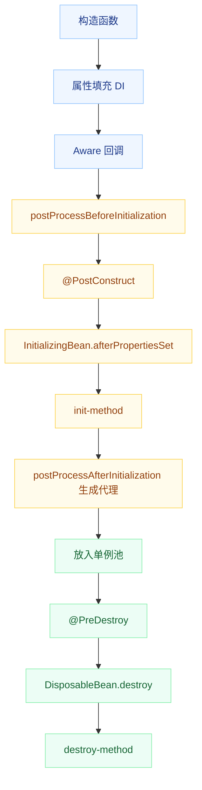
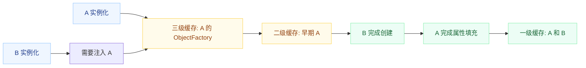

# SpringIoC与AOP原理

> 这篇从 IoC 容器与 BeanDefinition 讲起，经过 Bean 生命周期、依赖注入、循环依赖、AOP 代理和事务传播，最后落到一个用独立事务保证审计日志不被回滚的订单案例。
>
> 学完能独立判断一个 Bean 为什么没注入、切面为什么没生效、事务为什么没回滚，并能用代理和传播行为设计可验证的事务边界。

## 一、容器、BeanDefinition 与依赖注入

IoC（Inversion of Control，控制反转）把对象的创建和依赖装配从业务代码移到容器；DI（Dependency Injection，依赖注入）是它的实现方式。Spring 容器启动时先读 BeanDefinition，再按定义实例化、注入、初始化，最后把单例放进一级缓存。

`BeanFactory` 是最底层容器，默认延迟创建 Bean；`ApplicationContext` 在其上增加事件、国际化、资源加载和自动注册 `BeanPostProcessor`，默认启动时创建所有单例。日常说的“Spring 容器”通常指 `ApplicationContext`。


BeanDefinition 描述“怎么造一个 Bean”，包含类名、作用域、构造参数、依赖、初始化方法、是否懒加载等元数据。注解写法由 `ConfigurationClassPostProcessor` 解析 `@Component`、`@Bean`、`@Import` 后注册成 BeanDefinition。

```java
@Configuration
@ComponentScan("com.example.tx")
public class AppConfig {

    @Bean
    public Clock clock() {
        // 方法名就是默认 Bean 名；返回对象由容器管理
        return Clock.systemDefaultZone();
    }
}
```

```java
try (AnnotationConfigApplicationContext context =
         new AnnotationConfigApplicationContext(AppConfig.class)) {
    // 启动后单例已创建，可以按类型或名称取
    Clock clock = context.getBean(Clock.class);
    System.out.println(clock.getZone());
    System.out.println(context.getBeanDefinitionCount());
}
```

`@Configuration` 类会被 CGLIB 增强，`@Bean` 方法之间直接调用仍返回同一个单例；把注解换成 `@Component`，直接调用就是普通 Java 方法，会每次 new 一个新对象。启动加速时可以写 `@Configuration(proxyBeanMethods = false)`，前提是 `@Bean` 方法之间不互相调用。

> 边界：Bean 不是越多越好。第三方库的对象、需要按请求创建的对象、需要显式关闭的对象，才值得交给容器；纯数据对象和短生命周期临时对象直接 new 更清楚。

## 二、Bean 生命周期

单例 Bean 的创建顺序固定：构造 → 属性填充 → Aware 回调 → `BeanPostProcessor` 前置 → 初始化 → `BeanPostProcessor` 后置 → 使用 → 销毁。AOP 代理在“后置处理”阶段生成，所以其他 Bean 注入到的是代理，不是原始对象。



用一个探针类把顺序打出来：

```java
@Component
public class LifecycleProbe implements InitializingBean, DisposableBean {

    private static final Logger log = LoggerFactory.getLogger(LifecycleProbe.class);

    public LifecycleProbe() {
        log.info("1 constructor");
    }

    @PostConstruct
    void postConstruct() {
        log.info("3 @PostConstruct");
    }

    @Override
    public void afterPropertiesSet() {
        // 此时依赖已注入，适合校验必填配置
        log.info("4 afterPropertiesSet");
    }

    @PreDestroy
    void preDestroy() {
        log.info("6 @PreDestroy");
    }

    @Override
    public void destroy() {
        log.info("7 destroy");
    }
}
```

```java
@Component
public class ProbePostProcessor implements BeanPostProcessor {

    private static final Logger log = LoggerFactory.getLogger(ProbePostProcessor.class);

    @Override
    public Object postProcessBeforeInitialization(Object bean, String beanName) {
        if (bean instanceof LifecycleProbe) {
            log.info("2 before initialization: {}", beanName);
        }
        return bean;
    }

    @Override
    public Object postProcessAfterInitialization(Object bean, String beanName) {
        if (bean instanceof LifecycleProbe) {
            // 代理就在这一步之后生效，此处返回的对象会进入单例池
            log.info("5 after initialization: {}", beanName);
        }
        return bean;
    }
}
```

关闭上下文时的预期输出：

```text
1 constructor
2 before initialization: lifecycleProbe
3 @PostConstruct
4 afterPropertiesSet
5 after initialization: lifecycleProbe
6 @PreDestroy
7 destroy
```

顺序不是背出来的，而是由 `AbstractAutowireCapableBeanFactory.initializeBean` 决定的：先执行 `BeanPostProcessor` 前置，再执行 `@PostConstruct`、`afterPropertiesSet`、`init-method`，最后执行后置。`@PostConstruct` 由 `CommonAnnotationBeanPostProcessor` 驱动，属于前置处理的一部分。

> 边界：`prototype` Bean 的销毁方法不会被容器调用，创建后由调用方负责释放；单例 Bean 的销毁只在上下文正常关闭时触发，`kill -9` 不会执行。不要在 `@PostConstruct` 里做长时间远程调用，它会拖慢整个应用启动，失败还会导致上下文起不来。

### 2.1 三种初始化写法

| 写法 | 执行时机 | 适用 |
|---|---|---|
| `@PostConstruct` | 依赖注入完成后 | 业务代码，最常用 |
| `InitializingBean` | 同上，接口耦合 Spring | 框架内部 |
| `initMethod` | 同上，XML 或 `@Bean` 指定 | 第三方类无法改源码 |

销毁对应 `@PreDestroy`、`DisposableBean`、`destroyMethod`。`@Bean` 返回 `AutoCloseable` 时，Spring 会自动推断 `close` 作为销毁方法，不需要显式写 `destroyMethod`。

## 三、依赖注入与循环依赖

构造器注入是默认推荐：依赖在对象创建时就必须存在，字段可以声明为 `final`，单元测试直接 new，不依赖容器。Setter 注入适合可选依赖；字段注入代码短，但隐藏依赖、难以单测，也容易在 `new` 出来的对象里为 `null`。

| 方式 | 不可变 | 可测性 | 循环依赖 |
|---|---|---|---|
| 构造器 | 是 | 最好 | 直接失败 |
| Setter | 否 | 一般 | 可解 |
| 字段 | 否 | 差 | 可解 |

```java
@Service
public class OrderService {

    private final InventoryService inventory;
    private final PaymentService payment;

    // 单构造器可省略 @Autowired；依赖缺失时启动直接失败
    public OrderService(InventoryService inventory, PaymentService payment) {
        this.inventory = inventory;
        this.payment = payment;
    }
}
```

### 3.1 三级缓存

循环依赖指 A 依赖 B、B 又依赖 A。Spring 用三层缓存解决 setter/字段注入的循环：

| 缓存 | 内容 | 作用 |
|---|---|---|
| `singletonObjects` | 完整单例 | 日常 getBean 命中 |
| `earlySingletonObjects` | 提前暴露的早期引用 | 避免重复创建代理 |
| `singletonFactories` | 生成早期引用的工厂 | 需要时再决定是否代理 |

A 实例化后、属性填充前，先把“能生成 A 早期引用的 ObjectFactory”放进三级缓存；B 创建时发现需要 A，就从三级缓存取工厂生成早期 A，放进二级缓存并注入；B 完成后，A 继续填充属性，最后两者都进入一级缓存。



为什么需要三级而不是两级：如果 A 需要被 AOP 代理，早期引用必须是代理对象。ObjectFactory 把“是否创建代理”推迟到真正被依赖时，避免所有 Bean 都提前代理，也避免注入原始对象后又出现两个不同实例。

### 3.2 构造器循环为什么必失败

```java
@Service
public class AService {
    public AService(BService b) {
        // A 还没构造完，无法暴露早期引用
    }
}

@Service
public class BService {
    public BService(AService a) {
    }
}
```

启动报错的关键行：

```text
The dependencies of some of the beans in the application context form a cycle:
┌─────┐
|  aService defined in file [.../AService.class]
↑     ↓
|  bService defined in file [.../BService.class]
└─────┘
Action:
Relying upon circular references is discouraged and they are prohibited by default.
```

Spring Boot 2.6 起默认禁止循环引用，`spring.main.allow-circular-references=true` 只是临时开关，不解决设计问题。

### 3.3 真正要改的是依赖方向

三种处理方式按推荐顺序排列：

1. 抽第三层：把 B 需要 A 的那部分逻辑抽成 C，A 和 B 都依赖 C；
2. 用 `@Lazy` 注入代理：`public AService(@Lazy BService b)`，打破启动期强依赖；
3. 改成 setter/字段注入，让 Spring 用三级缓存解决。

```java
@Service
public class AService {
    private final BService b;

    public AService(@Lazy BService b) {
        // 注入的是 B 的代理，真正调用方法时才初始化 B
        this.b = b;
    }
}
```

> 边界：`@Lazy` 只把故障推迟到第一次调用，运行时仍可能栈溢出或形成死循环。循环依赖通常是职责划分错误的信号，优先拆服务，不要先加开关。

## 四、AOP 与代理

AOP（Aspect-Oriented Programming，面向切面编程）把日志、事务、权限、重试这类横切逻辑从业务方法里抽出来，运行时通过代理在方法前后插入行为。Spring AOP 只增强 Spring 容器里的 Bean 方法调用，不增强 `new` 出来的对象、静态方法、`final` 方法和同类内部调用。

| 项目 | JDK 动态代理 | CGLIB |
|---|---|---|
| 前提 | 目标类实现接口 | 目标类可继承 |
| 生成方式 | 实现同一接口的代理类 | 生成子类覆写方法 |
| 限制 | 只能代理接口方法 | 不能代理 final/private |
| Spring Boot 默认 | 有接口也可用 | `proxyTargetClass=true` |

Spring Boot 3.x 默认 `spring.aop.proxy-target-class=true`，即优先 CGLIB。需要强制 JDK 代理时设置 `spring.aop.proxy-target-class=false`，但注入类型必须是接口，否则 `NoSuchBeanDefinitionException`。

### 4.1 一个可运行的切面

```java
@Aspect
@Component
public class MethodTimingAspect {

    private static final Logger log = LoggerFactory.getLogger(MethodTimingAspect.class);

    // execution 精确到包和方法，避免把事务、定时任务也统计进来
    @Around("execution(public * com.example.tx.service.*Service.*(..))")
    public Object measure(ProceedingJoinPoint joinPoint) throws Throwable {
        long start = System.nanoTime();
        try {
            return joinPoint.proceed();
        } finally {
            long cost = (System.nanoTime() - start) / 1_000_000;
            log.info("[aop] {} took {} ms",
                joinPoint.getSignature().toShortString(), cost);
        }
    }
}
```

```java
@Service
public class PaymentService {

    public String pay(String orderId, BigDecimal amount) {
        return "PAID-" + orderId + "-" + amount;
    }
}
```

调用 `paymentService.pay("1001", new BigDecimal("39.90"))` 的预期日志：

```text
[aop] PaymentService.pay(..) took 3 ms
```

`@Around` 必须调用 `proceed()`，否则目标方法不会执行；`finally` 里统计耗时，异常也能记录。多个切面用 `@Order` 控制顺序，数值越小越先进入、越后退出。

### 4.2 自调用为什么失效

```java
@Service
public class NotificationService {

    public void send(String user) {
        // this 是原始对象，不经过代理，下面的 @Transactional 和切面都不生效
        this.writeLog(user);
    }

    @Transactional
    public void writeLog(String user) {
        // 插入日志
    }
}
```

外部调用 `send()` 时，代理只拦截 `send`；`send` 内部用 `this.writeLog` 调用原始对象，事务拦截器没有机会执行。修复方式按优先级：

- 把 `writeLog` 拆到另一个 Bean，`send` 注入并调用它；
- 用 `TransactionTemplate` 显式开启事务；
- 注入自身代理 `@Lazy NotificationService self`，调用 `self.writeLog()`；
- 开 `@EnableAspectJAutoProxy(exposeProxy = true)` 后用 `AopContext.currentProxy()`，可读性差，不推荐。

同样的坑适用于 `@Async`、`@Cacheable`、`@PreAuthorize`、`@Scheduled` 之外的绝大多数代理注解。

### 4.3 切点表达式速查

| 表达式 | 匹配 |
|---|---|
| `execution(* com.example.service.*.*(..))` | 包下所有类的所有方法 |
| `execution(* com.example.service..*.*(..))` | 包及子包 |
| `@annotation(org.springframework.transaction.annotation.Transactional)` | 带注解的方法 |
| `within(com.example.service..*)` | 包内所有连接点 |
| `args(java.lang.String, ..)` | 第一个参数是 String |

> 边界：切面本身的异常会影响业务返回；记录日志的切面要吞掉自己的异常，事务切面则必须让异常继续抛出。切面不要修改方法返回值，除非明确知道调用方契约。

## 五、事务传播与回滚

`@Transactional` 本质是一个 AOP 切面：方法进入前从 `PlatformTransactionManager` 获取连接、关闭自动提交，方法正常返回则提交，抛出未捕获的 `RuntimeException` 或 `Error` 则回滚。

Spring 定义七种传播行为：

| 传播行为 | 有外层事务 | 无外层事务 | 典型场景 |
|---|---|---|---|
| `REQUIRED` | 加入 | 新建 | 默认，绝大多数写操作 |
| `REQUIRES_NEW` | 挂起外层，新建 | 新建 | 审计、日志必须落库 |
| `NESTED` | 保存点 | 新建 | 可部分回滚的子步骤 |
| `SUPPORTS` | 加入 | 不加事务 | 查询 |
| `NOT_SUPPORTED` | 挂起外层 | 不加事务 | 耗时通知 |
| `MANDATORY` | 加入 | 抛异常 | 强制在事务内调用 |
| `NEVER` | 抛异常 | 不加事务 | 禁止事务的场景 |

`REQUIRES_NEW` 会占用第二个数据库连接。外层事务持有连接不放，内层再要一个，连接池小、并发高时容易把池耗尽；嵌套层级越深，死锁和超时风险越高。

### 5.1 回滚规则

默认只对 `RuntimeException` 和 `Error` 回滚，受检异常不回滚：

```java
@Transactional
public void createOrder() throws IOException {
    jdbc.update("insert into orders ...");
    throw new IOException("磁盘写入失败"); // 默认提交，订单会留下
}
```

```java
@Transactional(rollbackFor = Exception.class)
public void createOrderSafely() throws IOException {
    jdbc.update("insert into orders ...");
    throw new IOException("磁盘写入失败"); // 现在会回滚
}
```

捕获异常也会阻止回滚：

```java
@Transactional
public void importData() {
    try {
        jdbc.update("insert into import_log ...");
        throw new IllegalStateException("解析失败");
    } catch (IllegalStateException e) {
        log.warn("忽略失败", e); // 异常被吞，事务仍然提交
    }
}
```

需要“记录失败但继续提交”时，这是有意行为；需要“记录后仍然回滚”时，捕获后必须 `TransactionAspectSupport.currentTransactionStatus().setRollbackOnly()`，或把异常重新抛出。

### 5.2 只读、超时与隔离级别

```java
@Transactional(readOnly = true, timeout = 3)
public List<OrderView> queryRecent() {
    return jdbc.query("select ...", mapper);
}
```

`readOnly` 是给驱动和 ORM 的优化提示，不是所有数据库都强制拒绝写入；`timeout` 单位是秒，超时由底层连接和数据库配合实现。隔离级别用 `isolation = Isolation.READ_COMMITTED` 指定，MySQL InnoDB 默认 `REPEATABLE_READ`，H2 默认 `READ_COMMITTED`，跨库迁移时要显式确认。

> 边界：事务方法必须是 `public`，且通过代理调用；`private`、`final`、同类自调用都不会开启事务。不要把远程调用、发邮件、写文件放在长事务里，连接被占用的时间会成倍放大。

## 六、失效场景与排查

排查顺序是“Bean 是否被容器管理 → 调用是否经过代理 → 注解是否匹配 → 事务是否真的开启”，不要先怀疑框架。

| 现象 | 原因 | 第一条检查 |
|---|---|---|
| 注入为 `null` | 对象是 `new` 出来的 | 调用方是否用 `getBean`/注入 |
| 切面不执行 | 切点没匹配或 Bean 未被扫描 | 打印代理类型与切点 |
| 事务不回滚 | 受检异常、异常被吞、自调用 | 看异常类型与调用栈 |
| 启动循环依赖 | 构造器互相依赖 | 看错误里的依赖环 |
| `@PostConstruct` 不执行 | 类没有交给容器 | 是否有 `@Component`/`@Bean` |
| `@Async` 同步执行 | 自调用或未开 `@EnableAsync` | 看线程名是否变化 |

三个直接可用的判断：

```java
// 1. 当前对象是不是代理，JDK 还是 CGLIB
System.out.println(AopUtils.isAopProxy(orderService));
System.out.println(AopUtils.isJdkDynamicProxy(orderService));

// 2. 当前线程有没有真实事务
System.out.println(TransactionSynchronizationManager.isActualTransactionActive());

// 3. 看容器里 Bean 的定义来源
System.out.println(Arrays.toString(context.getBeanDefinitionNames()));
```

事务调试日志能看到获取连接、挂起、提交、回滚的完整过程：

```yaml
logging:
  level:
    org.springframework.transaction: TRACE
    org.springframework.jdbc.datasource.DataSourceTransactionManager: DEBUG
```

## 七、最佳实践案例

### 7.1 案例背景

一个订单服务要在同一个事务里完成“写订单 + 扣库存”，同时把“订单已创建”写入审计表。业务要求：库存不足时订单和扣减都回滚，但审计记录必须保留，便于事后追查失败请求。

约束：单体应用、H2 内存库、不引入消息队列；审计写入不能影响主事务提交；要能用一条命令复现成功和失败两条路径。

### 7.2 案例实操

工程依赖：

```xml
<dependencies>
    <dependency>
        <groupId>org.springframework.boot</groupId>
        <artifactId>spring-boot-starter</artifactId>
    </dependency>
    <dependency>
        <groupId>org.springframework.boot</groupId>
        <artifactId>spring-boot-starter-jdbc</artifactId>
    </dependency>
    <dependency>
        <groupId>org.springframework.boot</groupId>
        <artifactId>spring-boot-starter-aop</artifactId>
    </dependency>
    <dependency>
        <groupId>com.h2database</groupId>
        <artifactId>h2</artifactId>
        <scope>runtime</scope>
    </dependency>
    <dependency>
        <groupId>org.springframework.boot</groupId>
        <artifactId>spring-boot-starter-test</artifactId>
        <scope>test</scope>
    </dependency>
</dependencies>
```

`application.yml` 关闭 Web 容器，启动后直接跑命令行：

```yaml
spring:
  main:
    web-application-type: none
  datasource:
    url: jdbc:h2:mem:txdemo;DB_CLOSE_DELAY=-1
    username: sa
    password:
  sql:
    init:
      mode: always
logging:
  level:
    org.springframework.transaction: INFO
```

`schema.sql` 与 `data.sql`：

```sql
-- schema.sql
drop table if exists orders;
drop table if exists inventory;
drop table if exists audit_log;

create table orders (
    id bigint primary key,
    sku varchar(32) not null,
    qty int not null,
    amount decimal(10, 2) not null,
    status varchar(16) not null
);

create table inventory (
    sku varchar(32) primary key,
    stock int not null
);

create table audit_log (
    id bigint generated by default as identity primary key,
    action varchar(64) not null,
    detail varchar(255),
    created_at timestamp default current_timestamp
);
```

```sql
-- data.sql
insert into inventory (sku, stock) values ('SKU-1', 10);
```

库存服务加入外层事务，扣减失败抛运行时异常：

```java
@Service
public class InventoryService {

    private final JdbcTemplate jdbc;

    public InventoryService(JdbcTemplate jdbc) {
        this.jdbc = jdbc;
    }

    @Transactional
    public void deduct(String sku, int qty) {
        // where stock >= ? 把“检查”和“扣减”合成一条原子 SQL，避免并发超卖
        int updated = jdbc.update("""
                update inventory set stock = stock - ?
                where sku = ? and stock >= ?
                """, qty, sku, qty);
        if (updated == 0) {
            throw new IllegalStateException("库存不足: " + sku);
        }
    }
}
```

审计服务用 `REQUIRES_NEW`，方法返回时独立事务已经提交：

```java
@Service
public class AuditService {

    private final JdbcTemplate jdbc;

    public AuditService(JdbcTemplate jdbc) {
        this.jdbc = jdbc;
    }

    @Transactional(propagation = Propagation.REQUIRES_NEW)
    public void record(String action, String detail) {
        // 挂起外层事务，用新连接写入；外层回滚不会带走这条记录
        jdbc.update("insert into audit_log (action, detail) values (?, ?)",
            action, detail);
    }
}
```

订单服务按“订单 → 审计 → 扣库存”的顺序执行：

```java
@Service
public class OrderService {

    private static final Logger log = LoggerFactory.getLogger(OrderService.class);

    private final JdbcTemplate jdbc;
    private final InventoryService inventory;
    private final AuditService audit;

    public OrderService(JdbcTemplate jdbc, InventoryService inventory, AuditService audit) {
        this.jdbc = jdbc;
        this.inventory = inventory;
        this.audit = audit;
    }

    @Transactional
    public void place(long orderId, String sku, int qty, BigDecimal amount) {
        jdbc.update("""
                insert into orders (id, sku, qty, amount, status)
                values (?, ?, ?, ?, 'CREATED')
                """, orderId, sku, qty, amount);
        log.info("order {} inserted, waiting for stock", orderId);

        // 审计先提交：即使后面库存不足，失败请求也有记录
        audit.record("ORDER_CREATED", "order=" + orderId);

        // 库存不足抛异常，外层订单事务回滚，审计记录保留
        inventory.deduct(sku, qty);
        log.info("order {} completed", orderId);
    }
}
```

启动 Runner 连续跑失败和成功两条路径，并打印三张表的计数：

```java
@Component
@Profile("!test") // 测试上下文不跑演示数据，避免污染断言
public class DemoRunner implements ApplicationRunner {

    private final OrderService orderService;
    private final JdbcTemplate jdbc;

    public DemoRunner(OrderService orderService, JdbcTemplate jdbc) {
        this.orderService = orderService;
        this.jdbc = jdbc;
    }

    @Override
    public void run(ApplicationArguments args) {
        print("before");
        try {
            // 库存只有 10，下单 20 必然失败
            orderService.place(1001L, "SKU-1", 20, new BigDecimal("39.90"));
        } catch (IllegalStateException ex) {
            System.out.println("[expected] " + ex.getMessage());
        }
        print("after failed order");

        orderService.place(1002L, "SKU-1", 1, new BigDecimal("19.90"));
        print("after success");
    }

    private void print(String stage) {
        Integer orders = jdbc.queryForObject("select count(*) from orders", Integer.class);
        Integer stock = jdbc.queryForObject(
            "select stock from inventory where sku = 'SKU-1'", Integer.class);
        Integer audits = jdbc.queryForObject("select count(*) from audit_log", Integer.class);
        System.out.printf("[%s] orders=%d stock=%d audit=%d%n",
            stage, orders, stock, audits);
    }
}
```

运行：

```bash
./mvnw spring-boot:run
```

预期输出：

```text
[before] orders=0 stock=10 audit=0
order 1001 inserted, waiting for stock
[expected] 库存不足: SKU-1
[after failed order] orders=0 stock=10 audit=1
order 1002 inserted, waiting for stock
order 1002 completed
[after success] orders=1 stock=9 audit=2
```

用测试固定行为，防止以后有人把 `REQUIRES_NEW` 改回 `REQUIRED`。`@SpringBootTest` 会执行 `ApplicationRunner`，所以演示 Runner 标 `@Profile("!test")`，测试侧激活 `test` profile：

```java
@SpringBootTest
@ActiveProfiles("test") // 激活 test profile，排除 DemoRunner
class OrderServiceTest {

    @Autowired
    OrderService orderService;

    @Autowired
    JdbcTemplate jdbc;

    @Test
    void auditSurvivesWhenStockIsInsufficient() {
        assertThrows(IllegalStateException.class,
            () -> orderService.place(2001L, "SKU-1", 20, new BigDecimal("10.00")));

        // 订单回滚，库存不变，审计保留
        assertEquals(0, count("orders"));
        assertEquals(10, jdbc.queryForObject(
            "select stock from inventory where sku = 'SKU-1'", Integer.class));
        assertEquals(1, count("audit_log"));
    }

    private int count(String table) {
        return jdbc.queryForObject("select count(*) from " + table, Integer.class);
    }
}
```

```bash
./mvnw test
```

预期结果：

```text
Tests run: 1, Failures: 0, Errors: 0, Skipped: 0
BUILD SUCCESS
```

### 7.3 案例结果

失败订单没有留下 `orders` 记录，库存保持 10；审计表多了一条 `ORDER_CREATED`。成功订单写入 1 条订单、扣减 1 件库存、再写 1 条审计，最终计数与预期一致，测试通过。

失败模式与复盘：

- 第一次实现把审计方法写成 `REQUIRED`，失败订单回滚时审计一起消失，测试用例立刻暴露问题；改成 `REQUIRES_NEW` 后通过。
- `REQUIRES_NEW` 需要第二个连接，Hikari 默认池大小 10；并发压测时把池调到 20 仍出现等待，最终把审计改成异步消息，事务里只写本地事件表，这是下一阶段的演进方向。
- 库存扣减用 `where stock >= ?` 做原子判断，避免“先查再减”的并发超卖；如果业务需要预占库存，应拆成“预占、确认、释放”三个状态，而不是把长事务拉得更长。
- 审计表用独立事务后不再受主事务隔离级别保护，读审计时可能看到“订单还没提交但审计已存在”的中间状态，这是有意的取舍，查询侧要能接受。
