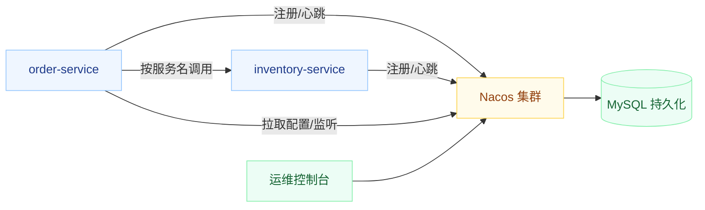

# Nacos注册与配置

> 这篇从注册中心与配置中心的职责边界讲起，经过单机安装、服务注册发现、配置中心接入、命名空间与灰度、集群高可用，最后落到一个多环境订单服务的配置灰度与回滚案例。
>
> 学完能独立部署 Nacos、把 Spring Boot 服务接入注册与配置中心，并能判断服务注册不上、配置不刷新、命名空间串环境这类问题出在哪一层。

## 一、注册中心与配置中心的边界

Nacos 同时提供命名服务（Naming）和配置服务（Config）：前者解决“服务实例在哪里”，后者解决“配置是什么”。两者共用控制台和鉴权，但数据模型、一致性协议和故障影响不同。

注册中心保存的是运行时实例列表，变化频繁，追求可用性；配置中心保存的是键值配置，变化较少，要求可靠和可回滚。把两者混在一个故障域里，配置中心挂了不应该让已启动的服务立刻不可用。



Nacos 2.x 的客户端默认走 gRPC 长连接，端口是主端口 +1000；1.x 的 HTTP 长轮询已经不再是默认路径。只开放 8848 会导致服务能打开控制台却注册不上，这是最常见的部署错误。

| 能力 | 注册中心 | 配置中心 |
|---|---|---|
| 核心数据 | 服务名、IP、端口、元数据 | dataId、group、内容 |
| 一致性 | 临时实例 AP，持久实例 CP | 持久化到 MySQL，集群同步 |
| 变更频率 | 秒级 | 分钟级 |
| 客户端 | 心跳、订阅推送 | 长轮询/长连接监听 |
| 故障影响 | 新实例发现失败 | 新配置不生效，旧配置仍可用 |

选型边界：单体应用不需要注册中心；Kubernetes 内只用 Service DNS、没有跨集群调用时，未必要再叠一层 Nacos；需要多语言、多环境、配置审计和灰度时，Nacos 的价值才明显。Nacos 不是服务网格，不负责流量治理的全部职责，限流、熔断仍由 Sentinel/Resilience4j 完成。

> 边界：注册中心只保证“拿到实例列表”，不保证实例一定健康。调用方仍要超时、重试、熔断；Nacos 的保护阈值只是防止大面积剔除导致流量打到少数实例，不是健康检查的替代品。

## 二、安装与最小验证

版本基线（2026-11）：Nacos 2.5.x、JDK 21、MySQL 8.4、Spring Boot 3.5.x、Spring Cloud 2025.0.x、Spring Cloud Alibaba 2025.0.0.0。Nacos 2.5 仍兼容 JDK 8/11/17，生产建议与业务统一到 21。

| 组件 | 版本 | 说明 |
|---|---|---|
| Nacos Server | 2.5.x | 2.5.1 为本文示例 |
| JDK | 21 LTS | 服务端与客户端一致 |
| MySQL | 8.4 | 生产必须外置 |
| Spring Boot | 3.5.x | 客户端基线 |
| Spring Cloud Alibaba | 2025.0.0.0 | 以官方版本说明为准 |

### 2.1 Docker 单机启动

开发环境用单机模式，数据默认落在内嵌 Derby；重启容器会丢配置，所以要么挂载数据目录，要么直接接 MySQL。

```bash
# 生成 Base64 密钥；Nacos 要求原始密钥至少 32 字节
export NACOS_AUTH_TOKEN="$(openssl rand -base64 32)"

docker run -d --name nacos \
  -e MODE=standalone \
  -e NACOS_AUTH_ENABLE=true \
  -e NACOS_AUTH_TOKEN="$NACOS_AUTH_TOKEN" \
  -e NACOS_AUTH_IDENTITY_KEY=serverIdentity \
  -e NACOS_AUTH_IDENTITY_VALUE=security \
  -p 8848:8848 \
  -p 9848:9848 \
  -p 9849:9849 \
  nacos/nacos-server:v2.5.1
```

macOS 与 Windows 的 Docker Desktop 命令相同；Linux 需要把当前用户加入 `docker` 组，或使用 `sudo`。生产不要用 `MODE=standalone`。

接 MySQL 时增加环境变量，并先导入官方 `mysql-schema.sql`：

```bash
docker run -d --name nacos \
  -e MODE=standalone \
  -e SPRING_DATASOURCE_PLATFORM=mysql \
  -e MYSQL_SERVICE_HOST=127.0.0.1 \
  -e MYSQL_SERVICE_PORT=3306 \
  -e MYSQL_SERVICE_DB_NAME=nacos \
  -e MYSQL_SERVICE_USER=nacos \
  -e MYSQL_SERVICE_PASSWORD='Nacos@2026' \
  -e MYSQL_SERVICE_DB_PARAM='characterEncoding=utf8&connectTimeout=1000&socketTimeout=3000&autoReconnect=true&useSSL=false&allowPublicKeyRetrieval=true&serverTimezone=Asia/Shanghai' \
  -p 8848:8848 -p 9848:9848 -p 9849:9849 \
  nacos/nacos-server:v2.5.1
```

MySQL 初始化：

```sql
CREATE DATABASE nacos DEFAULT CHARACTER SET utf8mb4 COLLATE utf8mb4_general_ci;
CREATE USER 'nacos'@'%' IDENTIFIED BY 'Nacos@2026';
GRANT ALL PRIVILEGES ON nacos.* TO 'nacos'@'%';
FLUSH PRIVILEGES;
```

```bash
# 官方发行包的 conf/mysql-schema.sql；Docker 镜像内路径为 /home/nacos/conf/mysql-schema.sql
mysql -h 127.0.0.1 -u nacos -p nacos < mysql-schema.sql
```

### 2.2 二进制安装

Ubuntu 24.04/26.04 与 Rocky/CentOS 9/10 先装 JDK：

```bash
# Ubuntu
sudo apt update && sudo apt install -y openjdk-21-jdk

# Rocky / CentOS
sudo dnf install -y java-21-openjdk-devel

# 验证
java -version
```

```bash
# 版本号以 release 页面为准
curl -LO https://github.com/alibaba/nacos/releases/download/2.5.1/nacos-server-2.5.1.tar.gz
tar -zxvf nacos-server-2.5.1.tar.gz -C /opt
cd /opt/nacos/bin

# Linux / macOS
bash startup.sh -m standalone

# Windows PowerShell
.\startup.cmd -m standalone
```

防火墙按系统放行：

```bash
# Ubuntu ufw
sudo ufw allow 8848/tcp
sudo ufw allow 9848/tcp
sudo ufw allow 9849/tcp

# Rocky firewalld
sudo firewall-cmd --permanent --add-port=8848/tcp
sudo firewall-cmd --permanent --add-port=9848/tcp
sudo firewall-cmd --permanent --add-port=9849/tcp
sudo firewall-cmd --reload
```

### 2.3 最小验证

```bash
# 就绪探针
curl -s http://127.0.0.1:8848/nacos/v1/console/health/readiness

# 登录拿 token
TOKEN=$(curl -s -X POST 'http://127.0.0.1:8848/nacos/v1/auth/login' \
  -d 'username=nacos&password=nacos' \
  | python3 -c 'import sys,json;print(json.load(sys.stdin)["accessToken"])')
echo "$TOKEN"
```

预期输出：

```text
{"status":"UP"}

eyJhbGciOiJIUzI1NiJ9.eyJzdWIiOiJuYWNvcyIsImV4cCI6MTc5NDU5ODQwMH0...
```

控制台地址 `http://127.0.0.1:8848/nacos`，默认账号 `nacos/nacos`；开启鉴权后首次登录必须改密码。只看到登录页、健康检查正常，不代表 9848 通了，下一步注册服务才能验证。

> 边界：`NACOS_AUTH_TOKEN` 不是随便填的字符串，必须是 Base64 编码且解码后至少 32 字节；`NACOS_AUTH_IDENTITY_KEY/VALUE` 是集群节点之间互相认证用的，三节点必须一致。生产不要把 token 写进 Dockerfile 或 Git。

## 三、服务注册与发现

服务注册只需要三样：服务名、可被访问的 IP、端口。Spring Cloud Alibaba 的 starter 会自动把 `spring.application.name` 注册为服务名，把网卡地址注册为 IP，并每 5 秒发送心跳。

```xml
<dependencyManagement>
    <dependencies>
        <dependency>
            <groupId>org.springframework.cloud</groupId>
            <artifactId>spring-cloud-dependencies</artifactId>
            <version>2025.0.0</version>
            <type>pom</type>
            <scope>import</scope>
        </dependency>
        <dependency>
            <groupId>com.alibaba.cloud</groupId>
            <artifactId>spring-cloud-alibaba-dependencies</artifactId>
            <version>2025.0.0.0</version>
            <type>pom</type>
            <scope>import</scope>
        </dependency>
    </dependencies>
</dependencyManagement>
```

```xml
<dependencies>
    <dependency>
        <groupId>org.springframework.boot</groupId>
        <artifactId>spring-boot-starter-web</artifactId>
    </dependency>
    <dependency>
        <groupId>com.alibaba.cloud</groupId>
        <artifactId>spring-cloud-starter-alibaba-nacos-discovery</artifactId>
    </dependency>
    <!-- Nacos 发现客户端需要 LoadBalancer 才能做服务名调用 -->
    <dependency>
        <groupId>org.springframework.cloud</groupId>
        <artifactId>spring-cloud-starter-loadbalancer</artifactId>
    </dependency>
    <dependency>
        <groupId>org.springframework.boot</groupId>
        <artifactId>spring-boot-starter-actuator</artifactId>
    </dependency>
</dependencies>
```

```yaml
spring:
  application:
    name: order-service
  cloud:
    nacos:
      server-addr: 127.0.0.1:8848
      username: nacos
      password: nacos
      discovery:
        namespace: dev
        group: ORDER_GROUP
        metadata:
          version: v1
          zone: shanghai
```

启动类加不加 `@EnableDiscoveryClient` 都可以；classpath 上有 Discovery 实现时 Boot 会自动启用。显式加上便于阅读：

```java
@SpringBootApplication
@EnableDiscoveryClient
public class OrderApplication {
    public static void main(String[] args) {
        SpringApplication.run(OrderApplication.class, args);
    }
}
```

验证注册结果：

```bash
curl -s "http://127.0.0.1:8848/nacos/v1/ns/instance/list?serviceName=order-service&groupName=ORDER_GROUP&namespaceId=dev&accessToken=$TOKEN" \
  | python3 -m json.tool
```

预期输出（关键字段）：

```json
{
  "name": "ORDER_GROUP@@order-service",
  "groupName": "ORDER_GROUP",
  "hosts": [
    {
      "ip": "192.168.10.21",
      "port": 8081,
      "healthy": true,
      "weight": 1.0,
      "metadata": {"version": "v1", "zone": "shanghai"}
    }
  ],
  "reachProtectionThreshold": false
}
```

代码侧用 `DiscoveryClient` 查实例：

```java
@RestController
@RequestMapping("/api/instances")
public class InstanceController {

    private final DiscoveryClient discoveryClient;

    public InstanceController(DiscoveryClient discoveryClient) {
        this.discoveryClient = discoveryClient;
    }

    @GetMapping
    public List<String> instances() {
        return discoveryClient.getInstances("inventory-service").stream()
            // getUri 已包含 ip:port，调用方不要再拼接 context-path
            .map(instance -> instance.getUri().toString())
            .toList();
    }
}
```

### 3.1 心跳、临时实例与保护阈值

Nacos 把实例分为临时（ephemeral）和持久（persistent）：

| 类型 | 注册方式 | 健康判断 | 一致性 |
|---|---|---|---|
| 临时实例 | 客户端心跳/gRPC 连接 | 心跳超时剔除 | Distro，AP |
| 持久实例 | 控制台/API 注册 | 服务端主动探测 | Raft，CP |

临时实例默认每 5 秒心跳，服务端约 15 秒未收到标记不健康，30 秒左右删除；具体阈值随版本配置变化。进程被 `kill -9` 时不会主动注销，要等心跳超时；正常关闭时客户端会先 deregister，所以上线要配优雅停机：

```yaml
server:
  shutdown: graceful
spring:
  lifecycle:
    timeout-per-shutdown-phase: 20s
```

保护阈值 `protectThreshold` 默认 0.5：当健康实例数 / 总实例数低于阈值时，Nacos 会把所有实例都返回，避免调用方只看到少数实例而被打垮。控制台可以按服务调整，代价是可能把不健康实例也返回，调用方仍要熔断。

> 边界：注册的 IP 必须是调用方能访问的地址。容器里自动取到的可能是 `172.17.0.x`，跨主机调用不通；用 `spring.cloud.nacos.discovery.ip` 显式指定宿主机 IP，或使用 host 网络。NAT/端口映射场景还要设置 `spring.cloud.nacos.discovery.port`。

## 四、配置中心

Nacos 配置由三元组定位：`namespace` + `group` + `dataId`。Spring Cloud Alibaba 2023 之后推荐用 `spring.config.import`，不再需要 `bootstrap.yml`；`bootstrap` 上下文在 Spring Boot 2.4 后已被配置数据导入取代。

```yaml
spring:
  application:
    name: order-service
  config:
    import: optional:nacos:order-service.yaml?group=ORDER_GROUP&refreshEnabled=true
  cloud:
    nacos:
      server-addr: 127.0.0.1:8848
      username: nacos
      password: nacos
      config:
        namespace: dev
        group: ORDER_GROUP
        file-extension: yaml
```

`optional:` 表示配置不存在也启动；核心配置建议去掉 `optional`，让缺失配置在启动时直接失败。`refreshEnabled=true` 让客户端监听变更并刷新。

配置层级：

| 层级 | 隔离对象 | 示例 |
|---|---|---|
| namespace | 环境、租户 | dev、prod |
| group | 应用或业务域 | ORDER_GROUP |
| dataId | 一个配置文件 | order-service.yaml |
| profile | 同环境多套配置 | order-service-dev.yaml |

Spring Cloud Alibaba 的配置优先级从高到低：

| 来源 | 优先级 | 说明 |
|---|---|---|
| `spring.config.import` 主配置 | 最高 | 精确 dataId |
| `extension-configs` | 中 | 下标越大越高 |
| `shared-configs` | 低 | 下标越大越高 |
| 本地 `application.yml` | 最低 | 兜底 |

```yaml
spring:
  cloud:
    nacos:
      config:
        shared-configs:
          - data-id: common.yaml
            group: COMMON_GROUP
            refresh: true
        extension-configs:
          - data-id: order-service-extra.yaml
            group: ORDER_GROUP
            refresh: true
```

### 4.1 发布与读取配置

```bash
curl -s -X POST "http://127.0.0.1:8848/nacos/v1/cs/configs?accessToken=$TOKEN" \
  --data-urlencode 'dataId=order-service.yaml' \
  --data-urlencode 'group=ORDER_GROUP' \
  --data-urlencode 'tenant=dev' \
  --data-urlencode 'type=yaml' \
  --data-urlencode 'content=feature:
  newCheckout: false
  banner: welcome'
```

```bash
curl -s "http://127.0.0.1:8848/nacos/v1/cs/configs?dataId=order-service.yaml&group=ORDER_GROUP&tenant=dev&accessToken=$TOKEN"
```

预期返回配置原文：

```yaml
feature:
  newCheckout: false
  banner: welcome
```

注意配置 API 的命名空间参数叫 `tenant`，服务发现 API 叫 `namespaceId`；两个接口的参数名不同，复制命令时最容易错。

### 4.2 自动刷新

`@Value` 注入的字段不会因为配置变化自动更新，需要 `@RefreshScope`：

```java
@RestController
@RequestMapping("/api/feature")
@RefreshScope
public class FeatureController {

    @Value("${feature.newCheckout:false}")
    private boolean newCheckout;

    @Value("${feature.banner:}")
    private String banner;

    @GetMapping
    public Map<String, Object> feature() {
        // @RefreshScope 会在配置变更后重建 Bean，这里读到的是新值
        return Map.of("newCheckout", newCheckout, "banner", banner);
    }
}
```

`@ConfigurationProperties` 不需要 `@RefreshScope`，Spring Cloud 的 `ConfigurationPropertiesRebinder` 会在环境变更时重新绑定：

```java
@ConfigurationProperties(prefix = "feature")
public record FeatureProperties(boolean newCheckout, String banner) {
}
```

```java
@Configuration
@EnableConfigurationProperties(FeatureProperties.class)
public class FeatureConfig {
}
```

> 边界：`@RefreshScope` 只刷新被代理的 Bean，静态字段、构造器里已经算好的值、连接池参数都不会变。数据库连接、线程池大小这类启动期参数，改配置后必须重启；把它们放进 Nacos 只会制造“看起来生效、实际没变”的假象。

## 五、命名空间、分组与灰度

多环境隔离优先用 namespace，不要靠 dataId 前缀硬编码。namespace 的 ID 是隔离键，名称只是展示；Spring 配置里写的是 ID，不是名称。

```bash
# 创建 dev / prod 命名空间；customNamespaceId 就是配置里要写的 ID
curl -s -X POST "http://127.0.0.1:8848/nacos/v1/console/namespaces?accessToken=$TOKEN" \
  -d 'customNamespaceId=dev' \
  -d 'namespaceName=dev' \
  -d 'namespaceDesc=development'

curl -s -X POST "http://127.0.0.1:8848/nacos/v1/console/namespaces?accessToken=$TOKEN" \
  -d 'customNamespaceId=prod' \
  -d 'namespaceName=prod' \
  -d 'namespaceDesc=production'
```

```bash
curl -s "http://127.0.0.1:8848/nacos/v1/console/namespaces?accessToken=$TOKEN" \
  | python3 -m json.tool
```

预期包含 `namespace: "dev"`、`namespaceShowName: "dev"`。如果创建时没传 `customNamespaceId`，Nacos 会生成 UUID，配置里写 `dev` 就匹配不上，表现为“配置明明发布了，服务就是读不到”。

隔离层级建议：

| 场景 | namespace | group | dataId |
|---|---|---|---|
| 开发/生产 | dev / prod | 按应用 | 服务名.yaml |
| 多租户 | 租户 ID | 按应用 | 服务名.yaml |
| 同环境多版本 | 同一 namespace | 同一 group | 服务名-v2.yaml |
| 公共配置 | 同环境 | COMMON_GROUP | common.yaml |

### 5.1 配置灰度

Nacos 控制台的“灰度发布”按客户端 IP 匹配：编辑配置时选择 Beta 发布，填入一台实例的 IP，只有该 IP 的客户端收到新值，其他实例保持旧值。验证完再把全量发布。

步骤：

1. 在配置详情页编辑 `feature.newCheckout=true`；
2. 选择“Beta 发布”，Beta IP 填 `192.168.10.22`；
3. 保存后只访问 22 这台实例的 `/api/feature`，应返回 `true`；
4. 访问其他实例，仍返回 `false`；
5. 观察 10 分钟，无异常后点“全量发布”。

Beta IP 必须是 Nacos 客户端上报的 IP，不是宿主机 NAT 后的地址；容器化部署时 Pod IP 会变，重启后 Beta 规则可能失效，生产更适合按实例元数据做路由。

### 5.2 实例权重灰度

按权重分流不依赖配置内容，适合验证新版本代码。控制台把 v1 权重设为 9、v2 设为 1，配合 `NacosLoadBalancer` 大约 90% / 10%：

```yaml
spring:
  cloud:
    loadbalancer:
      nacos:
        enabled: true
```

| 阶段 | v1 权重 | v2 权重 | 预期流量 |
|---|---|---|---|
| 初始 | 10 | 0 | 全部 v1 |
| 小流量 | 9 | 1 | 约 10% v2 |
| 对半 | 5 | 5 | 约 50% v2 |
| 全量 | 0 | 10 | 全部 v2 |

权重是相对值，不要求总和为 10；设为 0 表示不再分配流量，但实例仍注册。权重调整后客户端有缓存，通常几十秒内生效，不要用“立刻 100%”做断言。

> 边界：Nacos 的 Beta 发布和权重只解决“配置/流量切一部分”，不提供自动回滚和指标判断。灰度必须配监控：错误率、P99、业务成功率任一项越线就回滚；没有观测的灰度只是换了一种发布方式。

## 六、集群与高可用

生产至少三节点，共用一套 MySQL。每个节点的 `conf/cluster.conf` 写全部节点地址：

```text
192.168.10.11:8848
192.168.10.12:8848
192.168.10.13:8848
```

```bash
# 每个节点
bash startup.sh -m cluster
```

Docker 集群用 `NACOS_SERVERS` 指定节点列表，并确保 8848、9848、9849、7848 互通：

```bash
docker run -d --name nacos-1 \
  -e MODE=cluster \
  -e NACOS_SERVERS='192.168.10.11:8848 192.168.10.12:8848 192.168.10.13:8848' \
  -e SPRING_DATASOURCE_PLATFORM=mysql \
  -e MYSQL_SERVICE_HOST=192.168.10.10 \
  -e MYSQL_SERVICE_DB_NAME=nacos \
  -e MYSQL_SERVICE_USER=nacos \
  -e MYSQL_SERVICE_PASSWORD='Nacos@2026' \
  -p 8848:8848 -p 9848:9848 -p 9849:9849 -p 7848:7848 \
  nacos/nacos-server:v2.5.1
```

端口分工：

| 端口 | 用途 | 是否必须对外 |
|---|---|---|
| 8848 | HTTP、控制台、OpenAPI | 控制台/运维网段 |
| 9848 | 客户端 gRPC | 所有业务实例 |
| 9849 | 集群间 gRPC | 仅 Nacos 节点 |
| 7848 | Raft 选举与数据同步 | 仅 Nacos 节点 |

客户端配置多个地址，不要只写一个 VIP：

```yaml
spring:
  cloud:
    nacos:
      server-addr: 192.168.10.11:8848,192.168.10.12:8848,192.168.10.13:8848
```

Nginx 可以代理控制台和 OpenAPI 的 8848，但 gRPC 的 9848 需要四层透传或让客户端直连；只做七层代理会出现“控制台正常、注册失败”。升级时逐台摘流、重启、验证健康后再下一台，不要三台同时重启。

> 边界：MySQL 是 Nacos 的强依赖。MySQL 挂掉后，已连接的客户端仍能用本地缓存和已拉取配置运行一段时间，但新配置发布、新实例注册会失败。生产要给 MySQL 做主从和备份，不要把 Nacos 的 Derby 用在集群模式。

## 七、排障与上线检查

Nacos 的问题先分三层：客户端到 Nacos 的网络、Nacos 到 MySQL 的持久化、配置/命名空间的匹配。按现象查：

| 现象 | 原因 | 第一条检查 |
|---|---|---|
| 服务列表为空 | 只开了 8848 | `telnet ip 9848` |
| 注册 IP 不通 | 容器网卡地址错误 | 看 Nacos 实例 IP |
| 配置读不到 | namespace ID 写错 | 控制台命名空间 ID |
| 配置改了不生效 | 缺 `@RefreshScope` | 看 Bean 是否重建 |
| 启动报 import 错误 | 未配 `spring.config.import` | 检查 import 行 |
| 登录 403 | token 过期/鉴权关闭 | 重新登录拿 token |
| 实例一直不健康 | 心跳被防火墙拦 | `ss -lntp` 与安全组 |

常用命令：

```bash
# 看端口和进程
ss -lntp | grep -E '8848|9848|9849|7848'

# 看客户端到 gRPC 端口的连通性
nc -vz 192.168.10.11 9848

# 看服务端日志
tail -f /opt/nacos/logs/nacos.log
tail -f /opt/nacos/logs/naming-server.log

# 看注册结果
curl -s "http://127.0.0.1:8848/nacos/v1/ns/instance/list?serviceName=order-service&groupName=ORDER_GROUP&namespaceId=dev&accessToken=$TOKEN"
```

客户端打开调试日志能看到拉取和监听过程：

```yaml
logging:
  level:
    com.alibaba.nacos: DEBUG
    com.alibaba.cloud.nacos: DEBUG
```

上线检查清单：

- 三节点集群 + 外置 MySQL，MySQL 有备份和监控；
- 8848 只对运维网段开放，9848 对业务网段开放，控制台改默认密码；
- 客户端配置多地址，服务注册 IP 经过验证；
- 所有服务有 namespace、group、dataId 规范，禁止用 `public` 放生产配置；
- 配置变更走灰度，回滚有旧版本内容；
- 服务优雅停机，实例下线后等待调用方刷新再摘流量；
- 监控 Nacos 的 JVM、连接数、配置推送延迟和 MySQL 慢查询。

## 八、最佳实践案例

### 8.1 案例背景

一个订单服务要从本地 `application.yml` 迁移到 Nacos，支持 dev/prod 两套环境和一个“新版结算页”开关。目标是改开关不重启、不改包，灰度只影响一台实例，出问题能在 1 分钟内回滚。

约束：一套 Nacos 集群、两个环境、订单服务两个实例；本期不接网关；配置内容必须能通过 API 复现，避免只靠控制台点击。

### 8.2 案例实操

第一步，创建命名空间并确认 ID：

```bash
export NACOS=192.168.10.11:8848
TOKEN=$(curl -s -X POST "http://$NACOS/nacos/v1/auth/login" \
  -d 'username=nacos&password=nacos' \
  | python3 -c 'import sys,json;print(json.load(sys.stdin)["accessToken"])')

for ns in dev prod; do
  curl -s -X POST "http://$NACOS/nacos/v1/console/namespaces?accessToken=$TOKEN" \
    -d "customNamespaceId=$ns" -d "namespaceName=$ns" \
    -d "namespaceDesc=$ns environment"
done
```

第二步，在 dev 发布配置，prod 先保持关闭：

```bash
publish() {
  local ns=$1 value=$2
  curl -s -X POST "http://$NACOS/nacos/v1/cs/configs?accessToken=$TOKEN" \
    --data-urlencode 'dataId=order-service.yaml' \
    --data-urlencode 'group=ORDER_GROUP' \
    --data-urlencode "tenant=$ns" \
    --data-urlencode 'type=yaml' \
    --data-urlencode "content=feature:
  newCheckout: $value
  banner: $ns-welcome"
}

publish dev true
publish prod false
```

读取验证：

```bash
curl -s "http://$NACOS/nacos/v1/cs/configs?dataId=order-service.yaml&group=ORDER_GROUP&tenant=dev&accessToken=$TOKEN"
```

预期：

```yaml
feature:
  newCheckout: true
  banner: dev-welcome
```

第三步，订单服务接入：

```yaml
spring:
  application:
    name: order-service
  config:
    import: optional:nacos:order-service.yaml?group=ORDER_GROUP&refreshEnabled=true
  cloud:
    nacos:
      server-addr: 192.168.10.11:8848,192.168.10.12:8848,192.168.10.13:8848
      username: nacos
      password: nacos
      discovery:
        namespace: dev
        group: ORDER_GROUP
        metadata:
          version: v1
      config:
        namespace: dev
        group: ORDER_GROUP
        file-extension: yaml
```

```java
@RestController
@RequestMapping("/api/feature")
@RefreshScope
public class FeatureController {

    @Value("${feature.newCheckout:false}")
    private boolean newCheckout;

    @Value("${feature.banner:}")
    private String banner;

    @GetMapping
    public Map<String, Object> feature() {
        return Map.of("newCheckout", newCheckout, "banner", banner);
    }
}
```

启动两个实例，第二个用不同端口和元数据：

```bash
java -jar order-service.jar --server.port=8081 \
  --spring.cloud.nacos.discovery.metadata.version=v1

java -jar order-service.jar --server.port=8082 \
  --spring.cloud.nacos.discovery.metadata.version=v2
```

第四步，验证自动刷新。把 dev 的开关改成 `false`：

```bash
publish dev false
sleep 2
curl -s http://192.168.10.21:8081/api/feature
```

预期 2 秒内返回新值，不需要重启：

```json
{"newCheckout":false,"banner":"dev-welcome"}
```

第五步，Beta 灰度。把 dev 的 `newCheckout` 改成 `true`，Beta IP 填 8082 所在主机 `192.168.10.22`：

```bash
# 控制台操作等效的 API：指定 beta IP 发布
curl -s -X POST "http://$NACOS/nacos/v1/cs/configs?accessToken=$TOKEN" \
  --data-urlencode 'dataId=order-service.yaml' \
  --data-urlencode 'group=ORDER_GROUP' \
  --data-urlencode 'tenant=dev' \
  --data-urlencode 'type=yaml' \
  --data-urlencode 'betaIps=192.168.10.22' \
  --data-urlencode 'content=feature:
  newCheckout: true
  banner: dev-welcome'
```

```bash
curl -s http://192.168.10.21:8081/api/feature   # 旧实例，false
curl -s http://192.168.10.22:8082/api/feature   # Beta 实例，true
```

预期：

```text
{"newCheckout":false,"banner":"dev-welcome"}
{"newCheckout":true,"banner":"dev-welcome"}
```

第六步，全量发布与回滚：

```bash
# 去掉 betaIps，全量发布
publish dev true

# 观察 10 分钟，错误率正常后保留；异常则回滚
publish dev false
```

prod 命名空间始终保持 `false`，验证隔离：

```bash
curl -s "http://$NACOS/nacos/v1/cs/configs?dataId=order-service.yaml&group=ORDER_GROUP&tenant=prod&accessToken=$TOKEN"
```

预期：

```yaml
feature:
  newCheckout: false
  banner: prod-welcome
```

### 8.3 案例结果

dev 的两个实例在配置发布后约 1–2 秒读到新值，无重启；Beta 发布只影响 22 这台实例，21 保持旧值；回滚发布后 2 秒内恢复 `false`；prod 命名空间内容未受影响。

失败模式与复盘：

- 第一次把 `namespace` 写成显示名 `dev`，但创建时用了自动 UUID，客户端一直读 `public` 的旧配置；改成 `customNamespaceId` 后一致。命名空间 ID 与名称必须在创建时确定。
- 只放行 8848 时服务能启动但注册失败，`9848` 不通；在安全组补上 gRPC 端口后恢复。
- `@Value` 字段所在类没加 `@RefreshScope`，配置改了但接口一直返回旧值；加上后正常，改用 `@ConfigurationProperties` 也可以。
- Beta 规则按 IP 匹配，容器重建后 IP 变化，灰度实例变成另一台；生产改用固定元数据加自定义负载均衡，或把灰度实例放在固定 IP 的宿主机。
- 配置发布没有版本记录，回滚靠手工粘贴旧内容；后续把配置内容纳入 Git，用 CI 调 Nacos API 发布，保留每次变更的 commit 和操作人。
