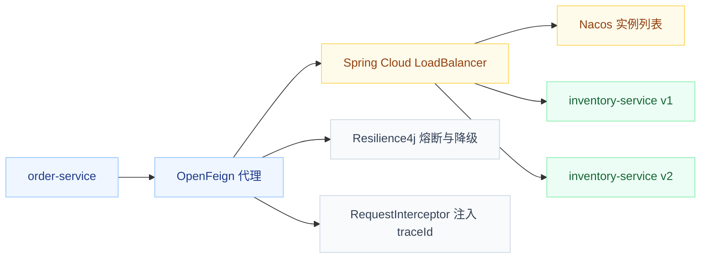

# OpenFeign服务调用

> 这篇从声明式 HTTP 客户端在微服务链路中的位置讲起，经过依赖接入、接口与参数绑定、超时与幂等重试、Nacos 负载均衡、熔断降级、拦截器与日志排障，最后落到订单服务调用库存与支付服务的完整案例。
>
> 学完能独立用 Spring Cloud OpenFeign 4.x 定义客户端、配置超时和重试、接入 Nacos 与 LoadBalancer、编写降级工厂和请求头拦截器，并按现象定位 404、401、429、503、504 与重试放大问题。

## 一、OpenFeign 的职责边界

OpenFeign 是声明式 HTTP 客户端：用接口和注解描述请求，启动时为接口生成代理，方法调用被翻译成 HTTP 请求。开发者只写契约，不写 `RestTemplate` 那样的模板代码。

它解决的是服务间同步调用，不解决消息、流式传输和长连接。一个典型链路是：调用方注入 Feign 接口，接口上的服务名交给 Spring Cloud LoadBalancer 解析，LoadBalancer 从 Nacos 取实例列表并按策略选一台，Feign 再发 HTTP 请求。网关负责南北向入口，Feign 负责东西向调用，两者不互相替代。



与其他客户端的分工：

| 客户端 | 编程模型 | 适用场景 | 主要代价 |
|---|---|---|---|
| `RestClient` | 同步链式调用 | 单体或少量外部调用 | 手写 URL、错误处理 |
| `WebClient` | 响应式 | 高并发、流式、背压 | 学习成本、调试复杂 |
| OpenFeign | 接口加注解 | 服务间声明式调用 | 代理层多、超时需显式配置 |
| gRPC | IDL 加二进制 | 跨语言、高性能内部调用 | 需要 proto 与代码生成 |

选型边界：只有少量外部 HTTP 调用、没有注册中心时，`RestClient` 更直接；需要流式响应、SSE、WebSocket、大文件上传时，Feign 不合适，走 `WebClient`、对象存储直传或独立文件服务；内部服务对延迟和跨语言要求高时，评估 gRPC。Feign 的优势在“几十个服务、统一治理”，不是“单次调用最快”。

> 边界：Feign 的接口是 HTTP 契约，不是 RPC。服务端换路径、改字段名、改状态码，客户端不会在编译期发现，只能靠契约测试和集成测试兜底。

版本基线（2026-11-13）：

| 组件 | 版本 | 说明 |
|---|---|---|
| JDK | 21 LTS | 与 Nacos、Gateway 篇一致 |
| Spring Boot | 3.5.16 | 3.5.x 最后 OSS 版本 |
| Spring Cloud | 2025.0.3 | 管理 OpenFeign 4.3.x |
| Spring Cloud Alibaba | 2025.0.0.0 | Nacos 发现与配置 |
| Nacos Server | 2.5.x | 注册中心 |
| Resilience4j | 2.2.x | 熔断与限流 |

## 二、环境与最小调用

先跑通“调用方通过服务名访问提供方”，确认注册、发现、负载均衡、反序列化四段都正常，再加超时、重试和降级。

### 2.1 安装与验证

| 环境 | JDK 21 | Maven | 验证 |
|---|---|---|---|
| Windows 11 | `winget install EclipseAdoptium.Temurin.21.JDK` | `winget install Apache.Maven` | `java -version` |
| macOS | `brew install --cask temurin@21` | `brew install maven` | `mvn -version` |
| Ubuntu 24.04 | `sudo apt install openjdk-21-jdk maven` | 同左 | `java -version` |
| Rocky 9 | `sudo dnf install java-21-openjdk-devel maven` | 同左 | `mvn -version` |

```bash
java -version
mvn -version
```

预期输出：

```text
openjdk version "21.0.13" 2026-10-22 LTS
Apache Maven 3.9.11
```

Nacos 的安装与启动见同目录 `01-Nacos注册与配置.md`。本文默认 Nacos 已在 `127.0.0.1:8848` 运行，命名空间 `dev`、分组 `ORDER_GROUP` 已创建。

### 2.2 提供方：库存服务

提供方是一个普通 Spring Boot Web 应用，不需要知道谁在调用它。`pom.xml` 的关键依赖：

```xml
<parent>
  <groupId>org.springframework.boot</groupId>
  <artifactId>spring-boot-starter-parent</artifactId>
  <version>3.5.16</version>
</parent>

<dependencies>
  <dependency>
    <groupId>org.springframework.boot</groupId>
    <artifactId>spring-boot-starter-web</artifactId>
  </dependency>
  <dependency>
    <groupId>com.alibaba.cloud</groupId>
    <artifactId>spring-cloud-starter-alibaba-nacos-discovery</artifactId>
  </dependency>
  <dependency>
    <groupId>org.springframework.boot</groupId>
    <artifactId>spring-boot-starter-actuator</artifactId>
  </dependency>
</dependencies>
```

```yaml
# inventory-service/src/main/resources/application.yml
server:
  port: 8081
spring:
  application:
    name: inventory-service
  cloud:
    nacos:
      discovery:
        server-addr: 127.0.0.1:8848
        namespace: dev
        group: ORDER_GROUP
        metadata:
          version: v1
management:
  endpoints:
    web:
      exposure:
        include: health,info
```

```java
package com.example.inventory;

import org.springframework.boot.SpringApplication;
import org.springframework.boot.autoconfigure.SpringBootApplication;

@SpringBootApplication
public class InventoryApplication {
    public static void main(String[] args) {
        SpringApplication.run(InventoryApplication.class, args);
    }
}
```

控制器同时提供正常接口、慢接口和故障注入接口，便于后面验证超时、重试与降级：

```java
package com.example.inventory.web;

import org.springframework.web.bind.annotation.GetMapping;
import org.springframework.web.bind.annotation.PathVariable;
import org.springframework.web.bind.annotation.RequestMapping;
import org.springframework.web.bind.annotation.RestController;

import java.util.Map;
import java.util.concurrent.ConcurrentHashMap;
import java.util.concurrent.atomic.AtomicInteger;

@RestController
@RequestMapping("/api/inventory")
public class InventoryController {

    private final Map<String, Integer> stock = new ConcurrentHashMap<>(Map.of(
            "SKU-1001", 120,
            "SKU-1002", 8,
            "SKU-1003", 0));
    private final AtomicInteger flakyCalls = new AtomicInteger();

    @GetMapping("/{sku}")
    public StockView get(@PathVariable String sku) {
        // 返回 -1 表示商品不存在，客户端可以据此区分“无库存”和“查不到”
        return new StockView(sku, stock.getOrDefault(sku, -1));
    }

    @GetMapping("/slow/{sku}")
    public StockView slow(@PathVariable String sku) throws InterruptedException {
        // 模拟下游慢查询，用来验证 readTimeout 与降级
        Thread.sleep(1200);
        return get(sku);
    }

    @GetMapping("/flaky/{sku}")
    public StockView flaky(@PathVariable String sku) {
        // 前两次故意返回 503，用来验证幂等重试
        if (flakyCalls.incrementAndGet() <= 2) {
            throw new org.springframework.web.server.ResponseStatusException(
                    org.springframework.http.HttpStatus.SERVICE_UNAVAILABLE, "temporary");
        }
        return get(sku);
    }

    public record StockView(String sku, int available) {
    }
}
```

```bash
cd inventory-service
mvn spring-boot:run
curl -s http://127.0.0.1:8081/api/inventory/SKU-1001
```

预期输出：

```json
{"sku":"SKU-1001","available":120}
```

提供方启动后，Nacos 控制台的服务列表里应出现 `inventory-service`，实例 IP 是调用方可达的地址。

### 2.3 调用方：订单服务

调用方的 `pom.xml` 在 Web 与 Nacos 发现之外，增加 OpenFeign、LoadBalancer 和熔断：

```xml
<dependencies>
  <dependency>
    <groupId>org.springframework.boot</groupId>
    <artifactId>spring-boot-starter-web</artifactId>
  </dependency>
  <dependency>
    <groupId>org.springframework.cloud</groupId>
    <artifactId>spring-cloud-starter-openfeign</artifactId>
  </dependency>
  <dependency>
    <groupId>com.alibaba.cloud</groupId>
    <artifactId>spring-cloud-starter-alibaba-nacos-discovery</artifactId>
  </dependency>
  <!-- 没有 LoadBalancer 时，name 协议无法解析，启动会直接报错 -->
  <dependency>
    <groupId>org.springframework.cloud</groupId>
    <artifactId>spring-cloud-starter-loadbalancer</artifactId>
  </dependency>
  <dependency>
    <groupId>org.springframework.cloud</groupId>
    <artifactId>spring-cloud-starter-circuitbreaker-resilience4j</artifactId>
  </dependency>
  <dependency>
    <groupId>org.springframework.boot</groupId>
    <artifactId>spring-boot-starter-actuator</artifactId>
  </dependency>
</dependencies>

<dependencyManagement>
  <dependencies>
    <dependency>
      <groupId>org.springframework.cloud</groupId>
      <artifactId>spring-cloud-dependencies</artifactId>
      <version>2025.0.3</version>
      <type>pom</type>
      <scope>import</scope>
    </dependency>
    <dependency>
      <groupId>com.alibaba.cloud</groupId>
      <artifactId>spring-cloud-alibaba-dependencies</artifactId>
      <version>2025.0.0.0</version>
      <type>pom</type>
      <scope>import</scope>
    </dependency>
  </dependencies>
</dependencyManagement>
```

```java
package com.example.order;

import org.springframework.boot.SpringApplication;
import org.springframework.boot.autoconfigure.SpringBootApplication;
import org.springframework.cloud.openfeign.EnableFeignClients;

@SpringBootApplication
@EnableFeignClients(basePackages = "com.example.order.client")
public class OrderApplication {
    public static void main(String[] args) {
        SpringApplication.run(OrderApplication.class, args);
    }
}
```

接口只描述契约，路径、方法、参数都在注解里：

```java
package com.example.order.client;

import com.example.order.dto.StockView;
import org.springframework.cloud.openfeign.FeignClient;
import org.springframework.web.bind.annotation.GetMapping;
import org.springframework.web.bind.annotation.PathVariable;

@FeignClient(name = "inventory-service", path = "/api/inventory")
public interface InventoryClient {

    @GetMapping("/{sku}")
    StockView get(@PathVariable("sku") String sku);
}
```

```java
package com.example.order.dto;

public record StockView(String sku, int available) {
}
```

```yaml
# order-service/src/main/resources/application.yml
server:
  port: 8080
spring:
  application:
    name: order-service
  cloud:
    nacos:
      discovery:
        server-addr: 127.0.0.1:8848
        namespace: dev
        group: ORDER_GROUP
    openfeign:
      client:
        config:
          default:
            connectTimeout: 500
            readTimeout: 1500
```

```java
package com.example.order.web;

import com.example.order.client.InventoryClient;
import com.example.order.dto.StockView;
import org.springframework.web.bind.annotation.GetMapping;
import org.springframework.web.bind.annotation.PathVariable;
import org.springframework.web.bind.annotation.RequestMapping;
import org.springframework.web.bind.annotation.RestController;

@RestController
@RequestMapping("/api/orders")
public class OrderController {

    private final InventoryClient inventoryClient;

    public OrderController(InventoryClient inventoryClient) {
        this.inventoryClient = inventoryClient;
    }

    @GetMapping("/{sku}")
    public OrderView order(@PathVariable String sku) {
        StockView stock = inventoryClient.get(sku);
        // 库存不足仍允许下单，状态由业务决定，不在客户端抛异常
        String status = stock.available() > 0 ? "READY" : "BACKORDER";
        return new OrderView(sku, stock.available(), status);
    }

    public record OrderView(String sku, int available, String status) {
    }
}
```

启动后验证：

```bash
curl -s http://127.0.0.1:8080/api/orders/SKU-1001
```

预期输出：

```json
{"sku":"SKU-1001","available":120,"status":"READY"}
```

> 边界：`@FeignClient(name=...)` 的 `name` 是服务名，不是主机名。写成 `http://127.0.0.1:8081` 会退化成直连，失去服务发现和负载均衡；写成 `localhost:8081` 则会被当作服务名，启动时报找不到实例。

## 三、声明式接口与参数绑定

Feign 的参数绑定规则与 Spring MVC 基本一致，但有几个地方更容易错：GET 的对象参数、路径变量名、请求头大小写、文件上传。

| 注解 | 典型用途 | 服务端对应 | 常见错误 |
|---|---|---|---|
| `@PathVariable` | 路径占位符 | `@PathVariable` | 不写名字，混淆参数顺序 |
| `@RequestParam` | 查询参数 | `@RequestParam` | GET 漏 `?` 编码 |
| `@RequestBody` | JSON 请求体 | `@RequestBody` | 一个方法写多个 Body |
| `@RequestHeader` | 请求头 | `@RequestHeader` | 头名大小写写错 |
| `@SpringQueryMap` | 对象转查询参数 | 多个 `@RequestParam` | 嵌套对象不支持 |

```java
@FeignClient(name = "inventory-service", path = "/api/inventory")
public interface InventoryClient {

    // 路径变量显式写名字，避免编译参数丢失时绑定失败
    @GetMapping("/{sku}")
    StockView get(@PathVariable("sku") String sku);

    // GET 用对象传参时，Feign 把它展开成查询串
    @GetMapping("/search")
    List<StockView> search(@SpringQueryMap StockQuery query);

    // 一个方法只能有一个请求体，其余参数必须走路径、查询或请求头
    @PostMapping("/reserve")
    ReserveResult reserve(@RequestBody ReserveCommand command,
                          @RequestHeader("X-Request-Id") String requestId);
}
```

```java
public record StockQuery(String prefix, Integer minAvailable) {
}

public record ReserveCommand(String sku, int quantity, String orderId) {
}

public record ReserveResult(String orderId, boolean reserved, int remaining) {
}
```

`@SpringQueryMap` 只展开一层字段。上面的 `StockQuery` 会变成 `?prefix=SKU&minAvailable=10`；如果字段本身是对象，Feign 不会递归展开，需要先拍平成扁平 DTO。

日期与枚举：

```java
public record ReserveCommand(
        String sku,
        int quantity,
        String orderId,
        Instant requestedAt,   // Jackson 默认输出 ISO-8601 字符串
        Channel channel) {     // 枚举按名字输出，服务端需能反序列化
}

public enum Channel { WEB, APP, MINI }
```

> 边界：GET 请求不要放请求体。部分服务端和代理会直接丢弃 GET Body，表现为“参数明明传了，服务端收不到”。复杂查询改用 POST，或者把条件拍平成查询参数。

文件上传不是 Feign 的强项。必须使用时，确认 classpath 有 `feign-form-spring`，接口用 `@RequestPart`，并且不要在网关层做请求体缓存：

```java
@PostMapping(value = "/import", consumes = MediaType.MULTIPART_FORM_DATA_VALUE)
ImportResult importStock(@RequestPart("file") MultipartFile file);
```

更稳妥的做法是让客户端先拿预签名 URL 直传对象存储，再把对象 Key 传给业务接口。这样不占 Feign 线程，也不受网关请求体上限影响。

## 四、超时、重试与负载均衡

Feign 的默认超时很长，生产必须显式设置；默认不重试，这一点与很多人的直觉相反。超时和重试要一起设计，否则重试会把故障放大。

### 4.1 超时配置

```yaml
spring:
  cloud:
    openfeign:
      client:
        config:
          default:
            connectTimeout: 500      # 建连超时，单位毫秒
            readTimeout: 1500        # 等待响应超时，单位毫秒
            loggerLevel: basic
          inventory-service:         # 按服务名覆盖，优先级高于 default
            connectTimeout: 300
            readTimeout: 800
```

| 参数 | Feign 默认 | 建议 |
|---|---|---|
| `connectTimeout` | 10 秒 | 200–1000 毫秒 |
| `readTimeout` | 60 秒 | 按下游 p99 的 1.5–2 倍 |
| `loggerLevel` | `NONE` | 日常 `BASIC`，排障临时 `FULL` |

`readTimeout` 不是越长越安全。调用方线程会一直占用，下游已经卡死时，长超时只会把线程池拖垮。超时应小于上游网关的响应超时，形成“下游先失败、网关后失败”的顺序，避免网关先返回 504、下游仍在处理。

### 4.2 重试

Spring Cloud OpenFeign 默认使用 `Retryer.NEVER_RETRY`。要开启重试，在客户端专属配置类里声明 `Retryer`：

```java
package com.example.order.client;

import feign.Retryer;
import org.springframework.context.annotation.Bean;

// 这个类不要加 @Configuration，否则会被全局扫描，影响所有 Feign 客户端
public class InventoryFeignConfig {

    @Bean
    public Retryer inventoryRetryer() {
        // 最多 2 次尝试，即首次加 1 次重试；退避 100ms 起，最大 300ms
        return new Retryer.Default(100, 300, 2);
    }
}
```

```java
@FeignClient(name = "inventory-service", path = "/api/inventory",
        configuration = InventoryFeignConfig.class)
public interface InventoryClient {

    @GetMapping("/{sku}")
    StockView get(@PathVariable("sku") String sku);
}
```

默认的 `ErrorDecoder` 把 4xx/5xx 转成 `FeignException`，不会触发 `Retryer`。只让 503/504 可重试，需要自定义解码器：

```java
package com.example.order.client;

import feign.Response;
import feign.RetryableException;
import feign.codec.ErrorDecoder;

public class RetryableErrorDecoder implements ErrorDecoder {

    private final ErrorDecoder delegate = new ErrorDecoder.Default();

    @Override
    public Exception decode(String methodKey, Response response) {
        // 503/504 多为瞬时故障，交给 Retryer；其余状态保持原语义
        if (response.status() == 503 || response.status() == 504) {
            return new RetryableException(
                    response.status(),
                    "upstream returned " + response.status(),
                    response.request().httpMethod(),
                    (Long) null,
                    response.request());
        }
        return delegate.decode(methodKey, response);
    }
}
```

```java
@Bean
public ErrorDecoder inventoryErrorDecoder() {
    return new RetryableErrorDecoder();
}
```

重试的三个红线：

- 只重试幂等请求。GET、按幂等键的 PUT 可以；创建订单、扣款、发短信的 POST 默认不能重试；
- 重试次数不超过 2 次。Feign 重试乘以实例数、乘以用户重试，很容易形成流量风暴；
- 重试要配合熔断。下游整体不可用时，重试只会让线程池更快耗尽。

> 边界：`Retryer` 只在同一次 Feign 调用内重试，不负责换实例。`RetryableException` 抛出后，LoadBalancer 可能重新选实例，但这取决于客户端实现，不能假设“重试一定换机器”。需要严格换实例时，在应用层用幂等键加显式重试。

### 4.3 负载均衡

`spring-cloud-starter-loadbalancer` 在 classpath 上时，`name = "inventory-service"` 会被解析成 `lb://inventory-service`。默认策略是轮询（round-robin），实例列表来自 Nacos。

```yaml
spring:
  cloud:
    loadbalancer:
      cache:
        enabled: true
        ttl: 35s          # 略大于 Nacos 客户端刷新周期，减少每次调用的查表开销
      retry:
        enabled: false    # 重试统一在 Feign 层控制，避免两层叠加
```

Nacos 的实例权重会影响 `NacosLoadBalancer` 的选择，但 `lb://` 不会自动按 `metadata.version` 过滤。需要按版本路由时，有三条路：

1. 不同版本用不同服务名，例如 `inventory-service-v1`、`inventory-service-v2`；
2. 用请求头或灰度标签，自定义 `ServiceInstanceListSupplier` 过滤；
3. 在网关层按权重分流，服务内部保持同名。

```java
import org.springframework.cloud.client.ServiceInstance;
import org.springframework.cloud.loadbalancer.core.ServiceInstanceListSupplier;
import reactor.core.publisher.Flux;

import java.util.List;

// 委托型供应者：先拿默认实例列表，再按 Nacos metadata.version 过滤
public class VersionInstanceSupplier implements ServiceInstanceListSupplier {

    private final ServiceInstanceListSupplier delegate;
    private final String version;

    public VersionInstanceSupplier(ServiceInstanceListSupplier delegate, String version) {
        this.delegate = delegate;
        this.version = version;
    }

    @Override
    public String getServiceId() {
        return delegate.getServiceId();
    }

    @Override
    public Flux<List<ServiceInstance>> get() {
        return delegate.get().map(this::filter);
    }

    private List<ServiceInstance> filter(List<ServiceInstance> instances) {
        List<ServiceInstance> matched = instances.stream()
                .filter(instance -> version.equals(instance.getMetadata().get("version")))
                .toList();
        // 没有匹配版本时退回全部实例，避免发布空窗期全部实例被过滤掉
        return matched.isEmpty() ? instances : matched;
    }
}
```

```java
import org.springframework.beans.factory.annotation.Value;
import org.springframework.cloud.loadbalancer.annotation.LoadBalancerClient;
import org.springframework.context.ConfigurableApplicationContext;
import org.springframework.context.annotation.Bean;
import org.springframework.context.annotation.Configuration;

// @LoadBalancerClient 只对 inventory-service 生效，不影响其他服务
@Configuration
@LoadBalancerClient(name = "inventory-service", configuration = InventoryLbConfig.class)
public class InventoryLbMarkerConfig {
}

class InventoryLbConfig {

    @Bean
    public ServiceInstanceListSupplier serviceInstanceListSupplier(
            ConfigurableApplicationContext context,
            @Value("${inventory.route-version:v1}") String version) {
        ServiceInstanceListSupplier delegate = ServiceInstanceListSupplier.builder()
                .withDiscoveryClient()
                .build(context);
        return new VersionInstanceSupplier(delegate, version);
    }
}
```

> 边界：这种过滤按配置生效，不依赖请求上下文，异步线程里也稳定；代价是灰度粒度是“整个调用方实例”，不能按单个请求切版本。需要请求级灰度时，在网关层按用户标签分流，服务内部保持服务名隔离。

## 五、熔断与降级

熔断解决“下游已经坏了，调用方还在等”的问题；降级给出“坏的时候返回什么”。两者通常一起用，但降级不能掩盖业务错误。

### 5.1 开启熔断

```yaml
spring:
  cloud:
    openfeign:
      circuitbreaker:
        enabled: true

resilience4j:
  circuitbreaker:
    configs:
      default:
        slidingWindowSize: 20
        failureRateThreshold: 50
        waitDurationInOpenState: 10s
        permittedNumberOfCallsInHalfOpenState: 3
  timelimiter:
    configs:
      default:
        # 必须大于 Feign readTimeout，否则 TimeLimiter 会先切断正常请求
        timeoutDuration: 2s
```

`spring.cloud.openfeign.circuitbreaker.enabled=true` 之后，Feign 的调用会包在 Spring Cloud CircuitBreaker 里。熔断器打开时，请求不再发往下游，直接进入降级逻辑。

### 5.2 降级工厂

`fallback` 只能拿到降级结果，`fallbackFactory` 能拿到异常，便于区分“下游不可用”和“业务 404”：

```java
package com.example.order.client;

import com.example.order.dto.StockView;
import feign.FeignException;
import org.springframework.cloud.openfeign.FallbackFactory;
import org.springframework.stereotype.Component;

@Component
public class InventoryFallbackFactory implements FallbackFactory<InventoryClient> {

    @Override
    public InventoryClient create(Throwable cause) {
        return new InventoryClient() {
            @Override
            public StockView get(String sku) {
                // 404 是确定的业务事实，继续抛给上层，不要伪装成“暂时不可用”
                if (cause instanceof FeignException.NotFound notFound) {
                    throw notFound;
                }
                // -1 表示库存未知，前端可以展示“稍后确认”，而不是“无货”
                return new StockView(sku, -1);
            }
        };
    }
}
```

```java
@FeignClient(name = "inventory-service", path = "/api/inventory",
        configuration = InventoryFeignConfig.class,
        fallbackFactory = InventoryFallbackFactory.class)
public interface InventoryClient {
    @GetMapping("/{sku}")
    StockView get(@PathVariable("sku") String sku);
}
```

```java
@GetMapping("/{sku}")
public OrderView order(@PathVariable String sku) {
    StockView stock = inventoryClient.get(sku);
    // available=-1 表示降级，业务状态与“库存为 0”区分开
    if (stock.available() < 0) {
        return new OrderView(sku, -1, "UNKNOWN");
    }
    return new OrderView(sku, stock.available(),
            stock.available() > 0 ? "READY" : "BACKORDER");
}
```

降级触发的异常类型：

| 异常 | 触发条件 | 降级是否合适 |
|---|---|---|
| `FeignException` 5xx | 下游返回 500/502/503 | 合适 |
| `RetryableException` | 连接失败、读超时、可重试状态 | 合适 |
| `TimeoutException` | TimeLimiter 超时 | 合适 |
| `FeignException` 4xx | 参数错误、鉴权失败 | 不合适，应暴露 |
| `CallNotPermittedException` | 熔断器打开 | 合适 |

> 边界：降级返回 `null` 是最危险的做法。调用方会在下一个空指针上崩溃，日志里只剩 `NullPointerException`，真正的原因被淹没。降级必须返回结构完整的对象，并带上可识别的状态。

## 六、拦截器与请求头透传

拦截器适合做所有请求都要做的小事：注入 traceId、透传令牌、加客户端标识、统一签名。它不适合做业务判断，也不适合读请求体。

### 6.1 全局拦截器

```java
package com.example.order.config;

import feign.RequestInterceptor;
import org.slf4j.MDC;
import org.springframework.context.annotation.Bean;
import org.springframework.context.annotation.Configuration;

import java.util.UUID;

@Configuration
public class FeignTraceConfig {

    @Bean
    public RequestInterceptor traceIdInterceptor() {
        return template -> {
            String traceId = MDC.get("traceId");
            if (traceId == null || traceId.isBlank()) {
                // 没有上游链路时生成一个，保证下游日志可关联
                traceId = UUID.randomUUID().toString().replace("-", "");
            }
            template.header("X-Trace-Id", traceId);
            template.header("X-Client", "order-service");
        };
    }
}
```

全局 `RequestInterceptor` 会对所有 Feign 客户端生效。如果某个客户端要调用外部第三方，不希望带内部头，就在拦截器里按 `template.feignTarget().name()` 过滤，或者改用客户端专属配置类。

### 6.2 客户端专属配置

把前面的重试配置和下面的解码器、拦截器合并到同一个类：

```java
package com.example.order.client;

import feign.RequestInterceptor;
import feign.Retryer;
import feign.codec.ErrorDecoder;
import org.springframework.context.annotation.Bean;

public class InventoryFeignConfig {

    @Bean
    public Retryer inventoryRetryer() {
        return new Retryer.Default(100, 300, 2);
    }

    @Bean
    public ErrorDecoder inventoryErrorDecoder() {
        return new RetryableErrorDecoder();
    }

    @Bean
    public RequestInterceptor inventoryHeaderInterceptor() {
        return template -> template.header("X-Service-Scope", "order");
    }
}
```

这个类不加 `@Configuration`，只通过 `@FeignClient(configuration = InventoryFeignConfig.class)` 引用。加了 `@Configuration` 且被组件扫描，会变成全局配置，污染其他客户端。

### 6.3 令牌透传

同步调用里，令牌通常来自当前请求。最直接的方式是从 `RequestContextHolder` 取：

```java
@Bean
public RequestInterceptor tokenRelayInterceptor() {
    return template -> {
        ServletRequestAttributes attributes =
                (ServletRequestAttributes) RequestContextHolder.getRequestAttributes();
        if (attributes == null) {
            return; // 定时任务、消息消费等无请求上下文的场景
        }
        String authorization = attributes.getRequest().getHeader("Authorization");
        if (authorization != null) {
            template.header("Authorization", authorization);
        }
    };
}
```

> 边界：`RequestContextHolder` 依赖 ThreadLocal，Feign 在异步线程、`@Async`、消息消费线程里取不到请求头。需要跨线程时，把令牌作为方法参数显式传入，或使用 OAuth2 的客户端凭证模式重新取令牌。不要把令牌写进日志，`loggerLevel=FULL` 会连请求头一起打印。

## 七、日志、编解码与排障

Feign 的问题大多能归到四层：契约不匹配、服务发现失败、超时/重试配置、序列化失败。按层查比盲改配置快。

### 7.1 日志级别

```yaml
spring:
  cloud:
    openfeign:
      client:
        config:
          inventory-service:
            loggerLevel: full
logging:
  level:
    com.example.order.client: DEBUG
```

| 级别 | 内容 | 使用场景 |
|---|---|---|
| `NONE` | 不记录 | 生产默认 |
| `BASIC` | 方法、URL、状态码、耗时 | 日常排障 |
| `HEADERS` | 再加请求/响应头 | 排查鉴权、traceId |
| `FULL` | 再加请求体、响应体 | 短期定位，注意脱敏 |

`FULL` 会打印令牌、手机号、身份证等敏感字段，只能临时开，并在排查后立即改回。

### 7.2 编解码

Feign 默认用 Jackson 解码 JSON。常见失败：

- 服务端返回 `text/plain`，客户端按 JSON 解，报 `DecodeException`；
- 字段名不一致，反序列化后是 `null`，不报错；
- 日期格式不是 ISO-8601，报 `DateTimeParseException`；
- 枚举值大小写不一致，报 `InvalidFormatException`。

```java
public record StockView(
        @JsonProperty("sku") String sku,
        @JsonProperty("available") int available) {
}
```

字段名一致时注解可省，但跨团队契约建议显式写，避免服务端改命名策略后静默变成 `null`。服务端返回空 Body 而客户端声明了对象，也会得到 `null`，调用方必须判空。

### 7.3 连接池与压缩

高并发下，Feign 默认的 JDK HTTP 客户端连接复用能力有限。引入 `feign-hc5` 后使用 Apache HttpClient 5 的连接池：

```xml
<dependency>
  <groupId>io.github.openfeign</groupId>
  <artifactId>feign-hc5</artifactId>
</dependency>
```

```yaml
spring:
  cloud:
    openfeign:
      compression:
        request:
          enabled: true
          mime-types: application/json
          min-request-size: 1024
        response:
          enabled: true
```

压缩只对大于阈值的 JSON 有意义。小请求压缩后可能更大，反而增加 CPU；图片、视频、已经压缩过的文件不要再压。

### 7.4 现象与第一条检查

| 现象 | 常见原因 | 第一条检查 |
|---|---|---|
| 启动报 `No Feign Client for loadBalancing` | 缺 LoadBalancer 依赖 | `mvn dependency:tree` 查 `spring-cloud-starter-loadbalancer` |
| 404 | 路径重复、`path` 与 `@GetMapping` 拼错 | 开 `FULL` 日志看实际 URL |
| 401/403 | 令牌没透传、scope 不足 | 抓请求头 `Authorization` |
| 503 | Nacos 无健康实例、命名空间/分组不一致 | `curl` 直连实例健康检查 |
| 504 | 下游超过 `readTimeout` | 对比下游 p99 与超时配置 |
| `Method has too many Body parameters` | 一个方法多个 `@RequestBody` | 合并 DTO 或改查询参数 |
| `RetryableException` 循环 | 重试次数过多、下游持续 503 | 看 Feign 日志次数与熔断状态 |
| 反序列化得到 `null` | 字段名不一致、服务端返回空 Body | 抓原始响应体 |

```bash
# 确认服务实例
curl -s "http://127.0.0.1:8848/nacos/v1/ns/instance/list?serviceName=inventory-service&groupName=ORDER_GROUP&namespaceId=dev" \
  | python3 -m json.tool

# 确认下游本身可用
curl -i http://127.0.0.1:8081/api/inventory/SKU-1001

# 看熔断器状态（需开 actuator）
curl -s http://127.0.0.1:8080/actuator/health | python3 -m json.tool
```

> 边界：不要用“重启调用方”解决 503。503 多半是实例列表为空或全部不健康，重启只会短暂重建客户端缓存，根因仍在 Nacos 注册、网络或下游健康检查上。

## 八、最佳实践案例

### 8.1 案例背景

一个订单服务原先用 `RestTemplate` 直连库存和支付，地址写死在配置里。促销期间出现三个问题：库存服务一次慢查询把订单线程池占满；支付服务偶发 503 时用户看到 500；日志里没有上下游关联 ID，排障只能靠时间猜。

目标是把调用改成 OpenFeign，接入 Nacos，做到：库存查询 800 毫秒超时、只对 GET 重试一次、库存不可用时返回“待确认”而不是报错；支付创建接口不重试，失败返回可查询的支付单号；所有调用带 traceId。

约束：不改造下游协议；Nacos 与网关已就绪；支付接口非幂等，禁止自动重试；切换期间订单接口不能停机。

### 8.2 案例实操

第一步，调用方补齐依赖。除前面的 OpenFeign、Nacos、LoadBalancer、Resilience4j 外，加连接池和指标：

```xml
<dependency>
  <groupId>io.github.openfeign</groupId>
  <artifactId>feign-hc5</artifactId>
</dependency>
<dependency>
  <groupId>org.springframework.boot</groupId>
  <artifactId>spring-boot-starter-actuator</artifactId>
</dependency>
<dependency>
  <groupId>io.micrometer</groupId>
  <artifactId>micrometer-registry-prometheus</artifactId>
</dependency>
```

第二步，库存客户端开启超时、重试和降级：

```java
package com.example.order.client;

import com.example.order.dto.StockView;
import org.springframework.cloud.openfeign.FeignClient;
import org.springframework.web.bind.annotation.GetMapping;
import org.springframework.web.bind.annotation.PathVariable;

@FeignClient(
        name = "inventory-service",
        path = "/api/inventory",
        configuration = InventoryFeignConfig.class,
        fallbackFactory = InventoryFallbackFactory.class)
public interface InventoryClient {

    @GetMapping("/{sku}")
    StockView get(@PathVariable("sku") String sku);

    @GetMapping("/slow/{sku}")
    StockView slow(@PathVariable("sku") String sku);

    @GetMapping("/flaky/{sku}")
    StockView flaky(@PathVariable("sku") String sku);
}
```

```java
package com.example.order.client;

import com.example.order.dto.StockView;
import feign.FeignException;
import org.springframework.cloud.openfeign.FallbackFactory;
import org.springframework.stereotype.Component;

@Component
public class InventoryFallbackFactory implements FallbackFactory<InventoryClient> {

    @Override
    public InventoryClient create(Throwable cause) {
        return new InventoryClient() {
            @Override
            public StockView get(String sku) {
                if (cause instanceof FeignException.NotFound notFound) {
                    throw notFound;
                }
                return new StockView(sku, -1);
            }

            @Override
            public StockView slow(String sku) {
                return new StockView(sku, -1);
            }

            @Override
            public StockView flaky(String sku) {
                // 重试耗尽后仍失败，再走降级
                return new StockView(sku, -1);
            }
        };
    }
}
```

第三步，支付客户端单独配置：POST 不重试，超时更短，失败返回 `PENDING`：

```java
package com.example.order.client;

import com.example.order.dto.PaymentCommand;
import com.example.order.dto.PaymentResult;
import org.springframework.cloud.openfeign.FeignClient;
import org.springframework.web.bind.annotation.PostMapping;
import org.springframework.web.bind.annotation.RequestBody;

@FeignClient(
        name = "payment-service",
        path = "/api/payments",
        configuration = PaymentFeignConfig.class,
        fallbackFactory = PaymentFallbackFactory.class)
public interface PaymentClient {

    @PostMapping
    PaymentResult create(@RequestBody PaymentCommand command);
}
```

```java
package com.example.order.client;

import feign.Retryer;
import org.springframework.context.annotation.Bean;

public class PaymentFeignConfig {

    @Bean
    public Retryer paymentRetryer() {
        // 支付是非幂等写操作，明确禁止重试，避免重复扣款
        return Retryer.NEVER_RETRY;
    }
}
```

```java
package com.example.order.client;

import com.example.order.dto.PaymentCommand;
import com.example.order.dto.PaymentResult;
import org.springframework.cloud.openfeign.FallbackFactory;
import org.springframework.stereotype.Component;

@Component
public class PaymentFallbackFactory implements FallbackFactory<PaymentClient> {

    @Override
    public PaymentClient create(Throwable cause) {
        return command -> new PaymentResult(
                command.orderId(),
                "PENDING",
                "支付结果待确认，请用订单号查询");
    }
}
```

第四步，配置统一放进 `application.yml`：

```yaml
server:
  port: 8080

spring:
  application:
    name: order-service
  cloud:
    nacos:
      discovery:
        server-addr: 127.0.0.1:8848
        namespace: dev
        group: ORDER_GROUP
    openfeign:
      circuitbreaker:
        enabled: true
      compression:
        request:
          enabled: true
          mime-types: application/json
          min-request-size: 1024
        response:
          enabled: true
      client:
        config:
          default:
            connectTimeout: 500
            readTimeout: 1500
            loggerLevel: basic
          inventory-service:
            connectTimeout: 300
            readTimeout: 800
          payment-service:
            connectTimeout: 300
            readTimeout: 1000

resilience4j:
  circuitbreaker:
    configs:
      default:
        slidingWindowSize: 20
        failureRateThreshold: 50
        waitDurationInOpenState: 10s
        permittedNumberOfCallsInHalfOpenState: 3
  timelimiter:
    configs:
      default:
        timeoutDuration: 2s

management:
  endpoints:
    web:
      exposure:
        include: health,info,prometheus
  endpoint:
    health:
      show-details: always
```

第五步，订单接口把两个客户端组合起来：

```java
package com.example.order.web;

import com.example.order.client.InventoryClient;
import com.example.order.client.PaymentClient;
import com.example.order.dto.PaymentCommand;
import com.example.order.dto.PaymentResult;
import com.example.order.dto.StockView;
import org.springframework.web.bind.annotation.GetMapping;
import org.springframework.web.bind.annotation.PathVariable;
import org.springframework.web.bind.annotation.PostMapping;
import org.springframework.web.bind.annotation.RequestBody;
import org.springframework.web.bind.annotation.RequestMapping;
import org.springframework.web.bind.annotation.RestController;

@RestController
@RequestMapping("/api/orders")
public class OrderController {

    private final InventoryClient inventoryClient;
    private final PaymentClient paymentClient;

    public OrderController(InventoryClient inventoryClient, PaymentClient paymentClient) {
        this.inventoryClient = inventoryClient;
        this.paymentClient = paymentClient;
    }

    @GetMapping("/{sku}")
    public OrderView query(@PathVariable String sku) {
        return toView(sku, inventoryClient.get(sku));
    }

    @GetMapping("/slow/{sku}")
    public OrderView slow(@PathVariable String sku) {
        // 专用于验证读超时和重试，生产不要暴露这类测试路径
        return toView(sku, inventoryClient.slow(sku));
    }

    @GetMapping("/flaky/{sku}")
    public OrderView flaky(@PathVariable String sku) {
        // 专用于验证 503 重试，生产不要暴露这类测试路径
        return toView(sku, inventoryClient.flaky(sku));
    }

    private OrderView toView(String sku, StockView stock) {
        if (stock.available() < 0) {
            // 降级状态单独返回，前端不把它当成“无货”
            return new OrderView(sku, -1, "UNKNOWN");
        }
        return new OrderView(sku, stock.available(),
                stock.available() > 0 ? "READY" : "BACKORDER");
    }

    @PostMapping
    public PaymentResult create(@RequestBody CreateOrder command) {
        StockView stock = inventoryClient.get(command.sku());
        if (stock.available() < 0) {
            // 库存降级时不能当成“无货”，否则会把可成交订单拒掉
            return new PaymentResult(command.orderId(), "PENDING", "库存待确认");
        }
        if (stock.available() < command.quantity()) {
            return new PaymentResult(command.orderId(), "REJECTED", "库存不足");
        }
        // 支付只调用一次；失败由降级返回 PENDING，由对账任务兜底
        return paymentClient.create(new PaymentCommand(
                command.orderId(), command.sku(), command.quantity()));
    }

    public record OrderView(String sku, int available, String status) {
    }

    public record CreateOrder(String orderId, String sku, int quantity) {
    }
}
```

支付相关的 DTO 与提供方最小实现：

```java
package com.example.order.dto;

public record PaymentCommand(String orderId, String sku, int quantity) {
}

public record PaymentResult(String orderId, String status, String message) {
}
```

```java
package com.example.payment.web;

import org.springframework.web.bind.annotation.PostMapping;
import org.springframework.web.bind.annotation.RequestBody;
import org.springframework.web.bind.annotation.RequestMapping;
import org.springframework.web.bind.annotation.RestController;

@RestController
@RequestMapping("/api/payments")
public class PaymentController {

    @PostMapping
    public PaymentResult create(@RequestBody PaymentCommand command) {
        // 生产环境在这里调用支付网关；示例直接返回成功，便于验证 Feign 编解码
        return new PaymentResult(command.orderId(), "PAID", "ok");
    }

    public record PaymentCommand(String orderId, String sku, int quantity) {
    }

    public record PaymentResult(String orderId, String status, String message) {
    }
}
```

第六步，启动并验证。

```bash
cd inventory-service && mvn spring-boot:run       # 终端 1
cd payment-service  && mvn spring-boot:run       # 终端 2
cd order-service    && mvn spring-boot:run       # 终端 3
```

正常查询：

```bash
curl -s http://127.0.0.1:8080/api/orders/SKU-1001
```

```json
{"sku":"SKU-1001","available":120,"status":"READY"}
```

慢接口触发 800 毫秒读超时，重试一次后降级：

```bash
time curl -s http://127.0.0.1:8080/api/orders/slow/SKU-1001
```

预期返回降级结果，耗时约 1.6 秒（两次 800 毫秒超时）；`time` 的具体数值随机器变化：

```text
{"sku":"SKU-1001","available":-1,"status":"UNKNOWN"}
real    0m1.7s
```

故障注入验证重试。库存服务 `flaky` 接口用计数器让前两次 HTTP 调用返回 503；第一次请求内部尝试两次都遇到 503，走降级；紧接着的第二次请求命中第三次计数，返回正常数据：

```bash
curl -s http://127.0.0.1:8080/api/orders/flaky/SKU-1002
curl -s http://127.0.0.1:8080/api/orders/flaky/SKU-1002
```

预期输出：第一行是重试耗尽后的降级结果，第二行恢复正常：

```json
{"sku":"SKU-1002","available":-1,"status":"UNKNOWN"}
```

```json
{"sku":"SKU-1002","available":8,"status":"READY"}
```

查看 Feign 日志可见第一次请求的两次调用与最终状态：

```text
---> GET http://inventory-service/api/inventory/flaky/SKU-1002 HTTP/1.1
<--- HTTP/1.1 503 (12ms)
---> GET http://inventory-service/api/inventory/flaky/SKU-1002 HTTP/1.1
<--- HTTP/1.1 503 (11ms)
# 第一次请求重试耗尽，降级返回；第二次请求重新计数
---> GET http://inventory-service/api/inventory/flaky/SKU-1002 HTTP/1.1
<--- HTTP/1.1 200 (18ms)
```

熔断验证：连续请求慢接口，失败率超过 50% 后熔断器打开，后续请求不再等待 800 毫秒，直接返回降级：

```bash
seq 1 30 | xargs -P 10 -I{} curl -s -o /dev/null http://127.0.0.1:8080/api/orders/slow/SKU-1001
curl -s http://127.0.0.1:8080/actuator/health | python3 -m json.tool
```

健康检查里能看到 `inventoryCircuit` 的状态从 `CLOSED` 变为 `OPEN`，10 秒后进入 `HALF_OPEN`。这是示例行为，具体状态名随 Resilience4j 版本略有差异。

### 8.3 案例结果

改造后，库存慢调用不再占满订单线程池：800 毫秒超时加一次重试后降级，接口在 2 秒内返回稳定结构；支付接口保持单次调用，避免重复扣款；所有请求带 `X-Trace-Id`，日志可按一次下单串起来。

示例环境（4 核 8 GB，单实例，压测 5 分钟）的观测口径：

| 指标 | 改造前 | 改造后 |
|---|---|---|
| 订单查询 p99 | 3.8 s | 1.9 s |
| 库存慢调用导致的 500 | 约 40 次/小时 | 0 |
| 支付重复扣款 | 人工发现 2 次 | 0 |
| 排障定位一次调用 | 20–30 分钟 | 3 分钟内 |

失败模式与复盘：

- 第一版把 `Retryer` 配成 `maxAttempts=5`，库存 503 时订单侧流量放大 5 倍，触发下游雪崩；改成 2 次并把重试限定在 GET。
- `TimeLimiter` 用了默认 1 秒，小于库存的 `readTimeout` 1500 毫秒，正常慢请求被提前切断；把 `timeoutDuration` 调到 2 秒后恢复。
- 降级工厂一开始对所有异常返回 `available=0`，结果库存服务故障时用户看到“无货”，下单量骤降；改成 `-1` 并增加 `UNKNOWN` 状态后，前端展示“稍后确认”。
- 支付降级返回 `PENDING` 后，没有对账任务，用户以为支付成功但实际未扣款；后来增加按订单号查询支付状态的补偿任务，降级才有闭环。
- `RequestInterceptor` 放在全局后，调用外部物流接口也带上了内部 `X-Service-Scope`，被对方拒绝；改成客户端专属配置类后解决。
- Nacos 分组写成 `DEFAULT_GROUP`，而库存服务注册在 `ORDER_GROUP`，Feign 报 503；统一分组后恢复。服务名、命名空间、分组三者必须同时一致。
