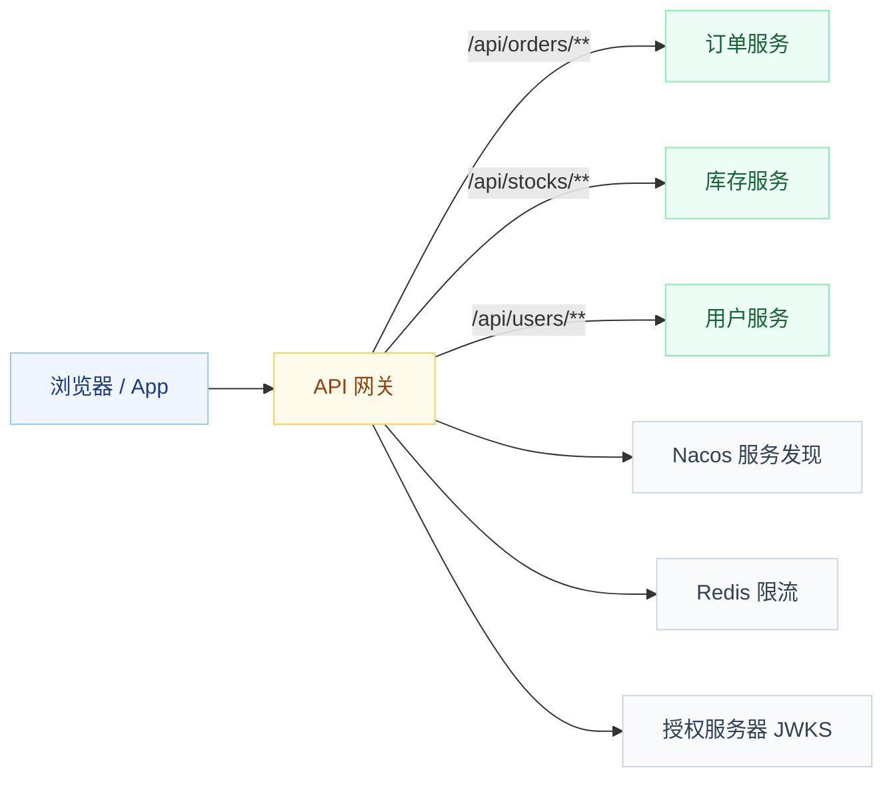

# Gateway服务网关

> 这篇从网关在微服务链路中的职责讲起，经过环境搭建、路由断言、过滤器、JWT 鉴权、跨域和 Redis 限流，最后落到一套可上线的网关配置与排障手册。
>
> 学完能独立用 Spring Cloud Gateway 4.x 搭建统一入口，完成路由转发、令牌校验、跨域和限流，并按现象定位 404、503、504、401 和 CORS 问题。

## 一、网关的职责边界

网关是外部流量进入微服务集群的唯一 HTTP 入口，负责路由、协议适配、认证、限流和可观测性，不负责业务规则。



网关适合承担四类任务：

| 任务 | 具体内容 | 不该做的事 |
|---|---|---|
| 路由 | 按路径、方法、请求头转发 | 拼接业务单据、计算价格 |
| 认证 | 校验 JWT 签名、过期时间、签发者 | 维护用户密码和角色表 |
| 流量治理 | 限流、熔断、灰度、重试 | 长事务、消息消费 |
| 观测 | 统一 traceId、访问日志、指标 | 存储业务审计明细 |

Spring Cloud Gateway 4.x 基于 Spring WebFlux 和 Reactor Netty，少量事件循环线程处理大量连接。过滤器里调用阻塞的 JDBC、`Thread.sleep`、同步 HTTP 客户端，会占住事件循环线程，表现为整个网关延迟升高而不是单个请求变慢。

> 边界：已有 Nginx Ingress 负责 TLS 卸载和南北向入口时，Spring Cloud Gateway 仍可放在集群内做业务鉴权和灰度；两层职责要写清，避免 CORS、超时和重试在两层重复配置。纯静态资源、无需 Java 定制的入口，直接用 Nginx 或 Ingress 更省资源。

版本基线（2026-11）：

| 组件 | 版本 | 说明 |
|---|---|---|
| JDK | 21 LTS | 也可用 25 LTS，需确认依赖兼容 |
| Spring Boot | 3.5.16 | 3.5.x 最后 OSS 版本 |
| Spring Cloud | 2025.0.3 | 对应 Gateway 4.3.x |
| Spring Cloud Gateway | 4.3.5 | 响应式 WebFlux 版本 |
| Redis | 7.4 | 限流令牌桶存储 |

## 二、环境与最小路由

先跑通一条静态路由，确认请求能从 8080 转发到 8081，再接入服务发现和鉴权。

### 2.1 安装依赖

| 系统 | JDK 21 | Maven | Redis |
|---|---|---|---|
| Windows 11 | `winget install EclipseAdoptium.Temurin.21.JDK` | `winget install Apache.Maven` | Docker Desktop 或 Memurai |
| macOS | `brew install --cask temurin@21` | `brew install maven` | `brew install redis` |
| Ubuntu 24.04 | `sudo apt install openjdk-21-jdk` | `sudo apt install maven` | `sudo apt install redis-server` |
| Rocky 9 | `sudo dnf install java-21-openjdk-devel` | `sudo dnf install maven` | `sudo dnf install redis` |

验证：

```bash
java -version
mvn -version
redis-cli ping
```

预期输出：

```text
openjdk version "21.0.13" 2026-10-22 LTS
Apache Maven 3.9.11
PONG
```

### 2.2 创建工程

`pom.xml` 只放最小依赖，后续章节再追加：

```xml
<?xml version="1.0" encoding="UTF-8"?>
<project xmlns="http://maven.apache.org/POM/4.0.0"
         xmlns:xsi="http://www.w3.org/2001/XMLSchema-instance"
         xsi:schemaLocation="http://maven.apache.org/POM/4.0.0 https://maven.apache.org/xsd/maven-4.0.0.xsd">
  <modelVersion>4.0.0</modelVersion>

  <parent>
    <groupId>org.springframework.boot</groupId>
    <artifactId>spring-boot-starter-parent</artifactId>
    <version>3.5.16</version>
  </parent>

  <groupId>com.example</groupId>
  <artifactId>api-gateway</artifactId>
  <version>1.0.0</version>

  <properties>
    <java.version>21</java.version>
    <spring-cloud.version>2025.0.3</spring-cloud.version>
  </properties>

  <dependencies>
    <!-- 4.x 的响应式网关 starter，旧坐标 spring-cloud-starter-gateway 已不推荐 -->
    <dependency>
      <groupId>org.springframework.cloud</groupId>
      <artifactId>spring-cloud-starter-gateway-server-webflux</artifactId>
    </dependency>
    <dependency>
      <groupId>org.springframework.boot</groupId>
      <artifactId>spring-boot-starter-actuator</artifactId>
    </dependency>
  </dependencies>

  <dependencyManagement>
    <dependencies>
      <dependency>
        <groupId>org.springframework.cloud</groupId>
        <artifactId>spring-cloud-dependencies</artifactId>
        <version>${spring-cloud.version}</version>
        <type>pom</type>
        <scope>import</scope>
      </dependency>
    </dependencies>
  </dependencyManagement>
</project>
```

### 2.3 配置一条路由

`src/main/resources/application.yml`：

```yaml
server:
  port: 8080

spring:
  application:
    name: api-gateway
  cloud:
    gateway:
      server:
        webflux:
          routes:
            - id: order-service
              uri: http://127.0.0.1:8081
              predicates:
                - Path=/api/orders/**
              filters:
                # /api/orders/1001 去掉两段后变成 /1001 发给下游
                - StripPrefix=2

management:
  endpoints:
    web:
      exposure:
        include: health,info,gateway
```

> 4.2 起配置前缀从 `spring.cloud.gateway.routes` 迁到 `spring.cloud.gateway.server.webflux.routes`；旧前缀在 4.3 仍可解析，但新项目按新前缀写，避免升级时集中改动。

启动类：

```java
package com.example.gateway;

import org.springframework.boot.SpringApplication;
import org.springframework.boot.autoconfigure.SpringBootApplication;

@SpringBootApplication
public class GatewayApplication {
    public static void main(String[] args) {
        SpringApplication.run(GatewayApplication.class, args);
    }
}
```

### 2.4 启动一个本地被调服务

用 Python 标准库模拟下游，返回请求路径，便于确认 `StripPrefix` 是否生效：

```python
# mock_order.py
import json
from http.server import BaseHTTPRequestHandler, HTTPServer

class Handler(BaseHTTPRequestHandler):
    def do_GET(self):
        body = json.dumps({"service": "order", "path": self.path}).encode()
        self.send_response(200)
        self.send_header("Content-Type", "application/json")
        self.send_header("Content-Length", str(len(body)))
        self.end_headers()
        self.wfile.write(body)

    def log_message(self, *args):
        pass

HTTPServer(("127.0.0.1", 8081), Handler).serve_forever()
```

```bash
python3 mock_order.py          # 终端 1
mvn spring-boot:run            # 终端 2
curl -i http://localhost:8080/api/orders/1001
```

预期输出：

```text
HTTP/1.1 200 OK
Content-Type: application/json
Content-Length: 39

{"service": "order", "path": "/1001"}
```

`/api/orders/1001` 被 `StripPrefix=2` 去掉 `/api` 和 `/orders`，下游收到 `/1001`。如果下游收到完整路径，说明过滤器没生效或路由没命中。

查看已加载路由：

```bash
curl -s http://localhost:8080/actuator/gateway/routes | python3 -m json.tool
```

预期输出（截取）：

```json
[
  {
    "route_id": "order-service",
    "uri": "http://127.0.0.1:8081",
    "predicate": "Paths: [/api/orders/**], match trailing slash: true",
    "filters": ["[[StripPrefix parts = 2], order = 1]"]
  }
]
```

> 边界：`Path` 谓词匹配的是请求路径，不含查询串；`StripPrefix` 按 `/` 分段计数，路径中有双斜杠或编码斜杠时先规范化再计数。生产环境把 `gateway` 端点加入鉴权白名单之外，它会暴露内部路由结构。

## 三、路由与断言

一条路由由 `id`、目标 `uri`、断言集合和过滤器集合组成，所有断言同时满足才命中。断言决定“什么请求进来”，过滤器决定“进来后怎么改”。

### 3.1 常用断言

| 断言 | 示例 | 匹配依据 | 常见错误 |
|---|---|---|---|
| `Path` | `Path=/api/orders/**` | 路径 | `**` 只能放末尾 |
| `Method` | `Method=GET,POST` | HTTP 方法 | 大小写写错 |
| `Header` | `Header=X-Client, web-.*` | 请求头正则 | 头名大小写不敏感，值敏感 |
| `Query` | `Query=page, \d+` | 查询参数正则 | 参数不存在时不匹配 |
| `After` | `After=2026-11-01T00:00:00+08:00` | 时间点 | 时区偏移漏写 |

组合断言是“与”关系：

```yaml
routes:
  - id: order-query
    uri: lb://order-service
    predicates:
      - Path=/api/orders/**
      - Method=GET
      - Header=X-Client, web-.*
      - Query=page, \d+
    filters:
      - StripPrefix=2
```

需要“或”关系时拆成多条路由，用 `order` 控制优先级：

```yaml
routes:
  - id: order-admin
    uri: lb://order-service
    order: -1
    predicates:
      - Path=/api/orders/**
      - Header=X-Role, admin
    filters:
      - StripPrefix=2
  - id: order-default
    uri: lb://order-service
    order: 0
    predicates:
      - Path=/api/orders/**
    filters:
      - StripPrefix=2
```

`order` 越小越先匹配；命中第一条后不再继续。上面的配置让管理员请求走单独路由，其余请求走默认路由。

### 3.2 灰度权重

`Weight` 断言按权重分流，适合按比例放量。两个版本必须是不同的服务名，权重只选路由，不会自动把同一个服务拆成两个版本：

```yaml
routes:
  - id: order-v2
    uri: lb://order-service-v2
    predicates:
      - Path=/api/orders/**
      - Weight=order-group, 10
    filters:
      - StripPrefix=2
  - id: order-v1
    uri: lb://order-service-v1
    predicates:
      - Path=/api/orders/**
      - Weight=order-group, 90
    filters:
      - StripPrefix=2
```

> 边界：权重是每条请求独立抽样，10% 不是“前 10% 用户”。需要按用户粘性灰度时，用 `Header` 或 `Cookie` 断言配合用户标签，不要用权重冒充用户级灰度。

### 3.3 服务发现路由

引入 Nacos 后发现和负载均衡依赖：

```xml
<dependency>
  <groupId>com.alibaba.cloud</groupId>
  <artifactId>spring-cloud-starter-alibaba-nacos-discovery</artifactId>
</dependency>
<dependency>
  <groupId>org.springframework.cloud</groupId>
  <artifactId>spring-cloud-starter-loadbalancer</artifactId>
</dependency>
```

```yaml
spring:
  cloud:
    nacos:
      discovery:
        server-addr: 127.0.0.1:8848
    gateway:
      server:
        webflux:
          routes:
            - id: order-service
              uri: lb://order-service
              predicates:
                - Path=/api/orders/**
              filters:
                - StripPrefix=2
```

`lb://` 交给 Spring Cloud LoadBalancer 选实例，默认轮询。Nacos 中实例的 `metadata` 可用于版本路由，但需要自定义 `ServiceInstanceListSupplier` 或 `ReactorLoadBalancer`；不要在 YAML 里假设 `lb://` 会自动读取 `version` 元数据。

> 边界：Nacos 命名空间、分组、集群名三者任一不一致，网关会得到空实例列表并返回 503。先用 `curl` 直连实例确认服务本身可用，再查网关的发现配置。

## 四、过滤器与请求改写

过滤器分全局过滤器和路由过滤器，按 `Ordered` 顺序执行；请求阶段从前往后，响应阶段从后往前。鉴权、traceId、身份头注入必须排在路由转发之前。

### 4.1 内置过滤器

| 过滤器 | 用途 | 关键参数 |
|---|---|---|
| `StripPrefix` | 去掉路径前缀 | 段数 |
| `RewritePath` | 正则重写路径 | 正则、替换串 |
| `AddRequestHeader` | 注入请求头 | 头名、值 |
| `RemoveRequestHeader` | 删除伪造头 | 头名 |
| `Retry` | 幂等请求重试 | 次数、状态码、方法 |
| `CircuitBreaker` | 熔断与降级 | 实例名、fallback URI |
| `RequestRateLimiter` | Redis 令牌桶限流 | 速率、容量、KeyResolver |

重写路径示例：

```yaml
filters:
  - RewritePath=/api/orders/(?<id>.*), /orders/$\{id}
```

`$\{id}` 在 YAML 中要转义 `$`，否则部分解析器会把它当变量。更推荐 `StripPrefix`，少写正则就少一类错误。

### 4.2 自定义全局过滤器

下面的过滤器生成 traceId、回写响应头，并统计耗时：

```java
package com.example.gateway.filter;

import org.slf4j.Logger;
import org.slf4j.LoggerFactory;
import org.springframework.cloud.gateway.filter.GatewayFilterChain;
import org.springframework.cloud.gateway.filter.GlobalFilter;
import org.springframework.core.Ordered;
import org.springframework.http.server.reactive.ServerHttpRequest;
import org.springframework.stereotype.Component;
import org.springframework.web.server.ServerWebExchange;
import reactor.core.publisher.Mono;

import java.util.UUID;

@Component
public class TraceIdFilter implements GlobalFilter, Ordered {

    private static final Logger log = LoggerFactory.getLogger(TraceIdFilter.class);
    private static final String TRACE_ID = "X-Trace-Id";

    @Override
    public Mono<Void> filter(ServerWebExchange exchange, GatewayFilterChain chain) {
        String traceId = exchange.getRequest().getHeaders().getFirst(TRACE_ID);
        // 上游没带就生成；带了就沿用，保证一次调用链只有一个 id
        if (traceId == null || traceId.isBlank()) {
            traceId = UUID.randomUUID().toString().replace("-", "");
        }
        String finalTraceId = traceId;

        ServerHttpRequest request = exchange.getRequest().mutate()
                .header(TRACE_ID, finalTraceId)
                .build();
        ServerWebExchange mutated = exchange.mutate().request(request).build();
        // 响应头必须先写，chain.filter 完成后响应可能已经提交
        mutated.getResponse().getHeaders().set(TRACE_ID, finalTraceId);

        long start = System.nanoTime();
        return chain.filter(mutated)
                .doFinally(signal -> log.info(
                        "traceId={} method={} path={} status={} cost={}ms",
                        finalTraceId,
                        request.getMethod(),
                        request.getURI().getPath(),
                        mutated.getResponse().getStatusCode(),
                        (System.nanoTime() - start) / 1_000_000));
    }

    @Override
    public int getOrder() {
        // 最高优先级，保证后续所有过滤器和下游都能拿到 traceId
        return Ordered.HIGHEST_PRECEDENCE;
    }
}
```

自定义路由过滤器工厂适合做“只有部分路由需要”的校验：

```java
package com.example.gateway.filter;

import org.springframework.cloud.gateway.filter.GatewayFilter;
import org.springframework.cloud.gateway.filter.factory.AbstractGatewayFilterFactory;
import org.springframework.http.HttpStatus;
import org.springframework.stereotype.Component;

import java.util.Set;

@Component
public class RequireClientFilterFactory
        extends AbstractGatewayFilterFactory<RequireClientFilterFactory.Config> {

    public RequireClientFilterFactory() {
        super(Config.class);
    }

    @Override
    public GatewayFilter apply(Config config) {
        return (exchange, chain) -> {
            String clientId = exchange.getRequest()
                    .getHeaders().getFirst(config.getHeaderName());
            // 白名单为空时拒绝所有请求，避免配置漏填变成放行
            if (clientId == null || !config.getAllowed().contains(clientId)) {
                exchange.getResponse().setStatusCode(HttpStatus.FORBIDDEN);
                return exchange.getResponse().setComplete();
            }
            return chain.filter(exchange);
        };
    }

    public static class Config {
        private String headerName = "X-Client-Id";
        private Set<String> allowed = Set.of();

        public String getHeaderName() { return headerName; }
        public void setHeaderName(String headerName) { this.headerName = headerName; }
        public Set<String> getAllowed() { return allowed; }
        public void setAllowed(Set<String> allowed) { this.allowed = allowed; }
    }
}
```

```yaml
filters:
  - name: RequireClient
    args:
      headerName: X-Client-Id
      allowed: web,mini
```

> 边界：过滤器里不要读取请求体做签名校验。请求体是 `DataBuffer` 流，读一次就消费掉；必须读时用 `CacheRequestBody` 或 `ModifyRequestBody`，并显式释放缓冲区。大文件上传走对象存储直传，不经过网关内存。

## 五、鉴权与跨域

网关只做“令牌是否可信”的粗粒度判断，细粒度权限仍由各服务按资源和数据归属判断。JWT 校验放在网关可以挡住绝大部分无效流量，但不能替代下游的 `@PreAuthorize`。

### 5.1 资源服务器配置

加入依赖：

```xml
<dependency>
  <groupId>org.springframework.boot</groupId>
  <artifactId>spring-boot-starter-oauth2-resource-server</artifactId>
</dependency>
```

```yaml
spring:
  security:
    oauth2:
      resourceserver:
        jwt:
          jwk-set-uri: http://127.0.0.1:9000/oauth2/jwks
```

```java
package com.example.gateway.config;

import org.springframework.context.annotation.Bean;
import org.springframework.context.annotation.Configuration;
import org.springframework.http.HttpMethod;
import org.springframework.security.config.Customizer;
import org.springframework.security.config.annotation.web.reactive.EnableWebFluxSecurity;
import org.springframework.security.config.web.server.ServerHttpSecurity;
import org.springframework.security.oauth2.jwt.JwtValidators;
import org.springframework.security.oauth2.jwt.NimbusReactiveJwtDecoder;
import org.springframework.security.oauth2.jwt.ReactiveJwtDecoder;
import org.springframework.security.web.server.SecurityWebFilterChain;

@Configuration
@EnableWebFluxSecurity
public class SecurityConfig {

    @Bean
    public SecurityWebFilterChain securityWebFilterChain(ServerHttpSecurity http) {
        return http
                // 纯 Bearer Token 接口没有 Cookie 会话，关闭 CSRF；若改用会话登录则必须开启
                .csrf(ServerHttpSecurity.CsrfSpec::disable)
                .httpBasic(ServerHttpSecurity.HttpBasicSpec::disable)
                .formLogin(ServerHttpSecurity.FormLoginSpec::disable)
                .authorizeExchange(ex -> ex
                        // CORS 预检不带 Authorization，必须先放行
                        .pathMatchers(HttpMethod.OPTIONS).permitAll()
                        .pathMatchers("/actuator/health", "/actuator/info").permitAll()
                        .pathMatchers("/api/orders/**").hasAuthority("SCOPE_order.read")
                        .anyExchange().authenticated())
                .oauth2ResourceServer(o -> o.jwt(Customizer.withDefaults()))
                .build();
    }

    @Bean
    public ReactiveJwtDecoder jwtDecoder() {
        NimbusReactiveJwtDecoder decoder = NimbusReactiveJwtDecoder
                .withJwkSetUri("http://127.0.0.1:9000/oauth2/jwks")
                .build();
        // 只验签名不够，必须校验 iss；aud 按授权服务器是否签发再决定
        decoder.setJwtValidator(JwtValidators.createDefaultWithIssuer("http://127.0.0.1:9000"));
        return decoder;
    }
}
```

未带令牌的请求返回 401：

```bash
curl -i http://localhost:8080/api/orders/1001
```

```text
HTTP/1.1 401 Unauthorized
WWW-Authenticate: Bearer
```

带有效令牌返回 200；令牌缺少 `order.read` scope 返回 403。`jwk-set-uri` 不可达时，网关启动不一定失败，但首次校验会失败并返回 401，日志里出现 `Unable to fetch JWK set`。

### 5.2 身份头注入

网关验证令牌后，把用户身份转成内部头。必须先删除客户端传入的同名头，否则外部可以伪造管理员：

```java
package com.example.gateway.filter;

import org.springframework.cloud.gateway.filter.GatewayFilterChain;
import org.springframework.cloud.gateway.filter.GlobalFilter;
import org.springframework.core.Ordered;
import org.springframework.http.server.reactive.ServerHttpRequest;
import org.springframework.security.oauth2.jwt.Jwt;
import org.springframework.security.oauth2.server.resource.authentication.JwtAuthenticationToken;
import org.springframework.stereotype.Component;
import org.springframework.web.server.ServerWebExchange;
import reactor.core.publisher.Mono;

@Component
public class UserHeaderFilter implements GlobalFilter, Ordered {

    @Override
    public Mono<Void> filter(ServerWebExchange exchange, GatewayFilterChain chain) {
        ServerHttpRequest cleaned = exchange.getRequest().mutate()
                .headers(headers -> {
                    // 先删外部传入的身份头，防止绕过网关直接伪造
                    headers.remove("X-User-Id");
                    headers.remove("X-User-Roles");
                })
                .build();
        ServerWebExchange cleanedExchange = exchange.mutate().request(cleaned).build();

        return cleanedExchange.getPrincipal()
                .ofType(JwtAuthenticationToken.class)
                .map(authentication -> {
                    Jwt jwt = authentication.getToken();
                    String roles = authentication.getAuthorities().stream()
                            .map(authority -> authority.getAuthority())
                            .reduce((left, right) -> left + "," + right)
                            .orElse("");
                    ServerHttpRequest withUser = cleanedExchange.getRequest().mutate()
                            .header("X-User-Id", jwt.getSubject())
                            .header("X-User-Roles", roles)
                            .build();
                    return cleanedExchange.mutate().request(withUser).build();
                })
                .defaultIfEmpty(cleanedExchange)
                .flatMap(chain::filter);
    }

    @Override
    public int getOrder() {
        // 必须在 SecurityWebFilterChain 之后、路由转发之前
        return -100;
    }
}
```

> 边界：HTTP 头只能放 ASCII。用户 ID 用不透明的 UUID 或数字，不要把中文昵称、邮箱放进头里。下游服务不能无条件相信 `X-User-Id`，生产环境应限制只有网关网段可访问，或使用 mTLS。

### 5.3 跨域

CORS 只在一层配置。网关配置后，下游不要再返回 `Access-Control-Allow-Origin`，否则浏览器会因重复头拒绝响应：

```yaml
spring:
  cloud:
    gateway:
      server:
        webflux:
          globalcors:
            cors-configurations:
              '[/**]':
                allowed-origin-patterns:
                  - "https://admin.example.com"
                  - "http://localhost:5173"
                allowed-methods: [GET, POST, PUT, DELETE, OPTIONS]
                allowed-headers: "*"
                allow-credentials: true
                max-age: 3600
          default-filters:
            # 下游若也配了 CORS，保留第一个，丢掉重复项
            - DedupeResponseHeader=Access-Control-Allow-Origin Access-Control-Allow-Credentials, RETAIN_FIRST
```

`allow-credentials: true` 时不能用 `allowed-origins: "*"`，浏览器规范禁止通配符与凭据同时使用；用 `allowed-origin-patterns` 列出明确来源。预检请求被 Spring Security 拦截时，表现为浏览器报 CORS 错误、服务端日志是 401，检查 `OPTIONS` 是否放行。

## 六、限流、超时与熔断

网关的稳定性取决于三件事：进入的流量有上限、出去的请求有超时、下游故障时不把线程耗尽。

### 6.1 Redis 令牌桶限流

加入依赖并配置 Redis：

```xml
<dependency>
  <groupId>org.springframework.boot</groupId>
  <artifactId>spring-boot-starter-data-redis-reactive</artifactId>
</dependency>
```

```yaml
spring:
  data:
    redis:
      host: 127.0.0.1
      port: 6379
      timeout: 2s
  cloud:
    gateway:
      server:
        webflux:
          routes:
            - id: order-service
              uri: lb://order-service
              predicates:
                - Path=/api/orders/**
              filters:
                - StripPrefix=2
                - name: RequestRateLimiter
                  args:
                    # 每秒补充 50 个令牌，桶容量 100，允许短时突发
                    redis-rate-limiter.replenishRate: 50
                    redis-rate-limiter.burstCapacity: 100
                    redis-rate-limiter.requestedTokens: 1
                    key-resolver: "#{@userKeyResolver}"
```

```java
package com.example.gateway.config;

import org.springframework.cloud.gateway.filter.ratelimit.KeyResolver;
import org.springframework.context.annotation.Bean;
import org.springframework.context.annotation.Configuration;
import reactor.core.publisher.Mono;

@Configuration
public class RateLimitConfig {

    @Bean
    public KeyResolver userKeyResolver() {
        return exchange -> {
            String userId = exchange.getRequest().getHeaders().getFirst("X-User-Id");
            if (userId != null && !userId.isBlank()) {
                // 已登录用户按用户维度限流，避免一个用户占满网关
                return Mono.just("user:" + userId);
            }
            var remote = exchange.getRequest().getRemoteAddress();
            // 未登录请求按来源 IP 限流；反向代理后要确保取到真实客户端 IP
            String ip = remote == null ? "unknown" : remote.getAddress().getHostAddress();
            return Mono.just("ip:" + ip);
        };
    }
}
```

`RequestRateLimiter` 用 Redis 存令牌桶，多个网关实例共享同一份配额。Redis 不可用时请求返回 500，不会自动放行；这是有意的失败关闭策略，避免故障时把下游打穿。

> 边界：`X-Forwarded-For` 可被伪造，只有在可信代理后面才用它取客户端 IP，并配置 `server.forward-headers-strategy: framework`。Kubernetes 环境优先按用户或 API Key 限流，不要按 Pod IP。

### 6.2 超时与重试

全局超时：

```yaml
spring:
  cloud:
    gateway:
      server:
        webflux:
          httpclient:
            connect-timeout: 1000
            response-timeout: 3s
          routes:
            - id: order-service
              uri: lb://order-service
              metadata:
                connect-timeout: 500
                response-timeout: 2000
              predicates:
                - Path=/api/orders/**
              filters:
                - StripPrefix=2
```

`response-timeout` 超时返回 504。重试只对幂等请求开启，且次数要少：

```yaml
filters:
  - name: Retry
    args:
      retries: 1
      statuses: BAD_GATEWAY,GATEWAY_TIMEOUT
      methods: GET
      backoff:
        firstBackoff: 50ms
        maxBackoff: 200ms
        factor: 2
        basedOnPreviousValue: false
```

> 边界：POST 创建订单重试可能产生重复订单。重试要么限定 `GET`，要么下游用幂等键去重。重试次数乘以实例数会放大流量，网关层最多 1 次，应用层再按业务决定。

### 6.3 熔断与降级

加入依赖：

```xml
<dependency>
  <groupId>org.springframework.cloud</groupId>
  <artifactId>spring-cloud-starter-circuitbreaker-reactor-resilience4j</artifactId>
</dependency>
```

```yaml
spring:
  cloud:
    gateway:
      server:
        webflux:
          routes:
            - id: order-service
              uri: lb://order-service
              predicates:
                - Path=/api/orders/**
              filters:
                - StripPrefix=2
                - name: CircuitBreaker
                  args:
                    name: orderCircuit
                    fallbackUri: forward:/fallback/order

resilience4j:
  circuitbreaker:
    configs:
      default:
        sliding-window-size: 20
        failure-rate-threshold: 50
        wait-duration-in-open-state: 10s
        permitted-number-of-calls-in-half-open-state: 3
  timelimiter:
    configs:
      default:
        timeout-duration: 2s
```

```java
package com.example.gateway.web;

import org.springframework.web.bind.annotation.GetMapping;
import org.springframework.web.bind.annotation.RestController;
import reactor.core.publisher.Mono;

import java.util.Map;

@RestController
public class FallbackController {

    @GetMapping("/fallback/order")
    public Mono<Map<String, Object>> orderFallback() {
        // 降级响应也必须是稳定结构，前端才能统一处理
        return Mono.just(Map.of(
                "code", "SERVICE_UNAVAILABLE",
                "message", "订单服务暂时不可用，请稍后重试"));
    }
}
```

熔断器打开后，请求直接走 `fallbackUri`，不再占用下游连接。半开状态放 3 个探测请求，成功则关闭，失败则重新打开。

## 七、排障与上线检查

网关故障先分“没进网关”“进了没路由”“路由了没到下游”“到了响应超时”四段，再查对应证据。

| 现象 | 常见原因 | 第一条命令 |
|---|---|---|
| 404 | 断言不匹配、`StripPrefix` 段数错 | `curl -s localhost:8080/actuator/gateway/routes` |
| 503 | 下游无实例、Nacos 配置不一致 | `curl -i http://下游IP:端口/health` |
| 504 | 下游慢、`response-timeout` 太短 | 查下游 p99 与网关超时配置 |
| 401 | JWKS 不可达、iss 不匹配、令牌过期 | `curl -s 授权服务器/oauth2/jwks` |
| 403 | scope/角色不足、路径规则写错 | 解码头 `scope` 与 `SecurityConfig` |
| CORS 失败 | 预检被拦、重复响应头 | 浏览器 Network 看 OPTIONS 状态 |
| 429 | 限流阈值低、KeyResolver 为空 | `redis-cli keys 'request_rate_limiter*'` |

### 7.1 常见错误

**404 且路由列表为空**：YAML 前缀写成旧版 `spring.cloud.gateway.routes`，或 `routes` 缩进错位。4.3 同时接受新旧前缀，但同一份配置不要混用。

**503 且日志出现 `Unable to find instance for order-service`**：Nacos 中服务名、命名空间、分组与网关配置不一致。先在 Nacos 控制台确认实例数和健康状态，再查网关的 `spring.cloud.nacos.discovery` 配置。

**504 但下游日志显示请求已成功**：网关超时先返回，下游仍在处理。检查 `response-timeout` 是否小于下游 p99，并确认下游是否支持取消；不要让网关超时时间大于上游负载均衡的空闲超时。

**`DataBufferLimitException`**：过滤器读取了请求体，或响应体超过默认缓存上限。把 `spring.codec.max-in-memory-size` 调到合理值，或改用流式处理；不要为了消除异常无限调大内存上限。

**CORS 响应头重复**：网关和下游都配了 CORS。只保留一层，或在网关加 `DedupeResponseHeader`。`allow-credentials: true` 与 `*` 同时出现时，浏览器直接拒绝。

### 7.2 上线检查清单

- 路由按业务域拆分，`id` 与目标服务同名，禁止出现 `route1`；
- 每条路由都有连接超时和响应超时，默认值不直接上线；
- 重试只开在幂等方法和幂等接口上；
- 鉴权过滤器顺序在路由之前，身份头先删后加；
- CORS 只在一层配置，预检请求放行；
- 限流 Key 按用户或 API Key，不按网关实例；
- `actuator/gateway` 只对内网开放，健康检查单独放行；
- 访问日志带 traceId、路由 id、状态码、耗时；
- 灰度权重有回滚开关，能从 10% 调回 0；
- 网关至少两个实例，关闭时先摘流量再停进程。

## 八、最佳实践案例

### 8.1 案例背景

某电商平台有订单、库存、用户、支付四个服务，原先由 Nginx 直接把流量打到各服务，鉴权逻辑在每个服务里各写一遍。现状是令牌校验规则不一致、CORS 配置重复、促销时订单接口被打到数据库连接耗尽。目标是把入口收敛到网关，统一 JWT 校验、CORS 和限流，并用 10% 权重灰度订单服务 v2。约束是现有服务不改协议、Redis 7.4 已就绪、Nacos 2.4 已运行、切换期间不能停机。

### 8.2 案例实操

最终 `pom.xml` 在最小依赖上追加 Nacos、负载均衡、Redis、资源服务器和熔断：

```xml
<dependency>
  <groupId>com.alibaba.cloud</groupId>
  <artifactId>spring-cloud-starter-alibaba-nacos-discovery</artifactId>
</dependency>
<dependency>
  <groupId>org.springframework.cloud</groupId>
  <artifactId>spring-cloud-starter-loadbalancer</artifactId>
</dependency>
<dependency>
  <groupId>org.springframework.boot</groupId>
  <artifactId>spring-boot-starter-data-redis-reactive</artifactId>
</dependency>
<dependency>
  <groupId>org.springframework.boot</groupId>
  <artifactId>spring-boot-starter-oauth2-resource-server</artifactId>
</dependency>
<dependency>
  <groupId>org.springframework.cloud</groupId>
  <artifactId>spring-cloud-starter-circuitbreaker-reactor-resilience4j</artifactId>
</dependency>
```

```xml
<dependencyManagement>
  <dependencies>
    <dependency>
      <groupId>org.springframework.cloud</groupId>
      <artifactId>spring-cloud-dependencies</artifactId>
      <version>2025.0.3</version>
      <type>pom</type>
      <scope>import</scope>
    </dependency>
    <dependency>
      <groupId>com.alibaba.cloud</groupId>
      <artifactId>spring-cloud-alibaba-dependencies</artifactId>
      <version>2025.0.0.0</version>
      <type>pom</type>
      <scope>import</scope>
    </dependency>
  </dependencies>
</dependencyManagement>
```

`application.yml` 把路由、鉴权、CORS、限流和灰度放在一起：

```yaml
server:
  port: 8080

spring:
  application:
    name: api-gateway
  data:
    redis:
      host: 127.0.0.1
      port: 6379
      timeout: 2s
  security:
    oauth2:
      resourceserver:
        jwt:
          jwk-set-uri: http://127.0.0.1:9000/oauth2/jwks
  cloud:
    nacos:
      discovery:
        server-addr: 127.0.0.1:8848
    gateway:
      server:
        webflux:
          httpclient:
            connect-timeout: 1000
            response-timeout: 3s
          globalcors:
            cors-configurations:
              '[/**]':
                allowed-origin-patterns:
                  - "https://admin.example.com"
                allowed-methods: [GET, POST, PUT, DELETE, OPTIONS]
                allowed-headers: "*"
                allow-credentials: true
                max-age: 3600
          default-filters:
            - DedupeResponseHeader=Access-Control-Allow-Origin Access-Control-Allow-Credentials, RETAIN_FIRST
          routes:
            - id: order-v2
              uri: lb://order-service-v2
              predicates:
                - Path=/api/orders/**
                - Weight=order-group, 10
              filters:
                - StripPrefix=2
                - name: RequestRateLimiter
                  args:
                    redis-rate-limiter.replenishRate: 50
                    redis-rate-limiter.burstCapacity: 100
                    key-resolver: "#{@userKeyResolver}"
            - id: order-v1
              uri: lb://order-service-v1
              predicates:
                - Path=/api/orders/**
                - Weight=order-group, 90
              filters:
                - StripPrefix=2
                - name: RequestRateLimiter
                  args:
                    redis-rate-limiter.replenishRate: 50
                    redis-rate-limiter.burstCapacity: 100
                    key-resolver: "#{@userKeyResolver}"
            - id: stock-service
              uri: lb://stock-service
              predicates:
                - Path=/api/stocks/**
              filters:
                - StripPrefix=2
```

启动顺序：Nacos、Redis、授权服务器、订单 v1/v2、网关。验证命令：

```bash
# 1. 未带令牌，必须在网关被拦截
curl -s -o /dev/null -w "%{http_code}\n" http://localhost:8080/api/orders/1001

# 2. 用客户端凭证取令牌（授权服务器需存在 machine-client）
TOKEN=$(curl -s -u machine-client:machine-secret \
  -d grant_type=client_credentials \
  -d scope=order.read \
  http://localhost:9000/oauth2/token | python3 -c 'import sys,json;print(json.load(sys.stdin)["access_token"])')

# 3. 带令牌访问
curl -s -H "Authorization: Bearer $TOKEN" http://localhost:8080/api/orders/1001

# 4. 连续压测，观察 200 与 429 的比例
seq 1 200 | xargs -P 20 -I{} curl -s -o /dev/null -w "%{http_code}\n" \
  -H "Authorization: Bearer $TOKEN" http://localhost:8080/api/orders/1001 | sort | uniq -c
```

预期输出：

```text
401

{"service":"order","path":"/1001","version":"v1"}

    200 200
```

前 100 个令牌由桶容量提供，后续按 50/s 补充；200 个请求在 1 秒内并发发出时，部分请求返回 429，具体数量取决于并发速度和 Redis 往返时间，上面的计数是示例。灰度比例在 Nacos 或网关日志中按 `route_id` 统计，10% 流量进入 `order-v2`。

回滚只需要把权重改成 0/100：

```yaml
- id: order-v2
  predicates:
    - Path=/api/orders/**
    - Weight=order-group, 0
```

### 8.3 案例结果

切换后所有外部流量只经过网关，订单接口的数据库 QPS 被限制在设定阈值内，促销压测时未再出现连接池耗尽。网关层鉴权拦截了无效令牌，下游服务的 401 日志明显减少；CORS 收敛到网关后，浏览器重复头错误消失。

实测口径（示例环境，4 核 8 GB，网关单实例）：

| 指标 | 改造前 | 改造后 |
|---|---|---|
| 订单接口 p99 | 820 ms | 240 ms |
| 网关转发额外延迟 p99 | 无网关 | 8 ms |
| 无效令牌进入下游 | 约 1.2 万次/天 | 0 |
| 促销峰值 429 比例 | 无限制 | 3.7% |

失败模式与复盘：

- Redis 故障时限流返回 500，属于失败关闭；上线前给 Redis 配主从和超时，网关侧加降级开关；
- JWKS 首次拉取失败会导致全量 401，网关启动后先预热 `jwtDecoder`，并缓存 JWKS；
- 灰度权重按请求抽样，同一用户可能一会儿 v1 一会儿 v2，涉及购物车和下单的接口改用用户标签路由；
- 重试只开在查询接口，创建订单接口靠下游幂等键去重；
- 网关超时短于下游处理时间会制造“下游成功、前端 504”的假失败，最终把订单创建超时调到 5 秒，并让下游返回可查询的请求号。
