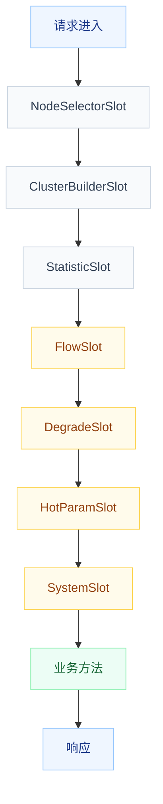
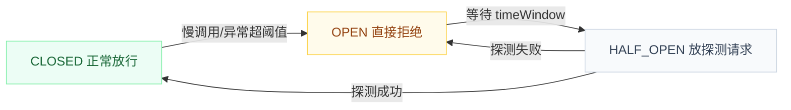

# Sentinel限流熔断

> 这篇从 Sentinel 的资源与规则模型讲起，经过控制台接入、流控、熔断、热点参数、系统规则和 Nacos 持久化，最后落到一套订单服务的限流熔断方案与排障手册。
>
> 学完能独立给 Spring Boot 接口配置 QPS/线程数限流、慢调用熔断和热点参数限流，把规则持久化到 Nacos，并用控制台和日志定位规则不生效的原因。

## 一、Sentinel 的规则模型

Sentinel 把每一次受保护的调用抽象成资源（resource），请求经过一条由多个 Slot 组成的责任链，依次完成统计、限流、熔断和系统保护。规则是挂在资源上的阈值，不是代码里的 if 判断。



资源有两种来源：Spring MVC 的 URL 自动成为资源，`@SentinelResource` 注解的方法也成为资源。规则里的 `resource` 必须和实际资源名完全一致，URL 资源通常带方法前缀或完整路径，注解资源就是注解的 `value`。

| 规则 | 保护目标 | 典型阈值 |
|---|---|---|
| 流控 | 入口流量 | QPS、并发线程数 |
| 熔断 | 不稳定下游 | 慢调用比例、异常比例、异常数 |
| 热点 | 单参数高频值 | 某用户 ID 的 QPS |
| 系统 | 整机负载 | 入口 QPS、平均 RT、线程数、CPU |
| 授权 | 调用来源 | 黑/白名单 |

Sentinel 与 Hystrix 的差异在规则模型：Hystrix 以命令为单位做线程池隔离，Sentinel 以资源为单位做流量统计和规则判断，轻量、无额外线程池，规则可以动态推送。Resilience4j 更贴近函数式装饰器，Sentinel 更适合需要控制台、集群流控和多语言接入的场景。

> 边界：Sentinel 只解决“流量进来时怎么限”，不解决“下游为什么慢”。下游连接池耗尽、SQL 没走索引、GC 停顿，仍然要靠指标和链路追踪定位。把 Sentinel 当万能熔断器，只会把问题推迟到下一次流量高峰。

版本基线（2026-11）：

| 组件 | 版本 | 说明 |
|---|---|---|
| JDK | 21 LTS | Spring Boot 3.5 最低 17 |
| Spring Boot | 3.5.16 | 3.5.x 最后 OSS 版本 |
| Spring Cloud Alibaba | 2025.0.0.0 | 对应 Spring Cloud 2025.0 |
| Sentinel | 1.8.10 | 1.8.x 稳定线 |
| Sentinel Dashboard | 1.8.10 | 与控制台同版本 |

> 版本对齐：SCA 2025.0.0.0 的 BOM 默认锁 Sentinel core 1.8.9；本章的扩展模块显式写 1.8.10。两者混装可用，但生产要么把 core 一并升到 1.8.10，要么全部使用 BOM 默认版本，不要只升级扩展模块。

## 二、控制台与最小闭环

先让一个 Spring Boot 接口出现在控制台，再用代码加载一条 QPS 规则，确认请求会被阻塞。

### 2.1 启动控制台

```bash
# 下载 1.8.10 的 dashboard jar，放到任意目录
curl -LO https://github.com/alibaba/Sentinel/releases/download/1.8.10/sentinel-dashboard-1.8.10.jar

# 8858 是控制台端口；dashboard.server 指向自己，project.name 用于日志区分
java -Dserver.port=8858 \
  -Dcsp.sentinel.dashboard.server=127.0.0.1:8858 \
  -Dproject.name=sentinel-dashboard \
  -jar sentinel-dashboard-1.8.10.jar
```

Windows PowerShell：

```powershell
java -Dserver.port=8858 `
  -Dcsp.sentinel.dashboard.server=127.0.0.1:8858 `
  -Dproject.name=sentinel-dashboard `
  -jar sentinel-dashboard-1.8.10.jar
```

macOS 与 Ubuntu 命令相同；Rocky 只需把下载命令换成 `curl -LO`，Java 用 `sudo dnf install java-21-openjdk-devel` 安装。启动后访问 `http://127.0.0.1:8858`，默认账号密码都是 `sentinel`。

### 2.2 接入 Spring Boot

```xml
<parent>
  <groupId>org.springframework.boot</groupId>
  <artifactId>spring-boot-starter-parent</artifactId>
  <version>3.5.16</version>
</parent>

<properties>
  <java.version>21</java.version>
  <spring-cloud.version>2025.0.3</spring-cloud.version>
</properties>

<dependencies>
  <dependency>
    <groupId>org.springframework.boot</groupId>
    <artifactId>spring-boot-starter-web</artifactId>
  </dependency>
  <dependency>
    <groupId>com.alibaba.cloud</groupId>
    <artifactId>spring-cloud-starter-alibaba-sentinel</artifactId>
  </dependency>
  <!-- 注解切面；starter 通常已传递，显式声明避免版本漂移 -->
  <dependency>
    <groupId>com.alibaba.csp</groupId>
    <artifactId>sentinel-annotation-aspectj</artifactId>
    <version>1.8.10</version>
  </dependency>
</dependencies>

<dependencyManagement>
  <dependencies>
    <dependency>
      <groupId>org.springframework.cloud</groupId>
      <artifactId>spring-cloud-dependencies</artifactId>
      <version>${spring-cloud.version}</version>
      <type>pom</type>
      <scope>import</scope>
    </dependency>
    <dependency>
      <groupId>com.alibaba.cloud</groupId>
      <artifactId>spring-cloud-alibaba-dependencies</artifactId>
      <version>2025.0.0.0</version>
      <type>pom</type>
      <scope>import</scope>
    </dependency>
  </dependencies>
</dependencyManagement>
```

`application.yml`：

```yaml
server:
  port: 8080

spring:
  application:
    name: order-service
  cloud:
    sentinel:
      transport:
        dashboard: 127.0.0.1:8858
        # 客户端与控制台通信的端口，被占用时自动向后找
        port: 8719
      # 启动即连接控制台，不等第一次请求
      eager: true
      # 关闭 URL 上下文合并，link 规则才能区分不同接口
      web-context-unify: false
```

```java
package com.example.order;

import com.alibaba.csp.sentinel.annotation.SentinelResource;
import com.alibaba.csp.sentinel.slots.block.BlockException;
import org.springframework.web.bind.annotation.GetMapping;
import org.springframework.web.bind.annotation.PathVariable;
import org.springframework.web.bind.annotation.RestController;

@RestController
public class OrderController {

    @GetMapping("/orders/{id}")
    @SentinelResource(value = "orderQuery", blockHandler = "queryBlocked")
    public String query(@PathVariable String id) {
        return "order-" + id;
    }

    // blockHandler 必须同参数列表，末尾多一个 BlockException，返回值一致
    public String queryBlocked(String id, BlockException ex) {
        return "blocked:" + ex.getClass().getSimpleName();
    }
}
```

启动后请求一次，控制台左侧出现 `order-service`，簇点链路里出现 `orderQuery` 和 `/orders/{id}` 两个资源。没有请求时控制台看不到资源，这是懒加载，不是接入失败。

### 2.3 用代码加载第一条规则

```java
package com.example.order;

import com.alibaba.csp.sentinel.slots.block.RuleConstant;
import com.alibaba.csp.sentinel.slots.block.flow.FlowRule;
import com.alibaba.csp.sentinel.slots.block.flow.FlowRuleManager;
import jakarta.annotation.PostConstruct;
import org.springframework.context.annotation.Configuration;

import java.util.List;

@Configuration
public class SentinelRuleConfig {

    @PostConstruct
    public void init() {
        FlowRule rule = new FlowRule("orderQuery");
        rule.setGrade(RuleConstant.FLOW_GRADE_QPS);
        // 每秒 2 次，超过直接拒绝
        rule.setCount(2);
        rule.setControlBehavior(RuleConstant.CONTROL_BEHAVIOR_DEFAULT);
        FlowRuleManager.loadRules(List.of(rule));
    }
}
```

验证：

```bash
for i in $(seq 1 10); do
  curl -s http://localhost:8080/orders/1
  echo
done
```

预期输出（前两条通过，其余被阻塞）：

```text
order-1
order-1
blocked:FlowException
blocked:FlowException
blocked:FlowException
blocked:FlowException
blocked:FlowException
blocked:FlowException
blocked:FlowException
blocked:FlowException
```

> 边界：`FlowRuleManager.loadRules` 是覆盖式加载，第二次调用会替换全部规则，不是追加。生产环境用 Nacos 数据源注册属性，不要在业务代码里反复 `loadRules`。

## 三、流控规则

流控规则决定“每秒放多少”或“同时允许多少个请求”，并可选拒绝、预热、排队三种处理方式。

### 3.1 规则字段

| 字段 | 含义 | 常用值 |
|---|---|---|
| `grade` | 阈值类型 | 0 线程数，1 QPS |
| `count` | 阈值 | QPS 或线程数 |
| `strategy` | 流控模式 | 0 直接，1 关联，2 链路 |
| `controlBehavior` | 拒绝策略 | 0 快速失败，1 预热，2 排队 |
| `limitApp` | 来源限制 | `default` 或来源名 |

`limitApp` 依赖 `RequestOriginParser` 解析来源，不配置时所有来源都算 `default`。只在网关或内网调用时，按来源限流意义不大；多租户 API 才需要。

### 3.2 QPS 与线程数

QPS 适合保护“单位时间请求数”，线程数适合保护“慢调用占满线程池”。一个接口平均 50 ms，QPS 100 时并发约 5；平均 2 s 时并发约 200，线程数规则会先触发。

线程数规则示例：

```java
FlowRule rule = new FlowRule("slowQuery");
rule.setGrade(RuleConstant.FLOW_GRADE_THREAD);
rule.setCount(5); // 同时最多 5 个请求进入方法
FlowRuleManager.loadRules(List.of(rule));
```

用一个故意慢的接口验证：

```java
@GetMapping("/slow")
@SentinelResource(value = "slowQuery", blockHandler = "slowBlocked")
public String slow() throws InterruptedException {
    Thread.sleep(1000);
    return "ok";
}

public String slowBlocked(BlockException ex) {
    return "blocked:" + ex.getClass().getSimpleName();
}
```

```bash
seq 1 10 | xargs -P 10 -I{} curl -s -w "\n" http://localhost:8080/slow
```

10 个并发同时到达，5 个进入方法并各睡 1 秒，另外 5 个立即返回 `blocked:FlowException`。线程数规则不关心请求速率，只关心当前占用线程数。

> 边界：WebFlux 应用没有“每请求一线程”的模型，线程数规则意义有限；网关场景用 GatewayFlowRule 或 QPS。线程数规则依赖正确的统计，异步回调不在同一线程时可能统计算错。

### 3.3 预热与排队

预热用于冷启动：阈值从 `count / coldFactor` 开始，在 `warmUpPeriodSec` 内逐步升到 `count`。`coldFactor` 默认 3，即从三分之一开始。

```java
FlowRule rule = new FlowRule("orderQuery");
rule.setGrade(RuleConstant.FLOW_GRADE_QPS);
rule.setCount(90);
rule.setControlBehavior(RuleConstant.CONTROL_BEHAVIOR_WARM_UP);
rule.setWarmUpPeriodSec(10); // 10 秒内从 30 QPS 升到 90 QPS
FlowRuleManager.loadRules(List.of(rule));
```

排队用于削峰：请求不立即拒绝，而是按固定间隔排队，超过 `maxQueueingTimeMs` 才拒绝。

```java
rule.setCount(20);
rule.setControlBehavior(RuleConstant.CONTROL_BEHAVIOR_RATE_LIMITER);
rule.setMaxQueueingTimeMs(500); // 最多等 500 ms，超时抛 BlockException
```

> 边界：排队会占用容器线程，排队时间乘以并发数就是额外内存和连接占用。入口 QPS 远大于处理能力时，排队只会把超时推迟，不能提高吞吐；这种场景应快速失败并让上游降级。

### 3.4 关联与链路

关联规则：当关联资源达到阈值时，限制当前资源。典型场景是“写库存慢，读库存让路”：

```java
FlowRule rule = new FlowRule("orderQuery");
rule.setGrade(RuleConstant.FLOW_GRADE_QPS);
rule.setCount(10);
rule.setStrategy(RuleConstant.STRATEGY_RELATE);
rule.setRefResource("stockUpdate"); // stockUpdate 达到阈值时，orderQuery 限到 10
FlowRuleManager.loadRules(List.of(rule));
```

链路规则只统计从指定入口进入的流量，需要 `web-context-unify: false` 或 `@SentinelResource` 的入口资源：

```java
rule.setStrategy(RuleConstant.STRATEGY_CHAIN);
rule.setRefResource("createOrder"); // 只限从 createOrder 入口进来的 orderQuery
```

> 边界：关联规则保护的是“被关联资源”，不是当前资源；两个资源的阈值方向容易写反。链路规则依赖入口资源名，URL 资源名随框架版本变化，升级后要重新核对。

## 四、熔断、热点与系统规则

流控解决“请求太多”，熔断解决“下游已经坏了”，热点解决“某个参数值太集中”，系统规则解决“整机快扛不住”。

### 4.1 熔断规则

Sentinel 熔断器有三种触发条件：

| 类型 | `grade` | `count` 含义 | 适用 |
|---|---|---|---|
| 慢调用比例 | 0 | 最大响应时间（ms） | 下游变慢 |
| 异常比例 | 1 | 异常比例 0~1 | 下游大量报错 |
| 异常数 | 2 | 时间窗内异常个数 | 低频接口 |

```java
DegradeRule rule = new DegradeRule("orderQuery");
// 500 ms 以上算慢调用，10 秒统计窗内慢调用比例超过 50% 就打开
rule.setGrade(RuleConstant.DEGRADE_GRADE_RT);
rule.setCount(500);
rule.setSlowRatioThreshold(0.5);
rule.setMinRequestAmount(20);
rule.setStatIntervalMs(10_000);
rule.setTimeWindow(10); // 打开后 10 秒内不再放行
DegradeRuleManager.loadRules(List.of(rule));
```

熔断器状态：



`@SentinelResource` 同时配 `blockHandler` 和 `fallback`：

```java
@SentinelResource(
    value = "orderQuery",
    blockHandler = "queryBlocked",
    fallback = "queryFallback",
    exceptionsToIgnore = IllegalArgumentException.class)
public OrderView query(String id) {
    return remoteOrderClient.get(id);
}

public OrderView queryBlocked(String id, BlockException ex) {
    return OrderView.cached(id, "限流");
}

public OrderView queryFallback(String id, Throwable ex) {
    return OrderView.cached(id, "降级");
}
```

`blockHandler` 只处理 `BlockException`（流控、熔断、热点、系统规则），`fallback` 处理业务异常。`exceptionsToIgnore` 里的异常既不计数也不走 fallback，适合参数校验失败这类“预期内”的异常。

> 边界：`blockHandler` 和 `fallback` 的方法签名必须匹配原方法参数，末尾分别多 `BlockException` 或 `Throwable`；返回值必须兼容。方法写成 `private` 或同类自调用会绕过 AOP，规则和降级都不生效。

### 4.2 热点参数

热点规则按方法参数值限流，例如同一商品 ID 被刷、同一用户高频请求。它只对 `@SentinelResource` 注解的资源生效，且方法必须有参数。

```xml
<dependency>
  <groupId>com.alibaba.csp</groupId>
  <artifactId>sentinel-parameter-flow-control</artifactId>
  <version>1.8.10</version>
</dependency>
```

```java
ParamFlowRule rule = new ParamFlowRule("orderQuery")
    .setParamIdx(0)   // 第 1 个参数，下标从 0 开始
    .setCount(5);     // 同一参数值每秒 5 次
rule.setDurationInSec(1);
rule.setControlBehavior(RuleConstant.CONTROL_BEHAVIOR_DEFAULT);

// 对 VIP 用户单独放宽到 100 QPS
ParamFlowItem vip = new ParamFlowItem()
    .setObject("vip-1001")
    .setClassType(String.class.getName())
    .setCount(100);
rule.setParamFlowItemList(List.of(vip));
ParamFlowRuleManager.loadRules(List.of(rule));
```

```java
@GetMapping("/orders/hot/{userId}")
@SentinelResource(value = "hotQuery", blockHandler = "hotBlocked")
public String hot(@PathVariable String userId) {
    return "query:" + userId;
}

public String hotBlocked(String userId, BlockException ex) {
    return "hot-blocked:" + userId;
}
```

```bash
for i in $(seq 1 8); do curl -s http://localhost:8080/orders/hot/u-1; echo; done
```

预期前 5 次返回 `query:u-1`，后 3 次返回 `hot-blocked:u-1`。把路径换成 `vip-1001` 时，阈值按 100 计算。

> 边界：热点参数只支持基本类型和字符串；参数是对象时用 `paramIdx` 取不到内部字段。热点规则不统计 URL 资源，必须打注解。阈值按参数值分桶，参数值无限增长会占用内存，生产环境限制参数基数。

### 4.3 系统规则

系统规则是全局兜底，不针对单个资源，触发后所有入口请求都会被拒绝。

```java
SystemRule rule = new SystemRule();
rule.setHighestSystemLoad(8.0);   // 1 分钟平均负载
rule.setAvgRt(500);               // 所有入口平均 RT 上限
rule.setMaxThread(200);           // 并发线程数上限
rule.setQps(1000);                // 所有入口总 QPS
rule.setHighestCpuUsage(0.8);     // CPU 使用率 80%
SystemRuleManager.loadRules(List.of(rule));
```

至少设置一个阈值，未设置的项不参与判断。系统规则适合作为最后一道保险，阈值应比正常容量高 20%~30%，不要拿它做精细业务限流。

> 边界：系统规则的 `qps` 是入口总 QPS，不是单资源；`avgRt` 统计所有入口，某个慢接口会拉高全局平均值。容器 CPU 限制和宿主机负载不一致时，`highestSystemLoad` 可能误判，容器环境优先用 CPU 使用率和入口 QPS。

## 五、控制台、持久化与集群

控制台默认把规则放在客户端内存，重启即丢失；生产环境必须把规则落到配置中心，并明确“谁是规则的唯一来源”。

### 5.1 控制台能做什么

- 查看簇点链路、实时 QPS、响应时间、异常数；
- 在线新增/修改流控、熔断、热点、系统、授权规则；
- 查看机器列表和心跳；
- 规则推送通过客户端 8719 端口完成，控制台不直接连数据库。

控制台修改的规则只存在客户端内存，应用重启后回到代码或数据源加载的版本。多实例场景下，控制台逐台推送，实例重启后规则不一致。

### 5.2 Nacos 持久化

```xml
<dependency>
  <groupId>com.alibaba.csp</groupId>
  <artifactId>sentinel-datasource-nacos</artifactId>
  <version>1.8.10</version>
</dependency>
```

```java
package com.example.order;

import com.alibaba.csp.sentinel.datasource.ReadableDataSource;
import com.alibaba.csp.sentinel.datasource.nacos.NacosDataSource;
import com.alibaba.csp.sentinel.slots.block.flow.FlowRule;
import com.alibaba.csp.sentinel.slots.block.flow.FlowRuleManager;
import com.fasterxml.jackson.core.type.TypeReference;
import com.fasterxml.jackson.databind.ObjectMapper;
import jakarta.annotation.PostConstruct;
import org.springframework.context.annotation.Configuration;

import java.util.List;

@Configuration
public class NacosRuleConfig {

    private static final ObjectMapper MAPPER = new ObjectMapper();

    @PostConstruct
    public void init() {
        String serverAddr = "127.0.0.1:8848";
        String groupId = "SENTINEL_GROUP";
        String dataId = "order-service-flow-rules";

        ReadableDataSource<String, List<FlowRule>> dataSource =
                new NacosDataSource<>(serverAddr, groupId, dataId, source -> {
                    try {
                        // 用 Jackson 解析，避免额外引入 fastjson
                        return MAPPER.readValue(source,
                                new TypeReference<List<FlowRule>>() {});
                    } catch (Exception e) {
                        throw new IllegalStateException("解析 Sentinel 流控规则失败", e);
                    }
                });
        // register2Property 让配置变更自动推送到 FlowRuleManager
        FlowRuleManager.register2Property(dataSource.getProperty());
    }
}
```

Nacos 配置内容：

```json
[
  {
    "resource": "orderQuery",
    "limitApp": "default",
    "grade": 1,
    "count": 100,
    "strategy": 0,
    "controlBehavior": 0,
    "clusterMode": false
  }
]
```

> 边界：控制台不会把规则写回 Nacos。要让 Nacos 成为唯一来源，就在 Nacos 控制台或发布系统改配置，控制台只用于观察；否则控制台改一次、Nacos 推一次，规则会来回覆盖。`dataId` 按应用命名，`groupId` 统一，避免多环境串配置。

### 5.3 集群流控

单机流控的阈值是“每实例 QPS”，3 个实例、阈值 100，实际总入口是 300。需要全局 100 QPS 时用集群流控：

- Token Server 独立部署，统一发放令牌；
- Token Client 嵌入应用，向 Server 申请令牌；
- 规则里 `clusterMode=true`，并配置 `clusterConfig.flowId` 和 `thresholdType`；
- Server 端口默认 18730，需要放通防火墙和 K8s NetworkPolicy。

集群流控的代价是每次请求多一次 RPC，Token Server 成为新的单点。实例少、阈值可按实例均分时，单机流控加负载均衡更简单；只有“全局精确配额”或“按用户全局配额”才值得上集群。

### 5.4 网关与 Feign 集成

Spring Cloud Gateway 使用独立适配器：

```xml
<dependency>
  <groupId>com.alibaba.cloud</groupId>
  <artifactId>spring-cloud-alibaba-sentinel-gateway</artifactId>
</dependency>
```

```yaml
spring:
  cloud:
    sentinel:
      scg:
        fallback:
          mode: response
          response-status: 429
          response-body: '{"code":"RATE_LIMITED","message":"请求过于频繁"}'
          content-type: application/json
```

```java
GatewayFlowRule rule = new GatewayFlowRule("order-service")
    .setCount(100)
    .setIntervalSec(1);
GatewayRuleManager.loadRules(Set.of(rule));
```

网关规则的 `resource` 默认是路由 id，不是后端 URL。需要按 API 分组时，用 `ApiDefinition` 把多个路径归到一个资源名，再对资源名限流。

OpenFeign 集成：

```yaml
feign:
  sentinel:
    enabled: true
```

```java
@FeignClient(name = "stock-service", fallback = StockFallback.class)
public interface StockClient {
    @GetMapping("/stocks/{skuId}")
    StockView get(@PathVariable String skuId);
}

@Component
public class StockFallback implements StockClient {
    @Override
    public StockView get(String skuId) {
        // 降级返回缓存或明确缺货，不能返回 null 让上层空指针
        return StockView.unavailable(skuId);
    }
}
```

> 边界：Feign 的 `fallback` 会吞掉所有异常，包括参数错误和 401；需要区分异常时用 `fallbackFactory`。网关限流和业务服务限流不是二选一：网关挡洪水，服务挡慢调用和热点。

## 六、排障与上线检查

Sentinel 的问题大多不是“规则没写对”，而是“资源名不一致”或“规则没加载到正确的实例”。

| 现象 | 常见原因 | 第一条检查 |
|---|---|---|
| 控制台看不到应用 | dashboard 地址错、8719 被占 | 应用日志搜 `sentinel`，`ss -lntp \| grep 8719` |
| 规则不生效 | 资源名不一致、自调用绕过 AOP | 控制台簇点链路核对资源名 |
| `blockHandler` 不执行 | 签名不匹配、异常类型不对 | 方法是否多 `BlockException` 参数 |
| 返回 200 但被限流 | blockHandler 返回了正常对象 | 响应体是否带降级标记 |
| 重启后规则丢失 | 只存在内存 | 是否注册 Nacos 数据源 |
| 集群流控失败 | Token Server 不可达 | `telnet token-server 18730` |

### 6.1 常见错误

**控制台没有应用**：`spring.cloud.sentinel.eager` 为 false 时，第一次请求才注册；先访问一次接口。8719 被其他实例占用时，客户端会自动递增端口，控制台仍能连上，但防火墙要放通一段端口范围。

**规则显示在控制台但不生效**：注解资源名是 `orderQuery`，规则写成了 `/orders/{id}`。URL 资源和注解资源是两套统计，规则不能混用。自调用 `this.query()` 不经过 Spring AOP，注解规则和 `blockHandler` 都不会触发。

**熔断一直不打开**：`minRequestAmount` 默认 5，统计窗口内请求数不够；`statIntervalMs` 太短，慢调用比例被稀释；`count` 单位是毫秒，不是秒。先看控制台实时 RT，再调阈值。

**热点规则不生效**：没有引入 `sentinel-parameter-flow-control`；`paramIdx` 从 0 开始；方法参数不是基本类型/字符串；规则加载到了 URL 资源而不是注解资源。

**系统规则把健康检查也拒了**：系统规则对所有入口生效，健康检查也是入口。给健康检查单独放行，或把系统规则阈值调高，不要用系统规则做业务限流。

### 6.2 上线检查清单

- 每个核心接口有明确的资源名，URL 和注解资源不混用；
- 流控阈值来自压测，不照抄默认值；
- 慢调用熔断的 `count` 与下游 p99 对齐，`timeWindow` 足够让下游恢复；
- 热点规则限制参数基数，避免内存膨胀；
- 规则持久化到 Nacos，控制台只读；
- 多实例阈值确认是单机还是全局；
- 降级响应有稳定结构，前端能识别；
- 规则变更走发布流程，有回滚版本；
- 监控面板包含 pass/block QPS、RT、异常数、熔断状态；
- 日志里记录资源名、规则 id、触发时间，便于复盘。

## 七、最佳实践案例

### 7.1 案例背景

订单服务有 3 个实例，依赖库存服务和 MySQL。促销时订单查询接口被商品详情页放大，单实例 QPS 从 80 涨到 400，库存服务 p99 从 120 ms 涨到 1.8 s，数据库连接池被打满。目标是：订单查询单实例限到 100 QPS，库存慢调用时 10 秒内熔断并返回缓存，单个热门商品参数限到 5 QPS，规则统一放 Nacos。约束是不能改网关，不能引入新中间件，降级必须返回可展示的数据。

### 7.2 案例实操

依赖在最小工程上追加 Nacos 数据源和热点参数模块：

```xml
<dependency>
  <groupId>com.alibaba.csp</groupId>
  <artifactId>sentinel-datasource-nacos</artifactId>
  <version>1.8.10</version>
</dependency>
<dependency>
  <groupId>com.alibaba.csp</groupId>
  <artifactId>sentinel-parameter-flow-control</artifactId>
  <version>1.8.10</version>
</dependency>
```

`application.yml`：

```yaml
server:
  port: 8080

spring:
  application:
    name: order-service
  cloud:
    sentinel:
      transport:
        dashboard: 127.0.0.1:8858
        port: 8719
      eager: true
      web-context-unify: false
  data:
    redis:
      host: 127.0.0.1
      port: 6379

feign:
  sentinel:
    enabled: true
```

Nacos 中建两个配置：

```text
Group: SENTINEL_GROUP
DataId: order-service-flow-rules
```

```json
[
  {
    "resource": "orderQuery",
    "limitApp": "default",
    "grade": 1,
    "count": 100,
    "strategy": 0,
    "controlBehavior": 0,
    "clusterMode": false
  }
]
```

热点规则放在独立配置，资源名用 `hotQuery`，不要和流控规则混在同一个数组：

```text
DataId: order-service-param-rules
```

```json
[
  {
    "resource": "hotQuery",
    "paramIdx": 0,
    "count": 5,
    "durationInSec": 1,
    "controlBehavior": 0
  }
]
```

加载代码：

```java
@Configuration
public class RuleConfig {

    private static final ObjectMapper MAPPER = new ObjectMapper();

    @PostConstruct
    public void init() {
        FlowRuleManager.register2Property(new NacosDataSource<>(
                "127.0.0.1:8848", "SENTINEL_GROUP", "order-service-flow-rules",
                source -> parse(source, new TypeReference<List<FlowRule>>() {}))
                .getProperty());

        ParamFlowRuleManager.register2Property(new NacosDataSource<>(
                "127.0.0.1:8848", "SENTINEL_GROUP", "order-service-param-rules",
                source -> parse(source, new TypeReference<List<ParamFlowRule>>() {}))
                .getProperty());

        DegradeRule degrade = new DegradeRule("stockQuery")
                .setGrade(RuleConstant.DEGRADE_GRADE_RT)
                .setCount(500)
                .setSlowRatioThreshold(0.5)
                .setMinRequestAmount(20)
                .setStatIntervalMs(10_000)
                .setTimeWindow(10);
        DegradeRuleManager.loadRules(List.of(degrade));
    }

    private static <T> T parse(String source, TypeReference<T> type) {
        try {
            return MAPPER.readValue(source, type);
        } catch (Exception e) {
            // 数据源回调不能抛受检异常，包成运行时异常让启动直接失败
            throw new IllegalStateException("解析 Sentinel 规则失败", e);
        }
    }
}
```

业务代码：

```java
@RestController
public class OrderController {

    private final StockService stockService;
    private final OrderCache cache;

    public OrderController(StockService stockService, OrderCache cache) {
        this.stockService = stockService;
        this.cache = cache;
    }

    @GetMapping("/orders/{id}")
    @SentinelResource(
            value = "orderQuery",
            blockHandler = "queryBlocked",
            fallback = "queryFallback")
    public OrderView query(@PathVariable String id) {
        // 库存查询是慢依赖，熔断规则挂在 stockQuery 上
        StockView stock = stockService.query(id);
        return OrderView.of(id, stock);
    }

    @GetMapping("/orders/hot/{skuId}")
    @SentinelResource(value = "hotQuery", blockHandler = "hotBlocked")
    public OrderView hot(@PathVariable String skuId) {
        return OrderView.of(skuId, stockService.query(skuId));
    }

    public OrderView queryBlocked(String id, BlockException ex) {
        // 限流时返回缓存，保证商品详情页有内容
        return cache.get(id).orElse(OrderView.unavailable(id, "限流"));
    }

    public OrderView queryFallback(String id, Throwable ex) {
        return cache.get(id).orElse(OrderView.unavailable(id, "降级"));
    }

    public OrderView hotBlocked(String skuId, BlockException ex) {
        return cache.get(skuId).orElse(OrderView.unavailable(skuId, "热点限流"));
    }
}

@Service
public class StockService {

    private final StockClient stockClient;

    public StockService(StockClient stockClient) {
        this.stockClient = stockClient;
    }

    @SentinelResource(value = "stockQuery", fallback = "stockFallback")
    public StockView query(String skuId) {
        return stockClient.get(skuId);
    }

    public StockView stockFallback(String skuId, Throwable ex) {
        return StockView.unavailable(skuId);
    }
}

@Component
class OrderCache {

    private final Map<String, OrderView> data = new ConcurrentHashMap<>();

    public Optional<OrderView> get(String id) {
        return Optional.ofNullable(data.get(id));
    }

    public void put(OrderView view) {
        data.put(view.id(), view);
    }
}

record StockView(String skuId, int available) {
    static StockView unavailable(String skuId) {
        return new StockView(skuId, 0);
    }
}

record OrderView(String id, String status, StockView stock) {
    static OrderView of(String id, StockView stock) {
        return new OrderView(id, "OK", stock);
    }

    static OrderView unavailable(String id, String reason) {
        return new OrderView(id, reason, null);
    }
}
```

压测命令：

```bash
# 20 并发、持续 10 秒，观察限流后的吞吐和响应
hey -z 10s -c 20 http://localhost:8080/orders/1001

# 单参数热点：同一商品连续请求
for i in $(seq 1 10); do curl -s http://localhost:8080/orders/hot/sku-1; echo; done
```

预期输出（示例环境，单实例）：

```text
Summary:
  Total:        10.0213 secs
  Requests/sec: 99.8
  Status codes: 200 998
```

被限流的请求也返回 200，因为 `queryBlocked` 返回的是缓存对象；这正是 6.1 提到的“返回 200 但被限流”现象，监控要单独看 Sentinel 的 block 指标，不要只看 HTTP 状态码。

单实例 QPS 稳定在 100 附近，超过阈值的请求由 `blockHandler` 返回缓存或降级对象，不会继续打到库存服务。库存服务被注入 800 ms 延迟后，`stockQuery` 在 10 秒统计窗内慢调用比例超过 50%，熔断器打开，后续请求直接走 `queryFallback`；10 秒后放 3 个探测请求，恢复正常则关闭。

### 7.3 案例结果

压测 10 分钟，订单服务单实例入口 QPS 稳定在 100，库存服务 p99 从 1.8 s 回落到 180 ms，数据库连接池活跃连接从 200 降到 60。熔断触发 3 次，均在 10 秒内恢复；热点商品请求被限制在 5 QPS，未再出现单商品打满实例。

指标（示例环境，3 实例）：

| 指标 | 改造前 | 改造后 |
|---|---|---|
| 订单查询 p99 | 1.6 s | 220 ms |
| 库存服务峰值 QPS | 1200 | 300 |
| 数据库活跃连接 | 200 | 60 |
| 熔断恢复时间 | 无 | 10 s |

失败模式与复盘：

- 规则同时写代码和 Nacos，启动时 Nacos 还没连上，代码规则先生效，随后被 Nacos 覆盖；最终只保留 Nacos 一个来源；
- 热点规则参数是商品 ID，商品下架后旧值仍占桶，内存缓慢增长；增加参数基数上限和定期清理；
- 熔断降级返回缓存，缓存也没有时返回 `unavailable`，前端必须能展示“暂时缺货”，不能把空对象当正常数据；
- `blockHandler` 最初返回 200，监控看不到限流；统一改成带 `code=RATE_LIMITED` 的响应，并在网关注入 429；
- 集群流控没有启用，3 个实例的实际总配额是 300 QPS；业务确认可接受后，把单机阈值按实例数均分，避免过度设计。
