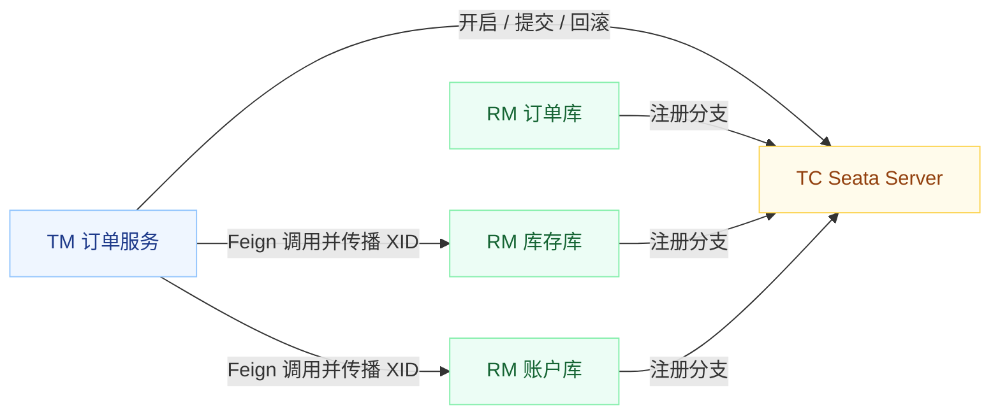
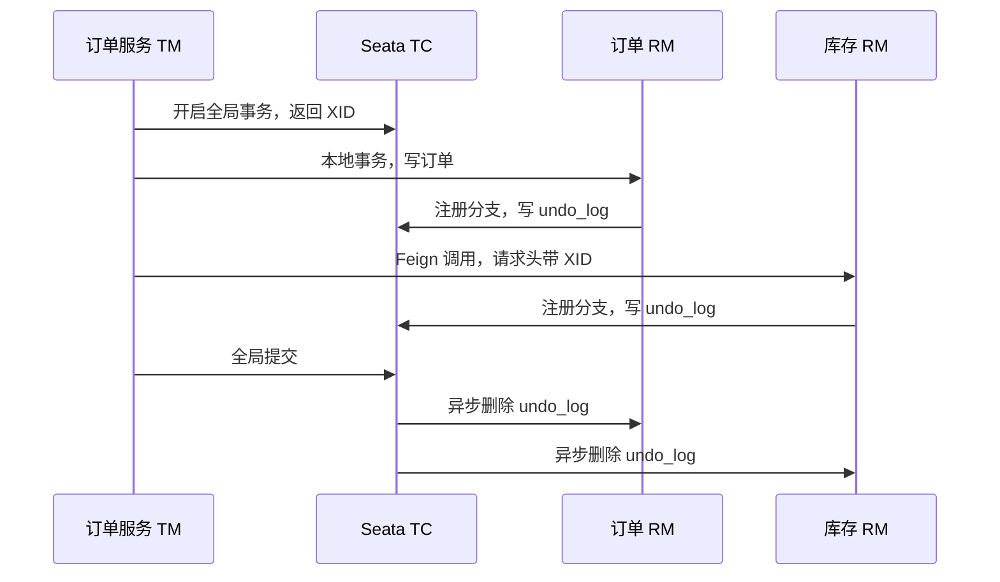
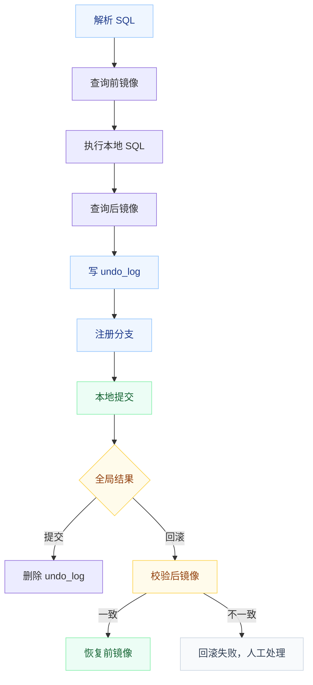

# Seata分布式事务

> 这篇从本地事务跨服务失效的原因讲起，经过 Seata 的 TC/TM/RM 角色、AT 两阶段提交与 undo_log、TCC 补偿、Saga/XA 选型，最后落到订单、库存、账户三个服务的可回滚实现与对账手册。
>
> 学完能独立部署 Seata 2.x 事务协调器，用 AT 模式保证跨服务下单的原子性，写出可幂等的 TCC 补偿，并在回滚失败时从 undo_log、TC 会话表和业务表中定位问题。

## 一、分布式事务的边界

一个业务操作跨越两个数据库时，本地 `@Transactional` 只能保证当前数据库回滚，已经提交的另一半不会自动撤销。分布式事务要解决的是“多个本地事务要么都成功、要么都回滚”的协调问题，代价是锁、重试和额外的网络往返。



Seata 有三个角色：

| 角色 | 所在位置 | 职责 |
|---|---|---|
| TC（Transaction Coordinator） | 独立部署的 Seata Server | 维护全局会话、分支、全局锁，驱动提交/回滚 |
| TM（Transaction Manager） | 业务发起方 | 定义全局事务边界，向 TC 开启、提交、回滚 |
| RM（Resource Manager） | 每个参与方 | 管理本地资源，注册分支，执行提交/回滚 |

四种模式解决不同问题：

| 模式 | 一致性 | 业务侵入 | 隔离性 | 适用场景 |
|---|---|---|---|---|
| AT | 最终一致 | 低 | 默认读未提交 | 普通 CRUD、短事务 |
| TCC | 最终一致 | 高 | 业务自己控制 | 外部系统、高并发、无本地事务 |
| Saga | 最终一致 | 中 | 无 | 长流程、跨组织编排 |
| XA | 强一致 | 低 | 强 | 短事务、数据库支持 XA |

> 边界：能用一个库的事务解决，就不要引入 Seata。跨服务但允许最终一致的场景，优先考虑本地消息表/事务性发件箱（outbox），它比全局锁更容易运维。Seata 适合“必须原子、参与方都有本地数据库、事务时间短”的场景。

版本基线（2026-11）：

| 组件 | 版本 | 说明 |
|---|---|---|
| JDK | 21 LTS | 业务侧 Spring Boot 3.5 最低 17；Seata Server 官方二进制要求 JDK 25，Docker 镜像另有 `jdk17`/`jdk21` 变体 |
| Spring Boot | 3.5.16 | 3.5.x 最后 OSS 版本 |
| Seata | 2.6.0 | Apache Seata，2.x 稳定线，2026-02 发布 |
| MySQL | 8.4 | InnoDB、utf8mb4 |
| Nacos | 2.4+ | 可选，用于 TC 注册和配置 |

## 二、环境与最小闭环

先启动 TC、建好业务库和 `undo_log`，再让一个服务连上 TC。最小闭环的目标不是完成下单，而是确认“应用能注册到 TC、AT 数据源代理生效”。

### 2.1 启动 TC

Docker 方式：

```bash
docker run -d --name seata-server \
  -p 8091:8091 \
  -p 7091:7091 \
  apache/seata-server:2.6.0

docker logs -f seata-server
```

预期日志（截取）：

```text
Server started, service listen port: 8091
console listen port: 7091
```

8091 是 TC 的事务端口，7091 是控制台端口。默认使用 file 注册中心和 file 存储，重启后全局会话丢失，只适合本地开发。

二进制方式：

```bash
# 下载 apache-seata-2.6.0-incubating-bin.tar.gz 后解压
tar -xzf apache-seata-2.6.0-incubating-bin.tar.gz
cd seata/bin
sh seata-server.sh -h 127.0.0.1 -p 8091 -m file
```

Windows 用 `seata-server.bat -h 127.0.0.1 -p 8091 -m file`。生产环境把 `-m file` 换成 `-m db`，并准备 `global_table`、`branch_table`、`lock_table` 三张 TC 表。

### 2.2 建业务库

```sql
CREATE DATABASE seata_order  DEFAULT CHARACTER SET utf8mb4;
CREATE DATABASE seata_stock  DEFAULT CHARACTER SET utf8mb4;
CREATE DATABASE seata_account DEFAULT CHARACTER SET utf8mb4;

USE seata_order;
CREATE TABLE orders (
  id BIGINT PRIMARY KEY AUTO_INCREMENT,
  user_id BIGINT NOT NULL,
  sku_id BIGINT NOT NULL,
  quantity INT NOT NULL,
  amount DECIMAL(10,2) NOT NULL,
  status TINYINT NOT NULL DEFAULT 0,
  create_time DATETIME NOT NULL DEFAULT CURRENT_TIMESTAMP
);

USE seata_stock;
CREATE TABLE stock (
  sku_id BIGINT PRIMARY KEY,
  total INT NOT NULL,
  used INT NOT NULL DEFAULT 0
);
INSERT INTO stock(sku_id, total, used) VALUES (1001, 100, 0);

USE seata_account;
CREATE TABLE account (
  user_id BIGINT PRIMARY KEY,
  balance DECIMAL(10,2) NOT NULL
);
INSERT INTO account(user_id, balance) VALUES (1, 10000.00);
```

每个业务库都要有 `undo_log`，AT 模式回滚靠它：

```sql
CREATE TABLE IF NOT EXISTS undo_log (
  branch_id BIGINT NOT NULL,
  xid VARCHAR(128) NOT NULL,
  context VARCHAR(128) NOT NULL,
  rollback_info LONGBLOB NOT NULL,
  log_status INT NOT NULL,
  log_created DATETIME(6) NOT NULL,
  log_modified DATETIME(6) NOT NULL,
  UNIQUE KEY ux_undo_log (xid, branch_id)
) ENGINE=InnoDB DEFAULT CHARSET=utf8mb4;
```

> 边界：`undo_log` 必须建在每个参与方的业务库里，不是只建在 TC 库。表名固定为小写 `undo_log`，MySQL 在 Linux 上默认区分大小写，写成 `Undo_Log` 会找不到表。

### 2.3 客户端依赖

三个服务都引入：

```xml
<parent>
  <groupId>org.springframework.boot</groupId>
  <artifactId>spring-boot-starter-parent</artifactId>
  <version>3.5.16</version>
</parent>

<dependencies>
  <dependency>
    <groupId>org.springframework.boot</groupId>
    <artifactId>spring-boot-starter-web</artifactId>
  </dependency>
  <dependency>
    <groupId>org.springframework.boot</groupId>
    <artifactId>spring-boot-starter-jdbc</artifactId>
  </dependency>
  <dependency>
    <groupId>com.mysql</groupId>
    <artifactId>mysql-connector-j</artifactId>
    <scope>runtime</scope>
  </dependency>
  <dependency>
    <groupId>org.apache.seata</groupId>
    <artifactId>seata-spring-boot-starter</artifactId>
    <version>2.6.0</version>
  </dependency>
  <!-- 提供 OpenFeign 的 XID 透传；排除它自带的 starter，避免版本冲突 -->
  <dependency>
    <groupId>com.alibaba.cloud</groupId>
    <artifactId>spring-cloud-starter-alibaba-seata</artifactId>
    <exclusions>
      <exclusion>
        <groupId>org.apache.seata</groupId>
        <artifactId>seata-spring-boot-starter</artifactId>
      </exclusion>
    </exclusions>
  </dependency>
</dependencies>
```

订单服务额外引入 OpenFeign：

```xml
<dependency>
  <groupId>org.springframework.cloud</groupId>
  <artifactId>spring-cloud-starter-openfeign</artifactId>
</dependency>
```

```xml
<dependencyManagement>
  <dependencies>
    <dependency>
      <groupId>org.springframework.cloud</groupId>
      <artifactId>spring-cloud-dependencies</artifactId>
      <version>2025.0.3</version>
      <type>pom</type>
      <scope>import</scope>
    </dependency>
    <dependency>
      <groupId>com.alibaba.cloud</groupId>
      <artifactId>spring-cloud-alibaba-dependencies</artifactId>
      <version>2025.0.0.0</version>
      <type>pom</type>
      <scope>import</scope>
    </dependency>
  </dependencies>
</dependencyManagement>
```

### 2.4 客户端配置

订单服务 `application.yml`：

```yaml
server:
  port: 8081

spring:
  application:
    name: order-service
  datasource:
    url: jdbc:mysql://127.0.0.1:3306/seata_order?useSSL=false&serverTimezone=Asia/Shanghai&rewriteBatchedStatements=true
    username: root
    password: root
    driver-class-name: com.mysql.cj.jdbc.Driver

seata:
  enabled: true
  application-id: order-service
  tx-service-group: order-service-tx-group
  service:
    vgroup-mapping:
      # 左边是事务分组，右边是 TC 集群名，必须与 TC 注册的 cluster 一致
      order-service-tx-group: default
    grouplist:
      default: 127.0.0.1:8091
  registry:
    type: file
  config:
    type: file
```

库存、账户服务的 `tx-service-group` 和 `vgroup-mapping` 必须与订单服务一致，`application-id` 改成各自的服务名。三个服务都连同一个 TC 集群，才能加入同一个全局事务。

启动后日志出现：

```text
RM will register resource ...
TM register success
```

说明客户端已连上 TC。若出现 `no available service 'default' found`，先查 TC 端口和 `grouplist`，不要急着改代码。

## 三、AT 模式

AT（Automatic Transaction）是 Seata 默认模式：业务只写本地 SQL，Seata 代理数据源，自动记录前后镜像并生成 `undo_log`，第二阶段用 `undo_log` 反向补偿。

### 3.1 两阶段流程



第一阶段：解析 SQL，查询前镜像，执行本地 SQL，查询后镜像，写 `undo_log`，注册分支，然后**本地事务直接提交**。注意，AT 的第一阶段已经提交了本地事务，不是数据库层面的两阶段提交。

第二阶段：全局提交时异步删除 `undo_log`；全局回滚时按 `undo_log` 的后镜像反向生成 SQL，校验当前数据是否仍等于后镜像，相等才恢复前镜像，避免覆盖别人的修改。



### 3.2 全局锁与隔离

AT 在第一阶段提交前向 TC 申请全局锁，锁的粒度是“表 + 主键值”。其他全局事务要修改同一行，必须等锁释放。本地事务（不走 Seata）不受全局锁约束，所以 AT 默认的读隔离级别是读未提交（Read Uncommitted），可能出现脏读。

需要避免脏读时：

```java
@GlobalLock
@Transactional
public BigDecimal queryBalance(long userId) {
    // FOR UPDATE 走本地行锁；@GlobalLock 先检查全局锁，避免读到别人未提交的中间态
    return jdbc.queryForObject(
        "SELECT balance FROM account WHERE user_id = ? FOR UPDATE",
        BigDecimal.class, userId);
}
```

`@GlobalLock` 只检查全局锁，不注册分支；它必须和本地事务一起用。普通 `SELECT` 不会检查全局锁。

> 边界：全局锁是“热点行杀手”。同一商品库存、同一账户余额在高并发下会排队，事务越长，锁等待越久。把非数据库操作（发短信、调外部支付）移出全局事务，事务里只保留必要的本地 SQL。

### 3.3 代码：下单的全局事务

订单服务：

```java
package com.example.order;

import org.apache.seata.spring.annotation.GlobalTransactional;
import org.springframework.jdbc.core.JdbcTemplate;
import org.springframework.jdbc.support.GeneratedKeyHolder;
import org.springframework.jdbc.support.KeyHolder;
import org.springframework.stereotype.Service;

import java.math.BigDecimal;
import java.sql.PreparedStatement;
import java.sql.Statement;

@Service
public class OrderService {

    private final JdbcTemplate jdbc;
    private final StockClient stockClient;
    private final AccountClient accountClient;

    public OrderService(JdbcTemplate jdbc, StockClient stockClient, AccountClient accountClient) {
        this.jdbc = jdbc;
        this.stockClient = stockClient;
        this.accountClient = accountClient;
    }

    @GlobalTransactional(name = "place-order", timeoutMills = 30_000, rollbackFor = Exception.class)
    public long placeOrder(long userId, long skuId, int quantity, BigDecimal amount) {
        KeyHolder keyHolder = new GeneratedKeyHolder();
        jdbc.update(connection -> {
            PreparedStatement ps = connection.prepareStatement(
                    "INSERT INTO orders(user_id, sku_id, quantity, amount, status) VALUES (?,?,?,?,0)",
                    Statement.RETURN_GENERATED_KEYS);
            ps.setLong(1, userId);
            ps.setLong(2, skuId);
            ps.setInt(3, quantity);
            ps.setBigDecimal(4, amount);
            return ps;
        }, keyHolder);

        // 远程分支：XID 由 Feign 拦截器放进请求头，库存服务加入同一全局事务
        stockClient.deduct(skuId, quantity);
        accountClient.debit(userId, amount);

        // 业务校验放在最后，异常会触发整个全局事务回滚
        if (amount.compareTo(new BigDecimal("5000")) > 0) {
            throw new IllegalArgumentException("订单金额超过风控上限");
        }
        return keyHolder.getKey().longValue();
    }
}
```

```java
@FeignClient(name = "stock-service", url = "${stock.url:http://127.0.0.1:8082}")
public interface StockClient {
    @PostMapping("/stocks/deduct")
    void deduct(@RequestParam("skuId") long skuId, @RequestParam("count") int count);
}
```

库存服务：

```java
@RestController
public class StockController {

    private final JdbcTemplate jdbc;

    public StockController(JdbcTemplate jdbc) {
        this.jdbc = jdbc;
    }

    @PostMapping("/stocks/deduct")
    public void deduct(@RequestParam long skuId, @RequestParam int count) {
        // 条件更新把“库存足够”放进 SQL，避免先查后改的竞态
        int updated = jdbc.update(
                "UPDATE stock SET used = used + ? WHERE sku_id = ? AND total - used >= ?",
                count, skuId, count);
        if (updated == 0) {
            throw new IllegalStateException("库存不足: skuId=" + skuId);
        }
    }
}
```

账户服务：

```java
@RestController
public class AccountController {

    private final JdbcTemplate jdbc;

    public AccountController(JdbcTemplate jdbc) {
        this.jdbc = jdbc;
    }

    @PostMapping("/accounts/debit")
    public void debit(@RequestParam long userId, @RequestParam BigDecimal amount) {
        // 余额不足时 updated=0，抛异常让全局事务回滚
        int updated = jdbc.update(
                "UPDATE account SET balance = balance - ? WHERE user_id = ? AND balance >= ?",
                amount, userId, amount);
        if (updated == 0) {
            throw new IllegalStateException("余额不足: userId=" + userId);
        }
    }
}
```

启动类加 `@EnableFeignClients`：

```java
@SpringBootApplication
@EnableFeignClients
public class OrderApplication {
    public static void main(String[] args) {
        SpringApplication.run(OrderApplication.class, args);
    }
}
```

### 3.4 验证提交与回滚

成功下单：

```bash
curl -s -X POST "http://127.0.0.1:8081/orders?userId=1&skuId=1001&count=2&amount=199.00"
```

```text
{"orderId":1}
```

```sql
SELECT id, user_id, sku_id, quantity, amount, status FROM seata_order.orders;
SELECT sku_id, total, used FROM seata_stock.stock WHERE sku_id=1001;
SELECT user_id, balance FROM seata_account.account WHERE user_id=1;
```

```text
id  user_id  sku_id  quantity  amount   status
1   1        1001    2         199.00   0

sku_id  total  used
1001    100    2

user_id  balance
1        9801.00
```

回滚验证：把数量改成 999，库存不足：

```bash
curl -s -X POST "http://127.0.0.1:8081/orders?userId=1&skuId=1001&count=999&amount=199.00"
```

```text
{"timestamp":"2026-11-13T10:20:31.123+08:00","status":500,"error":"Internal Server Error","path":"/orders"}
```

```sql
SELECT COUNT(*) FROM seata_order.orders;       -- 仍为 1
SELECT used FROM seata_stock.stock WHERE sku_id=1001; -- 仍为 2
SELECT balance FROM seata_account.account WHERE user_id=1; -- 仍为 9801.00
```

订单插入被回滚，库存和账户没有变化，说明 XID 传播和分支回滚都生效。查看 `undo_log`，正常提交/回滚完成后应为空：

```sql
SELECT xid, branch_id, log_status, log_created FROM seata_order.undo_log;
```

```text
Empty set
```

> 边界：`@GlobalTransactional` 必须通过 Spring 代理调用。同类方法里 `this.placeOrder(...)` 自调用不会开启全局事务，异常只会回滚本地事务。控制器直接调用 `OrderService` 的 public 方法，才能被拦截。

## 四、TCC 模式

TCC（Try-Confirm-Cancel）把业务拆成三个阶段：Try 预留资源，Confirm 确认扣减，Cancel 释放预留。它不依赖数据库回滚，适合没有本地事务的外部系统，也适合需要自己控制锁粒度的高并发热点。

### 4.1 三个方法

```java
import org.apache.seata.rm.tcc.api.BusinessActionContext;
import org.apache.seata.rm.tcc.api.BusinessActionContextParameter;
import org.apache.seata.rm.tcc.api.LocalTCC;
import org.apache.seata.rm.tcc.api.TwoPhaseBusinessAction;

@LocalTCC
public interface StockTccService {

    @TwoPhaseBusinessAction(
            name = "deductStockTcc",
            commitMethod = "commit",
            rollbackMethod = "rollback")
    boolean prepare(
            BusinessActionContext context,
            @BusinessActionContextParameter(paramName = "skuId") Long skuId,
            @BusinessActionContextParameter(paramName = "count") Integer count);

    boolean commit(BusinessActionContext context);

    boolean rollback(BusinessActionContext context);
}
```

实现要点：

- Try 只做资源预留，不真正扣减；库存表增加 `frozen` 字段，`total - used - frozen >= count` 才允许预留；
- Confirm 把 `frozen` 转到 `used`，必须幂等，重复调用结果一致；
- Cancel 把 `frozen` 减回去，必须幂等，且能处理“Cancel 先于 Try 到达”的空回滚；
- 每个阶段用 `(xid, branch_id, action)` 唯一键记录状态，防悬挂、防重复。

```java
@Service
public class StockTccServiceImpl implements StockTccService {

    private final JdbcTemplate jdbc;

    public StockTccServiceImpl(JdbcTemplate jdbc) {
        this.jdbc = jdbc;
    }

    @Override
    public boolean prepare(BusinessActionContext context, Long skuId, Integer count) {
        // 先写状态再扣预留，唯一键冲突说明重复 Try，直接返回成功
        int inserted = jdbc.update(
                "INSERT IGNORE INTO tcc_fence_log(xid, branch_id, action, status) VALUES (?,?,?,?)",
                context.getXid(), context.getBranchId(), "try", "TRIED");
        if (inserted == 0) {
            return true;
        }
        int updated = jdbc.update(
                "UPDATE stock SET frozen = frozen + ? WHERE sku_id = ? AND total - used - frozen >= ?",
                count, skuId, count);
        if (updated == 0) {
            throw new IllegalStateException("库存不足: skuId=" + skuId);
        }
        return true;
    }

    @Override
    public boolean commit(BusinessActionContext context) {
        // Confirm 幂等：只有 TRIED 状态才推进，重复调用直接成功
        int updated = jdbc.update(
                "UPDATE tcc_fence_log SET status='CONFIRMED' WHERE xid=? AND branch_id=? AND action='try' AND status='TRIED'",
                context.getXid(), context.getBranchId());
        if (updated == 1) {
            Long skuId = Long.valueOf(context.getActionContext("skuId").toString());
            Integer count = Integer.valueOf(context.getActionContext("count").toString());
            jdbc.update("UPDATE stock SET frozen = frozen - ?, used = used + ? WHERE sku_id = ?",
                    count, count, skuId);
        }
        return true;
    }

    @Override
    public boolean rollback(BusinessActionContext context) {
        int updated = jdbc.update(
                "UPDATE tcc_fence_log SET status='CANCELLED' WHERE xid=? AND branch_id=? AND action='try' AND status='TRIED'",
                context.getXid(), context.getBranchId());
        if (updated == 1) {
            Long skuId = Long.valueOf(context.getActionContext("skuId").toString());
            Integer count = Integer.valueOf(context.getActionContext("count").toString());
            jdbc.update("UPDATE stock SET frozen = frozen - ? WHERE sku_id = ?", count, skuId);
        } else {
            // 没有 Try 记录也要落一条 CANCELLED，防止 Cancel 之后 Try 再到达造成悬挂
            jdbc.update(
                    "INSERT IGNORE INTO tcc_fence_log(xid, branch_id, action, status) VALUES (?,?,?,?)",
                    context.getXid(), context.getBranchId(), "try", "CANCELLED");
        }
        return true;
    }
}
```

```sql
CREATE TABLE tcc_fence_log (
  xid VARCHAR(128) NOT NULL,
  branch_id BIGINT NOT NULL,
  action VARCHAR(16) NOT NULL,
  status VARCHAR(16) NOT NULL,
  gmt_create DATETIME NOT NULL DEFAULT CURRENT_TIMESTAMP,
  PRIMARY KEY (xid, branch_id, action)
);
```

> 边界：上面是 TCC 的核心片段，省略了库存表的 `frozen` 字段、异常重试和异步补偿调度。生产环境直接使用 Seata 的 TCC Fence 组件，或至少保留 `(xid, branch_id, action)` 唯一键；没有幂等键的 TCC 在重试下必然重复扣减。

### 4.2 空回滚与悬挂

空回滚：Try 没执行，Cancel 先到。常见于 Try 超时、网络丢包。Cancel 必须能识别“没有 Try 记录”，插入一条 `CANCELLED` 状态并返回成功，不能报错。

悬挂：Cancel 先到并返回成功，Try 随后才到。Try 插入唯一键时发现已存在 `CANCELLED` 记录，必须拒绝执行，否则资源被预留但永远不会 Confirm/Cancel。

```text
Try 到达：INSERT IGNORE (xid, branch, try) -> 成功，预留资源
Cancel 先到：INSERT IGNORE (xid, branch, try, CANCELLED) -> 成功
Try 后到：INSERT IGNORE 返回 0，检查状态为 CANCELLED -> 直接返回失败，不预留
```

TCC 的三个方法都要允许重复调用，返回值只表示“本次调用是否成功”，不表示“业务是否第一次执行”。

## 五、Saga、XA 与选型

Seata 不是只有 AT。选型先看一致性要求和事务时长，再看业务侵入成本。

| 模式 | 锁 | 隔离性 | 补偿方式 | 适合 |
|---|---|---|---|---|
| AT | 全局锁 + 本地锁 | 读未提交 | undo_log 自动反向 SQL | 短事务、普通 CRUD |
| TCC | 业务预留 | 业务控制 | 手写 Confirm/Cancel | 外部系统、高并发 |
| Saga | 无全局锁 | 无 | 状态机补偿 | 长流程、跨组织 |
| XA | 数据库 XA 锁 | 强 | 数据库回滚 | 短事务、强一致 |

### 5.1 XA

```yaml
seata:
  data-source-proxy-mode: XA
```

XA 由数据库的 XA 事务保证强一致，第一阶段 prepare 后资源一直锁到第二阶段结束。它适合“事务短、并发不高、必须强一致”的场景，比如资金记账。事务时间长会把数据库连接和行锁占满，不适合下单这类包含远程调用的流程。

### 5.2 Saga

Saga 把长流程拆成一串本地事务，每个正向操作配一个补偿操作，由状态机驱动。它没有全局锁，隔离性最弱，适合旅行预订、跨公司审批这类“流程长、不能长时间锁资源”的场景。

Seata Saga 用 JSON 状态机描述流程，核心是 `StateMachineEngine`：

```json
{
  "Name": "placeOrderSaga",
  "StartState": "CreateOrder",
  "States": {
    "CreateOrder": {
      "Type": "ServiceTask",
      "ServiceName": "orderService",
      "ServiceMethod": "create",
      "CompensateState": "CancelOrder",
      "Next": "DeductStock"
    },
    "DeductStock": {
      "Type": "ServiceTask",
      "ServiceName": "stockService",
      "ServiceMethod": "deduct",
      "CompensateState": "RestoreStock",
      "Next": "Succeed"
    },
    "CancelOrder": {
      "Type": "ServiceTask",
      "ServiceName": "orderService",
      "ServiceMethod": "cancel"
    },
    "RestoreStock": {
      "Type": "ServiceTask",
      "ServiceName": "stockService",
      "ServiceMethod": "restore"
    },
    "Succeed": { "Type": "Succeed" }
  }
}
```

状态机里每个补偿方法都必须幂等，且能处理“正向操作没执行”的空补偿。Saga 的补偿失败不会自动重试到无限，最终要有人工对账和告警。

> 边界：Saga 没有隔离性，中间状态对其它事务可见。业务上要允许“订单已创建、库存未扣”的短暂状态，并用状态字段区分，不能把中间态当最终态展示。

### 5.3 选型顺序

1. 能用一个库的本地事务解决，不引入分布式事务；
2. 允许最终一致且只需一次重试，用本地消息表/outbox；
3. 参与方都是本地数据库、事务短、CRUD 为主，用 AT；
4. 有外部系统、需要预留资源、并发高，用 TCC；
5. 流程长、跨组织、不能锁资源，用 Saga；
6. 必须强一致且事务短，用 XA。

## 六、回滚失败与对账

分布式事务的难点不在正常提交，而在“第二阶段失败后怎么办”。TC 会重试，重试耗尽后留下不一致，必须靠日志、表和人工补偿收尾。

### 6.1 常见失败模式

| 现象 | 原因 | 第一条检查 |
|---|---|---|
| 回滚后数据仍在 | XID 没传播、分支没注册 | 下游日志搜 `TX_XID` |
| `Global lock wait timeout` | 热点行、长事务 | `lock_table`、事务耗时 |
| `Branch rollback failed` | undo_log 丢失、后镜像不一致 | `undo_log`、`seata-server.log` |
| `no available service` | TC 地址/分组错 | `grouplist`、8091 端口 |
| 回滚后余额多扣 | 幂等没做、重复 Cancel | `tcc_fence_log` 唯一键 |
| 提交后订单重复 | 重试 + 无唯一业务键 | 订单号唯一索引 |

### 6.2 查询链路

业务库：

```sql
-- 订单是否真的回滚
SELECT id, user_id, sku_id, quantity, amount, status
FROM seata_order.orders ORDER BY id DESC LIMIT 5;

-- 库存与账户是否一致
SELECT sku_id, total, used, total - used AS available
FROM seata_stock.stock WHERE sku_id = 1001;
SELECT user_id, balance FROM seata_account.account WHERE user_id = 1;

-- 是否有残留 undo_log（正常应为空）
SELECT xid, branch_id, log_status, log_created
FROM seata_order.undo_log ORDER BY log_created DESC LIMIT 5;
```

TC 库（`store.mode=db`）：

```sql
SELECT xid, status, application_id, transaction_service_group,
       timeout, begin_time
FROM global_table ORDER BY begin_time DESC LIMIT 5;

SELECT xid, branch_id, resource_id, status
FROM branch_table WHERE xid = '全局事务ID';

SELECT xid, table_name, pk, row_key
FROM lock_table WHERE xid = '全局事务ID';
```

`status` 为非终态且 `begin_time` 很早，说明全局事务卡住。先看 TC 日志里该 XID 的重试次数，再决定人工提交还是回滚。

### 6.3 人工补偿

人工补偿必须满足三条：

- 有唯一业务键，重复执行不产生第二条记录；
- 先查后改，记录补偿前的数据快照；
- 补偿脚本和结果写入审计表，不能只在聊天里说“已经改了”。

```sql
-- 示例：把一笔未回滚的扣款补回去，用唯一键保证只补一次
INSERT INTO compensation_log(biz_key, action, amount, operator, created_at)
VALUES ('ORDER-20261113-001', 'REFUND', 199.00, 'ops', NOW())
ON DUPLICATE KEY UPDATE biz_key = biz_key;

UPDATE account a
JOIN compensation_log c ON c.biz_key = 'ORDER-20261113-001'
SET a.balance = a.balance + 199.00
WHERE a.user_id = 1
  AND c.action = 'REFUND'
  AND c.applied = 0;

UPDATE compensation_log SET applied = 1 WHERE biz_key = 'ORDER-20261113-001';
```

> 边界：人工补偿不是“再跑一次业务”。重跑会重复扣库存、重复下单；正确做法是按 `undo_log` 的前镜像恢复，或按业务流水做反向记账。补偿前先冻结相关订单，防止用户继续操作。

## 七、排障与上线检查

Seata 的问题集中在三处：TC 连不上、XID 没传过去、回滚时数据对不上。按这三条线查，比从头看源码快。

### 7.1 常见错误

**`no available service 'default' found`**：客户端找不到 TC。检查 `seata.service.grouplist.default` 是否是 `IP:8091`，TC 容器端口是否映射，`vgroup-mapping` 右边的集群名是否与 TC 注册的 `default` 一致。Nacos 注册时还要查命名空间和分组。

**下游 `RootContext.getXID()` 为 null**：XID 没传播。确认引入了 `spring-cloud-starter-alibaba-seata`，Feign 调用经过它的拦截器；手写 `RestTemplate`、WebClient、消息队列不会自动传播，需要手动加 `TX_XID` 头并在消费端 `RootContext.bind`。

**`@GlobalTransactional` 不生效**：方法不是 public、同类自调用、类没有被 Spring 管理、异常被 catch 后没有抛出。全局事务靠 AOP 拦截，自调用绕过了代理。

**`Table 'undo_log' doesn't exist`**：业务库没建表，或数据源连到了错误的库。每个参与方都要建，包括只读服务中会写库的分支。

**`Branch rollback failed`**：`undo_log` 被清理、后镜像与当前数据不一致、`rollback_info` 反序列化失败。先查 `undo_log` 是否还有记录，再查业务数据是否被别的本地事务改过；数据校验开启时，Seata 不会强行覆盖，避免脏写。

**`Global lock wait timeout`**：同一行被两个全局事务同时修改。缩短事务、把非数据库操作移出、按业务拆分热点行，或对库存采用“分段库存”。不要简单调大重试次数，锁等待会拖垮线程池。

### 7.2 上线检查清单

- TC 用 db 存储，`global_table`、`branch_table`、`lock_table` 已建并定期归档；
- TC 至少两个节点，注册到 Nacos，客户端配置集群名而不是单 IP；
- 每个业务库都有 `undo_log`，表结构和 Seata 版本匹配；
- 全局事务只包必要的本地 SQL，远程调用有超时；
- 参与方都引入 XID 传播组件，异步线程手动传递；
- 热点行有分段或排队方案，不把全局锁当万能锁；
- TCC 的 Try/Confirm/Cancel 都有幂等键和空回滚处理；
- 补偿脚本有审计表，人工操作可追溯；
- 监控包含全局事务数、回滚数、锁等待、TC 连接数；
- 版本升级前在预发跑提交、回滚、超时、TC 重启四类演练。

## 八、最佳实践案例

### 8.1 案例背景

某小型电商把单体拆成订单、库存、账户三个服务，每个服务独立 MySQL 8.4 库。下单要同时写订单、扣库存、扣余额，任何一步失败都必须全部回滚。现状是订单服务用本地事务包住三次远程调用，库存扣了、余额扣了，订单插入失败时无法撤销。目标是引入 Seata 2.6.0 AT 模式，保证下单原子性，库存不允许超卖，单机下单 p99 控制在 300 ms 内。约束是不能改表结构太多、不能上 XA、TC 先用 file 模式跑通再切 db。

### 8.2 案例实操

建库和表按 2.2 节执行，三个库都建 `undo_log`。启动 TC：

```bash
docker run -d --name seata-server \
  -p 8091:8091 -p 7091:7091 \
  apache/seata-server:2.6.0
```

三个服务的 `application.yml` 只在端口、库名、`application-id` 上不同，事务分组保持一致：

```yaml
# order-service
server.port: 8081
spring:
  application.name: order-service
  datasource:
    url: jdbc:mysql://127.0.0.1:3306/seata_order?useSSL=false&serverTimezone=Asia/Shanghai
    username: root
    password: root
seata:
  enabled: true
  application-id: order-service
  tx-service-group: order-service-tx-group
  service:
    vgroup-mapping:
      order-service-tx-group: default
    grouplist:
      default: 127.0.0.1:8091
  registry:
    type: file
  config:
    type: file
```

```yaml
# stock-service
server.port: 8082
spring:
  application.name: stock-service
  datasource:
    url: jdbc:mysql://127.0.0.1:3306/seata_stock?useSSL=false&serverTimezone=Asia/Shanghai
    username: root
    password: root
seata:
  enabled: true
  application-id: stock-service
  tx-service-group: order-service-tx-group
  service:
    vgroup-mapping:
      order-service-tx-group: default
    grouplist:
      default: 127.0.0.1:8091
  registry:
    type: file
  config:
    type: file
```

账户服务同理，端口 8083，库名 `seata_account`。订单服务的 Feign 客户端：

```java
@FeignClient(name = "stock-service", url = "http://127.0.0.1:8082")
public interface StockClient {
    @PostMapping("/stocks/deduct")
    void deduct(@RequestParam("skuId") long skuId, @RequestParam("count") int count);
}

@FeignClient(name = "account-service", url = "http://127.0.0.1:8083")
public interface AccountClient {
    @PostMapping("/accounts/debit")
    void debit(@RequestParam("userId") long userId, @RequestParam("amount") BigDecimal amount);
}
```

启动三个服务：

```bash
mvn -f order-service/pom.xml spring-boot:run
mvn -f stock-service/pom.xml spring-boot:run
mvn -f account-service/pom.xml spring-boot:run
```

成功下单：

```bash
curl -s -X POST "http://127.0.0.1:8081/orders?userId=1&skuId=1001&count=2&amount=199.00"
```

```text
{"orderId":1}
```

失败下单（库存不足）：

```bash
curl -s -X POST "http://127.0.0.1:8081/orders?userId=1&skuId=1001&count=999&amount=199.00"
```

```text
{"timestamp":"2026-11-13T10:22:04.456+08:00","status":500,"error":"Internal Server Error","path":"/orders"}
```

核对：

```sql
SELECT COUNT(*) AS order_count FROM seata_order.orders;
SELECT used FROM seata_stock.stock WHERE sku_id=1001;
SELECT balance FROM seata_account.account WHERE user_id=1;
```

```text
order_count
1

used
2

balance
9801.00
```

失败请求没有留下订单，库存和余额保持在成功下单后的值。再把库存重置为 10，做并发防超卖：

```sql
UPDATE seata_stock.stock SET total=10, used=0 WHERE sku_id=1001;
UPDATE seata_account.account SET balance=10000.00 WHERE user_id=1;
```

```bash
seq 1 20 | xargs -P 20 -I{} curl -s -o /dev/null -w "%{http_code}\n" \
  -X POST "http://127.0.0.1:8081/orders?userId=1&skuId=1001&count=1&amount=10.00" \
  | sort | uniq -c
```

预期（示例环境）：

```text
     10 200
     10 500
```

```sql
SELECT total, used, total - used AS available FROM seata_stock.stock WHERE sku_id=1001;
SELECT COUNT(*) AS order_count FROM seata_order.orders;
```

```text
total  used  available
10     10    0

order_count
10
```

库存没有变成负数，订单数等于成功数。并发下部分请求可能因为全局锁等待超时返回 500，而不是“库存不足”，但最终 `used` 不会超过 `total`。

### 8.3 案例结果

AT 模式接入后，失败下单能完整回滚，库存不再超卖。压测 5 分钟、20 并发，成功订单 10 笔，失败 10 笔，`stock.used` 始终等于成功订单数。单机下单 p99 约 240 ms，比不走 Seata 的 90 ms 多出约 150 ms，主要花在分支注册和全局锁上。

指标（示例环境，单 TC、单库）：

| 指标 | 接入前 | 接入后 |
|---|---|---|
| 失败下单残留订单 | 约 3% | 0 |
| 超卖数量 | 峰值 7 件 | 0 |
| 下单 p99 | 90 ms | 240 ms |
| 回滚成功率 | 无 | 100%（200 次故障注入） |

失败模式与复盘：

- 最初只引 `seata-spring-boot-starter`，Feign 调用没有带 XID，库存和账户各自开了新事务；补上 `spring-cloud-starter-alibaba-seata` 后分支才加入全局事务；
- 全局事务里调用了短信接口，短信超时拖长事务，库存行锁等待升高；把短信移出事务，改为事务提交后异步发送；
- 库存服务用“先查再改”，并发下两个请求都查到足够库存；改成条件 `UPDATE ... WHERE total - used >= ?`，由数据库原子判断；
- TC 用 file 模式重启后丢过一次全局会话，预发环境可以接受，生产切到 db 存储并给 `global_table` 建索引；
- 回滚失败的一次原因是 `undo_log` 被运维当垃圾表清理；把 `undo_log` 加入备份和监控，禁止手工 truncate。
