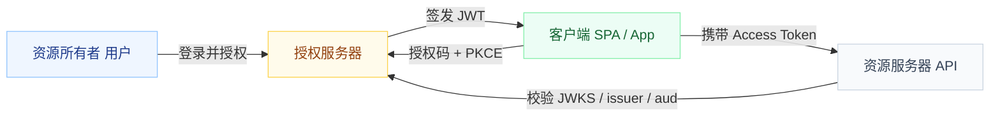
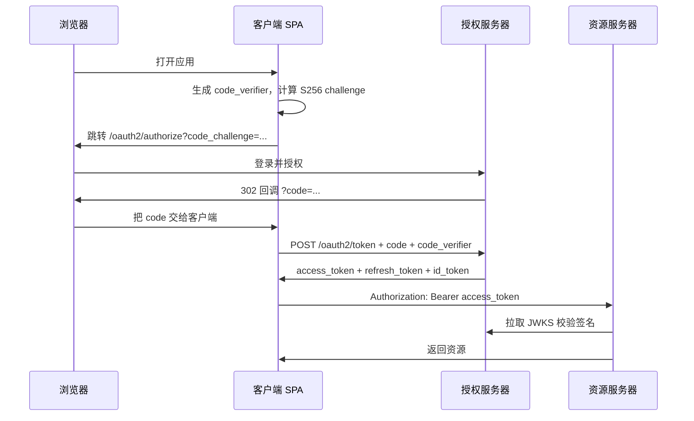

# OAuth2与JWT认证授权

> 这篇从 OAuth2 的四个角色和授权码流程讲起，经过授权服务器搭建、令牌签发、资源服务器校验、刷新与登出，最后落到一套面向 SPA、移动端和机器调用的权限模型与排障手册。
>
> 学完能独立用 Spring Authorization Server 1.5 搭建授权服务器，让 Web、移动端和 M2M 客户端拿到令牌，在微服务侧校验 JWT 的签名、签发者、受众和权限，并处理刷新令牌轮换与登出。

## 一、OAuth2 的角色与授权模式

OAuth2 解决的是“第三方应用如何在不让用户交出密码的前提下，获得访问受保护资源的有限权限”。它定义四个角色，令牌是授权结果的载体，不是登录状态的同义词。



| 角色 | 职责 | 在系统中的对应 |
|---|---|---|
| 资源所有者（Resource Owner） | 授权访问自己的资源 | 登录的用户 |
| 客户端（Client） | 代表用户发起授权请求 | SPA、移动 App、M2M 服务 |
| 授权服务器（Authorization Server） | 认证用户、签发令牌 | Spring Authorization Server |
| 资源服务器（Resource Server） | 校验令牌、返回资源 | 订单、库存等 API |

授权模式只保留企业仍在用的三种：

| 模式 | 适用客户端 | 是否带用户 | 关键点 |
|---|---|---|---|
| 授权码 + PKCE | SPA、移动 App、BFF | 是 | 浏览器跳转，code 换 token |
| 客户端凭证 | 服务间调用、定时任务 | 否 | 用 client_id/secret 换 token |
| 设备码 | 电视、CLI、无浏览器设备 | 是 | 用户在其他设备输入码 |

隐式模式（Implicit）和密码模式（Resource Owner Password Credentials）已被 OAuth 2.1 移除，新项目不要使用。OIDC（OpenID Connect）在 OAuth2 之上增加身份层，提供 `id_token` 和 `userinfo`，登录场景用 OIDC，纯 API 授权用 OAuth2。

> 边界：OAuth2 不是“登录协议”，`access_token` 只代表访问权限，不代表“用户已登录”。需要知道“是谁”时用 OIDC 的 `id_token` 或 `userinfo`。JWT 是令牌的一种格式，不是 OAuth2 的必选项；需要即时撤销时用不透明令牌（opaque token）+ 内省（introspection）。

版本基线（2026-11）：

| 组件 | 版本 | 说明 |
|---|---|---|
| JDK | 21 LTS | Spring Boot 3.5 最低 17 |
| Spring Boot | 3.5.16 | 3.5.x 最后 OSS 版本 |
| Spring Security | 6.5.x | 由 Boot 管理 |
| Spring Authorization Server | 1.5.8 | 1.5.x 稳定线 |
| MySQL | 8.4 | 客户端、授权、同意记录持久化 |

## 二、授权服务器最小闭环

先让授权服务器在 9000 端口跑起来，用客户端凭证拿到一个可解析的 JWT，再用它访问资源服务器。授权码流程涉及浏览器登录，放在第三章。

### 2.1 依赖

```xml
<parent>
  <groupId>org.springframework.boot</groupId>
  <artifactId>spring-boot-starter-parent</artifactId>
  <version>3.5.16</version>
</parent>

<dependencies>
  <dependency>
    <groupId>org.springframework.boot</groupId>
    <artifactId>spring-boot-starter-web</artifactId>
  </dependency>
  <dependency>
    <groupId>org.springframework.boot</groupId>
    <artifactId>spring-boot-starter-security</artifactId>
  </dependency>
  <dependency>
    <groupId>org.springframework.boot</groupId>
    <artifactId>spring-boot-starter-oauth2-authorization-server</artifactId>
  </dependency>
  <dependency>
    <groupId>org.springframework.boot</groupId>
    <artifactId>spring-boot-starter-jdbc</artifactId>
  </dependency>
  <dependency>
    <groupId>com.mysql</groupId>
    <artifactId>mysql-connector-j</artifactId>
    <scope>runtime</scope>
  </dependency>
</dependencies>
```

Spring Boot 3.5.16 管理的 Spring Authorization Server 版本是 1.5.x；需要固定版本时显式引入 `org.springframework.security:spring-security-oauth2-authorization-server:1.5.8`，不要和 Boot 管理版本混用。

### 2.2 授权服务器配置

```java
package com.example.auth;

import com.nimbusds.jose.jwk.JWKSet;
import com.nimbusds.jose.jwk.RSAKey;
import com.nimbusds.jose.jwk.source.ImmutableJWKSet;
import com.nimbusds.jose.jwk.source.JWKSource;
import com.nimbusds.jose.proc.SecurityContext;
import org.springframework.context.annotation.Bean;
import org.springframework.context.annotation.Configuration;
import org.springframework.core.annotation.Order;
import org.springframework.http.MediaType;
import org.springframework.security.config.Customizer;
import org.springframework.security.config.annotation.web.builders.HttpSecurity;
import org.springframework.security.config.annotation.web.configuration.EnableWebSecurity;
import org.springframework.security.crypto.bcrypt.BCryptPasswordEncoder;
import org.springframework.security.crypto.password.PasswordEncoder;
import org.springframework.security.oauth2.core.AuthorizationGrantType;
import org.springframework.security.oauth2.core.ClientAuthenticationMethod;
import org.springframework.security.oauth2.core.oidc.OidcScopes;
import org.springframework.security.oauth2.jwt.JwtDecoder;
import org.springframework.security.oauth2.server.authorization.client.InMemoryRegisteredClientRepository;
import org.springframework.security.oauth2.server.authorization.client.RegisteredClient;
import org.springframework.security.oauth2.server.authorization.client.RegisteredClientRepository;
import org.springframework.security.oauth2.server.authorization.config.annotation.web.configuration.OAuth2AuthorizationServerConfiguration;
import org.springframework.security.oauth2.server.authorization.config.annotation.web.configurers.OAuth2AuthorizationServerConfigurer;
import org.springframework.security.oauth2.server.authorization.settings.AuthorizationServerSettings;
import org.springframework.security.oauth2.server.authorization.settings.ClientSettings;
import org.springframework.security.oauth2.server.authorization.settings.TokenSettings;
import org.springframework.security.web.SecurityFilterChain;
import org.springframework.security.web.authentication.LoginUrlAuthenticationEntryPoint;
import org.springframework.security.web.util.matcher.MediaTypeRequestMatcher;

import java.security.KeyPair;
import java.security.KeyPairGenerator;
import java.security.interfaces.RSAPrivateKey;
import java.security.interfaces.RSAPublicKey;
import java.time.Duration;
import java.util.UUID;

@Configuration
@EnableWebSecurity
public class AuthorizationServerConfig {

    @Bean
    @Order(1)
    public SecurityFilterChain authorizationServerSecurityFilterChain(HttpSecurity http) throws Exception {
        OAuth2AuthorizationServerConfigurer configurer =
                OAuth2AuthorizationServerConfigurer.authorizationServer();

        http
                // 只拦截 OAuth2/OIDC 端点，登录页由下一条过滤器链处理
                .securityMatcher(configurer.getEndpointsMatcher())
                .with(configurer, server -> server.oidc(Customizer.withDefaults()))
                .authorizeHttpRequests(auth -> auth.anyRequest().authenticated())
                .exceptionHandling(ex -> ex.defaultAuthenticationEntryPointFor(
                        new LoginUrlAuthenticationEntryPoint("/login"),
                        new MediaTypeRequestMatcher(MediaType.TEXT_HTML)));
        return http.build();
    }

    @Bean
    @Order(2)
    public SecurityFilterChain defaultSecurityFilterChain(HttpSecurity http) throws Exception {
        http
                .authorizeHttpRequests(auth -> auth
                        .requestMatchers("/actuator/health", "/error").permitAll()
                        .anyRequest().authenticated())
                // 授权服务器自身用表单登录；API 资源服务器是无状态的，见第四章
                .formLogin(Customizer.withDefaults());
        return http.build();
    }

    @Bean
    public PasswordEncoder passwordEncoder() {
        // 生产环境用 BCrypt，{noop} 只允许出现在本地测试客户端
        return new BCryptPasswordEncoder();
    }

    @Bean
    public RegisteredClientRepository registeredClientRepository(PasswordEncoder encoder) {
        RegisteredClient web = RegisteredClient.withId("web-client")
                .clientId("web-client")
                // 公共客户端没有 secret，靠 PKCE 证明自己是同一个客户端
                .clientAuthenticationMethod(ClientAuthenticationMethod.NONE)
                .authorizationGrantType(AuthorizationGrantType.AUTHORIZATION_CODE)
                .authorizationGrantType(AuthorizationGrantType.REFRESH_TOKEN)
                .redirectUri("http://127.0.0.1:8080/callback")
                .postLogoutRedirectUri("http://127.0.0.1:8080/")
                .scope(OidcScopes.OPENID)
                .scope(OidcScopes.PROFILE)
                .scope("order.read")
                .clientSettings(ClientSettings.builder()
                        .requireProofKey(true)          // 强制 PKCE，防止授权码被截获
                        .requireAuthorizationConsent(false)
                        .build())
                .tokenSettings(TokenSettings.builder()
                        .accessTokenTimeToLive(Duration.ofMinutes(15))
                        .refreshTokenTimeToLive(Duration.ofDays(7))
                        .reuseRefreshTokens(false)      // 每次刷新都换新 refresh token
                        .build())
                .build();

        RegisteredClient machine = RegisteredClient.withId("machine-client")
                .clientId("machine-client")
                .clientSecret(encoder.encode("machine-secret"))
                .clientAuthenticationMethod(ClientAuthenticationMethod.CLIENT_SECRET_BASIC)
                .authorizationGrantType(AuthorizationGrantType.CLIENT_CREDENTIALS)
                .scope("order.read")
                .tokenSettings(TokenSettings.builder()
                        .accessTokenTimeToLive(Duration.ofMinutes(5))
                        .build())
                .build();

        return new InMemoryRegisteredClientRepository(web, machine);
    }

    @Bean
    public JWKSource<SecurityContext> jwkSource() throws Exception {
        // 本地演示每次启动生成新密钥；生产环境从密钥库/ KMS 加载，重启不能换 key
        KeyPairGenerator generator = KeyPairGenerator.getInstance("RSA");
        generator.initialize(2048);
        KeyPair keyPair = generator.generateKeyPair();
        RSAPublicKey publicKey = (RSAPublicKey) keyPair.getPublic();
        RSAPrivateKey privateKey = (RSAPrivateKey) keyPair.getPrivate();
        RSAKey rsaKey = new RSAKey.Builder(publicKey)
                .privateKey(privateKey)
                .keyID(UUID.randomUUID().toString())
                .build();
        return new ImmutableJWKSet<>(new JWKSet(rsaKey));
    }

    @Bean
    public JwtDecoder jwtDecoder(JWKSource<SecurityContext> jwkSource) {
        // 授权服务器自身在 OIDC userinfo 等场景也要解码 JWT
        return OAuth2AuthorizationServerConfiguration.jwtDecoder(jwkSource);
    }

    @Bean
    public AuthorizationServerSettings authorizationServerSettings() {
        // issuer 必须与资源服务器校验的 iss 完全一致，包括协议、端口、末尾斜杠
        return AuthorizationServerSettings.builder()
                .issuer("http://127.0.0.1:9000")
                .build();
    }
}
```

用户来源先用内存：

```java
@Bean
public UserDetailsService userDetailsService(PasswordEncoder encoder) {
    UserDetails alice = User.withUsername("alice")
            .password(encoder.encode("password"))
            .roles("USER")
            .build();
    UserDetails admin = User.withUsername("admin")
            .password(encoder.encode("admin-password"))
            .roles("ADMIN", "USER")
            .build();
    return new InMemoryUserDetailsManager(alice, admin);
}
```

启动后检查发现文档：

```bash
curl -s http://127.0.0.1:9000/.well-known/openid-configuration | python3 -m json.tool
```

预期输出（截取）：

```json
{
  "issuer": "http://127.0.0.1:9000",
  "authorization_endpoint": "http://127.0.0.1:9000/oauth2/authorize",
  "token_endpoint": "http://127.0.0.1:9000/oauth2/token",
  "jwks_uri": "http://127.0.0.1:9000/oauth2/jwks",
  "end_session_endpoint": "http://127.0.0.1:9000/connect/logout"
}
```

### 2.3 用客户端凭证拿令牌

```bash
curl -s -u machine-client:machine-secret \
  -d grant_type=client_credentials \
  -d scope=order.read \
  http://127.0.0.1:9000/oauth2/token | python3 -m json.tool
```

```json
{
  "access_token": "eyJraWQiOiI...",
  "scope": "order.read",
  "token_type": "Bearer",
  "expires_in": 299
}
```

客户端凭证没有用户，也没有 refresh token；它代表“这个服务有权访问 order.read”，不代表任何用户。把返回的 `access_token` 粘贴到 `jwt.io` 可以看到 `iss`、`sub`、`aud`、`exp`、`scope`。`sub` 是 `machine-client`，不是用户 ID。

> 边界：`client_secret_basic` 把 `client_id:secret` 做 Base64 放在 Authorization 头，必须走 HTTPS。公共客户端不能用 secret，浏览器、App 里的 secret 一定会泄露；公共客户端只允许授权码 + PKCE。

## 三、授权码 + PKCE

授权码流程是用户登录的主路径：浏览器跳转到授权服务器，用户认证并授权，授权服务器把一次性 code 回调给客户端，客户端再用 code 换 token。PKCE 让公共客户端在不保存 secret 的情况下证明“换 token 的还是发起授权的那个人”。



### 3.1 生成 PKCE 参数

```bash
# 43~128 个字符，URL 安全；这里取 64 个
VERIFIER=$(openssl rand -base64 96 | tr -d '=+/' | cut -c1-64)
CHALLENGE=$(printf '%s' "$VERIFIER" | openssl dgst -sha256 -binary \
  | openssl base64 -A | tr '+/' '-_' | tr -d '=')
echo "verifier=$VERIFIER"
echo "challenge=$CHALLENGE"
```

授权 URL：

```text
http://127.0.0.1:9000/oauth2/authorize
  ?response_type=code
  &client_id=web-client
  &redirect_uri=http://127.0.0.1:8080/callback
  &scope=openid%20profile%20order.read
  &state=6f1c2a
  &code_challenge=<CHALLENGE>
  &code_challenge_method=S256
```

浏览器打开后跳到登录页，输入 `alice/password`，授权服务器 302 到：

```text
http://127.0.0.1:8080/callback?code=abc123&state=6f1c2a
```

`state` 必须与发起时一致，防止 CSRF。客户端校验后，用 code 换 token：

```bash
curl -s -X POST http://127.0.0.1:9000/oauth2/token \
  -H "Content-Type: application/x-www-form-urlencoded" \
  -d grant_type=authorization_code \
  -d code=abc123 \
  -d redirect_uri=http://127.0.0.1:8080/callback \
  -d client_id=web-client \
  -d code_verifier="$VERIFIER" | python3 -m json.tool
```

```json
{
  "access_token": "eyJraWQiOiI...",
  "refresh_token": "vYq3...",
  "id_token": "eyJraWQiOiI...",
  "scope": "openid profile order.read",
  "token_type": "Bearer",
  "expires_in": 899
}
```

> 边界：授权码是一次性的，有效期默认 5 分钟；重复使用会返回 `invalid_grant`。`redirect_uri` 必须与注册值逐字符一致，包括末尾斜杠和端口。PKCE 的 `code_verifier` 不能出现在浏览器地址栏，只能存在客户端内存或安全的本地存储。

### 3.2 令牌里有什么

JWT 由三段组成：`header.payload.signature`，Base64URL 编码后用 `.` 连接。

| 声明 | 含义 | 校验方 |
|---|---|---|
| `iss` | 签发者 | 必须等于授权服务器 issuer |
| `sub` | 主体 | 用户 ID 或客户端 ID |
| `aud` | 受众 | 必须包含当前 API 的标识 |
| `exp` | 过期时间 | 必须大于当前时间 |
| `scope` | 授权范围 | 资源服务器按接口校验 |
| `roles` | 用户角色 | 业务侧细粒度权限 |

JWT 只签名不加密，任何人都能 Base64 解码看到内容。不要把密码、身份证号、完整手机号放进令牌；需要传递敏感信息时用不透明令牌 + 内省。

> 边界：解析 JWT 不等于验证 JWT。只做 Base64 解码就信任 `sub`，等于让客户端自己声明身份。资源服务器必须验签、校验 `iss`、`aud`、`exp`，并限制允许的签名算法，拒绝 `alg: none`。

## 四、资源服务器与权限模型

资源服务器只做两件事：验证令牌可信，判断当前调用者是否有权访问这个资源。验证靠 JWKS 和标准声明，授权靠 scope、角色和业务归属。

### 4.1 资源服务器配置

```xml
<dependency>
  <groupId>org.springframework.boot</groupId>
  <artifactId>spring-boot-starter-oauth2-resource-server</artifactId>
</dependency>
```

```java
package com.example.order;

import org.springframework.context.annotation.Bean;
import org.springframework.context.annotation.Configuration;
import org.springframework.security.config.Customizer;
import org.springframework.security.config.annotation.method.configuration.EnableMethodSecurity;
import org.springframework.security.config.annotation.web.builders.HttpSecurity;
import org.springframework.security.config.http.SessionCreationPolicy;
import org.springframework.security.core.GrantedAuthority;
import org.springframework.security.core.authority.SimpleGrantedAuthority;
import org.springframework.security.oauth2.core.DelegatingOAuth2TokenValidator;
import org.springframework.security.oauth2.core.OAuth2Error;
import org.springframework.security.oauth2.core.OAuth2TokenValidator;
import org.springframework.security.oauth2.core.OAuth2TokenValidatorResult;
import org.springframework.security.oauth2.jwt.Jwt;
import org.springframework.security.oauth2.jwt.JwtDecoder;
import org.springframework.security.oauth2.jwt.JwtValidators;
import org.springframework.security.oauth2.jwt.NimbusJwtDecoder;
import org.springframework.security.oauth2.server.resource.authentication.JwtAuthenticationConverter;
import org.springframework.security.oauth2.server.resource.authentication.JwtGrantedAuthoritiesConverter;
import org.springframework.security.web.SecurityFilterChain;

import java.util.ArrayList;
import java.util.Collection;

@Configuration
@EnableMethodSecurity
public class ResourceServerConfig {

    @Bean
    public SecurityFilterChain apiSecurityFilterChain(HttpSecurity http, JwtDecoder decoder)
            throws Exception {
        http
                .securityMatcher("/api/**")
                .authorizeHttpRequests(auth -> auth
                        .requestMatchers("/api/public/**").permitAll()
                        .requestMatchers("/api/orders/**").hasAuthority("SCOPE_order.read")
                        .requestMatchers("/api/admin/**").hasRole("ADMIN")
                        .anyRequest().authenticated())
                .oauth2ResourceServer(oauth2 -> oauth2.jwt(jwt -> jwt
                        .decoder(decoder)
                        .jwtAuthenticationConverter(jwtAuthenticationConverter())))
                // 无状态 API 不创建会话，避免 JSESSIONID 和 Bearer 混用
                .sessionManagement(session -> session.sessionCreationPolicy(SessionCreationPolicy.STATELESS))
                .csrf(csrf -> csrf.disable());
        return http.build();
    }

    @Bean
    public JwtDecoder jwtDecoder() {
        NimbusJwtDecoder decoder = NimbusJwtDecoder
                .withJwkSetUri("http://127.0.0.1:9000/oauth2/jwks")
                .build();

        OAuth2TokenValidator<Jwt> issuer =
                JwtValidators.createDefaultWithIssuer("http://127.0.0.1:9000");
        OAuth2TokenValidator<Jwt> audience = jwt ->
                jwt.getAudience().contains("order-api")
                        ? OAuth2TokenValidatorResult.success()
                        : OAuth2TokenValidatorResult.failure(new OAuth2Error(
                                "invalid_token", "audience 不匹配", null));

        // 默认校验 exp/nbf，再叠加 issuer 和 audience
        decoder.setJwtValidator(new DelegatingOAuth2TokenValidator<>(issuer, audience));
        return decoder;
    }

    private JwtAuthenticationConverter jwtAuthenticationConverter() {
        JwtGrantedAuthoritiesConverter scopes = new JwtGrantedAuthoritiesConverter();
        // scope claim 映射为 SCOPE_ 前缀，hasAuthority("SCOPE_order.read") 使用

        JwtGrantedAuthoritiesConverter roles = new JwtGrantedAuthoritiesConverter();
        roles.setAuthoritiesClaimName("roles");
        roles.setAuthorityPrefix("ROLE_");

        JwtAuthenticationConverter converter = new JwtAuthenticationConverter();
        converter.setJwtGrantedAuthoritiesConverter(jwt -> {
            Collection<GrantedAuthority> authorities = new ArrayList<>();
            authorities.addAll(scopes.convert(jwt));
            authorities.addAll(roles.convert(jwt));
            return authorities;
        });
        return converter;
    }
}
```

```yaml
server:
  port: 8081

spring:
  security:
    oauth2:
      resourceserver:
        jwt:
          jwk-set-uri: http://127.0.0.1:9000/oauth2/jwks
```

### 4.2 方法级权限

```java
@RestController
@RequestMapping("/api/orders")
public class OrderController {

    @GetMapping("/{id}")
    @PreAuthorize("hasAuthority('SCOPE_order.read')")
    public OrderView get(@PathVariable String id, @AuthenticationPrincipal Jwt jwt) {
        // sub 是用户 ID；租户从自定义 claim 取，不能从请求头取
        String userId = jwt.getSubject();
        String tenantId = jwt.getClaimAsString("tenant_id");
        return orderService.find(id, userId, tenantId);
    }

    @PostMapping("/{id}/cancel")
    @PreAuthorize("hasAuthority('SCOPE_order.write') and hasRole('ADMIN')")
    public void cancel(@PathVariable String id) {
        orderService.cancel(id);
    }
}
```

`hasRole("ADMIN")` 会自动加 `ROLE_` 前缀，等价于 `hasAuthority('ROLE_ADMIN')`。如果令牌里的 `roles` 已经是 `ROLE_ADMIN`，转换器又加一次前缀，会变成 `ROLE_ROLE_ADMIN`，表现为 403。

> 边界：网关校验过令牌，不代表下游可以跳过校验。内部网络也可能被横向渗透，服务间调用应使用 mTLS 或再次校验令牌。只在网关做权限、下游直接信任 `X-User-Id`，等于把安全边界交给一个可伪造的请求头。

### 4.3 权限表设计

RBAC 最小模型五张表：

```sql
CREATE TABLE app_user (
  id BIGINT PRIMARY KEY,
  username VARCHAR(64) NOT NULL UNIQUE,
  password_hash VARCHAR(100) NOT NULL,
  tenant_id VARCHAR(32) NOT NULL,
  enabled TINYINT NOT NULL DEFAULT 1
);

CREATE TABLE role (
  id BIGINT PRIMARY KEY,
  code VARCHAR(64) NOT NULL UNIQUE,
  name VARCHAR(64) NOT NULL
);

CREATE TABLE permission (
  id BIGINT PRIMARY KEY,
  code VARCHAR(64) NOT NULL UNIQUE,
  description VARCHAR(128) NOT NULL
);

CREATE TABLE user_role (
  user_id BIGINT NOT NULL,
  role_id BIGINT NOT NULL,
  PRIMARY KEY (user_id, role_id)
);

CREATE TABLE role_permission (
  role_id BIGINT NOT NULL,
  permission_id BIGINT NOT NULL,
  PRIMARY KEY (role_id, permission_id)
);
```

角色进令牌，权限点留在服务端。不要把几十个权限点都塞进 JWT：令牌会变大，权限变更要等令牌过期才生效。角色数量少、变更不频繁时，`roles` 放令牌；权限点每次请求从缓存查。

| 模型 | 判断依据 | 适合 |
|---|---|---|
| RBAC | 角色 | 后台管理、权限稳定 |
| ABAC | 属性（部门、租户、时间） | 多租户、细粒度 |
| ReBAC | 资源关系（owner、member） | 文档、项目协作 |

> 边界：`tenant_id` 必须来自可信令牌，不能来自 URL 或请求头。跨租户查询在 SQL 层加 `tenant_id = ?`，不要只靠应用层判断。

## 五、刷新、登出与令牌生命周期

访问令牌短、刷新令牌长，是平衡安全与体验的常用组合。刷新令牌必须轮换，登出必须同时处理本地会话、授权服务器会话和令牌撤销。

### 5.1 刷新令牌轮换

`TokenSettings.reuseRefreshTokens(false)` 让每次刷新都返回新的 refresh token，旧 token 立即失效。客户端必须原子地替换本地存储，不能两个并发请求同时用同一个 refresh token。

```bash
curl -s -X POST http://127.0.0.1:9000/oauth2/token \
  -H "Content-Type: application/x-www-form-urlencoded" \
  -d grant_type=refresh_token \
  -d refresh_token="$REFRESH_TOKEN" \
  -d client_id=web-client | python3 -m json.tool
```

```json
{
  "access_token": "eyJraWQiOiI...",
  "refresh_token": "新值",
  "scope": "openid profile order.read",
  "token_type": "Bearer",
  "expires_in": 899
}
```

再次使用旧 refresh token：

```bash
curl -s -X POST http://127.0.0.1:9000/oauth2/token \
  -d grant_type=refresh_token \
  -d refresh_token="$OLD_REFRESH_TOKEN" \
  -d client_id=web-client
```

```json
{"error":"invalid_grant"}
```

> 边界：多个标签页同时刷新会互相把对方的 refresh token 作废。SPA 用单一刷新锁（Web Locks API 或内存 Promise）串行化；BFF 模式把刷新放在服务端，浏览器只拿 HttpOnly 会话 Cookie。

### 5.2 登出

本地登出只清客户端令牌，授权服务器会话还在，下次访问可能直接静默登录。完整登出分三步：

1. 客户端清除内存和存储中的 token；
2. 浏览器跳转授权服务器 `end_session_endpoint`，带 `id_token_hint` 和 `post_logout_redirect_uri`；
3. 授权服务器清会话，按配置回调客户端。

```text
POST http://127.0.0.1:9000/connect/logout
Content-Type: application/x-www-form-urlencoded

id_token_hint=<ID_TOKEN>&post_logout_redirect_uri=http://127.0.0.1:8080/
```

浏览器表单提交时要带 CSRF token；直接 `curl` 没有会话和 CSRF，会被拒绝。生产环境用 Spring Security 的 `OidcClientInitiatedLogoutSuccessHandler` 生成登出地址，不要手拼。

撤销令牌：

```bash
curl -s -X POST http://127.0.0.1:9000/oauth2/revoke \
  -u machine-client:machine-secret \
  -d token="$ACCESS_TOKEN" \
  -d token_type_hint=access_token
```

```text
HTTP/1.1 200 OK
```

> 边界：JWT 是无状态的，撤销接口对已经签发的 JWT 不一定立即生效，资源服务器本地缓存和时钟偏差也会延迟失效。需要“立即踢下线”时，用短 TTL + 令牌版本号/黑名单，或改用不透明令牌 + 内省。

### 5.3 生产持久化

内存版 `RegisteredClientRepository` 和 `OAuth2AuthorizationService` 重启即丢，生产换成 JDBC：

```java
@Bean
public RegisteredClientRepository registeredClientRepository(JdbcTemplate jdbc) {
    return new JdbcRegisteredClientRepository(jdbc);
}

@Bean
public OAuth2AuthorizationService authorizationService(
        JdbcTemplate jdbc, RegisteredClientRepository clients) {
    return new JdbcOAuth2AuthorizationService(jdbc, clients);
}

@Bean
public OAuth2AuthorizationConsentService authorizationConsentService(
        JdbcTemplate jdbc, RegisteredClientRepository clients) {
    return new JdbcOAuth2AuthorizationConsentService(jdbc, clients);
}
```

建表脚本在依赖 jar 内：

```text
org/springframework/security/oauth2/server/authorization/oauth2-authorization-schema.sql
org/springframework/security/oauth2/server/authorization/oauth2-authorization-consent-schema.sql
org/springframework/security/oauth2/server/authorization/client/oauth2-registered-client-schema.sql
```

> 边界：JDBC 存的是授权记录和 refresh token，不是用户密码。用户表仍由业务系统管理；授权服务器只负责认证和签发，不要把用户中心的所有字段复制过来。

## 六、网关与微服务集成

网关和资源服务器可以同时校验令牌，但职责不同：网关挡无效流量，服务做业务授权。令牌在服务间如何传递，决定了系统是“零信任”还是“内网裸奔”。

### 6.1 网关作为资源服务器

```yaml
spring:
  security:
    oauth2:
      resourceserver:
        jwt:
          jwk-set-uri: http://127.0.0.1:9000/oauth2/jwks
```

```java
@Bean
public SecurityWebFilterChain gatewaySecurity(ServerHttpSecurity http) {
    return http
            .csrf(ServerHttpSecurity.CsrfSpec::disable)
            .authorizeExchange(ex -> ex
                    .pathMatchers(HttpMethod.OPTIONS).permitAll()
                    .pathMatchers("/actuator/health").permitAll()
                    .pathMatchers("/api/orders/**").hasAuthority("SCOPE_order.read")
                    .anyExchange().authenticated())
            .oauth2ResourceServer(o -> o.jwt(Customizer.withDefaults()))
            .build();
}
```

网关只做粗粒度 scope 校验，订单归属、租户隔离仍由订单服务判断。网关把 `Authorization` 原样转发，下游再校验一次；或者网关校验后换发内部令牌，下游只信任内部令牌。

### 6.2 Feign 传递令牌

```java
@Bean
public RequestInterceptor bearerTokenInterceptor() {
    return template -> {
        Authentication authentication = SecurityContextHolder.getContext().getAuthentication();
        if (authentication != null
                && authentication.getCredentials() instanceof AbstractOAuth2Token token) {
            // 只在当前请求线程有令牌时透传，定时任务没有 SecurityContext，不能强转
            template.header("Authorization", "Bearer " + token.getTokenValue());
        }
    };
}
```

`SecurityContextHolder` 默认基于 ThreadLocal，异步线程、线程池、`@Async` 里拿不到。需要异步传播时用 `DelegatingSecurityContextExecutor` 包装线程池，或显式把令牌作为参数传入。

服务间调用更推荐客户端凭证，不借用用户令牌：

```java
@Bean
public OAuth2AuthorizedClientManager authorizedClientManager(
        ClientRegistrationRepository registrations,
        OAuth2AuthorizedClientRepository authorizedClients) {
    OAuth2AuthorizedClientProvider provider =
            OAuth2AuthorizedClientProviderBuilder.builder()
                    .clientCredentials()
                    .build();
    DefaultOAuth2AuthorizedClientManager manager =
            new DefaultOAuth2AuthorizedClientManager(registrations, authorizedClients);
    manager.setAuthorizedClientProvider(provider);
    return manager;
}
```

> 边界：用户令牌代表用户权限，服务间调用如果借用用户令牌，下游会以用户身份执行，审计和限流都会失真。M2M 用客户端凭证，用户态调用才透传用户令牌。

### 6.3 令牌中继

`TokenRelay` 过滤器用于“浏览器通过 OAuth2 登录网关，网关把令牌转发给下游”的场景：

```yaml
filters:
  - TokenRelay=
```

它依赖 `spring-boot-starter-oauth2-client` 和会话，不是无状态 Bearer API 的方案。纯 API 网关不需要 `TokenRelay`，直接把 `Authorization` 头透传即可。

## 七、排障与安全清单

OAuth2 的错误码很具体，先看 `error` 和 `error_description`，再按“客户端注册、重定向、PKCE、令牌校验”四条线排查。

| 现象 | 常见原因 | 第一条检查 |
|---|---|---|
| `invalid_client` | secret 不匹配、认证方式错 | 客户端是否用对 `client_secret_basic` |
| `invalid_grant` | code 过期/复用、redirect 不一致 | 比对注册的 redirect URI |
| 401 `invalid_token` | iss/aud 不匹配、JWKS 不可达 | `curl` 授权服务器 JWKS |
| 403 | scope/角色不足、`ROLE_` 前缀重复 | 解码 token 看 `scope`/`roles` |
| 登录循环 | Cookie、SameSite、代理头 | 浏览器看 302 链和 Set-Cookie |
| 预检 401 | `OPTIONS` 被安全链拦截 | 安全配置是否放行 OPTIONS |
| 登出后仍可访问 | JWT 未撤销 | access token TTL 是否过长 |

### 7.1 常见错误

**`invalid_client`**：客户端凭证模式用了 `ClientAuthenticationMethod.NONE`，或 secret 存的是 BCrypt 但请求发的是明文而客户端没做匹配。检查注册时的 `clientAuthenticationMethod` 和请求的 Authorization 头。

**`invalid_grant`**：授权码只能用一次、默认 5 分钟过期；`redirect_uri` 必须与注册值完全一致；PKCE 的 `code_verifier` 必须与 `code_challenge` 对应。刷新令牌轮换后旧 token 立即失效，重复使用会返回 `invalid_grant`。

**401 `invalid_token`**：资源服务器拉不到 JWKS、`iss` 多了或少了末尾斜杠、`aud` 没配、令牌过期、容器时钟偏差超过允许范围。先 `curl` 授权服务器的 `/.well-known/openid-configuration` 和 `/oauth2/jwks`，再解码头看 `iss/aud/exp`。

**403 但令牌有角色**：`hasRole("ADMIN")` 期望 `ROLE_ADMIN`，而令牌 `roles` 里是 `ADMIN`，转换器没有加前缀；或者令牌里已是 `ROLE_ADMIN`，转换器又加了一次。统一约定：令牌存不带前缀的角色名，资源服务器加 `ROLE_`。

**登录循环**：授权服务器和客户端不在同一站点时，会话 Cookie 的 `SameSite=Lax` 可能不发送；反向代理没有传 `X-Forwarded-Proto`，授权服务器生成的 redirect URI 是 http 而注册的是 https。检查 `server.forward-headers-strategy: framework` 和代理头。

**登出后 access token 仍有效**：JWT 无状态，登出只清会话和 refresh token。把 access token TTL 降到 5~15 分钟；需要立即失效时加令牌版本号 claim，资源服务器比对用户当前版本。

### 7.2 安全清单

- 全链路 HTTPS，令牌和 secret 不落日志；
- 公共客户端强制 PKCE，禁用隐式模式和密码模式；
- redirect URI 白名单精确匹配，不允许通配符；
- access token 5~15 分钟，refresh token 轮换并检测复用；
- 资源服务器校验 `iss`、`aud`、`exp`、签名算法，拒绝 `alg: none`；
- scope 最小化，角色和权限点分离；
- 客户端 secret 放密钥管理服务，不写进前端和 Git；
- JWKS 缓存并支持 `kid` 轮换，签名密钥定期轮换；
- 登出清理本地 token、授权服务器会话和 refresh token；
- 令牌端点限流，防暴力破解和授权码爆破；
- 审计登录、授权、刷新、撤销事件，保留足够时间。

## 八、最佳实践案例

### 8.1 案例背景

某 SaaS 后台有三类调用方：运营使用的 SPA、外勤使用的移动 App、报表系统的定时任务。原先用 Session + Cookie，移动端和第三方系统无法复用，权限判断散落在每个服务。目标是迁移到 OAuth2/OIDC：SPA 和 App 用授权码 + PKCE，报表用客户端凭证；access token 15 分钟，refresh token 7 天轮换；角色放令牌，权限点在服务端；网关做 scope 粗校验，订单服务做租户和归属校验。约束是用户表已存在、不能停机、移动端不能保存 secret。

### 8.2 案例实操

用户表和角色表按 4.3 节建立，密码用 BCrypt。授权服务器在 2.2 节配置上增加令牌定制：

```java
@Bean
public OAuth2TokenCustomizer<JwtEncodingContext> tokenCustomizer() {
    return context -> {
        // 所有令牌都带 audience，资源服务器才能拒绝“发给别的 API 的令牌”
        context.getClaims().audience(List.of("order-api"));

        var authorities = context.getPrincipal().getAuthorities();
        if (authorities != null) {
            List<String> roles = authorities.stream()
                    .map(GrantedAuthority::getAuthority)
                    .filter(authority -> authority.startsWith("ROLE_"))
                    // 去掉前缀，资源服务器统一加 ROLE_，避免双前缀
                    .map(authority -> authority.substring("ROLE_".length()))
                    .toList();
            if (!roles.isEmpty()) {
                context.getClaims().claim("roles", roles);
            }
        }

        if (AuthorizationGrantType.CLIENT_CREDENTIALS.equals(context.getAuthorizationGrantType())) {
            context.getClaims().claim("client_id", context.getRegisteredClient().getClientId());
        }
    };
}
```

注册三个客户端：

```java
@Bean
public RegisteredClientRepository clients(PasswordEncoder encoder) {
    RegisteredClient spa = RegisteredClient.withId("spa")
            .clientId("spa")
            .clientAuthenticationMethod(ClientAuthenticationMethod.NONE)
            .authorizationGrantType(AuthorizationGrantType.AUTHORIZATION_CODE)
            .authorizationGrantType(AuthorizationGrantType.REFRESH_TOKEN)
            .redirectUri("https://admin.example.com/callback")
            .postLogoutRedirectUri("https://admin.example.com/")
            .scope(OidcScopes.OPENID)
            .scope("order.read")
            .scope("order.write")
            .clientSettings(ClientSettings.builder().requireProofKey(true).build())
            .tokenSettings(TokenSettings.builder()
                    .accessTokenTimeToLive(Duration.ofMinutes(15))
                    .refreshTokenTimeToLive(Duration.ofDays(7))
                    .reuseRefreshTokens(false)
                    .build())
            .build();

    RegisteredClient mobile = RegisteredClient.withId("mobile")
            .clientId("mobile")
            .clientAuthenticationMethod(ClientAuthenticationMethod.NONE)
            .authorizationGrantType(AuthorizationGrantType.AUTHORIZATION_CODE)
            .authorizationGrantType(AuthorizationGrantType.REFRESH_TOKEN)
            // 移动端用自定义 scheme，回调由 App 捕获
            .redirectUri("com.example.app://oauth/callback")
            .scope(OidcScopes.OPENID)
            .scope("order.read")
            .clientSettings(ClientSettings.builder().requireProofKey(true).build())
            .tokenSettings(TokenSettings.builder()
                    .accessTokenTimeToLive(Duration.ofMinutes(15))
                    .refreshTokenTimeToLive(Duration.ofDays(30))
                    .reuseRefreshTokens(false)
                    .build())
            .build();

    RegisteredClient report = RegisteredClient.withId("report")
            .clientId("report-service")
            .clientSecret(encoder.encode("report-secret"))
            .clientAuthenticationMethod(ClientAuthenticationMethod.CLIENT_SECRET_BASIC)
            .authorizationGrantType(AuthorizationGrantType.CLIENT_CREDENTIALS)
            .scope("report.read")
            .tokenSettings(TokenSettings.builder()
                    .accessTokenTimeToLive(Duration.ofMinutes(5))
                    .build())
            .build();

    return new InMemoryRegisteredClientRepository(spa, mobile, report);
}
```

资源服务器在 4.1 节基础上增加租户校验：

```java
@GetMapping("/api/reports/monthly")
@PreAuthorize("hasAuthority('SCOPE_report.read')")
public Report monthly(@RequestParam String tenantId) {
    // 报表任务没有用户，sub 是客户端 ID；租户由任务参数显式传入，服务端校验该客户端是否有权访问此租户
    return reportService.monthly(tenantId);
}
```

验证命令：

```bash
# 1. 机器令牌
TOKEN=$(curl -s -u report-service:report-secret \
  -d grant_type=client_credentials \
  -d scope=report.read \
  http://127.0.0.1:9000/oauth2/token \
  | python3 -c 'import sys,json;print(json.load(sys.stdin)["access_token"])')

# 2. 调用资源服务器，租户由报表任务参数传入
curl -s -H "Authorization: Bearer $TOKEN" \
  "http://127.0.0.1:8081/api/reports/monthly?tenantId=t-001"

# 3. 不带令牌，必须 401
curl -s -o /dev/null -w "%{http_code}\n" http://127.0.0.1:8081/api/orders/1

# 4. 用错 scope，必须 403
curl -s -o /dev/null -w "%{http_code}\n" \
  -H "Authorization: Bearer $TOKEN" \
  http://127.0.0.1:8081/api/orders/1

# 5. 刷新令牌轮换：旧 refresh token 第二次使用应失败
curl -s -X POST http://127.0.0.1:9000/oauth2/token \
  -d grant_type=refresh_token -d refresh_token="$OLD_REFRESH" -d client_id=spa
```

预期输出：

```text
{"tenantId":"t-001","month":"2026-11","amount":128000.00}

401

403

{"error":"invalid_grant"}
```

### 8.3 案例结果

迁移后 SPA、App、报表任务共用一套授权服务器，用户不再分别登录；订单服务的权限判断从散落的 if 收敛到 `@PreAuthorize` 和租户 SQL 条件。access token 15 分钟，泄露窗口从原来的 7 天会话缩短到 15 分钟；refresh token 轮换后，旧令牌复用会被拒绝并触发告警。

指标（示例环境，单授权服务器、2 个资源服务）：

| 指标 | 迁移前 | 迁移后 |
|---|---|---|
| 登录方式 | 每个端各一套 | 统一 OIDC |
| 令牌有效期 | 7 天会话 | 15 分钟 |
| 权限判断位置 | 各服务散落 | 注解 + 租户 SQL |
| 令牌签发 p99 | 无 | 45 ms |
| 无效令牌拦截 | 到业务层 | 网关 + 服务双层 |

失败模式与复盘：

- 移动端最初把 `client_secret` 打进 App 包，被反编译后泄露；改为公共客户端 + PKCE，secret 全部移除；
- 两个标签页同时刷新，后到的请求把先到的 refresh token 作废；SPA 加刷新锁，BFF 方案把刷新移到服务端；
- 网关只校验 `authenticated()`，没有校验 `aud`，一个发给报表 API 的令牌能访问订单 API；资源服务器补 audience 校验后修复；
- 登出只清了 localStorage，授权服务器会话还在，重新打开页面自动登录；改为 RP-initiated logout，并清理授权服务器会话；
- 角色从 `ROLE_ADMIN` 改成 `ADMIN` 存令牌时，资源服务器转换器重复加前缀，后台管理员全部 403；统一“令牌不带前缀、资源服务器加前缀”的约定后恢复。
