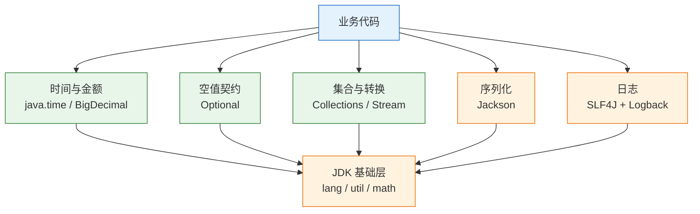
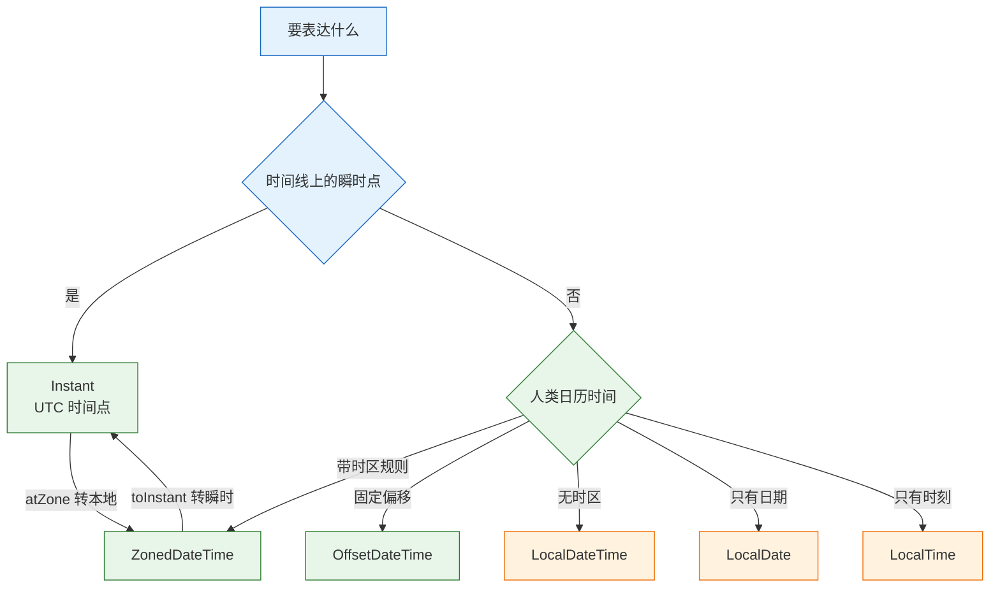
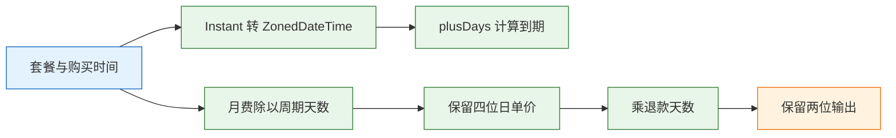

# 常用类库

---

## 一、常用类库的定位

### 1.1 核心概念

业务代码的绝大部分只反复使用少数几类能力：时间、金额、可能为空的值、集合转换、JSON、日志。这些能力共同的特征是“语义细节多、边界条件密”，手写一遍几乎必然出错，因此适合交给标准库或成熟第三方库。

类库解决的是重复且容易错的部分，不解决业务语义。退款按自然日还是 24 小时、过期时间算到哪一刻、金额在哪一步舍入、空值代表“不存在”还是“未填写”，仍要业务给出定义。类库只负责把定义准确地执行出来。

| 能力 | 首选来源 | 典型错误 |
|---|---|---|
| 时间 | `java.time` | 用本地时间当时间点、格式化用错模式字母 |
| 金额 | `BigDecimal` 或最小货币单位整数 | 用 `double`、比较用 `equals` |
| 空值 | `Optional` 作为返回值 | 字段和参数滥用、直接 `get` |
| 集合转换 | 集合框架与 Stream | 并行流做阻塞 IO、收集器重复键 |
| JSON | Jackson | 每次请求新建 mapper、多态反序列化开任意类 |
| 日志 | SLF4J + Logback | 字符串拼接、异常没传栈、MDC 未清理 |

### 1.2 与相邻技术的关系

标准库与第三方库不是替代关系，而是分层关系。JDK 提供语言级基础能力，第三方库填补标准库没有覆盖的领域，业务代码只依赖稳定抽象。

`java.time` 替代了 `Date`、`Calendar`、`SimpleDateFormat`，后者在新代码中不应出现。集合框架替代了 `Vector`、`Hashtable` 等同步容器，并发场景改用 `java.util.concurrent`。`Optional` 是返回值契约工具，不是空值判断的语法糖。

JDK 没有 JSON 对象绑定 API，日志虽有 `java.util.logging`，但生态普遍采用 SLF4J 门面配合 Logback。Jackson 与 SLF4J 事实上成为行业默认，Spring Boot 通过 starter 完成装配，业务代码面向接口编程。

| 相邻技术 | 角色 | 边界 |
|---|---|---|
| JDK 标准库 | 语言基础能力 | 版本随 JDK 升级，API 稳定 |
| 第三方库 | 填补标准库空白 | 需要管理版本与漏洞 |
| 框架 | 装配与约定 | 不替代类库语义 |
| 数据库类型 | 持久化表示 | 精度、时区要与 Java 类型对齐 |

### 1.3 整体结构

常用类库可以按“数据如何表达、如何计算、如何传输、如何记录”分成四层。分层之后，选型问题变成“这一层该用什么”，而不是在一堆工具类里挑顺手的一个。



| 层 | 代表类型 | 主要职责 |
|---|---|---|
| 数据表达 | `Instant`、`BigDecimal`、`Optional` | 把业务语义编码成不会歧义的值 |
| 计算转换 | `Stream`、`Collectors`、`String` | 过滤、分组、聚合、格式化 |
| 传输契约 | Jackson、DTO | 与外部系统交换结构化数据 |
| 运行记录 | SLF4J、Logback、MDC | 留下可检索、可关联的现场 |

---

## 二、环境与最小示例

### 2.1 JDK 版本与依赖边界

> **版本现状（2026）**：JDK 25 是当前长期支持版本，`java.time`、`Optional`、Stream、`var`、record、switch 表达式、文本块均已稳定。示例按 JDK 21 及以上编译，`record` 与模式匹配可直接使用。

标准库覆盖时间、金额、集合、字符串、并发与加密。JSON、日志、测试断言需要第三方依赖。引入前先确认 JDK 是否已有等价能力，例如 `String.isBlank`、`List.of`、`Optional`、`HexFormat`，避免为一个小功能引入整套工具库。

| 能力 | JDK 是否内置 | 建议 |
|---|---|---|
| 时间日期 | 是 | `java.time`，不要用旧 API |
| 任意精度小数 | 是 | `BigDecimal` |
| JSON | 否 | Jackson，统一版本 |
| 日志门面 | 否 | SLF4J，实现用 Logback |
| 集合工具 | 部分是 | `List.of`、`Map.of`、`Collectors` |
| 字符串工具 | 部分是 | 先看 `String` 与 `Objects` |

```bash
# ========== 确认编译与运行版本 ==========
# 两者主版本必须一致，否则可能出现 class 版本错误
java -version
javac -version

# ========== 查看依赖树 ==========
# 找出重复的坐标与传递依赖版本
mvn dependency:tree -Dincludes=tools.jackson.core

# 查看依赖冲突的调解结果
mvn dependency:tree -Dverbose -Dincludes=com.google.guava:guava

# ========== 快速验证 API 行为 ==========
# 用 jshell 验证时间与金额行为，不必建工程
jshell --enable-preview
```

### 2.2 最小可运行示例

下面的程序把金额计算与时间格式化放在一起，用来验证环境是否可用。它不依赖第三方库，可以直接编译运行。

```java
import java.math.BigDecimal;
import java.math.RoundingMode;
import java.time.Instant;
import java.time.ZoneId;
import java.time.format.DateTimeFormatter;

public class BasicsDemo {
    public static void main(String[] args) {
        // 金额一律用字符串构造，避免二进制浮点误差
        BigDecimal price = new BigDecimal("19.90");
        BigDecimal count = BigDecimal.valueOf(3);
        BigDecimal total = price.multiply(count).setScale(2, RoundingMode.HALF_UP);

        // 时间点用 Instant，展示时才转时区
        Instant paidAt = Instant.parse("2026-03-01T00:00:00Z");
        DateTimeFormatter fmt = DateTimeFormatter.ofPattern("yyyy-MM-dd HH:mm");
        String local = fmt.format(paidAt.atZone(ZoneId.of("Asia/Shanghai")));

        System.out.println("total=" + total.toPlainString());
        System.out.println("paidAt=" + local);
    }
}
```

```bash
# ========== 编译与运行 ==========
# 指定 release 保证不使用更高版本的 API
javac --release 21 -d out BasicsDemo.java
java -cp out BasicsDemo
```

```text
total=59.70
paidAt=2026-03-01 08:00
```

### 2.3 工程结构与依赖收敛

第三方库的版本必须收敛到一处。Maven 用 `dependencyManagement` 或 BOM，Gradle 用 `platform()`，避免不同模块引入同一库的不同版本。

```xml
<properties>
  <!-- 版本集中声明，子模块只引用属性 -->
  <jackson.version>3.0.0</jackson.version>
</properties>

<dependencies>
  <dependency>
    <groupId>tools.jackson.core</groupId>
    <artifactId>jackson-databind</artifactId>
    <version>${jackson.version}</version>
  </dependency>
</dependencies>
```

多模块项目建议用官方 BOM 统一传递依赖，坐标与版本以所用发行版文档为准。

| 关注点 | 做法 | 检查方式 |
|---|---|---|
| 版本一致 | BOM 或 platform 统一 | `dependency:tree` 无多版本 |
| 作用域 | 测试依赖用 `test` | 运行期不带测试库 |
| 传递依赖 | 排除不需要的模块 | `dependency:analyze` |
| 漏洞 | 定期扫描并升级 | 依赖扫描报告 |

> **注意**：`dependencyManagement` 只管理版本，不引入依赖。子模块仍需声明 `groupId` 与 `artifactId`，只是省略 `version`。

---

## 三、java.time 的时间模型

### 3.1 时间点与日历时间

`java.time` 把“时间线上的一个点”和“墙上的日期时间”分成两类类型。前者用 `Instant`，后者用 `LocalDateTime`、`LocalDate`、`LocalTime`。混淆这两类，是跨时区故障的头号原因。



| 类型 | 含义 | 典型用途 |
|---|---|---|
| `Instant` | UTC 时间线上的一个点 | 数据库 `timestamptz`、日志、过期判断 |
| `LocalDateTime` | 年月日时分秒，无时区 | 营业时间、预约的墙上时间 |
| `ZonedDateTime` | 带时区规则的时间 | 跨时区业务、夏令时计算 |
| `OffsetDateTime` | 带固定偏移的时间 | 与只保存偏移的系统交互 |
| `LocalDate` / `LocalTime` | 日期 / 时刻 | 生日、账单日、每天九点 |
| `Duration` | 两个时间点之间的秒与纳秒 | 超时、耗时统计 |
| `Period` | 年月日之间的日历差 | 一个月后、三天后 |

选择规则只有三条：存库与跨服务传输用 `Instant`；做“加一个月”用 `LocalDate.plusMonths`，它按日历处理月末；做“24 小时后”用 `Instant.plus(Duration.ofHours(24))`，跨夏令时时 24 小时不等于第二天同一时刻。

### 3.2 时区规则与夏令时

时区必须用 IANA ID，例如 `Asia/Shanghai`、`Europe/Berlin`、`America/New_York`。`GMT+8` 是固定偏移，没有夏令时规则，跨地区换算会错一小时。

```java
import java.time.*;

public class TimeDemo {
    public static void main(String[] args) {
        ZoneId shanghai = ZoneId.of("Asia/Shanghai");
        Instant purchased = Instant.parse("2026-03-01T00:00:00Z");

        ZonedDateTime local = purchased.atZone(shanghai);
        ZonedDateTime expiry = local.plusDays(30);

        System.out.println(local);
        System.out.println(expiry);
        System.out.println(local.toInstant());

        // 夏令时缺口：2026-03-08 02:00 纽约直接跳到 03:00
        ZoneId ny = ZoneId.of("America/New_York");
        ZonedDateTime gap = ZonedDateTime.of(2026, 3, 8, 1, 30, 0, 0, ny);
        System.out.println(gap.plusHours(1));

        // 月末：1 月 31 日加一个月
        System.out.println(LocalDate.of(2026, 1, 31).plusMonths(1));
    }
}
```

```text
2026-03-01T08:00+08:00[Asia/Shanghai]
2026-03-31T08:00+08:00[Asia/Shanghai]
2026-03-01T00:00:00Z
2026-03-08T03:30-04:00[America/New_York]
2026-02-28
```

纽约那段的结果容易误判。1:30 加一小时，表面上应是 2:30，但 2:00 到 3:00 这一小时不存在，`ZonedDateTime` 自动推进到 3:30，偏移同时从 -05:00 变为 -04:00。这不是缺陷，是时区数据库的规则。

时区数据有版本。JDK 自带 tzdb，各国调整夏令时政策后需要升级 JDK 或单独更新时区数据；容器基础镜像里的 tzdata 也要同步更新，否则同一份代码在不同镜像上结果不同。

### 3.3 格式化与解析

`DateTimeFormatter` 不可变且线程安全，可以定义为静态常量复用。`SimpleDateFormat` 内部有可变状态，多线程共享会解析出错误日期或抛异常。

```java
import java.time.LocalDateTime;
import java.time.ZonedDateTime;
import java.time.ZoneId;
import java.time.format.DateTimeFormatter;
import java.util.Locale;

public class FormatDemo {
    // 静态常量，全局复用
    private static final DateTimeFormatter FMT =
            DateTimeFormatter.ofPattern("yyyy-MM-dd HH:mm:ss", Locale.ROOT);

    public static void main(String[] args) {
        String text = FMT.format(ZonedDateTime.now(ZoneId.of("Asia/Shanghai")));
        // 模式不含时区，解析结果用 LocalDateTime 承接
        LocalDateTime parsed = LocalDateTime.parse(text, FMT);
        System.out.println(parsed);
    }
}
```

| 模式 | 含义 | 易错点 |
|---|---|---|
| `yyyy` | 日历年 | 与 `YYYY` 混用会跨年错位 |
| `YYYY` | 周历年 | 仅按周编号的场景使用 |
| `MM` / `mm` | 月 / 分 | 大小写含义完全不同 |
| `HH` / `hh` | 0–23 时 / 1–12 时 | 十二小时制需配 `a` |
| `dd` / `DD` | 月中天 / 年中天 | 日常日期用 `dd` |
| `SSS` | 毫秒 | 微秒与纳秒需 `SSSSSS` |

解析不要依赖 `toString()` 的格式做协议。`Instant.toString()` 输出 ISO-8601，适合日志与调试；对外接口要显式约定格式，并用固定 formatter 解析。

`Clock` 可以注入，便于测试时间相关逻辑：

```java
import java.time.Clock;
import java.time.Instant;
import java.time.ZoneOffset;

public class ClockDemo {
    public static void main(String[] args) {
        // 固定时钟，测试中结果可预期
        Clock clock = Clock.fixed(Instant.parse("2026-03-01T00:00:00Z"), ZoneOffset.UTC);
        System.out.println(Instant.now(clock));
        System.out.println(Instant.now());
    }
}
```

### 3.4 旧日期 API 的迁移边界

新代码不要使用 `Date`、`Calendar`、`SimpleDateFormat`。维护老系统时，转换点集中到一处，避免类型在业务层扩散。

```java
import java.time.Instant;
import java.util.Date;

public class LegacyBridge {
    public static void main(String[] args) {
        Instant instant = Instant.parse("2026-03-01T00:00:00Z");
        // 旧转新
        Date legacy = Date.from(instant);
        // 新转旧
        Instant back = legacy.toInstant();
        System.out.println(back.equals(instant));
    }
}
```

| 旧类型 | 新类型 | 迁移要点 |
|---|---|---|
| `Date` | `Instant` | 只表示瞬时，不含时区 |
| `Calendar` | `ZonedDateTime` | 月份从 0 开始，易错 |
| `SimpleDateFormat` | `DateTimeFormatter` | 后者线程安全 |
| `java.sql.Timestamp` | `Instant` / `LocalDateTime` | JDBC 4.2 起直接绑定 |

数据库列用 `timestamp with time zone` 保存 `Instant`，不要用无时区的 `timestamp` 再靠应用猜时区。列类型与 Java 类型要一一对应，精度也要一致，`timestamp(3)` 会截断纳秒。

> **注意**：`Date` 的 `toString()` 使用 JVM 默认时区，服务器时区变化会让日志里的时间“漂移”。日志统一输出 `Instant` 或带偏移的 ISO 字符串。

---

## 四、BigDecimal 的数值模型

### 4.1 value、scale 与 precision

`BigDecimal` 是十进制定点数，由 unscaled value（未缩放整数）和 scale（小数位数）组成。`1.0` 的 scale 是 1，`1.00` 是 2，两者数值相等但对象不相等。precision 是有效数字位数，由数值本身决定。

| 概念 | 含义 | 示例 |
|---|---|---|
| value | 数值大小 | `1.00` 与 `1.0` 数值相同 |
| scale | 小数点后位数 | `1.00` 的 scale 为 2 |
| precision | 有效数字位数 | `123.45` 的 precision 为 5 |
| unscaled | 去掉小数点后的整数 | `1.23` 为 123，scale 为 2 |

scale 会影响运算结果与比较。乘法结果的 scale 是两个操作数 scale 之和，连续相乘会让位数不断增长；`equals` 同时比较数值与 scale，`compareTo` 只比较数值。

### 4.2 构造与比较

```java
import java.math.BigDecimal;
import java.math.RoundingMode;

public class MoneyDemo {
    public static void main(String[] args) {
        BigDecimal a = new BigDecimal("0.1");
        BigDecimal b = new BigDecimal("0.2");
        System.out.println(a.add(b));                       // 0.3

        System.out.println(new BigDecimal(0.1));            // 二进制误差被完整保留
        System.out.println(BigDecimal.valueOf(0.1));        // 0.1

        BigDecimal x = new BigDecimal("1.0");
        BigDecimal y = new BigDecimal("1.00");
        System.out.println(x.equals(y));                    // false，scale 不同
        System.out.println(x.compareTo(y));                 // 0，数值相同

        BigDecimal monthly = new BigDecimal("99.00");
        BigDecimal daily = monthly.divide(BigDecimal.valueOf(30), 4, RoundingMode.HALF_UP);
        BigDecimal refund = daily.multiply(BigDecimal.valueOf(7)).setScale(2, RoundingMode.HALF_UP);
        System.out.println(daily);                          // 3.3000
        System.out.println(refund);                         // 23.10
    }
}
```

`new BigDecimal(0.1)` 的输出是 `0.1000000000000000055511151231257827021181583404541015625`，因为 0.1 无法用二进制精确表示。这个值参与乘法后误差会被放大，最终对账差几分钱。

构造只用两种方式：字符串 `new BigDecimal("0.1")`，或 `BigDecimal.valueOf(double)`。后者内部先转字符串再构造，能消除大部分显示误差，但源头仍是浮点数，金额场景优先用字符串或整数分。

> **安全警告**：任何金额字段都不允许用 `double` 或 `float` 参与计算与持久化。浮点误差在单笔上看不见，在批量对账、利息累计、退款分摊时会累积成真实资金差错。

### 4.3 除法、舍入与累加

除法必须指定 scale 与 `RoundingMode`，否则除不尽时抛 `ArithmeticException: Non-terminating decimal expansion`。这是保护机制，不是缺陷。

| 舍入模式 | 行为 | 适用 |
|---|---|---|
| `HALF_UP` | 四舍五入，远离零 | 通用金额展示 |
| `HALF_EVEN` | 银行家舍入，遇五取偶 | 金融统计、减少累计偏差 |
| `DOWN` | 向零截断 | 保守计提 |
| `CEILING` / `FLOOR` | 向正 / 负无穷 | 税费、额度上限 |
| `UNNECESSARY` | 不允许舍入 | 断言结果精确 |

```java
import java.math.BigDecimal;
import java.math.RoundingMode;

public class RoundingDemo {
    public static void main(String[] args) {
        BigDecimal amount = new BigDecimal("10.005");

        // 保留两位，四舍五入
        System.out.println(amount.setScale(2, RoundingMode.HALF_UP));    // 10.01
        // 银行家舍入，5 前面的 0 是偶数，不进位
        System.out.println(amount.setScale(2, RoundingMode.HALF_EVEN));  // 10.00

        // 除不尽必须给 scale 与模式
        System.out.println(BigDecimal.ONE.divide(new BigDecimal("3"), 4, RoundingMode.HALF_UP));
    }
}
```

舍入位置要在业务上定死。先乘后舍与逐步舍入会得到不同结果：日单价保留四位、乘天数后保留两位，与日单价先保留两位再乘，差额会出现在账单上。规则要写进接口文档与单元测试。

累加大量金额时，`BigDecimal` 的加法比 `long` 分慢，但正确性优先。金额以“分”为单位的 `long` 存储与计算是常见替代方案，展示时再除 100；汇率、利率、分摊比例仍需要小数，不能一律整数化。

```java
import java.math.BigDecimal;

public class SumDemo {
    public static void main(String[] args) {
        BigDecimal total = BigDecimal.ZERO;
        for (int i = 0; i < 1000; i++) {
            // 每次加完保持两位，避免中间结果无限增长
            total = total.add(new BigDecimal("0.01")).setScale(2);
        }
        System.out.println(total.toPlainString());  // 10.00
    }
}
```

对外输出用 `toPlainString()`。`toString()` 在 scale 为负或经过 `stripTrailingZeros()` 后可能输出科学计数法，例如 `1E+2`，前端与对账程序未必能解析。

---

## 五、Optional 与空值契约

### 5.1 容器语义

`Optional<T>` 是一个只能容纳零个或一个值的容器。它的价值在方法签名：返回值声明为 `Optional`，调用方就知道“这里可能没有”，编译器也会提示先处理再取值。

```java
import java.util.Optional;

public class OptionalDemo {
    record User(long id, String name) {}

    static Optional<User> find(long id) {
        // 模拟查询：只有 1 存在
        return id == 1 ? Optional.of(new User(1, "alice")) : Optional.empty();
    }

    public static void main(String[] args) {
        String name = find(1)
                .map(User::name)
                .filter(s -> !s.isBlank())
                .orElse("anonymous");
        System.out.println(name);

        // 不存在时抛业务异常，而不是返回 null
        User user = find(2).orElseThrow(() -> new IllegalStateException("user not found"));
        System.out.println(user);
    }
}
```

`map` 会自动跳过空值，`flatMap` 用于返回 `Optional` 的方法，避免嵌套两层。`or` 接受另一个 `Optional` 作为备选，`orElseGet` 接受供给函数，只在为空时执行。

### 5.2 组合方法

| 方法 | 为空时的行为 | 适用 |
|---|---|---|
| `map(fn)` | 返回空 Optional | 值转换 |
| `filter(pred)` | 返回空 Optional | 条件校验 |
| `orElse(v)` | 返回默认值，参数总被求值 | 默认值无开销 |
| `orElseGet(fn)` | 调用供给函数 | 默认值有构造成本 |
| `orElseThrow()` | 抛指定异常 | 缺失即错误 |
| `ifPresentOrElse` | 执行空分支 | 两种结果都要处理 |

`orElse` 的陷阱在于参数是值，不是函数。写成 `orElse(loadFromDb())` 时，无论 Optional 是否有值，`loadFromDb()` 都会执行，可能产生一次无谓查询甚至副作用。有开销时一律用 `orElseGet`。

```java
import java.util.Optional;

public class OrElseDemo {
    static String loadDefault() {
        System.out.println("loadDefault called");
        return "fallback";
    }

    public static void main(String[] args) {
        // 有值时仍然调用 loadDefault，输出一次
        System.out.println(Optional.of("value").orElse(loadDefault()));
        // 有值时不调用，没有输出
        System.out.println(Optional.of("value").orElseGet(OrElseDemo::loadDefault));
    }
}
```

### 5.3 使用边界

`Optional` 适合方法返回值，不适合字段、方法参数与集合元素。它是普通对象，不可序列化，放进字段会增加包装与空判断；放进集合等于用 `Optional.empty()` 表达“没有元素”，而集合本身已经能用空集合表达。

| 场景 | 是否推荐 | 原因 |
|---|---|---|
| 方法返回值 | 推荐 | 明确提示可能缺失 |
| 实体字段 | 不推荐 | 不可序列化，ORM 支持差 |
| 方法参数 | 不推荐 | 调用方仍需传值，增加包装 |
| 集合元素 | 不推荐 | 用空集合或过滤表达 |
| 缓存值 | 不推荐 | 缓存未命中与空值语义不同 |

`Optional` 不能替代业务错误。它只能表达“没有值”，无法说明“为什么没有”。需要区分“不存在”“无权限”“已删除”时，用异常或带状态的结果对象。

对外 API 的契约要统一：要么全部返回 `Optional`，要么全部用空集合或明确异常，不要一半返回 `null`、一半返回 `Optional`。混合风格会让调用方每次都猜。

> **注意**：`Optional.of(null)` 直接抛 `NullPointerException`。可能为空时用 `ofNullable`，但更应先确认这个值为什么可能为空。

---

## 六、集合与 Stream 处理

### 6.1 流水线模型

Stream 是“源 → 中间操作 → 终端操作”的流水线。中间操作是惰性的，只记录动作；终端操作触发遍历，元素逐个流过整条链。这个模型决定了短路操作能提前结束，也决定了流只能消费一次。


```java
import java.util.*;
import java.util.stream.*;

public class StreamDemo {
    record Order(String id, String merchant, int cents) {}

    public static void main(String[] args) {
        List<Order> orders = List.of(
                new Order("A1", "M01", 19900),
                new Order("A2", "M02", 8000),
                new Order("A3", "M01", 5850),
                new Order("A4", "M03", 1000)
        );

        // 按商户分组求和，结果放入 TreeMap 保证键有序
        Map<String, Integer> byMerchant = orders.stream()
                .collect(Collectors.groupingBy(
                        Order::merchant,
                        TreeMap::new,
                        Collectors.summingInt(Order::cents)));

        String line = byMerchant.entrySet().stream()
                .map(e -> e.getKey() + "=" + e.getValue())
                .collect(Collectors.joining(", "));

        System.out.println(line);
    }
}
```

```text
M01=25750, M02=8000, M03=1000
```

### 6.2 收集器

| 收集器 | 结果 | 注意 |
|---|---|---|
| `toList()` | 列表 | JDK 16+ 返回不可变列表 |
| `toSet()` | 集合 | 去重，顺序不保证 |
| `toMap(k, v)` | Map | 重复键抛异常，需合并函数 |
| `groupingBy` | `Map<K, List<V>>` | 可指定下游收集器 |
| `joining` | 字符串 | 可加分隔符与前后缀 |
| `counting` / `summingInt` | 计数 / 求和 | 避免手写累加 |
| `teeing` | 合并两个收集器结果 | 一次遍历算多个指标 |

`toMap` 必须考虑重复键。源数据有重复而没给合并函数时，抛 `IllegalStateException: Duplicate key`。合并函数要明确保留哪一个，不能随手写 `(a, b) -> a` 而不考虑业务含义。

需要保持顺序时用 `TreeMap` 或 `LinkedHashMap` 作为下游容器。默认的 `HashMap` 不保证顺序，接口返回的字段顺序变化会让前端与测试困惑。

### 6.3 并行流与副作用

`parallelStream` 使用公共 `ForkJoinPool`，默认线程数为 CPU 核数减一。在流里做阻塞 IO、数据库查询、远程调用，会占满公共池，拖慢同一 JVM 内所有并行流。

| 用法 | 建议 | 原因 |
|---|---|---|
| CPU 密集的大集合计算 | 可用 | 能拆分且无共享状态 |
| 阻塞 IO | 禁止 | 占满公共 ForkJoinPool |
| 有状态 lambda | 禁止 | 结果依赖执行顺序 |
| 小集合 | 不必 | 拆分开销大于收益 |
| 需要顺序保证 | 用顺序流 | 并行后顺序不保证 |

副作用包括向外部集合 `add`、修改计数器、写文件。正确做法是让中间操作保持纯函数，把副作用集中到终端操作，或用 `Collectors` 完成归约。

Stream 的目标是表达清楚，不是看起来函数式。十几行链式调用加嵌套条件，可读性往往不如一个普通循环加注释。团队要约定复杂度上限，超过就退回循环。

> **注意**：流只能消费一次。复用会抛 `IllegalStateException: stream has already been operated upon or closed`，需要重新从源创建。

---

## 七、字符串、正则与基础工具

### 7.1 字符串方法

`String` 是不可变类，每次拼接都会产生新对象。循环内拼接用 `StringBuilder`，少量拼接用 `+` 由编译器优化即可。

| 方法 | 行为 | 版本 |
|---|---|---|
| `strip()` | 去掉 Unicode 空白 | JDK 11 |
| `isBlank()` | 判断是否只含空白 | JDK 11 |
| `repeat(n)` | 重复字符串 | JDK 11 |
| `lines()` | 按行拆分 | JDK 11 |
| `transform(fn)` | 链式应用函数 | JDK 12 |
| `formatted(args)` | 格式化 | JDK 15 |

```java
public class StringDemo {
    public static void main(String[] args) {
        System.out.println("[" + "  42  ".strip() + "]");     // [42]
        System.out.println(" ".isBlank());                    // true
        System.out.println("ab".repeat(3));                   // ababab
        System.out.println("a\nb\nc".lines().count());        // 3
        System.out.println("java".transform(String::toUpperCase)); // JAVA
        System.out.println("%s=%d".formatted("n", 7));        // n=7
    }
}
```

`trim()` 只去除码点小于等于 U+0020 的字符，`strip()` 按 Unicode 空白定义处理，能去掉全角空格与不换行空格。处理用户输入时用 `strip()`。

### 7.2 正则表达式

`String.matches` 要求整个字符串匹配，`Pattern.matcher(...).find()` 是查找子串，两者语义不同。判断“包含”却用 `matches`，是最常见的正则错误。

| 场景 | 用法 | 说明 |
|---|---|---|
| 整串校验 | `str.matches(regex)` | 等价于 `Pattern.matches` |
| 子串查找 | `pattern.matcher(s).find()` | 找到即返回 |
| 替换 | `matcher.replaceAll(...)` | 支持捕获组引用 |
| 分割 | `pattern.split(s)` | 注意尾部空串 |
| 字面量转义 | `Pattern.quote(s)` | 用户输入拼正则前必做 |

```java
import java.util.regex.Matcher;
import java.util.regex.Pattern;

public class RegexDemo {
    public static void main(String[] args) {
        // 预编译，循环中复用
        Pattern p = Pattern.compile("order-(\\d+)");
        Matcher m = p.matcher("id=order-42;status=paid");

        // find 查找子串，group(1) 取第一个捕获组
        if (m.find()) {
            System.out.println(m.group(1));  // 42
        }

        // 用户输入当字面量，避免元字符生效
        String keyword = "a.b";
        System.out.println("a.b".matches(Pattern.quote(keyword)));  // true
    }
}
```

`String.replaceAll` 每次调用都会重新编译正则。循环内替换要先 `Pattern.compile` 再复用 `Matcher`。嵌套量词如 `(a+)+$` 在长字符串上会指数级回溯，要限制输入长度或改写成确定性匹配。

### 7.3 标识与编码工具

| 需求 | 用什么 | 注意 |
|---|---|---|
| 随机 UUID | `UUID.randomUUID()` | 不是时间有序，不宜做聚簇索引主键 |
| 有序 ID | 雪花算法 / 数据库序列 | 分布式要处理时钟回拨 |
| Base64 | `Base64.getEncoder()` | 不是加密 |
| URL 安全 Base64 | `getUrlEncoder()` | 去掉 `+` `/` 换 `-` `_` |
| 十六进制 | `HexFormat.of()` | JDK 17+ |
| 参数校验 | `Objects.requireNonNull` | 早失败，信息明确 |
| 线程安全随机 | `ThreadLocalRandom` | 不要共享 `Random` |
| 安全随机 | `SecureRandom` | 生成令牌与密钥 |

`UUID.randomUUID()` 生成的是版本 4 随机 UUID，没有时间顺序。用作数据库主键时，随机写入会打散 B+ 树页，插入性能随数据量下降。需要有序主键时用数据库自增、序列或带时间前缀的分布式 ID。

Base64 只是编码，任何人都能解码还原。它适合传输二进制，不适合保护敏感信息。令牌、密码、密钥要用 `SecureRandom` 生成，并配合哈希或加密存储。

> **安全警告**：不要用 `Random` 生成会话 ID、重置令牌、验证码。`Random` 的输出可预测，攻击者能推算出后续值；安全场景必须用 `SecureRandom`。

---

## 八、Jackson 的序列化边界

### 8.1 对象绑定模型

Jackson 通过 `ObjectMapper`（Jackson 3 中为 `JsonMapper`）在 Java 对象与 JSON 之间做绑定。序列化读取 getter 或字段，反序列化调用构造器或 setter，字段名与结构由配置和注解共同决定。

> **版本说明**：Spring Boot 4 默认使用 Jackson 3，包名为 `tools.jackson`；Jackson 2 的包名是 `com.fasterxml.jackson`。两者 API 相似但不能混用。下面片段需要 Jackson 3 依赖，未在纯 JDK 环境实跑。

```java
import tools.jackson.databind.json.JsonMapper;
import java.math.BigDecimal;

public class JsonDemo {
    record Order(String id, BigDecimal amount) {}

    public static void main(String[] args) throws Exception {
        // 构建一次，全局复用；mapper 配置完成后线程安全
        JsonMapper mapper = JsonMapper.builder().build();

        String json = mapper.writeValueAsString(new Order("A1", new BigDecimal("19.90")));
        System.out.println(json);

        Order order = mapper.readValue(json, Order.class);
        System.out.println(order.id() + " " + order.amount());
    }
}
```

```text
{"id":"A1","amount":19.90}
A1 19.90
```

字段顺序可能不同，JSON 对象本身无序。断言 JSON 时比较解析后的结构，不要比较原始字符串。

### 8.2 配置与契约

| 配置项 | 作用 | 建议 |
|---|---|---|
| 未知字段策略 | 遇到 DTO 没有的字段是否失败 | 对内严格，对外宽松并记录 |
| 空值包含策略 | `null` 字段是否输出 | 按契约统一 |
| 日期格式 | 时间类型如何序列化 | 统一 ISO-8601 |
| 命名策略 | 驼峰与下划线转换 | 对外用注解显式声明 |
| 循环引用 | 双向关联如何处理 | 用 DTO 切断 |

配置集中在一个工厂方法里，不要每个类都加注解。字段命名、空值、日期、未知字段四项策略，团队要统一并写进接口规范。

```java
import tools.jackson.databind.DeserializationFeature;
import tools.jackson.databind.json.JsonMapper;

public class MapperFactory {
    // 单例配置，避免每次请求重建
    private static final JsonMapper MAPPER = JsonMapper.builder()
            .disable(DeserializationFeature.FAIL_ON_UNKNOWN_PROPERTIES)
            .build();

    public static JsonMapper get() {
        return MAPPER;
    }
}
```

> **注意**：`JsonMapper` 构建成本高，每次请求 `new` 会显著增加 CPU 与 GC 压力。它配置完成后线程安全，应当复用。

### 8.3 安全边界

多态反序列化是最危险的功能。开启 `@JsonTypeInfo` 并允许任意类名时，攻击者可以构造报文加载并实例化 classpath 上的危险类，形成远程代码执行链。不可信输入必须用白名单，或改用 sealed 类型与显式分支。

| 风险 | 触发条件 | 缓解 |
|---|---|---|
| 任意类实例化 | 多态类型开启且无白名单 | 白名单、禁用默认类型 |
| 内存放大 | 超深嵌套、超长字符串 | 限制深度、长度、总大小 |
| 字段覆盖 | 批量绑定覆盖敏感字段 | DTO 白名单，不直接绑实体 |
| 日期错乱 | 依赖默认时间戳 | 统一 ISO-8601 |
| 金额精度 | 前端传 `double` | 用字符串或 `BigDecimal` |

反序列化不可信输入时，先限制报文总大小，再限制嵌套深度与字符串长度。Jackson 提供流式 `JsonParser`，可以在解析过程中计数并提前终止，但大多数业务用分页接口与字段校验更简单。

> **安全警告**：不要把 JSON 直接反序列化成带副作用的实体或框架内部类。对外接口一律使用 DTO，并对字段做白名单校验；多态类型只允许登记过的子类型。

---

## 九、SLF4J 与 Logback 日志

### 9.1 门面与实现

业务代码面向 SLF4J 编程，运行时绑定 Logback 或其他实现。门面与实现分离后，切换日志库不需要改业务代码。

```java
import org.slf4j.Logger;
import org.slf4j.LoggerFactory;
import java.math.BigDecimal;

public class OrderService {
    private static final Logger log = LoggerFactory.getLogger(OrderService.class);

    void pay(String orderId, BigDecimal amount) {
        try {
            // 业务逻辑省略
            log.info("order paid id={} amount={}", orderId, amount);
        } catch (RuntimeException e) {
            // 异常作为最后一个参数，保留完整栈
            log.error("pay failed id={} amount={}", orderId, amount, e);
        }
    }
}
```

日志级别从高到低为 `ERROR`、`WARN`、`INFO`、`DEBUG`、`TRACE`。`ERROR` 表示需要人处理，`WARN` 表示可恢复的异常，`INFO` 记录关键状态变化，`DEBUG` 与 `TRACE` 只在排障期开启。

### 9.2 占位符与 MDC

使用 `{}` 占位符，不要字符串拼接。日志级别关闭时，SLF4J 不会构造消息，拼接则会先执行，白白消耗 CPU 与内存。

| 写法 | 问题 | 正确做法 |
|---|---|---|
| `"failed " + e` | 只有异常 `toString`，无栈 | 异常作为最后一个参数 |
| `"id=" + id + " amount=" + amt` | 级别关闭仍拼接 | `"id={} amount={}"` |
| `log.error(e.getMessage())` | 丢失类型与栈 | `log.error("pay failed", e)` |
| 每行都打 `INFO` | 高 QPS 下 IO 成为瓶颈 | 降级或采样 |

MDC（Mapped Diagnostic Context）把 traceId、用户 ID 等上下文绑定到当前线程，供日志模板输出。它基于 `ThreadLocal`，线程池复用线程时必须清理，否则下一个请求会带上一个请求的标识。

```java
import org.slf4j.Logger;
import org.slf4j.LoggerFactory;
import org.slf4j.MDC;

public class MdcDemo {
    private static final Logger log = LoggerFactory.getLogger(MdcDemo.class);

    public static void main(String[] args) {
        try {
            MDC.put("traceId", "t-123");
            log.info("start");
        } finally {
            // 必须清理，线程池会复用该线程
            MDC.clear();
        }
    }
}
```

### 9.3 滚动与结构化

Logback 的滚动策略关注三点：单文件上限、保留天数、总大小上限。只配 `maxHistory` 不配 `totalSizeCap`，日志总量仍可能撑满磁盘。

```xml
<configuration>
  <appender name="FILE" class="ch.qos.logback.core.rolling.RollingFileAppender">
    <file>logs/app.log</file>
    <rollingPolicy class="ch.qos.logback.core.rolling.SizeAndTimeBasedRollingPolicy">
      <!-- 按天与序号滚动，压缩历史文件 -->
      <fileNamePattern>logs/app.%d{yyyy-MM-dd}.%i.log.gz</fileNamePattern>
      <maxFileSize>100MB</maxFileSize>
      <maxHistory>14</maxHistory>
      <totalSizeCap>5GB</totalSizeCap>
    </rollingPolicy>
    <encoder>
      <!-- traceId 从 MDC 取出 -->
      <pattern>%d{ISO8601} %-5level [%X{traceId}] %logger{36} - %msg%n</pattern>
    </encoder>
  </appender>

  <root level="INFO">
    <appender-ref ref="FILE"/>
  </root>
</configuration>
```

Spring Boot 项目用 `logback-spring.xml` 而不是 `logback.xml`。前者在 Spring 环境准备好后加载，能使用 `<springProfile>` 与 `<springProperty>`；后者加载更早，拿不到 Spring 配置。

| 关注点 | 配置 | 后果 |
|---|---|---|
| 单文件大小 | `maxFileSize` | 过大导致归档慢 |
| 保留天数 | `maxHistory` | 过短丢失排障窗口 |
| 总大小 | `totalSizeCap` | 缺失会撑满磁盘 |
| 异步队列 | `queueSize` / `discardingThreshold` | 队列满时阻塞或丢日志 |

集中式日志通常要求 JSON 格式。Spring Boot 3.4 起可配置 `logging.structured.format.console=ecs`，或自定义 encoder。结构化字段要稳定，`traceId`、`userId`、`orderId` 一旦改名，历史查询与告警规则都会失效。

> **安全警告**：日志不得记录密码、完整身份证号、完整银行卡号、会话令牌。需要关联用户时输出脱敏 ID；日志文件与采集链路的访问权限要按敏感数据管理。

---

## 十、订阅计费的完整示例与故障复盘

### 10.1 需求与数据模型

一个订阅服务需要根据套餐、购买时间与周期计算到期时间，并按日单价计算七天退款金额。业务规则明确：到期按日历天推进，时区固定为 `Asia/Shanghai`，日单价保留四位，退款保留两位并四舍五入。



| 决策点 | 选择 | 理由 |
|---|---|---|
| 时间表示 | `Instant` 入库 | 跨时区不歧义 |
| 到期计算 | `plusDays` | 按天推进 |
| 时区 | `Asia/Shanghai` | 业务所在时区 |
| 日单价 | 四位小数 | 减少分摊误差 |
| 退款 | 两位，`HALF_UP` | 与账单展示一致 |

### 10.2 实现

```java
import java.math.BigDecimal;
import java.math.RoundingMode;
import java.time.Instant;
import java.time.ZoneId;
import java.time.ZonedDateTime;
import java.time.format.DateTimeFormatter;
import java.util.Optional;

public class Subscription {
    record Plan(String name, BigDecimal monthly, int cycleDays) {}

    static Optional<Plan> findPlan(String name) {
        // 用 switch 表达式做映射，未知套餐返回空
        return switch (name) {
            case "basic" -> Optional.of(new Plan("basic", new BigDecimal("29.00"), 30));
            case "pro" -> Optional.of(new Plan("pro", new BigDecimal("99.00"), 30));
            default -> Optional.empty();
        };
    }

    public static void main(String[] args) {
        ZoneId zone = ZoneId.of("Asia/Shanghai");
        Instant purchased = Instant.parse("2026-03-01T00:00:00Z");

        // 缺失即错误，抛出可读异常
        Plan plan = findPlan("pro")
                .orElseThrow(() -> new IllegalArgumentException("unknown plan"));
        ZonedDateTime expiry = purchased.atZone(zone).plusDays(plan.cycleDays());

        // 先算日单价并保留四位，再乘天数，最后保留两位
        BigDecimal daily = plan.monthly()
                .divide(BigDecimal.valueOf(plan.cycleDays()), 4, RoundingMode.HALF_UP);
        BigDecimal refund = daily.multiply(BigDecimal.valueOf(7))
                .setScale(2, RoundingMode.HALF_UP);

        DateTimeFormatter fmt = DateTimeFormatter.ofPattern("yyyy-MM-dd HH:mm");
        System.out.println("plan=" + plan.name());
        System.out.println("expiry=" + fmt.format(expiry));
        System.out.println("daily=" + daily.toPlainString());
        System.out.println("refund7d=" + refund.toPlainString());
    }
}
```

```text
plan=pro
expiry=2026-03-31 08:00
daily=3.3000
refund7d=23.10
```

### 10.3 运行与校验

```bash
# ========== 编译运行 ==========
javac --release 21 -d out Subscription.java
java -cp out Subscription

# ========== 边界验证 ==========
# 修改购买时间为月末，观察到期日是否按日历推进
# 修改套餐为 basic，确认日单价与退款同步变化
```

校验要覆盖四类边界：月末购买、闰年 2 月、跨时区展示、退款天数超过周期。每个边界写一条断言，把舍入规则固定下来，避免后续重构改变结果。

日单价保留四位是折中。保留两位会让 99 除以 30 变成 3.30，乘 7 得 23.10；保留四位是 3.3000，结果相同，但对更长周期或更大金额，差异会显现。规则由财务确认后写进测试，不能由开发临时决定。

### 10.4 常见偏差复盘

同一个需求换一种写法就会出错，复盘时把偏差与防线并列，比记住结论更有用。

| 偏差 | 现象 | 本例的防线 |
|---|---|---|
| 用 `LocalDateTime` 存购买时间 | 跨时区后到期时间差 8 小时 | 入口即 `Instant`，展示才 `atZone` |
| 用 `double` 计算日单价 | 对账差 1 分，批量后扩大 | 字符串构造，固定 scale 与舍入模式 |
| 把按月订阅写成 `plusDays(30)` | 月末购买时到期日偏移 | 周期按天还是按月由业务定义，本例按天 |
| 格式化用 `YYYY` | 跨年那一周显示下一年 | 固定 `yyyy` 与 `Locale.ROOT` |

复盘按四步核对：输入是什么类型、在哪一层转换、存储列是什么类型、输出用什么格式。四步中任何一步含糊，故障都会在跨时区或对账时出现。

---

## 十一、工程实践

### 11.1 依赖取舍

判断标准不是“这个库有没有用”，而是“它替我省下的代码，是否值得多一个版本、漏洞与升级面”。JDK 已稳定的能力优先用 JDK，确实缺失的再用成熟库。

| 需求 | 优先 | 备选 |
|---|---|---|
| 字符串判空 | `String.isBlank` | Commons Lang `StringUtils` |
| 不可变集合 | `List.of`、`Map.of` | Guava `ImmutableList` |
| 时间计算 | `java.time` | Joda-Time（老项目） |
| JSON | Jackson | Gson |
| 日志 | SLF4J | 直接使用 Logback API |
| 测试断言 | JUnit Jupiter | AssertJ |

引入工具库前先搜索 JDK 是否已有替代。为一个 `isBlank` 引入整个 Commons Lang，会增加依赖冲突与漏洞扫描成本；为集合工具引入 Guava，也要评估其传递依赖。

### 11.2 测试策略

时间与金额必须有单元测试，而且要用固定时钟与固定输入，不能依赖当前时间。`Clock.fixed` 让“现在”可预期，断言才能稳定。

| 测试对象 | 方法 | 断言重点 |
|---|---|---|
| 时间计算 | 注入固定 `Clock` | 到期日、时区、夏令时 |
| 金额舍入 | 参数化用例 | scale、舍入模式、边界值 |
| 空值契约 | 空与不空两组 | 异常类型与默认值 |
| JSON 契约 | 固定报文样本 | 字段名、未知字段、日期格式 |
| 日志 | 内存 appender | 级别、MDC、异常栈 |

金额测试要包含“半分”边界，例如 10.005 保留两位在不同舍入模式下的结果。只测整数金额无法发现舍入错误。

### 11.3 团队约定

| 约定 | 内容 |
|---|---|
| 时间 | 入库与传输用 `Instant`，展示层转时区 |
| 金额 | 禁止 `double`，统一 scale 与舍入模式 |
| 空值 | 返回值用 `Optional` 或空集合，禁止混用 |
| JSON | 一个项目一个 mapper 配置，DTO 与契约对齐 |
| 日志 | 面向 SLF4J，异常传栈，MDC 必清理 |

约定要落进代码审查清单与静态检查规则。只写在文档里，几周后就会被新代码绕过。金额字段可以用自定义注解加检查工具拦截，时间类型可以用 ArchUnit 规则限制旧 API 的出现。

> **开发提示**：把“时区 ID、金额 scale、舍入模式”作为接口契约的一部分写进文档。调用方按契约实现，跨团队对账才不会各算各的。

---

## 十二、常见错误与排查

### 12.1 故障表

| 现象 | 最可能原因 | 处理 |
|---|---|---|
| 跨时区后时间差 8 小时 | 用 `LocalDateTime` 当时间点 | 存 `Instant`，展示时再 `atZone` |
| 跨年那周日期显示下一年 | 格式化用了 `YYYY` | 日历年用 `yyyy` |
| 加一个月得到 3 月 3 日 | 用 `plusDays(30)` 代替日历月 | 明确语义，日历月用 `plusMonths` |
| 对账差 1 分 | `double` 或舍入规则不一致 | 字符串构造，统一 scale 与模式 |
| `divide` 抛 `ArithmeticException` | 除不尽且未给 scale | `divide(x, 2, HALF_UP)` |
| `BigDecimal.equals` 判不相等 | scale 不同 | 用 `compareTo` |
| `Optional.get` 抛异常 | 未检查就取值 | `orElseThrow`、`map`、`ifPresent` |
| `toMap` 抛重复键 | 源数据有重复 | 合并函数或先分组 |
| JSON 多字段或少字段报错 | 配置与 DTO 不一致 | 显式未知字段策略，DTO 对齐契约 |
| 日志没有异常栈 | 异常拼进消息字符串 | 异常作为最后一个参数 |
| 日志 traceId 串号 | MDC 未清理，线程被复用 | `finally { MDC.clear(); }` |

### 12.2 排查顺序

1. 时间问题先打印 `Instant`、时区 ID 与偏移，确认在哪一层转换出错，不要从格式化字符串倒推。
2. 金额问题打印 value、scale、precision 与舍入模式，再核对数据库列精度，不要只看最终展示。
3. JSON 问题先看原始报文与 DTO 字段名，再看 mapper 配置，最后才怀疑框架版本。
4. 日志问题检查 appender、级别与 MDC，不要靠增加日志量掩盖缺失的上下文。
5. 集合与流问题确认是否复用流、是否有重复键、是否在并行流里做阻塞操作。
6. 修复后补一条回归测试，把这次的边界条件固定下来。

> **核心结论**：类库的价值在于把容易错的语义固定成可测试的代码；选型看边界，使用看契约，排障看原始值。
