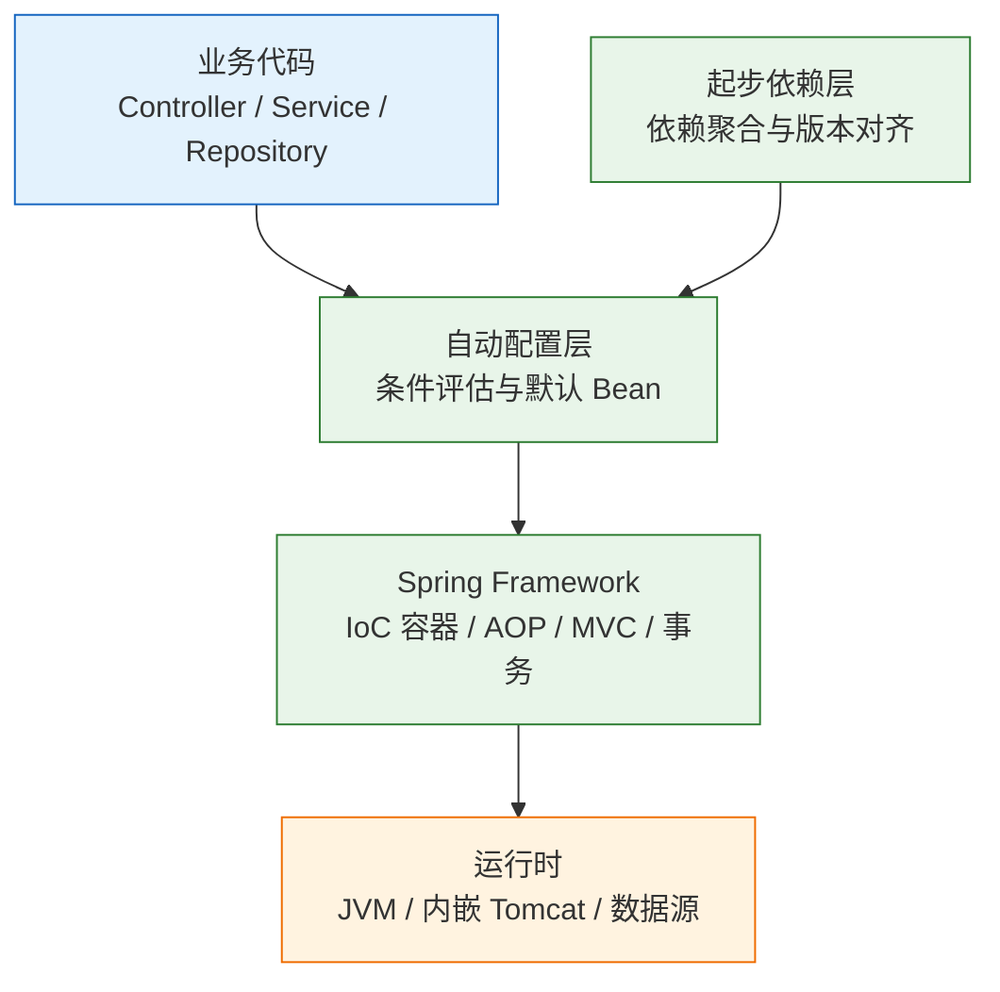
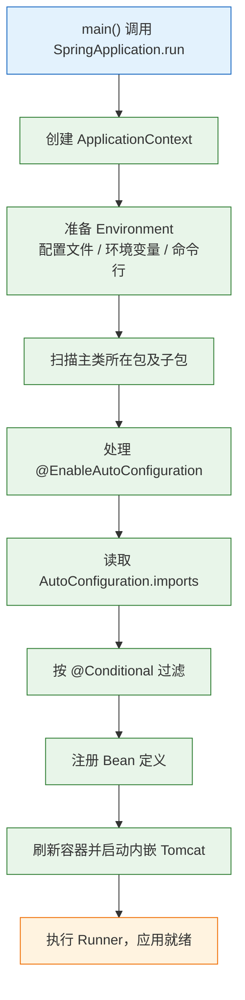
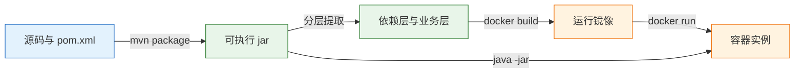

# Spring Boot

---

## 一、Spring Boot 是什么

### 1.1 核心概念

Spring Boot 是建立在 Spring Framework 之上的应用脚手架。它不重新实现 IoC 容器、AOP、MVC 和事务，而是把“一个 Spring 应用需要哪些依赖、哪些默认 Bean、配置从哪里读、如何打成可执行包”这些重复工作收拢成约定。开发者写业务组件，Boot 负责装配运行环境。

它主要解决五个问题：

- **依赖组合**：starter 把一组常用库聚合在一起，版本由父工程统一管理，减少版本冲突。
- **自动配置**：根据 classpath 上的类、已有 Bean 和配置属性，决定默认 Bean 是否注册。
- **外部化配置**：同一份代码通过配置文件、环境变量、命令行参数适配不同环境。
- **交付形态**：把应用、依赖和内嵌容器打进一个可执行 jar，用 `java -jar` 启动。
- **运行观测**：用 Actuator 暴露健康、指标和配置状态，减少上线后的盲区。

| 能力 | 解决的问题 | 具体体现 |
|---|---|---|
| 起步依赖 | 依赖选型与版本对齐 | starter 聚合常用库 |
| 自动配置 | 大量样板配置 | 按条件注册默认 Bean |
| 外部化配置 | 一份代码多环境运行 | 配置来源分层覆盖 |
| 可执行 jar | 交付物自带运行环境 | 内嵌 Tomcat 与嵌套依赖 |
| 运行观测 | 上线后查看健康与指标 | Actuator 端点 |

Spring Boot 的边界也需要说清：它适合独立运行、按环境配置、需要快速接入数据库与监控的 HTTP 服务；不适合必须部署到既有应用服务器且不能改变启动方式的遗留系统；也不适合只做一次极简 HTTP 处理、对启动时间和内存极度敏感的场景。自动配置不是黑盒，每个默认 Bean 都能被用户 Bean 覆盖，覆盖不了就排除并显式配置。

“约定优于配置”带来的收益是启动快、样板少，代价是默认行为分散在大量条件类里。一个依赖被 starter 间接带入，就可能改变数据源、JSON 序列化或安全过滤链的行为。排查这类问题时，先确认 classpath 上有什么，再看条件评估报告，比逐行读业务代码有效。

### 1.2 与相邻技术的关系

Spring Framework 提供容器和 Web 抽象：`ApplicationContext` 管理 Bean，`@Transactional` 处理事务，`DispatcherServlet` 负责 MVC 调度。Spring Boot 站在这一层之上，根据 classpath 决定“默认怎么配”。有 H2 就创建内存数据源，有 `spring-boot-starter-webmvc` 就启动 Tomcat 并注册 MVC 基础设施。

starter 是依赖集合，不是代码。`spring-boot-starter-webmvc` 把 Spring MVC、Jackson、Tomcat 等依赖拉到一起，但不包含 Bean Validation，校验要单独加 `spring-boot-starter-validation`。这一点在写 `@Valid` 时经常被忽略。starter 的传递依赖会进入 classpath，自动配置再据此判断；引入一个 starter 可能同时改变 JSON、日志和监控行为，升级前要看清依赖树。

Spring Cloud 构建在 Boot 之上，但 Boot 本身不提供服务发现、配置中心、熔断和网关，这些是 Cloud 及其组件的职责。把 Boot 当成“微服务框架”会导致在单体服务里引入一整套分布式组件，增加启动时间和故障面。

| 技术 | 职责 | 与 Spring Boot 的边界 |
|---|---|---|
| Spring Framework | IoC、AOP、MVC、事务 | Boot 只做装配与默认值 |
| Spring MVC | HTTP 请求到控制器方法 | 由 Web starter 引入并自动配置 |
| Servlet 容器 | 网络监听与 Servlet 生命周期 | 内嵌 Tomcat，也可换 Jetty |
| Spring Security | 认证与授权过滤链 | 独立 starter，Boot 不替它做安全决策 |
| Spring Cloud | 分布式治理与远程调用 | 构建在 Boot 之上，不属于 Boot 本体 |
| Maven / Gradle | 依赖解析与构建 | Boot 插件负责可执行 jar |

> **注意**：Spring Boot 4 默认使用 Jackson 3。按 Jackson 2 写的 `com.fasterxml.jackson.*` 导入在 Boot 4 工程里可能直接编译失败或运行期缺类，迁移时先核对包名。

### 1.3 架构组成



- **业务代码层**：`@RestController`、`@Service`、`@Repository` 等组件，由组件扫描注册。
- **自动配置层**：读取 `META-INF/spring/org.springframework.boot.autoconfigure.AutoConfiguration.imports`，按条件注册默认 Bean。
- **起步依赖层**：只参与依赖解析，不产生运行时代码。
- **框架层**：Spring Framework 提供容器、代理、MVC 和事务语义。
- **运行时层**：JVM、内嵌容器、连接池和数据库驱动。

启动入口是 `SpringApplication.run`。它创建 `ApplicationContext`，准备 `Environment`，扫描主类所在包，处理自动配置，刷新容器并启动内嵌容器，最后执行 `ApplicationRunner` 与 `CommandRunner`。启动失败时，异常会沿启动流程向上抛出，日志里的第一处 `Caused by` 往往就是根因。

| 组件 | 职责 |
|---|---|
| `SpringApplication` | 启动流程编排与事件发布 |
| `ApplicationContext` | Bean 定义、创建与依赖注入 |
| `Environment` | 配置文件、环境变量、命令行参数的统一视图 |
| `AutoConfiguration.imports` | 自动配置类清单 |
| Actuator | 把运行状态暴露为 HTTP 端点 |

---

## 二、环境与最小服务

### 2.1 版本与工程生成

> **版本现状（2026-10）**：Spring Boot 4.1.2，Spring Framework 7.0.10；Java 17 起，兼容到 Java 27；内嵌容器为 Tomcat 11 / Jetty 12.1（Servlet 6.1）。Boot 4 的 MVC starter 叫 `spring-boot-starter-webmvc`，测试 starter 按模块拆分，默认 JSON 库是 Jackson 3。

| 组件 | 建议版本 | 说明 |
|---|---|---|
| JDK | 21 LTS | Boot 4 最低要求 Java 17 |
| Maven | 3.9 及以上 | 也可直接使用工程自带的 `mvnw` |
| Spring Boot | 4.1.2 | 示例固定版本，避免行为漂移 |
| Servlet API | 6.1 | 由 Tomcat 11 提供 |

用 Initializr 生成骨架，依赖选 Web MVC、Validation、Actuator：

```bash
# 生成 Maven 工程，依赖包含 web、validation、actuator
curl -G https://start.spring.io/starter.zip \
  -d type=maven-project -d language=java -d bootVersion=4.1.2 -d javaVersion=21 \
  -d groupId=com.example -d artifactId=demo -d name=demo \
  -d packageName=com.example.demo -d dependencies=web,validation,actuator \
  -o demo.zip

unzip demo.zip -d demo
cd demo
```

生成的 `pom.xml` 关键部分如下。父工程管理所有 starter 的版本，所以依赖不写 `<version>`；只有引入第三方库时才需要显式版本。

```xml
<parent>
    <groupId>org.springframework.boot</groupId>
    <artifactId>spring-boot-starter-parent</artifactId>
    <version>4.1.2</version>
    <relativePath/>
</parent>

<properties>
    <!-- 编译与运行统一到 Java 21 -->
    <java.version>21</java.version>
</properties>

<dependencies>
    <!-- Web MVC：Spring MVC、Jackson、内嵌 Tomcat -->
    <dependency>
        <groupId>org.springframework.boot</groupId>
        <artifactId>spring-boot-starter-webmvc</artifactId>
    </dependency>
    <!-- Bean Validation：@Valid、@NotBlank 等 -->
    <dependency>
        <groupId>org.springframework.boot</groupId>
        <artifactId>spring-boot-starter-validation</artifactId>
    </dependency>
    <!-- 健康检查与指标端点 -->
    <dependency>
        <groupId>org.springframework.boot</groupId>
        <artifactId>spring-boot-starter-actuator</artifactId>
    </dependency>
    <!-- Boot 4 按模块拆分的 MVC 测试支持 -->
    <dependency>
        <groupId>org.springframework.boot</groupId>
        <artifactId>spring-boot-starter-webmvc-test</artifactId>
        <scope>test</scope>
    </dependency>
</dependencies>

<build>
    <plugins>
        <plugin>
            <groupId>org.springframework.boot</groupId>
            <artifactId>spring-boot-maven-plugin</artifactId>
        </plugin>
    </plugins>
</build>
```

| 文件 | 作用 |
|---|---|
| `pom.xml` | 依赖、JDK 版本、Boot 插件 |
| `DemoApplication.java` | 启动类与组件扫描起点 |
| `application.properties` | 默认配置 |
| `src/test/java` | 测试代码 |
| `mvnw` / `mvnw.cmd` | 固定 Maven 版本的包装脚本 |

### 2.2 最小可运行服务

启动类只做三件事：标记应用、开启自动配置、扫描配置属性。`@ConfigurationPropertiesScan` 让 `@ConfigurationProperties` 类不需要逐个加 `@EnableConfigurationProperties`。

```java
package com.example.demo;

import org.springframework.boot.SpringApplication;
import org.springframework.boot.autoconfigure.SpringBootApplication;
import org.springframework.boot.context.properties.ConfigurationPropertiesScan;

@SpringBootApplication
@ConfigurationPropertiesScan
public class DemoApplication {

    public static void main(String[] args) {
        SpringApplication.run(DemoApplication.class, args);
    }
}
```

配置属性用 record 承载。record 不可变，构造器绑定完成后即可安全共享；字段名与配置键通过松散绑定对应。

```java
package com.example.demo;

import org.springframework.boot.context.properties.ConfigurationProperties;

// prefix 对应 application.properties 里的 app.*
@ConfigurationProperties(prefix = "app")
public record AppProperties(String greeting) {
}
```

控制器通过构造器注入配置，返回一个 record，由 Jackson 序列化为 JSON。

```java
package com.example.demo;

import org.springframework.web.bind.annotation.GetMapping;
import org.springframework.web.bind.annotation.RequestMapping;
import org.springframework.web.bind.annotation.RequestParam;
import org.springframework.web.bind.annotation.RestController;

@RestController
@RequestMapping("/api")
class HelloController {

    private final AppProperties props;

    // 只有一个构造器时不需要 @Autowired
    HelloController(AppProperties props) {
        this.props = props;
    }

    record Hello(String message) {
    }

    @GetMapping("/hello")
    Hello hello(@RequestParam(defaultValue = "world") String name) {
        return new Hello(props.greeting() + ", " + name);
    }
}
```

`src/main/resources/application.properties`：

```properties
spring.application.name=demo
server.port=8080

# 自定义配置，绑定到 AppProperties.greeting
app.greeting=hi

# Actuator 只额外开放 info 与 metrics，health 默认已开放
management.endpoints.web.exposure.include=health,info,metrics
```

### 2.3 启动与验证

```bash
# 使用包装脚本启动，避免本机 Maven 版本差异
./mvnw spring-boot:run
```

启动日志会出现（耗时随机器变化）：

```text
Tomcat started on port 8080 (http)
Started DemoApplication in 1.614 seconds
```

另开终端验证接口与健康端点：

```bash
# 调用业务接口
curl -s 'http://localhost:8080/api/hello?name=java'

# 查看健康状态
curl -s http://localhost:8080/actuator/health
```

预期：

```json
{"message":"hi, java"}
```

```json
{"groups":["liveness","readiness"],"status":"UP"}
```

| 检查项 | 命令 | 预期 |
|---|---|---|
| 端口监听 | `lsof -i :8080` | Java 进程处于 LISTEN |
| 业务接口 | `curl -s .../api/hello` | 返回绑定后的问候语 |
| 健康端点 | `curl -s .../actuator/health` | `status` 为 `UP` |
| 配置生效 | 修改 `app.greeting` 后重启 | 返回值随之变化 |

> **注意**：`8080` 被占用时启动会直接失败，日志包含 `Port 8080 was already in use`。先用 `lsof -i :8080` 找到占用进程，再决定改端口还是停进程，不要盲目改代码。

---

## 三、自动配置与条件装配

### 3.1 自动配置的加载路径

`@SpringBootApplication` 是三个注解的组合：`@SpringBootConfiguration` 标记配置类，`@EnableAutoConfiguration` 触发自动配置，`@ComponentScan` 扫描主类所在包及子包。自动配置类不在业务包扫描范围内，它们由 imports 文件登记。



自动配置类上通常叠着多个条件注解，只有全部满足才生效：

| 条件注解 | 作用 | 例子 |
|---|---|---|
| `@ConditionalOnClass` | classpath 存在指定类才生效 | 有 `DataSource` 才配数据源 |
| `@ConditionalOnMissingBean` | 容器中没有同类型 Bean 才生效 | 用户自定义 `DataSource` 后默认的退让 |
| `@ConditionalOnProperty` | 配置属性满足条件才生效 | `spring.mvc.problemdetails.enabled=true` |
| `@ConditionalOnWebApplication` | 仅在 Web 应用生效 | MVC 与 WebFlux 的基础设施 |
| `@ConditionalOnBean` | 已存在某个 Bean 才生效 | 依赖其他自动配置的产物 |

这解释了两个常见现象。classpath 里有 H2 时，即使没有写 `spring.datasource.url`，应用也能启动，因为自动配置创建了内存数据源。自己定义了同类型 Bean 却仍用默认实现，通常是类型不匹配、Bean 名称冲突，或条件在解析顺序上更早；用条件评估报告确认，不要靠猜。

自动配置之间也有顺序。数据源要先于 JPA 创建，Web 基础设施要先于依赖它的组件注册；这些顺序由自动配置类上的 `@AutoConfigureBefore`、`@AutoConfigureAfter` 声明，业务代码不应依赖它们的偶然次序。需要插入自己的配置时，让配置类通过构造器参数表达依赖，比用 `@DependsOn` 硬指定更清晰。

### 3.2 条件注解与覆盖规则

覆盖自动配置有四类做法：定义同类型 Bean、排除自动配置类、用属性排除、使用自动配置自带的开关。定义 Bean 最常用，也最容易被误用；排除适合“这个能力完全不需要”，属性开关适合不同环境切换。

```java
package com.example.demo;

import org.springframework.boot.SpringApplication;
import org.springframework.boot.autoconfigure.SpringBootApplication;
import org.springframework.boot.autoconfigure.jdbc.DataSourceAutoConfiguration;

// 明确不需要数据源时，排除对应的自动配置类
@SpringBootApplication(exclude = DataSourceAutoConfiguration.class)
public class DemoApplication {

    public static void main(String[] args) {
        SpringApplication.run(DemoApplication.class, args);
    }
}
```

上例只演示排除写法，实际项目仍应保留自己的 `main` 方法调用 `SpringApplication.run`。

| 方式 | 写法 | 适用场景 |
|---|---|---|
| 自定义 Bean | `@Bean` 声明同类型对象 | 替换单个默认组件 |
| 排除自动配置 | `exclude = XxxAutoConfiguration.class` | 整个能力不需要 |
| 属性排除 | `spring.autoconfigure.exclude=...` | 不改代码按环境关闭 |
| 条件属性 | 自动配置自带的 `spring.*.enabled` | 官方提供的开关 |

排除要写自动配置类的全限定名。排除非自动配置类时，启动会报“无法排除”的错误；排除正确但目标本来就没生效时，日志里不会有明显变化。改完用 `--debug` 确认 `Negative matches` 里出现了目标类。

### 3.3 条件评估报告与调试

```bash
# 启动时打印条件评估报告
java -jar target/demo-0.0.1-SNAPSHOT.jar --debug
```

日志里会出现 `CONDITIONS EVALUATION REPORT`，分为 `Positive matches` 与 `Negative matches`。每条都写明生效或未生效的原因：缺类、缺 Bean、属性值不匹配、Web 类型不符。定位“为什么某个默认 Bean 没出现”时，这是最快的手段。

| 现象 | 先看什么 | 结论方向 |
|---|---|---|
| 数据源自动配置未生效 | `Negative matches` 中的 `DataSourceAutoConfiguration` | 缺驱动、缺 URL 或被排除 |
| 自定义 Bean 没覆盖默认值 | Bean 类型与名称 | 类型不一致或条件更早 |
| 某端点返回 404 | 端点是否暴露 | 暴露列表或管理端口 |
| 配置写了但没绑定 | 前缀与属性名 | 松散绑定规则或扫描缺失 |

> **安全警告**：Actuator 的 `conditions`、`env`、`configprops` 端点会暴露类路径、配置键和部分值。生产环境不要公开这些端点；需要临时排查时把管理端口限制在内网并尽快关闭。

---

## 四、Bean 生命周期与依赖注入

### 4.1 Bean 声明方式

业务代码里的 Bean 有两种来源：类路径扫描和配置类方法声明。自己写的类用 stereotype 注解，第三方类或需要条件判断的构造用 `@Bean`。

| 注解 | 注册方式 | 适用对象 |
|---|---|---|
| `@Component` | 组件扫描 | 通用组件 |
| `@Service` | 组件扫描 | 业务服务 |
| `@Repository` | 组件扫描 | 数据访问，附带异常转换 |
| `@Controller` | 组件扫描 | MVC 控制器 |
| `@RestController` | 组件扫描 | 返回响应体的控制器 |
| `@Bean` | 配置类方法 | 第三方类、需要手工构造的对象 |

依赖注入优先用构造器。构造器注入让依赖在对象创建时就必须存在，字段可以声明为 `final`，测试时直接传参，不需要反射注入。

```java
package com.example.demo;

import org.springframework.stereotype.Service;

@Service
class OrderService {

    private final OrderRepository repository;
    private final PaymentClient paymentClient;

    // 单一构造器，Spring 自动注入，无需 @Autowired
    OrderService(OrderRepository repository, PaymentClient paymentClient) {
        this.repository = repository;
        this.paymentClient = paymentClient;
    }
}
```

`@Configuration` 默认 `proxyBeanMethods=true`，容器会为配置类生成代理，保证 `@Bean` 方法之间直接调用时仍返回同一个单例。把它设为 `false` 可以跳过代理、加快启动，但方法间不能再互相调用获取 Bean。

### 4.2 作用域与生命周期

| 作用域 | 实例数量 | 适用场景 |
|---|---|---|
| `singleton`（默认） | 每个容器一个 | 无状态 Service、配置、客户端 |
| `prototype` | 每次获取新建 | 有状态、短生命周期对象 |
| `request` | 每个 HTTP 请求一个 | 请求级上下文 |
| `session` | 每个会话一个 | 传统登录态 |

单例 Bean 必须无状态，或者状态本身线程安全。在单例里保存 `HttpServletRequest`、当前用户信息等请求级字段，会在并发请求之间串数据，这类问题往往只在压测时暴露。

`prototype` Bean 注入到单例时，只会在单例创建时注入一次，之后不会自动换成新实例。需要每次获取新对象时，注入 `ObjectProvider` 或 `ApplicationContext` 主动获取；否则 `prototype` 的实际行为与单例无异。

生命周期顺序是：构造器 → 依赖注入 → `@PostConstruct` → Bean 可用 → `@PreDestroy` → 容器关闭。

```java
package com.example.demo;

import jakarta.annotation.PostConstruct;
import jakarta.annotation.PreDestroy;
import org.springframework.stereotype.Component;

import java.math.BigDecimal;
import java.util.Map;
import java.util.concurrent.ConcurrentHashMap;

@Component
class PriceCache {

    private final Map<String, BigDecimal> cache = new ConcurrentHashMap<>();

    @PostConstruct
    void warmUp() {
        // 只做轻量预热；远程调用放到健康检查或异步任务
        cache.put("DEFAULT", BigDecimal.ZERO);
    }

    @PreDestroy
    void clear() {
        // 释放本地资源；kill -9 时不会执行
        cache.clear();
    }
}
```

构造器里不要做重 IO 或远程调用：依赖还没注入完，失败也难以转换成可读的启动错误。`@PostConstruct` 适合校验配置、预热本地缓存；耗时操作应改为异步或交给健康检查。`@PreDestroy` 适合关闭线程池、刷新缓冲，但不保证在 `kill -9` 时执行。

### 4.3 代理机制与循环依赖

`@Transactional`、`@Async`、`@PreAuthorize` 都依赖代理对象。调用必须经过代理才会触发增强逻辑，同类内部调用直接走 `this`，注解不生效。

```java
package com.example.demo;

import org.springframework.stereotype.Service;
import org.springframework.transaction.annotation.Transactional;

@Service
class OrderService {

    @Transactional
    public void create(long id) {
        // 事务增强由代理织入
    }

    public void batchCreate(long id) {
        // 同类调用不经过代理，create 上的事务不会生效
        create(id);
    }
}
```

`private`、`final` 方法也可能代理不到；CGLIB 通过子类代理，`final` 方法无法覆盖。需要事务边界时，把方法拆到另一个 Bean，或通过注入自身代理调用，不要依赖内部调用。

| 场景 | 结果 | 处理方式 |
|---|---|---|
| 构造器循环依赖 | 启动直接失败 | 重构依赖方向 |
| Setter/字段循环依赖 | Boot 2.6 起默认禁止，需显式开启才走三级缓存 | 拆分职责 |
| 同类内部调用事务 | 事务不生效 | 拆 Bean 或注入代理 |
| `private` 方法加事务 | 代理不到 | 改为 `public` 并走代理 |
| 单例保存请求状态 | 并发串数据 | 改为方法参数或请求作用域 |

> **注意**：`@Lazy` 只能推迟循环依赖的解析，不能消除设计上的双向耦合。用之前先确认是否真的需要互相引用；把 `spring.main.allow-circular-references` 设为 `true` 只是恢复旧行为，不是修复方案。

---

## 五、配置体系与多环境

### 5.1 配置来源与优先级

配置来源按优先级覆盖，高优先级覆盖低优先级。下面是从高到低的简化顺序：

| 优先级 | 来源 | 例子 |
|---|---|---|
| 1 | 命令行参数 | `--server.port=9090` |
| 2 | Java 系统属性 | `-Dserver.port=9090` |
| 3 | 操作系统环境变量 | `SERVER_PORT=9090` |
| 4 | jar 外的 profile 配置 | `./config/application-prod.properties` |
| 5 | jar 内的 profile 配置 | `classpath:/application-prod.properties` |
| 6 | jar 外的默认配置 | `./config/application.properties` |
| 7 | jar 内的默认配置 | `classpath:/application.properties` |
| 8 | `@PropertySource` 与代码默认值 | 兜底值 |

环境变量采用松散绑定：`app.greeting` 对应 `APP_GREETING`，`app.payment-timeout` 对应 `APP_PAYMENT_TIMEOUT`。容器部署通常只注入环境变量，不把配置文件打进镜像。

优先级的意义在于“同一份产物可以在不同环境启动”。镜像里保留默认配置，测试环境用 `application-test.properties` 覆盖，生产环境再用环境变量覆盖数据库地址。排查配置问题时，先确认最终生效值来自哪一层，不要只看仓库里的文件；`/actuator/env` 能列出属性来源，但只在受控环境临时使用。

> **注意**：松散绑定有固定映射，不是随便写。环境变量没有“删除”语义，注入空字符串会覆盖默认值；需要“未设置”时不要给空值，否则类型化配置可能绑定成空串或转换失败。

### 5.2 类型化配置与校验

```java
package com.example.demo;

import jakarta.validation.constraints.Min;
import jakarta.validation.constraints.NotBlank;
import org.springframework.boot.context.properties.ConfigurationProperties;
import org.springframework.validation.annotation.Validated;

import java.time.Duration;

@ConfigurationProperties(prefix = "app")
@Validated
public record AppProperties(
        @NotBlank String greeting,
        @Min(1) int timeoutSeconds,
        Duration connectTimeout,
        int maxPageSize) {
}
```

类型化配置支持嵌套对象、列表、`Duration`、`DataSize` 和枚举。启动时绑定失败会直接报错，并指出字段路径，比运行到第一个请求才发现要好。`@Validated` 需要 `spring-boot-starter-validation`，缺失时约束注解不会生效。

| 配置类型 | 示例值 | 绑定结果 |
|---|---|---|
| `Duration` | `30s`、`2m` | 对应时长 |
| `DataSize` | `10MB` | 字节数 |
| 枚举 | `CREATED` | 枚举常量 |
| 列表 | `a,b,c` | `List<String>` |
| 嵌套对象 | `app.client.url` | 内部 record 或类 |

`@Value("${app.greeting}")` 适合一两个值；数量多了以后，拼写、类型转换、默认值分散在各处，维护成本明显上升。需要 IDE 补全时加 `spring-boot-configuration-processor` 作为可选依赖，它在编译期生成元数据，不影响运行。

### 5.3 Profile 与外部化配置

```properties
# application.properties：默认配置，不放任何环境专属值
spring.application.name=demo
spring.profiles.active=local
```

```properties
# application-prod.properties：只覆盖生产不同的键
server.port=8080
spring.datasource.url=${DB_URL}
spring.datasource.username=${DB_USER}
spring.datasource.password=${DB_PASSWORD}
```

```bash
# 激活生产 profile，优先级高于配置文件
java -jar app.jar --spring.profiles.active=prod

# 也可以用环境变量，适合容器
SPRING_PROFILES_ACTIVE=prod java -jar app.jar
```

- `application-prod.properties` 只覆盖它写了的键，其余继承 `application.properties`。
- 不要在 profile 文件里再写 `spring.profiles.active`，容易形成循环或被忽略。
- 测试用 `@ActiveProfiles("test")`，测试配置放 `src/test/resources`。
- 密码、令牌走环境变量或密钥管理，不提交到仓库；日志里不要打印配置全文。

需要把配置拆到多个文件或外部目录时，用 `spring.config.import`：

```properties
# optional: 表示文件不存在时不报错
spring.config.import=optional:file:./config/secrets.properties
```

| 场景 | 推荐来源 | 原因 |
|---|---|---|
| 本地开发 | `application-local.properties` | 可读、可调试 |
| 容器部署 | 环境变量 | 不重建镜像即可换配置 |
| 密钥 | 密钥管理或挂载文件 | 不进入镜像与仓库 |
| 多模块共享 | `spring.config.import` | 显式声明依赖关系 |

> **安全警告**：把生产数据库密码写进 `application-prod.properties` 并提交仓库，是最常见的数据泄露路径。配置文件只放键名和占位符，真实值由运行环境注入。

---

## 六、Web 运行与可观测性

### 6.1 内嵌容器与优雅停机

Boot 4 的 MVC 栈默认是 Tomcat 11 + Spring MVC + Jackson 3。常用运行参数如下：

```properties
# 优雅停机：先停止接收新请求，再等待在途请求完成
server.shutdown=graceful
spring.lifecycle.timeout-per-shutdown-phase=30s

# 虚拟线程：JDK 21+，适合阻塞 IO；CPU 密集任务不要开
spring.threads.virtual.enabled=true

# 上传限制
spring.servlet.multipart.max-file-size=10MB
spring.servlet.multipart.max-request-size=20MB

# 启用 RFC 9457 Problem Details
spring.mvc.problemdetails.enabled=true
```

| 配置项 | 作用 | 注意 |
|---|---|---|
| `server.shutdown` | 停机方式 | 仅部分容器支持 |
| `spring.lifecycle.timeout-per-shutdown-phase` | 等待在途请求的上限 | 要小于编排系统杀进程时间 |
| `spring.threads.virtual.enabled` | 使用虚拟线程执行请求 | 阻塞 IO 受益，CPU 密集无收益 |
| `spring.servlet.multipart.*` | 单文件与整请求大小 | 超限抛 `MaxUploadSizeExceededException` |
| `spring.mvc.problemdetails.enabled` | 标准错误响应 | 仍需自定义业务异常映射 |

优雅停机只解决应用侧“先把请求处理完”。停机开始时，就绪探针会先转为拒绝流量，负载均衡把实例摘除，等在途请求结束后进程才退出。容器编排还要给足 `terminationGracePeriodSeconds`，否则进程会在请求完成前被 kill。两者时间要对齐：编排等待时间略大于应用停机超时。

### 6.2 Actuator 端点与健康检查

Actuator 把运行状态暴露成 HTTP 端点，默认只开放 `health`。需要哪些端点必须显式写出，不要用 `*` 图省事。

```properties
# 只开放必要的端点
management.endpoints.web.exposure.include=health,info,metrics,prometheus

# 健康细节只对已授权用户展示
management.endpoint.health.show-details=when-authorized

# 需要强制开启存活/就绪探针时保留
management.endpoint.health.probes.enabled=true
```

| 端点 | 用途 | 风险 |
|---|---|---|
| `/actuator/health` | 总体健康状态 | 细节可能泄露依赖地址 |
| `/actuator/health/liveness` | 进程是否活着 | 不应包含数据库等外部依赖 |
| `/actuator/health/readiness` | 是否可接流量 | 可包含下游就绪状态 |
| `/actuator/metrics` | JVM、HTTP、连接池指标 | 高基数标签拖垮监控 |
| `/actuator/prometheus` | Prometheus 抓取格式 | 需要对应 registry 依赖 |
| `/actuator/env` | 配置来源与属性 | 可能泄露密钥，生产禁用 |
| `/actuator/heapdump` | 堆转储 | 文件大，按需授权 |
| `/actuator/threaddump` | 线程栈 | 排障有用，注意权限 |

健康检查最常见的错误是把数据库连通性放进 liveness。数据库短暂抖动会让编排系统判定进程不健康并重启所有实例，形成雪崩。liveness 只看进程是否卡死，readiness 才看外部依赖是否就绪。Kubernetes 的 liveness 与 readiness 探针要分别指向对应分组；只配一个 `/actuator/health`，kubelet 无法区分“进程死了”和“暂时不能接流量”。

### 6.3 管理端口与暴露边界

业务端口和管理端口分离，能把 Actuator 放到只允许内网访问的地址上。

```properties
# 管理端点使用独立端口
management.server.port=9090

# 只绑定回环地址，适合单机排障
management.server.address=127.0.0.1
```

| 环境 | 暴露范围 | 措施 |
|---|---|---|
| 本地开发 | 全部端点 | 仅绑定 `127.0.0.1` |
| 测试 | `health,info,metrics` | 内网访问 |
| 生产 | `health,prometheus` | 独立端口、安全组限制、角色鉴权 |
| 故障排查 | 临时加 `env,loggers` | 排查结束立即收回 |

> **安全警告**：`/actuator/env`、`/actuator/heapdump`、`/actuator/threaddump` 能读出配置、内存和线程信息。不要因为“在内网”就裸奔；管理端口必须做网络隔离，能加认证就加认证。

---

## 七、完整示例：订单查询服务

### 7.1 工程结构与接口契约

示例只依赖 Web MVC、Validation、Actuator，数据放在内存里，目的是把配置绑定、校验、异常映射和健康检查串成一条可运行链路。

```text
src/main/java/com/example/demo/
├── DemoApplication.java
├── OrderProperties.java
├── OrderController.java
├── OrderService.java
├── OrderView.java
├── CreateOrder.java
├── OrderNotFoundException.java
└── ApiExceptionHandler.java
src/main/resources/
└── application.yaml
```

| 方法 | 路径 | 成功状态 | 说明 |
|---|---|---|---|
| `GET` | `/api/orders` | 200 | 按状态分页查询 |
| `POST` | `/api/orders` | 201 | 创建订单，返回 `Location` |
| `GET` | `/api/orders/{id}` | 200 | 查询单个订单 |

### 7.2 领域与配置代码

```java
package com.example.demo;

import jakarta.validation.constraints.Max;
import jakarta.validation.constraints.Min;
import jakarta.validation.constraints.NotBlank;
import org.springframework.boot.context.properties.ConfigurationProperties;
import org.springframework.validation.annotation.Validated;

@ConfigurationProperties(prefix = "order")
@Validated
public record OrderProperties(
        @Min(1) @Max(200) int maxPageSize,
        @NotBlank String defaultStatus) {
}
```

```java
package com.example.demo;

import jakarta.validation.constraints.NotBlank;
import jakarta.validation.constraints.Positive;

// 创建订单的入参，校验失败由全局异常处理器映射为 400
public record CreateOrder(
        @NotBlank(message = "sku is required") String sku,
        @Positive(message = "qty must be > 0") int qty) {
}
```

```java
package com.example.demo;

public record OrderView(long id, String sku, int qty, String status) {
}
```

```java
package com.example.demo;

import org.springframework.stereotype.Service;

import java.util.Comparator;
import java.util.List;
import java.util.Map;
import java.util.concurrent.ConcurrentHashMap;
import java.util.concurrent.atomic.AtomicLong;

@Service
class OrderService {

    private final Map<Long, OrderView> db = new ConcurrentHashMap<>();
    private final AtomicLong seq = new AtomicLong();

    OrderView create(CreateOrder cmd) {
        long id = seq.incrementAndGet();
        OrderView view = new OrderView(id, cmd.sku(), cmd.qty(), "CREATED");
        db.put(id, view);
        return view;
    }

    OrderView get(long id) {
        OrderView view = db.get(id);
        if (view == null) {
            throw new OrderNotFoundException(id);
        }
        return view;
    }

    List<OrderView> list(String status, int page, int size) {
        // 页码从 1 开始，调用方已在控制器里做过下限保护
        return db.values().stream()
                .filter(v -> status.equals(v.status()))
                .sorted(Comparator.comparingLong(OrderView::id))
                .skip((long) (page - 1) * size)
                .limit(size)
                .toList();
    }
}
```

```java
package com.example.demo;

// 业务异常只表达语义，状态码由 advice 决定
class OrderNotFoundException extends RuntimeException {

    private final long id;

    OrderNotFoundException(long id) {
        super("order " + id + " not found");
        this.id = id;
    }

    long id() {
        return id;
    }
}
```

### 7.3 控制器、异常与运行验证

```java
package com.example.demo;

import jakarta.validation.Valid;
import org.springframework.http.ResponseEntity;
import org.springframework.web.bind.annotation.*;

import java.net.URI;
import java.util.List;

@RestController
@RequestMapping("/api/orders")
class OrderController {

    private final OrderService service;
    private final OrderProperties props;

    OrderController(OrderService service, OrderProperties props) {
        this.service = service;
        this.props = props;
    }

    @GetMapping
    List<OrderView> list(@RequestParam(required = false) String status,
                         @RequestParam(defaultValue = "1") int page,
                         @RequestParam(defaultValue = "20") int size) {
        // 空状态用配置的默认值，分页大小不超过配置上限
        String actual = (status == null || status.isBlank())
                ? props.defaultStatus() : status;
        int safePage = Math.max(1, page);
        int safeSize = Math.min(Math.max(1, size), props.maxPageSize());
        return service.list(actual, safePage, safeSize);
    }

    @PostMapping
    ResponseEntity<OrderView> create(@Valid @RequestBody CreateOrder cmd) {
        OrderView view = service.create(cmd);
        return ResponseEntity.created(URI.create("/api/orders/" + view.id())).body(view);
    }

    @GetMapping("/{id}")
    OrderView get(@PathVariable long id) {
        return service.get(id);
    }
}
```

```java
package com.example.demo;

import org.slf4j.Logger;
import org.slf4j.LoggerFactory;
import org.springframework.http.HttpStatus;
import org.springframework.http.ProblemDetail;
import org.springframework.web.bind.MethodArgumentNotValidException;
import org.springframework.web.bind.annotation.ExceptionHandler;
import org.springframework.web.bind.annotation.RestControllerAdvice;

import jakarta.servlet.http.HttpServletRequest;
import java.util.UUID;
import java.util.stream.Collectors;

@RestControllerAdvice
class ApiExceptionHandler {

    private static final Logger log = LoggerFactory.getLogger(ApiExceptionHandler.class);

    @ExceptionHandler(OrderNotFoundException.class)
    ProblemDetail notFound(OrderNotFoundException e) {
        ProblemDetail pd = ProblemDetail.forStatusAndDetail(HttpStatus.NOT_FOUND, e.getMessage());
        pd.setTitle("Order not found");
        pd.setProperty("orderId", e.id());
        return pd;
    }

    @ExceptionHandler(MethodArgumentNotValidException.class)
    ProblemDetail invalid(MethodArgumentNotValidException e) {
        String detail = e.getBindingResult().getFieldErrors().stream()
                .map(f -> f.getField() + ": " + f.getDefaultMessage())
                .collect(Collectors.joining("; "));
        ProblemDetail pd = ProblemDetail.forStatusAndDetail(HttpStatus.BAD_REQUEST, detail);
        pd.setTitle("Validation failed");
        return pd;
    }

    @ExceptionHandler(Exception.class)
    ProblemDetail unknown(Exception e, HttpServletRequest request) {
        // 响应只给 traceId，完整堆栈留在服务端日志
        String traceId = UUID.randomUUID().toString();
        log.error("unhandled error traceId={} path={}", traceId, request.getRequestURI(), e);
        ProblemDetail pd = ProblemDetail.forStatusAndDetail(
                HttpStatus.INTERNAL_SERVER_ERROR, "internal error");
        pd.setProperty("traceId", traceId);
        return pd;
    }
}
```

`application.yaml`：

```yaml
spring:
  application:
    name: order-service

server:
  port: 8080
  shutdown: graceful

order:
  # 松散绑定到 OrderProperties.maxPageSize
  max-page-size: 100
  default-status: CREATED

management:
  endpoints:
    web:
      exposure:
        include: health,info,metrics
  endpoint:
    health:
      show-details: when-authorized
```

启动并验证：

```bash
# 启动服务
./mvnw spring-boot:run

# 创建订单
curl -i -X POST http://localhost:8080/api/orders \
  -H 'Content-Type: application/json' \
  -d '{"sku":"A-100","qty":2}'

# 触发参数校验
curl -i -X POST http://localhost:8080/api/orders \
  -H 'Content-Type: application/json' \
  -d '{"sku":"A-100","qty":0}'

# 查询不存在的订单
curl -i http://localhost:8080/api/orders/99

# 按默认状态分页查询
curl -s 'http://localhost:8080/api/orders?page=1&size=10'
```

输出类似：

```text
HTTP/1.1 201
Location: /api/orders/1
Content-Type: application/json

{"id":1,"sku":"A-100","qty":2,"status":"CREATED"}
```

```text
HTTP/1.1 400
Content-Type: application/problem+json

{"detail":"qty: qty must be > 0","instance":"/api/orders","status":400,"title":"Validation failed"}
```

| 验证点 | 操作 | 预期 |
|---|---|---|
| 配置绑定 | 改 `order.max-page-size` 后重启 | 分页上限变化 |
| 参数校验 | 提交 `qty=0` | 400 与字段级错误 |
| 业务异常 | 查询不存在的 id | 404 与 `orderId` |
| 健康检查 | 访问 `/actuator/health` | `status` 为 `UP` |

示例把数据放在 `ConcurrentHashMap`，进程重启后订单与自增序号都会丢失，只适合验证装配链路。换成真实数据库时，把 `OrderService` 的存储部分替换为 Repository，控制器、校验和异常映射不需要改；这也是分层的价值。生产环境还应把自增序号交给数据库或号段服务，避免多实例各自从 1 开始。

---

## 八、打包、部署与测试

### 8.1 可执行 jar 与分层

```bash
# 跳过测试打包
./mvnw -q -DskipTests package

# 运行可执行 jar
java -jar target/demo-0.0.1-SNAPSHOT.jar
```

可执行 jar 里嵌套了依赖 jar，`java -jar` 由 Boot 的 `JarLauncher` 负责加载，不需要额外 classpath。Boot 4 可以用工具模式把 jar 拆成层，便于容器构建时复用缓存：

```bash
# 提取分层目录
java -Djarmode=tools -jar target/demo-0.0.1-SNAPSHOT.jar \
  extract --layers --destination extracted

ls extracted
```

预期目录：

```text
application/  dependencies/  snapshot-dependencies/  spring-boot-loader/
```



| 层 | 内容 | 变化频率 |
|---|---|---|
| `dependencies` | 发布版依赖 | 低 |
| `snapshot-dependencies` | 快照依赖 | 中 |
| `spring-boot-loader` | 启动加载器 | 低 |
| `application` | 业务代码与资源 | 高 |

变化少的层放前面，变化多的层放后面，容器构建才能命中缓存。分层 COPY 的目录结构和启动类要按当前 Boot 版本文档核对；维护成本高于收益时，继续用 fat jar 更稳妥。

### 8.2 容器镜像

```dockerfile
# 构建阶段：固定 Maven 与 JDK 版本
FROM maven:3.9-eclipse-temurin-21 AS build
WORKDIR /src

# 先复制依赖清单，依赖不变时复用缓存层
COPY pom.xml .
RUN mvn -B -q dependency:go-offline

# 再复制源码并打包
COPY src ./src
RUN mvn -B -q -DskipTests package

# 运行阶段：只保留 JRE 与 jar
FROM eclipse-temurin:21-jre-alpine
RUN addgroup -S app && adduser -S app -G app
WORKDIR /app
# 指定产物名，避免 target 下的 .original 文件一起被匹配
COPY --from=build /src/target/demo-0.0.1-SNAPSHOT.jar app.jar

# 非 root 运行
USER app
EXPOSE 8080

# MaxRAMPercentage 给堆外内存留出空间
ENTRYPOINT ["java", "-XX:MaxRAMPercentage=75", "-jar", "/app/app.jar"]
```

| 实践 | 做法 | 目的 |
|---|---|---|
| 多阶段构建 | 构建镜像与运行镜像分离 | 减小最终体积 |
| 依赖缓存 | 先 `pom.xml` 后 `src` | 改代码不重下依赖 |
| 非 root | 创建专用用户 | 降低逃逸风险 |
| 内存参数 | `MaxRAMPercentage` | 适配容器 limit |
| 构建上下文 | `.dockerignore` 排除 `target` | 加快构建、避免脏文件 |

镜像里只放 jar 和 JRE，不把源码、测试报告、`.git` 带进去。构建完用 `docker images` 核对体积，Java 运行镜像通常控制在二百 MB 以内。容器内存限制要按“堆 + Metaspace + 线程栈 + Direct + Code Cache”估算，不能只给 `-Xmx`。

### 8.3 测试切片

```java
package com.example.demo;

import org.junit.jupiter.api.Test;
import org.springframework.beans.factory.annotation.Autowired;
import org.springframework.boot.test.context.SpringBootTest;
import org.springframework.boot.webmvc.test.autoconfigure.AutoConfigureMockMvc;
import org.springframework.test.web.servlet.MockMvc;

import static org.springframework.test.web.servlet.request.MockMvcRequestBuilders.get;
import static org.springframework.test.web.servlet.result.MockMvcResultMatchers.jsonPath;
import static org.springframework.test.web.servlet.result.MockMvcResultMatchers.status;

@SpringBootTest
@AutoConfigureMockMvc
class OrderApiTest {

    @Autowired
    MockMvc mvc;

    @Test
    void returnsNotFoundForUnknownOrder() throws Exception {
        mvc.perform(get("/api/orders/99"))
                .andExpect(status().isNotFound())
                .andExpect(jsonPath("$.orderId").value(99));
    }
}
```

| 测试方式 | 加载范围 | 适用 |
|---|---|---|
| `@SpringBootTest` | 完整上下文 | 验证装配、配置、端到端行为 |
| `@WebMvcTest` | 仅 MVC 层 | 控制器、绑定、校验、异常映射 |
| `@DataJpaTest` | JPA 与嵌入式数据库 | 映射与查询 |
| Testcontainers | 真实外部依赖容器 | 数据库、消息队列集成 |

`@WebMvcTest` 的控制器依赖用 `@MockitoBean` 替换，比完整上下文快很多。`@MockBean` 与 `@SpyBean` 在 Boot 3.4 已弃用，Boot 4 用 `@MockitoBean` 与 `@MockitoSpyBean`。Boot 4 的 `@WebMvcTest`、`@AutoConfigureMockMvc` 在 `org.springframework.boot.webmvc.test.autoconfigure` 包，从旧项目复制测试时 import 会直接编译失败。

测试不要依赖“本机恰好启动了一个数据库”。外部依赖用 Testcontainers 或嵌入式替代，保证 CI 环境可重复；集成测试与单元测试分开命名和超时，避免流水线被一个慢用例拖住。

> **开发提示**：先测量再优化。Actuator 的 `startup` 端点能记录 Bean 初始化耗时；确认瓶颈在类扫描、自动配置还是容器初始化，再决定是否开延迟初始化或 AOT 缓存。

---

## 九、常见错误与排查

### 9.1 故障对照表

| 现象 | 最可能原因 | 处理 |
|---|---|---|
| `Port 8080 was already in use` | 端口被其他进程占用 | `lsof -i :8080`，改 `server.port` 或停占用方 |
| `Failed to configure a DataSource` | 引了 JPA/JDBC 但没有 URL | 配 `spring.datasource.*`，或排除自动配置 |
| `No qualifying bean of type ...` | 类不在扫描包、缺注解、条件未满足 | 调整包结构，`--debug` 看条件 |
| 启动报循环依赖 | 构造器互相注入 | 重构依赖方向，`@Lazy` 仅作临时手段 |
| 配置项绑定为 `null` | 前缀不匹配、缺 `@ConfigurationPropertiesScan` | 核对前缀、扫描注解、环境变量名 |
| Actuator 404 | 端点未暴露或管理端口不同 | 检查暴露列表与 `management.server.port` |
| `NoClassDefFoundError: com/fasterxml/jackson/...` | 代码按 Jackson 2 写，Boot 4 默认 Jackson 3 | 改用 `tools.jackson` 或显式引入 Jackson 2 |
| `UnsupportedClassVersionError` | 编译与运行 JDK 不一致 | 统一 JDK 21，核对 `java -version` 与 `maven.compiler.release` |
| 容器内 `OOMKilled` | 堆按宿主机内存计算，或 `-Xmx` 等于 limit | 用 `MaxRAMPercentage`，预留 Metaspace 与 Direct |
| 优雅停机未生效 | 编排系统杀进程太快 | 对齐 `terminationGracePeriodSeconds` |

### 9.2 排查顺序

1. 先看启动日志第一处 `APPLICATION FAILED TO START`，它通常直接给出原因和修复动作。
2. 配置问题加 `--debug` 看 `CONDITIONS EVALUATION REPORT`，确认是缺类、缺 Bean 还是属性不匹配。
3. Bean 问题先核对包扫描范围与构造器注入，不要上来就写 `@ComponentScan("com")` 全局扫描。
4. 端口、内存、停机问题看进程、端口和 cgroup 限制，不要先改业务代码。
5. 从旧版本升级到 Boot 4 时，先查包名、starter 名、Jackson 版本三处。
6. 线上问题先看 `/actuator/health` 与日志 traceId，再决定是否重启；重启只能恢复服务，不能定位根因。
7. 故障结束后补齐监控项、启动参数和配置校验，把根因与修复动作写进复盘记录，才算闭环。

> **运维提示**：自动配置的默认值适合大多数服务，但每个被覆盖的默认 Bean 都应该有理由。把“为什么排除这个自动配置、为什么自定义这个 Bean”写进提交说明，升级时能少踩很多坑。
