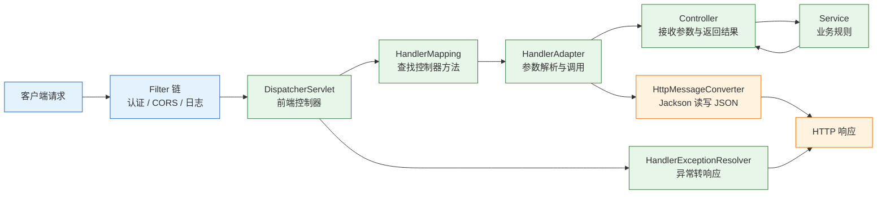
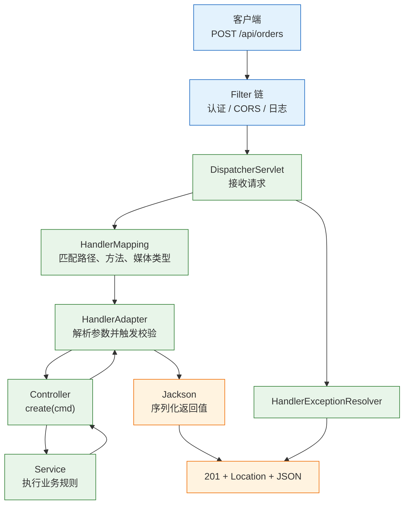
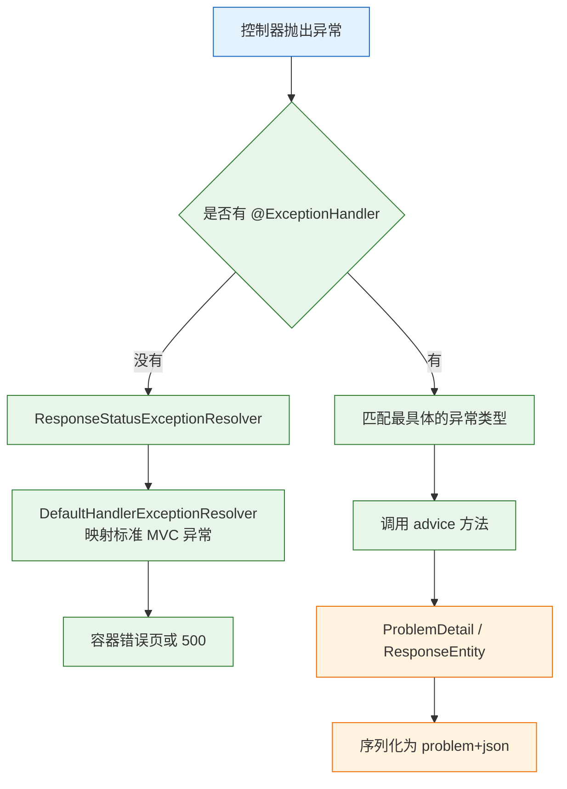

# Spring MVC

---

## 一、Spring MVC 是什么

### 1.1 核心概念

浏览器发来的是 HTTP 文本：请求行、路径、查询参数、请求头、JSON 体。业务代码需要的是 `long id`、`CreateOrder` 对象和 `ResponseEntity`。中间要做路由、类型转换、数据校验、序列化、异常映射，Spring MVC 把这些步骤收进一条固定的请求流水线。

它的核心是一个前端控制器 `DispatcherServlet`。所有请求先到它，由它查映射、调适配器、选消息转换器、处理异常，开发者只写控制器方法。理解这条流水线，就能解释大多数 400、404、405、406、415 从哪来。

| 职责 | 内容 |
|---|---|
| 负责 | 路由映射、参数绑定、类型转换、数据校验、内容协商、异常映射 |
| 不负责 | 认证与授权、事务边界、领域规则、模板引擎实现 |
| 依赖 | Servlet 容器、Spring IoC 容器、JSON 库 |
| 输出 | HTTP 状态码、响应头、响应体或视图名 |

Spring MVC 不替代 Spring Security，后者在过滤器链里完成认证与授权；也不替代 `@Transactional`，事务由 Spring 的 AOP 代理管理。它只负责“HTTP 与 Java 方法”之间的适配，边界清楚，排障时才不会把认证失败、事务回滚都归到 MVC 头上。

一次请求在 MVC 内的生命周期可以概括为六步：容器把请求交给 `DispatcherServlet`；映射器找到处理方法；适配器解析参数并触发校验；控制器调用 Service；返回值经消息转换器写入响应；异常由解析器转成错误响应。输入不满足约定时，通常在对应阶段产生 4xx；业务执行失败则由异常映射决定状态码，两者不要混为一谈。

### 1.2 与相邻技术的关系

Spring MVC 跑在 Servlet 容器里，由 Spring IoC 容器管理控制器和协作对象。Spring Boot 负责把 MVC、Jackson、Tomcat 装配起来，并提供配置属性；没有 Boot 时，MVC 仍可部署到外置 Tomcat 或 Jetty。

| 技术 | 职责 | 与 Spring MVC 的关系 |
|---|---|---|
| Servlet | 定义请求、响应、过滤器、会话 | MVC 运行在 Servlet API 之上 |
| Spring IoC | 管理控制器与依赖 | 控制器是容器中的 Bean |
| Spring Boot | 自动配置 MVC 与内嵌容器 | 减少 `web.xml` 与 XML 配置 |
| Spring Security | 认证、授权、CSRF、CORS | 在 DispatcherServlet 之前过滤 |
| Jackson | JSON 读写 | 作为 `HttpMessageConverter` 的实现 |
| WebFlux | 响应式非阻塞栈 | 与 MVC 并列，不是替代关系 |

选择 MVC 还是 WebFlux，取决于阻塞模型，不取决于“新不新”。MVC 的控制器方法在容器线程上同步执行，配虚拟线程后能支撑大量阻塞 IO；WebFlux 用事件循环处理非阻塞流，适合高并发长连接和流式响应，但阻塞调用会卡住事件线程。既有 JDBC、Servlet 过滤器链和同步事务的项目，留在 MVC 更稳。

> **注意**：Spring Boot 4 默认使用 Jackson 3。按 Jackson 2 的 `com.fasterxml.jackson.*` 写的自定义序列化器，在 Boot 4 工程里需要同步迁移。

### 1.3 架构组成



- **Filter**：Servlet 容器级组件，在 `DispatcherServlet` 之前执行，能包装请求与响应。
- **DispatcherServlet**：总调度器，串联映射、适配、视图或消息转换、异常处理。
- **HandlerMapping**：按路径、HTTP 方法、`consumes`、`produces`、版本等条件找到处理方法。
- **HandlerAdapter**：调用方法，负责参数解析、校验触发和返回值处理。
- **HandlerInterceptor**：在方法调用前后执行，知道命中了哪个处理器。
- **HttpMessageConverter**：读写请求体与响应体，JSON 默认交给 Jackson。
- **HandlerExceptionResolver**：把异常转换成响应，`@RestControllerAdvice` 由它驱动。

前端控制器的价值在于把公共流程集中：路由、参数解析、校验、序列化、异常映射只实现一次，控制器只处理“这个接口要什么、返回什么”。代价是执行链变长，一个 400 可能来自参数解析、类型转换、校验或消息转换中的任一环节，排障时必须先定位阶段。

| 组件 | 输入 | 输出 |
|---|---|---|
| `HandlerMapping` | 请求路径与方法 | 处理器执行链 |
| `HandlerAdapter` | 处理器与请求 | 方法返回值 |
| `HttpMessageConverter` | Java 对象或字节流 | JSON 或对象 |
| `HandlerExceptionResolver` | 异常与请求 | 响应或 `null` |
| `ViewResolver` | 视图名 | 视图实现 |

---

## 二、环境与最小接口

### 2.1 版本与依赖

> **版本现状（2026-10）**：Spring Framework 7.0.x，Spring Boot 4.1.x；Servlet 6.1、Jackson 3。API 版本化等新特性以 Framework 7 为准。

| 依赖 | 作用 | 说明 |
|---|---|---|
| `spring-boot-starter-webmvc` | MVC、Jackson、内嵌 Tomcat | Boot 4 的 MVC starter |
| `spring-boot-starter-validation` | Bean Validation | `@Valid`、`@NotBlank` 需要 |
| `spring-boot-starter-webmvc-test` | MockMvc 测试支持 | 测试作用域 |
| `jackson-databind` | JSON 序列化 | 由 Web starter 间接带入 |

```xml
<dependencies>
    <!-- MVC 与内嵌 Tomcat -->
    <dependency>
        <groupId>org.springframework.boot</groupId>
        <artifactId>spring-boot-starter-webmvc</artifactId>
    </dependency>
    <!-- 参数校验，缺少它 @Valid 不会生效 -->
    <dependency>
        <groupId>org.springframework.boot</groupId>
        <artifactId>spring-boot-starter-validation</artifactId>
    </dependency>
    <!-- MockMvc 切片测试 -->
    <dependency>
        <groupId>org.springframework.boot</groupId>
        <artifactId>spring-boot-starter-webmvc-test</artifactId>
        <scope>test</scope>
    </dependency>
</dependencies>
```

### 2.2 最小可运行接口

启动类保持默认包扫描，控制器放在主类同包或子包下。`@RestController` 等价于 `@Controller` 加 `@ResponseBody`，返回值直接写入响应体。

```java
package com.example.demo;

import org.springframework.boot.SpringApplication;
import org.springframework.boot.autoconfigure.SpringBootApplication;

@SpringBootApplication
public class DemoApplication {

    public static void main(String[] args) {
        SpringApplication.run(DemoApplication.class, args);
    }
}
```

```java
package com.example.demo;

import org.springframework.web.bind.annotation.GetMapping;
import org.springframework.web.bind.annotation.RequestMapping;
import org.springframework.web.bind.annotation.RequestParam;
import org.springframework.web.bind.annotation.RestController;

@RestController
@RequestMapping("/api")
class HelloController {

    record Hello(String message) {
    }

    @GetMapping("/hello")
    Hello hello(@RequestParam(defaultValue = "world") String name) {
        return new Hello("hello, " + name);
    }
}
```

`application.properties`：

```properties
spring.application.name=mvc-demo
server.port=8080
```

```bash
# 启动服务
./mvnw spring-boot:run

# 调用接口
curl -s 'http://localhost:8080/api/hello?name=java'
```

输出类似：

```json
{"message":"hello, java"}
```

| 文件 | 作用 |
|---|---|
| `pom.xml` | 引入 Web MVC 与校验依赖 |
| `DemoApplication.java` | 启动类与组件扫描起点 |
| `HelloController.java` | 控制器与映射 |
| `application.properties` | 端口与应用名 |

`Hello` 是嵌套在控制器里的 record，Jackson 能读取它的访问器并序列化。`@RestController` 已经包含 `@ResponseBody`，所以返回值直接写入响应体；如果换成 `@Controller` 且不加 `@ResponseBody`，返回值会进入视图解析流程，通常得到 404 或视图解析错误。这是“接口返回 JSON 却变成页面错误”的常见原因。

record 适合不可变 DTO，构造器即契约，字段不会被框架偷偷改写。需要 setter、继承或某些序列化框架反射实例化时，改用普通类；不要为了省几行代码把可变实体直接当请求体。

### 2.3 工程结构

```text
src/main/java/com/example/demo/
├── DemoApplication.java
├── web/
│   ├── OrderController.java
│   └── ApiExceptionHandler.java
├── service/
│   └── OrderService.java
└── domain/
    ├── CreateOrder.java
    └── OrderView.java
src/main/resources/
├── application.properties
└── static/
```

| 包 | 内容 | 依赖方向 |
|---|---|---|
| `web` | 控制器、请求 DTO、异常处理 | 依赖 service |
| `service` | 业务规则、事务边界 | 依赖 domain 与 repository |
| `domain` | 领域对象、值对象 | 不依赖 web |
| `repository` | 数据访问 | 被 service 依赖 |

包结构决定组件扫描范围。主类在 `com.example.demo`，控制器在 `com.example.demo.web` 能被扫描；把控制器放到 `com.other` 下，启动后所有接口都会 404。遇到“注解都写了却没有映射”，先看包位置。

依赖方向也要约束：web 依赖 service，service 依赖 domain 与 repository，domain 不反向依赖 web。控制器直接调用 Repository 会让校验、事务和异常映射散落；Service 返回 `ResponseEntity` 会让业务层绑死 HTTP。分层不是形式，目的是让业务规则能在没有 Web 容器的测试里独立运行。

---

## 三、请求处理流水线

### 3.1 前端控制器与处理器映射



`HandlerMapping` 不只看路径。映射条件还包括 HTTP 方法、请求头、`consumes`、`produces` 和版本；多个条件同时存在时，更具体的映射优先。

| 映射条件 | 作用 | 不匹配的结果 |
|---|---|---|
| `path` | 路径与路径变量 | 404 |
| `method` | GET、POST 等方法 | 405 |
| `consumes` | 请求 `Content-Type` | 415 |
| `produces` | 响应 `Accept` | 406 |
| `params` | 必须存在或缺失的参数 | 404 |
| `headers` | 必须存在的请求头 | 404 |
| `version` | API 版本 | 400 或 404 |

映射条件越多，匹配越具体。两个方法都能匹配同一路径时，带 `consumes`、`produces` 或版本约束的方法优先；条件完全相同会在启动时报映射冲突，不会悄悄覆盖。排障时看到 405 而不是 404，说明路径已经匹配成功，只是 HTTP 方法不在允许列表里。

`DispatcherServlet` 的处理顺序固定：查映射、取执行链、调 `HandlerAdapter`、处理返回值、解析异常、触发 `afterCompletion`。拦截器的 `preHandle` 在适配器调用前执行，`postHandle` 在控制器正常返回后执行，`afterCompletion` 无论成功失败都执行。

> **注意**：`postHandle` 在控制器抛异常时不会执行，清理 ThreadLocal、关闭资源要放在 `afterCompletion`，否则异常请求会留下脏数据。

### 3.2 参数解析与数据绑定

参数解析由 `HandlerMethodArgumentResolver` 完成，每个注解对应一个解析器。解析器把 HTTP 的某一部分取出，再通过 `ConversionService` 转成方法参数类型。

| 参数来源 | 解析器 | 典型注解 |
|---|---|---|
| 路径变量 | `PathVariableMethodArgumentResolver` | `@PathVariable` |
| 查询参数 | `RequestParamMethodArgumentResolver` | `@RequestParam` |
| 请求体 | `RequestResponseBodyMethodProcessor` | `@RequestBody` |
| 表单对象 | `ModelAttributeMethodProcessor` | `@ModelAttribute` |
| 请求头 | `RequestHeaderMethodArgumentResolver` | `@RequestHeader` |
| Cookie | `ServletCookieValueMethodArgumentResolver` | `@CookieValue` |
| 文件 | `RequestPartMethodArgumentResolver` | `@RequestPart` |
| 原始对象 | `ServletRequestMethodArgumentResolver` | `HttpServletRequest` |

类型转换失败会抛 `MethodArgumentTypeMismatchException`，最终映射为 400。日期、枚举、金额等格式敏感字段，最好在 DTO 上写清格式，或注册全局 `Converter`，不要依赖客户端的默认写法。转换器是全局生效的，注册前确认不会影响其他接口的既有格式。

请求体走的是另一条路径：先由 `HttpMessageConverter` 反序列化成对象，再由 Bean Validation 校验。JSON 语法错误、字段类型不匹配在反序列化阶段就失败，抛出 `HttpMessageNotReadableException`，此时校验注解还没有执行，错误信息也不会是字段级校验消息。

```java
package com.example.demo;

import org.springframework.web.bind.WebDataBinder;
import org.springframework.web.bind.annotation.ControllerAdvice;
import org.springframework.web.bind.annotation.InitBinder;

@ControllerAdvice
class BindingConfig {

    @InitBinder
    void initBinder(WebDataBinder binder) {
        // 只允许绑定白名单字段，避免请求参数覆盖敏感属性
        binder.setAllowedFields("sku", "qty");
    }
}
```

`@InitBinder` 作用于当前控制器或全局 advice，适合注册自定义 `PropertyEditor`、限制可绑定字段。上面挂在 `@ControllerAdvice` 上会对所有控制器生效，实际项目应通过 `@ControllerAdvice(assignableTypes = ...)` 或把方法放进具体控制器来收窄范围。字段白名单是防 Mass Assignment 的手段之一，不能替代 DTO 设计。

### 3.3 返回值与消息转换

返回值由 `HandlerMethodReturnValueHandler` 处理。`@RestController` 的方法返回值默认走 `RequestResponseBodyMethodProcessor`，由 `HttpMessageConverter` 写入响应体。

| 返回类型 | 状态码 | 处理方式 |
|---|---|---|
| 普通对象 | 200 | Jackson 序列化为 JSON |
| `ResponseEntity<T>` | 自定义 | 完全控制状态码、头、体 |
| `ProblemDetail` | 由对象决定 | 标准错误体 |
| `void` | 200 或自定义 | 需要自己写响应 |
| `String`（`@RestController`） | 200 | 作为响应体，不是视图名 |
| `Callable<T>` | 200 | 异步执行后返回 |

内容协商看请求的 `Accept` 与方法的 `produces`。服务端只能产 JSON，客户端却要求 XML，结果为 406；请求体声明 `text/plain`，没有转换器能读，结果为 415。写 `consumes` 是在映射层面提前拒绝不支持的媒体类型，错误更明确。

转换器按媒体类型和 Java 类型匹配，顺序由注册顺序决定。自定义转换器插到默认转换器之前会改变所有接口的行为；只在某个控制器需要特殊格式时，优先用 DTO 注解或局部配置，不要全局替换 Jackson。返回 `byte[]`、`StreamingResponseBody` 时，内容类型要自己设，转换器不会替一个字节数组猜业务语义。

`ResponseEntity` 适合需要精确控制状态码和响应头的场景；普通对象适合 200 的成功返回；`ProblemDetail` 只用于错误体，不要拿它返回成功响应。三种返回方式混用没有错，但同一类接口要保持一致，客户端才能用统一逻辑解析。

---

## 四、参数绑定与数据校验

### 4.1 参数来源与注解

| HTTP 位置 | 注解 | 必填与默认值 |
|---|---|---|
| 路径 `/orders/{id}` | `@PathVariable` | 默认必填，类型自动转换 |
| 查询 `?page=1` | `@RequestParam` | 默认必填，可设 `required=false` |
| 请求体 JSON | `@RequestBody` | 默认必须有体，缺体为 400 |
| 表单或查询对象 | `@ModelAttribute` | 按字段名绑定 |
| 请求头 | `@RequestHeader` | 默认必填，可设默认值 |
| Cookie | `@CookieValue` | 默认必填 |
| 文件 | `@RequestPart` / `MultipartFile` | 按 multipart 解析 |
| 原始请求 | `HttpServletRequest` | 需要底层能力时使用 |

`@RequestParam` 缺失抛 `MissingServletRequestParameterException`，映射为 400；`@PathVariable` 类型不匹配抛 `MethodArgumentTypeMismatchException`，也是 400。把参数声明成 `Optional<String>` 或给 `defaultValue`，可以明确表达“可缺省”。

路径变量用于标识资源，查询参数用于过滤、排序和分页。把令牌、手机号等敏感值放进路径，会进入访问日志、浏览器历史和网关指标；这类值应放请求头或请求体。路径设计稳定后，不要为了省一个参数把过滤条件塞进路径层级。

### 4.2 校验触发与分组

`@Valid` 触发 Bean Validation，主要用于 `@RequestBody` 和 `@ModelAttribute`。`@RequestParam`、`@PathVariable` 上的约束需要类级 `@Validated`，由方法级校验处理。

```java
package com.example.demo;

import jakarta.validation.constraints.NotBlank;
import jakarta.validation.constraints.NotNull;
import jakarta.validation.constraints.Positive;

interface Create {
}

interface Update {
}

// 同一 DTO 在创建与更新时规则不同，用分组区分
record OrderCmd(
        @NotNull(groups = Update.class) Long id,
        @NotBlank(groups = {Create.class, Update.class}) String sku,
        @Positive(groups = {Create.class, Update.class}) int qty) {
}
```

```java
// 片段：import 省略，仅演示分组校验的接线方式
@PostMapping
ResponseEntity<?> create(@Validated(Create.class) @RequestBody OrderCmd cmd) {
    // 只校验 Create 组；真实接口按契约返回 201
    return ResponseEntity.ok().build();
}

@PatchMapping("/{id}")
ResponseEntity<?> update(@Validated(Update.class) @RequestBody OrderCmd cmd) {
    // 只校验 Update 组
    return ResponseEntity.ok().build();
}
```

| 校验方式 | 触发条件 | 失败异常 |
|---|---|---|
| `@Valid` + `@RequestBody` | JSON 反序列化后 | `MethodArgumentNotValidException` |
| `@Validated(Group.class)` | 指定分组 | `MethodArgumentNotValidException` |
| 类级 `@Validated` + 参数约束 | 方法级校验 | `HandlerMethodValidationException` |
| `@Validated` AOP 校验 | Service 方法 | `ConstraintViolationException` |

`@Valid` 不支持指定分组；需要分组时用 `@Validated(Group.class)`。分组接口只是标记，不需要实现方法；不写分组时使用默认组 `Default`。分组超过两套，通常说明 DTO 该拆了。

### 4.3 绑定失败与错误响应

`BindingResult` 必须紧跟在被校验的参数后面。用了它，校验失败不会抛异常，需要自己判断 `hasErrors()`。

```java
// 片段：import 省略，CreateOrder 为示例请求 DTO
@PostMapping("/legacy")
ResponseEntity<?> createLegacy(@Valid @RequestBody CreateOrder cmd, BindingResult result) {
    if (result.hasErrors()) {
        // 自己组装错误响应，适合需要返回多字段明细的旧接口
        String detail = result.getFieldErrors().stream()
                .map(e -> e.getField() + ": " + e.getDefaultMessage())
                .reduce((a, b) -> a + "; " + b)
                .orElse("invalid request");
        return ResponseEntity.badRequest().body(detail);
    }
    return ResponseEntity.ok().build();
}
```

| 现象 | 原因 | 处理 |
|---|---|---|
| 校验完全不生效 | 缺 `spring-boot-starter-validation` | 补依赖 |
| `@RequestParam` 约束不生效 | 类上缺 `@Validated` | 加类级注解并映射方法校验异常 |
| 错误只返回第一条 | 只取了 `getFieldError()` | 遍历 `getFieldErrors()` |
| `BindingResult` 没生效 | 位置不在参数后 | 紧跟被校验参数 |
| 分组校验报错 | 用了 `@Valid` | 改用 `@Validated(Group.class)` |

> **注意**：`BindingResult` 会让校验失败变成“正常返回”，如果忘记判断 `hasErrors()`，接口会带着非法数据继续执行。统一异常映射的项目，优先让校验抛异常，由 advice 集中处理；只有需要一次性收集全部字段错误并继续执行的旧接口，才使用它。

---

## 五、状态码、内容协商与版本管理

### 5.1 状态码语义

| 场景 | 状态码 | 必要信息 |
|---|---|---|
| 创建成功 | 201 | `Location` 或响应体中的 id |
| 更新成功且无返回体 | 204 | 不能有响应体 |
| 参数格式或校验失败 | 400 | 字段级错误 |
| 未认证 | 401 | 认证方式提示 |
| 已认证但无权限 | 403 | 不泄露资源细节 |
| 资源不存在 | 404 | 请求路径 |
| 方法不允许 | 405 | `Allow` 头 |
| 不支持的请求体类型 | 415 | 支持的 `Content-Type` |
| 不支持的响应类型 | 406 | 支持的 `Accept` |
| 业务冲突 | 409 | 冲突原因 |
| 未捕获异常 | 500 | traceId，不含堆栈 |

`201` 必须带新资源的标识，只返回状态码，客户端不知道创建了什么。`204` 不能有响应体，返回 `ResponseEntity.noContent().build()` 即可，不要顺手塞一个 JSON。`202` 表示已接受、稍后处理，必须配查询进度的方式，不能用它掩盖同步失败。

400 与 422 的界限要团队统一：语法错误、类型错误、字段约束失败用 400；请求格式正确但业务语义不成立，例如库存不足、状态机不允许，用 409 或 422。同一个业务错误在不同接口一半返回 400、一半返回 500，客户端和监控都无法形成稳定判断。

`PUT` 是全量替换、幂等；`PATCH` 是部分更新，不保证幂等；`POST` 创建默认不幂等。需要重试的创建接口，让客户端带 `Idempotency-Key`，服务端用唯一索引或去重表保证只落一次。

### 5.2 内容协商

内容协商由 `Accept`、`Content-Type`、`produces`、`consumes` 共同决定。服务端不写 `consumes` 时，仍要求请求体能被某个转换器读取，不是“什么都能收”。

```java
// 片段：service 为构造器注入的 OrderService
@GetMapping(value = "/{id}", produces = MediaType.APPLICATION_JSON_VALUE)
OrderView get(@PathVariable long id) {
    return service.get(id);
}

@PostMapping(consumes = MediaType.APPLICATION_JSON_VALUE)
ResponseEntity<OrderView> create(@Valid @RequestBody CreateOrder cmd) {
    OrderView view = service.create(cmd);
    return ResponseEntity.created(URI.create("/api/orders/" + view.id())).body(view);
}
```

| 客户端行为 | 服务端结果 | 排查点 |
|---|---|---|
| `Accept: application/xml`，只产 JSON | 406 | `produces` 与转换器 |
| `Content-Type: text/plain` 发 JSON | 415 | `consumes` 与请求头 |
| 不带 `Content-Type` 发 JSON | 415 或 400 | 客户端补头 |
| 返回 `byte[]` 未设类型 | 类型不确定 | 手动设置 `Content-Type` |

> **注意**：网关、CDN 或反向代理可能改写 `Accept` 和 `Content-Type`。直连服务正常、经过网关却 406，先对比两侧请求头，不要先改控制器。

### 5.3 接口版本管理

Spring Framework 7 支持在映射上声明版本，Boot 4 通过属性选择解析方式。

```java
// 片段：import 省略，service 为构造器注入的 OrderService
@RestController
@RequestMapping("/api/orders")
class OrderVersionController {

    @RequestMapping(method = RequestMethod.GET, path = "/{id}", version = "1.0")
    OrderView getV1(@PathVariable long id) {
        return service.get(id);
    }

    @RequestMapping(method = RequestMethod.GET, path = "/{id}", version = "2.0")
    OrderView getV2(@PathVariable long id) {
        // 示例复用同一视图；真实 v2 契约变化时返回独立 DTO
        return service.get(id);
    }
}
```

```properties
# 从请求头读取版本，未声明版本时按 1.0 处理
spring.mvc.apiversion.use.header=API-Version
spring.mvc.apiversion.default=1.0
```

| 方式 | 优点 | 代价 |
|---|---|---|
| URL 路径 `/v1/...` | 直观、易调试 | 污染资源路径 |
| 请求头 | 路径干净 | 调试与缓存不友好 |
| 查询参数 | 易测试 | 链接冗长 |
| 媒体类型参数 | 符合 REST 语义 | 客户端支持参差 |

版本不匹配返回 400。版本化是承诺，不是习惯：新增字段、放宽校验属于兼容变更，不必开新版本；删字段、改语义、改类型才需要。选一种方式全站统一，不要同一服务混用三种。

---

## 六、MVC 配置写法

### 6.1 Java 配置与 WebMvcConfigurer

Boot 的自动配置提供默认 MVC 基础设施。需要调整拦截器、跨域、格式化、静态资源时，实现 `WebMvcConfigurer`，不要加 `@EnableWebMvc`。后者会关闭 Boot 的 MVC 自动配置，导致静态资源、消息转换器等默认能力失效。

能用配置属性解决的，不要写 Java 配置。上传大小、静态资源路径、Problem Details 开关都有对应属性；只有拦截器、跨域白名单、自定义转换器这类没有属性入口的能力，才实现 `WebMvcConfigurer`。配置类保持无状态，不要在 `addInterceptors` 里创建有状态对象。

```java
package com.example.demo;

import jakarta.servlet.http.HttpServletRequest;
import jakarta.servlet.http.HttpServletResponse;
import org.slf4j.Logger;
import org.slf4j.LoggerFactory;
import org.springframework.stereotype.Component;
import org.springframework.web.servlet.HandlerInterceptor;

@Component
class TimingInterceptor implements HandlerInterceptor {

    private static final Logger log = LoggerFactory.getLogger(TimingInterceptor.class);

    @Override
    public boolean preHandle(HttpServletRequest req, HttpServletResponse res, Object handler) {
        // 记录开始时间，afterCompletion 统一计算耗时
        req.setAttribute("start", System.nanoTime());
        return true;
    }

    @Override
    public void afterCompletion(HttpServletRequest req, HttpServletResponse res,
                                Object handler, Exception ex) {
        long ms = (System.nanoTime() - (long) req.getAttribute("start")) / 1_000_000;
        log.info("{} {} -> {} {}ms", req.getMethod(), req.getRequestURI(),
                res.getStatus(), ms);
    }
}
```

```java
package com.example.demo;

import org.springframework.context.annotation.Configuration;
import org.springframework.web.servlet.config.annotation.InterceptorRegistry;
import org.springframework.web.servlet.config.annotation.WebMvcConfigurer;

@Configuration
class WebConfig implements WebMvcConfigurer {

    private final TimingInterceptor timing;

    WebConfig(TimingInterceptor timing) {
        this.timing = timing;
    }

    @Override
    public void addInterceptors(InterceptorRegistry registry) {
        // 只拦截 API 路径，静态资源不参与计时
        registry.addInterceptor(timing).addPathPatterns("/api/**");
    }
}
```

| 回调方法 | 用途 |
|---|---|
| `addInterceptors` | 注册拦截器与路径规则 |
| `addCorsMappings` | 配置跨域规则 |
| `addFormatters` | 注册类型转换器与格式化器 |
| `addResourceHandlers` | 自定义静态资源映射 |
| `configureMessageConverters` | 替换消息转换器 |
| `extendMessageConverters` | 在默认转换器前后追加 |

### 6.2 消息转换器与 Jackson 定制

`@RequestBody` 与 `@ResponseBody` 的读写由 `HttpMessageConverter` 完成，JSON 默认交给 Jackson。Boot 4 自动配置的是 Jackson 3，定制点应集中在 Boot 提供的 `JsonMapper` 上，不要在控制器里 `new` 一个 mapper。

| 定制点 | 做法 | 注意 |
|---|---|---|
| 字段命名 | 全局策略或 `@JsonProperty` | 对外契约不要依赖默认驼峰 |
| 日期格式 | ISO-8601 或 `@JsonFormat` | 明确时区 |
| 空值输出 | `NON_NULL` 等策略 | 前端可能拿不到 key |
| 未知字段 | 忽略或严格失败 | 全站统一策略 |
| 大响应 | 分页或流式输出 | 不要一次序列化百万行 |

```java
// 片段：import 省略，注解全限定名以工程实际 Jackson 版本为准
record OrderView(
        long id,
        @JsonProperty("sku_code") String sku,
        @JsonFormat(pattern = "yyyy-MM-dd'T'HH:mm:ss'Z'", timezone = "UTC")
        Instant createdAt) {
}
```

命名与日期格式一旦对外发布就是契约。改字段名、改时间格式、改空值策略都属于破坏性变更，需要版本化或兼容期。Boot 4 默认 Jackson 3，从 Jackson 2 迁移时先按官方迁移说明核对包名，不要同时引入两套 databind。

### 6.3 静态资源、跨域与上传

Boot 默认把 `classpath:/static/`、`/public/`、`/resources/`、`/META-INF/resources/` 映射到 `/`，`index.html` 是欢迎页。API 路径优先于静态资源；找不到的路径可能落到静态资源处理器，表现成 404 而不是 500。前端 history 路由需要 fallback 到 `index.html`，但不要把未知的 `/api/**` 也 fallback，否则接口 404 会变成一段 HTML。

| 配置项 | 作用 | 默认值 |
|---|---|---|
| `spring.web.resources.static-locations` | 静态资源目录 | 四个 classpath 目录 |
| `spring.mvc.static-path-pattern` | 静态资源路径模式 | `/**` |
| `spring.servlet.multipart.max-file-size` | 单文件上限 | 容器默认 |
| `spring.servlet.multipart.max-request-size` | 整请求上限 | 容器默认 |

```java
package com.example.demo;

import org.springframework.context.annotation.Configuration;
import org.springframework.web.servlet.config.annotation.CorsRegistry;
import org.springframework.web.servlet.config.annotation.WebMvcConfigurer;

@Configuration
class CorsConfig implements WebMvcConfigurer {

    @Override
    public void addCorsMappings(CorsRegistry registry) {
        registry.addMapping("/api/**")
                .allowedOrigins("https://app.example.com")
                .allowedMethods("GET", "POST", "PATCH", "DELETE")
                .allowedHeaders("Content-Type", "Authorization")
                .allowCredentials(true)
                .maxAge(3600);
    }
}
```

带 Cookie 时 `allowedOrigins` 不能是 `*`，必须写明确来源。预检 `OPTIONS` 必须放行；用了 Spring Security 后，还要在安全链里启用 `cors()`，否则预检会在 Security 层被 401 或 403。

> **安全警告**：`allowedOrigins("*")` 与 `allowCredentials(true)` 组合会被浏览器拒绝，也不应通过放松校验来“解决”。跨域白名单要按环境配置，不要在生产放开全部来源。

---

## 七、异常映射与统一错误响应

### 7.1 异常解析链



`@RestControllerAdvice` 是全局异常处理，`@ExceptionHandler` 按异常类型匹配，子类优先。异常处理方法可以返回 `ProblemDetail`、`ResponseEntity` 或普通对象；返回普通对象时状态码默认 200，错误响应不要用这种写法。

| 解析器 | 处理对象 | 说明 |
|---|---|---|
| `ExceptionHandlerExceptionResolver` | `@ExceptionHandler` | 优先级最高 |
| `ResponseStatusExceptionResolver` | `@ResponseStatus`、`ResponseStatusException` | 按注解或异常设置状态 |
| `DefaultHandlerExceptionResolver` | Spring MVC 标准异常 | 400、405、415 等 |
| 容器默认错误页 | 未处理异常 | 返回 500 |

### 7.2 异常类型与状态映射

| 异常 | 默认状态 | 处理建议 |
|---|---|---|
| `MethodArgumentNotValidException` | 400 | 提取字段错误，返回 ProblemDetail |
| `HttpMessageNotReadableException` | 400 | 提示 JSON 格式或字段类型 |
| `MissingServletRequestParameterException` | 400 | 指明缺失参数 |
| `MethodArgumentTypeMismatchException` | 400 | 指明参数与期望类型 |
| `HttpMediaTypeNotSupportedException` | 415 | 提示支持的 Content-Type |
| `HttpRequestMethodNotSupportedException` | 405 | 提示允许的方法 |
| `NoResourceFoundException` | 404 | 静态资源或路径不存在 |
| 自定义业务异常 | 自定义 | 映射 404、409 或 422 |
| 其他 `Exception` | 500 | 记录日志与 traceId |

业务异常不要继承 `RuntimeException` 后到处 `try/catch`。定义清晰的异常类型，在 advice 里集中映射，控制器只表达正常流程。异常粒度不要太细，一个“订单不存在”拆成五个子类只会让 advice 膨胀；也不要太粗，所有业务失败都抛一个异常，状态码只能靠字符串判断。

异常处理本身也可能失败。`@ExceptionHandler` 方法返回值无法序列化、或 advice 里再次抛异常，会落到容器或 Boot 默认错误页，客户端拿到的是另一套错误结构。兜底处理器只做日志和简单 `ProblemDetail`，不要在里面查数据库或调用远程服务。

### 7.3 兜底处理与日志

```java
package com.example.demo;

import jakarta.servlet.http.HttpServletRequest;
import org.slf4j.Logger;
import org.slf4j.LoggerFactory;
import org.springframework.http.HttpStatus;
import org.springframework.http.ProblemDetail;
import org.springframework.web.bind.annotation.ExceptionHandler;
import org.springframework.web.bind.annotation.RestControllerAdvice;

import java.util.UUID;

@RestControllerAdvice
class FallbackExceptionHandler {

    private static final Logger log = LoggerFactory.getLogger(FallbackExceptionHandler.class);

    @ExceptionHandler(Exception.class)
    ProblemDetail unknown(Exception e, HttpServletRequest request) {
        // 服务端保留完整堆栈，客户端只拿到 traceId
        String traceId = UUID.randomUUID().toString();
        log.error("unhandled error traceId={} path={}", traceId, request.getRequestURI(), e);

        ProblemDetail pd = ProblemDetail.forStatusAndDetail(
                HttpStatus.INTERNAL_SERVER_ERROR, "internal error");
        pd.setTitle("Internal error");
        pd.setProperty("traceId", traceId);
        return pd;
    }
}
```

`ProblemDetail` 是 RFC 9457 的标准错误体，常用字段包括 `type`、`title`、`status`、`detail`、`instance`，业务扩展字段通过 `setProperty` 添加。字段顺序不固定，客户端按字段名读取，不要依赖序列化顺序。

> **安全警告**：不要把 `e.getMessage()` 原样返回给外部，它可能包含 SQL、文件路径、内部主机名。也不要把 `printStackTrace()` 写进响应；堆栈只进服务端日志，响应给 traceId 即可。

traceId 要能从网关透传到应用，再进入下游调用和日志。只在应用内随机生成，上下游日志无法关联，故障时仍然要靠时间戳猜。对外响应只回传当前请求的 id，不要回传内部主机名、线程名和完整调用链。

---

## 八、完整示例：订单接口

### 8.1 接口契约与工程结构

| 方法 | 路径 | 成功状态 | 失败状态 |
|---|---|---|---|
| `POST` | `/api/orders` | 201 + `Location` | 400 |
| `GET` | `/api/orders/{id}` | 200 | 404 |

```text
src/main/java/com/example/demo/
├── DemoApplication.java
├── OrderController.java
├── OrderService.java
├── CreateOrder.java
├── OrderView.java
├── OrderNotFoundException.java
└── ApiExceptionHandler.java
```

| 类 | 职责 | 不应包含 |
|---|---|---|
| `OrderController` | 接收参数、校验、状态码 | 业务规则、数据库访问 |
| `OrderService` | 创建、查询、库存规则 | HTTP 状态码 |
| `CreateOrder` | 请求契约与校验注解 | 持久化字段 |
| `ApiExceptionHandler` | 异常到响应的映射 | 业务分支 |

接口契约先于实现确定：路径表达资源，方法表达动作，状态码表达结果。创建接口返回 201 和 `Location`；查询不存在的资源返回 404；校验失败返回 400 并在 `detail` 中指明字段。契约稳定后，控制器代码只是把 HTTP 输入翻译成 Service 调用，不应在这一层出现业务分支。

### 8.2 控制器与服务实现

```java
package com.example.demo;

import jakarta.validation.Valid;
import org.springframework.http.ResponseEntity;
import org.springframework.web.bind.annotation.*;

import java.net.URI;

@RestController
@RequestMapping("/api/orders")
class OrderController {

    private final OrderService service;

    OrderController(OrderService service) {
        this.service = service;
    }

    @PostMapping
    ResponseEntity<OrderView> create(@Valid @RequestBody CreateOrder cmd) {
        OrderView view = service.create(cmd);
        // 201 必须告诉客户端新资源的位置
        return ResponseEntity.created(URI.create("/api/orders/" + view.id())).body(view);
    }

    @GetMapping("/{id}")
    OrderView get(@PathVariable long id) {
        return service.get(id);
    }
}
```

```java
package com.example.demo;

import jakarta.validation.constraints.NotBlank;
import jakarta.validation.constraints.Positive;

record CreateOrder(
        @NotBlank(message = "sku is required") String sku,
        @Positive(message = "qty must be > 0") int qty) {
}
```

```java
package com.example.demo;

record OrderView(long id, String sku, int qty, String status) {
}
```

```java
package com.example.demo;

import org.springframework.stereotype.Service;

import java.util.Map;
import java.util.concurrent.ConcurrentHashMap;
import java.util.concurrent.atomic.AtomicLong;

@Service
class OrderService {

    private final Map<Long, OrderView> db = new ConcurrentHashMap<>();
    private final AtomicLong seq = new AtomicLong();

    OrderView create(CreateOrder cmd) {
        long id = seq.incrementAndGet();
        OrderView view = new OrderView(id, cmd.sku(), cmd.qty(), "CREATED");
        db.put(id, view);
        return view;
    }

    OrderView get(long id) {
        OrderView view = db.get(id);
        if (view == null) {
            throw new OrderNotFoundException(id);
        }
        return view;
    }
}
```

```java
package com.example.demo;

class OrderNotFoundException extends RuntimeException {

    private final long id;

    OrderNotFoundException(long id) {
        super("order " + id + " not found");
        this.id = id;
    }

    long id() {
        return id;
    }
}
```

### 8.3 异常处理与运行验证

```java
package com.example.demo;

import org.springframework.http.HttpStatus;
import org.springframework.http.ProblemDetail;
import org.springframework.web.bind.MethodArgumentNotValidException;
import org.springframework.web.bind.annotation.ExceptionHandler;
import org.springframework.web.bind.annotation.RestControllerAdvice;

import java.util.stream.Collectors;

@RestControllerAdvice
class ApiExceptionHandler {

    @ExceptionHandler(OrderNotFoundException.class)
    ProblemDetail notFound(OrderNotFoundException e) {
        ProblemDetail pd = ProblemDetail.forStatusAndDetail(HttpStatus.NOT_FOUND, e.getMessage());
        pd.setTitle("Order not found");
        pd.setProperty("orderId", e.id());
        return pd;
    }

    @ExceptionHandler(MethodArgumentNotValidException.class)
    ProblemDetail invalid(MethodArgumentNotValidException e) {
        // 汇总所有字段错误，避免客户端逐个试错
        String detail = e.getBindingResult().getFieldErrors().stream()
                .map(f -> f.getField() + ": " + f.getDefaultMessage())
                .collect(Collectors.joining("; "));
        ProblemDetail pd = ProblemDetail.forStatusAndDetail(HttpStatus.BAD_REQUEST, detail);
        pd.setTitle("Validation failed");
        return pd;
    }
}
```

生产环境还应补上 7.3 的兜底处理器。只映射业务异常和校验异常时，未捕获的 `Exception` 会走容器或 Boot 默认错误页，返回的是另一套结构，客户端无法按 `problem+json` 统一解析。

```bash
# 创建订单
curl -i -X POST http://localhost:8080/api/orders \
  -H 'Content-Type: application/json' \
  -d '{"sku":"A-100","qty":2}'

# 查询不存在的订单
curl -i http://localhost:8080/api/orders/99

# 触发数量校验
curl -i -X POST http://localhost:8080/api/orders \
  -H 'Content-Type: application/json' \
  -d '{"sku":"A-100","qty":0}'
```

输出类似：

```text
HTTP/1.1 201
Location: /api/orders/1
Content-Type: application/json

{"id":1,"sku":"A-100","qty":2,"status":"CREATED"}
```

```text
HTTP/1.1 404
Content-Type: application/problem+json

{"detail":"order 99 not found","instance":"/api/orders/99","status":404,"title":"Order not found","orderId":99}
```

```text
HTTP/1.1 400
Content-Type: application/problem+json

{"detail":"qty: qty must be > 0","instance":"/api/orders","status":400,"title":"Validation failed"}
```

| 验证点 | 请求 | 预期 |
|---|---|---|
| 创建成功 | 合法 JSON | 201、`Location`、订单体 |
| 字段校验 | `qty=0` | 400 与字段错误 |
| 资源不存在 | `/api/orders/99` | 404 与 `orderId` |
| 类型错误 | `/api/orders/abc` | 400 |

`ProblemDetail` 的 `instance` 通常对应请求路径，具体取值取决于异常来源与处理器；`type` 未显式设置时可能不输出。客户端按 `status`、`title`、`detail` 读取，不要依赖字段顺序。

示例把订单存在 `ConcurrentHashMap`，重启后数据与自增序号都会丢失，只适合验证 MVC 链路。接入数据库后，`OrderService` 的存储部分替换为 Repository，控制器、校验和异常映射保持不变；多实例部署时，自增 id 要交给数据库或号段服务，不能各自从 1 开始。

---

## 九、测试与工程实践

### 9.1 MockMvc 切片测试

MVC 层的问题——路由、绑定、校验、状态码、序列化——Service 单元测试覆盖不到。`MockMvc` 直接发 HTTP 请求，不启动真实端口。

```java
package com.example.demo;

import org.junit.jupiter.api.Test;
import org.springframework.beans.factory.annotation.Autowired;
import org.springframework.boot.webmvc.test.autoconfigure.WebMvcTest;
import org.springframework.http.MediaType;
import org.springframework.test.context.bean.override.mockito.MockitoBean;
import org.springframework.test.web.servlet.MockMvc;

import static org.springframework.test.web.servlet.request.MockMvcRequestBuilders.post;
import static org.springframework.test.web.servlet.result.MockMvcResultMatchers.*;

@WebMvcTest(OrderController.class)
class OrderControllerTest {

    @Autowired
    MockMvc mvc;

    @MockitoBean
    OrderService service;

    @Test
    void rejectsZeroQty() throws Exception {
        mvc.perform(post("/api/orders")
                        .contentType(MediaType.APPLICATION_JSON)
                        .content("""
                                {"sku":"A-100","qty":0}
                                """))
                .andExpect(status().isBadRequest())
                .andExpect(jsonPath("$.detail").value("qty: qty must be > 0"));
    }
}
```

| 测试方式 | 加载范围 | 适用场景 |
|---|---|---|
| `@WebMvcTest` | MVC 相关 Bean | 控制器、绑定、校验、异常映射 |
| `@SpringBootTest` | 完整上下文 | 装配、配置、端到端 |
| `@AutoConfigureMockMvc` | 完整上下文 + MockMvc | 需要真实过滤器与安全链 |
| 随机端口 | 真实 HTTP 服务 | 网关、序列化、超时验证 |

`@WebMvcTest` 默认包含 `@ControllerAdvice`，全局异常映射也会生效。断言要覆盖状态码、`Content-Type` 和关键 JSON 字段，不要只写 `status().isOk()`。Boot 4 的 `@WebMvcTest` 在 `org.springframework.boot.webmvc.test.autoconfigure` 包，旧 import 会编译失败。

MockMvc 不经过真实网络，测不到端口、TLS、网关改写和连接超时；这些要用随机端口启动或端到端测试。切片测试负责快速反馈，端到端测试负责验证部署形态，两者不能互相替代。

### 9.2 分层职责与异步处理

控制器负责参数接收、校验、状态码和 DTO 转换；业务规则放 Service；实体不要直接返回前端，用 DTO 切断懒加载和字段泄露。异常统一在 advice 映射，控制器里不要到处 `try/catch`。

同步够用就不要异步。虚拟线程开启后，阻塞写法也能保持较高并发；只有确实需要释放容器线程时才用异步返回值。

| 返回类型 | 机制 | 适用场景 |
|---|---|---|
| `Callable<T>` | MVC 异步执行器 | 耗时计算、远程查询 |
| `DeferredResult<T>` | 等待外部事件 | 长轮询、消息驱动 |
| `SseEmitter` | 服务端推送 | 进度、通知流 |
| `ResponseBodyEmitter` | 分块写响应 | 大结果流式输出 |

```java
// 片段：service 为注入的 OrderService，Report 为示例返回类型
@GetMapping("/report")
Callable<Report> report() {
    // 任务交给 MVC 异步执行器，Tomcat 线程先释放
    return () -> service.buildReport();
}
```

异步要配 `spring.mvc.async.request-timeout`，否则超时行为依赖容器。异步线程不继承请求线程的 ThreadLocal，MDC 里的 traceId 要显式传递，否则日志断链。实现 `AsyncHandlerInterceptor` 时，`afterConcurrentHandlingStarted` 用于异步启动后的清理，不要把它和同步的 `afterCompletion` 混用。

文件上传时，`MultipartFile.getOriginalFilename()` 不可信，必须重命名、限制扩展名并校验实际内容，保存到 Web 根目录之外。超过限制会抛 `MaxUploadSizeExceededException`，在 advice 里映射为 413 或 400，不要让它落到默认 500。

### 9.3 上线前的接口检查

| 检查项 | 标准 |
|---|---|
| 状态码 | 创建 201、无体 204、校验 400、冲突 409 |
| 错误体 | 统一 `application/problem+json` |
| 参数校验 | `@Valid` 或 `@Validated` 覆盖必填与边界 |
| 异常兜底 | 500 只返回 traceId，堆栈进日志 |
| 跨域 | 白名单明确，预检放行 |
| 上传 | 限制大小、重命名、存 Web 根目录之外 |
| 超时 | 同步接口有上游超时，异步接口有 MVC 超时 |

> **开发提示**：接口契约先写清“成功返回什么、失败返回什么、哪些字段必填”，再写控制器。契约稳定后，MockMvc 测试就是可执行的文档。

---

## 十、常见错误与排查

### 10.1 故障对照表

| 现象 | 最可能原因 | 处理 |
|---|---|---|
| 所有接口 404 | 控制器不在主类包下，或漏 `@RestController` | 调整包结构，查看 `/actuator/mappings` |
| 404 但路径看起来正确 | 尾斜杠、路径前缀、网关改写 | `curl -i` 直连服务，打印实际 URI |
| 400 且无 detail | JSON 类型不符、缺字段、`@Valid` 失败 | 看日志异常类型，返回字段级错误 |
| 415 | 缺少 `Content-Type: application/json` | 客户端补头，服务端加 `consumes` |
| 406 | `Accept` 与 `produces` 不匹配 | 统一 JSON，检查代理是否改写 Accept |
| 405 | 路径匹配但 HTTP 方法不符 | 核对映射方法，查看 `Allow` 头 |
| 校验不生效 | 漏 `@Valid`，或参数约束缺 `@Validated` | 补注解，映射方法校验异常 |
| 异常处理不生效 | `@ExceptionHandler` 写在控制器内，只覆盖本类 | 抽到 `@RestControllerAdvice` |
| 上传大文件 500 | 超过 multipart 限制 | 调整限制，映射 `MaxUploadSizeExceededException` |
| CORS 预检 403 | Security 未启用 CORS，或未放行 OPTIONS | 开启 `cors()`，允许预检 |
| 序列化报懒加载异常 | 在序列化阶段访问未初始化关联 | 用 DTO 或投影，事务内取完数据 |

### 10.2 排查顺序

1. 用 `curl -i` 直连服务，拿到真实状态码、响应头和响应体。
2. 400、415、406 先看请求头、请求体和 `Accept`，再怀疑控制器。
3. 404 先看映射注册与包扫描，再对比网关前缀和尾斜杠。
4. 405 看 HTTP 方法与映射声明，不要用 GET 调 POST 接口。
5. 500 看服务端日志的 traceId 与第一处 `Caused by`，不要只看最外层异常。
6. 最后才检查 Spring 配置；多数问题出在路径、类型和请求头。
7. 修复后补一条 MockMvc 回归用例，锁定状态码、`Content-Type` 与关键错误字段。

> **运维提示**：生产环境保留 `/actuator/mappings` 的访问控制，排障时能快速确认某条路径是否注册。对外暴露映射清单会泄露接口结构，只允许内网或受控账号访问。
