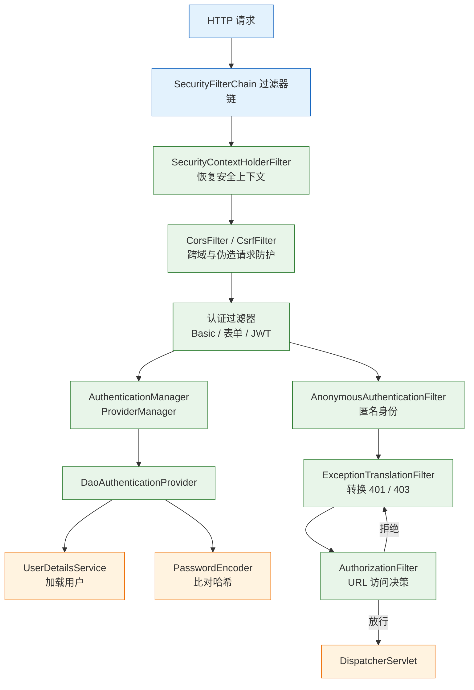
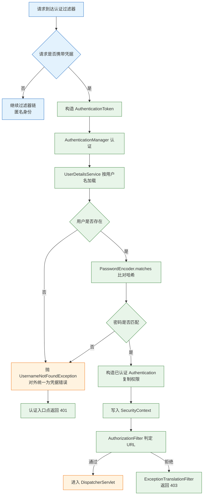
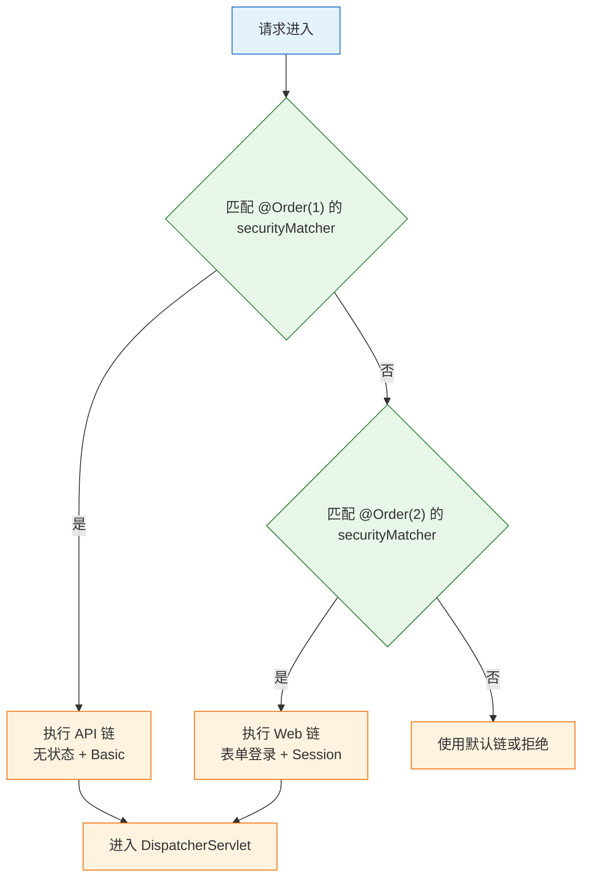

# Spring Security

---

## 一、Spring Security 是什么

### 1.1 核心概念

Spring Security 是 Spring 生态中的认证与授权框架。它把安全控制实现为一组 Servlet 过滤器，请求进入 `DispatcherServlet` 之前先经过过滤器链，依次完成上下文恢复、身份认证、异常转换和访问决策。控制器只处理业务，安全边界集中在配置类与过滤器链上。

三个概念必须先分开：

- **认证（Authentication）**：确认请求方是谁。用户名密码、Session、HTTP Basic、JWT、OIDC 都是认证方式。
- **授权（Authorization）**：确认已认证的主体能否执行某个操作。URL、方法、对象三个层级各自独立。
- **防护（Protection）**：CSRF、CORS、安全响应头、会话固定攻击防护，属于框架附带能力，不属于业务逻辑。

认证失败返回 401，表示服务端没有识别出身份；授权失败返回 403，表示身份已识别但权限不足。两者混用会让客户端无法判断应该重新登录还是提示无权限，也是接口联调阶段最常见的争议点。

把安全逻辑放在过滤器链而不是控制器，换来两个结果：所有进入容器的请求都经过同一条判定路径，静态资源、错误页、Actuator 不会因为漏写注解而裸奔；代价是排查时必须理解链的顺序，任何自定义过滤器插错位置，都可能让后续判定读到空的上下文。

| 概念 | 英文 | 作用 | 典型载体 |
|---|---|---|---|
| 主体 | Principal | 当前用户标识 | 用户名、用户 ID、令牌 subject |
| 凭据 | Credentials | 证明身份的材料 | 密码、Token、证书 |
| 权限 | Authority | 可执行的操作 | `ROLE_ADMIN`、`orders:write` |
| 安全上下文 | SecurityContext | 保存当前请求的认证结果 | `SecurityContextHolder` |
| 访问决策 | AuthorizationManager | 判断是否放行 | 过滤器链、方法拦截器 |

框架只负责“识别身份”和“判断权限”，不负责用户注册、找回密码、权限模型设计、审计合规策略。这些能力要建立在它之上，不能指望框架替业务做决定。

### 1.2 与相邻技术的关系

Spring Security 经常与 Shiro、网关鉴权、OAuth2、Spring Session 一起出现，边界不清会导致重复建设。

- **Servlet Filter**：Security 本身运行在过滤器层，早于 Spring MVC。自定义 `OncePerRequestFilter` 可以插进链里，但顺序错了会拿不到认证结果。
- **Spring MVC Interceptor**：运行在 Handler 层，能拿到 Controller 方法信息，适合做日志和租户上下文；不适合承担认证，因为静态资源和错误页可能绕过。
- **Apache Shiro**：更轻量，会话与加密自成体系，Spring 集成深度不如 Security。已有 Shiro 的系统不必为了统一而迁移。
- **OAuth2 / OIDC**：协议与授权服务器。`oauth2-client` 负责登录对接，`oauth2-resource-server` 负责校验 JWT；Spring Authorization Server 是独立项目，不在 Security 核心包里。
- **Spring Session**：解决集群会话共享，替换的是 Session 存储，不替代认证与授权。
- **网关鉴权**：网关做粗粒度过滤和令牌校验，服务内仍要做细粒度授权。只靠网关，一旦内网被横向渗透就失去第二道边界。

| 技术 | 解决的问题 | 与 Spring Security 的边界 |
|---|---|---|
| Servlet Filter | 请求预处理 | Security 是其中一组有序过滤器 |
| MVC Interceptor | 控制器前后增强 | 不承担认证入口 |
| Shiro | 认证授权一体化 | 替代关系，不同时引入 |
| OAuth2 / OIDC | 跨系统授权与身份联邦 | Security 提供客户端与资源服务器实现 |
| Spring Session | 分布式会话存储 | 只换存储，不改认证逻辑 |
| API 网关 | 统一入口与粗粒度鉴权 | 服务内仍需方法级与对象级校验 |

> **注意**：引入 `spring-boot-starter-security` 后，所有端点默认被保护，包括 Actuator。启动日志里出现随机密码，说明还没有自定义用户来源，属于默认行为而不是故障。

### 1.3 架构组成

Security 的运行时结构可以分成四层：Web 过滤器层、认证管理层、授权决策层、上下文存储层。四层共同完成一次请求的安全判定。



| 组件 | 职责 | 常见实现 |
|---|---|---|
| `SecurityFilterChain` | 组织一组有序过滤器 | 每个 `@Bean` 定义一条链 |
| `AuthenticationManager` | 认证入口 | `ProviderManager` |
| `AuthenticationProvider` | 具体认证逻辑 | `DaoAuthenticationProvider` |
| `UserDetailsService` | 按用户名加载用户 | 数据库、LDAP、内存 |
| `PasswordEncoder` | 编码与校验密码 | BCrypt、Argon2 |
| `AuthorizationManager` | 访问决策 | 请求匹配器、方法拦截器 |
| `SecurityContextHolder` | 保存当前认证 | 默认 ThreadLocal |

过滤器链的顺序由框架固定，配置只决定启用哪些过滤器。自定义过滤器通过 `addFilterBefore`、`addFilterAfter` 插入，位置选错会读不到 `SecurityContext`，或者在异常处理之后才执行。

---

## 二、环境准备与最小示例

### 2.1 依赖与版本

> **版本现状（2026-10）**：Spring Security 7.1.x，由 Spring Boot 4.1.x 的 BOM 管理；最低 Java 17，配置以 lambda DSL 为主，旧的非 lambda 链式写法已移除。

```xml
<!-- Web 安全：过滤器链、表单登录、Basic、方法级授权 -->
<dependency>
    <groupId>org.springframework.boot</groupId>
    <artifactId>spring-boot-starter-security</artifactId>
</dependency>

<!-- 可选：校验外部 IdP 签发的 JWT -->
<dependency>
    <groupId>org.springframework.boot</groupId>
    <artifactId>spring-boot-starter-oauth2-resource-server</artifactId>
</dependency>

<!-- 可选：作为 OAuth2 / OIDC 客户端登录 -->
<dependency>
    <groupId>org.springframework.boot</groupId>
    <artifactId>spring-boot-starter-oauth2-client</artifactId>
</dependency>
```

| 依赖 | 引入能力 | 适用场景 |
|---|---|---|
| `spring-boot-starter-security` | 过滤器链、会话、方法级授权 | 所有需要登录的系统 |
| `oauth2-resource-server` | JWT 解码、JWKS 校验 | 前后端分离、服务间调用 |
| `oauth2-client` | 授权码流程、OIDC 登录 | 接入企业 IdP |
| `spring-session-core` | 分布式会话 | 多实例部署 |

Boot 的自动配置会在缺少 `SecurityFilterChain` 时生成默认链：所有请求要求认证，表单登录与 Basic 同时启用，并在启动日志打印随机密码。这个默认链适合验证依赖是否生效，不适合作为项目起点；一旦声明自己的 `SecurityFilterChain`，默认链就不再创建。

### 2.2 最小可运行配置

下面的配置定义两个内存用户、一个 BCrypt 编码器、一条无状态 API 链。它可以直接启动，用来观察认证与授权的行为。

```java
package com.example.security;

import org.springframework.context.annotation.Bean;
import org.springframework.context.annotation.Configuration;
import org.springframework.security.config.Customizer;
import org.springframework.security.config.annotation.web.builders.HttpSecurity;
import org.springframework.security.config.annotation.web.configuration.EnableWebSecurity;
import org.springframework.security.config.http.SessionCreationPolicy;
import org.springframework.security.core.userdetails.User;
import org.springframework.security.core.userdetails.UserDetails;
import org.springframework.security.core.userdetails.UserDetailsService;
import org.springframework.security.crypto.bcrypt.BCryptPasswordEncoder;
import org.springframework.security.crypto.password.PasswordEncoder;
import org.springframework.security.provisioning.InMemoryUserDetailsManager;
import org.springframework.security.web.SecurityFilterChain;

@Configuration
@EnableWebSecurity
public class SecurityConfig {

    @Bean
    SecurityFilterChain api(HttpSecurity http) throws Exception {
        http
                // 无状态 API 不依赖 Cookie，关闭 CSRF；改用 Cookie 认证时必须重新开启
                .csrf(csrf -> csrf.disable())
                .sessionManagement(s -> s.sessionCreationPolicy(SessionCreationPolicy.STATELESS))
                .authorizeHttpRequests(auth -> auth
                        .requestMatchers("/api/public").permitAll()
                        .requestMatchers("/api/admin/**").hasRole("ADMIN")
                        .anyRequest().authenticated())
                .httpBasic(Customizer.withDefaults());
        return http.build();
    }

    @Bean
    PasswordEncoder passwordEncoder() {
        // 默认强度 10，自带随机盐，同一密码每次编码结果不同
        return new BCryptPasswordEncoder();
    }

    @Bean
    UserDetailsService users(PasswordEncoder encoder) {
        UserDetails demo = User.withUsername("demo")
                .password(encoder.encode("demo123"))
                .roles("USER")                 // 自动展开为 ROLE_USER
                .build();
        UserDetails admin = User.withUsername("admin")
                .password(encoder.encode("admin123"))
                .roles("USER", "ADMIN")        // 同时拥有 ROLE_USER 与 ROLE_ADMIN
                .build();
        return new InMemoryUserDetailsManager(demo, admin);
    }
}
```

```java
package com.example.security;

import org.springframework.security.core.Authentication;
import org.springframework.web.bind.annotation.GetMapping;
import org.springframework.web.bind.annotation.RequestMapping;
import org.springframework.web.bind.annotation.RestController;

import java.util.List;
import java.util.Map;

@RestController
@RequestMapping("/api")
class MeController {

    @GetMapping("/public")
    String publicApi() {
        return "public";
    }

    @GetMapping("/me")
    Map<String, Object> me(Authentication auth) {
        // 只保留业务角色，过滤掉 Security 7 附带的内部因子权限
        List<String> roles = auth.getAuthorities().stream()
                .map(Object::toString)
                .filter(a -> a.startsWith("ROLE_"))
                .toList();
        return Map.of("user", auth.getName(), "roles", roles);
    }

    @GetMapping("/admin")
    String admin() {
        return "admin only";
    }
}
```

### 2.3 验证认证与授权结果

```bash
# 未认证：401，响应头带 WWW-Authenticate
curl -i http://localhost:8080/api/me

# 普通用户：200
curl -i -u demo:demo123 http://localhost:8080/api/me

# 普通用户访问管理员接口：403
curl -i -u demo:demo123 http://localhost:8080/api/admin

# 管理员：200
curl -i -u admin:admin123 http://localhost:8080/api/admin
```

预期结果类似：

```text
HTTP/1.1 401
WWW-Authenticate: Basic realm="Realm", charset="UTF-8"

HTTP/1.1 200
Content-Type: application/json

{"roles":["ROLE_USER"],"user":"demo"}

HTTP/1.1 403

HTTP/1.1 200

admin only
```

| 状态码 | 含义 | 客户端动作 |
|---|---|---|
| 401 | 未认证或凭据无效 | 跳转登录、刷新令牌 |
| 403 | 已认证但无权限 | 提示无权限，不重试登录 |
| 302 | 表单登录重定向 | 浏览器跟随到登录页 |
| 200 | 认证与授权均通过 | 正常处理响应 |

401 与 403 的边界要写进接口契约：401 表示“需要认证或凭据已失效”，客户端应跳转登录或刷新令牌；403 表示“身份有效但权限不足”，客户端不应反复重试登录。把权限不足也返回 401，会触发客户端的登录循环；把凭据失效返回 403，则会让用户卡在无权限页面。

`Map.of` 的 JSON 字段顺序不保证，示例来自一次运行。Security 7 在密码认证成功后还会加入 `FactorGrantedAuthority`，因此 `getAuthorities()` 里不止 `ROLE_*`；示例只保留角色前缀，避免把内部因子暴露给前端。

`roles("USER")` 会自动加 `ROLE_` 前缀，所以规则里的 `hasRole("ADMIN")` 对应权限 `ROLE_ADMIN`。若改用 `hasAuthority("ADMIN")`，匹配的是不带前缀的 `ADMIN`。这两个方法混用是 403 的高频原因。

---

## 三、过滤器链与认证流程

### 3.1 过滤器链的执行顺序

过滤器链是 Security 的主干。每个过滤器只做一件事，顺序由框架排定；配置项决定某个过滤器是否加入链。

| 顺序 | 过滤器 | 作用 |
|---|---|---|
| 1 | `SecurityContextHolderFilter` | 从仓库恢复上下文，请求结束清理 |
| 2 | `HeaderWriterFilter` | 写入安全响应头 |
| 3 | `CorsFilter` | 处理跨源请求与预检 |
| 4 | `CsrfFilter` | 校验非安全方法的 CSRF Token |
| 5 | `LogoutFilter` | 处理注销请求 |
| 6 | `UsernamePasswordAuthenticationFilter` | 处理表单登录 |
| 7 | `BasicAuthenticationFilter` | 解析 `Authorization: Basic` |
| 8 | `AnonymousAuthenticationFilter` | 为未认证请求补匿名身份 |
| 9 | `ExceptionTranslationFilter` | 把安全异常转成 401/403 |
| 10 | `AuthorizationFilter` | 执行 URL 访问决策 |

`ExceptionTranslationFilter` 位于授权过滤器之前，所以它能捕获 `AuthorizationFilter` 抛出的 `AccessDeniedException`。认证入口点负责 401，拒绝处理器负责 403；两者都不配时，框架按当前认证机制给默认响应。

自定义过滤器用 `addFilterBefore` 或 `addFilterAfter` 插入，锚点要选已经存在的标准过滤器。需要读取当前用户时放在 `SecurityContextHolderFilter` 之后，需要捕获认证异常时放在 `ExceptionTranslationFilter` 之前；位置反了，代码不报错但行为不符合预期。

### 3.2 认证核心对象

| 对象 | 关键内容 | 生命周期 |
|---|---|---|
| `Authentication` | principal、credentials、authorities | 一次认证或一个请求 |
| `AuthenticationManager` | 调度多个 Provider | 应用级单例 |
| `AuthenticationProvider` | 校验一种凭据 | 应用级单例 |
| `UserDetails` | 用户、密码哈希、权限、账号状态 | 每次加载 |
| `SecurityContext` | 持有 `Authentication` | 一个请求 |
| `SecurityContextRepository` | 上下文持久化 | Session 或请求属性 |

`AuthenticationManager` 的默认实现是 `ProviderManager`。它按顺序询问每个 `AuthenticationProvider`，返回第一个非空结果；全部返回空则抛 `BadCredentialsException`。`DaoAuthenticationProvider` 负责最常见的用户名密码校验，内部组合 `UserDetailsService` 与 `PasswordEncoder`。

认证成功后，`ProviderManager` 会擦除凭据字段，避免密码或 Token 长时间停留在内存对象里。业务代码读取 `Authentication` 时应使用 `getPrincipal()` 与 `getAuthorities()`，不要依赖 `getCredentials()`；它在认证完成后通常已经是 null。

### 3.3 认证的完整流程



认证过程有三个不可省略的检查：用户是否存在、密码哈希是否匹配、账号状态是否可用。`UserDetails` 的 `isEnabled()`、`isAccountNonLocked()`、`isAccountNonExpired()`、`isCredentialsNonExpired()` 任一为 false，`DaoAuthenticationProvider` 都会拒绝登录。

### 3.4 上下文的读取与传播

业务代码读取当前用户有两种方式：

```java
// 方式一：注入 Authentication 参数，Controller 方法签名直接可见
@GetMapping("/me")
Map<String, Object> me(Authentication auth) {
    return Map.of("user", auth.getName());
}

// 方式二：从 SecurityContextHolder 取，适合没有方法参数的场景
Authentication auth = SecurityContextHolder.getContext().getAuthentication();
```

| 场景 | 上下文是否可用 | 处理方式 |
|---|---|---|
| 同一请求的 Controller / Service | 可用 | 直接读取 |
| `@Async` 方法 | 不可用 | 显式传 `Authentication` 或包装执行器 |
| 自定义线程池 | 不可用 | `DelegatingSecurityContextExecutor` |
| 定时任务 | 不可用 | 以系统身份显式构造上下文 |
| 虚拟线程 | 每请求独立 | 不跨请求复用，但避免放入大对象 |

> **注意**：匿名请求也会得到 `AnonymousAuthenticationToken`，其 `isAuthenticated()` 返回 true。判断“是否已登录”不能只看这个方法，要检查 `authentication instanceof AnonymousAuthenticationToken`，或者直接依赖授权规则。

自行调用 `SecurityContextHolder.setContext()` 后必须 `clearContext()`。线程池复用线程时，残留的上下文会让下一个任务读到上一个用户，属于越权漏洞而不是显示错误。

虚拟线程按请求创建，不存在线程池复用导致的上下文串用户，但数量大时仍要注意上下文里对象的大小。`SecurityContext` 只应保存身份与权限，不要把整个用户档案、权限树或大 JSON 放进去；每个请求复制一份会放大内存占用。

---

## 四、用户存储与密码编码

### 4.1 密码编码器选型

密码只能存哈希，不能存明文，也不能可逆加密。编码器的选择取决于安全等级、合规要求和性能预算。

| 编码器 | 特点 | 适用 |
|---|---|---|
| `BCryptPasswordEncoder` | 自适应成本，自带盐，默认强度 10 | 普通账号密码，默认选择 |
| `Argon2PasswordEncoder` | 内存硬，抗 GPU；需要 BouncyCastle | 高安全场景 |
| `Pbkdf2PasswordEncoder` | 标准、FIPS 友好 | 合规要求 |
| `SCryptPasswordEncoder` | 内存硬 | 可选 |
| `DelegatingPasswordEncoder` | 哈希带 `{bcrypt}` 前缀，支持迁移 | 多算法共存与升级 |
| `NoOpPasswordEncoder` | 明文 | 禁止用于生产 |

```java
// 默认委托编码器：新密码用 bcrypt，旧哈希按前缀选择验证算法
PasswordEncoder encoder = PasswordEncoderFactories.createDelegatingPasswordEncoder();
String hash = encoder.encode("demo123");
// 存储形如 {bcrypt}$2a$10$...
```

强度参数要在安全与延迟之间权衡。BCrypt 强度每加 1，计算时间约翻倍；默认 10 适合多数 Web 登录，改成 12 之前要先压测登录接口的 P99。哈希本身仍是凭据材料，不能写进日志、响应或监控标签。

> **安全警告**：数据库只能保存密码哈希，不能保存明文，也不能用可逆加密冒充哈希。MD5、SHA-1 以及单次 SHA-256 加盐都不适合存密码，计算太快，离线爆破成本极低。历史系统迁移时保留旧字段只读，登录成功后逐步改写为新算法。

### 4.2 UserDetailsService 实现

生产环境从数据库、LDAP 或身份提供商加载用户。实现要点只有四个：按用户名精确查询、返回完整状态、用户不存在时抛异常、不要泄露账号是否存在。

```java
@Service
class DbUserDetailsService implements UserDetailsService {

    private final UserRepository users;

    DbUserDetailsService(UserRepository users) {
        this.users = users;
    }

    @Override
    public UserDetails loadUserByUsername(String username) {
        AppUser user = users.findByUsername(username)
                // 统一异常类型，避免调用方区分“不存在”和“密码错”
                .orElseThrow(() -> new UsernameNotFoundException("user not found"));
        return User.withUsername(user.username())
                .password(user.passwordHash())
                .authorities(user.authorities())
                .accountLocked(user.locked())
                .disabled(!user.enabled())
                .build();
    }
}
```

| 检查项 | 失败后果 | 处理 |
|---|---|---|
| 用户不存在 | 返回 null 导致空指针 | 抛 `UsernameNotFoundException` |
| 密码为空 | 认证直接失败 | 拒绝保存空密码 |
| 账号锁定 | 无法登录 | 由 `accountLocked` 状态控制 |
| 权限为空 | 登录后全部 403 | 至少给基础角色 |

用户信息是否缓存要单独决定。每次请求都查库会放大数据库压力，缓存 `UserDetails` 又会让权限变更延迟生效。常见折中是缓存短周期，或在权限变更时主动清缓存；直接缓存整份用户对象且不设过期，撤权后旧会话仍能访问，属于越权。

> **注意**：`UserDetailsService` 只负责加载，不负责校验密码。密码比对由 `DaoAuthenticationProvider` 完成；在自己实现里再比对一次，会让编码器配置和异常语义分叉，排查时很难定位。

> **安全警告**：登录失败提示必须统一为“用户名或密码错误”。分别提示“用户不存在”“密码错误”“账号锁定”，等于向攻击者提供账号枚举接口；锁定状态可以记录在服务端日志，但不能回传给公网客户端。

### 4.3 密码升级与迁移

算法升级不能要求全体用户重置密码。`DelegatingPasswordEncoder` 按哈希前缀选择验证器，旧哈希继续可用；登录成功后再用新算法重新编码并保存。

```java
@Bean
UserDetailsPasswordService passwordUpdater(UserRepository users, PasswordEncoder encoder) {
    return (user, newPassword) -> {
        // 框架在登录成功后调用，newPassword 已是新算法编码结果
        users.updatePassword(user.getUsername(), newPassword);
        return User.withUserDetails(user).password(newPassword).build();
    };
}
```

迁移期间要确认三件事：旧前缀仍在委托映射里、数据库字段长度足够容纳新哈希、回滚时旧代码能识别新前缀。缺少任意一项，都会出现部分用户无法登录。

---

## 五、会话与令牌认证

### 5.1 会话创建策略

| 策略 | 行为 | 适用 |
|---|---|---|
| `IF_REQUIRED`（默认） | 需要时创建 Session | 同源浏览器应用 |
| `STATELESS` | 不创建、不使用 Session | Bearer Token API |
| `NEVER` | 不创建，但已有 Session 可用 | 混合场景 |
| `ALWAYS` | 总是创建 | 特殊审计需求 |

`STATELESS` 不只是“不写 Session”，还会让 `SecurityContextHolderFilter` 不保存上下文。若在无状态链里仍然读取 Session，会得到空上下文，表现为“登录成功但下一个请求 401”。

### 5.2 Cookie 安全属性

```properties
# 禁止 JavaScript 读取会话 Cookie，降低 XSS 窃取风险
server.servlet.session.cookie.http-only=true
# 只通过 HTTPS 发送，生产必须开启
server.servlet.session.cookie.secure=true
# 限制跨站请求携带，缓解 CSRF
server.servlet.session.cookie.same-site=lax
# 会话空闲超时
server.servlet.session.timeout=30m
```

| 属性 | 作用 | 常见错误 |
|---|---|---|
| `HttpOnly` | 阻止脚本读取 | 为前端读取而关闭 |
| `Secure` | 仅 HTTPS 传输 | 本地调试关闭后带上生产 |
| `SameSite` | 限制跨站携带 | 跨域场景误用 `Lax` |
| `Domain` | 指定生效域 | 设置过宽导致子域共享 |
| `Path` | 指定生效路径 | 设为 `/api` 后页面拿不到 |

会话安全还有四个细节：登录成功后更换 Session ID，框架默认 `changeSessionId`，不要禁用；并发会话用 `maximumSessions(1)` 限制，需要踢掉旧会话时配置 `SessionRegistry`；注销必须走 `POST /logout`，GET 注销会被 CSRF 或浏览器预取触发；集群部署要把 Session 放到 Redis 或数据库，并验证序列化格式。

会话固定攻击的过程很直接：攻击者先取得一个未登录的 Session ID，诱导受害者用这个 ID 登录；如果登录后 ID 不变，攻击者手里的 ID 就变成了已认证会话。更换 Session ID 是唯一有效的阻断方式，代价只是客户端多一次 Cookie 更新。

> **安全警告**：`SameSite=Lax` 只阻止跨站 POST 携带 Cookie，不能替代 CSRF Token。部分旧浏览器不支持该属性，企业内网还可能存在代理改写；只要认证依赖 Cookie，服务端校验就不能省。

### 5.3 JWT 资源服务器

外部 IdP 签发 JWT，服务端只做验签和声明校验，不保存会话。

```java
@Bean
SecurityFilterChain api(HttpSecurity http) throws Exception {
    http
            .securityMatcher("/api/**")
            .csrf(csrf -> csrf.disable())
            .sessionManagement(s -> s.sessionCreationPolicy(SessionCreationPolicy.STATELESS))
            .authorizeHttpRequests(auth -> auth
                    .requestMatchers("/api/public").permitAll()
                    .anyRequest().authenticated())
            // 开启 Bearer Token 解析，默认校验签名与时间声明
            .oauth2ResourceServer(oauth2 -> oauth2.jwt(Customizer.withDefaults()));
    return http.build();
}
```

```properties
# 走 OIDC discovery，启动时拉取 issuer 元数据与 JWKS
spring.security.oauth2.resourceserver.jwt.issuer-uri=https://id.example.com/realms/demo
# 网络受限或 IdP 未就绪时，直接指定 JWKS 地址
# spring.security.oauth2.resourceserver.jwt.jwk-set-uri=https://id.example.com/realms/demo/protocol/openid-connect/certs
```

| 校验项 | 作用 | 失败表现 |
|---|---|---|
| 签名 | 确认令牌由可信方签发 | 401，日志提示签名无效 |
| `iss` | 确认签发者 | 401，issuer 不匹配 |
| `aud` | 确认受众 | 401，audience 不匹配 |
| `exp` / `nbf` | 确认有效期 | 401，令牌过期或未生效 |
| `scope` | 映射为 `SCOPE_xxx` 权限 | 403，权限不足 |

> **注意**：`issuer-uri` 默认在启动阶段拉取 OIDC 元数据，IdP 不可达会导致应用启动失败。生产环境要配置超时与重试，或改用 `jwk-set-uri` 并接受启动时不做发现。

JWT 由头部、载荷、签名三段组成，载荷只是 Base64URL 编码，不是加密。任何拿到令牌的人都能读出 `sub`、`scope`、`exp`，因此不能把手机号、身份证号、内部权限清单塞进声明。需要携带敏感信息时，应改为服务端查询或使用加密令牌。

无状态不等于可撤销。JWT 在过期前始终有效，需要即时注销时采用短过期加刷新令牌，再配合黑名单或用户级令牌版本号。把过期时间设成数天，等于放弃了撤销能力。刷新令牌要单独存储、单次使用、绑定客户端，泄露后的影响远大于访问令牌。

> **注意**：资源服务器只负责校验，不负责签发。把签名密钥同时放在签发端和所有资源服务器上，会让任何一台资源服务器都具备伪造令牌的能力；正确做法是通过 JWKS 分发公钥，私钥只留在授权服务器。

---

## 六、授权规则配置

### 6.1 URL 级授权

```java
http.authorizeHttpRequests(auth -> auth
        // 静态资源与公开接口放行
        .requestMatchers("/", "/assets/**", "/api/public").permitAll()
        // 按 HTTP 方法细化，读与写分开授权
        .requestMatchers(HttpMethod.POST, "/api/orders").hasAuthority("orders:write")
        .requestMatchers("/api/admin/**").hasRole("ADMIN")
        // 其余一律要求认证，作为兜底
        .anyRequest().authenticated());
```

| 方法 | 含义 | 说明 |
|---|---|---|
| `permitAll()` | 不要求认证 | 不绕过 CSRF、CORS、限流 |
| `authenticated()` | 任意已认证主体 | 匿名身份不算 |
| `hasRole("ADMIN")` | 需要 `ROLE_ADMIN` | 自动加前缀 |
| `hasAuthority("orders:write")` | 精确匹配权限串 | 不加前缀 |
| `denyAll()` | 全部拒绝 | 显式关闭一组路径 |

规则从上到下第一个匹配生效，`anyRequest()` 必须放最后。`permitAll()` 只表示“不要求认证”，不代表绕过其他防护；把公开接口放在 CSRF 关闭的链上，仍然要评估跨站风险。Security 7 已移除旧的 `AntPathRequestMatcher` 用法，需要自定义匹配时改用 `PathPatternRequestMatcher`。

### 6.2 多过滤链与顺序

```java
@Bean
@Order(1)
SecurityFilterChain api(HttpSecurity http) throws Exception {
    http.securityMatcher("/api/**")
            .csrf(csrf -> csrf.disable())
            .sessionManagement(s -> s.sessionCreationPolicy(SessionCreationPolicy.STATELESS))
            .authorizeHttpRequests(auth -> auth.anyRequest().authenticated())
            .httpBasic(Customizer.withDefaults());
    return http.build();
}

@Bean
@Order(2)
SecurityFilterChain web(HttpSecurity http) throws Exception {
    http.authorizeHttpRequests(auth -> auth
                    .requestMatchers("/login", "/assets/**").permitAll()
                    .anyRequest().authenticated())
            .formLogin(Customizer.withDefaults());
    return http.build();
}
```



| 规则 | 说明 | 违反后果 |
|---|---|---|
| `@Order` 小的先匹配 | 数值越小优先级越高 | 顺序错导致链不生效 |
| 每条链要有 `securityMatcher` | 明确负责的路径范围 | 后面的链永远轮不到 |
| API 链放在 Web 链之前 | `/api/**` 比 `/**` 更具体 | API 请求被表单登录重定向 |
| 同一路径不重复定义 | 只由一条链负责 | 行为取决于顺序，难以排查 |

多链可以共享 `UserDetailsService` 与 `PasswordEncoder`，但认证入口、CSRF、Session 策略各自独立。链的数量按认证方式划分，不要按 Controller 数量划分。

### 6.3 方法级授权

```java
@Configuration
@EnableMethodSecurity
class MethodSecurityConfig {}

@Service
class OrderService {

    // 方法执行前判断，支持 SpEL 与参数引用
    @PreAuthorize("hasRole('ADMIN') or #ownerId == authentication.name")
    OrderView get(long id, String ownerId) {
        return load(id);
    }

    // 拿到返回值后再判断，适合结果依赖数据的场景
    @PostAuthorize("hasRole('ADMIN') or returnObject.owner == authentication.name")
    OrderView load(long id) {
        return repository.find(id);
    }
}
```

| 注解 | 时机 | 用途 |
|---|---|---|
| `@PreAuthorize` | 方法执行前 | 最常用，支持 SpEL |
| `@PostAuthorize` | 方法返回后 | 需要看返回值才能判断 |
| `@PreFilter` / `@PostFilter` | 集合过滤 | 少用，性能差 |
| `@Secured` | 执行前 | 只支持角色，旧写法 |
| `@RolesAllowed` | 执行前 | JSR-250 标准 |

方法级授权依赖 Spring AOP 代理。同类内部调用 `this.method()` 不经过代理，注解不生效；`private`、`final` 方法无法被 CGLIB 覆盖。Controller 做粗粒度入口控制，Service 做细粒度业务控制，前端隐藏按钮不是权限。

### 6.4 认证失败入口点

```java
http.exceptionHandling(ex -> ex
        // 401：未认证，返回稳定的 JSON 错误体
        .authenticationEntryPoint((req, res, e) -> {
            res.setStatus(401);
            res.setContentType("application/problem+json");
            res.getWriter().write("""
                    {"type":"about:blank","title":"Unauthorized","status":401}
                    """);
        })
        // 403：已认证但无权限，不暴露缺失的具体权限
        .accessDeniedHandler((req, res, e) -> {
            res.setStatus(403);
            res.setContentType("application/problem+json");
            res.getWriter().write("""
                    {"type":"about:blank","title":"Forbidden","status":403}
                    """);
        }));
```

| 场景 | 默认行为 | 自定义目标 |
|---|---|---|
| Basic 未认证 | 401 + `WWW-Authenticate` | 统一 JSON 错误体 |
| 表单未认证 | 302 到登录页 | API 返回 401 |
| 已认证无权限 | 403 | 统一错误体，记录审计 |
| 注销后访问 | 401 或重定向 | 与客户端约定一致 |

---

## 七、CSRF 与 CORS 防护

### 7.1 CSRF 的触发条件

CSRF 利用浏览器会自动携带 Cookie 的行为。攻击者在第三方站点构造表单或请求，浏览器带上受害者的 Session Cookie，服务端无法区分请求来源。Spring Security 默认对非 GET、HEAD、OPTIONS、TRACE 的请求校验 Token，缺失时返回 403。

| 认证方式 | CSRF | 原因 |
|---|---|---|
| Session Cookie（同源浏览器） | 必须开启 | 浏览器自动携带 Cookie |
| Basic Auth | 通常关闭 | 浏览器不会自动填充 Basic |
| Bearer Token（Authorization 头） | 通常关闭 | 浏览器不会自动添加该头 |
| Token 存放在 Cookie | 必须开启 | 本质仍是 Cookie 认证 |

> **安全警告**：`csrf().disable()` 只能用于确实不使用 Cookie 认证的无状态 API。因为“POST 403 很烦”而全局关闭，等于把会话 Cookie 认证暴露给跨站伪造请求。

### 7.2 CSRF Token 配置

```java
http.csrf(csrf -> csrf
        // 把 Token 写入 XSRF-TOKEN Cookie，允许前端脚本读取
        .csrfTokenRepository(CookieCsrfTokenRepository.withHttpOnlyFalse()));
```

前端从 `XSRF-TOKEN` Cookie 读取 Token，放入 `X-XSRF-TOKEN` 请求头。`HttpOnly=false` 是为了让 JavaScript 能读，同时也意味着 XSS 能读，因此 XSS 防护不能省。表单应用则用隐藏字段 `_csrf`，由 Thymeleaf 或 JSP 标签自动注入。

### 7.3 CORS 与预检请求

CORS 是浏览器的跨源读取限制。启用 Security 后，预检 `OPTIONS` 也会经过过滤器链；未启用 CORS 时，预检可能先被 401/403 拦截。

```java
@Bean
SecurityFilterChain api(HttpSecurity http, CorsConfigurationSource cors) throws Exception {
    http
            // 让 CorsFilter 在授权之前处理预检
            .cors(c -> c.configurationSource(cors))
            .csrf(csrf -> csrf.disable())
            .authorizeHttpRequests(auth -> auth.anyRequest().authenticated())
            .httpBasic(Customizer.withDefaults());
    return http.build();
}

@Bean
CorsConfigurationSource cors() {
    CorsConfiguration cfg = new CorsConfiguration();
    // 带凭据时不能用 *，必须列出具体来源
    cfg.setAllowedOrigins(List.of("https://app.example.com"));
    cfg.setAllowedMethods(List.of("GET", "POST", "PATCH", "DELETE"));
    cfg.setAllowedHeaders(List.of("Authorization", "Content-Type", "X-XSRF-TOKEN"));
    cfg.setAllowCredentials(true);
    UrlBasedCorsConfigurationSource source = new UrlBasedCorsConfigurationSource();
    source.registerCorsConfiguration("/api/**", cfg);
    return source;
}
```

| 配置 | 限制 | 错误表现 |
|---|---|---|
| `allowedOrigins` | 带凭据时禁止 `*` | 浏览器报 CORS 错误 |
| `allowedMethods` | 必须包含实际方法 | 预检失败 |
| `allowedHeaders` | 必须包含自定义头 | 请求头被拦截 |
| `maxAge` | 预检缓存时间 | 过短导致频繁预检 |

### 7.4 安全响应头

| 响应头 | 作用 | 备注 |
|---|---|---|
| `Strict-Transport-Security` | 强制 HTTPS | 只在 HTTPS 响应添加 |
| `X-Content-Type-Options: nosniff` | 禁止 MIME 猜测 | 默认开启 |
| `X-Frame-Options: DENY` | 禁止 iframe 嵌入 | 需要嵌入时改 `SAMEORIGIN` |
| `Content-Security-Policy` | 限制脚本与资源来源 | API 可设 `default-src 'none'` |
| `Cache-Control: no-store` | 防止敏感响应被缓存 | 登录与用户信息接口显式设置 |

HSTS 配置错误会把整个域名锁在 HTTPS，上线前确认证书与所有子域；CSP 配置错误会让前端白屏，先在报告模式观察再强制。

---

## 八、完整示例：订单接口的分层授权

### 8.1 领域模型与接口

示例使用内存仓库，保留认证、方法级授权、对象级校验三条主线，去掉数据库依赖，便于直接运行。

```java
package com.example.security;

import org.springframework.stereotype.Repository;

import java.math.BigDecimal;
import java.util.List;
import java.util.Map;
import java.util.Optional;
import java.util.concurrent.ConcurrentHashMap;

record Order(long id, String orderNo, String owner, BigDecimal amount) {}

@Repository
class OrderRepository {

    private final Map<Long, Order> store = new ConcurrentHashMap<>();

    Order save(Order order) {
        store.put(order.id(), order);
        return order;
    }

    Optional<Order> findById(long id) {
        return Optional.ofNullable(store.get(id));
    }

    List<Order> findAll() {
        return List.copyOf(store.values());
    }
}
```

```java
package com.example.security;

import org.springframework.security.access.prepost.PreAuthorize;
import org.springframework.stereotype.Service;

import java.util.List;

@Service
class OrderService {

    private final OrderRepository repository;

    OrderService(OrderRepository repository) {
        this.repository = repository;
    }

    // 入口先校验：调用方只能以自己的身份查询
    @PreAuthorize("#username == authentication.name")
    public OrderView getForUser(long id, String username) {
        return repository.findById(id)
                // 查询条件带上属主，避免只在 Controller 判断
                .filter(o -> o.owner().equals(username))
                .map(OrderView::from)
                .orElseThrow(() -> new OrderNotFoundException(id));
    }

    // 管理端列表单独授权，不与用户接口复用
    @PreAuthorize("hasRole('ADMIN')")
    public List<OrderView> listAll() {
        return repository.findAll().stream().map(OrderView::from).toList();
    }
}

record OrderView(long id, String orderNo, java.math.BigDecimal amount) {
    static OrderView from(Order order) {
        return new OrderView(order.id(), order.orderNo(), order.amount());
    }
}

class OrderNotFoundException extends RuntimeException {
    OrderNotFoundException(long id) {
        super("order not found: " + id);
    }
}
```

### 8.2 安全配置

完整示例用 `OrderSecurityConfig` 替换第二章的 `SecurityConfig`，避免同包下出现两个同名的配置类。

```java
import org.springframework.context.annotation.Bean;
import org.springframework.context.annotation.Configuration;
import org.springframework.security.config.Customizer;
import org.springframework.security.config.annotation.method.configuration.EnableMethodSecurity;
import org.springframework.security.config.annotation.web.builders.HttpSecurity;
import org.springframework.security.config.annotation.web.configuration.EnableWebSecurity;
import org.springframework.security.config.http.SessionCreationPolicy;
import org.springframework.security.core.userdetails.User;
import org.springframework.security.core.userdetails.UserDetailsService;
import org.springframework.security.crypto.bcrypt.BCryptPasswordEncoder;
import org.springframework.security.crypto.password.PasswordEncoder;
import org.springframework.security.provisioning.InMemoryUserDetailsManager;
import org.springframework.security.web.SecurityFilterChain;

@Configuration
@EnableWebSecurity
@EnableMethodSecurity
public class OrderSecurityConfig {

    @Bean
    SecurityFilterChain api(HttpSecurity http) throws Exception {
        http
                .csrf(csrf -> csrf.disable())          // 无状态 API，不使用 Cookie
                .sessionManagement(s -> s.sessionCreationPolicy(SessionCreationPolicy.STATELESS))
                .authorizeHttpRequests(auth -> auth
                        .requestMatchers("/api/public").permitAll()
                        .requestMatchers("/api/admin/**").hasRole("ADMIN")
                        .anyRequest().authenticated())
                .httpBasic(Customizer.withDefaults());
        return http.build();
    }

    @Bean
    PasswordEncoder passwordEncoder() {
        return new BCryptPasswordEncoder();
    }

    @Bean
    UserDetailsService users(PasswordEncoder encoder) {
        return new InMemoryUserDetailsManager(
                User.withUsername("demo").password(encoder.encode("demo123")).roles("USER").build(),
                User.withUsername("admin").password(encoder.encode("admin123")).roles("USER", "ADMIN").build());
    }
}
```

### 8.3 控制器与异常映射

```java
import org.springframework.security.core.Authentication;
import org.springframework.web.bind.annotation.*;
import java.util.List;

@RestController
@RequestMapping("/api")
class OrderController {

    private final OrderService service;

    OrderController(OrderService service) {
        this.service = service;
    }

    // 只接受当前认证用户，用户名从上下文取，不接受客户端传入
    @GetMapping("/orders/{id}")
    OrderView get(@PathVariable long id, Authentication auth) {
        return service.getForUser(id, auth.getName());
    }

    @GetMapping("/admin/orders")
    List<OrderView> all() {
        return service.listAll();
    }
}
```

```java
import org.springframework.http.ResponseEntity;
import org.springframework.web.bind.annotation.ExceptionHandler;
import org.springframework.web.bind.annotation.RestControllerAdvice;
import java.util.Map;

@RestControllerAdvice
class ApiExceptionHandler {

    // 对象不存在统一返回 404，不暴露资源是否存在
    @ExceptionHandler(OrderNotFoundException.class)
    ResponseEntity<Map<String, Object>> notFound(OrderNotFoundException e) {
        return ResponseEntity.status(404)
                .body(Map.of("title", "Not Found", "status", 404));
    }
}
```

```java
import org.springframework.boot.CommandLineRunner;
import org.springframework.context.annotation.Bean;
import org.springframework.context.annotation.Configuration;
import java.math.BigDecimal;

@Configuration
class DemoDataConfig {

    // 启动时写入两条固定 ID 的订单，供 curl 与测试使用
    @Bean
    CommandLineRunner seed(OrderRepository repository) {
        return args -> {
            repository.save(new Order(1L, "A-100", "demo", new BigDecimal("199.00")));
            repository.save(new Order(2L, "A-101", "other", new BigDecimal("58.50")));
        };
    }
}
```

> **注意**：对象级权限必须在查询条件里体现。只在 Controller 比较 `order.owner().equals(auth.getName())`，列表、导出、批量接口很容易漏掉；把条件写进 Repository 查询，才能保证所有入口一致。

### 8.4 验证与自动化测试

```bash
# 普通用户读取自己的订单：200
curl -i -u demo:demo123 http://localhost:8080/api/orders/1

# 普通用户读取他人订单：404，避免泄露资源是否存在
curl -i -u demo:demo123 http://localhost:8080/api/orders/2

# 普通用户访问管理端：403
curl -i -u demo:demo123 http://localhost:8080/api/admin/orders

# 管理员访问管理端：200
curl -i -u admin:admin123 http://localhost:8080/api/admin/orders
```

```java
@SpringBootTest
@AutoConfigureMockMvc
class SecurityTest {

    @Autowired
    MockMvc mvc;

    @Test
    void anonymousIsUnauthorized() throws Exception {
        mvc.perform(get("/api/orders/1")).andExpect(status().isUnauthorized());
    }

    @Test
    @WithMockUser(username = "demo", roles = "USER")
    void userReadsOwnOrder() throws Exception {
        mvc.perform(get("/api/orders/1")).andExpect(status().isOk());
    }

    @Test
    @WithMockUser(username = "demo", roles = "USER")
    void userCannotReadOthersOrder() throws Exception {
        mvc.perform(get("/api/orders/2")).andExpect(status().isNotFound());
    }

    @Test
    @WithMockUser(username = "demo", roles = "USER")
    void userCannotAdmin() throws Exception {
        mvc.perform(get("/api/admin/orders")).andExpect(status().isForbidden());
    }
}
```

| 测试用例 | 断言 | 覆盖点 |
|---|---|---|
| 匿名访问 | 401 | 认证入口 |
| 本人资源 | 200 | 对象级放行 |
| 他人资源 | 404 | 不泄露资源存在性 |
| 普通用户进管理端 | 403 | 角色授权 |
| 缺少 CSRF Token | 403 | 仅 Cookie 链需要 |

Boot 4 的 `@AutoConfigureMockMvc` 位于 `org.springframework.boot.webmvc.test.autoconfigure`，从 Boot 3 迁移时包名会变；`@SpringBootTest` 仍在 `org.springframework.boot.test.context`。

---

## 九、工程实践

### 9.1 默认拒绝与规则组织

安全配置的第一原则是默认拒绝：先 `anyRequest().authenticated()`，再逐条显式放行。反过来写，新增接口会自动暴露，直到有人发现。

| 实践 | 做法 | 反例 |
|---|---|---|
| 默认拒绝 | 兜底要求认证 | `anyRequest().permitAll()` |
| 规则集中 | 安全配置独立成类 | 每个 Controller 各自判断 |
| 路径分组 | 按认证方式拆链 | 一条链堆几百条规则 |
| 变更审查 | 放行规则走代码评审 | 临时放行后不删除 |

### 9.2 权限模型与对象级校验

认证回答“是谁”，授权回答“能做什么”，对象级权限回答“这个资源归谁”。三者缺一不可。

| 层级 | 控制点 | 示例 |
|---|---|---|
| URL | 过滤器链 | `/api/admin/**` 需要管理员 |
| 方法 | `@PreAuthorize` | 下单需要 `orders:write` |
| 对象 | 查询条件 | `where id = ? and owner_id = ?` |
| 字段 | 序列化 | 隐藏手机号、内部备注 |

权限模型要能回答“谁能看、谁能改、谁能删”，而不是只分“登录/未登录”。列表、导出、搜索、批量接口都要逐条过同样的规则；详情做了属主校验而列表没有，等于绕过。

> **安全警告**：对象级权限缺失属于越权，不是显示问题。只校验“已登录”而不校验资源归属，任意用户改一个 ID 就能读到他人订单；把校验放在前端或只放在详情接口，同样不构成防护。查询条件必须由服务端根据当前身份拼接。

### 9.3 密钥与凭据管理

| 材料 | 存放位置 | 禁止 |
|---|---|---|
| 数据库密码 | 环境变量或密钥管理服务 | 写入仓库、镜像 |
| JWT 签名密钥 | KMS 或加密配置 | 硬编码在代码 |
| OAuth2 Client Secret | 密钥管理服务 | 前端代码 |
| Session 密钥 | 集中配置 | 多实例各自随机 |

> **安全警告**：JWT 的签名私钥泄露等同于任何人都能伪造任意用户。密钥必须可轮换，轮换期间用 `kid` 同时保留旧公钥，确认所有令牌过期后再移除。

### 9.4 审计与可观测性

安全事件要能回答五个问题：谁、在什么时间、从哪里、访问了什么、结果如何。日志至少记录认证失败、授权拒绝、权限变更、密钥轮换。

| 事件 | 记录字段 | 告警条件 |
|---|---|---|
| 登录失败 | 用户名、IP、时间、原因 | 同账号短时间多次失败 |
| 授权拒绝 | 用户、路径、所需权限 | 单用户高频 403 |
| 权限变更 | 操作人、目标、旧值、新值 | 管理员权限授予 |
| 令牌异常 | issuer、kid、失败类型 | 签名失败突增 |

日志里不能出现密码、完整 Token、Session ID。需要关联请求时记录哈希或后四位，既能追踪又不泄露凭据。

---

## 十、常见错误与排查

### 10.1 故障对照表

| 现象 | 最可能原因 | 处理 |
|---|---|---|
| POST 返回 403，GET 正常 | CSRF 未带 Token | 表单或请求头带 Token；无状态 API 才关闭 |
| 401 与 403 混用 | 未认证与无权限未分清 | 401 引导登录，403 提示无权限 |
| `hasRole("ADMIN")` 不通过 | 权限是 `ADMIN` 而非 `ROLE_ADMIN` | 统一前缀，或改用 `hasAuthority` |
| 登录成功但下一个请求 401 | Cookie 的 Domain、Path、Secure、SameSite 不对 | 检查 `Set-Cookie` 与请求是否携带 |
| 预检 OPTIONS 返回 401 | Security 未启用 CORS | 配置 `http.cors(...)` 并放行预检 |
| JWT 始终 401 | issuer、audience、时钟、签名密钥不匹配 | 解码查看 `iss/aud/exp`，核对服务端时钟 |
| 启动卡在拉取 OIDC 配置 | IdP 不可达 | 改用 `jwk-set-uri` 或延迟初始化 |
| `@PreAuthorize` 不生效 | 同类内部调用绕过代理 | 从另一个 Bean 调用，或移到入口方法 |
| 异步任务拿不到用户 | ThreadLocal 未传递 | 显式传 `Authentication`，或包装执行器 |
| 密码迁移后老用户登录失败 | 编码器与哈希前缀不匹配 | 用 `DelegatingPasswordEncoder` 按前缀验证 |
| Actuator 端点被公开 | 只配了 `permitAll` 未限制 | 独立管理端口或角色，禁止公网访问敏感端点 |

### 10.2 排查顺序

1. 先看状态码：401 查认证链路，403 查授权规则与 CSRF。
2. 401 检查请求是否携带 Cookie 或 `Authorization`，服务端是否解析出 `Authentication`。
3. 403 检查规则顺序、角色前缀、方法级注解是否被代理，以及 CSRF Token。
4. 打开安全日志：`logging.level.org.springframework.security=DEBUG`，观察过滤器链与拒绝原因。
5. 检查上下文传播：异步、线程池、内部调用是否丢失认证。
6. 最后才改配置。不要用 `permitAll("/**")` 掩盖问题，放行范围一旦扩大很难收回。

> **核心结论**：认证解决身份，授权解决权限，对象级校验解决归属；三者分层落地，默认拒绝，Cookie 认证必评估 CSRF，密钥与日志都要按凭据管理。
