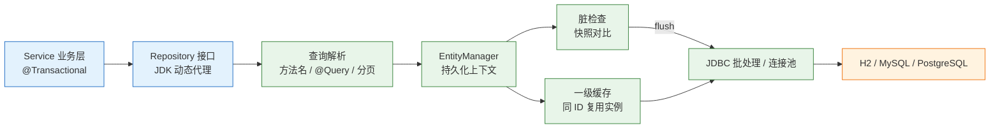
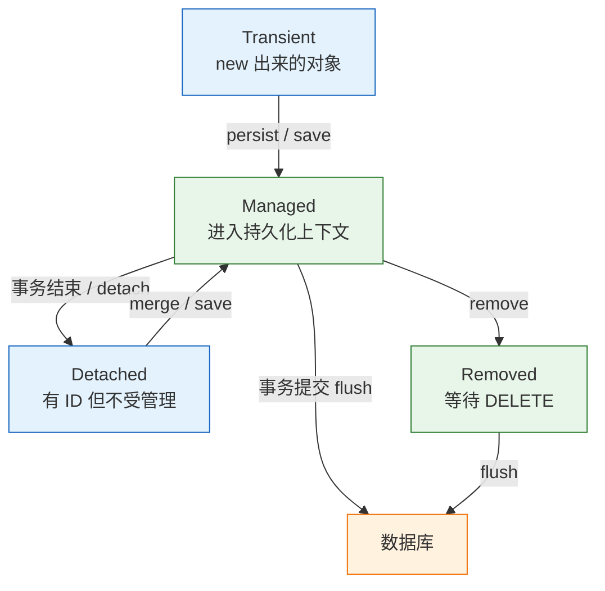
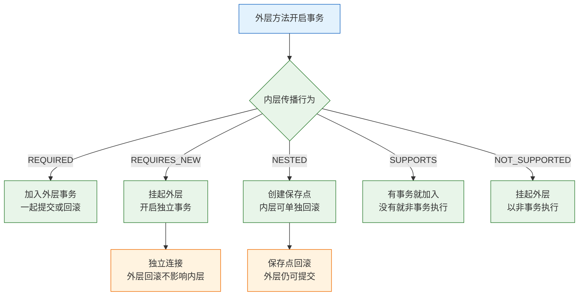
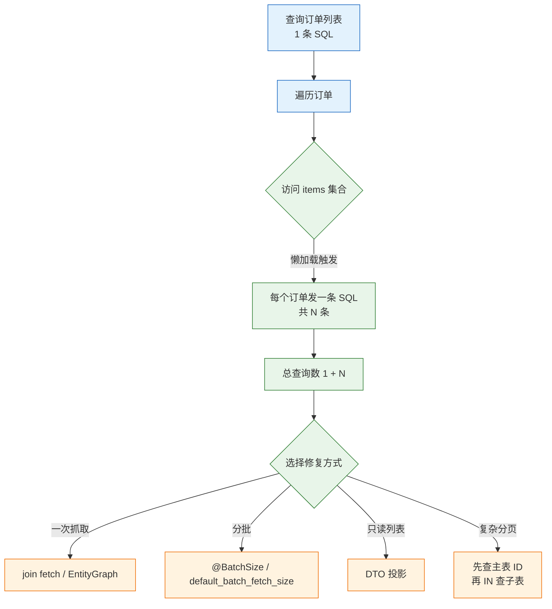

# Spring Data

---

## 一、Spring Data 是什么

### 1.1 核心概念

Spring Data 是 Spring 生态中面向数据访问的统称，包含 JPA、JDBC、MongoDB、Redis、Elasticsearch 等多个模块。日常说的“Spring Data”通常指 Spring Data JPA：在 JPA 之上提供 Repository 抽象，开发者声明接口，框架在启动时生成实现，把方法名、注解和分页参数翻译成查询。

它解决的是数据访问层的重复劳动：连接获取、参数绑定、结果映射、分页拼装、事务同步。它不解决数据库设计、索引优化、跨库一致性，也不替代 SQL。

| 概念 | 含义 | 作用 |
|---|---|---|
| 实体 | 映射到表的 Java 类 | 承载持久化状态 |
| 聚合根 | 一组强一致对象的入口 | 划定事务与级联边界 |
| Repository | 数据访问接口 | 声明查询与 CRUD |
| 持久化上下文 | 实体的工作区 | 一级缓存与脏检查 |
| 事务 | 一次原子操作边界 | 控制提交、回滚、锁 |

理解 Spring Data JPA 的关键，是分清“接口调用”和“SQL 执行”不是一一对应。一次 `findById` 可能命中一级缓存而不发 SQL；一次字段赋值可能在任何显式保存之前就触发 UPDATE。所有这些行为都由持久化上下文和事务边界决定。

聚合边界决定事务粒度。订单与订单明细适合放在一个聚合里，因为二者必须同时成立；订单与用户不适合，用户被多个订单引用，级联删除会误伤其他业务。聚合划分错了，后面靠 `cascade`、`orphanRemoval` 和锁去补，只会让一致性更难保证。

### 1.2 与相邻技术的关系

数据访问有三条常见路线，选型取决于查询复杂度、团队习惯和性能要求。

| 方案 | 适合 | 代价 |
|---|---|---|
| JPA / Hibernate | 领域模型、复杂关联、需要脏检查与一级缓存 | 学习曲线、N+1、生成 SQL 不可控 |
| Spring Data JDBC | 简单聚合、希望少一点 ORM 魔法 | 关联与懒加载能力弱 |
| MyBatis / JdbcTemplate | 复杂 SQL、报表、精细控制 | 手写映射、重复代码 |

- **Hibernate** 是 JPA 的实现，Spring Data JPA 默认使用它。更换实现（如 EclipseLink）通常不需要改 Repository 接口。
- **Spring Data JDBC** 同样提供 Repository，但不做懒加载和脏检查，聚合边界更严格。
- **MyBatis** 把 SQL 写在映射文件或注解里，结果映射可控，适合报表和多表联合查询。
- **JdbcTemplate** 是最薄的封装，适合批量导入、存储过程、需要精确控制批处理和游标的场景。

> **注意**：Spring Data JPA 不是“不用写 SQL”的同义词。方法名派生只适合简单条件；复杂查询仍要写 JPQL、原生 SQL 或 Specification。把十张表的报表塞进 Repository，只会得到难以优化的查询。

### 1.3 架构组成



| 层 | 职责 | 关键对象 |
|---|---|---|
| Repository | 声明查询、分页、CRUD | `JpaRepository`、`CrudRepository` |
| 查询解析 | 方法名派生、注解解析 | `QueryLookupStrategy` |
| 持久化上下文 | 实体身份、缓存、脏检查 | `EntityManager` |
| JDBC 层 | SQL 发送、批处理、连接 | `DataSource`、HikariCP |
| 数据库 | 存储、索引、锁、隔离 | MySQL、PostgreSQL、H2 |

Repository 代理不直接拼 SQL，它把查询委托给 `EntityManager`。真正的 SQL 由 Hibernate 根据实体映射、方言和抓取策略生成；因此同一段 Java 代码在不同数据库上可能产生不同 SQL。

`EntityManager` 本身也是代理，真正绑定到当前事务的是 `Session`。同一个事务里多次调用 Repository，拿到的是同一个持久化上下文；跨事务调用则各自独立。理解这层代理关系，才能解释为什么事务注解失效时，脏检查和一级缓存也一起失效。

---

## 二、环境准备与最小示例

### 2.1 依赖与版本

> **版本现状（2026-10）**：Spring Data 2026.0.x，Hibernate 7.4.x，Jakarta Persistence 3.2，由 Spring Boot 4.1.2 的 BOM 管理；示例数据库为 H2 2.x。JPA 注解包名是 `jakarta.persistence`，不是旧的 `javax.persistence`。

```xml
<!-- Spring Data JPA：Repository、事务、Hibernate -->
<dependency>
    <groupId>org.springframework.boot</groupId>
    <artifactId>spring-boot-starter-data-jpa</artifactId>
</dependency>

<!-- 内存数据库，仅用于示例与测试 -->
<dependency>
    <groupId>com.h2database</groupId>
    <artifactId>h2</artifactId>
    <scope>runtime</scope>
</dependency>
```

```properties
# 内存库，应用停止后数据消失；DB_CLOSE_DELAY=-1 让连接关闭后库仍保留
spring.datasource.url=jdbc:h2:mem:shop;DB_CLOSE_DELAY=-1
spring.datasource.username=sa
spring.datasource.password=
# 本地示例自动建表；生产改为 validate，见工程实践
spring.jpa.hibernate.ddl-auto=create-drop
# 关闭 Open Session in View，避免视图层隐式懒加载
spring.jpa.open-in-view=false
# 打印 SQL，排查 N+1 与多余查询
logging.level.org.hibernate.SQL=debug
```

H2 只用于示例与测试。它的锁、隔离级别、JSON 类型、序列行为和 MySQL、PostgreSQL 并不完全一致；涉及唯一约束、行锁、批量自增的验证，要放到目标数据库上做。`DB_CLOSE_DELAY=-1` 只是让内存库在最后一个连接关闭后继续存在，不代表数据会持久化到磁盘。

### 2.2 实体与仓库定义

```java
package com.example.data;

import jakarta.persistence.*;
import java.math.BigDecimal;
import java.time.Instant;

@Entity
@Table(name = "orders")
public class OrderEntity {

    @Id
    @GeneratedValue(strategy = GenerationType.IDENTITY)
    private Long id;

    @Column(nullable = false, unique = true, length = 32)
    private String orderNo;

    // 金额用 BigDecimal，禁止用 double 表示货币
    @Column(nullable = false, precision = 12, scale = 2)
    private BigDecimal amount;

    // 枚举按字符串存储，避免调整顺序后历史数据错位
    @Enumerated(EnumType.STRING)
    @Column(nullable = false, length = 16)
    private Status status;

    @Column(nullable = false)
    private Instant createdAt;

    // JPA 要求无参构造，设为 protected 防止业务代码随意 new 出非法状态
    protected OrderEntity() {}

    OrderEntity(String orderNo, BigDecimal amount, Instant createdAt) {
        this.orderNo = orderNo;
        this.amount = amount;
        this.createdAt = createdAt;
        this.status = Status.CREATED;
    }

    public void markPaid() {
        this.status = Status.PAID;
    }

    public Long getId() { return id; }
    public String getOrderNo() { return orderNo; }
    public BigDecimal getAmount() { return amount; }
    public Status getStatus() { return status; }
    public Instant getCreatedAt() { return createdAt; }

    public enum Status { CREATED, PAID, CANCELLED }
}
```

```java
package com.example.data;

import org.springframework.data.domain.Page;
import org.springframework.data.domain.Pageable;
import org.springframework.data.jpa.repository.JpaRepository;
import org.springframework.data.jpa.repository.Query;
import org.springframework.data.repository.query.Param;

import java.math.BigDecimal;
import java.util.List;
import java.util.Optional;

interface OrderRepository extends JpaRepository<OrderEntity, Long> {

    // 方法名派生：where order_no = ?
    Optional<OrderEntity> findByOrderNo(String orderNo);

    // 条件 + 排序：where status = ? order by order_no asc
    List<OrderEntity> findByStatusOrderByOrderNoAsc(OrderEntity.Status status);

    // 分页：返回 Page 会额外执行 count
    Page<OrderEntity> findByAmountGreaterThan(BigDecimal amount, Pageable pageable);

    // JPQL 操作实体与字段，不写表名和列名
    @Query("select o from OrderEntity o where o.amount >= :min order by o.orderNo")
    List<OrderEntity> findLarge(@Param("min") BigDecimal min);

    // 接口投影：只查 getter 对应的列
    List<OrderSummary> findByStatus(OrderEntity.Status status);

    interface OrderSummary {
        String getOrderNo();
        BigDecimal getAmount();
    }
}
```

### 2.3 服务与运行结果

```java
package com.example.data;

import org.springframework.boot.SpringApplication;
import org.springframework.boot.autoconfigure.SpringBootApplication;
import org.springframework.boot.CommandLineRunner;
import org.springframework.context.annotation.Bean;
import org.springframework.data.domain.*;
import org.springframework.stereotype.Service;
import org.springframework.transaction.annotation.Transactional;

import java.math.BigDecimal;
import java.time.Instant;
import java.util.List;

@SpringBootApplication
public class DataDemoApplication {

    public static void main(String[] args) {
        SpringApplication.run(DataDemoApplication.class, args);
    }

    @Bean
    CommandLineRunner demo(OrderService service) {
        return args -> {
            service.create("A-100", new BigDecimal("199.00"));
            service.create("A-101", new BigDecimal("58.50"));
            service.create("A-102", new BigDecimal("1200.00"));
            service.markPaid("A-100");

            System.out.println("count=" + service.count());
            service.byStatus(OrderEntity.Status.PAID)
                    .forEach(v -> System.out.println("PAID " + v.orderNo() + " " + v.amount()));

            Page<OrderView> page = service.page(new BigDecimal("50.00"), 0, 2);
            System.out.println("page=" + page.getContent().stream().map(OrderView::orderNo).toList());
            System.out.println("total=" + page.getTotalElements());
            System.out.println("large=" + service.large(new BigDecimal("100.00")));
        };
    }
}

record OrderView(Long id, String orderNo, BigDecimal amount, String status) {
    static OrderView from(OrderEntity e) {
        return new OrderView(e.getId(), e.getOrderNo(), e.getAmount(), e.getStatus().name());
    }
}

@Service
class OrderService {

    private final OrderRepository repo;

    OrderService(OrderRepository repo) {
        this.repo = repo;
    }

    @Transactional
    public OrderView create(String orderNo, BigDecimal amount) {
        repo.findByOrderNo(orderNo).ifPresent(o -> {
            throw new IllegalStateException("duplicate orderNo: " + orderNo);
        });
        OrderEntity saved = repo.save(new OrderEntity(
                orderNo, amount, Instant.parse("2026-03-01T00:00:00Z")));
        return OrderView.from(saved);
    }

    @Transactional
    public void markPaid(String orderNo) {
        OrderEntity e = repo.findByOrderNo(orderNo).orElseThrow();
        // 没有 save；实体处于托管状态，事务提交时脏检查生成 UPDATE
        e.markPaid();
    }

    @Transactional(readOnly = true)
    public long count() {
        return repo.count();
    }

    @Transactional(readOnly = true)
    public List<OrderView> byStatus(OrderEntity.Status status) {
        return repo.findByStatusOrderByOrderNoAsc(status).stream()
                .map(OrderView::from)
                .toList();
    }

    @Transactional(readOnly = true)
    public Page<OrderView> page(BigDecimal min, int page, int size) {
        Pageable pageable = PageRequest.of(page, size, Sort.by(Sort.Direction.DESC, "amount"));
        return repo.findByAmountGreaterThan(min, pageable).map(OrderView::from);
    }

    @Transactional(readOnly = true)
    public List<String> large(BigDecimal min) {
        return repo.findLarge(min).stream().map(OrderEntity::getOrderNo).toList();
    }
}
```

```bash
# 启动示例，观察控制台 SQL 与业务输出
./mvnw spring-boot:run
```

```text
count=3
PAID A-100 199.00
page=[A-102, A-100]
total=3
large=[A-100, A-102]
```

| 观察点 | 结论 | 判断依据 |
|---|---|---|
| `markPaid` 未调用 `save` | 更新仍然生效 | 托管实体 + 脏检查 |
| `count=3` | 三条记录均已提交 | 每个 `create` 独立事务 |
| `page` 只有两条 | 分页参数生效 | 页码从 0 开始 |
| `large` 按订单号排序 | JPQL 的 `order by` 生效 | 不是数据库默认顺序 |

`markPaid` 没有调用 `save`，但 UPDATE 确实发生了：实体在事务内是托管状态，字段变化被记录，提交前 flush。`repo.save` 对新实体是 `persist`，对脱离状态的实体是 `merge`，后者可能先 SELECT 再 UPDATE。

三个 `create` 各自开启事务，因此 `count=3` 看到的是三次独立提交的结果。如果把三个创建放进同一个事务，并在中间抛异常，回滚后计数应为 0；这类对照实验比只看最终输出更能确认事务边界。

---

## 三、Repository 代理与查询派生

### 3.1 代理的生成过程

应用启动时，Spring Data 扫描 `@EnableJpaRepositories` 覆盖的包，为每个 Repository 接口创建代理。代理实现 `JpaRepository` 的通用方法，并为声明方法建立查询元数据：方法名解析结果、`@Query` 内容、分页参数、返回类型。

调用发生时，代理按元数据选择执行路径：

| 声明方式 | 解析时机 | 执行方式 |
|---|---|---|
| 继承 `JpaRepository` | 启动时 | 调用 `EntityManager` 标准方法 |
| 方法名派生 | 启动时 | 解析为 JPQL，再编译 |
| `@Query` | 启动时 | 校验并编译 JPQL 或原生 SQL |
| `Specification` | 调用时 | 动态拼接条件 |
| 自定义实现 | 启动时 | 调用 `XxxRepositoryImpl` |

方法名解析失败会在启动阶段直接报错，不会等到第一次调用。这既是优点也是约束：拼错一个属性名，应用起不来；想写数据库函数或复杂子查询，方法名表达不了。

需要手写实现时，接口方法由 `XxxRepositoryImpl` 中的同名方法接管，其余方法仍由代理生成。实现类必须与接口同包，命名必须是“接口名 + Impl”，否则启动时找不到绑定。自定义实现适合调用存储过程、动态拼接方言相关 SQL，不适合把整个 Repository 改成手写。

### 3.2 方法名派生规则

| 方法名 | 生成的查询 |
|---|---|
| `findByOrderNo` | `where order_no = ?` |
| `findByStatusOrderByOrderNoAsc` | `where status = ? order by order_no asc` |
| `findByAmountGreaterThan` | `where amount > ?` |
| `findByStatusAndAmountBetween` | `where status = ? and amount between ? and ?` |
| `existsByOrderNo` | 存在性判断，比查整行便宜 |
| `countByStatus` | `select count(*)` |
| `deleteByStatus` | 先查再逐条删除，必须放在事务里 |

派生查询适合两到三个条件。条件继续增加，方法名会变成 `findByStatusAndAmountGreaterThanAndCreatedAtBetweenOrderByOrderNoAsc`，可读性和可维护性都会崩掉；此时改用 `@Query`、`Specification` 或独立的查询对象。

常用关键字还有 `In`、`Containing`、`StartingWith`、`IgnoreCase`、`IsNull`、`Top3`。`Containing` 生成 `like %值%`，前导通配无法使用普通 B 树索引，数据量大时要换成全文检索。关键字只是语法糖，生成什么 SQL 仍要开日志确认，不能凭方法名推断性能。

> **注意**：`deleteBy...` 默认先查询再删除，数据量大时会产生大量 SQL。需要一条 DELETE 时写 `@Modifying @Query("delete from ...")`，并明确事务边界与缓存清理。

### 3.3 查询注解与投影

```java
@Query("""
        select o from OrderEntity o
        where o.status = :status and o.amount >= :min
        order by o.createdAt desc
        """)
List<OrderEntity> search(@Param("status") OrderEntity.Status status,
                         @Param("min") BigDecimal min);
```

| 写法 | 查询内容 | 适用 |
|---|---|---|
| 实体查询 | 全部列，进入持久化上下文 | 需要修改实体 |
| 接口投影 | 仅 getter 对应列 | 列表页、只读 |
| 构造器投影 | `select new com.example.OrderView(...)` | DTO 明确、字段固定 |
| 原生 SQL | 手写 SQL，`nativeQuery = true` | 数据库特有语法 |

- JPQL 操作实体和字段名，不是表名和列名；原生 SQL 才使用数据库标识符。
- 更新与删除要加 `@Modifying` 并放在事务里；`clearAutomatically = true` 可在更新后清一级缓存，避免读到旧实体。
- 接口投影只查需要的列，适合列表页；嵌套投影与 `@Value` 的用法更复杂，维护成本更高。
- 分页返回 `Page<T>` 会额外执行 count；不需要总数时用 `Slice<T>` 或 `List<T>` 加游标。

查询方法返回 `Optional<T>` 表示“最多一条”，返回 `List<T>` 表示“零到多条”，不要用 `null` 表示没查到。`existsBy...` 比 `findBy... != null` 便宜，但高并发下“先 exists 再 insert”仍有竞态，最终要靠数据库唯一约束。捕获唯一约束异常并转成业务上的“重复”，比先查后插可靠。

### 3.4 分页与排序

```java
Pageable pageable = PageRequest.of(0, 20, Sort.by("createdAt").descending());
Page<Order> page = repo.findByStatus(Status.PAID, pageable);
```

| 返回类型 | 是否查总数 | 适用 |
|---|---|---|
| `List<T>` | 否 | 数据量有限、自行截取 |
| `Slice<T>` | 否，多查一条判断是否有下一页 | 无限滚动 |
| `Page<T>` | 是 | 需要总页数的后台列表 |
| `Window<T>` | 否 | 键集分页与滚动查询 |

页码从 0 开始，前端通常从 1 开始，边界处要转换。`Sort` 的属性是实体字段名，不是数据库列名。深分页 `offset 100000` 会越来越慢，优先使用基于 `id > lastId` 的键集分页，而不是继续加索引。

`Page` 的 count 查询与内容查询是两条 SQL，条件复杂时 count 可能比内容查询更慢。后台列表如果只需要“下一页有没有”，用 `Slice` 可以省掉总数；需要精确总数时，给 count 的过滤条件单独建索引，并避免在 count 查询里 join 不必要的关联。

---

## 四、持久化上下文与实体状态

### 4.1 四种实体状态

| 状态 | 含义 | 如何进入 | 变化是否落库 |
|---|---|---|---|
| New / Transient | 刚 `new`，没有 ID | 构造 | 否 |
| Managed | 在持久化上下文里 | `persist`、`find`、查询结果 | 是，flush 时 |
| Detached | 有 ID，但不在当前上下文 | 事务结束、`detach`、`clear` | 否，除非 `merge` |
| Removed | 标记删除 | `remove` | flush 时 DELETE |



### 4.2 一级缓存与脏检查

持久化上下文是“一个事务内的实体工作区”。同一个 ID 在同一个上下文里只会有一个 Java 实例，第二次 `find` 直接返回缓存对象，不再发 SQL。这就是一级缓存，它默认开启，事务结束即销毁，不是 Redis 之类的分布式缓存。

脏检查依赖快照：实体进入上下文时，Hibernate 保存一份属性快照；flush 时逐字段比较，有差异就生成 UPDATE。因此“改了字段没调 `save`”仍然会更新，前提是实体处于托管状态且事务提交。

缓存命中有一个前提：两次查询必须落在同一个持久化上下文。事务结束、`clear`、`detach` 之后，同一 ID 会重新查库。跨请求共享实体实例也不行，因为上下文已经关闭，实体处于分离状态，修改不会被跟踪。

脏检查的代价是内存与 CPU。一次查询一万条实体，上下文就保存一万份快照；循环里再逐条修改，flush 前会积累大量待执行 SQL。批量任务要分批 `flush` 加 `clear`，只读任务直接用投影，不要把所有行都变成托管实体。

### 4.3 常用操作的后果

- `persist` 之后、提交之前，实体有 ID 但不一定已 INSERT；`IDENTITY` 策略为了拿 ID 会立即 INSERT。
- `merge` 会先按 ID 查库，再复制状态到托管实例；对分离对象直接 `save`，可能产生额外 SELECT。
- `getReferenceById` 返回代理，不查库；第一次访问非 ID 字段才查，事务外访问抛 `LazyInitializationException`。
- `flush` 只把变更发 SQL，不等于提交；`clear` 清空上下文，之后同一 ID 再查会重新查库。
- `detach` 把单个实体移出上下文，之后的修改不再被跟踪。

| 操作 | 是否发 SQL | 是否改变状态 | 常见误用 |
|---|---|---|---|
| `persist` | 可能立即 INSERT | Transient → Managed | 对已有 ID 的对象调用 |
| `merge` | 先 SELECT 再 UPDATE | Detached → Managed | 误以为不会查库 |
| `remove` | flush 时 DELETE | Managed → Removed | 缺事务导致无效 |
| `flush` | 发送待执行 SQL | 状态不变 | 当成提交使用 |
| `clear` | 否 | 全部 Detached | 清完后继续用旧对象 |

---

## 五、事务边界与传播

### 5.1 事务属性

```java
@Service
class OrderService {

    @Transactional
    public void pay(long id) {
        Order o = repo.findById(id).orElseThrow();
        o.markPaid();
        // 抛 RuntimeException 回滚；抛受检异常默认不回滚
    }
}
```

| 属性 | 默认 | 说明 |
|---|---|---|
| `propagation` | `REQUIRED` | 有事务就加入，没有就新建 |
| `isolation` | `DEFAULT` | 用数据库默认，PostgreSQL 是 READ COMMITTED |
| `readOnly` | `false` | 提示优化，不是强制只读 |
| `rollbackFor` | 空 | 默认只对 `RuntimeException` 与 `Error` 回滚 |
| `timeout` | 无 | 超时抛异常并回滚 |

`readOnly = true` 会让 Hibernate 把 `FlushMode` 设为 `MANUAL`，关闭自动脏检查，适合查询；它不是数据库只读权限，写操作仍可能被发出去。不要把它当安全边界，也不要指望它阻止误写。

### 5.2 传播行为



| 传播 | 行为 | 适用 |
|---|---|---|
| `REQUIRED` | 加入现有事务，没有则新建 | 大多数业务方法 |
| `REQUIRES_NEW` | 挂起外层，独立提交 | 审计日志、失败也要留痕 |
| `NESTED` | 保存点，内层可单独回滚 | 部分失败可容忍的批处理 |
| `SUPPORTS` | 有则加入，无则非事务 | 查询辅助方法 |
| `NOT_SUPPORTED` | 挂起事务，非事务执行 | 慢速外部调用 |

`REQUIRES_NEW` 会占用两个连接，连接池紧张时容易死锁：外层持有一个连接等待内层，内层又从池里拿不到连接。使用前确认池大小与调用链深度。`NESTED` 依赖 JDBC 保存点，不是所有数据库和驱动都完整支持。

### 5.3 失效场景

- **同类内部调用**：`this.pay()` 不经过代理，`@Transactional` 不生效。
- **private / final 方法**：CGLIB 代理无法覆盖，注解被忽略。
- **异常被吞**：catch 后不抛，事务不会回滚。
- **受检异常**：默认不回滚，要 `rollbackFor = Exception.class`。
- **多数据源**：默认只作用于主事务管理器，需指定 `transactionManager`。
- **异步方法**：`@Async` 在新线程，事务上下文不传递。

| 失效原因 | 现象 | 修正 |
|---|---|---|
| 内部调用 | 抛异常但数据已提交 | 拆到另一个 Bean，或注入自身代理 |
| 方法非 public | 注解完全不生效 | 改为 public，或调整调用入口 |
| 异常被捕获 | 事务正常提交 | 继续抛出，或手动 `setRollbackOnly` |
| 受检异常 | 部分数据落库 | 显式声明 `rollbackFor` |
| 多数据源 | 只回滚一个库 | 指定事务管理器，评估分布式事务 |
| 异常被转成返回码 | 事务提交 | 保持异常向上抛，或手动标记回滚 |

回滚判断发生在异常离开代理边界时。业务代码把异常捕获后返回 `false` 或错误码，代理看不到异常，事务会正常提交。需要“记录失败但仍回滚”时，用 `TransactionAspectSupport.currentTransactionStatus().setRollbackOnly()` 显式标记；这比重新抛一个包装异常更清楚。

> **注意**：事务边界应放在 Service，不要放在 Controller。Controller 只做 HTTP 适配，事务里包含 Web 层对象会让回滚范围和序列化行为都变得不可控。

---

## 六、关联映射与抓取策略

### 6.1 关联类型与默认抓取

| 关联 | 默认 Fetch | 说明 |
|---|---|---|
| `@ManyToOne` | EAGER | 查订单会顺带查用户，容易多查 |
| `@OneToOne` | EAGER | 同上 |
| `@OneToMany` | LAZY | 查订单不查明细，访问时才查 |
| `@ManyToMany` | LAZY | 中间表，慎用 |

默认值只是 JPA 规范的建议，不是性能建议。生产实体通常把 `@ManyToOne` 显式改为 `LAZY`，需要时再用 `join fetch` 或 `EntityGraph` 抓取。EAGER 会在每次查询主实体时附带关联，层级一深就产生大量 JOIN 或额外 SELECT。

### 6.2 N+1 的成因与修复

```text
select * from orders;                          -- 1 次
select * from order_item where order_id=1;     -- N 次
select * from order_item where order_id=2;
...
```



| 修复方式 | 做法 | 边界 |
|---|---|---|
| JOIN FETCH | `select o from Order o join fetch o.items` | 集合分页会退化为内存分页 |
| `@EntityGraph` | 方法上声明抓取路径 | 抓取过多会产生笛卡尔积 |
| 批量抓取 | `@BatchSize(size = 50)` | 把 N 降到 N/50，仍有多次查询 |
| DTO 投影 | 只查页面字段 | 不适合需要实体行为的场景 |
| 两段查询 | 先查 ID，再 `IN` 查子表 | 代码多，但分页稳定 |

抓取策略要按接口分别设计，不能给实体统一配置。列表接口只需要主表字段，用投影；详情接口需要完整聚合，用 `EntityGraph`；统计接口只需要计数，用 `count` 查询。把三者合并成一个“万能查询”，最终会为了少数详情请求拖慢所有列表请求。

`open-in-view=true` 是 Boot 的默认值，把 `EntityManager` 开到视图渲染结束，能在 Controller 或模板里懒加载。代价是 N+1 被藏起来，连接持有时间变长。API 项目建议 `spring.jpa.open-in-view=false`，在 Service 事务内把 DTO 组装好。

### 6.3 分页与集合抓取的冲突

`join fetch` 集合再加 `Pageable` 时，Hibernate 无法在数据库层同时完成去重与分页，会把结果全部取回内存再截取。日志出现 `firstResult/maxResults specified with collection fetch; applying in memory` 就说明已经退化，数据量大时会直接拖垮服务。

正确做法是两段查询：先按条件分页查主表 ID，再用 `where id in (:ids)` 配合 `EntityGraph` 或 `join fetch` 查关联，最后按原顺序组装。这样分页在数据库完成，关联抓取只针对当前页。

N+1 不是“加上 `@EntityGraph` 就完事”：抓取太多关联会让单条 SQL 变成笛卡尔积，返回行数爆炸。列表页优先 DTO 投影，详情页再抓完整聚合。

### 6.4 双向关联的维护

```java
@Entity
class Order {
    @OneToMany(mappedBy = "order", cascade = CascadeType.ALL, orphanRemoval = true)
    private List<OrderItem> items = new ArrayList<>();

    void addItem(OrderItem item) {
        items.add(item);
        item.setOrder(this);   // 双向关系必须两端同时维护
    }
}

@Entity
class OrderItem {
    @ManyToOne(fetch = FetchType.LAZY, optional = false)
    @JoinColumn(name = "order_id")
    private Order order;
}
```

| 配置 | 含义 | 误用后果 |
|---|---|---|
| `mappedBy` | 由多端维护外键 | 放在错误一侧会多出中间表 |
| `cascade = ALL` | 父操作级联到子 | 配在 `@ManyToOne` 上可能误删字典 |
| `orphanRemoval` | 移出集合即删除子 | 与 `cascade = REMOVE` 语义不同 |
| `optional = false` | 外键非空 | 缺省时允许孤儿记录 |

双向关联的 `toString`、`equals`、`hashCode` 不要包含对方，否则容易栈溢出。`CascadeType.ALL` 只应加在“聚合根拥有子实体”的方向；用户、字典这类被引用对象不应由业务实体级联删除。

---

## 七、批量操作与并发控制

### 7.1 批量写入

逐条 `save` 在循环里很慢：每条都可能一次 INSERT、一次 flush。先分清两件事：JDBC 批处理把多条 INSERT 合成一批发送，减少网络往返；Hibernate 批处理攒够 `batch_size` 再 flush，并避免每条都查 ID。

```properties
# 攒够 50 条发送一批
spring.jpa.properties.hibernate.jdbc.batch_size=50
# 合并同类型 INSERT / UPDATE，提升批处理命中率
spring.jpa.properties.hibernate.order_inserts=true
spring.jpa.properties.hibernate.order_updates=true
```

```java
@Transactional
void importAll(List<OrderEntity> orders) {
    for (int i = 0; i < orders.size(); i++) {
        repo.save(orders.get(i));
        if (i % 50 == 49) {
            repo.flush();                 // 发送当前批次
            entityManager.clear();        // 防止上下文无限增长
        }
    }
}
```

| 主键策略 | 批处理效果 | 原因 |
|---|---|---|
| `IDENTITY` | 基本失效 | 每条 INSERT 立即执行才能拿到自增 ID |
| `SEQUENCE` | 好 | 可预取 ID，攒批发送 |
| `TABLE` | 差 | 额外锁与查询 |
| 应用生成 UUID | 好 | 插入前已知主键 |

`saveAll` 不等于批量，它只是循环 `save`。大批量导入优先用 `SEQUENCE` 加 pooled optimizer，或直接用 `JdbcTemplate.batchUpdate`；后者绕过实体生命周期，但速度和内存都更可控。

批处理调优要看三个量：每批条数、上下文里保留的实体数、单条 SQL 的列数。批大小不是越大越好，超过数据库参数上限会拆包；上下文不清理，内存会随导入行数线性增长。导入前后各打一次内存与耗时，才能判断瓶颈在 SQL 往返还是在对象管理。

### 7.2 批量更新

```java
@Modifying(clearAutomatically = true, flushAutomatically = true)
@Query("update OrderEntity o set o.status = :to where o.status = :from")
int updateStatus(@Param("from") Status from, @Param("to") Status to);
```

批量 UPDATE 绕过实体生命周期和一级缓存。`clearAutomatically` 清缓存，避免后续查询读到旧值；级联、审计回调、`@Version` 之外的业务钩子都不会触发。执行前先 `flush`，否则上下文里未发送的修改可能被覆盖。

### 7.3 乐观锁与悲观锁

并发修改同一行，默认“最后提交者赢”。需要防覆盖时使用版本号：

```java
@Entity
class Account {
    @Id @GeneratedValue(strategy = GenerationType.IDENTITY)
    private Long id;

    @Version
    private long version;
}
```

更新时 Hibernate 自动带 `where version = ?`，版本不匹配抛 `ObjectOptimisticLockingFailureException`，JPA 层是 `OptimisticLockException`。业务要么重试，要么提示冲突；重试次数要有上限，并保证操作幂等。

```java
@Lock(LockModeType.PESSIMISTIC_WRITE)
@Query("select a from Account a where a.id = :id")
Optional<Account> findForUpdate(@Param("id") long id);
```

| 方案 | 机制 | 适用 | 风险 |
|---|---|---|---|
| 乐观锁 | 版本号比对 | 冲突少、读多写少 | 冲突时需重试 |
| 悲观锁 | 数据库行锁 | 冲突多、必须串行 | 持锁时间长、死锁 |
| 无锁 | 最后写入生效 | 可容忍覆盖 | 静默丢更新 |

> **注意**：悲观锁必须在事务内使用，锁到事务结束才释放。事务里做远程调用、文件上传或长时间计算，会把行锁持有到超时；加锁顺序不一致还会死锁，按固定顺序（如 ID 升序）加锁。

乐观锁重试要写成有界循环：捕获冲突异常，重新读取最新状态，再执行一次修改；超过次数就返回冲突提示。重试逻辑必须幂等，不能把“扣减库存”重复执行两次；涉及外部副作用时，先确认副作用已经隔离在事务之外。

---

## 八、完整示例：订单聚合的读写

### 8.1 聚合模型

订单与明细构成一个聚合：订单是根，明细随订单一起创建、一起删除。事务边界划在订单上，明细不单独开事务。

```java
import jakarta.persistence.*;
import java.math.BigDecimal;
import java.time.Instant;
import java.util.ArrayList;
import java.util.List;

@Entity
@Table(name = "orders")
class Order {
    @Id @GeneratedValue(strategy = GenerationType.IDENTITY)
    private Long id;

    @Column(nullable = false, unique = true, length = 32)
    private String orderNo;

    @Enumerated(EnumType.STRING)
    @Column(nullable = false, length = 16)
    private Status status = Status.CREATED;

    @Column(nullable = false)
    private Instant createdAt;

    @OneToMany(mappedBy = "order", cascade = CascadeType.ALL, orphanRemoval = true)
    private List<OrderItem> items = new ArrayList<>();

    protected Order() {}

    Order(String orderNo) {
        this.orderNo = orderNo;
        this.createdAt = Instant.now();
    }

    void addItem(String sku, int quantity, BigDecimal price) {
        OrderItem item = new OrderItem(this, sku, quantity, price);
        items.add(item);
    }

    public void markPaid() {
        if (items.isEmpty()) {
            throw new IllegalStateException("empty order");
        }
        this.status = Status.PAID;
    }

    String getOrderNo() {
        return orderNo;
    }

    enum Status { CREATED, PAID, CANCELLED }
}

@Entity
@Table(name = "order_item")
class OrderItem {
    @Id @GeneratedValue(strategy = GenerationType.IDENTITY)
    private Long id;

    @ManyToOne(fetch = FetchType.LAZY, optional = false)
    @JoinColumn(name = "order_id")
    private Order order;

    @Column(nullable = false, length = 32)
    private String sku;

    @Column(nullable = false)
    private int quantity;

    @Column(nullable = false, precision = 12, scale = 2)
    private BigDecimal price;

    protected OrderItem() {}

    OrderItem(Order order, String sku, int quantity, BigDecimal price) {
        this.order = order;
        this.sku = sku;
        this.quantity = quantity;
        this.price = price;
    }
}
```

### 8.2 仓库与服务

```java
import org.springframework.data.jpa.repository.EntityGraph;
import org.springframework.data.jpa.repository.JpaRepository;
import org.springframework.stereotype.Service;
import org.springframework.transaction.annotation.Transactional;
import java.math.BigDecimal;
import java.util.List;
import java.util.Optional;

interface OrderRepository extends JpaRepository<Order, Long> {

    // 列表页只取需要的列，避免加载明细
    List<OrderSummary> findByStatus(Order.Status status);

    // 详情页一次抓取明细，避免 N+1
    @EntityGraph(attributePaths = "items")
    Optional<Order> findWithItemsByOrderNo(String orderNo);

    interface OrderSummary {
        String getOrderNo();
        Order.Status getStatus();
    }
}

@Service
class OrderApplicationService {

    private final OrderRepository repo;

    OrderApplicationService(OrderRepository repo) {
        this.repo = repo;
    }

    @Transactional
    public Order create(String orderNo, List<ItemCommand> commands) {
        Order order = new Order(orderNo);
        commands.forEach(c -> order.addItem(c.sku(), c.quantity(), c.price()));
        // 级联保存明细，一次事务提交
        return repo.save(order);
    }

    @Transactional
    public void pay(String orderNo) {
        Order order = repo.findWithItemsByOrderNo(orderNo)
                .orElseThrow(() -> new IllegalArgumentException("order not found"));
        order.markPaid();   // 脏检查生成 UPDATE，不需要 save
    }

    @Transactional(readOnly = true)
    public List<OrderRepository.OrderSummary> list(Order.Status status) {
        return repo.findByStatus(status);
    }
}

record ItemCommand(String sku, int quantity, BigDecimal price) {}
```

### 8.3 验证与结果观察

```java
// 放在 @SpringBootApplication 类中，应用启动后执行一次
@Bean
CommandLineRunner demo(OrderApplicationService service) {
    return args -> {
        service.create("B-200", List.of(
                new ItemCommand("SKU-1", 2, new BigDecimal("30.00")),
                new ItemCommand("SKU-2", 1, new BigDecimal("50.00"))));
        service.pay("B-200");
        service.list(Order.Status.PAID)
                .forEach(s -> System.out.println(s.getOrderNo() + " " + s.getStatus()));
    };
}
```

```text
B-200 PAID
```

| 动作 | 预期 SQL | 说明 |
|---|---|---|
| `create` | 1 条 INSERT orders + 2 条 INSERT order_item | 级联保存 |
| `pay` 查询 | 1 条 SELECT 主表 + 1 条 SELECT 明细 | `EntityGraph` 抓取 |
| `pay` 更新 | 1 条 UPDATE orders | 脏检查，不带明细更新 |
| `list` | 1 条 SELECT 投影列 | 不加载实体与明细 |

> **注意**：示例中的 `pay` 只更新订单状态，却加载了明细，因为 `markPaid` 要校验明细非空。如果业务不校验，详情抓取应放到真正需要明细的查询方法上，避免为一次状态更新多查一张表。

### 8.4 schema 与迁移

```sql
-- Flyway V1__init.sql：以下 DDL 适用于 H2 / PostgreSQL
-- Instant 对应带时区时间戳，避免服务器时区变化后语义漂移
create table orders (
    id          bigint generated by default as identity primary key,
    order_no    varchar(32) not null unique,
    status      varchar(16) not null,
    created_at  timestamp with time zone not null
);

create table order_item (
    id        bigint generated by default as identity primary key,
    order_id  bigint not null references orders (id),
    sku       varchar(32) not null,
    quantity  int not null,
    price     numeric(12, 2) not null
);

-- 列表查询按状态过滤并按创建时间排序，建复合索引
create index idx_orders_status_created on orders (status, created_at);

-- 外键列在 PostgreSQL 不自动建索引，关联查询要显式补
create index idx_order_item_order on order_item (order_id);
```

| 迁移工具 | 特点 | 适用 |
|---|---|---|
| Flyway | SQL 为主，版本号顺序执行 | 团队熟悉 SQL |
| Liquibase | XML/YAML/JSON 描述，跨库 | 需要多数据库支持 |
| `ddl-auto=update` | 启动自动改表 | 仅本地试验 |

---

## 九、工程实践

### 9.1 schema 管理

| `ddl-auto` | 行为 | 环境 |
|---|---|---|
| `none` | 不做任何操作 | 完全交给迁移工具 |
| `validate` | 启动校验实体与表一致 | 生产推荐 |
| `update` | 尝试增量修改 | 仅本地，可能改错 |
| `create-drop` | 启动建表、停止删表 | 测试与示例 |

`update` 不会删列、不会改类型，多个实例同时启动还可能竞争；它让“代码即 schema”的错觉成立，却无法审查变更。生产使用 `validate` 加 Flyway 或 Liquibase，迁移脚本进版本控制，按顺序执行，并准备回滚方案。

迁移文件按“版本号 + 动词 + 对象”命名，例如 `V2__add_order_status_index.sql`。文件名一旦执行就不能修改，否则校验和对不上；修正错误要新增下一个版本。删除列、改类型、重命名这类破坏性变更，要先加新列并双写，确认回滚窗口后再删旧列。

### 9.2 测试策略

```java
@DataJpaTest
class OrderRepositoryTest {

    @Autowired OrderRepository repo;

    @Test
    void findsByOrderNo() {
        Order saved = repo.save(new Order("A-100"));
        assertThat(repo.findWithItemsByOrderNo(saved.getOrderNo())).isPresent();
    }
}
```

| 测试类型 | 注解 | 覆盖范围 |
|---|---|---|
| Repository 切片 | `@DataJpaTest` | 映射、查询、约束 |
| 事务测试 | `@Transactional` + 测试方法 | 回滚、传播、锁 |
| 集成测试 | `@SpringBootTest` | 完整上下文 |
| 真实数据库 | Testcontainers | 方言、锁、JSONB、序列 |

`@DataJpaTest` 默认用嵌入式数据库替换真实数据源，并在每个测试后回滚。需要真实数据库行为时用 Testcontainers，并加 `@AutoConfigureTestDatabase(replace = NONE)`。Boot 4 的 `@DataJpaTest` 位于 `org.springframework.boot.data.jpa.test.autoconfigure`，从 Boot 3 迁移时包名会变。

### 9.3 审计与软删除

```java
@EntityListeners(AuditingEntityListener.class)
@Entity
class Order {
    @CreatedDate
    private Instant createdAt;

    @LastModifiedDate
    private Instant updatedAt;

    @CreatedBy
    private String createdBy;
}
```

```java
@Configuration
@EnableJpaAuditing
class AuditConfig {
    @Bean
    AuditorAware<String> auditor() {
        return () -> Optional.ofNullable(SecurityContextHolder.getContext().getAuthentication())
                .map(Authentication::getName);
    }
}
```

软删除用 `@SQLDelete` 把 DELETE 改成 UPDATE，用 `@SQLRestriction` 过滤已删除行。查询、唯一索引、关联都要考虑“已删除”语义：唯一索引仍然会拦住重复插入，需要把删除标记纳入索引或改用部分索引。

| 方案 | 实现 | 注意 |
|---|---|---|
| 物理删除 | `delete` / `deleteById` | 不可恢复，需备份 |
| 软删除 | 标记列 + `@SQLRestriction` | 唯一索引与统计要排除 |
| 归档表 | 定时迁移 | 增加同步任务 |
| 事件表 | 记录删除事件 | 只增不改，查询复杂 |

### 9.4 索引与连接池

JPA 只负责生成 SQL，快不快取决于索引和执行计划。拿到慢查询后先看计划：

```sql
EXPLAIN ANALYZE
SELECT id, order_no, status
FROM orders
WHERE status = 'PAID'
ORDER BY created_at DESC
LIMIT 20;
```

| 检查项 | 判断 | 动作 |
|---|---|---|
| 过滤列 | 是否有索引 | 建索引或改查询 |
| 排序列 | 是否与过滤列组成复合索引 | 按等值、范围、排序排列 |
| 低基数列 | 单列索引是否有效 | 与排序列组合 |
| 前导通配 | `like '%x'` 能否走索引 | 改全文检索 |
| 外键列 | 是否自动建索引 | PostgreSQL 需显式建 |

连接池也要配。HikariCP 的 `maximumPoolSize` 不是越大越好，数据库连接数有上限；按“数据库核数 × 2 + 磁盘数”估算，再看实际等待。`connectionTimeout` 要短于上游超时，避免请求一直挂着。

连接持有时间与事务长度直接相关。事务里做远程调用、发消息、生成大文件，连接会被一直占用；并发一高，池耗尽，所有请求都在等待连接，表现为整体超时而不是某个接口慢。把非数据库操作移到事务外，是比调大连接池更有效的办法。

监控上要同时看连接池活跃数、等待时长和数据库侧的慢查询。只盯应用日志会把连接等待误判为业务超时；只盯数据库慢日志又会漏掉“连接拿不到”的问题。两侧时间戳对齐，才能判断时间花在排队、传输还是执行。

---

## 十、常见错误与排查

### 10.1 故障对照表

| 现象 | 最可能原因 | 处理 |
|---|---|---|
| `LazyInitializationException` | 事务外访问懒加载关联 | 事务内取 DTO，或 `EntityGraph` 抓取 |
| 列表接口很慢、SQL 很多 | N+1 | 开 SQL 日志确认，抓取或投影 |
| 改了实体没更新 | 方法没事务，或实体已 detached | 放进 `@Transactional`，或显式 `save` |
| `save` 后多一条 SELECT | 对 detached 实体执行 merge | 用 `persist`，或先查再改 |
| 事务不回滚 | 受检异常、异常被吞、同类调用 | `rollbackFor`、别吞异常、跨 Bean 调用 |
| 线上表结构异常 | 生产使用 `ddl-auto=update` | 改 `validate` 加迁移脚本 |
| 删除报外键约束 | 存在子记录或中间表 | 先处理子记录，或配级联 |
| 分页结果不对 | 集合 join fetch 加 `Pageable` | 两段查询或 `EntityGraph` |
| `Page` 查询很慢 | count 全表扫描 | 用 `Slice`、游标，补索引 |
| 枚举顺序错乱 | `@Enumerated(ORDINAL)` | 改为 `EnumType.STRING` |
| 并发更新丢失 | 无版本控制 | 加 `@Version`，捕获冲突并重试 |
| 批量导入内存溢出 | 上下文无限增长 | 分批 `flush` + `clear` |

### 10.2 排查顺序

1. 打开 SQL 日志：`logging.level.org.hibernate.SQL=debug` 与 `org.hibernate.orm.jdbc.bind=trace`，先确认实际发了几条 SQL。
2. 区分慢查询与 N+1：慢查询看执行计划，N+1 看 SQL 条数与参数。
3. 事务问题检查调用是否经过代理、异常类型、是否被 catch、传播行为是否匹配。
4. 数据不一致检查一级缓存与 flush 时机，必要时 `clear` 后重查。
5. 并发问题检查版本号、锁模式、事务隔离级别与加锁顺序。
6. 生产环境不要用 `ddl-auto=update` 试错，迁移脚本要可审查、可回滚。

> **核心结论**：Spring Data JPA 的价值在聚合读写与样板代码消除；性能取决于抓取策略、索引和事务边界。Repository 只声明查询，真正的行为由持久化上下文决定。
