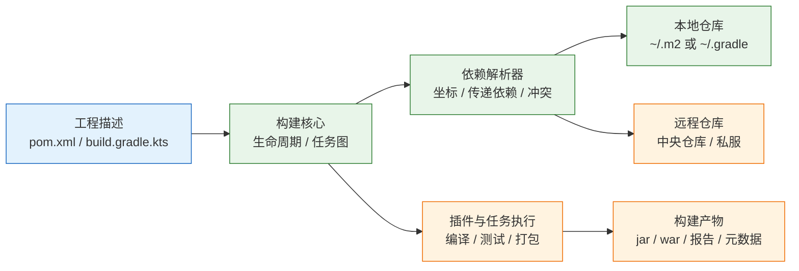
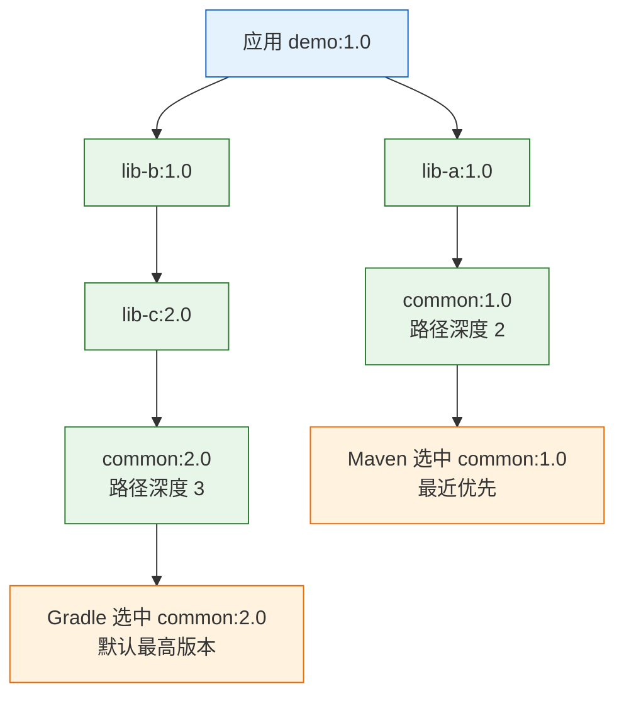
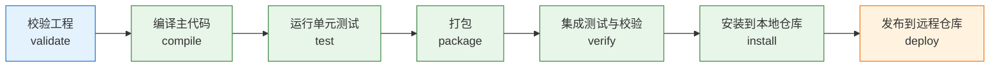
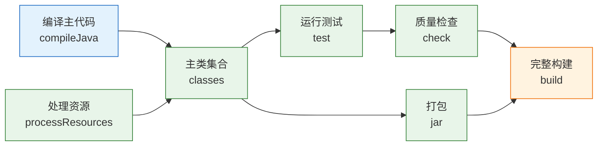

# Maven 与 Gradle 构建工具

构建工具把源码、依赖、插件和产物组织成一条可重复执行的流水线。它决定依赖图最终解析出哪些 jar、测试在哪个阶段运行、产物里包含什么，以及换一台机器后能否得到相同结果。Maven 与 Gradle 是 Java 生态的两套主流实现，前者以固定生命周期和强约定见长，后者以任务图和可编程模型见长。

---

## 一、构建工具是什么

### 1.1 核心概念

构建工具是**把工程描述转换为构建产物的执行系统**。它不负责写业务代码，也不替代 JDK 编译器，而是解决四件事：依赖从哪来、源码按什么顺序编译、测试与打包何时执行、产物如何发布。

理解构建工具，需要抓住五个对象：

| 概念 | 作用 | Maven 对应 | Gradle 对应 |
|---|---|---|---|
| 工程模型 | 描述项目身份、模块和构建配置 | `pom.xml` | `build.gradle.kts` |
| 依赖图 | 记录直接与传递依赖及其版本 | 依赖调解后的图 | 配置（configuration）解析结果 |
| 执行单元 | 按顺序完成编译、测试、打包 | 生命周期阶段与插件目标 | 任务（task）与任务图 |
| 仓库 | 存放依赖与产物的位置 | 本地仓库、远程仓库 | 本地缓存、远程仓库 |
| 封装 | 固定构建工具自身的版本 | Maven Wrapper | Gradle Wrapper |

构建工具与包管理器的区别常被混淆。Maven 和 Gradle 都能下载依赖，但它们的核心职责是**组织构建过程**；npm、pip 这类工具的核心职责是安装包。Java 生态把依赖管理并入构建工具，因此 POM 既是工程描述，也是依赖清单。

构建工具的价值集中在可重复性。同一份提交在开发机、CI runner 和容器里应当解析出同一组依赖、产出同一份字节码。只要版本选择规则依赖“本机装了什么”或“仓库此刻返回什么”，构建结果就会漂移，故障也无法复现。

### 1.2 与相邻技术的关系

构建工具位于 JDK 与运行环境之间，向上承接源码，向下产出可部署产物。它与相邻技术的边界如下：

| 相邻技术 | 负责内容 | 与构建工具的关系 |
|---|---|---|
| JDK / `javac` | 词法分析、编译、字节码生成 | 构建工具调用编译器，并管理编译参数 |
| 依赖仓库 | 存储 jar、POM、校验和 | 构建工具按坐标下载并缓存 |
| CI 流水线 | 触发构建、保存产物、发布制品 | 构建工具提供可脚本化的命令入口 |
| 容器构建 | 打包运行环境 | 构建产物是镜像的一层输入 |
| IDE | 编辑、索引、调试 | IDE 导入构建模型，不替代命令行构建 |

`javac` 只能处理显式给出的 classpath，无法解析传递依赖，也不会管理插件版本。手工维护 `-cp` 在依赖超过十几个时就会失控，这是构建工具存在的直接原因。

CI 与容器也不替代构建工具。CI 负责“什么时候跑、跑完存哪里”，容器负责“运行环境长什么样”；真正决定依赖版本和产物结构的是构建脚本。把版本选择交给 CI 环境变量，等于把可重复性交给运行环境。反过来，构建工具不负责运行环境、网络和部署编排。

### 1.3 架构组成

两套工具的内部结构不同，但都可以拆成“描述层、解析层、执行层、仓库层”四部分。



| 组成 | 职责 | 关键行为 |
|---|---|---|
| 描述层 | 声明坐标、依赖、插件、模块 | 解析 XML 或 Kotlin/Groovy 脚本 |
| 解析层 | 构建依赖图并决定版本 | 最近优先、最高版本、约束覆盖 |
| 执行层 | 按阶段或任务图调度 | 增量判断、并行、缓存 |
| 仓库层 | 下载、缓存、发布制品 | 校验和、快照更新、认证 |

Maven 的执行层是**生命周期加插件绑定**：阶段固定，插件目标挂到阶段上。Gradle 的执行层是**有向无环任务图**：任务声明输入输出，调度器据此决定执行顺序和是否跳过。

两者都遵循 Maven 仓库布局：`groupId` 转路径、`artifactId` 与 `version` 组成目录、jar 与 POM 并列存放。Gradle 能消费 Maven 坐标，也能发布 Maven 格式的元数据，所以同一套私服可以同时服务两种工具。

---

## 二、安装与配置

> **版本现状（2026-10）**：Maven 3.10.0；Gradle 9.8.2。Spring Boot 4.1.2 要求 Maven 3.6.3 以上、Gradle 8.14 以上或 9.x。示例以 JDK 21 为编译基线，实际项目按运行环境选择 LTS 版本。

### 2.1 JDK 与版本基线

构建工具本身运行在 JVM 上，编译目标又由 JDK 决定，因此至少存在两个版本：**构建工具运行 JDK** 与 **项目编译 JDK**。两者可以不同，但必须显式声明。

```bash
# ========== 查看当前环境 ==========
# 查看运行时 JDK 版本
java -version

# 查看编译器版本，确认与运行时一致
javac -version

# 查看 JAVA_HOME 指向
echo "$JAVA_HOME"

# ========== 切换 JDK（示例路径按实际安装位置替换） ==========
export JAVA_HOME=/usr/lib/jvm/java-21-openjdk
export PATH="$JAVA_HOME/bin:$PATH"

# 再次确认
java -version
```

| 版本项 | 决定什么 | 配置位置 |
|---|---|---|
| 构建工具运行 JDK | Maven/Gradle 自身能否启动 | `JAVA_HOME` |
| 编译 release | 字节码版本与可用 API | `maven.compiler.release` / toolchain |
| 测试运行 JDK | 测试能否加载字节码 | surefire 配置 / toolchain |
| 容器运行 JDK | 生产环境能否启动 | 基础镜像 |

> **注意**：只设置 `source` 和 `target` 不能阻止编译器引用更高版本 JDK 的 API，运行期仍可能抛 `NoSuchMethodError`。Maven 使用 `release`，Gradle 使用 toolchain，才能同时约束字节码版本和 API 范围。

### 2.2 Maven 安装与目录

Maven 是绿色版压缩包，解压后配置环境变量即可。包管理器安装适合开发机，生产与 CI 更推荐固定目录加 Wrapper。

```bash
# ========== 下载与解压 ==========
# 从 Apache 归档站下载指定版本，避免使用 latest
curl -fL -o /tmp/apache-maven-3.10.0-bin.tar.gz \
  https://archive.apache.org/dist/maven/maven-3/3.10.0/binaries/apache-maven-3.10.0-bin.tar.gz

# 解压到 /opt
sudo tar -xzf /tmp/apache-maven-3.10.0-bin.tar.gz -C /opt

# 建立稳定软链接，升级时只改链接
sudo ln -sfn /opt/apache-maven-3.10.0 /opt/maven

# ========== 配置环境变量 ==========
# 写入当前用户的 shell 配置
cat >> ~/.zshrc <<'EOF'
export MAVEN_HOME=/opt/maven
export PATH="$MAVEN_HOME/bin:$PATH"
export MAVEN_OPTS="-Xms256m -Xmx1g -Dfile.encoding=UTF-8"
EOF

# 使配置生效
source ~/.zshrc

# ========== 验证 ==========
mvn -v
```

`mvn -v` 会输出 Maven 版本、Maven Home、Java 版本和平台编码等信息。每一项都要核对：Maven 版本是否为目标版本，Java 版本是否符合项目要求，平台编码是否为 UTF-8。

Maven 安装目录中需要认识三个位置：

| 路径 | 内容 | 是否应提交 |
|---|---|---|
| `$MAVEN_HOME/conf/settings.xml` | 全局配置 | 否，属于机器配置 |
| `~/.m2/settings.xml` | 用户配置 | 否，含凭据 |
| `~/.m2/repository` | 本地仓库 | 否，可重建 |

> **运维提示**：CI 镜像应预装固定版本 Maven，并在流水线里用 `./mvnw` 再固定一次。预装版本只保证命令存在，Wrapper 才保证版本一致。

### 2.3 Gradle 安装与 Wrapper

Gradle 同样可以解压安装，但项目侧应始终使用 Wrapper。Wrapper 把 Gradle 版本、下载地址和校验和写进仓库，CI 不需要预装 Gradle。

```bash
# ========== 安装 Gradle（仅用于生成 Wrapper） ==========
curl -fL -o /tmp/gradle-9.8.2-bin.zip \
  https://services.gradle.org/distributions/gradle-9.8.2-bin.zip

sudo unzip -q /tmp/gradle-9.8.2-bin.zip -d /opt
sudo ln -sfn /opt/gradle-9.8.2 /opt/gradle

export GRADLE_HOME=/opt/gradle
export PATH="$GRADLE_HOME/bin:$PATH"

gradle --version

# ========== 在项目根目录生成 Wrapper ==========
# --distribution-type bin 只下载运行时，不下载源码和文档
gradle wrapper --gradle-version 9.8.2 --distribution-type bin

# 之后统一使用 Wrapper，不再直接调用 gradle
./gradlew --version
```

生成的 `gradle/wrapper/gradle-wrapper.properties` 是版本锁的核心：

```properties
# 下载的 Gradle 发行版解压到用户目录
distributionBase=GRADLE_USER_HOME
distributionPath=wrapper/dists

# 固定版本与发行版类型
distributionUrl=https\://services.gradle.org/distributions/gradle-9.8.2-bin.zip

# 固定官方 SHA-256 校验和，防止下载被替换
distributionSha256Sum=<填写官方页面公布的校验值>

# 下载超时与地址校验
networkTimeout=10000
validateDistributionUrl=true

zipStoreBase=GRADLE_USER_HOME
zipStorePath=wrapper/dists
```

| Wrapper 文件 | 作用 | 处理方式 |
|---|---|---|
| `mvnw` / `mvnw.cmd` | 启动脚本 | 提交，保留可执行位 |
| `.mvn/wrapper/maven-wrapper.properties` | Maven 版本与下载地址 | 提交 |
| `gradlew` / `gradlew.bat` | 启动脚本 | 提交，保留可执行位 |
| `gradle/wrapper/gradle-wrapper.properties` | Gradle 版本与校验和 | 提交 |
| `gradle-wrapper.jar` | Wrapper 引导程序 | 提交，保证离线可用 |

> **安全警告**：`distributionUrl` 必须指向官方或内部审核过的地址，并配置 `distributionSha256Sum`。把 Wrapper 指向未审核的镜像，等于允许对方替换构建工具本身。

### 2.4 settings.xml 与仓库配置

Maven 的镜像、代理和认证通常不写在 `pom.xml`，而写在 `settings.xml`；项目可以在 POM 中声明额外仓库，但镜像规则与私服凭据属于机器配置。用户级配置优先于全局配置，命令行可用 `-s` 指定文件、`-gs` 指定全局文件。

```xml
<?xml version="1.0" encoding="UTF-8"?>
<settings xmlns="http://maven.apache.org/SETTINGS/1.0.0"
          xmlns:xsi="http://www.w3.org/2001/XMLSchema-instance"
          xsi:schemaLocation="http://maven.apache.org/SETTINGS/1.0.0 https://maven.apache.org/xsd/settings-1.0.0.xsd">

  <!-- 本地仓库位置，默认 ~/.m2/repository -->
  <localRepository>${user.home}/.m2/repository</localRepository>

  <!-- 镜像：把中央仓库请求转发到内部 Nexus -->
  <mirrors>
    <mirror>
      <id>internal-nexus</id>
      <name>内部 Nexus 聚合仓库</name>
      <url>https://nexus.example.com/repository/maven-public/</url>
      <!-- 只代理 central，不拦截其他显式仓库 -->
      <mirrorOf>central</mirrorOf>
    </mirror>
  </mirrors>

  <!-- 认证：id 必须与仓库或镜像的 id 一致 -->
  <servers>
    <server>
      <id>internal-releases</id>
      <username>deployer</username>
      <!-- 从环境变量读取，不把密码写进文件 -->
      <password>${env.NEXUS_PASSWORD}</password>
    </server>
  </servers>

  <!-- Profile：集中声明编译基线 -->
  <profiles>
    <profile>
      <id>jdk21</id>
      <activation>
        <activeByDefault>true</activeByDefault>
      </activation>
      <properties>
        <maven.compiler.release>21</maven.compiler.release>
        <project.build.sourceEncoding>UTF-8</project.build.sourceEncoding>
      </properties>
    </profile>
  </profiles>
</settings>
```

| 配置段 | 作用 | 常见错误 |
|---|---|---|
| `localRepository` | 指定本地仓库 | 放在网络盘导致锁竞争 |
| `mirrors` | 替换仓库地址 | `mirrorOf` 写成 `*` 拦截了私服 |
| `servers` | 提供认证信息 | `id` 与仓库 `id` 不一致 |
| `proxies` | 通过 HTTP 代理访问外网 | 只配了 `http` 没配 `https` |
| `profiles` | 按环境或属性切换配置 | 把密钥写进 Profile |

`mirrorOf` 的写法决定拦截范围：

| 写法 | 含义 |
|---|---|
| `central` | 只替换中央仓库 |
| `*` | 替换所有仓库，包括私服 |
| `external:*` | 替换所有外部仓库，保留 localhost 与文件仓库 |
| `repo1,repo2` | 只替换指定 id 的仓库 |
| `*,!internal` | 替换全部，但排除 `internal` |

> **安全警告**：`settings.xml` 含私服凭据，不得提交到仓库。优先用环境变量或 CI Secret 注入；需要在本地保存时，用 `mvn --encrypt-password` 生成加密密码并配合 `settings-security.xml`，同时限制文件权限为 `600`。

---

## 三、坐标与依赖

### 3.1 Maven 坐标与目录约定

Maven 用坐标唯一标识一个构件，坐标由 `groupId`、`artifactId`、`version` 组成，简称 GAV。`packaging` 决定产物类型，默认是 `jar`。

```xml
<?xml version="1.0" encoding="UTF-8"?>
<project xmlns="http://maven.apache.org/POM/4.0.0"
         xmlns:xsi="http://www.w3.org/2001/XMLSchema-instance"
         xsi:schemaLocation="http://maven.apache.org/POM/4.0.0 https://maven.apache.org/xsd/maven-4.0.0.xsd">

  <!-- POM 模型版本，固定为 4.0.0 -->
  <modelVersion>4.0.0</modelVersion>

  <!-- 组织或公司域名的反写 -->
  <groupId>com.example</groupId>
  <!-- 项目内唯一的构件名 -->
  <artifactId>demo</artifactId>
  <!-- 发布版本；开发期可用 1.0.0-SNAPSHOT -->
  <version>1.0.0</version>
  <!-- 产物类型：jar、war、pom -->
  <packaging>jar</packaging>

  <properties>
    <maven.compiler.release>21</maven.compiler.release>
    <project.build.sourceEncoding>UTF-8</project.build.sourceEncoding>
  </properties>
</project>
```

| 元素 | 含义 | 约束 |
|---|---|---|
| `groupId` | 组织标识 | 通常用反写域名 |
| `artifactId` | 构件标识 | 同一 `groupId` 下唯一 |
| `version` | 版本号 | 发布后不可修改 |
| `packaging` | 产物类型 | 决定绑定的默认插件目标 |
| `classifier` | 同一版本的变体 | 如 `sources`、`javadoc` |

Maven 依赖目录约定，源码位置不需要声明：

```text
demo/
├── pom.xml
├── src/
│   ├── main/
│   │   ├── java/         主代码
│   │   └── resources/    主资源
│   └── test/
│       ├── java/         测试代码
│       └── resources/    测试资源
└── target/               构建输出，不提交
```

约定的收益是任何 Maven 工程结构一致，新人不必先读构建脚本。代价是特殊布局必须通过 `<sourceDirectory>` 或插件配置改写，不能靠移动目录碰运气。

### 3.2 依赖范围

依赖范围（scope）决定一个依赖在编译期、测试期、运行期是否可见，以及是否传递给下游项目。范围配错，常见结果是编译通过、运行缺类。

```xml
<dependencies>
  <!-- 普通库：编译、测试、运行都可用，会传递给下游 -->
  <dependency>
    <groupId>com.example</groupId>
    <artifactId>common</artifactId>
    <version>1.0.0</version>
    <scope>compile</scope>
  </dependency>

  <!-- 容器提供实现：编译可见，运行期由容器提供，不传递 -->
  <dependency>
    <groupId>jakarta.servlet</groupId>
    <artifactId>jakarta.servlet-api</artifactId>
    <version>6.0.0</version>
    <scope>provided</scope>
  </dependency>

  <!-- 运行期才需要：编译不可见，运行与测试可见 -->
  <dependency>
    <groupId>com.mysql</groupId>
    <artifactId>mysql-connector-j</artifactId>
    <version>8.4.0</version>
    <scope>runtime</scope>
  </dependency>

  <!-- 仅测试：不进入运行期，不传递给下游 -->
  <dependency>
    <groupId>org.junit.jupiter</groupId>
    <artifactId>junit-jupiter</artifactId>
    <version>5.11.4</version>
    <scope>test</scope>
  </dependency>
</dependencies>
```

| scope | 编译期 | 运行期 | 传递与说明 |
|---|---|---|---|
| `compile`（默认） | 是 | 是 | 传递 |
| `provided` | 是 | 否 | 不传递 |
| `runtime` | 否 | 是 | 传递，测试可见 |
| `test` | 否 | 否 | 不传递，仅测试 |
| `system` | 是 | 是 | 不传递，本地路径 |
| `import` | — | — | 仅用于 BOM |

`provided` 的典型陷阱是本地能跑、打包后报 `ClassNotFoundException`。IDE 会把 `provided` 加入测试 classpath，容器或应用服务器也确实提供该依赖；一旦用 `java -jar` 直接运行，运行环境没有这个 jar，类加载立即失败。

> **注意**：`system` 范围依赖本地绝对路径，换机器即失效，且 Maven 已不推荐使用。需要本地 jar 时，先 `mvn install:install-file` 安装到本地仓库，再按普通坐标引用。

### 3.3 传递依赖与冲突调解

依赖会沿依赖图向下传递。当同一个构件出现多个版本时，Maven 和 Gradle 使用不同规则选版本，这是两套工具行为差异最大的地方。



| 规则 | Maven | Gradle |
|---|---|---|
| 默认选择 | 路径最短者 | 版本最高者 |
| 同深度处理 | 先声明者胜 | 仍取最高版本 |
| 显式覆盖 | `dependencyManagement` | `constraints`、`force` |
| 排除传递依赖 | `<exclusions>` | `exclude` |
| 冲突查看 | `dependency:tree` | `dependencyInsight` |

Maven 的“最近优先”指依赖图中距离项目最近的版本获胜，与版本号大小无关。上图中 `common:1.0` 深度为 2，`common:2.0` 深度为 3，因此选中 1.0，即使 2.0 更新。两条路径深度相同时，POM 中先声明的依赖获胜。

`dependencyManagement` 的优先级高于传递依赖调解。只要在当前 POM 或父 POM 中声明了版本，传递进来的其他版本都会被覆盖。这一机制适合统一版本，也容易造成“声明了却没用到”的误解。

```bash
# ========== 查看依赖树 ==========
# 输出完整依赖树，确认实际选中的版本
mvn -B -ntp dependency:tree

# 只看某个构件，快速定位冲突路径
mvn -B -ntp dependency:tree -Dincludes=com.example:common

# 显示被省略的冲突节点
mvn -B -ntp dependency:tree -Dverbose

# ========== 分析声明是否准确 ==========
# 提示“声明未使用”和“使用未声明”
mvn -B -ntp dependency:analyze

# 查看生效后的 POM，确认继承与覆盖结果
mvn -B -ntp help:effective-pom

# ========== 刷新元数据 ==========
# 强制更新 SNAPSHOT 与仓库元数据
mvn -B -ntp -U clean package
```

`dependency:analyze` 的“使用未声明”比“声明未使用”更危险：代码依赖了某个传递进来的 jar，一旦上游升级并移除该依赖，编译立即失败。正确做法是把直接使用的库显式声明，而不是依赖巧合。

### 3.4 BOM 与版本统一

BOM（Bill of Materials，物料清单）是一个只含 `dependencyManagement` 的 POM，用来集中管理一组兼容版本。导入 BOM 后，依赖不写版本，由 BOM 决定。

```xml
<dependencyManagement>
  <dependencies>
    <!-- 导入 Spring Boot BOM：统一 Spring 生态依赖版本 -->
    <dependency>
      <groupId>org.springframework.boot</groupId>
      <artifactId>spring-boot-dependencies</artifactId>
      <version>4.1.2</version>
      <type>pom</type>
      <scope>import</scope>
    </dependency>

    <!-- 项目级覆盖：只对确有需要的构件生效 -->
    <dependency>
      <groupId>com.example</groupId>
      <artifactId>common</artifactId>
      <version>2.0.0</version>
    </dependency>
  </dependencies>
</dependencyManagement>

<dependencies>
  <!-- 不写版本，由 BOM 提供 -->
  <dependency>
    <groupId>org.springframework.boot</groupId>
    <artifactId>spring-boot-starter-webmvc</artifactId>
  </dependency>
</dependencies>
```

| 版本来源 | 优先级 | 适用场景 |
|---|---|---|
| 当前 POM 的 `dependencyManagement` | 最高 | 项目级统一覆盖 |
| 父 POM 的 `dependencyManagement` | 高 | 组织级版本基线 |
| 导入的 BOM | 中 | 生态兼容版本集合 |
| 传递依赖调解 | 低 | 未声明版本时的兜底 |

排除传递依赖是精确动作，必须写清 groupId 与 artifactId：

```xml
<dependency>
  <groupId>com.example</groupId>
  <artifactId>lib-a</artifactId>
  <version>1.0.0</version>
  <exclusions>
    <!-- 排除旧日志实现，避免与 slf4j 绑定冲突 -->
    <exclusion>
      <groupId>org.slf4j</groupId>
      <artifactId>slf4j-simple</artifactId>
    </exclusion>
  </exclusions>
</dependency>
```

> **注意**：不要用通配排除 `*:*` 图省事。它会把运行必需的依赖一并排掉，且不会报编译错误，问题会延迟到运行期。排除前先用 `dependency:tree` 确认冲突路径。

> **安全警告**：内部构件应使用公共仓库不会占用的 groupId，并在私服中把内部仓库排在代理仓库之前。若内部坐标与公共坐标同名，构建可能从公共仓库解析到同名恶意构件，形成依赖混淆攻击。

---

## 四、生命周期与任务

### 4.1 Maven 生命周期

Maven 有三套独立生命周期：`clean` 清理产物，`default` 完成编译到部署，`site` 生成站点文档。调用某一阶段时，同一生命周期中它之前的阶段会依次执行。



| 阶段 | 主要动作 | 典型产物 |
|---|---|---|
| `validate` | 校验 POM 与工程结构 | 无 |
| `compile` | 编译 `src/main/java` | `target/classes` |
| `test` | 编译并运行单元测试 | `target/test-classes`、测试报告 |
| `package` | 打 jar 或 war | `target/*.jar` |
| `verify` | 运行集成测试与质量校验 | 集成测试报告 |
| `install` | 安装到本地仓库 | `~/.m2/repository` 中的构件 |
| `deploy` | 上传到远程仓库 | 私服中的构件 |

`mvn clean` 属于 `clean` 生命周期，不会自动随 `package` 执行。`mvn clean package` 是两条生命周期的组合：先删除 `target/`，再执行到 `package`。

常用命令与参数：

```bash
# ========== 日常构建 ==========
# 清理并打包，跳过测试执行但保留测试编译
mvn -B -ntp clean package -DskipTests

# 连测试编译一起跳过，仅用于确认主代码可编译
mvn -B -ntp clean package -Dmaven.test.skip=true

# 安装到本地仓库，供同机其他项目引用
mvn -B -ntp clean install

# 跑完整验证，包含集成测试
mvn -B -ntp clean verify

# ========== 并行与离线 ==========
# 按 CPU 核数并行构建模块
mvn -B -ntp -T 1C clean package

# 离线构建，依赖必须已在本地仓库
mvn -B -ntp -o clean package

# ========== 排障 ==========
# 只输出错误
mvn -q clean package

# 输出调试日志
mvn -X clean package
```

| 参数 | 作用 | 风险 |
|---|---|---|
| `-DskipTests` | 编译测试但不执行 | 测试失败被掩盖 |
| `-Dmaven.test.skip=true` | 跳过测试编译 | 测试代码错误无法发现 |
| `-T 1C` | 每个 CPU 核一个线程 | 插件非线程安全时结果异常 |
| `-o` | 离线模式 | 缺依赖立即失败 |
| `-U` | 强制更新元数据 | 构建变慢，快照可能变化 |
| `-B -ntp` | 批处理、关闭下载进度 | 仅影响日志 |

### 4.2 插件与绑定

Maven 的阶段本身不做事，真正执行的是绑定到阶段的插件目标。`maven-compiler-plugin` 绑定 `compile`，`maven-surefire-plugin` 绑定 `test`，`maven-jar-plugin` 绑定 `package`。

```xml
<build>
  <pluginManagement>
    <plugins>
      <!-- 统一插件版本，子模块不再重复声明 -->
      <plugin>
        <groupId>org.apache.maven.plugins</groupId>
        <artifactId>maven-compiler-plugin</artifactId>
        <version>3.13.0</version>
      </plugin>
      <plugin>
        <groupId>org.apache.maven.plugins</groupId>
        <artifactId>maven-surefire-plugin</artifactId>
        <version>3.5.2</version>
      </plugin>
    </plugins>
  </pluginManagement>

  <plugins>
    <!-- 编译插件：release 同时约束字节码与 API -->
    <plugin>
      <groupId>org.apache.maven.plugins</groupId>
      <artifactId>maven-compiler-plugin</artifactId>
      <configuration>
        <release>21</release>
        <parameters>true</parameters>
      </configuration>
    </plugin>

    <!-- 单元测试插件：默认匹配 *Test、Test*、*Tests、*TestCase -->
    <plugin>
      <groupId>org.apache.maven.plugins</groupId>
      <artifactId>maven-surefire-plugin</artifactId>
      <configuration>
        <argLine>-Dfile.encoding=UTF-8</argLine>
      </configuration>
    </plugin>

    <!-- 集成测试插件：匹配 *IT，绑定 integration-test 与 verify -->
    <plugin>
      <groupId>org.apache.maven.plugins</groupId>
      <artifactId>maven-failsafe-plugin</artifactId>
      <version>3.5.2</version>
      <executions>
        <execution>
          <goals>
            <goal>integration-test</goal>
            <goal>verify</goal>
          </goals>
        </execution>
      </executions>
    </plugin>
  </plugins>
</build>
```

| 插件 | 默认阶段 | 作用 |
|---|---|---|
| `maven-compiler-plugin` | `compile` / `test-compile` | 编译主代码与测试代码 |
| `maven-surefire-plugin` | `test` | 运行单元测试 |
| `maven-failsafe-plugin` | `integration-test` / `verify` | 运行集成测试 |
| `maven-jar-plugin` | `package` | 生成普通 jar |
| `maven-shade-plugin` | `package` | 生成 uber jar，需处理服务文件合并 |
| `spring-boot-maven-plugin` | `package` | `repackage` 生成可执行 jar |

```bash
# ========== 直接调用插件目标 ==========
# 只编译，不跑后续阶段
mvn -B -ntp compiler:compile

# 只跑单元测试
mvn -B -ntp surefire:test

# 查看插件目标与参数说明
mvn -B -ntp help:describe -Dplugin=org.apache.maven.plugins:maven-compiler-plugin

# ========== 查看插件绑定 ==========
# 输出继承与插件配置合并后的 POM
mvn -B -ntp help:effective-pom
```

> **注意**：插件不写版本时会继承超级 POM 的默认版本，可能远低于当前稳定版。`pluginManagement` 必须显式锁定所有生产插件的版本，否则同一份 POM 在不同 Maven 版本下行为可能不同。

### 4.3 Gradle 任务图

Gradle 不设固定阶段，而是把构建拆成任务，由任务之间的依赖组成有向无环图。执行 `build` 时，Gradle 只运行该任务依赖链上的任务。



每个任务声明输入与输出。Gradle 在执行前比较输入、输出和实现是否变化，未变化则标记 `UP-TO-DATE` 并跳过。增量构建不是额外优化，而是任务模型的默认行为。

```bash
# ========== 构建与测试 ==========
# 执行 build 依赖链：编译、测试、打包
./gradlew build

# 只跑测试
./gradlew test

# 跳过某个任务
./gradlew build -x test

# 强制重新执行任务，忽略增量判断
./gradlew test --rerun-tasks

# 只预览将执行的任务，不实际执行
./gradlew build --dry-run

# ========== 依赖排查 ==========
# 查看某个配置的依赖树
./gradlew dependencies --configuration runtimeClasspath

# 查看某个依赖为何被选中
./gradlew dependencyInsight \
  --dependency com.example:common \
  --configuration runtimeClasspath

# ========== 守护进程 ==========
# 停止所有 daemon，释放内存与文件锁
./gradlew --stop

# CI 中禁用 daemon，避免残留进程
./gradlew --no-daemon clean build
```

| 现象 | 含义 | 处理 |
|---|---|---|
| `UP-TO-DATE` | 输入输出未变，任务被跳过 | 正常；需要重跑用 `--rerun-tasks` |
| `FROM-CACHE` | 命中构建缓存 | 正常；核对缓存键是否覆盖全部输入 |
| `NO-SOURCE` | 没有对应源码 | 检查源码目录与 SourceSet |
| `SKIPPED` | 任务被条件或 `-x` 跳过 | 检查命令行与任务条件 |

> **注意**：自定义任务必须用 `@Input`、`@InputFile`、`@OutputDirectory` 等注解声明输入输出。声明不完整时，Gradle 会错误复用旧结果，表现为“改了代码但产物没变”。

### 4.4 Gradle 配置与版本目录

Gradle 用 configuration 表示一组依赖，并决定其可见范围和传递性。`implementation` 与 `api` 的差异直接影响下游项目的编译 classpath。

```kotlin
plugins {
    java
    application
    id("org.springframework.boot") version "4.1.2"
    id("io.spring.dependency-management") version "1.1.7"
}

group = "com.example"
version = "1.0.0"

java {
    // 用 toolchain 固定编译 JDK，不依赖 JAVA_HOME
    toolchain {
        languageVersion = JavaLanguageVersion.of(21)
    }
}

repositories {
    mavenCentral()
}

dependencies {
    // 编译与运行都可见，但不暴露给下游
    implementation("org.springframework.boot:spring-boot-starter-webmvc")

    // 仅运行期需要，如 JDBC 驱动
    runtimeOnly("com.h2database:h2")

    // 仅测试编译与运行可见
    testImplementation("org.springframework.boot:spring-boot-starter-webmvc-test")
    testRuntimeOnly("org.junit.platform:junit-platform-launcher")
}

application {
    mainClass = "com.example.App"
}

tasks.test {
    useJUnitPlatform()
}
```

Groovy DSL 与 Kotlin DSL 语义一致，脚本文件名为 `build.gradle`。关键差异是字符串用单引号、插件用 `id` 声明、任务用 `tasks.named` 获取：

```groovy
plugins {
    id 'java'
    id 'application'
    id 'org.springframework.boot' version '4.1.2'
    id 'io.spring.dependency-management' version '1.1.7'
}

group = 'com.example'
version = '1.0.0'

java {
    toolchain {
        // 与 Kotlin DSL 相同，固定编译 JDK
        languageVersion = JavaLanguageVersion.of(21)
    }
}

repositories {
    mavenCentral()
}

dependencies {
    implementation 'org.springframework.boot:spring-boot-starter-webmvc'
    runtimeOnly 'com.h2database:h2'
    testImplementation 'org.springframework.boot:spring-boot-starter-webmvc-test'
    testRuntimeOnly 'org.junit.platform:junit-platform-launcher'
}

application {
    mainClass = 'com.example.App'
}

tasks.named('test') {
    useJUnitPlatform()
}
```

| configuration | 编译可见 | 运行可见 | 下游编译可见 |
|---|---|---|---|
| `implementation` | 是 | 是 | 否 |
| `api`（需 `java-library`） | 是 | 是 | 是 |
| `compileOnly` | 是 | 否 | 否 |
| `runtimeOnly` | 否 | 是 | 否 |
| `testImplementation` | 测试可见 | 测试可见 | 否 |
| `testRuntimeOnly` | 否 | 测试运行可见 | 否 |

版本目录把版本集中到 `gradle/libs.versions.toml`，多模块不再各写各的：

```toml
[versions]
spring-boot = "4.1.2"
junit = "5.11.4"

[libraries]
junit-jupiter = { module = "org.junit.jupiter:junit-jupiter", version.ref = "junit" }

[plugins]
spring-boot = { id = "org.springframework.boot", version.ref = "spring-boot" }
```

```kotlin
plugins {
    // 通过别名引用版本目录中的插件
    alias(libs.plugins.spring.boot)
}

dependencies {
    testImplementation(libs.junit.jupiter)
}
```

> **注意**：使用 Spring Boot BOM 时，starter 依赖不要再写版本。版本目录适合管理插件与独立库的版本，不应把 BOM 已覆盖的构件再逐个固定，否则升级 BOM 时会出现版本撕裂。

---

## 五、多模块工程

### 5.1 Maven 反应堆

多模块工程由一个父 POM 和若干子模块组成。父 POM 的 `packaging` 必须是 `pom`，只放版本、插件和公共配置；业务代码放进子模块。

```xml
<!-- 父 pom.xml -->
<project xmlns="http://maven.apache.org/POM/4.0.0">
  <modelVersion>4.0.0</modelVersion>

  <groupId>com.example</groupId>
  <artifactId>shop-parent</artifactId>
  <version>1.0.0</version>
  <!-- 父模块只做聚合与配置，不产出 jar -->
  <packaging>pom</packaging>

  <!-- 反应堆包含的模块，顺序不影响依赖排序 -->
  <modules>
    <module>common</module>
    <module>api</module>
  </modules>

  <properties>
    <maven.compiler.release>21</maven.compiler.release>
    <project.build.sourceEncoding>UTF-8</project.build.sourceEncoding>
  </properties>

  <dependencyManagement>
    <dependencies>
      <!-- 子模块引用 common 时无需重复写版本 -->
      <dependency>
        <groupId>com.example</groupId>
        <artifactId>common</artifactId>
        <version>${project.version}</version>
      </dependency>
    </dependencies>
  </dependencyManagement>

  <build>
    <pluginManagement>
      <plugins>
        <plugin>
          <groupId>org.apache.maven.plugins</groupId>
          <artifactId>maven-compiler-plugin</artifactId>
          <version>3.13.0</version>
        </plugin>
      </plugins>
    </pluginManagement>
  </build>
</project>
```

```xml
<!-- api/pom.xml -->
<project xmlns="http://maven.apache.org/POM/4.0.0">
  <modelVersion>4.0.0</modelVersion>

  <parent>
    <groupId>com.example</groupId>
    <artifactId>shop-parent</artifactId>
    <version>1.0.0</version>
    <!-- 相对路径指向父 POM，默认 ../pom.xml -->
    <relativePath>../pom.xml</relativePath>
  </parent>

  <artifactId>api</artifactId>

  <dependencies>
    <!-- 版本由父 POM 的 dependencyManagement 提供 -->
    <dependency>
      <groupId>com.example</groupId>
      <artifactId>common</artifactId>
    </dependency>
  </dependencies>
</project>
```

反应堆（reactor）按模块间的依赖关系排序，而不是按 `<modules>` 的书写顺序。`common` 会被先构建，`api` 随后构建。

```bash
# ========== 全量构建 ==========
# 在父目录执行，构建所有模块
mvn -B -ntp clean install

# ========== 定点构建 ==========
# 只构建 api 及其依赖的模块
mvn -B -ntp -pl api -am clean package

# 只构建 api，不构建依赖模块（依赖必须已安装）
mvn -B -ntp -pl api clean package

# 构建 api 及依赖它的模块
mvn -B -ntp -pl api -amd clean package

# 排除某个模块
mvn -B -ntp -pl '!common' clean package

# 从失败模块继续，避免重复构建
mvn -B -ntp -rf :api clean package
```

| 参数 | 含义 | 使用场景 |
|---|---|---|
| `-pl` | 指定模块列表 | 只改了一个模块 |
| `-am` | 同时构建依赖模块 | 依赖尚未安装 |
| `-amd` | 同时构建下游模块 | 改公共库后验证影响 |
| `-rf` | 从指定模块继续 | 构建中断后恢复 |

### 5.2 Gradle 多项目

Gradle 用 `settings.gradle.kts` 声明项目结构，根项目可以统一配置子项目，也可以让子项目自行配置。

```kotlin
// settings.gradle.kts
rootProject.name = "shop"

// 声明子项目，路径与目录名对应
include("common", "api")
```

```kotlin
// 根 build.gradle.kts：只做公共配置，不应用业务插件
plugins {
    java
}

allprojects {
    group = "com.example"
    version = "1.0.0"

    repositories {
        mavenCentral()
    }
}

subprojects {
    apply(plugin = "java")

    java {
        toolchain {
            languageVersion = JavaLanguageVersion.of(21)
        }
    }
}
```

```kotlin
// api/build.gradle.kts
plugins {
    java
    application
    id("org.springframework.boot") version "4.1.2"
}

dependencies {
    // 项目依赖用 project(":路径") 引用
    implementation(project(":common"))
    implementation("org.springframework.boot:spring-boot-starter-webmvc")
}

application {
    mainClass = "com.example.api.ApiApplication"
}
```

```bash
# ========== 多项目命令 ==========
# 构建所有项目
./gradlew build

# 只跑 api 的测试
./gradlew :api:test

# 启动 api 应用
./gradlew :api:bootRun

# 打可执行 jar
./gradlew :api:bootJar

# 查看项目结构
./gradlew projects

# 查看某个项目的任务
./gradlew :api:tasks
```

| 命令 | 作用 | 对应 Maven |
|---|---|---|
| `./gradlew build` | 聚合构建 | `mvn verify` |
| `./gradlew :api:test` | 单模块测试 | `mvn -pl api test` |
| `./gradlew :api:bootRun` | 启动应用 | `mvn -pl api spring-boot:run` |
| `./gradlew projects` | 查看项目树 | 无直接对应 |

### 5.3 模块边界与发布

多模块的常见失败不是构建报错，而是模块边界失控：所有模块互相依赖，最终无法单独发布。边界应由依赖方向保证，而不是靠口头约定。

| 模块类型 | 允许依赖 | 禁止依赖 |
|---|---|---|
| `common` 基础库 | 仅第三方基础库 | 业务模块、Web 框架 |
| `domain` 领域层 | `common` | `api`、基础设施实现 |
| `infra` 基础设施 | `domain`、`common` | `api` |
| `api` 接入层 | 全部下层 | 无（保持单向） |

只有可运行的应用模块应用 Spring Boot 插件，库模块使用 `java-library` 并通过 `api` 暴露类型；库模块应用 Boot 插件后，`bootJar` 的语义与普通 jar 不一致。

发布库模块需要生成 POM 元数据，Maven 用 `distributionManagement`，Gradle 用 `maven-publish`：

```xml
<!-- 库模块的发布目标 -->
<distributionManagement>
  <repository>
    <!-- id 必须与 settings.xml 中 server 的 id 一致 -->
    <id>internal-releases</id>
    <url>https://nexus.example.com/repository/maven-releases/</url>
  </repository>
  <snapshotRepository>
    <id>internal-snapshots</id>
    <url>https://nexus.example.com/repository/maven-snapshots/</url>
  </snapshotRepository>
</distributionManagement>
```

```kotlin
// Gradle 发布配置
plugins {
    `java-library`
    `maven-publish`
}

publishing {
    publications {
        create<MavenPublication>("mavenJava") {
            // 从 java 组件生成 POM 与模块元数据
            from(components["java"])
        }
    }
    repositories {
        maven {
            name = "internal"
            url = uri("https://nexus.example.com/repository/maven-releases/")
            credentials {
                username = System.getenv("NEXUS_USER")
                password = System.getenv("NEXUS_PASSWORD")
            }
        }
    }
}
```

```bash
# ========== 发布前验证 ==========
# 安装到本地仓库，检查 POM 与依赖元数据
mvn -B -ntp clean install

# Gradle 发布到本地仓库
./gradlew publishToMavenLocal

# 正式发布
mvn -B -ntp clean deploy
./gradlew publish
```

> **安全警告**：发布凭据只从环境变量或 CI Secret 读取，不得写进 `pom.xml`、`build.gradle.kts` 或 `gradle.properties`。发布账号应只拥有目标仓库的写权限，不要复用管理员账号。

---

## 六、完整构建示例

### 6.1 Maven 工程

从空目录建立一个最小可运行工程，目录结构如下：

```text
demo-maven/
├── pom.xml
└── src/main/java/com/example/App.java
```

```xml
<?xml version="1.0" encoding="UTF-8"?>
<project xmlns="http://maven.apache.org/POM/4.0.0"
         xmlns:xsi="http://www.w3.org/2001/XMLSchema-instance"
         xsi:schemaLocation="http://maven.apache.org/POM/4.0.0 https://maven.apache.org/xsd/maven-4.0.0.xsd">

  <modelVersion>4.0.0</modelVersion>

  <groupId>com.example</groupId>
  <artifactId>demo-maven</artifactId>
  <version>1.0.0</version>
  <packaging>jar</packaging>

  <properties>
    <!-- 同时约束字节码版本与可用 API -->
    <maven.compiler.release>21</maven.compiler.release>
    <project.build.sourceEncoding>UTF-8</project.build.sourceEncoding>
  </properties>

  <build>
    <plugins>
      <plugin>
        <groupId>org.apache.maven.plugins</groupId>
        <artifactId>maven-compiler-plugin</artifactId>
        <version>3.13.0</version>
        <configuration>
          <release>21</release>
        </configuration>
      </plugin>
    </plugins>
  </build>
</project>
```

```java
package com.example;

public class App {
    public static void main(String[] args) {
        // 输出构建验证信息，便于确认运行 JDK
        System.out.println("build ok, java=" + System.getProperty("java.version"));
    }
}
```

```bash
# ========== 构建与运行 ==========
# 清理并打包，输出到 target/
mvn -B -ntp clean package

# 用编译输出目录运行，不依赖 jar 内的 Main-Class
java -cp target/classes com.example.App

# 查看 jar 内容，确认 class 已打入
jar tf target/demo-maven-1.0.0.jar

# 查看字节码版本，Java 21 对应 major version 65
javap -verbose -cp target/classes com.example.App | grep "major version"
```

预期输出类似：

```text
build ok, java=21.0.13
major version: 65
```

`target/` 下会出现 `classes/`、`maven-status/` 和 jar。普通 jar 不会自动写入 `Main-Class`，直接 `java -jar` 会报“no main manifest attribute”；需要可执行 jar 时，使用 `maven-jar-plugin` 的 `manifest` 配置或 Spring Boot 的 `repackage`。

### 6.2 Gradle 工程

Gradle 工程同样从空目录开始，先写构建文件，再生成 Wrapper。

```text
demo-gradle/
├── settings.gradle.kts
├── build.gradle.kts
└── src/main/java/com/example/App.java
```

```kotlin
// settings.gradle.kts
rootProject.name = "demo-gradle"
```

```kotlin
// build.gradle.kts
plugins {
    java
    application
}

group = "com.example"
version = "1.0.0"

java {
    toolchain {
        // 固定编译 JDK，机器上没有该版本时 Gradle 会提示安装
        languageVersion = JavaLanguageVersion.of(21)
    }
}

application {
    // 指定入口类，run 与 installDist 都依赖它
    mainClass = "com.example.App"
}
```

```java
package com.example;

public class App {
    public static void main(String[] args) {
        System.out.println("build ok, java=" + System.getProperty("java.version"));
    }
}
```

```bash
# ========== 生成 Wrapper ==========
# 首次需要本机已安装 Gradle
gradle wrapper --gradle-version 9.8.2 --distribution-type bin

# ========== 构建与运行 ==========
# 编译、测试、打包
./gradlew clean build

# 直接运行 mainClass
./gradlew run

# 生成带启动脚本的分发包
./gradlew installDist

# 运行分发包中的启动脚本
./build/install/demo-gradle/bin/demo-gradle
```

预期输出与 Maven 示例一致：

```text
build ok, java=21.0.13
```

Gradle 的默认输出目录与 Maven 不同：

| 内容 | Maven | Gradle |
|---|---|---|
| 主代码字节码 | `target/classes` | `build/classes/java/main` |
| 测试字节码 | `target/test-classes` | `build/classes/java/test` |
| jar | `target/*.jar` | `build/libs/*.jar` |
| 测试报告 | `target/surefire-reports` | `build/reports/tests/test` |
| 分发包 | 需插件 | `build/install/<项目名>` |

### 6.3 产物验证

构建成功不等于产物正确。至少验证三件事：class 是否齐全、字节码版本是否匹配、依赖是否进入运行时 classpath。

```bash
# ========== Maven 产物 ==========
# 列出 jar 内文件，确认包路径与资源
jar tf target/demo-maven-1.0.0.jar

# 查看字节码主版本
javap -verbose -cp target/classes com.example.App | grep "major version"

# 查看编译与运行 JDK
mvn -v
java -version

# ========== Gradle 产物 ==========
# 列出 jar 内容
jar tf build/libs/demo-gradle-1.0.0.jar

# 查看运行时 classpath
./gradlew dependencies --configuration runtimeClasspath

# 运行分发包，验证启动脚本与依赖齐全
./build/install/demo-gradle/bin/demo-gradle
```

| 检查项 | 命令 | 异常含义 |
|---|---|---|
| 字节码版本 | `javap -verbose` | 与运行 JDK 不匹配 |
| jar 内容 | `jar tf` | 资源或 class 未打入 |
| 运行时依赖 | `dependencies` / `dependency:tree` | 缺运行期依赖 |
| 入口类 | `java -jar` 或启动脚本 | manifest 未配置 |

> **开发提示**：容器构建时先复制 `pom.xml` 或 `build.gradle.kts` 与 Wrapper，再执行一次只下载依赖的构建，最后复制源码。依赖层不变即可命中镜像缓存，源码改动不会触发全量下载。

---

## 七、构建最佳实践

### 7.1 版本固定与 Wrapper

可重复构建的第一要求是固定所有会变化的版本。固定对象不只是业务依赖，还包括构建工具、插件、父 POM 和镜像。

| 固定对象 | Maven 做法 | Gradle 做法 |
|---|---|---|
| 构建工具 | Maven Wrapper | Gradle Wrapper |
| 依赖版本 | BOM + `dependencyManagement` | `platform()` + version catalog |
| 插件版本 | `pluginManagement` | `plugins` 块显式版本 |
| 依赖校验与锁定 | `maven-enforcer-plugin` + BOM | dependency locking |
| 构建工具链 | `release` / toolchain | toolchain |
| 容器基础镜像 | 固定 tag 或 digest | 固定 tag 或 digest |

```bash
# ========== 生成 Maven Wrapper ==========
# 在项目根目录执行，提交生成的脚本与配置
mvn -B -ntp wrapper:wrapper

# 之后统一使用 Wrapper
./mvnw -B -ntp clean verify

# ========== 生成 Gradle Wrapper ==========
gradle wrapper --gradle-version 9.8.2 --distribution-type bin
./gradlew --version
```

归档任务还要固定时间戳与文件顺序：Maven 设置 `project.build.outputTimestamp`，Gradle 的归档任务设置 `preserveFileTimestamps = false` 与 `reproducibleFileOrder = true`。Gradle 可在 `settings.gradle.kts` 的 `pluginManagement` 中统一插件仓库与解析策略；`target/`、`build/`、`.gradle/` 不提交，Wrapper 文件必须提交。

Maven Profile 用于同一 POM 的不同构建模式，例如用 `-Pintegration` 激活集成测试插件；环境差异应由配置或环境变量提供，密钥不写进 Profile。

> **注意**：不要使用 `latest.release`、`+`、`[1.0,)` 这类动态版本。它们让同一份提交在不同时间解析出不同依赖，构建结果无法复现，问题也无法定位到具体版本。

### 7.2 缓存与并行

构建优化的前提是测量。先分清时间花在依赖下载、编译、测试还是打包，再选择对应手段；盲目增加内存或线程数通常只加剧 GC 和锁竞争。

```properties
# gradle.properties
# 开启构建缓存，任务命中时直接取结果
org.gradle.caching=true

# 多模块并行执行
org.gradle.parallel=true

# 缓存任务图，减少配置阶段耗时
org.gradle.configuration-cache=true

# 守护进程堆大小与编码
org.gradle.jvmargs=-Xmx2g -Dfile.encoding=UTF-8
```

```bash
# ========== Maven 侧 ==========
# 并行构建模块
mvn -B -ntp -T 1C clean verify

# 调整构建 JVM 内存
export MAVEN_OPTS="-Xms512m -Xmx2g -Dfile.encoding=UTF-8"

# ========== Gradle 侧 ==========
# 使用构建缓存
./gradlew build --build-cache

# 使用配置缓存
./gradlew build --configuration-cache
```

| 瓶颈 | 判断方式 | 处理 |
|---|---|---|
| 依赖下载 | 日志停在 Downloading | 配镜像或私服，CI 缓存本地仓库 |
| 编译 | 编译阶段耗时占比高 | 增量编译、并行模块、升级硬件 |
| 测试 | 测试数量多、单测慢 | 单测与集成测试分层，先跑快的 |
| 打包 | 每次复制整个目录 | 分层构建，只复制必要产物 |
| 配置阶段 | Gradle 启动慢 | 配置缓存、减少脚本逻辑 |

缓存键必须覆盖全部输入。CI 缓存 `~/.m2/repository` 或 `~/.gradle/caches` 时，key 应包含 POM、锁文件或 Wrapper 配置的哈希；缓存损坏时应能自动回退到全量下载，而不是让构建永久失败。

### 7.3 私服与发布

私服承担三个职责：代理外部仓库、缓存公共依赖、托管内部构件。生产构建应只依赖私服，避免直连外部网络导致构建不稳定。

| 仓库类型 | 存放内容 | 是否允许覆盖 |
|---|---|---|
| `maven-public` | 代理与托管聚合 | 只读 |
| `maven-releases` | 正式版本 | 不允许 |
| `maven-snapshots` | 快照版本 | 允许，保留策略受限 |
| `maven-central` | 中央仓库代理 | 只读 |

```bash
# ========== 发布流程 ==========
# 1. 本地完整验证
./mvnw -B -ntp clean verify

# 2. 确认版本不是 SNAPSHOT，无输出即通过
grep -n "SNAPSHOT" pom.xml || true

# 3. 发布到私服
./mvnw -B -ntp clean deploy -s /path/ci-settings.xml

# ========== Gradle 发布 ==========
# 版本号由构建脚本或版本目录提供，发布前先跑完整构建
./gradlew clean build publish
```

> **安全警告**：私服凭据、签名密钥、仓库地址都属于敏感配置。CI 使用独立 `settings.xml`，通过 Secret 注入密码；发布账号与读取账号分离，离职或轮换时立即吊销旧凭据。

### 7.4 工具选型与迁移

选型依据是团队维护能力与工程复杂度，不是“新旧”。标准 Java 服务用 Maven 足够；多模块庞大、需要自定义任务或 Kotlin/Android 生态时，Gradle 更合适。

| 维度 | Maven | Gradle |
|---|---|---|
| 学习成本 | 低，结构固定 | 中，需要理解任务与配置 |
| 构建速度 | 中等，依赖插件 | 增量与缓存更强 |
| 脚本灵活性 | 低，以 XML 配置为主 | 高，可写 Kotlin/Groovy |
| 生态资料 | 多，示例统一 | 多，但写法差异大 |
| 适用场景 | 传统服务、库、Spring Boot | Android、大型多模块、定制流程 |

迁移时先对齐四件事，而不是逐行翻译 XML：

1. **版本来源**：Maven 的 parent/BOM 对应 Gradle 的 `platform()` 与版本目录，不逐个手写版本。
2. **范围映射**：`compile` 对应 `implementation` 或 `api`，`runtime` 对应 `runtimeOnly`，`provided` 对应 `compileOnly`，`test` 对应 `testImplementation`。
3. **插件对应**：`spring-boot-maven-plugin` 对应 `org.springframework.boot`，`maven-surefire-plugin` 对应 `test` 任务。
4. **生命周期对应**：`package`/`verify` 对应 `build`/`check`，集成测试要单独建 SourceSet 与任务。

| Maven | Gradle | 注意 |
|---|---|---|
| `compile` | `implementation` / `api` | 库模块对外暴露类型时用 `api` |
| `runtime` | `runtimeOnly` | 驱动、日志实现 |
| `provided` | `compileOnly` | 运行期由容器提供 |
| `test` | `testImplementation` | 测试编译与运行 |
| `package` | `assemble` / `build` | `build` 含测试 |
| `verify` | `check` | 质量校验入口 |

> **注意**：迁移期间保留两套依赖树做对照，确认没有少依赖或多依赖。不要在同一仓库长期同时维护 `pom.xml` 与 `build.gradle.kts`，版本和插件会持续漂移。

---

## 八、常见错误与排查

### 8.1 故障对照表

| 现象 | 最可能原因 | 处理 |
|---|---|---|
| `UnsupportedClassVersionError` | 编译 JDK 高于运行 JDK | 统一 `release`/toolchain，核对 `java -version` |
| `NoSuchMethodError` | 运行时依赖版本低于编译版本 | 查依赖树，统一版本或排除旧版本 |
| `NoClassDefFoundError` | 运行期缺依赖，或 `provided` 未提供 | 补 `runtime` 依赖，检查容器 classpath |
| `Could not resolve dependencies` | 仓库、网络、代理或坐标错误 | 看完整错误，检查 `settings.xml` 与镜像 |
| `Could not find artifact` | 版本不存在或未发布 | 核对 GAV，确认私服已 deploy |
| 测试本地跑、CI 不跑 | CI 加了跳过参数或命名不匹配 | 检查命令与 surefire/failsafe 规则 |
| 打出的 jar 缺依赖 | 只执行 `package`，未打 uber jar | 用 Boot `repackage` 或 shade，`jar tf` 验证 |
| Gradle 构建卡住 | daemon 残留或文件锁 | `./gradlew --stop`，清理 `.gradle` 后重试 |
| 配置缓存报错 | 插件访问了不兼容的全局状态 | `--no-configuration-cache` 定位，升级插件 |
| 构建内存溢出 | 编译或 daemon 堆太小 | 调 `MAVEN_OPTS` 或 `org.gradle.jvmargs` |
| 依赖校验失败 | 缓存损坏或镜像不同步 | 删除对应缓存目录，换官方仓库重试 |
| 同一提交产物不同 | 动态版本、快照或时间戳 | 固定版本，配置可重复时间戳 |

### 8.2 排查顺序

1. **读完整错误**：先看第一行和 `Caused by`，不要只看最后一行。最后一行往往只是“构建失败”的结论。
2. **确认实际版本**：跑 `dependency:tree` 或 `dependencyInsight`，看解析后的版本，而不是 POM 里写的版本。
3. **核对 JDK**：比较 `java -version`、`javac -version`、`release` 与 toolchain，确认编译与运行一致。
4. **检查仓库链路**：确认仓库 URL、镜像规则、代理、认证与离线模式，排除网络因素。
5. **复现最小构建**：用 `clean` 后重跑，排除增量缓存与旧产物干扰；仍失败再保留日志。
6. **最后清理缓存**：删除本地仓库中的对应构件或 `.gradle` 缓存，重新下载；删之前先保存错误信息与依赖树。

> **核心结论**：构建工具的可靠性来自固定的版本、明确的依赖图和可重复的执行顺序。先保证同一提交产出同一份结果，再谈缓存与并行；顺序反过来，优化只会让问题更难复现。
