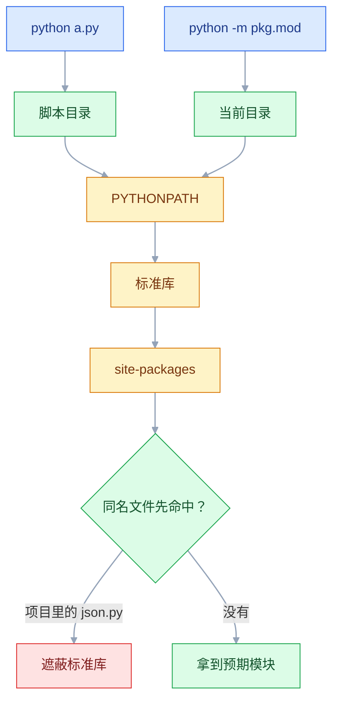
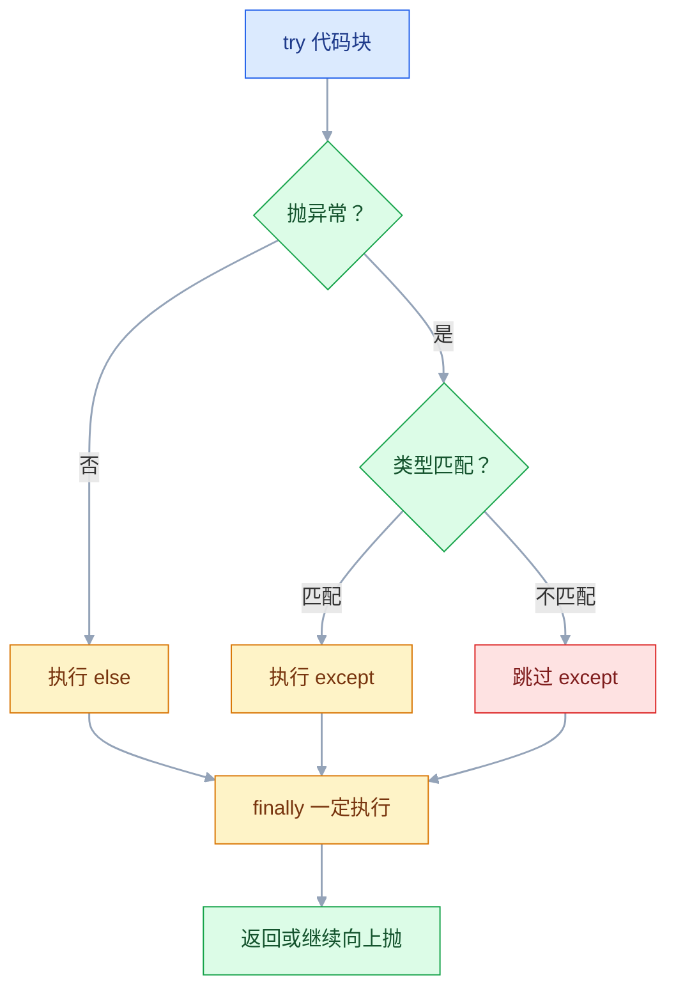

# Python 基础

## 一、工程案例：写一个日志分析脚本并补上测试

**场景**：一台 Nginx 每天生成 `access.log`，运维要回答四个问题：谁访问最多、哪些接口在报错、哪个请求最慢、流量高峰在几点。过去靠 `awk + sort + uniq` 拼长命令，每次重拼还容易把字段数错。现在写一个单文件命令行工具，一条命令出报告，并用 pytest 锁住解析逻辑。

**产出**：`log_analyzer.py`（零第三方依赖）+ 3 个测试。扔到任何装了 Python 3.10+ 的机器上都能跑，也能挂进 cron：报告写进文件，退出码交给监控判断。

```text
log-analyzer/
├── log_analyzer.py
├── access.log
└── tests/test_log_analyzer.py
```

**样例日志**（Nginx combined 格式，末尾自己加了 `$request_time`；字段依次是 IP、时间、请求行、状态码与字节数、Referer 与 UA、耗时，缺失值统一是 `-`）：

```text
192.168.1.101 - - [11/Oct/2026:08:15:23 +0800] "GET /api/users HTTP/1.1" 200 1234 "https://example.com/" "Mozilla/5.0" 0.123
203.0.113.45 - - [11/Oct/2026:08:16:30 +0800] "GET /api/products HTTP/1.1" 200 8901 "-" "curl/8.4.0" 0.234
192.168.1.103 - - [11/Oct/2026:08:18:33 +0800] "GET /api/reports HTTP/1.1" 500 89 "-" "Mozilla/5.0" 2.345
198.51.100.7 - - [11/Oct/2026:08:17:45 +0800] "GET /missing HTTP/1.1" 404 153 "-" "Mozilla/5.0" 0.012
192.168.1.106 - - [11/Oct/2026:14:25:50 +0800] "GET /api/export HTTP/1.1" 200 45678 "-" "Mozilla/5.0" 4.512
192.168.1.103 - - [11/Oct/2026:09:15:44 +0800] "GET /api/reports HTTP/1.1" 500 89 "-" "Mozilla/5.0" 3.120
192.168.1.107 - - [11/Oct/2026:09:41:02 +0800] "GET /api/orders HTTP/1.1" 200 512 "-" "Mozilla/5.0
```

最后一行是写到一半被截断的脏行（没有耗时、引号没闭合），用来验证「跳过坏行而不是整批失败」。7 行里 6 行有效，1 行跳过。

### 1.1 主程序

```python
#!/usr/bin/env python3
"""Nginx 访问日志分析：python log_analyzer.py access.log --top 5"""
from __future__ import annotations

import argparse, re, sys
from collections import Counter
from dataclasses import dataclass, field
from datetime import datetime
from pathlib import Path

TIME_FORMAT = "%d/%b/%Y:%H:%M:%S %z"
LOG_PATTERN = re.compile(
    r'(?P<ip>\S+) \S+ \S+ \[(?P<time>[^\]]+)\] '
    r'"(?P<method>\S+) (?P<path>\S+) [^"]*" '
    r'(?P<status>\d{3}) (?P<size>\d+|-) '
    r'"[^"]*" "[^"]*" (?P<duration>[\d.]+|-)'
)


@dataclass
class Record:
    """一行日志解析后的结构化结果。"""
    ip: str; time: datetime; method: str
    path: str; status: int; size: int; duration: float

    @property
    def hour(self) -> int: return self.time.hour


@dataclass
class Report:
    """可变默认值必须用 field(default_factory=...)。"""
    total: int = 0; skipped: int = 0; avg_duration: float = 0.0
    top_ips: list[tuple[str, int]] = field(default_factory=list)
    status_dist: dict[int, int] = field(default_factory=dict)
    hours: list[tuple[int, int]] = field(default_factory=list)
    slowest: list[Record] = field(default_factory=list)
    error_paths: list[tuple[str, int]] = field(default_factory=list)


def parse_line(line: str) -> Record | None:
    """解析失败返回 None：日志里总有脏行，跳过比让整批中断合适。"""
    match = LOG_PATTERN.match(line.strip())
    if not match:
        return None
    d = match.groupdict()
    try:
        return Record(
            d["ip"], datetime.strptime(d["time"], TIME_FORMAT),
            d["method"], d["path"], int(d["status"]),
            0 if d["size"] == "-" else int(d["size"]),
            0.0 if d["duration"] == "-" else float(d["duration"]),
        )
    except ValueError:
        return None


def rank(counter: Counter[str], top_n: int) -> list[tuple[str, int]]:
    """次数降序、同次数按键升序，同一份日志永远输出同样的顺序。"""
    return sorted(counter.items(), key=lambda kv: (-kv[1], kv[0]))[:top_n]


def analyze(records: list[Record], top_n: int = 5) -> Report:
    report = Report(total=len(records))
    if not records:
        return report
    report.top_ips = rank(Counter(r.ip for r in records), top_n)
    report.status_dist = dict(sorted(Counter(r.status for r in records).items()))
    report.hours = sorted(Counter(r.hour for r in records).items())
    report.slowest = sorted(records, key=lambda r: r.duration, reverse=True)[:top_n]
    report.error_paths = rank(
        Counter(f"{r.method} {r.path}" for r in records if r.status >= 400), top_n
    )
    report.avg_duration = sum(r.duration for r in records) / len(records)
    return report


def render(report: Report, source: str) -> str:
    parsed = report.total - report.skipped
    out = [f"文件 {source} | 总行数 {report.total} | 解析 {parsed} | "
           f"跳过 {report.skipped} | 平均 {report.avg_duration:.3f}s", "", "TOP IP"]
    out += [f"  {i:>2}. {ip:<15} {n:>6}"
            for i, (ip, n) in enumerate(report.top_ips, 1)]
    out += ["", "状态码"]
    total = parsed or 1
    out += [f"  {code}  {n:>5}  {n / total:>6.1%}"
            for code, n in report.status_dist.items()]
    out += ["", "每小时请求数"]
    out += [f"  {h:02d} 点  {n:>5}" for h, n in report.hours]
    out += ["", "最慢请求"]
    out += [f"  {r.duration:>7.3f}s  {r.status}  {r.method} {r.path}"
            for r in report.slowest]
    out += ["", "错误接口"]
    out += [f"  {path:<30} {n:>4}" for path, n in report.error_paths]
    return "\n".join(out)


def load(path: Path, verbose: bool) -> tuple[list[Record], int, int]:
    """返回 (记录, 总行数, 跳过行数)。"""
    records: list[Record] = []
    total = skipped = 0
    with path.open(encoding="utf-8", errors="replace") as fh:
        for lineno, raw in enumerate(fh, 1):
            total = lineno
            rec = parse_line(raw)
            if rec is None:
                skipped += 1
                if verbose:
                    print(f"跳过第 {lineno} 行: {raw.rstrip()[:60]}", file=sys.stderr)
            else:
                records.append(rec)
    return records, total, skipped


def main(argv: list[str] | None = None) -> int:
    """返回退出码：0 成功 / 1 没有数据 / 2 文件错误。"""
    p = argparse.ArgumentParser(prog="log-analyzer", description="分析 Nginx access.log")
    p.add_argument("logfile", help="日志文件路径")
    p.add_argument("-n", "--top", type=int, default=5, metavar="N")
    p.add_argument("-v", "--verbose", action="store_true")
    args = p.parse_args(argv)

    path = Path(args.logfile)
    if not path.exists():
        print(f"文件不存在: {path}", file=sys.stderr)
        return 2
    records, total, skipped = load(path, args.verbose)
    if not records:
        print("没有解析到记录，请检查日志格式", file=sys.stderr)
        return 1

    report = analyze(records, args.top)
    report.total = total
    report.skipped = skipped
    print(render(report, str(path)))
    return 0


if __name__ == "__main__":
    raise SystemExit(main())
```

| 代码 | 作用 |
|---|---|
| `(?P<name>...)` 命名组 | `groupdict()` 直接取成字典，比按位置取可读 |
| `\d+\|-` | 同时接受数字和缺失值 `-` |
| `parse_line` 返回 `None` | 坏行跳过，不让一条脏数据毁掉整批 |
| `except ValueError` | 收窄到「转换失败」，不吞其它 bug |
| `Counter(...)` + `sorted(key=(-次数, 键))` | 计数后取 TOP N，同次数按 IP 升序，输出可复现 |
| `dict(sorted(...))` | 固定输出顺序，报告可对比 |
| `load` 返回记录、总行数、跳过数 | 三个口径分开算，报告里的分母才不含脏行 |
| `errors="replace"` | 日志混入坏字节时不崩 |
| `main(argv)` | 测试直接传参数，不用伪造 `sys.argv` |

### 1.2 测试

```python
"""pytest：文件名叫 test_*.py，函数名以 test_ 开头才会被发现。"""
from pathlib import Path

import pytest

from log_analyzer import analyze, main, parse_line

SAMPLE = ('192.168.1.101 - - [11/Oct/2026:08:15:23 +0800] '
          '"GET /api/users HTTP/1.1" 200 1234 "-" "Mozilla/5.0" 0.123')


@pytest.fixture
def log_file(tmp_path: Path) -> Path:
    content = "\n".join([
        SAMPLE,
        '10.0.0.1 - - [11/Oct/2026:08:16:00 +0800] "GET /a HTTP/1.1" 500 10 "-" "curl" 2.500',
        "这是一行垃圾数据，应该被跳过",
    ])
    p = tmp_path / "access.log"
    p.write_text(content, encoding="utf-8")
    return p


def test_parse_ok_and_dash():
    rec = parse_line(SAMPLE)
    assert rec is not None
    assert (rec.ip, rec.path, rec.status) == ("192.168.1.101", "/api/users", 200)
    assert rec.duration == pytest.approx(0.123)
    assert parse_line("") is None and parse_line("not a log line") is None
    rec = parse_line('1.1.1.1 - - [11/Oct/2026:01:02:03 +0800] '
                     '"GET / HTTP/1.1" 204 - "-" "-" -')
    assert rec is not None and rec.size == 0 and rec.duration == 0.0


def test_analyze_and_main(log_file, capsys):
    assert analyze([]).total == 0
    assert main([str(log_file), "--top", "3"]) == 0
    out = capsys.readouterr().out
    assert "总行数 3" in out and "解析 2" in out and "跳过 1" in out and "500" in out


def test_exit_code(capsys):
    assert main(["/no/such/file.log"]) == 2
    assert "文件不存在" in capsys.readouterr().err
```

```bash
python3 -m venv .venv && source .venv/bin/activate
python -m pip install pytest
python -m pytest -q
# ...                                                                      [100%]
# 3 passed in 0.03s
```

**注意是 `python -m pytest`，不是裸 `pytest`**：裸 `pytest` 只把测试文件所在的 `tests/` 加进 `sys.path`，`import log_analyzer` 会报 `ModuleNotFoundError`；`python -m pytest` 会把当前目录加进去，规则和 3.1 里 `python -m` 那条一致。

### 1.3 运行与关键输出

```bash
python log_analyzer.py access.log --top 3
```

```text
文件 access.log | 总行数 7 | 解析 6 | 跳过 1 | 平均 1.724s

TOP IP
   1. 192.168.1.103        2
   2. 192.168.1.101        1
   3. 192.168.1.106        1

状态码
  200      3   50.0%
  404      1   16.7%
  500      2   33.3%

每小时请求数
  08 点      4
  09 点      1
  14 点      1

最慢请求
    4.512s  200  GET /api/export
    3.120s  500  GET /api/reports
    2.345s  500  GET /api/reports

错误接口
  GET /api/reports                  2
  GET /missing                      1
```

表头三个数字各管一件事：`总行数` 是文件读了几行，`解析` 是进统计的记录数，`跳过` 是脏行；百分比的分母用 `解析`，脏行不该稀释错误率。手动加 `-v` 能看到被跳过的具体行和行号。

报告直接给出结论：`/api/reports` 两次 500 且都在 2 秒以上，是第一个要查的服务端问题；`/api/export` 4.5 秒，需要看是不是导出了全量数据；小时分布里 08 点占了 4 条，扩容和限流要盯这个时段。

### 1.4 验收

| # | 检查项 | 命令或检查 | 通过标准 |
|---|---|---|---|
| 1 | 模块可导入 | `python -c "import log_analyzer"` | 无输出，退出码 0 |
| 2 | 单行解析 | `python -m pytest -q -k parse` | 1 个测试通过 |
| 3 | 缺失字段 | 同上 | `size=0`、`duration=0.0`，不抛异常 |
| 4 | 脏行跳过 | `python log_analyzer.py access.log -v` | stderr 有「跳过第 7 行」，表头 `总行数 7 \| 解析 6 \| 跳过 1`，退出码 0 |
| 5 | 空输入 | `printf '' > empty.log; python log_analyzer.py empty.log` | 退出码 1，stderr 有提示 |
| 6 | 文件不存在 | `python log_analyzer.py nope.log; echo $?` | 输出 2 |
| 7 | TOP N | `python log_analyzer.py access.log --top 2` | TOP IP 只有 2 行，次数降序、同次数按 IP 升序 |
| 8 | 全量测试 | `python -m pytest -q` | 3 passed |

> 退出码是脚本能被 cron 和监控消费的前提：0 成功、1 没数据、2 文件错误。全返回 0 的脚本，出问题时没人知道。
> 同一份代码既能直接跑又能被测试 `import`，靠的是把入口收进 `main()` 并加 `if __name__ == "__main__"`。

---

## 二、高频问答：会卡住你的地方，也是面试最常问的

### 2.1 `ModuleNotFoundError: No module named 'xxx'`

**现场**

对比 `sys.executable` 和 `pip show` 的 Location，再看模块实际从哪个文件加载；解释器一致、`Location` 在同一个 `site-packages` 下才算装对。

```bash
which python && python -c "import sys; print(sys.executable)"
python -m pip show requests
python -c "import requests; print(requests.__file__)"
```

**要点**

- 包没装是少数，多数是 `pip` 和 `python` 指向不同解释器，或项目里有同名文件遮蔽了包。
- 裸 `pip` 可能是 Homebrew、系统或另一个 venv 的入口，装的地方和跑的地方不是一处。
- 脚本目录排在 `sys.path` 最前面，当前目录有个 `requests.py` 就会先命中它。

**追问**

- 为什么 `pip install` 成功了还报找不到？→ 装进了另一个环境的 `site-packages`。
- 同名文件为什么能遮蔽已安装的包？→ 脚本目录在 `sys.path` 里排在标准库和第三方包之前。
- 怎么保证装对？→ 一律用 `python -m pip`，和环境用同一个解释器。

### 2.2 函数返回 `None`，调用处报 `'NoneType' object is not subscriptable`

**现场**

看 traceback 停在哪个变量，用 `print(repr(x))` 确认是 `None` 还是空容器，再回头找哪条分支没返回。

```python
import json
from pathlib import Path

def load(path: Path) -> dict:
    if path.exists():
        return json.loads(path.read_text(encoding="utf-8"))
    # 少了 else 分支的返回值

print(load(Path("config.json"))["host"])   # TypeError
```

**要点**

- `None` 不是空数据，它没有任何下标；空字典 `{}` 才不会在这里崩。
- 某条分支没写 `return`，Python 默认返回 `None`，后面继续下标就崩。
- 给每个提前返回的分支补返回值，或跑 `mypy`，它会直接报缺少 return 语句。

**追问**

- `None` 和 `{}` 有什么区别？→ 一个是空值，一个是空容器，只有后者能下标。
- `mypy` 为什么能发现？→ 返回类型标了 `dict`，缺 return 就是类型错误。
- 函数里 `return` 和 `return None` 一样吗？→ 一样，都返回 `None`。

### 2.3 `UnboundLocalError: local variable 'count' referenced before assignment`

**现场**

搜函数体内有没有 `count =`、`count +=`、`for count in ...`，只要出现赋值，这个名字在整个函数内就是局部。

```python
count = 0

def bump():
    count += 1          # UnboundLocalError

def bump_ok():
    global count        # 显式声明改全局
    count += 1
```

**要点**

- 局部性由编译期决定，不看执行顺序。
- `+=` 先读后写，读的时候局部变量还没绑定，就抛这个错。
- 用 `global` / `nonlocal`，或更推荐把值作为参数传入、用返回值传出。

**追问**

- 函数里只读不赋值呢？→ 会按 LEGB 顺序去找外层和全局。
- `global` 和 `nonlocal` 的区别？→ 一个改模块级变量，一个改外层函数变量。
- 为什么列表 `append` 不报错？→ 没有重新绑定名字，只是改对象内容。

### 2.4 用了 `.get()` 还是崩：`None` 被继续下标或调用

**现场**

看 traceback 停在哪一层，`repr()` 出中间值，确认 `.get()` 返回的到底是默认值还是 `None`。

```python
user = {"name": "小明"}
city = user.get("city")        # None，不报错
print(city.upper())            # AttributeError

city = user.get("city", "未知")  # 给默认值才是完整写法
```

**要点**

- `.get()` 只处理「键不存在」，不处理「值是 None」。
- 它返回的 `None` 被继续下标或调用，就变成 `AttributeError` 或 `TypeError`。
- 默认值能覆盖业务语义就用默认值，不能就用 `if "city" in user` 或 `user["city"]` 让错误尽早暴露。

**追问**

- 嵌套取值怎么写？→ `user.get("city", {}).get("name")`，不要连着下标。
- `.get()` 和 `[]` 怎么选？→ 键可能不存在且能接受默认值用 `.get()`，否则用 `[]` 早失败。
- 值是 `None` 时给默认值有用吗？→ 没用，键存在时返回的是 `None`，不会用默认值。

### 2.5 循环里删元素，总有一半没删掉

**现场**

用 `[1, 2, 2, 3, 4]` 删偶数复现，看最后是否还剩一个 2。

```python
nums = [1, 2, 2, 3, 4]
for n in nums:
    if n % 2 == 0:
        nums.remove(n)
print(nums)                              # [1, 2, 3]

nums = [n for n in nums if n % 2 != 0]   # 重建，最清晰
```

**要点**

- 边遍历边改长度，迭代器和容器失去同步：删除后后面的元素整体前移，下一轮索引跳过了一个。
- 判断条件没写错，`remove` 也没 bug，问题在遍历方式。
- 生成新列表、倒序遍历，或遍历副本 `for n in nums[:]`。

**追问**

- 为什么剩的是第二个 2？→ 第一个删除后它前移，正好被跳过。
- 字典也这样吗？→ 遍历时改大小会直接抛 `RuntimeError`，要遍历 `list(d)` 副本。
- 列表推导为什么没这个问题？→ 它新建列表，不在原列表上删。

### 2.6 默认参数在多次调用之间「记住了」上次的值

**现场**

打印 `f.__defaults__`，能看到那个列表已经积累了元素，说明默认值是函数对象上的共享属性。

```python
def add(item, box=[]):
    box.append(item)
    return box

add(1)                  # [1]
add(2)                  # [1, 2]，不是 [2]

def add_ok(item, box=None):
    box = [] if box is None else box
    box.append(item)
    return box
```

**要点**

- 默认值在 `def` 执行时求值一次，之后所有调用共享同一个对象。
- 它不是每次调用新建，而是函数对象上的一个属性，所以列表会一直积累。
- 默认值是 `[]`、`{}`、`set()` 或可变对象时，一律改成 `None` 再在函数体内创建。

**追问**

- 为什么 `None` 能解决？→ 每次调用在函数体内新建，不共享。
- `dataclass` 里怎么写可变默认值？→ `field(default_factory=list)`。
- 不可变默认值有问题吗？→ 没有，共享也不影响。

### 2.7 改了副本，原列表也跟着变

**现场**

`b[0] is a[0]` 为 `True`，就说明内外层还是共享的同一批对象。

```python
a = [[1], [2]]
b = a.copy()
b[0].append(9)
print(a)               # [[1, 9], [2]]

import copy
c = copy.deepcopy(a)   # 完全独立，代价是递归复制
```

**要点**

- 浅拷贝只复制外层容器，内层元素仍是同一批对象。
- 容器新了不代表里面也新了，`b[0].append` 改的还是原来那个列表。
- 只改外层用 `copy()` / `a[:]`，改嵌套用 `deepcopy()`；数据量大时优先设计成不可变数据。

**追问**

- 元组里的列表能改吗？→ 能，元组只保证引用不变，不保证被引用对象不变。
- `deepcopy` 有什么代价？→ 递归复制，遇到循环引用要靠 memo 处理。
- 什么时候不该用深拷贝？→ 数据量大或对象不可变时，深拷贝纯属浪费。

### 2.8 `UnicodeDecodeError: 'utf-8' codec can't decode byte ...`

**现场**

先看真实编码：`file -I data.csv`（macOS）或 `file -i data.csv`（Linux），或用 `errors="replace"` 先读出来观察。

```bash
file -I data.csv                              # macOS
file -i data.csv                              # Linux
python -c "print(open('data.csv', encoding='gbk').read()[:80])"
```

```python
with open("data.csv", encoding="gbk", errors="replace") as f:
    text = f.read()
```

**要点**

- 编码不是文件内容的一部分，读的时候必须由调用方声明。
- 实际编码与声明不一致就报这个错，常见是 GBK 文件按 UTF-8 读。
- 省略 `encoding` 时用的是 locale 决定的默认编码，同一份代码在 macOS、Linux、容器里可能读到不同结果。

**追问**

- 为什么不能猜编码？→ 同一个字节序列在多种编码下都合法，猜错就是乱码。
- `errors="replace"` 能上生产吗？→ 只适合排查，它会把坏字节替换掉，静默丢数据。
- 写文件要注意什么？→ 永远显式 `encoding="utf-8"`，二进制用 `"rb"`，不走文本模式。

### 2.9 `0.1 + 0.2 == 0.3` 是 `False`

**现场**

用 `repr(0.1 + 0.2)` 看真实结果，再用 `math.isclose` 比较，应返回 `True`。

```python
import math
from decimal import Decimal

0.1 + 0.2                     # 0.30000000000000004
math.isclose(0.1 + 0.2, 0.3)  # True
Decimal("0.1") + Decimal("0.2") == Decimal("0.3")   # True
```

**要点**

- 二进制浮点无法精确表示 0.1、0.2，相加后是 `0.30000000000000004`，不是 Python 的 bug。
- 等号比较的是二进制结果，不是十进制小数。
- 金额用 `Decimal` 或整数分，统计比较用 `math.isclose`。

**追问**

- `round(2.5)` 为什么是 2？→ 银行家舍入，不是四舍五入。
- `Decimal(0.1)` 为什么也不行？→ 会把浮点误差带进去，要用字符串构造。
- `Decimal` 就完全精确吗？→ 十进制精确，但除法仍要设精度和舍入。

### 2.10 `SyntaxError` 指着的行看着没问题：全角标点或缩进混用

**现场**

看消息里的 `invalid character '，' (U+FF0C)`、`expected ','`、`inconsistent use of tabs and spaces`，码位已经直接点出了全角字符。

```python
# SyntaxError: invalid character '，' (U+FF0C)
print("超时"，timeout)
```

**要点**

- 报错位置只是解析器第一次发现异常的地方，不一定是真正写错的那一行。
- 全角标点在 Python 里不是语法字符，肉眼几乎和半角一样；`TabError` 是同一文件混用 Tab 和空格。
- 关掉编辑器全角标点自动替换，缩进统一 4 个空格；`TabError` 用 `python -m tabnanny 文件名` 定位到行。

**追问**

- 为什么漏逗号会报在下一行？→ 解析器读到下一个 token 才发现语法不成立。
- `U+FF0C` 是什么？→ 中文逗号，`invalid character` 后面已经给了码位。
- 怎么从根上避免？→ 统一编辑器配置，提交前跑一遍 lint。

---

## 三、核心知识：从零开始要建立的东西

### 3.1 解释器与导入路径

`python a.py` 先把源码编译成字节码，缓存到 `__pycache__`，再由虚拟机逐条执行。编译期只查语法不查类型，所以类型错误大多要等运行时才炸。

| 顺序 | 位置 | 说明 |
|---|---|---|
| 1 | 脚本所在目录 | `python -m` 时是当前工作目录 |
| 2 | `PYTHONPATH` | 手动追加的路径，容易埋雷 |
| 3 | 标准库 | `json`、`pathlib` 等 |
| 4 | `site-packages` | pip 装的第三方包 |



一个 `.py` 文件是模块，带 `__init__.py` 的目录是常规包；`python -m app.main` 会把当前目录加入 `sys.path`，而 `python app/main.py` 只会把 `app/` 放进去，包内相对导入会失败。3.3 起没有 `__init__.py` 的目录也能作为命名空间包被导入，但常规包仍建议保留 `__init__.py`。边界：不要起 `json.py`、`random.py` 这类文件名，它们会压过标准库。

### 3.2 变量、对象与拷贝

变量是名字到对象的引用，不是装值的盒子。赋值只重新绑定名字，原对象不变。

```python
a = [1, 2]
b = a            # 两个名字指向同一个列表
b.append(3)
print(a)         # [1, 2, 3]

a = [9]          # 只把 a 改指向新列表，b 仍是 [1, 2, 3]

c = [1, [2]]
d = c.copy()     # 新外层，内层共享
d[1].append(9)
print(c)         # [1, [2, 9]]
```

| 类型 | 可变 | 影响 |
|---|---|---|
| `int` / `str` / `tuple` / `frozenset` | 否 | 任何「修改」都产生新对象 |
| `list` / `dict` / `set` / 自定义实例 | 是 | 共享引用会互相影响 |

函数传参是「传对象引用」：改对象内容调用方看得见，重新赋值看不见。边界：判断相等用 `==`，判断同一对象才用 `is`；`deepcopy` 能彻底隔离但要付递归复制的代价。

### 3.3 数值类型与精度

| 类型 | 本质 | 边界 |
|---|---|---|
| `int` | 任意精度整数 | 不溢出，超大整数运算变慢 |
| `float` | IEEE 754 双精度 | 约 15~17 位有效数字，多数十进制小数不精确 |
| `bool` | `int` 的子类 | `True == 1`、`True + True == 2` |
| `Decimal` | 十进制浮点 | 金额计算，需设精度与舍入 |

```python
7 // 2      # 3
-7 // 2     # -4，向下取整，不是向零截断
-7 % 2      # 1，余数符号跟除数走
round(2.5)  # 2，银行家舍入
```

边界：`Decimal` 要用字符串构造 `Decimal("0.1")`，`Decimal(0.1)` 会把浮点误差带进去；大量浮点求和用 `math.fsum()`。

### 3.4 字符串与编码

`str` 是 Unicode 码点序列，`bytes` 是字节序列，两者靠 `encode` / `decode` 转换。

```python
s = "中文"
len(s)                  # 2，按码点计数
raw = s.encode("utf-8") # 6 字节
raw.decode("utf-8")     # "中文"
```

拼接优先 `"".join(parts)`（O(n)）；循环里 `s += part` 每次可能新建字符串，最坏 O(n²)。边界：`len()` 数的是码点，不是用户看到的字符——带修饰的 emoji 可能由多个码点组成；比较用户输入前可做 `unicodedata.normalize("NFC", s)`。

### 3.5 容器类型取舍

| | `list` | `tuple` | `dict` | `set` |
|---|---|---|---|---|
| 有序 | 是 | 是 | 是（插入序，3.7+ 保证） | 否 |
| 可变 | 是 | 否 | 是 | 是 |
| 查找 | O(n) | O(n) | 平均 O(1) | 平均 O(1) |
| 典型用途 | 有序集合 | 固定记录 | 映射、计数 | 去重、交并差 |

```python
from collections import Counter, defaultdict, deque

Counter("hello").most_common(2)      # [('l', 2), ('h', 1)]
d = defaultdict(list)
d["tags"].append("python")           # 键不存在时自动建空列表
q = deque([1, 2]); q.appendleft(0)   # 两端 O(1)
```

边界：`list.insert(0, x)` 和 `pop(0)` 是 O(n)，频繁操作换 `deque`；自定义对象做字典键要实现 `__hash__` 和 `__eq__`，参与哈希的字段必须不可变。

### 3.6 迭代协议与生成器

`for x in obj` 的实际动作是：`iter(obj)` 拿迭代器，反复 `next()`，直到 `StopIteration`。

```python
def count_up(n):
    i = 0
    while i < n:
        yield i        # 产出后暂停，下次从这儿继续
        i += 1

gen = count_up(3)
list(gen)              # [0, 1, 2]
list(gen)              # []，生成器只能消费一次
```


生成器对象自己就是迭代器：`iter(gen) is gen` 为 `True`，所以没有「重新开始」这回事。边界：生成器适合大数据边读边处理和无限序列，代价是不能重复遍历、不能随机访问、不能直接 `len()`；需要多次使用时落成 `list`，或接受 `itertools.tee` 的缓存开销。

> **面试**：常问「生成器和迭代器的区别？为什么只能遍历一次？」答：生成器自己就是迭代器，产出后挂起，耗尽后不会再开始。

### 3.7 函数参数绑定

参数按位置和关键字绑定，规则由定义时的分隔符决定：

```python
def f(a, b=1, /, c=2, *, d, **kw):
    return a, b, c, d, kw

f(10, d=4)               # (10, 1, 2, 4, {})
f(10, 20, d=4, c=5)      # 关键字顺序随意
```

| 形式 | 绑定方式 | 用途 |
|---|---|---|
| `a` | 位置或关键字 | 普通参数 |
| `a, /` | 只能位置 | 参数名不暴露给调用方 |
| `b=1` | 可省略 | 默认值，定义时求值一次 |
| `*args` | 多余位置参数收成元组 | 透传 |
| `*` | 后面的只能关键字 | 强制可读性 |
| `**kwargs` | 多余关键字收成字典 | 透传配置 |

边界：可变默认值跨调用共享；`*args` / `**kwargs` 透传会丢签名信息，对外 API 尽量写全参数；参数过多是职责过多的信号，考虑收进 dataclass。

### 3.8 作用域与闭包

名字查找顺序是 LEGB：局部 → 外层函数 → 全局 → 内置。函数内一旦赋值，该名字在整个函数内就是局部。

```python
def outer():
    x = 0
    def inner():
        nonlocal x       # 改外层函数的 x
        x += 1
        return x
    return inner

funcs = [lambda: i for i in range(3)]
[f() for f in funcs]     # [2, 2, 2]，捕获的是变量不是值
funcs = [lambda i=i: i for i in range(3)]
[f() for f in funcs]     # [0, 1, 2]
```

边界：`global` 只用于确实要改模块级状态的地方；长期存活的闭包会阻止对象回收，必要时用 `functools.partial` 或显式参数替代。

> **面试**：常问「闭包捕获的是值还是变量？`lambda` 在循环里为什么会全部一样？」答：捕获变量，循环结束后都指向最后一个值，用默认参数绑定当下值。

### 3.9 装饰器：函数是对象

`@deco` 只是 `func = deco(func)` 的语法糖：装饰器接收函数，返回一个替代函数。函数能传参、能赋值、能在内部定义，所以这层包装才成立。框架里的 `@app.get("/x")`、`@lru_cache`、`@pytest.fixture` 都是同一个机制——`@` 后面那个可调用对象决定原函数被换成什么。

```python
import functools
import time

def timed(fn):
    @functools.wraps(fn)              # 保留 __name__、__doc__
    def wrapper(*args, **kwargs):
        start = time.perf_counter()
        try:
            return fn(*args, **kwargs)
        finally:
            print(f"{fn.__name__} 用时 {time.perf_counter() - start:.3f}s")
    return wrapper

@timed
def load(path: str) -> str:           # 等价于 load = timed(load)
    return path
```

带参数的装饰器要再套一层：`def retry(times=3):` 里定义并返回 `deco`，使用时写 `@retry(times=5)`。三个 `def` 嵌套不是炫技，是「配置」和「包装」必须分开求值。

边界：每加一层就多一层调用栈，traceback 会变长；`functools.wraps` 只修元信息，被装饰函数的真实签名还藏在 `__wrapped__` 里，要用 `inspect.signature(fn)` 取。装饰器适合横切关注点（计时、重试、鉴权、注册），不适合塞业务逻辑——读代码的人会找不到它到底在哪被调用。

> **面试**：常问「装饰器的本质是什么？`functools.wraps` 有什么用？」答：`func = deco(func)`，`wraps` 保留原函数的元信息。

### 3.10 异常与资源释放

异常沿调用栈向上传播，直到遇到匹配的 `except`；`finally` 无论是否异常都执行，`else` 只在没异常时执行。

```python
try:
    value = int(raw)
except ValueError as e:
    raise ConfigError("port") from e   # 保留原始异常链
else:
    use(value)
finally:
    cleanup()
```



`else` 的位置容易被忽略：它挂在 `try` 上，只在该 `try` 没抛异常时执行，放在 `else` 里的代码不会被同一组 `except` 捕获——这正是「只处理你想处理的异常」的写法。

| 场景 | 做法 |
|---|---|
| 能恢复 | 捕获具体异常，降级或重试 |
| 不能恢复 | 打日志后 `raise`，让上层决定 |
| 资源释放 | `with` / `try...finally` |
| 多个资源 | `contextlib.ExitStack` |

边界：`__exit__` 返回 `True` 会吞掉异常；不要在 `finally` 里 `return`，它会覆盖正在传播的异常。

### 3.11 类与数据类

类属性属于类，实例属性属于对象；通过实例给同名属性赋值，会在实例上新建一个，遮住类属性。

```python
class Task:
    default_priority = 3            # 类属性，所有实例共享

    def __init__(self, title: str):
        self.title = title          # 实例属性
        self.tags: list[str] = []   # 每个实例独立

from dataclasses import dataclass, field

@dataclass(slots=True)
class Point:
    x: int
    y: int = 0
    tags: list[str] = field(default_factory=list)
```

| 方法类型 | 第一个参数 | 用途 |
|---|---|---|
| 实例方法 | `self` | 读写实例状态 |
| 类方法 | `cls` | 备选构造、操作类状态 |
| 静态方法 | 无 | 挂在类下的纯函数 |

边界：`@dataclass` 默认生成 `__eq__`，会让 `__hash__` 变成 `None`，要放进 `set` 得加 `frozen=True` 或自己实现 `__hash__`；上面的 `slots=True` 是 3.10 起才有的参数（以官方当前稳定版为准），只在对内存敏感、对象数量大时才值得加。

### 3.12 类型提示与静态检查

类型提示是给人和工具看的标注，运行时默认不检查；它的价值在补全、重构和 CI。

```python
def greet(name: str, times: int = 1) -> str:
    return f"你好 {name}" * times

maybe: str | None = None     # 3.10+
names: list[str] = ["a"]     # 3.9+
pair: tuple[str, int] = ("a", 1)
```

`mypy --strict` 做全量检查，适合 CI；`pyright` 更快、编辑器集成好；`ruff` 只查风格与常见 bug，不替代类型检查；Pydantic / FastAPI 在运行时真的用注解做校验与序列化。

边界：`Any` 会静默传播，等于关掉检查；第三方库没有标注时结果打折扣；`from __future__ import annotations` 让注解延迟求值，依赖运行时注解的框架要能解析字符串。

> **面试**：常问「Python 的类型提示会在运行时检查吗？」答：默认不检查，价值在补全、重构和 CI，真正运行时校验靠 Pydantic 这类库。

### 3.13 模块、包与虚拟环境

一个 `.py` 是模块，带 `__init__.py` 的目录是常规包。虚拟环境给项目独立的 `site-packages`，解决版本冲突，也避免污染系统 Python。

```bash
python3 -m venv .venv
source .venv/bin/activate        # Windows: .venv\Scripts\activate
python -m pip install -U pip requests pytest
python -m pip freeze > requirements.txt
```

依赖声明有两套东西，别混着用：`pyproject.toml` 里的 `dependencies` 写你**直接**要的包，`requirements.txt` 用 `pip freeze` 生成的是**当前环境的完整快照**（含间接依赖），适合部署时锁版本。把 `pip freeze` 的输出当「项目依赖清单」维护，会越滚越长、也说不清哪个包是真正需要的。

| 现象 | 常见原因 |
|---|---|
| `ModuleNotFoundError` | 路径不对、venv 不对、同名文件遮蔽 |
| 相对导入失败 | 直接运行了包内文件 |
| 刚 `pip install` 就失效 | 装进了另一个环境的 `site-packages` |

边界：venv 只隔离包，不隔离解释器版本；`.venv` 不进 git；只写顶层依赖时，重建可能拿到不同的传递版本。怀疑环境脏了就删掉 `.venv` 重建再装一遍，比逐个 `pip show` 快。

---

## 四、冷门知识汇总

| 知识点 | 为什么冷门 | 用到时的关键词 |
|---|---|---|
| `__slots__` | 日常类不需要，只有大量小对象时才看得出内存差异 | 去掉 `__dict__`、`dataclass(slots=True)` |
| `functools.lru_cache` | 只在重复计算明显时才用，且参数必须可哈希 | `maxsize`、`cache_clear`、`functools.cache` |
| `itertools.groupby` | 用错的人多，它只合并相邻元素 | 先 `sorted(key=...)` 再分组 |
| `bisect` | 有序列表的二分查找与插入，日常被 `sorted` + 线性扫描盖住 | `bisect_left`、`insort`、维护有序列表 |
| `namedtuple` | 被 dataclass 取代，在轻量不可变记录里仍省内存 | `_fields`、`_asdict`、`_replace` |
| `typing.Protocol` | 结构化子类型，写库和做解耦时才用 | 鸭子类型的静态检查、`runtime_checkable` |
| `match` 语句 | 3.10+ 才有，业务代码里长 if-elif 更常见 | 结构模式匹配、`case {"type": t}` |
| 海象运算符 `:=` | 可读性争议大，只在「算一次顺便判断」时划算 | `while (line := f.readline())` |
| `cached_property` | 属性只算一次，但会掩盖计算开销 | 只读派生属性、实例级缓存 |
| `textwrap.dedent` | 只处理字符串字面量的公共缩进，三引号 SQL 里才碰到 | 拼接 SQL、`dedent("""...""")` |
| `weakref` | 缓存和观察者模式才需要，平时直接用强引用 | `WeakValueDictionary`、避免循环引用 |
| `sys.intern` | 大量重复短字符串去重，属于微观优化 | 解析器的字段名、`is` 比较 |
| 小整数缓存 | 让 `is` 看起来能用，但 257 以上就失效 | `-5~256` 才复用、比值只用 `==` |
| `array` / `memoryview` | 科学计算直接用 NumPy，标准库这两个很少露面 | 大块数值、零拷贝切片 |
| `zoneinfo` | 3.9+ 的时区库，很多人还在用 `pytz` | `ZoneInfo("Asia/Shanghai")`、夏令时 |
| `unittest.mock.patch` 的目标 | 补丁打在「使用处」而不是「定义处」，第一次几乎必错 | `patch("app.services.requests.get")` |
