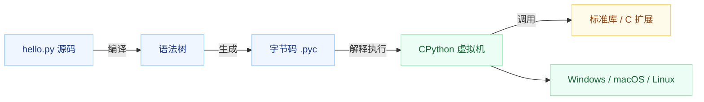

# Python基本语法

> 这篇从 CPython 的执行模型讲起，经过环境搭建、类型与容器、运算符、控制流、函数、异常、文件、模块，最后落到一个可运行的订单清洗程序和一套调试方法。
>
> 学完能独立编写、拆分、运行和调试一个只依赖标准库的 Python 命令行工具，并读懂常见异常栈。

## 一、Python 的运行模型

CPython 先把源码编译成字节码，再由虚拟机逐条执行；类型检查发生在运行时，变量只是对象的名字。



| 产物 | 位置 | 说明 |
|---|---|---|
| `.py` | 源码目录 | 人读的源文件 |
| `__pycache__/*.pyc` | 源码旁 | 字节码缓存，可删除 |
| `.so` / `.pyd` | site-packages | C 扩展，平台相关 |
| `.whl` / `.tar.gz` | 分发渠道 | 安装包，不是运行产物 |

Python 的对象模型有三个直接后果：

- 赋值不复制对象，只让名字指向对象；`b = a` 之后两个名字共享同一个列表。
- 类型属于对象，不属于变量；同一个名字可以先指向 `int`，再指向 `str`。
- 对象销毁由引用计数和循环垃圾回收共同完成，不需要手动 `free`。

```python
import sys

a = [1, 2]
b = a
print(a is b)          # True，两个名字指向同一个列表
print(sys.getrefcount(a))  # 3，a、b 和 getrefcount 的临时参数各一份引用
```

> 边界：动态类型不等于不需要类型设计。函数参数、返回值、外部数据边界仍要标注类型，用 mypy 在提交前检查；运行时不会因为注解写错而报错。

## 二、环境与第一个程序

项目环境用 `uv` 管理，解释器版本写进 `.python-version`，依赖写进 `pyproject.toml`，三端命令一致。

### 2.1 安装 Python 与 uv

| 环境 | 安装 Python | 安装 uv |
|---|---|---|
| Windows 10/11 | `winget install Python.Python.3.13` | `powershell -c "irm https://astral.sh/uv/install.ps1 \| iex"` |
| macOS | `brew install python@3.13` | `brew install uv` |
| Ubuntu 24.04 | `sudo apt install python3.12 python3.12-venv` | `curl -LsSf https://astral.sh/uv/install.sh \| sh` |
| Rocky/CentOS 9 | `sudo dnf install python3.12` | `curl -LsSf https://astral.sh/uv/install.sh \| sh` |

安装后验证：

```bash
python3 --version
uv --version
```

预期输出（版本号以实际为准）：

```text
Python 3.13.18
uv 0.13.7
```

### 2.2 第一个程序

```python
# hello.py
from __future__ import annotations


def main() -> None:
    # 业务逻辑放进函数，模块被 import 时不会产生副作用
    print("Hello, Python 3.13")


if __name__ == "__main__":
    main()
```

```bash
python3 hello.py
```

```text
Hello, Python 3.13
```

`if __name__ == "__main__"` 判断当前文件是被直接执行还是被导入：直接执行时 `__name__` 是 `"__main__"`，被导入时是模块名。

| 现象 | 原因 | 处理 |
|---|---|---|
| `python: command not found` | 只装了 `python3` | 用 `python3`，或安装 `python-is-python3` |
| `No module named ...` | 解释器选错 | `which python3`、`python3 -m pip --version` |
| 中文输出乱码 | 终端编码不是 UTF-8 | 设 `PYTHONUTF8=1`，文件显式 `encoding="utf-8"` |
| 改代码不生效 | 导入了旧的 `.pyc` 或同名模块 | 删 `__pycache__`，检查 `sys.path` |

> 边界：`python3 hello.py` 适合脚本；多文件项目用 `python3 -m package.module` 或安装后的入口命令，避免依赖当前工作目录。

## 三、类型、变量与可变性

Python 的变量是名字绑定，不是内存格子；判断“变没变”要看对象是否可变，而不是看名字是否重新赋值。

### 3.1 标量类型

| 类型 | 示例 | 关键行为 |
|---|---|---|
| `int` | `42`、`10**100` | 任意精度，不会溢出 |
| `float` | `3.14`、`1e-3` | IEEE 754 双精度，有舍入误差 |
| `Decimal` | `Decimal("0.10")` | 十进制精确运算，金额用它 |
| `bool` | `True`、`False` | `bool` 是 `int` 的子类 |
| `str` | `"文本"` | Unicode 不可变序列 |
| `bytes` | `b"\x00"` | 字节序列，I/O 和协议用 |
| `NoneType` | `None` | 只有一个值，表示“没有” |

```python
from decimal import Decimal

print(10 ** 30)                 # 1000000000000000000000000000000，int 不溢出
print(0.1 + 0.2)                # 0.30000000000000004
print(Decimal("0.1") + Decimal("0.2"))  # 0.3，十进制精确
print(isinstance(True, int))    # True，bool 继承 int
print(True + 1)                 # 2
```

整数除法、取余和舍入是最容易出错的三处：

```python
print(7 / 2)       # 3.5，/ 永远返回 float
print(7 // 2)      # 3，向下取整
print(-7 // 2)     # -4，不是 -3
print(-7 % 2)      # 1，余数符号跟除数一致
print(divmod(-7, 2))  # (-4, 1)
print(round(0.5))  # 0，银行家舍入，不是四舍五入
print(round(1.5))  # 2
```

> 边界：金额、税率、积分不要用 `float`；用 `Decimal` 并从字符串构造。科学计算可以用 `float`，比较时用 `math.isclose`。

### 3.2 字符串

字符串不可变，拼接会创建新对象；循环里拼接用 `"".join(parts)`，不要用 `+=` 累加大量片段。

```python
name = "  Ada Lovelace  "
print(name.strip())                 # Ada Lovelace
print(name.strip().lower())         # ada lovelace
print("a,b,c".split(","))           # ['a', 'b', 'c']
print("-".join(["2026", "11", "13"]))  # 2026-11-13
print("report.csv".removesuffix(".csv"))  # report，3.9+
print("line1\nline2".splitlines())  # ['line1', 'line2']

price = 12.5
print(f"{price:.2f}")               # 12.50
print(f"{price=}")                  # price=12.5，调试用
print(f"{'x':>5}|")                 #     x|
```

原始字符串 `r"\d+"` 不处理反斜杠；多行字符串用三引号；`str` 和 `bytes` 之间必须显式编码解码：

```python
text = "中文"
data = text.encode("utf-8")   # b'\xe4\xb8\xad\xe6\x96\x87'
print(data.decode("utf-8"))   # 中文
```

> 边界：文件、网络、数据库的边界都要明确编码。Python 3 的 `str` 是 Unicode 码点序列，不是字节；长度按码点算，不按显示宽度算。

### 3.3 容器

| 容器 | 有序 | 可变 | 查找 | 典型用途 |
|---|---|---|---|---|
| `list` | 是 | 是 | O(n) | 顺序集合、栈 |
| `tuple` | 是 | 否 | O(n) | 固定记录、字典键 |
| `dict` | 是（插入序） | 是 | O(1) | 映射、计数 |
| `set` | 否 | 是 | O(1) | 去重、成员判断 |
| `frozenset` | 否 | 否 | O(1) | 可哈希集合 |

```python
scores = [86, 92, 58]
scores.append(74)
print(scores[0], scores[-1])       # 86 74
print(scores[1:3])                 # [92, 58]

point = (3, 4)
x, y = point                       # 解包
print(x + y)                       # 7

counts = {"a": 1}
counts["b"] = 2
print(counts)                      # {'a': 1, 'b': 2}
print(counts.get("c", 0))          # 0，不抛 KeyError

tags = {"python", "backend"}
tags.add("async")
print("python" in tags)            # True
```

字典的键必须可哈希，列表和字典不能做键；元组内部若含列表，也不能做键。

```python
# print({[1, 2]: "x"})  # TypeError: unhashable type: 'list'
print({(1, 2): "ok"})   # {(1, 2): 'ok'}
```

> 边界：需要稳定顺序用 `list`/`dict`，需要快速成员判断用 `set`。`set` 的迭代顺序不保证，日志和测试断言不要依赖它。

### 3.4 可变性、复制与身份

`is` 比较身份（是不是同一个对象），`==` 比较值；不可变对象可以被复用，所以小整数和短字符串的 `is` 结果不能当作语义保证。

```python
a = [1, 2]
b = a
b.append(3)
print(a)            # [1, 2, 3]，a 和 b 是同一个列表

c = a.copy()       # 浅复制，只复制第一层
c.append(4)
print(a)           # [1, 2, 3]，a 不受影响

matrix = [[1, 2], [3, 4]]
shallow = matrix.copy()
shallow[0][0] = 99
print(matrix)      # [[99, 2], [3, 4]]，内层列表仍共享

import copy
deep = copy.deepcopy(matrix)
deep[0][0] = 0
print(matrix)      # [[99, 2], [3, 4]]
```

```python
x = [1, 2]
y = [1, 2]
print(x == y)      # True，值相等
print(x is y)      # False，两个不同对象
print(None is None)  # True，单例
```

> 边界：只用 `is` 判断 `None`、`True`、`False` 和哨兵对象；其余值比较一律用 `==`。浅复制只解决第一层，嵌套结构用 `copy.deepcopy`。

### 3.5 真值与空值

空容器、`0`、`""`、`None` 在布尔上下文里都是假，但“假”不等于“缺失”。

```python
values = [0, "", [], None]
print([bool(v) for v in values])  # [False, False, False, False]

count = 0
print(count or 10)                # 10，0 被当成假
print(10 if count is None else count)  # 0，明确区分 None 和 0
```

> 边界：配置项允许 `0` 或空字符串时，用 `is None` 判断缺失，不要用 `if not value`；否则合法的 0 会被默认值覆盖。

## 四、运算符与表达式

运算符的优先级可以查表，但可读性优先：混合运算加括号，比较写成链式，布尔表达式利用短路。

| 类别 | 运算符 | 注意 |
|---|---|---|
| 算术 | `+ - * / // % **` | `/` 返回 float，`//` 向下取整 |
| 比较 | `== != < <= > >=` | 支持 `0 <= x <= 100` 链式 |
| 逻辑 | `and or not` | 返回操作数，不强制转 bool |
| 成员 | `in`、`not in` | `set`/`dict` 平均 O(1) |
| 身份 | `is`、`is not` | 只用于单例和哨兵 |
| 位运算 | `& \| ^ ~ << >>` | `&`/`^`/`\|` 高于比较（C/Java 相反），混用加括号 |

```python
score = 86
print(0 <= score <= 100)          # True，链式比较等价于两个比较
print(score > 60 and score < 90)  # True
print("py" in "python")           # True

name = ""
display = name or "匿名"           # 空字符串是假，取默认值
print(display)                    # 匿名

# 海象运算符：赋值并返回结果，减少重复计算
if (n := len("hello")) > 3:
    print(n)                      # 5
```

`and`/`or` 返回的是操作数本身，不是 `True`/`False`：

```python
print(0 or "fallback")   # fallback
print("a" and "b")       # b
print([] or {})          # {}
```

> 边界：`x = x or []` 在 `x` 是 `0`、`""`、`False` 时也会走默认值；这类值合法时改用 `if x is None`。位运算和比较混用时加括号：Python 中 `a & 1 == 0` 按 `(a & 1) == 0` 解析，但 C/Java 的优先级不同，跨语言阅读容易误判。

## 五、控制流

控制流只解决三件事：分支、遍历、提前退出；能用早返回压平嵌套时，不要写三层 `if`。

### 5.1 条件与 match

```python
score = 86

if score >= 90:
    level = "优秀"
elif score >= 60:
    level = "及格"
else:
    level = "不及格"
print(level)  # 及格
```

Python 3.10 起有结构化模式匹配，适合按“形状”分派命令和消息：

```python
def handle(command: str) -> str:
    match command.split():
        case ["go", direction]:
            return f"向 {direction} 移动"
        case ["look"]:
            return "观察四周"
        case ["take", item] if item:
            return f"拿起 {item}"
        case _:
            return "未知命令"

print(handle("go north"))   # 向 north 移动
print(handle("look"))       # 观察四周
print(handle("take"))       # 未知命令
```

`case ["go", direction]` 既匹配长度，也把第二项绑定到 `direction`；`case _` 是兜底，必须覆盖。

> 边界：`match` 不是 C 的 `switch`，不会贯穿；模式里的名字是捕获变量，不是常量。要和常量比较，用 `case Color.RED` 这类点号形式。

### 5.2 循环

```python
for i in range(1, 4):
    print(i)                 # 1 2 3

scores = [86, 92, 58]
for index, score in enumerate(scores, start=1):
    print(index, score)      # 1 86 / 2 92 / 3 58

names = ["a", "b", "c"]
for name, score in zip(names, scores, strict=True):
    print(name, score)       # strict 在长度不一致时抛 ValueError

n = 3
while n > 0:
    print(n)
    n -= 1
```

`for`/`while` 可以带 `else`，只在循环没有被 `break` 打断时执行：

```python
for candidate in [4, 6, 8]:
    if candidate % 2 == 0:
        print("找到偶数", candidate)
        break
else:
    print("没有偶数")
```

> 边界：遍历列表时不要同时 `remove`，会跳过元素；用列表推导式生成新列表，或倒序遍历。`for...else` 只适合“查找并 break”的场景，普通循环加 `else` 会降低可读性。

### 5.3 推导式与生成器

```python
numbers = [1, 2, 3, 4, 5]
squares = [n * n for n in numbers if n % 2 == 1]
print(squares)                       # [1, 9, 25]

mapping = {n: n * n for n in numbers}
print(mapping[3])                    # 9

unique = {n % 3 for n in numbers}
print(unique)                        # {0, 1, 2}

total = sum(n * n for n in numbers)  # 生成器表达式，不建中间列表
print(total)                         # 55
```

> 边界：推导式只放一个表达式和至多一个过滤条件；嵌套超过两层或带副作用时改成普通循环。生成器只能消费一次。

## 六、函数与参数

函数的参数设计决定调用方是否容易用错：位置参数表达顺序，关键字参数表达含义，默认值只放不可变对象。

### 6.1 定义与返回

```python
def average(scores: list[int]) -> float:
    """返回平均分；空列表返回 0.0。"""
    if not scores:
        return 0.0
    return sum(scores) / len(scores)


print(average([86, 92, 58]))  # 78.66666666666667
print(average([]))            # 0.0
```

没有 `return` 的函数返回 `None`；返回多个值时实际返回元组，调用方可以解包。

```python
def min_max(values: list[int]) -> tuple[int, int]:
    return min(values), max(values)


low, high = min_max([3, 1, 4])
print(low, high)  # 1 4
```

### 6.2 默认值、关键字参数与可变参数

默认值在函数定义时求值一次，所以可变默认值会在调用之间共享：

```python
def add_bad(item, bucket=[]):   # 错误示范：默认列表只创建一次
    bucket.append(item)
    return bucket


print(add_bad("a"))  # ['a']
print(add_bad("b"))  # ['a', 'b']，不是 ['b']


def add_good(item, bucket=None):
    if bucket is None:          # None 作为哨兵，每次调用新建列表
        bucket = []
    bucket.append(item)
    return bucket


print(add_good("a"))  # ['a']
print(add_good("b"))  # ['b']
```

参数列表里的 `/` 和 `*` 控制调用方式：

```python
def create_user(name, /, *, age: int, active: bool = True):
    return {"name": name, "age": age, "active": active}


print(create_user("Ada", age=36))          # name 只能位置传，age 只能关键字传
# create_user(name="Ada", age=36)          # TypeError
```

`*args` 收集多余位置参数，`**kwargs` 收集多余关键字参数：

```python
def tag(name, *children, **attrs):
    # 关键字参数里的 class_ 还原成 HTML 的 class
    attr_text = " ".join(f'{k.rstrip("_")}="{v}"' for k, v in attrs.items())
    inner = "".join(children)
    return f"<{name} {attr_text}>{inner}</{name}>"


print(tag("p", "hello", class_="lead"))  # <p class="lead">hello</p>
```

> 边界：布尔参数、配置参数用关键字限定；参数超过 4 个时考虑传 dataclass 或字典。`*args`/`**kwargs` 会削弱类型检查，公共 API 不要滥用。

### 6.3 闭包、lambda 与装饰器

内层函数引用外层变量，形成闭包；修改外层变量要声明 `nonlocal`。

```python
def make_counter(start: int = 0):
    count = start

    def counter() -> int:
        nonlocal count
        count += 1
        return count

    return counter


c = make_counter(10)
print(c(), c())  # 11 12
```

lambda 只适合一行表达式；循环里创建 lambda 会晚绑定，必须用默认参数固定当前值：

```python
funcs = [lambda x, i=i: x + i for i in range(3)]
print([f(10) for f in funcs])  # [10, 11, 12]
```

装饰器是接收函数并返回新函数的高阶函数，`functools.wraps` 保留原函数的元数据：

```python
import functools
import time


def timed(func):
    @functools.wraps(func)
    def wrapper(*args, **kwargs):
        start = time.perf_counter()
        result = func(*args, **kwargs)
        print(f"{func.__name__} 耗时 {time.perf_counter() - start:.4f}s")
        return result

    return wrapper


@timed
def slow_add(a: int, b: int) -> int:
    time.sleep(0.01)
    return a + b


print(slow_add(1, 2))  # 先打印耗时，再打印 3
```

> 边界：闭包捕获的是变量而不是值；装饰器会改变函数签名，类型检查器需要 `ParamSpec` 才能完整推断。业务代码优先用显式函数，装饰器只封装横切逻辑。

## 七、异常处理

异常用于处理“预期内的失败”，不是控制流；捕获要具体，处理不了就向上抛，并在边界统一记录。

### 7.1 try 的完整结构

```python
def parse_port(raw: str) -> int:
    try:
        port = int(raw)
    except ValueError as exc:
        # 保留原始异常链，排查时能看到 int() 的失败原因
        raise ValueError(f"端口不是整数: {raw!r}") from exc
    else:
        # 只有 try 没抛异常才执行，避免把校验错误也当成解析错误
        if not 1 <= port <= 65535:
            raise ValueError(f"端口越界: {port}")
        return port
    finally:
        # 无论成功失败都执行，适合释放资源
        print(f"parse_port({raw!r}) 结束")
```

```python
print(parse_port("8080"))
# parse_port('8080') 结束
# 8080
```

异常类层次：

```text
BaseException
├── SystemExit
├── KeyboardInterrupt
└── Exception
    ├── ValueError
    ├── TypeError
    ├── OSError
    │   ├── FileNotFoundError
    │   └── PermissionError
    └── RuntimeError
```

`KeyboardInterrupt` 和 `SystemExit` 不是 `Exception` 的子类，`except Exception` 不会吞掉 Ctrl+C 和 `sys.exit()`。

> 边界：不要写裸 `except:`，它会连 `KeyboardInterrupt` 一起捕获；不要用 `assert` 校验外部输入，`python -O` 会移除断言。

### 7.2 自定义异常与上下文管理器

```python
class ConfigError(Exception):
    """配置缺失或格式错误。"""


def require(config: dict[str, str], key: str) -> str:
    if key not in config:
        raise ConfigError(f"缺少配置项: {key}")
    return config[key]


try:
    require({"host": "localhost"}, "port")
except ConfigError as exc:
    print(f"配置失败: {exc}")  # 配置失败: 缺少配置项: port
```

`with` 保证退出时释放资源，自定义上下文管理器实现 `__enter__`/`__exit__`：

```python
import time


class Timer:
    def __enter__(self):
        self.start = time.perf_counter()
        return self

    def __exit__(self, exc_type, exc, tb):
        self.elapsed = time.perf_counter() - self.start
        print(f"耗时 {self.elapsed:.4f}s")
        return False  # False 表示不吞异常


with Timer():
    sum(range(100_000))
```

> 边界：自定义异常继承最近的语义父类（如 `ValueError`），不要都继承 `Exception`；`__exit__` 返回 `True` 会吞掉异常，除非确实要抑制。

## 八、文件与路径

路径操作用 `pathlib`，文本读写显式指定 `encoding="utf-8"`，大文件逐行处理，写文件先写临时文件再原子替换。

### 8.1 路径与目录

```python
from pathlib import Path

base = Path("data")
base.mkdir(parents=True, exist_ok=True)  # 父目录不存在也创建，已存在不报错
report = base / "report.csv"
print(report.name)       # report.csv
print(report.suffix)     # .csv
print(report.stem)       # report
print(report.resolve())  # 绝对路径，符号链接会展开
print(list(base.glob("*.csv")))
```

### 8.2 文本、JSON 与 CSV

```python
import json

path = Path("data/config.json")
path.write_text('{"host": "localhost", "port": 8080}', encoding="utf-8")

config = json.loads(path.read_text(encoding="utf-8"))
print(config["port"])  # 8080

# ensure_ascii=False 保留中文，indent 便于人工阅读
path.write_text(json.dumps(config, ensure_ascii=False, indent=2), encoding="utf-8")
```

```python
import csv

with Path("data/report.csv").open("w", encoding="utf-8", newline="") as handle:
    writer = csv.DictWriter(handle, fieldnames=["name", "score"])
    writer.writeheader()
    writer.writerows([{"name": "张三", "score": 86}, {"name": "李四", "score": 92}])

with Path("data/report.csv").open(encoding="utf-8", newline="") as handle:
    for row in csv.DictReader(handle):
        print(row["name"], row["score"])
```

`newline=""` 交给 `csv` 模块处理换行，避免 Windows 上出现空行。

### 8.3 大文件与原子写入

```python
def count_lines(path: Path) -> int:
    total = 0
    with path.open(encoding="utf-8") as handle:
        for _ in handle:      # 逐行迭代，不会把整个文件读进内存
            total += 1
    return total


def atomic_write(path: Path, text: str) -> None:
    tmp = path.with_suffix(path.suffix + ".tmp")
    tmp.write_text(text, encoding="utf-8")
    tmp.replace(path)          # 同一文件系统内原子替换，避免读到半截文件
```

> 边界：`Path.write_text` 会直接覆盖，进程中途崩溃可能留下半截文件；对账、配置、导出文件用临时文件加 `replace`。读取未知来源的文件要限制大小，防止内存被占满。

## 九、模块与包

模块是 `.py` 文件，常规包是带 `__init__.py` 的目录，命名空间包可以没有；导入只执行一次，之后从 `sys.modules` 缓存取。

### 9.1 导入与入口

```text
billing/
├── __init__.py
├── core.py
└── cli.py
```

```python
# billing/core.py
def total(amounts: list[float]) -> float:
    return sum(amounts)
```

```python
# billing/cli.py
from billing.core import total


def main() -> None:
    print(total([10.0, 20.0]))


if __name__ == "__main__":
    main()
```

```bash
python3 -m billing.cli
```

```text
30.0
```

`python3 -m billing.cli` 把当前目录放进 `sys.path`，按包路径导入；直接 `python3 billing/cli.py` 会把 `billing/` 当顶层目录，`from billing.core` 可能失败。

| 写法 | 适用 | 风险 |
|---|---|---|
| `import json` | 标准库/第三方顶层包 | 无 |
| `from billing.core import total` | 包内绝对导入 | 循环导入 |
| `from .core import total` | 包内相对导入 | 只能包内使用 |
| `sys.path.append(...)` | 临时脚本 | 污染导入路径 |

> 边界：不要用 `sys.path` 补丁解决导入问题，改用 `src` 布局和可安装包；不要让模块名和标准库重名，例如项目里的 `random.py` 会遮蔽标准库。

### 9.2 `__init__.py` 与 `__all__`

```python
# billing/__init__.py
from billing.core import total

__all__ = ["total"]  # 控制 from billing import * 的导出，也提示公共 API
```

> 边界：`__init__.py` 只做导出和版本号，不放业务逻辑和 I/O；否则一次导入会触发数据库连接、日志配置等副作用。

## 十、完整程序与调试

下面的词频工具把文件读取、正则、`Counter`、`argparse` 和异常处理串成一个可运行程序。

```python
#!/usr/bin/env python3
"""统计文本中的单词频次。"""

from __future__ import annotations

import argparse
import re
import sys
from collections import Counter
from pathlib import Path

WORD_RE = re.compile(r"[A-Za-z][A-Za-z'-]*")


def count_words(text: str, min_length: int = 3) -> Counter[str]:
    # 先统一小写再匹配，避免 "Python" 和 "python" 分成两个词
    words = WORD_RE.findall(text.lower())
    return Counter(word for word in words if len(word) >= min_length)


def main(argv: list[str] | None = None) -> int:
    parser = argparse.ArgumentParser(description="统计英文词频")
    parser.add_argument("path", type=Path, help="输入文本文件")
    parser.add_argument("-n", "--top", type=int, default=10, help="输出前 N 个")
    parser.add_argument("--min-length", type=int, default=3, help="忽略短于该长度的词")
    args = parser.parse_args(argv)

    try:
        # 显式编码，避免不同系统默认编码不同
        text = args.path.read_text(encoding="utf-8")
    except FileNotFoundError:
        print(f"文件不存在: {args.path}", file=sys.stderr)
        return 2
    except UnicodeDecodeError as exc:
        print(f"不是 UTF-8 文本: {args.path} ({exc})", file=sys.stderr)
        return 2

    counts = count_words(text, args.min_length)
    print(f"文件: {args.path}")
    print(f"不同单词: {len(counts)}，总词数: {sum(counts.values())}")
    for rank, (word, count) in enumerate(counts.most_common(args.top), start=1):
        print(f"{rank:>2}. {word:<12} {count}")
    return 0


if __name__ == "__main__":
    raise SystemExit(main())
```

输入文件 `sample.txt`：

```text
Python is a dynamic language. Python runs on an interpreter, and the interpreter
compiles source into bytecode. A dynamic language still benefits from tests and
type checking; the interpreter does not enforce annotations at runtime.
```

```bash
python3 wordstat.py sample.txt -n 5
```

预期输出：

```text
文件: sample.txt
不同单词: 22，总词数: 29
 1. interpreter  3
 2. python       2
 3. dynamic      2
 4. language     2
 5. and          2
```

### 10.1 读异常栈

异常栈从下往上读：最后一行是异常类型和消息，往上是调用链，最上面是入口。先定位“哪一行抛的”，再看“是哪条输入导致的”。

```text
Traceback (most recent call last):
  File "wordstat.py", line 47, in <module>
    raise SystemExit(main())
  File "wordstat.py", line 30, in main
    text = args.path.read_text(encoding="utf-8")
FileNotFoundError: [Errno 2] No such file or directory: 'missing.txt'
```

第一条命令不是改代码，而是复现并缩小输入：

```bash
python3 -X dev wordstat.py missing.txt   # 开发模式，暴露更多警告
python3 -m pdb wordstat.py sample.txt    # 进入调试器
```

`pdb` 常用命令：

| 命令 | 作用 |
|---|---|
| `l` / `ll` | 查看当前位置/整个函数 |
| `n` | 执行下一行，不进入函数 |
| `s` | 进入函数 |
| `c` | 继续到下一个断点 |
| `p expr` | 打印表达式 |
| `b file:line` | 设置断点 |
| `q` | 退出 |

代码里也可以调用 `breakpoint()`，由 `PYTHONBREAKPOINT` 决定行为；生产环境设 `PYTHONBREAKPOINT=0` 关闭。

### 10.2 日志替代 print

```python
import logging

logging.basicConfig(
    level=logging.INFO,
    format="%(asctime)s %(levelname)s %(name)s %(message)s",
)
logger = logging.getLogger(__name__)

logger.info("开始处理 %s", "orders.csv")  # 用参数占位，级别未开启时不格式化
```

> 边界：`print` 只用于一次性脚本和标准输出；需要级别、时间、模块名、文件输出时用 `logging`。日志里不要拼接密码、令牌和完整身份证号。

### 10.3 常见错误对照

| 现象 | 常见原因 | 第一条检查 |
|---|---|---|
| `IndentationError` | 空格和 Tab 混用 | 编辑器显示空白字符 |
| `NameError` | 变量未赋值或拼错 | 作用域和导入 |
| `TypeError` | 参数类型/个数不对 | 函数签名和实参 |
| `KeyError` | 字典键不存在 | 用 `get` 或先判断 |
| `AttributeError` | 对象没有该属性/方法 | `type(obj)`、`dir(obj)` |
| `UnicodeDecodeError` | 文件不是 UTF-8 | `file --mime-type`、换编码 |
| `ModuleNotFoundError` | 解释器或 `sys.path` 不对 | `sys.executable`、`sys.path` |

## 十一、最佳实践案例

### 11.1 案例背景

电商运营每天从后台导出 `orders.csv`，列固定为 `order_id,customer,amount,status,created_at`。上游系统不保证数据质量：金额可能是 `abc`、负数或 0，状态可能拼错，时间可能不是 ISO 格式。运营需要一份可核对的状态汇总、一份干净数据，以及一份带行号的拒绝明细。

约束是只允许标准库、重复运行结果一致、坏行不能中断整批处理、金额不能出现浮点误差。现有做法是手工在 Excel 里筛选，既无法复现，也无法解释某一行为什么被丢弃。

### 11.2 案例实操

```python
#!/usr/bin/env python3
"""清洗订单 CSV，输出汇总、干净数据和拒绝明细。"""

from __future__ import annotations

import argparse
import csv
import sys
from collections import Counter, defaultdict
from datetime import datetime
from decimal import Decimal, InvalidOperation
from pathlib import Path

FIELDS = ("order_id", "customer", "amount", "status", "created_at")
VALID_STATUS = {"paid", "refunded", "pending"}
MAX_AMOUNT = Decimal("1000000.00")


class RowError(ValueError):
    """单行数据不合法；消息直接写入拒绝明细。"""


def parse_amount(raw: str) -> Decimal:
    try:
        # 金额从字符串构造，避免先经过 float 引入二进制误差
        value = Decimal(raw.strip())
    except InvalidOperation as exc:
        raise RowError(f"金额不是数字: {raw!r}") from exc
    if not value.is_finite() or value <= 0:
        raise RowError(f"金额必须为正数: {raw!r}")
    if value > MAX_AMOUNT:
        raise RowError(f"金额超过上限: {raw!r}")
    # 统一到分，后续汇总不会出现 0.001 这类尾差
    return value.quantize(Decimal("0.01"))


def parse_time(raw: str) -> datetime:
    try:
        return datetime.fromisoformat(raw.strip())
    except ValueError as exc:
        raise RowError(f"时间格式错误: {raw!r}") from exc


def validate_row(row: dict[str, str | None]) -> dict[str, str]:
    order_id = (row.get("order_id") or "").strip()
    customer = (row.get("customer") or "").strip()
    status = (row.get("status") or "").strip().lower()
    if not order_id:
        raise RowError("order_id 为空")
    if not customer:
        raise RowError("customer 为空")
    if status not in VALID_STATUS:
        raise RowError(f"未知状态: {status!r}")
    amount = parse_amount(row.get("amount") or "")
    created_at = parse_time(row.get("created_at") or "")
    # 统一成字符串再向下传，调用方不必处理 Decimal/datetime 的联合类型
    return {
        "order_id": order_id,
        "customer": customer,
        "amount": f"{amount:.2f}",
        "status": status,
        "created_at": created_at.isoformat(timespec="seconds"),
    }


def load_orders(path: Path) -> tuple[list[dict[str, str]], list[dict[str, str]]]:
    valid: list[dict[str, str]] = []
    rejected: list[dict[str, str]] = []
    # utf-8-sig 兼容 Excel 导出的 BOM，否则第一列名会变成 \ufefforder_id
    with path.open(encoding="utf-8-sig", newline="") as handle:
        reader = csv.DictReader(handle)
        if reader.fieldnames is None or tuple(reader.fieldnames) != FIELDS:
            raise ValueError(f"表头必须是 {','.join(FIELDS)}")
        for line_no, row in enumerate(reader, start=2):
            try:
                valid.append(validate_row(row))
            except RowError as exc:
                rejected.append({"line": str(line_no), "reason": str(exc)})
    return valid, rejected


def summarize(
    orders: list[dict[str, str]],
) -> tuple[Counter[str], Decimal, Decimal, Decimal, list[tuple[str, Decimal]]]:
    counts = Counter(order["status"] for order in orders)
    paid = sum(
        (Decimal(order["amount"]) for order in orders if order["status"] == "paid"),
        Decimal("0"),
    )
    refunded = sum(
        (Decimal(order["amount"]) for order in orders if order["status"] == "refunded"),
        Decimal("0"),
    )
    by_customer: defaultdict[str, Decimal] = defaultdict(Decimal)
    for order in orders:
        if order["status"] == "paid":
            # defaultdict 省去“键不存在先赋 0”的分支，聚合代码更短
            by_customer[order["customer"]] += Decimal(order["amount"])
    top = sorted(by_customer.items(), key=lambda item: item[1], reverse=True)[:3]
    return counts, paid, refunded, paid - refunded, top


def write_clean(path: Path, orders: list[dict[str, str]]) -> None:
    with path.open("w", encoding="utf-8", newline="") as handle:
        writer = csv.DictWriter(handle, fieldnames=FIELDS)
        writer.writeheader()
        writer.writerows(orders)


def write_rejects(path: Path, rows: list[dict[str, str]]) -> None:
    with path.open("w", encoding="utf-8", newline="") as handle:
        writer = csv.DictWriter(handle, fieldnames=("line", "reason"))
        writer.writeheader()
        writer.writerows(rows)


def main(argv: list[str] | None = None) -> int:
    parser = argparse.ArgumentParser(description="清洗订单 CSV 并汇总")
    parser.add_argument("input", type=Path, help="原始 CSV")
    parser.add_argument("-o", "--out-dir", type=Path, default=Path("out"))
    args = parser.parse_args(argv)

    try:
        orders, rejected = load_orders(args.input)
    except (OSError, ValueError) as exc:
        print(f"读取失败: {exc}", file=sys.stderr)
        return 2

    args.out_dir.mkdir(parents=True, exist_ok=True)
    write_clean(args.out_dir / "clean.csv", orders)
    write_rejects(args.out_dir / "rejects.csv", rejected)

    counts, paid, refunded, net, top = summarize(orders)
    print(f"读取: {args.input}")
    print(f"有效: {len(orders)} 行，跳过: {len(rejected)} 行")
    print("状态分布: " + ", ".join(f"{k}={counts[k]}" for k in sorted(counts)))
    print(f"已收: {paid:.2f}  已退: {refunded:.2f}  净额: {net:.2f}")
    print("客户贡献（paid）:")
    for index, (name, amount) in enumerate(top, start=1):
        print(f"  {index}. {name} {amount:.2f}")
    print(f"清洗结果: {args.out_dir / 'clean.csv'}")
    print(f"拒绝明细: {args.out_dir / 'rejects.csv'}")
    return 0


if __name__ == "__main__":
    raise SystemExit(main())
```

输入：

```csv
order_id,customer,amount,status,created_at
A1001,张三,128.50,paid,2026-11-01T10:00:00
A1002,李四,99.99,paid,2026-11-01T11:20:00
A1003,张三,50.00,refunded,2026-11-02T09:15:00
A1004,王五,abc,paid,2026-11-02T10:00:00
A1005,赵六,-20,paid,2026-11-02T10:05:00
A1006,李四,300,paid,2026-11-03T08:30:00
A1007,王五,75.25,pending,2026-11-03T09:00:00
A1008,张三,0,paid,2026-11-03T09:10:00
A1009,赵六,42.00,unknown,2026-11-03T09:20:00
A1010,李四,1000.00,refunded,2026-11-04T12:00:00
```

```bash
python3 order_report.py orders.csv -o out
```

预期输出：

```text
读取: orders.csv
有效: 6 行，跳过: 4 行
状态分布: paid=3, pending=1, refunded=2
已收: 528.49  已退: 1050.00  净额: -521.51
客户贡献（paid）:
  1. 李四 399.99
  2. 张三 128.50
清洗结果: out/clean.csv
拒绝明细: out/rejects.csv
```

`out/rejects.csv` 保留行号，运营可以直接回到 Excel 第 5、6、9、10 行核对：

```text
line,reason
5,金额不是数字: 'abc'
6,金额必须为正数: '-20'
9,金额必须为正数: '0'
10,未知状态: 'unknown'
```

### 11.3 案例结果

本机实测（Python 3.13.18）：10 行输入，6 行有效、4 行被拒绝，净额为 `-521.51`，与手算一致；重复运行覆盖同一份输出，结果不变。金额全部走 `Decimal`，`0.1 + 0.2` 的浮点尾差不会进入汇总。

失败模式与复盘：

- 表头被 Excel 改成中文或加列时，`load_orders` 直接报错退出，避免在错误列上静默计算；需要兼容时把列映射做成配置。
- `Decimal` 可以接受 `"NaN"`、`"Infinity"`，代码用 `is_finite()` 挡掉；只校验 `> 0` 会漏掉 `NaN` 的比较。
- 单行失败只记录行号和原因，不打印整行，避免把客户姓名和金额写进普通日志；需要审计时另存脱敏后的原始行。
- `main` 只负责参数、输出和退出码；解析、校验、汇总、写文件各自独立，后续换成数据库或 Parquet 时不用重写校验逻辑。
- 若数据量到百万行，`read_text`/一次性列表会占内存，应改为流式读取并在汇总后释放；当前版本面向每日几万行的运营导出。
