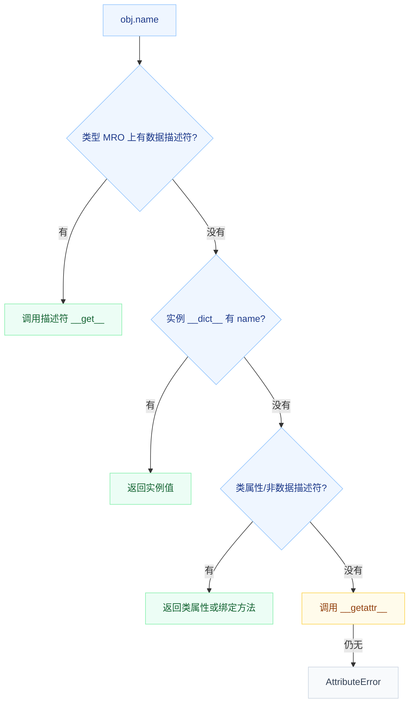

# Python面向对象

> 这篇从对象与类的运行模型讲起，经过类与实例、属性查找、继承与 MRO、魔术方法、dataclass、Enum、组合与依赖注入、调试与常见坑，最后落到一个可扩展的订单计价引擎。
>
> 学完能把一组散落的字典和 `if/elif` 重构成有边界、可测试、可替换策略的 Python 领域模型。

## 一、对象模型与类的边界

Python 里一切皆对象：实例是对象，类本身也是对象，函数、模块、异常都是对象。类的主要价值不是“把字段装在一起”，而是守住不变量并提供行为。

```python
from decimal import Decimal


class Money:
    def __init__(self, amount: str) -> None:
        # 构造时就校验，非法对象根本创建不出来
        self.amount = Decimal(amount).quantize(Decimal("0.01"))

    def __repr__(self) -> str:
        return f"Money({self.amount!r})"


value = Money("12.5")
print(type(value))          # <class '__main__.Money'>
print(type(Money))          # <class 'type'>，类也是对象
print(vars(value))          # {'amount': Decimal('12.50')}
```

类、dataclass、字典、Enum 的选择取决于是否需要行为和不变量：

| 形态 | 适合 | 不适合 |
|---|---|---|
| `dict` | 临时配置、JSON 边界 | 有校验和行为的领域对象 |
| `tuple` / `NamedTuple` | 固定顺序的轻量记录 | 需要修改和方法的对象 |
| `dataclass` | 字段明确的记录、值对象 | 复杂生命周期、大量行为 |
| 普通类 | 有不变量、状态机、资源管理 | 只有字段没有行为的 DTO |
| `Enum` | 有限、稳定的取值集合 | 可扩展的第三方编码 |

> 边界：一个类如果需要 10 个以上初始化参数、跨 3 层继承、一半方法是 getter/setter，通常说明它承担了多个职责。先拆数据与行为，再考虑继承。

## 二、类与实例

`class` 语句执行一次，生成类对象；每次调用类先由 `__new__` 创建实例，再由 `__init__` 初始化。`self` 是显式传入的实例引用，不是关键字。

### 2.1 类属性与实例属性

```python
class BankAccount:
    bank_name = "示例银行"          # 类属性：所有实例共享，适合常量

    def __init__(self, owner: str, balance: str = "0") -> None:
        self.owner = owner           # 实例属性：每个对象独立
        self._balance = Decimal(balance)

    @property
    def balance(self) -> Decimal:
        return self._balance

    def deposit(self, amount: str) -> None:
        value = Decimal(amount)
        if value <= 0:
            raise ValueError("存款金额必须为正数")
        self._balance += value


a = BankAccount("张三")
b = BankAccount("李四")
a.deposit("100")
print(a.bank_name, b.bank_name)  # 示例银行 示例银行
print(a.balance, b.balance)      # 100.00 0.00
print(a.__dict__)                # {'owner': '张三', '_balance': Decimal('100')}
```

可变类属性是最常见的共享状态坑：

```python
class BadQueue:
    items = []                   # 错误：所有实例共享同一个列表

    def push(self, item):
        self.items.append(item)


q1, q2 = BadQueue(), BadQueue()
q1.push("a")
print(q2.items)                  # ['a']，q2 被污染
```

正确做法是在 `__init__` 里创建实例属性，或用 `field(default_factory=list)`。

### 2.2 私有约定与 `__slots__`

Python 没有强制私有；`_name` 是约定，`__name` 会触发名称改写（name mangling）为 `_Class__name`，用于避免子类意外覆盖。

```python
class Wallet:
    __slots__ = ("_owner", "_balance")  # 禁止动态加属性，减少内存占用

    def __init__(self, owner: str) -> None:
        self._owner = owner
        self._balance = Decimal("0")

    def add(self, amount: str) -> None:
        self._balance += Decimal(amount)


w = Wallet("Ada")
w.add("10")
print(w._balance)       # 10
# w.note = "x"          # AttributeError，__slots__ 没有 note
```

> 边界：`__slots__` 适合大量小对象和性能敏感场景；它会阻止动态属性、`__dict__` 和部分序列化工具，继承时每个类都要声明自己的槽。业务代码优先用普通类，确有内存压力再上。

## 三、属性查找与描述符

访问 `obj.name` 时，Python 先找类型上的数据描述符，再找实例字典，再找非数据描述符和类属性，最后调用 `__getattr__`。



| 机制 | 触发 | 常见用途 |
|---|---|---|
| `property` | 数据描述符 | 校验、计算属性、只读字段 |
| 普通方法 | 非数据描述符 | 绑定 `self` |
| `classmethod` | 绑定类 | 工厂方法、替代构造器 |
| `staticmethod` | 不绑定 | 纯工具函数 |
| `__getattr__` | 常规查找失败后 | 懒加载、兼容旧字段 |

```python
class Temperature:
    def __init__(self, celsius: float) -> None:
        self._celsius = celsius

    @property
    def celsius(self) -> float:
        return self._celsius

    @celsius.setter
    def celsius(self, value: float) -> None:
        if value < -273.15:
            raise ValueError("低于绝对零度")
        self._celsius = value

    @property
    def fahrenheit(self) -> float:
        return self._celsius * 9 / 5 + 32


t = Temperature(25)
print(t.fahrenheit)   # 77.0
t.celsius = 30
print(t.fahrenheit)   # 86.0
```

`__getattr__` 只在常规查找失败时调用，适合懒加载；`__getattribute__` 拦截所有访问，容易写出递归和性能问题，业务代码不要轻易覆盖。

```python
class LazyConfig:
    def __init__(self, data: dict[str, str]) -> None:
        self._data = data
        self._cache: dict[str, str] = {}

    def __getattr__(self, name: str) -> str:
        if name.startswith("_"):
            raise AttributeError(name)       # 防止初始化阶段递归
        if name not in self._cache:
            self._cache[name] = self._data[name].upper()
        return self._cache[name]


config = LazyConfig({"host": "localhost"})
print(config.host)   # LOCALHOST
```

> 边界：`property` 的 getter 不应做慢 I/O；需要缓存时显式缓存。`__getattr__` 对拼写错误的属性也会触发，必须对未知名字抛 `AttributeError`，否则 `hasattr` 和 IDE 推断都会失真。

## 四、继承与 MRO

Python 支持多继承，方法解析顺序由 C3 线性化算法决定；`Cls.__mro__` 就是实际查找顺序。`super()` 调用的是 MRO 中的下一个类，不是“父类”。

```python
class Base:
    def __init__(self, **kwargs) -> None:
        super().__init__(**kwargs)


class CacheMixin:
    def __init__(self, **kwargs) -> None:
        self.cache: dict[str, str] = {}
        super().__init__(**kwargs)


class AuditMixin:
    def __init__(self, **kwargs) -> None:
        self.audit: list[str] = []
        super().__init__(**kwargs)


class UserRepo(CacheMixin, AuditMixin, Base):
    def __init__(self, dsn: str, **kwargs) -> None:
        self.dsn = dsn
        super().__init__(**kwargs)


print([cls.__name__ for cls in UserRepo.__mro__])
# ['UserRepo', 'CacheMixin', 'AuditMixin', 'Base', 'object']
repo = UserRepo("postgres://localhost/app")
print(repo.cache, repo.audit, repo.dsn)  # {} [] postgres://localhost/app
```

协作式初始化要求每一层都接收 `**kwargs` 并调用 `super().__init__`；任何一层忘记，链就断在那里。

### 4.1 抽象基类

`abc.ABC` 和 `@abstractmethod` 把“必须实现”的契约写进类型系统，实例化未实现抽象方法的类会直接报错。

```python
from abc import ABC, abstractmethod


class Repository(ABC):
    @abstractmethod
    def get(self, key: str) -> str:
        raise NotImplementedError

    @abstractmethod
    def put(self, key: str, value: str) -> None:
        raise NotImplementedError


class MemoryRepository(Repository):
    def __init__(self) -> None:
        self._data: dict[str, str] = {}

    def get(self, key: str) -> str:
        return self._data[key]

    def put(self, key: str, value: str) -> None:
        self._data[key] = value


# Repository()  # TypeError: Can't instantiate abstract class
repo = MemoryRepository()
repo.put("a", "1")
print(repo.get("a"))  # 1
```

> 边界：继承表达“is-a”并复用实现，组合表达“has-a”并委托行为。超过两层继承、只是为了复用几个工具方法时，改用组合或模块级函数；多继承只用于 mixin 和明确的接口组合。

## 五、魔术方法

魔术方法（dunder method）让自定义对象接入 Python 的协议：打印、比较、容器、上下文管理、运算符。实现原则是“行为符合内置类型的直觉”。

```python
from decimal import Decimal, ROUND_HALF_UP
from functools import total_ordering


@total_ordering
class Money:
    __slots__ = ("amount",)

    def __init__(self, amount: str | Decimal) -> None:
        self.amount = Decimal(str(amount)).quantize(
            Decimal("0.01"), rounding=ROUND_HALF_UP
        )

    def __repr__(self) -> str:
        # repr 面向开发者，尽量能重新构造对象
        return f"Money({self.amount!r})"

    def __str__(self) -> str:
        # str 面向用户，带货币符号和千分位
        return f"¥{self.amount:,.2f}"

    def __eq__(self, other: object) -> bool:
        if not isinstance(other, Money):
            return False
        return self.amount == other.amount

    def __lt__(self, other: object) -> bool:
        if not isinstance(other, Money):
            return NotImplemented
        return self.amount < other.amount

    def __hash__(self) -> int:
        return hash(self.amount)

    def __add__(self, other: object) -> "Money":
        if not isinstance(other, Money):
            return NotImplemented
        return Money(self.amount + other.amount)


price = Money("19.9")
fee = Money("0.1")
print(price)                 # ¥19.90
print(repr(price))           # Money(Decimal('19.90'))
print(price + fee)           # ¥20.00
print(price == Money("19.90"))  # True
print({price: "键盘"})        # {Money(Decimal('19.90')): '键盘'}
```

| 魔术方法 | 触发场景 | 注意 |
|---|---|---|
| `__repr__` | 调试、容器显示 | 无歧义，尽量可重建 |
| `__str__` | `print`、f-string | 面向用户，可读优先 |
| `__eq__` | `==`、`in`、去重 | 返回 `NotImplemented` 交给对方 |
| `__hash__` | `dict`/`set` 键 | 与 `__eq__` 保持一致 |
| `__len__` | `len()`、真值 | 返回非负整数 |
| `__getitem__` | 下标、切片、迭代回退 | 越界抛 `IndexError` |
| `__iter__` | `for`、解包 | 返回迭代器 |
| `__enter__`/`__exit__` | `with` | 退出时释放资源 |
| `__call__` | `obj()` | 让实例像函数 |

> 边界：定义了 `__eq__` 而不定义 `__hash__`，类会变成不可哈希；可变对象不要实现值相等再拿去做字典键。运算符重载只在语义直观时使用，`Money + Money` 合理，`User + User` 不合理。

## 六、dataclass

`@dataclass` 根据注解生成 `__init__`、`__repr__`、`__eq__`，适合“字段明确、以数据为主”的值对象；它不负责运行时类型校验。

```python
from dataclasses import dataclass, field, replace


@dataclass(frozen=True, slots=True)
class OrderLine:
    sku: str
    unit_price: Decimal
    quantity: int = 1
    tags: tuple[str, ...] = field(default_factory=tuple)

    def __post_init__(self) -> None:
        if self.quantity <= 0:
            raise ValueError("数量必须为正数")
        if self.unit_price <= 0:
            raise ValueError("单价必须为正数")

    @property
    def subtotal(self) -> Decimal:
        return Money(self.unit_price * self.quantity).amount


line = OrderLine("KB-01", Decimal("128.00"), 2, ("硬件",))
print(line)                 # OrderLine(sku='KB-01', ...)
print(line.subtotal)        # 256.00
print(replace(line, quantity=3).subtotal)  # 384.00
```

关键参数：

| 参数 | 作用 | 边界 |
|---|---|---|
| `frozen=True` | 禁止赋值，生成 `__hash__` | 只冻结字段绑定，不冻结嵌套对象 |
| `slots=True` | 生成 `__slots__` | 3.10+，不能与动态属性共存 |
| `kw_only=True` | 所有字段只能关键字传参 | 3.10+，适合多字段 |
| `order=True` | 生成比较方法 | 字段顺序决定比较顺序 |
| `field(default_factory=...)` | 每个实例独立默认值 | 列表/字典必须用它 |

> 边界：dataclass 不校验类型，`OrderLine("x", "not-a-decimal")` 不会在赋值时被拒，通常要到 `__post_init__` 或后续运算才报错；外部输入先用 Pydantic 或手写校验，再构造 dataclass。`frozen` 不是深度不可变，嵌套列表仍可修改。

## 七、Enum

有限、稳定的取值集合用 `Enum`，不要用裸字符串和魔法数字；`StrEnum` 在 JSON 和日志里直接序列化为字符串。

```python
from enum import StrEnum, unique


@unique
class OrderStatus(StrEnum):
    PENDING = "pending"
    PAID = "paid"
    REFUNDED = "refunded"


print(OrderStatus.PAID)                  # paid
print(OrderStatus("paid") is OrderStatus.PAID)  # True
print(OrderStatus.PAID.value)            # paid
print(list(OrderStatus))                 # [<OrderStatus.PENDING: 'pending'>, ...]

ALLOWED = {
    OrderStatus.PENDING: {OrderStatus.PAID, OrderStatus.REFUNDED},
    OrderStatus.PAID: {OrderStatus.REFUNDED},
    OrderStatus.REFUNDED: set(),
}


def transition(current: OrderStatus, target: OrderStatus) -> OrderStatus:
    if target not in ALLOWED[current]:
        raise ValueError(f"不允许从 {current.value} 变为 {target.value}")
    return target


print(transition(OrderStatus.PENDING, OrderStatus.PAID))  # paid
# transition(OrderStatus.REFUNDED, OrderStatus.PAID)      # ValueError
```

> 边界：数据库和 API 边界存 `status.value`，读入时用 `OrderStatus(raw)` 转换并在失败时给出明确错误；不要直接比较 `raw == OrderStatus.PAID`，字符串和枚举的比较结果依赖具体类型。取值集合会频繁增加时，枚举要同步改代码和数据库约束。

## 八、组合、策略与依赖注入

类比继承更适合表达“可替换的行为”：把变化点抽成接口，由外部注入实现，类只依赖抽象。

```python
from abc import ABC, abstractmethod


class Notifier(ABC):
    @abstractmethod
    def send(self, message: str) -> str:
        raise NotImplementedError


class EmailNotifier(Notifier):
    def __init__(self, address: str) -> None:
        self.address = address

    def send(self, message: str) -> str:
        return f"email -> {self.address}: {message}"


class SmsNotifier(Notifier):
    def __init__(self, phone: str) -> None:
        self.phone = phone

    def send(self, message: str) -> str:
        return f"sms -> {self.phone}: {message}"


class AlertService:
    def __init__(self, notifier: Notifier) -> None:
        self._notifier = notifier       # 依赖抽象，不关心具体渠道

    def alert(self, level: str, message: str) -> str:
        return self._notifier.send(f"[{level}] {message}")


print(AlertService(EmailNotifier("ops@example.com")).alert("P1", "磁盘满"))
print(AlertService(SmsNotifier("13800000000")).alert("P1", "磁盘满"))
```

测试时注入一个假的 notifier 即可，不需要 mock 网络：

```python
class FakeNotifier(Notifier):
    def __init__(self) -> None:
        self.messages: list[str] = []

    def send(self, message: str) -> str:
        self.messages.append(message)
        return "ok"


fake = FakeNotifier()
service = AlertService(fake)
service.alert("P2", "队列积压")
assert fake.messages == ["[P2] 队列积压"]
```

| 方式 | 关系 | 适合 |
|---|---|---|
| 继承 | is-a | 共享实现、模板方法 |
| 组合 | has-a | 委托、策略、可选能力 |
| 依赖注入 | 使用抽象 | 替换外部服务、测试替身 |

> 边界：只有一个分支、未来也不会扩展时，直接写函数或 `if` 更清楚；策略模式的价值在“运行时替换”和“独立测试”，不是为了消灭所有 `if`。

## 九、调试与常见坑

面向对象的 bug 大多不是语法错误，而是共享状态、查找顺序和协议实现不一致。先打印 `type(obj)`、`obj.__dict__`、`type(obj).__mro__`，再定位。

| 现象 | 常见原因 | 第一条检查 |
|---|---|---|
| 两个实例互相影响 | 可变类属性/默认参数 | `vars(a)`、类属性定义 |
| `TypeError: Cannot create a consistent MRO` | 继承顺序冲突 | `Cls.__mro__`、基类顺序 |
| 子类 `__init__` 没执行 | 某层忘记 `super()` | 每层 `__init__` 的 `super()` |
| `unhashable type` | 定义了 `__eq__` 没定义 `__hash__` | 类里是否有 `__eq__` |
| `dataclass` 默认值报错 | 可变默认值/继承字段顺序 | 用 `default_factory`、`kw_only` |
| `Enum` 值重复 | 别名被合并 | `@unique`、`list(Enum)` |

```python
import inspect

print(inspect.getmro(UserRepo))
print(inspect.signature(OrderLine))
print(vars(repo))
```

> 边界：`hasattr` 会捕获 `AttributeError`，但不会捕获属性 getter 里的其他异常；`dir()` 只列出属性名，不保证可访问。排查描述符问题用 `type(obj).__dict__` 看原始对象，而不是看实例。

## 十、最佳实践案例

### 10.1 案例背景

一个 B2B 商城的订单计价最初写成 300 行 `if/elif`：会员折扣、满减、优惠券、运费全部揉在 `calculate()` 里。每次运营改规则都要改主流程，测试只能覆盖整条链路，线上还出现过“折扣叠加后超过小计”的负数订单。

目标是拆出可独立替换的计价策略，保证金额精确到分、折扣不超过小计、规则可单测；约束是只使用标准库，不引入规则引擎，现有调用方仍通过 `Order.total` 取应付金额。

### 10.2 案例实操

```python
from __future__ import annotations

from abc import ABC, abstractmethod
from dataclasses import dataclass, field
from decimal import ROUND_HALF_UP, Decimal
from enum import StrEnum


def money(value: str | int | Decimal) -> Decimal:
    """把任意金额输入统一成两位小数，避免二进制浮点误差。"""
    return Decimal(str(value)).quantize(Decimal("0.01"), rounding=ROUND_HALF_UP)


class CustomerTier(StrEnum):
    REGULAR = "regular"
    SILVER = "silver"
    GOLD = "gold"


class DiscountPolicy(ABC):
    """折扣策略：输入小计和会员等级，返回可抵扣金额。"""

    @abstractmethod
    def describe(self) -> str:
        raise NotImplementedError

    @abstractmethod
    def discount(self, subtotal: Decimal, tier: CustomerTier) -> Decimal:
        raise NotImplementedError


@dataclass(frozen=True)
class TierDiscount(DiscountPolicy):
    rates: dict[CustomerTier, Decimal] = field(
        default_factory=lambda: {
            CustomerTier.REGULAR: Decimal("0.00"),
            CustomerTier.SILVER: Decimal("0.03"),
            CustomerTier.GOLD: Decimal("0.05"),
        }
    )

    def describe(self) -> str:
        return "会员折扣"

    def discount(self, subtotal: Decimal, tier: CustomerTier) -> Decimal:
        return money(subtotal * self.rates[tier])


@dataclass(frozen=True)
class ThresholdDiscount(DiscountPolicy):
    threshold: Decimal
    amount: Decimal

    def describe(self) -> str:
        return f"满减（满 {self.threshold:.0f} 减 {self.amount:.0f}）"

    def discount(self, subtotal: Decimal, tier: CustomerTier) -> Decimal:
        return min(self.amount, subtotal) if subtotal >= self.threshold else money(0)


@dataclass(frozen=True)
class Coupon(DiscountPolicy):
    code: str
    amount: Decimal
    min_subtotal: Decimal

    def describe(self) -> str:
        return f"优惠券 {self.code}"

    def discount(self, subtotal: Decimal, tier: CustomerTier) -> Decimal:
        return min(self.amount, subtotal) if subtotal >= self.min_subtotal else money(0)


@dataclass(frozen=True, slots=True)
class OrderLine:
    sku: str
    unit_price: Decimal
    quantity: int

    def __post_init__(self) -> None:
        if self.quantity <= 0:
            raise ValueError("数量必须为正数")
        if self.unit_price <= 0:
            raise ValueError("单价必须为正数")
        # frozen=True 时用 object.__setattr__ 规范化字段，避免绕过校验
        object.__setattr__(self, "unit_price", money(self.unit_price))

    @property
    def subtotal(self) -> Decimal:
        return money(self.unit_price * self.quantity)


@dataclass(slots=True)
class Order:
    order_id: str
    tier: CustomerTier
    lines: list[OrderLine]
    policies: list[DiscountPolicy] = field(default_factory=list)
    shipping_fee: Decimal = Decimal("10.00")
    free_shipping_threshold: Decimal = Decimal("99.00")

    def __post_init__(self) -> None:
        if not self.order_id.strip():
            raise ValueError("订单号不能为空")
        if not self.lines:
            raise ValueError("订单至少需要一行商品")

    @property
    def subtotal(self) -> Decimal:
        return money(sum((line.subtotal for line in self.lines), Decimal("0")))

    def applied_discounts(self) -> list[tuple[str, Decimal]]:
        remaining = self.subtotal
        applied: list[tuple[str, Decimal]] = []
        for policy in self.policies:
            # 每项按小计计算，再按剩余金额封顶，防止叠加后超过小计
            amount = min(policy.discount(self.subtotal, self.tier), remaining)
            if amount > 0:
                applied.append((policy.describe(), money(amount)))
                remaining -= amount
        return applied

    @property
    def discount_total(self) -> Decimal:
        return money(sum((amount for _, amount in self.applied_discounts()), Decimal("0")))

    @property
    def shipping(self) -> Decimal:
        if self.subtotal >= self.free_shipping_threshold:
            return money(0)
        return money(self.shipping_fee)

    @property
    def total(self) -> Decimal:
        return money(self.subtotal - self.discount_total + self.shipping)

    def __str__(self) -> str:
        rows = [f"订单 {self.order_id}（{self.tier.value}）"]
        for line in self.lines:
            rows.append(
                f"  {line.sku:<8} {line.quantity} x {line.unit_price:>7.2f} = {line.subtotal:>8.2f}"
            )
        rows.append(f"小计: {self.subtotal:.2f}")
        for name, amount in self.applied_discounts():
            rows.append(f"{name}: -{amount:.2f}")
        rows.append(f"运费: {self.shipping:.2f}")
        rows.append(f"应付: {self.total:.2f}")
        return "\n".join(rows)


def main() -> None:
    order = Order(
        order_id="SO-20261113-001",
        tier=CustomerTier.GOLD,
        lines=[
            OrderLine("KB-01", Decimal("128.00"), 2),
            OrderLine("MS-02", Decimal("60.00"), 1),
        ],
        policies=[
            TierDiscount(),
            ThresholdDiscount(Decimal("300"), Decimal("30")),
            Coupon("SAVE10", Decimal("10"), Decimal("200")),
        ],
    )
    print(order)

    # 规则可以独立替换：只换策略，不改 Order 的分支
    assert order.subtotal == money("316.00")
    assert order.discount_total == money("55.80")
    assert order.total == money("260.20")


if __name__ == "__main__":
    main()
```

```bash
python3 pricing.py
```

预期输出：

```text
订单 SO-20261113-001（gold）
  KB-01    2 x  128.00 =   256.00
  MS-02    1 x   60.00 =    60.00
小计: 316.00
会员折扣: -15.80
满减（满 300 减 30）: -30.00
优惠券 SAVE10: -10.00
运费: 0.00
应付: 260.20
```

### 10.3 案例结果

本机实测（Python 3.13.18）：小计 `316.00`，三项优惠合计 `55.80`，应付 `260.20`，与手算一致。新增“满 500 减 80”只需增加一个 `ThresholdDiscount(Decimal("500"), Decimal("80"))` 实例，`Order` 和已有策略都不用改；每个策略可以用两个边界金额独立测试。

失败模式与复盘：

- 折扣按小计计算、按剩余金额封顶，避免 `10% + 满减 + 券` 叠加后出现负数；如果业务要求“折扣后金额再算满减”，改 `discount()` 的入参即可，不影响调用方。
- `Order` 用 `slots` 和可变列表，说明它不是值对象；订单行只在构造时校验，后续不应原地修改，需要改数量时用 `replace(line, quantity=...)` 生成新行。
- `TierDiscount` 的费率表是可变字典，放在 `frozen` dataclass 里仍可能被外部修改；生产代码应复制成 `MappingProxyType` 或改为按等级分支的只读属性。
- 金额统一走 `money()`，但 `Decimal` 的上下文精度仍可能影响乘法；当前默认精度 28 位，远大于两位小数需求，若接入高精度税率要显式设置 `localcontext`。
