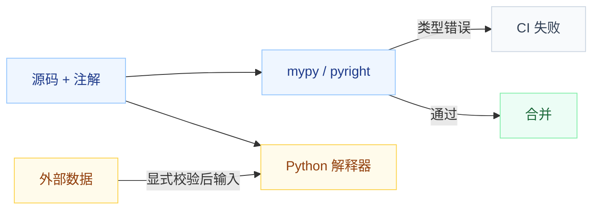

# Python类型注解

> 这篇从类型注解在运行时的真实语义讲起，经过 mypy 环境、基础注解、Optional/Union、泛型、Protocol、TypedDict、严格模式与排障，最后落到一个严格模式通过的订单导入器。
>
> 学完能给现有 Python 代码补上可检查的类型边界，并用 mypy/pyright 在提交和 CI 阶段拦住类型错误。

## 一、注解的运行语义

类型注解默认只是表达式，解释器把它们存进 `__annotations__`，不会在调用时检查类型；检查由 mypy、pyright、IDE 等静态工具完成。

```python
def greet(name: str) -> str:
    return f"Hello {name}"


print(greet(123))                    # Hello 123，运行时不报错
print(greet.__annotations__)         # {'name': <class 'str'>, 'return': <class 'str'>}
```

```python
from __future__ import annotations

# 3.7 起可用 future import 延迟注解求值；3.14 起注解默认惰性求值
def load(path: str) -> list[str]:
    return [path]
```

`from __future__ import annotations` 把注解变成字符串，解决前向引用和启动开销；代价是运行时拿不到真实类型，需要 `typing.get_type_hints()` 解析。

```python
from typing import get_type_hints


def handler(payload: "dict[str, int]") -> None:
    pass


print(get_type_hints(handler))  # {'payload': dict[str, int], 'return': <class 'NoneType'>}
```

| 能力 | 注解是否提供 |
|---|---|
| 编辑器补全、跳转 | 是 |
| 提交前发现参数类型错误 | 是，配合 mypy/pyright |
| 运行时拒绝错误类型 | 否，需要显式校验 |
| JSON/HTTP 入参校验 | 否，需要 Pydantic 或手写检查 |
| 性能优化 | 否，CPython 不会据此生成更快代码 |



> 边界：注解不是运行时校验，也不是文档的替代品。外部输入（JSON、环境变量、请求参数）必须在边界做 `isinstance`、范围、枚举校验，再把结果标记成领域类型。

## 二、环境与最小类型检查

类型检查器装在开发依赖里，配置写进 `pyproject.toml`，CI 和本地执行同一条命令。

```bash
uv init --package typed-importer
cd typed-importer
uv add --dev "mypy>=1.11,<2" pyright
uv run mypy --version
```

预期输出（版本号以实际为准）：

```text
mypy 1.20.2 (compiled: yes)
```

`pyproject.toml` 的最小配置：

```toml
[tool.mypy]
python_version = "3.12"
strict = true
warn_unreachable = true
show_error_codes = true

[tool.pyright]
pythonVersion = "3.12"
typeCheckingMode = "strict"
```

先看一个会被拦下的例子：

```python
# bad.py
def total(prices: list[float]) -> float:
    return sum(prices)


print(total(["1", "2"]))
```

```bash
uv run mypy --strict bad.py
```

预期输出：

```text
bad.py:6: error: List item 0 has incompatible type "str"; expected "float"  [list-item]
bad.py:6: error: List item 1 has incompatible type "str"; expected "float"  [list-item]
Found 2 errors in 1 file (checked 1 source file)
```

| 工具 | 优势 | 取舍 |
|---|---|---|
| mypy | 生态成熟、插件多、CI 稳定 | 速度较慢，部分新语法跟进稍晚 |
| pyright | 快、编辑器体验好、严格模式细 | 由微软维护，规则与 mypy 有差异 |
| IDE 内置 | 即时反馈 | 不能替代 CI 门禁 |

> 边界：团队只选一个作为合并门禁，另一个放编辑器；两套同时卡会因规则差异产生无意义的争论。升级检查器版本要单独提交，避免类型错误和新规则混在一起。

## 三、基础注解

函数参数、返回值、模块级常量优先标注；局部变量通常让检查器推断，只有空容器或复杂结构才显式写。

```python
from collections.abc import Callable, Iterable, Mapping, Sequence
from typing import Annotated, Final, Literal

MAX_RETRY: Final = 3
Environment = Literal["dev", "staging", "prod"]


def average(scores: Sequence[float]) -> float:
    # 参数用 Sequence 而不是 list：只读，元组和列表都能传
    return sum(scores) / len(scores) if scores else 0.0


def index_by_id(rows: Iterable[Mapping[str, str]]) -> dict[str, Mapping[str, str]]:
    # 返回具体 dict，调用方拿到的是可变映射
    return {row["id"]: row for row in rows}


def apply(values: list[int], fn: Callable[[int], int]) -> list[int]:
    return [fn(value) for value in values]


Price = Annotated[float, "CNY"]


def format_price(value: Price) -> str:
    return f"¥{value:.2f}"
```

| 写法 | 含义 | 注意 |
|---|---|---|
| `list[int]` | 元素为 int 的列表 | 3.9+ 内置泛型 |
| `Sequence[float]` | 只读序列 | 参数位置优先用抽象类型 |
| `dict[str, int]` | 字符串键、整数值的字典 | 键必须可哈希 |
| `tuple[int, str]` | 固定长度、固定类型 | 变长用 `tuple[int, ...]` |
| `Callable[[int], str]` | 接收 int 返回 str | 关键字参数用 `Protocol` |
| `Any` | 关闭检查 | 会向调用方扩散 |
| `object` | 任意对象，但使用前要收窄 | 比 `Any` 安全 |

`Any` 和 `object` 的区别是检查器是否继续跟踪：

```python
from typing import Any


def take_any(value: Any) -> None:
    print(value.upper())     # 不报错，Any 跳过检查


def take_object(value: object) -> None:
    # print(value.upper())   # 报错：object 没有 upper
    if isinstance(value, str):
        print(value.upper())  # 收窄后可调用
```

> 边界：`bool` 是 `int` 的子类型，`list[bool]` 不能传给 `list[int]`（列表不变）；参数位置用 `Sequence[int]` 可以接受 `list[bool]`。返回类型尽量具体，参数类型尽量抽象。

## 四、Optional/Union 与类型收窄

`T | None` 表示“T 或 None”，不是“参数可省略”；有默认值的参数才可省略。检查器通过 `is None`、`isinstance`、成员判断等控制流收窄类型。

```python
def parse_port(value: str | None) -> int:
    if value is None:
        return 8080              # 收窄为 None，直接返回默认值
    port = int(value)
    if not 1 <= port <= 65535:
        raise ValueError(f"端口越界: {port}")
    return port


print(parse_port(None))          # 8080
print(parse_port("8080"))        # 8080
```

```python
def describe(value: int | str) -> str:
    if isinstance(value, int):
        return f"整数 {value + 1}"   # 此分支内 value 是 int
    return f"字符串 {value.upper()}"  # 此分支内 value 是 str
```

`dict.get()` 返回 `Optional`，直接调用方法会被检查器拦下：

```python
config: dict[str, str] = {"host": "localhost"}
port = config.get("port")
# print(port.strip())            # 报错：str | None 没有 strip
if port is not None:
    print(port.strip())          # 收窄后可用
```

`assert` 也能收窄，但只适合“不可能发生”的内部不变量；外部输入不要用 `assert`，`python -O` 会移除它。

```python
from dataclasses import dataclass
from typing import assert_never


@dataclass
class Circle:
    radius: float


@dataclass
class Square:
    side: float


def area(shape: Circle | Square) -> float:
    match shape:
        case Circle(radius):
            return 3.14159 * radius * radius
        case Square(side):
            return side * side
        case _ as unreachable:
            assert_never(unreachable)  # 新增形状未处理时，mypy 在这里报错
```

> 边界：`Optional[T]` 的默认值写 `None` 时，参数注解必须是 `T | None`；只写 `T = None` 在 strict 模式下会报错。`cast(T, value)` 不做运行时检查，只在已经手动验证后使用。

## 五、泛型

泛型用于表达“输入类型和输出类型有关系”，例如栈的元素类型、解析器的输入输出。Python 3.12 起用 PEP 695 的方括号语法声明类型参数。

```python
class Stack[T]:
    def __init__(self) -> None:
        self._items: list[T] = []

    def push(self, item: T) -> None:
        self._items.append(item)

    def pop(self) -> T:
        if not self._items:
            raise IndexError("栈为空")
        return self._items.pop()

    def __len__(self) -> int:
        return len(self._items)


stack = Stack[int]()       # 显式实例化，元素类型固定为 int
stack.push(1)
# stack.push("x")          # 报错：str 不能传给 int
print(stack.pop())         # 1
```

泛型函数：

```python
def first[T](items: list[T]) -> T | None:
    return items[0] if items else None


print(first([1, 2, 3]))    # 1，推断为 int | None
print(first(["a"]))        # a
```

3.12 之前用 `TypeVar` 和 `Generic`，存量代码仍会见到：

```python
from typing import Generic, TypeVar

T = TypeVar("T")


class Box(Generic[T]):
    def __init__(self, value: T) -> None:
        self.value = value


box = Box(42)              # 推断为 Box[int]
```

`bound` 限制类型必须继承某个基类，`constraints` 限制为几个具体类型之一：

```python
from typing import Protocol, TypeVar


class Comparable(Protocol):
    def __lt__(self, other: object) -> bool: ...


Number = TypeVar("Number", int, float)          # 只能是 int 或 float
ComparableT = TypeVar("ComparableT", bound=Comparable)  # 必须可比较
```

> 边界：泛型只在类型之间有关系时使用；一个函数只用一次 `T`、返回值与参数无关时，直接用具体类型更清楚。`Any` 会让泛型推断失效，`list[Any]` 传进去后返回类型也变成 `Any`。

## 六、Protocol 与结构化子类型

`Protocol` 用“有哪些方法”定义接口，不要求显式继承；适合描述第三方库、回调、可替换的外部依赖。

```python
from typing import Protocol


class Renderer(Protocol):
    def render(self, rows: list[dict[str, str]]) -> str: ...


class JsonRenderer:
    def render(self, rows: list[dict[str, str]]) -> str:
        import json

        return json.dumps(rows, ensure_ascii=False)


class CsvRenderer:
    def render(self, rows: list[dict[str, str]]) -> str:
        return "\n".join(",".join(row.values()) for row in rows)


def export(rows: list[dict[str, str]], renderer: Renderer) -> str:
    # 只依赖协议，不关心具体实现
    return renderer.render(rows)


rows = [{"id": "1", "name": "键盘"}]
print(export(rows, JsonRenderer()))  # [{"id": "1", "name": "键盘"}]
print(export(rows, CsvRenderer()))   # 1,键盘
```

`@runtime_checkable` 允许 `isinstance(obj, Renderer)`，但它只检查方法名是否存在，不检查参数和返回类型：

```python
from typing import runtime_checkable


@runtime_checkable
class Closeable(Protocol):
    def close(self) -> None: ...


print(isinstance(JsonRenderer(), Closeable))  # False
```

| 方式 | 关系 | 适合 |
|---|---|---|
| `Protocol` | 结构化，按形状匹配 | 第三方接口、回调、测试替身 |
| `ABC` | 名义继承，显式注册 | 共享实现、强不变量 |
| 普通基类 | is-a | 模板方法、复用代码 |

> 边界：Protocol 不适合带大量默认实现；需要共享代码时用 ABC 或 mixin。`runtime_checkable` 只做浅检查，不能替代真正的契约测试。

## 七、TypedDict 与外部数据边界

`TypedDict` 描述 JSON 对象的键和值类型，实例仍是普通 `dict`，运行时不校验数据；它解决的是“字典的键名和类型在静态检查里可见”。

```python
from typing import NotRequired, TypedDict


class RawOrder(TypedDict):
    order_id: str
    customer: str
    amount: str
    status: str
    note: NotRequired[str]       # 3.11+，可选键


def require_str(data: dict[str, object], key: str) -> str:
    value = data.get(key)
    if not isinstance(value, str) or not value.strip():
        raise ValueError(f"{key} 必须是非空字符串")
    return value.strip()


def parse_raw(obj: object) -> RawOrder:
    if not isinstance(obj, dict):
        raise ValueError("必须是 JSON 对象")
    data: dict[str, object] = obj
    return RawOrder(
        order_id=require_str(data, "order_id"),
        customer=require_str(data, "customer"),
        amount=require_str(data, "amount"),
        status=require_str(data, "status"),
    )
```

`total=False` 让所有键可选，`Required` 再把必填键标回来：

```python
from typing import Required


class Patch(TypedDict, total=False):
    customer: Required[str]
    note: str
```

> 边界：TypedDict 只描述形状，不验证值；`json.loads` 返回 `Any`，必须先用 `object` 接收并逐字段 `isinstance` 检查，再构造 TypedDict。带行为的领域对象用 dataclass，需要完整校验和序列化时用 Pydantic。

| 形态 | 运行时校验 | 适合 |
|---|---|---|
| `TypedDict` | 无 | 外部 JSON 的形状描述 |
| `dataclass` | 仅手写 `__post_init__` | 内部领域对象 |
| Pydantic `BaseModel` | 有 | API 入参、配置 |

## 八、严格模式与团队落地

`strict = true` 打开一组检查开关，适合新项目；存量项目按模块逐步收紧，先把边界和公共 API 标完。

```toml
[tool.mypy]
python_version = "3.12"
strict = true
warn_unreachable = true
warn_unused_ignores = true
show_error_codes = true
exclude = ["migrations/"]

[[tool.mypy.overrides]]
module = "legacy.*"
disallow_untyped_defs = false
```

| 开关 | 作用 | 常见冲突 |
|---|---|---|
| `disallow_untyped_defs` | 所有函数必须有注解 | 老代码大量无注解 |
| `disallow_any_generics` | 禁止裸 `list`/`dict` | 第三方类型未标注 |
| `warn_return_any` | 返回 `Any` 时警告 | 动态库返回值 |
| `no_implicit_optional` | 默认值 `None` 必须写 Optional | 旧代码习惯 |
| `strict_equality` | 禁止不重叠类型比较 | 枚举与字符串混用 |

落地顺序：

1. 新模块和公共 API 全量 strict；
2. 老模块先加 `disallow_untyped_defs = false` 的 override，逐个子包收紧；
3. 第三方库缺类型时安装 `types-*` 或写最小 `.pyi`，不要全局 `ignore_missing_imports`；
4. 每个 `# type: ignore` 带错误码，例如 `# type: ignore[arg-type]`，并开 `warn_unused_ignores`；
5. CI 跑 `mypy src tests`，把类型检查放在测试之前，失败最快。

> 边界：不要为了“全绿”把公共 API 改成 `Any`；`Any` 会沿着调用链扩散，最后检查器什么都发现不了。第三方库确实没有类型时，在边界写一个窄的 `Protocol` 包一层，比全局忽略更可控。

## 九、排障

类型错误先看错误码和行号，再用 `reveal_type` 看检查器推断出的真实类型；不要第一反应加 `# type: ignore`。

| 现象 | 常见原因 | 第一条命令 |
|---|---|---|
| `Need type annotation` | 空列表/字典无法推断 | 写 `items: list[str] = []` |
| `Item "None" has no attribute` | 未收窄 Optional | 加 `is None` 分支 |
| `Incompatible types in assignment` | 变量被复用于不同类型 | 拆变量或改注解 |
| `Missing return statement` | 分支未覆盖所有路径 | 补 `return` 或 `raise` |
| `Library stubs not installed` | 第三方库无类型 | `uv add --dev types-requests` |
| `Source file found twice` | 包路径重复 | 检查 `files`、`mypy_path` |

```bash
uv run mypy --strict --show-error-codes src
uv run mypy --strict --no-incremental src   # CI 中避免缓存掩盖问题
uv run pyright src
```

在代码里临时查看推断：

```python
value = {"a": 1}
reveal_type(value)   # mypy 输出：Revealed type is "builtins.dict[builtins.str, builtins.int]"
```

> 边界：`reveal_type` 是调试语句，提交前删除；`cast` 只用于“运行时已验证但检查器推不出”的场景，滥用等于把类型系统关掉。`stubgen` 生成的 stub 只是起点，需要人工收紧。

## 十、最佳实践案例

### 10.1 案例背景

数据平台每天接收合作方推送的 JSON Lines 订单文件。旧实现把每行解析成 `dict[str, Any]`，取值靠 `row["amount"]`，上线后出现过三类事故：字段名拼错导致 `KeyError`、金额 `"abc"` 直到写库才报错、状态字符串拼错后进入错误分支。

目标是把导入器改成“边界校验 + 领域类型 + 类型检查器门禁”：坏行跳过并报告行号，合法行转成 `Order`，mypy strict 零错误。约束是 Python 3.12+、只用标准库和 mypy，不引入 Pydantic；输入量每天几万行。

### 10.2 案例实操

```python
from __future__ import annotations

import json
from collections.abc import Iterable
from dataclasses import dataclass
from decimal import Decimal, InvalidOperation
from enum import StrEnum
from typing import Protocol, TypedDict


class OrderStatus(StrEnum):
    PENDING = "pending"
    PAID = "paid"
    REFUNDED = "refunded"


class RawOrder(TypedDict):
    """外部 JSON 的形状：字段名和值类型都写死。"""

    order_id: str
    customer: str
    amount: str
    status: str


@dataclass(frozen=True)
class Order:
    order_id: str
    customer: str
    amount: Decimal
    status: OrderStatus


class OrderSink(Protocol):
    def write(self, order: Order) -> None: ...


class ListSink:
    def __init__(self) -> None:
        self.orders: list[Order] = []

    def write(self, order: Order) -> None:
        self.orders.append(order)


def require_str(data: dict[str, object], key: str) -> str:
    value = data.get(key)
    if not isinstance(value, str) or not value.strip():
        raise ValueError(f"字段 {key} 必须是非空字符串")
    return value.strip()


def parse_raw(obj: object) -> RawOrder:
    if not isinstance(obj, dict):
        raise ValueError("每行必须是 JSON 对象")
    data: dict[str, object] = obj
    return RawOrder(
        order_id=require_str(data, "order_id"),
        customer=require_str(data, "customer"),
        amount=require_str(data, "amount"),
        status=require_str(data, "status"),
    )


def parse_order(raw: RawOrder) -> Order:
    try:
        amount = Decimal(raw["amount"])
    except InvalidOperation as exc:
        raise ValueError(f"金额非法: {raw['amount']!r}") from exc
    if not amount.is_finite() or amount <= 0:
        raise ValueError(f"金额必须为正数: {raw['amount']!r}")
    try:
        status = OrderStatus(raw["status"])
    except ValueError as exc:
        raise ValueError(f"未知状态: {raw['status']!r}") from exc
    return Order(raw["order_id"], raw["customer"], amount, status)


def import_lines(lines: Iterable[str], sink: OrderSink) -> int:
    count = 0
    for line_no, line in enumerate(lines, start=1):
        if not line.strip():
            continue
        try:
            payload: object = json.loads(line)
            order = parse_order(parse_raw(payload))
        except (json.JSONDecodeError, ValueError) as exc:
            print(f"跳过第 {line_no} 行: {exc}")
            continue
        sink.write(order)
        count += 1
    return count


def main() -> None:
    lines = [
        '{"order_id":"A1","customer":"张三","amount":"128.50","status":"paid"}',
        '{"order_id":"A2","customer":"李四","amount":"0","status":"paid"}',
        '{"order_id":"A3","customer":"王五","amount":"42.00","status":"unknown"}',
        '{"order_id":"A4","customer":"赵六","amount":"99.90","status":"pending"}',
        "not-json",
    ]
    sink = ListSink()
    count = import_lines(lines, sink)
    print(f"导入 {count} 条")
    for order in sink.orders:
        print(order.order_id, order.status.value, order.amount)


if __name__ == "__main__":
    main()
```

```bash
uv run mypy --strict importer.py
uv run python importer.py
```

预期输出：

```text
Success: no issues found in 1 source file
跳过第 2 行: 金额必须为正数: '0'
跳过第 3 行: 未知状态: 'unknown'
跳过第 5 行: Expecting value: line 1 column 1 (char 0)
导入 2 条
A1 paid 128.50
A4 pending 99.90
```

### 10.3 案例结果

本机实测（Python 3.13.18，mypy 1.20.2）：`mypy --strict` 输出 `Success: no issues found in 1 source file`；5 行输入中 2 行入库、3 行被跳过并带行号，坏行没有中断整批。金额为 `Decimal`，状态为 `OrderStatus`，后续代码不再接受裸字符串。

失败模式与复盘：

- `json.loads` 返回 `Any`，先赋给 `object` 再逐字段 `isinstance`，避免把 `Any` 带进领域层；`RawOrder` 是“已验证形状”的标记，不是运行时保证。
- `parse_order` 把金额和状态转换集中在一处，失败消息带原始值，运营能直接定位；如果字段更多，应把错误收集成列表而不是遇到第一个就抛。
- `OrderSink` 用 Protocol，测试时注入内存 sink，生产换数据库 sink 不用改导入逻辑；`import_lines` 只依赖 `write`，符合接口隔离。
- mypy 通过不代表运行时安全：`Decimal("NaN")` 能构造，代码用 `is_finite()` 挡住；外部数据边界仍然要保留异常处理和测试。
- 若接入 FastAPI，Pydantic 模型会替代 `parse_raw` 的手写校验，但 `Order` 和 `OrderSink` 的类型边界仍可复用；不要同时维护两套字段定义。
