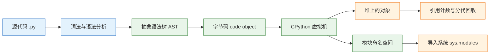
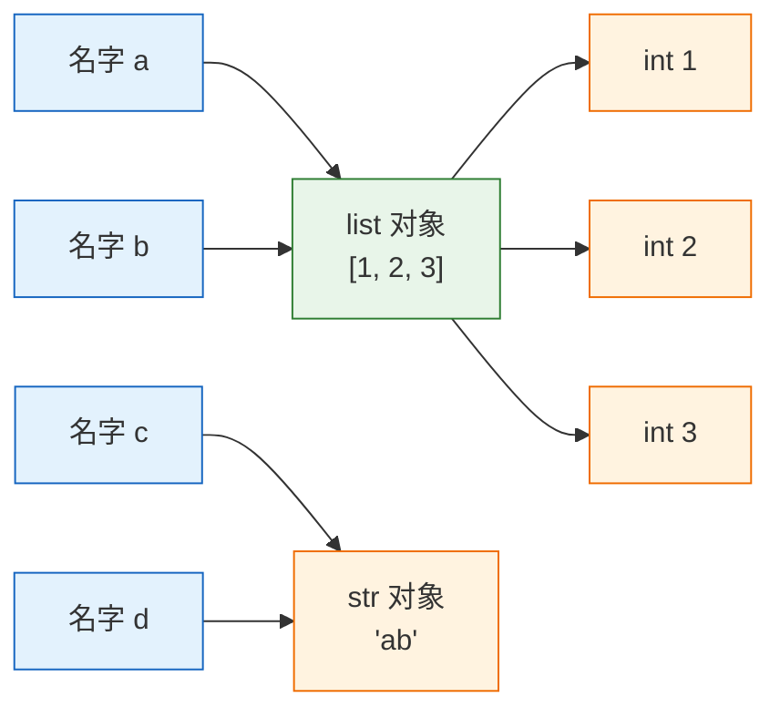
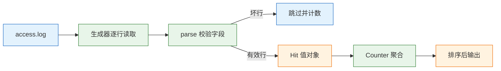

# Python 核心语法

---

## 一、Python 核心语法的定位

Python 是一门动态类型、解释执行、带自动内存管理的通用编程语言。它的语法表面简单，真正的难点在于建立稳定的对象模型：变量是名字，赋值只改变名字指向哪个对象；对象有类型和可变性；函数、类、模块都遵循同一套属性查找与协议约定。把这三件事想清楚，大多数“Python 的怪问题”都会变成可解释的行为。

核心语法解决的是表达问题：如何组织数据、如何控制流程、如何划分作用域、如何定义错误边界。它不解决性能，解释执行的热点需要下沉到 C 扩展；不解决类型安全，类型提示在运行时不做强制校验；也不解决并发，默认构建仍受 GIL 约束。这些能力分别属于工程化、类型检查器和异步篇的范围。

### 1.1 核心概念

理解 Python 需要先区分四个层次：名字、对象、类型、协议。

- **名字（name）**：模块、函数、类里的标识符，本质是命名空间字典中的一个键。
- **对象（object）**：内存中的实体，拥有身份 `id`、类型 `type` 和值。
- **类型（type）**：决定对象支持哪些操作，以及这些操作如何执行。
- **协议（protocol）**：一组约定方法，例如 `__iter__` 让对象可迭代，`__enter__` 让对象可用于 `with`。

赋值语句 `b = a` 不复制对象，只把名字 `b` 绑定到 `a` 当前指向的对象。对可变对象原地修改，所有绑定到它的名字都会看到变化；对不可变对象执行 `+=`，实际是创建新对象并重新绑定。函数参数同样按对象引用传递：函数内重新绑定参数不影响调用方，原地修改会影响调用方。

| 概念 | 载体 | 观察方式 | 常见误解 |
|---|---|---|---|
| 名字 | 命名空间字典 | `globals()`、`locals()` | 把名字当成内存盒子 |
| 对象身份 | `id(obj)` | 生命周期内唯一 | 用 `is` 比较值 |
| 对象类型 | `type(obj)` | 运行时可查 | 认为变量有类型 |
| 可变性 | 类型属性 | 原地操作后看其他引用 | 认为赋值即复制 |
| 协议 | 特殊方法 | `iter()`、`len()`、`with` | 把双下划线当魔法 |

### 1.2 与相邻技术的关系

Python 与 C、Java、JavaScript 的差异，集中在类型检查时机、内存管理和执行方式三点。C 需要手动管理内存，类型在编译期确定；Java 的变量有静态类型，对象由 GC 回收，但泛型存在擦除；JavaScript 同样动态类型，却以原型链组织对象。Python 选择的是“名字无类型、对象有类型、运行时查找属性”的模型。

| 语言 | 类型检查 | 内存管理 | 执行方式 |
|---|---|---|---|
| C | 编译期静态 | 手动 | 编译为机器码 |
| Java | 编译期静态 | 分代 GC | 字节码 + JVM |
| JavaScript | 运行时动态 | 分代 GC | JIT 引擎 |
| Python | 运行时动态 | 引用计数 + 分代 GC | 字节码 + 解释器 |

类型提示是 Python 后来补上的工程能力，它服务于静态检查器、IDE 和框架，不改变运行时行为。`def f(x: int) -> int` 在调用时不会拒绝字符串，除非使用 Pydantic 这类校验层。把类型提示当作文档和契约，把运行时校验放在系统边界，是两种能力各自的位置。

### 1.3 整体结构

CPython 的执行路径可以拆成五段：源代码经过词法与语法分析生成抽象语法树，再编译为字节码，由虚拟机逐条执行，过程中不断创建和销毁对象。导入系统、内置命名空间和垃圾回收器贯穿整个生命周期。



| 阶段 | 输入 | 输出 | 可观察点 |
|---|---|---|---|
| 词法语法分析 | 源文本 | AST | `ast.parse()` |
| 编译 | AST | code object | `compile()`、`dis` |
| 执行 | 字节码 | 对象与副作用 | 调用栈、异常 |
| 导入 | 模块名 | `sys.modules` 条目 | `sys.path` |
| 回收 | 不可达对象 | 释放内存 | `gc` 模块 |

理解这条链路有两个直接收益：看到 `SyntaxError` 知道问题在编译前，看到 `NameError` 知道问题在运行时的命名空间查找；用 `dis.dis()` 能确认一段代码到底执行了哪些字节码，而不是凭直觉猜测。

---

## 二、环境与第一个程序

### 2.1 安装与版本

> **版本现状（2026-10）**：Python 3.14 是当前稳定主线，3.13 仍在安全维护期。3.14 的注解默认惰性求值、模板字符串、free-threaded 构建转正都属于会影响日常写法的变化，升级前先确认依赖的 C 扩展是否支持。

```bash
# ========== 检查系统解释器 ==========
# 查看版本与构建信息，确认是否为 free-threaded 构建
python3 -VV

# 查看解释器路径与模块搜索路径
which python3
python3 -c "import sys; print(sys.executable); print(sys.path)"

# ========== 使用 uv 管理独立环境 ==========
# 安装指定版本，避免污染系统解释器
uv python install 3.14

# 在项目目录创建虚拟环境
uv venv --python 3.14

# 激活环境
source .venv/bin/activate

# ========== 验证 ==========
python -VV
python -c "import sys; print(sys.version_info)"
```

`python3 -VV` 的第二个 `V` 会输出编译选项，free-threaded 构建通常带有 `t` 后缀和 `--disable-gil` 标记。判断当前进程是否启用 GIL，用 `sys._is_gil_enabled()`，不要根据版本号猜。

> **注意**：系统自带的 `python3` 往往被包管理器和其他工具依赖，不要直接用它 `pip install` 全局包。虚拟环境放在项目目录，激活后再安装，能避免“明明装过却 import 不到”的解释器错位。

### 2.2 最小可运行示例

第一个程序同时展示名字绑定、可变对象和函数默认值三个高频问题。

```python
a = [1, 2, 3]
b = a                 # 绑定同一个 list 对象，不是复制
b.append(4)
print(a)              # [1, 2, 3, 4]
print(a is b)         # True

def add(item, bucket=[]):
    # 默认值在函数定义时求值一次，所有调用共享这个 list
    bucket.append(item)
    return bucket

print(add(1))         # [1]
print(add(2))         # [1, 2]
```

把文件保存为 `demo.py`，执行 `python demo.py`。输出顺序固定，`a is b` 为 `True` 说明两个名字指向同一对象。第二段的行为不是 bug，而是默认参数求值时机的直接结果；把默认值改成 `None`，在函数体内创建列表，才能让每次调用得到独立容器。

### 2.3 运行方式与工程结构

同一个文件有三种常见运行方式，导入路径的基准目录不同，这是“命令行能跑、测试不能跑”的主要来源。

```bash
# ========== 直接执行脚本 ==========
# 把脚本所在目录放入 sys.path[0]
python script.py

# ========== 以模块方式执行 ==========
# 把当前工作目录放入 sys.path[0]，适合包内相对导入
python -m package.module

# ========== 交互式验证 ==========
# 进入 REPL，逐行观察对象行为
python
```

| 方式 | `sys.path[0]` | 适用场景 | 风险 |
|---|---|---|---|
| `python script.py` | 脚本所在目录 | 单文件脚本 | 包内导入可能失败 |
| `python -m pkg.mod` | 当前工作目录 | 包内模块、测试 | 必须在项目根执行 |
| `python -c` | 当前工作目录 | 快速验证 | 引号与转义复杂 |
| REPL | 当前工作目录 | 探索对象行为 | 状态不持久 |

推荐的工程结构是“源码目录 + 测试目录 + 配置分离”：包放 `src/`，测试放 `tests/`，入口用 `__main__.py` 或命令行脚本。目录层级不宜过深，模块职责按领域划分，不要按技术分层拆成十几个空包。

---

## 三、名字、对象与类型

### 3.1 绑定与引用语义

Python 的赋值、传参、`for` 循环变量、`with ... as` 目标，全部是名字绑定。绑定发生在命名空间里，模块级绑定写入模块字典，函数级绑定写入栈帧的局部字典，闭包变量存放在单元格对象中。

```python
x = [1, 2]
y = x
y += [3]          # list 的 __iadd__ 原地扩展，x 也变
print(x)          # [1, 2, 3]

s = "ab"
t = s
t += "c"          # str 不可变，创建新对象并重新绑定 t
print(s, t)       # ab abc
```

`+=` 对可变对象调用 `__iadd__`，对不可变对象退化为 `__add__` 加重新绑定。判断一段代码是否共享，不能看运算符，要看对象的类型和是否原地修改。

CPython 用引用计数及时回收对象，循环引用交给分代 GC 兜底。`del x` 只删除一个名字，不等于释放对象；只要还有别的引用，对象就还在。资源释放不要依赖 `__del__`，用 `with` 或 `finally` 明确生命周期。



| 操作 | 是否新建对象 | 是否影响其他引用 | 说明 |
|---|---|---|---|
| `b = a` | 否 | 是（共享） | 只绑定名字 |
| `b = a[:]` | 是（外层） | 否 | 浅拷贝 |
| `b = copy.deepcopy(a)` | 是（递归） | 否 | 深拷贝 |
| `a += [x]`（list） | 否 | 是 | 原地扩展 |
| `a = a + [x]` | 是 | 否 | 新建后重新绑定 |

### 3.2 可变性、哈希与比较

不可变对象包括 `int`、`float`、`str`、`bytes`、`tuple`、`frozenset`，它们创建后值不变，因此可以作为字典键和集合元素。可变对象包括 `list`、`dict`、`set`、`bytearray` 和默认的类实例，原地修改会让所有引用同时看到变化。

`is` 比较身份，`==` 比较值。小整数和短字符串的驻留是 CPython 的实现细节，不是语言保证，不能用 `is` 判断字符串相等。自定义类默认按身份比较；实现 `__eq__` 后，`__hash__` 会被置为 `None`，实例不能再放进 `set`，除非显式实现 `__hash__`。

| 类型 | 可变 | 可哈希 | 典型用途 |
|---|---|---|---|
| `int` / `float` / `str` / `bytes` | 否 | 是 | 标量、字典键 |
| `tuple` | 否 | 元素可哈希时可哈希 | 固定记录、复合键 |
| `frozenset` | 否 | 是 | 集合常量、去重结果 |
| `list` / `dict` / `set` | 是 | 否 | 容器、聚合 |
| 普通类实例 | 默认是 | 默认按身份 | 领域对象、资源句柄 |

> **注意**：`tuple` 本身不可变，但内部可以放 `list`。这样的 tuple 在计算哈希时会对元素求哈希，遇到 list 直接抛 `TypeError: unhashable type: 'list'`。要当字典键，整条引用链都必须是不可变对象。

### 3.3 拷贝的层级

浅拷贝只复制最外层容器，内层对象仍然共享；深拷贝递归复制整张对象图，并用备忘录处理循环引用。

```python
import copy

inner = [1, 2]
a = [inner, 3]
b = a[:]               # 浅拷贝：新外层，内层仍是同一个 list
c = copy.deepcopy(a)   # 深拷贝：递归复制整张图

inner.append(9)
print(b)               # [[1, 2, 9], 3]
print(c)               # [[1, 2], 3]
```

切片、`list(a)`、`dict(a)`、`copy.copy()` 都是浅拷贝。嵌套结构需要独立时才用 `deepcopy`，它有递归深度和性能代价；能用不可变对象表达的数据结构，优先避免拷贝。`deepcopy` 遇到打开的文件、锁、数据库连接这类不可复制对象会抛异常，资源句柄应显式管理生命周期，而不是随对象一起复制。

---

## 四、容器与迭代协议

### 4.1 容器选型

容器选择由访问模式决定，而不是由“哪个更常用”决定。查找多就用哈希容器，两端增删多用 `deque`，顺序遍历和随机下标用 `list`。

| 容器 | 查找 | 头部插入/删除 | 典型用途 |
|---|---|---|---|
| `list` | O(n) | O(n) | 顺序遍历、栈 |
| `tuple` | O(n) | 不支持 | 固定记录、字典键 |
| `dict` | 平均 O(1) | — | 按 key 查、计数、分组 |
| `set` | 平均 O(1) | — | 去重、成员判断 |
| `deque` | O(n) | O(1) | 队列、滑动窗口 |

几个直接后果：`list`、`tuple`、`deque` 保持元素顺序，`dict` 保持插入顺序，`set` 不保证顺序；用 `list` 做大量 `in` 判断是 O(n)，应换成 `set`；队列不要用 `list.pop(0)`，每次都要搬移整个列表，应使用 `collections.deque`；`dict` 的键必须可哈希；测试里不要断言 `set` 的迭代顺序。

### 4.2 迭代协议与生成器

`for` 循环背后是迭代协议：先调用 `iter(obj)` 得到迭代器，再反复调用 `next()`，结束时抛出 `StopIteration`。可迭代对象实现 `__iter__`，迭代器同时实现 `__iter__` 和 `__next__`，生成器是迭代器的一种。

```python
def read_lines(path):
    with open(path, encoding="utf-8") as f:
        for line in f:
            yield line.rstrip("\n")

lines = read_lines("access.log")
print(sum(1 for _ in lines))   # 第一次：文件行数
print(sum(1 for _ in lines))   # 第二次：0
```

生成器把“读取”和“处理”解耦，内存只与单行大小有关。代价是只能消费一次：第二次遍历拿不到任何元素，因为生成器函数返回的迭代器已经耗尽。需要多次遍历时，要么重新创建生成器，要么物化为列表。

> **安全警告**：`list(gen)`、`readlines()` 会把全部内容读进内存。处理 GB 级日志时，这种写法会直接把进程推到 OOM；流式处理的上限应由单条记录大小决定，而不是文件总大小。需要多次扫描时，先落盘中间结果，不要靠内存缓存。

### 4.3 推导式与惰性求值

列表推导式立即求值并物化，生成器表达式惰性求值。两者语法接近，内存行为完全不同。

```python
squares = [x * x for x in range(10)]       # 立即生成 10 个元素
lazy = (x * x for x in range(10))          # 生成器，逐个产出
total = sum(lazy)                          # 消费后 lazy 耗尽
```

| 写法 | 求值时机 | 内存 | 可重复遍历 |
|---|---|---|---|
| 列表推导式 | 立即 | O(n) | 是 |
| 生成器表达式 | 惰性 | O(1) | 否 |
| `map` / `filter` | 惰性 | O(1) | 否 |
| `tuple(...)` | 立即 | O(n) | 是 |

推导式只适合简单变换。嵌套超过两层、带多个条件、需要异常处理时，改写成普通循环更易读；调试器无法在推导式内部逐行断点，这也是它不适合复杂逻辑的原因。

### 4.4 数值与文本的显式转换

`int` 是任意精度，`float` 是 IEEE 754 双精度，`bool` 是 `int` 的子类（`True == 1`）。`0.1 + 0.2 == 0.3` 是 `False`，因为二进制无法精确表示这些十进制小数。比较浮点用 `math.isclose`；金额用 `Decimal("0.1")`（从字符串构造，不要从 float 构造）或整数分。

`str` 是 Unicode 码点序列，`bytes` 是字节序列，中间靠 `encode` 与 `decode` 转换。`len("中文")` 是 2，但码点数、字节数、显示宽度不是一回事，终端对齐不能拿 `len` 硬算。

```python
from decimal import Decimal
import math

print(0.1 + 0.2)                         # 0.30000000000000004
print(math.isclose(0.1 + 0.2, 0.3))      # True
print(Decimal("0.1") + Decimal("0.2"))   # 0.3

raw = "中文".encode("utf-8")
print(raw)                               # b'\xe4\xb8\xad\xe6\x96\x87'
print(raw.decode("utf-8"))               # 中文
print(len("中文"))                        # 2
```

文件读写一律显式 `encoding="utf-8"`：不写就依赖系统 locale，Windows 上可能是 GBK，换台机器就报 `UnicodeDecodeError`。`errors="replace"` 能让程序不崩，但坏字节会变成 `�`，只适合展示，不适合入库。循环里用 `+=` 拼长字符串是 O(n²)，先收集到列表再 `"".join()`。

| 转换 | 正确写法 | 失败表现 | 适用 |
|---|---|---|---|
| 文本转字节 | `s.encode("utf-8")` | `UnicodeEncodeError` | 网络、文件、哈希 |
| 字节转文本 | `b.decode("utf-8")` | `UnicodeDecodeError` | 读取外部数据 |
| 文本转整数 | `int(text)` | `ValueError` | 校验后的外部输入 |
| 浮点转金额 | `Decimal(str(x))` | 直接 `Decimal(x)` 带入二进制误差 | 计费、报表 |
| 拼接长文本 | `"".join(parts)` | 类型错误 | 日志、导出 |

---

## 五、函数、作用域与装饰器

### 5.1 参数传递与默认值

参数列表的顺序是：位置参数 → 默认参数 → `*args` → 仅关键字参数 → `**kwargs`。`/` 之前的参数只能按位置传，`*` 之后的参数只能按关键字传。公共 API 用这两个符号锁住调用方式，避免调用方依赖参数名或位置。

```python
def request(url, /, *, timeout=5.0, retries=0):
    # url 只能按位置传；timeout 与 retries 只能按关键字传
    return url, timeout, retries

request("https://example.com", timeout=3)
```

默认值在函数定义时求值一次，所以可变默认值必须用 `None` 占位：

```python
def add(item, bucket=None):
    if bucket is None:
        bucket = []
    bucket.append(item)
    return bucket
```

| 写法 | 求值时机 | 风险 | 正确做法 |
|---|---|---|---|
| `def f(x=[])` | 定义时一次 | 所有调用共享列表 | `x=None` 后内部创建 |
| `def f(x=now())` | 定义时一次 | 时间被冻结 | 函数体内调用 |
| `def f(*, x)` | 调用时 | 无 | 强制关键字传参 |
| `def f(x, /)` | 调用时 | 无 | 锁定位置传参 |

### 5.2 作用域与闭包

Python 的作用域按 LEGB 查找：局部、闭包、全局、内置。函数内只要出现赋值，这个名字在整个函数内都会被判定为局部变量，赋值前读取就是 `UnboundLocalError`。

闭包捕获的是变量，不是定义时的值：

```python
funcs = [lambda: i for i in range(3)]
print([f() for f in funcs])      # [2, 2, 2]

funcs = [lambda i=i: i for i in range(3)]
print([f() for f in funcs])      # [0, 1, 2]
```

第一种写法里三个 lambda 共享同一个 `i`，循环结束后 `i` 为 2；第二种用默认参数在定义时把当前值绑定到局部参数，才得到各自的结果。需要修改外层变量时用 `global` 或 `nonlocal`，但更常见的做法是改成返回值，避免状态藏在函数外部。

### 5.3 装饰器与函数工具

装饰器本质是 `f = deco(f)`：接收函数、返回函数。带参数的装饰器多一层闭包，执行顺序是“先求装饰器参数，再装饰函数”。

```python
from functools import wraps
import time

def timed(fn):
    @wraps(fn)                     # 保留 __name__、文档和签名
    def wrapper(*args, **kwargs):
        start = time.perf_counter()
        try:
            return fn(*args, **kwargs)
        finally:
            elapsed = time.perf_counter() - start
            print(f"{fn.__name__} {elapsed:.3f}s")
    return wrapper

@timed
def work():
    time.sleep(0.1)
```

| 问题 | 表现 | 处理 |
|---|---|---|
| 忘记 `return wrapper` | 调用方拿到 `None` | 检查装饰器返回值 |
| 不用 `functools.wraps` | `__name__` 变成 `wrapper` | 始终加 `@wraps(fn)` |
| 带参装饰器少一层 | 加载时就执行 | 外层收参数，内层收函数 |
| 装饰器顺序混淆 | 行为与预期相反 | 靠近函数的内层先包装 |

装饰器适合横切关注点：计时、重试、缓存、权限校验、事务边界。它不适合承载业务分支；一个装饰器里出现三层 `if`，说明逻辑应该回到普通函数。

---

## 六、类、数据模型与协议

### 6.1 dataclass 与值对象

`@dataclass` 根据字段生成 `__init__`、`__repr__`、`__eq__`。可变默认值必须用 `field(default_factory=...)`，否则所有实例共享同一个列表。

```python
from dataclasses import dataclass, field

@dataclass(frozen=True, slots=True)
class Point:
    x: int
    y: int

@dataclass
class Basket:
    items: list[str] = field(default_factory=list)

p = Point(1, 2)
print(p)                              # Point(x=1, y=2)
print(hash(p) == hash(Point(1, 2)))   # True
```

`frozen=True` 让实例不可变、可哈希，适合值对象和字典键；`slots=True` 省内存并禁止动态加属性，代价是不能临时挂字段。实现 `__eq__` 的普通类，`__hash__` 会被置为 `None`，实例不能放进 `set`，除非显式实现 `__hash__`。

| 参数 | 作用 | 代价 | 适用 |
|---|---|---|---|
| `frozen=True` | 不可变、可哈希 | 不能赋值 | 值对象、配置快照 |
| `slots=True` | 省内存、限制属性 | 不能动态扩展 | 大量小对象 |
| `eq=False` | 按身份比较 | 不能按值去重 | 资源句柄 |
| `order=True` | 生成比较方法 | 字段必须可比较 | 排序记录 |

### 6.2 双下划线协议

双下划线方法是协议，不是魔法：`__len__` 让 `len()` 可用，`__iter__` 让 `for` 可用，`__enter__`/`__exit__` 让 `with` 可用，`__repr__` 决定调试输出。

```python
class Inventory:
    def __init__(self, items):
        self._items = dict(items)

    def __len__(self):
        return len(self._items)

    def __iter__(self):
        return iter(self._items)

    def __contains__(self, key):
        return key in self._items

    def __repr__(self):
        return f"Inventory({self._items!r})"
```

实现协议时保持语义一致：`__len__` 返回非负整数，`__iter__` 返回新的迭代器，`__eq__` 与 `__hash__` 要么同时实现，要么都不实现。协议方法抛出的异常要符合内置类型的行为，例如 `__getitem__` 越界抛 `IndexError`，不要换成自定义异常。

### 6.3 继承、组合与属性

`super()` 指向 MRO 中的下一个类，不是“父类”。多继承时 MRO 由 C3 线性化决定，菱形继承里每个类只出现一次。优先组合，继承只用于真正的 is-a 关系。

| 能力 | 写法 | 适用 | 注意 |
|---|---|---|---|
| 计算属性 | `@property` | 派生值、只读字段 | 读操作可能慢或抛异常 |
| 替代构造器 | `@classmethod` | `from_dict`、`from_env` | 第一个参数是类 |
| 工具函数 | `@staticmethod` | 与实例无关 | 不需要就别加 |
| 继承 | `class B(A)` | is-a 关系 | 注意 MRO 与 `super()` |
| 组合 | 持有成员对象 | has-a 关系 | 优先选择 |

`@property` 把计算属性伪装成字段，读它可能很慢或抛异常，名字要让人预期到成本；写操作在 setter 里校验，校验失败抛 `ValueError`，不要静默丢弃。继承层次超过三层、或者子类需要重写大量方法，通常说明抽象边界选错了。

---

## 七、模块、包与异常

### 7.1 导入机制

`import` 会执行模块顶层代码，并把结果缓存进 `sys.modules`；第二次导入直接拿缓存。两个后果：模块顶层不要做重 IO、建连接或读环境变量；循环导入时，一方会拿到还没执行完的半成品模块，表现为 `ImportError: cannot import name ...`。

```python
# 模块顶层只定义，不执行副作用
DEFAULT_TIMEOUT = 5.0

def build_client(base_url: str):
    # 延迟导入，打破可选依赖或循环依赖
    import httpx
    return httpx.Client(base_url=base_url, timeout=DEFAULT_TIMEOUT)

def main() -> None:
    print("run")

if __name__ == "__main__":
    main()
```

`python script.py` 把脚本所在目录放进 `sys.path`；`python -m pkg.mod` 放的是当前工作目录。同一个文件两种跑法，导入结果可能不同。`__name__ == "__main__"` 让模块既能被导入，又能直接执行；不加的话，导入时就会跑主逻辑。

| 现象 | 原因 | 处理 |
|---|---|---|
| `ModuleNotFoundError` | 搜索路径不含目标包 | 检查 `sys.path` 与安装位置 |
| `ImportError: cannot import name` | 循环导入拿到半成品 | 拆分依赖、延迟导入 |
| 导入时连数据库 | 顶层有副作用 | 移入函数或 `main()` |
| 测试与命令行行为不同 | `sys.path[0]` 不同 | 统一用 `python -m` |

### 7.2 异常与资源管理

异常处理的目标是保留因果链、缩小捕获范围、保证资源释放。

```python
from pathlib import Path

def read_config(path: Path) -> str:
    try:
        return path.read_text(encoding="utf-8")
    except FileNotFoundError:
        return ""
    except UnicodeDecodeError as exc:
        raise ValueError(f"{path} 不是 UTF-8 编码") from exc
```

- 只捕获预期异常；裸 `except:` 会连 `KeyboardInterrupt`、`SystemExit` 一起吞掉。
- `raise ... from exc` 保留因果链，日志里能看到根因；`from None` 才是主动切断。
- `try/except/else/finally` 中，`else` 只在没异常时执行，`finally` 一定执行。
- 资源释放用 `with`；自己写上下文管理器用 `contextlib.contextmanager`，`yield` 前是 setup，`yield` 后是 teardown。
- 捕获后既不处理也不记录，是最危险的写法：故障从异常变成静默的脏数据。
- 并发任务抛出的 `ExceptionGroup` 用 `except*` 按类型拆分；普通 `except` 接不住组里的每个子异常。

| 写法 | 行为 | 适用 |
|---|---|---|
| `except ValueError:` | 捕获指定类型 | 常规 |
| `except (ValueError, KeyError):` | 捕获多种类型 | 同一处理逻辑 |
| `except Exception as exc:` | 捕获绝大多数异常 | 顶层兜底，需记录并重抛 |
| `except BaseException:` | 含退出与中断 | 几乎不用 |
| `finally:` | 一定执行 | 释放资源 |

文件、网络这类“预期可能失败”的操作适合 EAFP（先做，失败再捕获）；参数校验这类“检查成本低”的场景适合显式判断。自定义异常按层划分：领域错误与基础设施错误分开，上层只处理它理解的类型。异常信息要带上下文，但不要带密码和完整请求体。

### 7.3 日志与格式化

格式化优先 f-string；日志用 `logging` 的惰性 `%s` 占位，不要先拼好字符串，级别没开时也白算。

```python
import logging

log = logging.getLogger(__name__)

def load(path):
    log.info("loading %s", path)      # 惰性格式化
    try:
        return path.read_text(encoding="utf-8")
    except OSError:
        log.exception("load failed: %s", path)   # 带堆栈
        raise
```

| 场景 | 写法 | 原因 |
|---|---|---|
| 普通文本拼接 | f-string | 可读性最好 |
| 日志参数 | `log.info("%s", value)` | 级别未启用时不格式化 |
| 异常日志 | `log.exception(...)` | 自动附带堆栈 |
| 用户输入 | `%r` 或显式转义 | 暴露不可见字符 |

库代码只取 logger，不配 handler；handler 由应用入口统一配置。日志里不能出现密码、令牌和完整请求体，需要关联时记录哈希或后四位。

---

## 八、完整示例：访问日志聚合

### 8.1 输入与数据模型

示例读取一份简化的访问日志，跳过坏行，按状态码和错误路径聚合。数据模型用 `dataclass` 表达，解析函数保持纯函数，便于单独测试。

`access.log`：

```text
2026-10-01 GET /a 200
2026-10-01 GET /b 500
坏行
2026-10-01 POST /a 201
2026-10-01 GET /b 503
```

### 8.2 解析与聚合实现

```python
from collections import Counter
from dataclasses import dataclass
from pathlib import Path

@dataclass(frozen=True, slots=True)
class Hit:
    path: str
    status: int

def parse(line: str) -> Hit | None:
    parts = line.split()
    # 字段数不对或状态码不是数字，视为坏行
    if len(parts) != 4 or not parts[3].isdigit():
        return None
    return Hit(parts[2], int(parts[3]))

def load(path: Path):
    with path.open(encoding="utf-8") as f:
        for line in f:
            hit = parse(line.strip())
            if hit is not None:
                yield hit

hits = list(load(Path("access.log")))
by_status = Counter(h.status for h in hits)
errors = Counter(h.path for h in hits if h.status >= 500)
print(f"有效 {len(hits)} 行，状态 {dict(sorted(by_status.items()))}")
print("错误路径", errors.most_common(2))
```

解析层只做格式判断，聚合层只做计数，输出层只做排序与格式化。三层分开后，替换日志格式只需要改 `parse`，不会牵动统计逻辑。



### 8.3 运行结果与扩展

运行 `python report.py`，预期输出：

```text
有效 4 行，状态 {200: 1, 201: 1, 500: 1, 503: 1}
错误路径 [('/b', 2)]
```

这段代码把本篇的几个点串起来：`dataclass` 表达记录，生成器逐行读，`Counter` 聚合，坏行返回 `None` 而不是让整批失败。

| 输出字段 | 含义 | 数据来源 |
|---|---|---|
| 有效行数 | 通过解析的记录数 | `len(hits)` |
| 状态分布 | 每个状态码的次数 | `Counter` |
| 错误路径 | 5xx 路径及次数 | 过滤后 `Counter` |

接到真实 Nginx 日志时，只改 `parse`：用命名组正则取出 IP、路径、状态码和耗时，解析失败仍返回 `None`。同时在循环里累加 `skipped`，报告里把“跳过多少行”显式打出来；跳过率突然升高，通常说明日志格式变了，而不是流量变了。要给监控用，就让脚本在有效行为 0 时返回非零退出码，cron 才能报警。

---

## 九、工程实践

### 9.1 类型提示与边界

类型提示服务于静态检查和文档，不改变运行时。写在模块边界和公共函数上收益最高：HTTP 请求体、配置、数据库行、对外 API。内部实现到处标注会淹没真正的约束，也增加重构成本。

| 位置 | 是否标注 | 理由 |
|---|---|---|
| 公共函数签名 | 是 | 契约与 IDE 补全 |
| 领域模型字段 | 是 | 结构清晰，配合 dataclass |
| 局部变量 | 少标 | 推断已足够 |
| 复杂返回值 | 是 | 明确 `None` 与容器元素类型 |
| 运行时输入 | 配合校验层 | 类型提示不校验 |

### 9.2 代码组织与可读性

- 数据优先：先定义记录和错误类型，再写流程。
- 函数短小：一个函数只做一件事，参数超过五个考虑引入配置对象。
- 副作用集中：IO、时间、随机数放在边界，核心逻辑保持纯函数。
- 命名具体：`load_orders` 优于 `process`，`retry_count` 优于 `n`。
- 避免共享可变状态：模块级可变变量是测试隔离和并发问题的常见来源。
- 规模判断：几百行的脚本用标准库加 `dataclass` 足够，抽象层次按维护人数增加，而不是按代码行数增加。

### 9.3 版本迁移

> **版本现状（2026-10）**：Python 3.14 的注解默认惰性求值（PEP 649），`from __future__ import annotations` 不再是必需；依赖运行时注解的框架要改用 `annotationlib` 或 `typing.get_type_hints()`。模板字符串 `t"..."` 返回 `Template` 对象，不是 `str`。`except A, B:` 可以省略括号（PEP 758），但带 `as` 时仍要括号。free-threaded 构建需要单独安装，第三方 C 扩展要先验证兼容性。

| 变化 | 影响 | 迁移动作 |
|---|---|---|
| 注解惰性求值 | 运行时读 `__annotations__` 的代码 | 改用 `get_type_hints()` |
| 模板字符串 | 误当 f-string 使用 | 明确需要 `Template` 时再用 |
| 无括号多异常 | 风格差异 | 团队统一，带 `as` 保留括号 |
| free-threaded | 性能与扩展兼容 | 先 profile，再验证 C 扩展 |
| `compression.zstd` | 标准库替代方案 | 老项目不必急着换 |

---

## 十、常见错误与排查

### 10.1 故障对照表

| 现象 | 最可能原因 | 处理 |
|---|---|---|
| 改了 `b`，`a` 也变 | 赋值不复制 | 明确用切片、`copy` 或 `deepcopy` |
| 默认参数跨调用累积 | 默认值在定义时求值一次 | 用 `None` 占位，函数内创建 |
| 循环里的 lambda 全返回最后一个值 | 闭包捕获变量 | 用默认参数或 `partial` 固定 |
| `UnboundLocalError` | 函数内赋值让名字变局部 | 改用返回值，或显式 `global`/`nonlocal` |
| `is` 判断字符串偶发失败 | 比较的是身份不是值 | 一律用 `==` |
| 从 list 头部删元素越来越慢 | 每次 O(n) 搬移 | 换 `deque` |
| 生成器第二次遍历为空 | 迭代器只能消费一次 | 重新创建，或物化成 list |
| `TypeError: unhashable type: 'list'` | 可变对象做键 | 换 tuple 或字符串 |
| `dataclass` 报可变默认值错误 | 直接写了 `[]` | `field(default_factory=list)` |
| 异常被吞，线上只有脏数据 | 捕获后没记录也没重抛 | 记录上下文，保留或包装后重抛 |
| 换机器后读文件报 `UnicodeDecodeError` | 没指定编码，依赖系统 locale | `open(..., encoding="utf-8")` |
| 循环拼字符串越来越慢 | 字符串不可变，`+=` 每次复制 | 收集后 `"".join()` |

### 10.2 排查顺序

1. 把问题缩成十行以内的最小片段，去掉框架和外部依赖。
2. 打印 `type()`、`id()`、`len()`，确认对象身份和共享关系。
3. 检查默认参数、闭包、全局变量这三个高频来源。
4. 检查编码、路径和版本差异，用 `python -VV` 确认解释器与构建。
5. 最后才怀疑第三方库；先用标准库复现，再对比库的行为。

> **核心结论**：名字指向对象，赋值不复制；可变对象共享会被同时改；默认参数在定义时求值，闭包捕获变量而非值；容器按访问模式选，迭代器只能消费一次；类型提示是契约，运行时校验放在边界。
